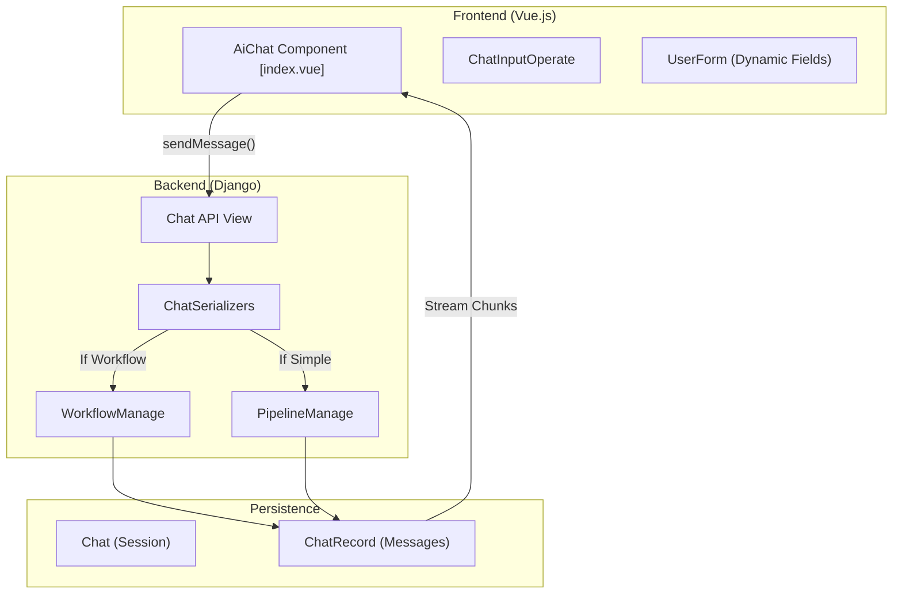
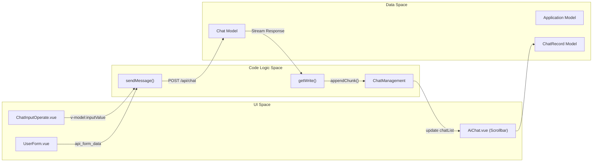

<!-- source: DeepWiki mcp.deepwiki.com · repo 1Panel-dev/MaxKB · page 3 AI Chat System · fetched 2026-10-29 -->

# AI Chat System

Relevant source files

The following files were used as context for generating this wiki page:

- [ui/src/components/ai-chat/component/answer-content/index.vue](ui/src/components/ai-chat/component/answer-content/index.vue)
- [ui/src/components/ai-chat/component/chat-input-operate/TouchChat.vue](ui/src/components/ai-chat/component/chat-input-operate/TouchChat.vue)
- [ui/src/components/ai-chat/component/chat-input-operate/index.vue](ui/src/components/ai-chat/component/chat-input-operate/index.vue)
- [ui/src/components/ai-chat/component/operation-button/ChatOperationButton.vue](ui/src/components/ai-chat/component/operation-button/ChatOperationButton.vue)
- [ui/src/components/ai-chat/component/operation-button/LogOperationButton.vue](ui/src/components/ai-chat/component/operation-button/LogOperationButton.vue)
- [ui/src/components/ai-chat/component/operation-button/MobileVoteReasonDrawer.vue](ui/src/components/ai-chat/component/operation-button/MobileVoteReasonDrawer.vue)
- [ui/src/components/ai-chat/component/operation-button/VoteReasonContent.vue](ui/src/components/ai-chat/component/operation-button/VoteReasonContent.vue)
- [ui/src/components/ai-chat/component/operation-button/index.vue](ui/src/components/ai-chat/component/operation-button/index.vue)
- [ui/src/components/ai-chat/component/prologue-content/index.vue](ui/src/components/ai-chat/component/prologue-content/index.vue)
- [ui/src/components/ai-chat/component/question-content/index.vue](ui/src/components/ai-chat/component/question-content/index.vue)
- [ui/src/components/ai-chat/component/user-form/index.vue](ui/src/components/ai-chat/component/user-form/index.vue)
- [ui/src/components/ai-chat/index.scss](ui/src/components/ai-chat/index.scss)
- [ui/src/components/ai-chat/index.vue](ui/src/components/ai-chat/index.vue)
- [ui/src/components/app-icon/icons/application.ts](ui/src/components/app-icon/icons/application.ts)
- [ui/src/views/application-workflow/component/PublishHistory.vue](ui/src/views/application-workflow/component/PublishHistory.vue)
- [ui/src/views/application-workflow/index.vue](ui/src/views/application-workflow/index.vue)
- [ui/src/views/application/component/CopyApplicationDialog.vue](ui/src/views/application/component/CopyApplicationDialog.vue)
- [ui/src/views/application/component/CreateApplicationDialog.vue](ui/src/views/application/component/CreateApplicationDialog.vue)
- [ui/src/views/chat/component/EditTitleDialog.vue](ui/src/views/chat/component/EditTitleDialog.vue)
- [ui/src/views/chat/component/HistoryPanel.vue](ui/src/views/chat/component/HistoryPanel.vue)
- [ui/src/views/chat/embed/component/ChatHistoryDrawer.vue](ui/src/views/chat/embed/component/ChatHistoryDrawer.vue)
- [ui/src/views/chat/embed/index.vue](ui/src/views/chat/embed/index.vue)
- [ui/src/views/chat/mobile/component/ChatHistoryDrawer.vue](ui/src/views/chat/mobile/component/ChatHistoryDrawer.vue)
- [ui/src/views/chat/mobile/component/ResetPasswordDrawer.vue](ui/src/views/chat/mobile/component/ResetPasswordDrawer.vue)
- [ui/src/views/chat/mobile/component/UserCenterDrawer.vue](ui/src/views/chat/mobile/component/UserCenterDrawer.vue)
- [ui/src/views/chat/mobile/index.vue](ui/src/views/chat/mobile/index.vue)
- [ui/src/views/chat/pc/index.vue](ui/src/views/chat/pc/index.vue)
- [ui/src/workflow/nodes/base-node/component/FileUploadSettingDialog.vue](ui/src/workflow/nodes/base-node/component/FileUploadSettingDialog.vue)

The AI Chat System is the core interaction layer of MaxKB, providing a comprehensive interface for users to communicate with AI agents. It manages the entire conversational lifecycle, from capturing multi-modal user input to rendering real-time streaming responses from various Large Language Models (LLMs).

## System Overview

The system is architected to handle both simple RAG (Retrieval-Augmented Generation) flows and complex, multi-step workflows. It supports a variety of interaction modes, including standard PC web views, mobile-responsive interfaces, and embedded chat widgets for third-party websites.

### Core Interaction Flow

Sources:
- [ui/src/components/ai-chat/index.vue:1-91]()
- [ui/src/components/ai-chat/index.vue:423-525]()
- [ui/src/views/chat/pc/index.vue:165-181]()

## Key Capabilities

### 1. Chat Interface Components
The system utilizes a modular component architecture. The primary container is the `AiChat` component, which orchestrates sub-components like `QuestionContent` for user messages and `AnswerContent` for AI responses. It also manages the `UserForm` for capturing structured data required by specific application workflows.

For details, see [Chat Interface Components](#3.1).

### 2. Message Processing and Streaming
MaxKB implements a robust streaming architecture. The frontend uses a `getWrite` function to process `ReadableStream` data from the backend. Chunks are buffered and parsed (typically as JSON objects prefixed with `data:`) to provide real-time feedback, including reasoning steps and final answers.

For details, see [Chat Message Processing and Streaming](#3.2).

### 3. Multi-Platform Support
The chat system is designed for "write once, run anywhere" capability. It provides dedicated views for different environments:
- **PC View**: A full-featured desktop interface with history panels and detailed execution logs.
- **Mobile View**: A touch-optimized interface with drawer-based history.
- **Embedded View**: A lightweight version designed to be integrated into external sites via iframes or scripts.

For details, see [Chat Views and Multi-Platform Support](#3.3).

### 4. History and Session Management
Conversations are organized into sessions (`Chat`). Each session contains multiple `ChatRecord` entries. The system supports paginated history retrieval, session clearing, and the ability to rename or delete specific conversations.

For details, see [Chat History and Session Management](#3.4).

### 5. Multi-Modal Input & STT
Beyond text, the system supports:
- **File Uploads**: Images, documents (PDF, DOCX), and audio/video files can be attached to messages.
- **Speech-to-Text (STT)**: Users can record voice messages which are transcribed in real-time using the `RecorderManage` class and sent as text queries.

For details, see [File Upload and Speech-to-Text](#3.5).

## Component Hierarchy and Data Flow

The following diagram illustrates how system components map to specific code entities and how data flows between them during a typical chat interaction.

Sources:
- [ui/src/components/ai-chat/index.vue:343-413]()
- [ui/src/components/ai-chat/component/chat-input-operate/index.vue:10-135]()
- [ui/src/components/ai-chat/component/user-form/index.vue:18-36]()

## Detailed Sub-Pages

| Section | Topic | Description |
|:---|:---|:---|
| [Chat Interface Components](#3.1) | **Chat Components** | Details on `AiChat`, `QuestionContent`, `AnswerContent`, and `UserForm`. |
| [Chat Message Processing and Streaming](#3.2) | **Streaming Logic** | Deep dive into `getWrite`, chunk parsing, and reasoning content rendering. |
| [Chat Views and Multi-Platform Support](#3.3) | **Views & Platforms** | Implementation of PC, Mobile, and Embed views. |
| [Chat History and Session Management](#3.4) | **History & Sessions** | Backend session management and frontend history panels. |
| [File Upload and Speech-to-Text](#3.5) | **Files & Voice** | File upload logic and `RecorderManage` for voice input. |

Sources:
- [ui/src/views/chat/pc/index.vue:1-22]()
- [ui/src/views/chat/mobile/index.vue:1-20]()
- [ui/src/views/chat/embed/index.vue:1-21]()

---

