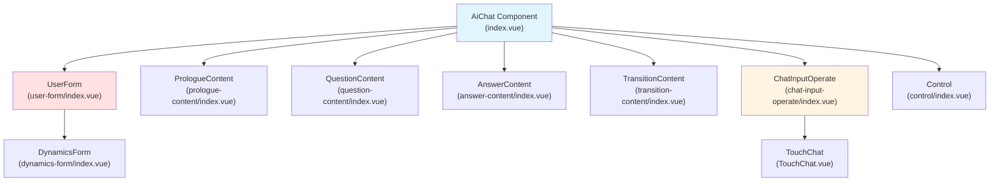
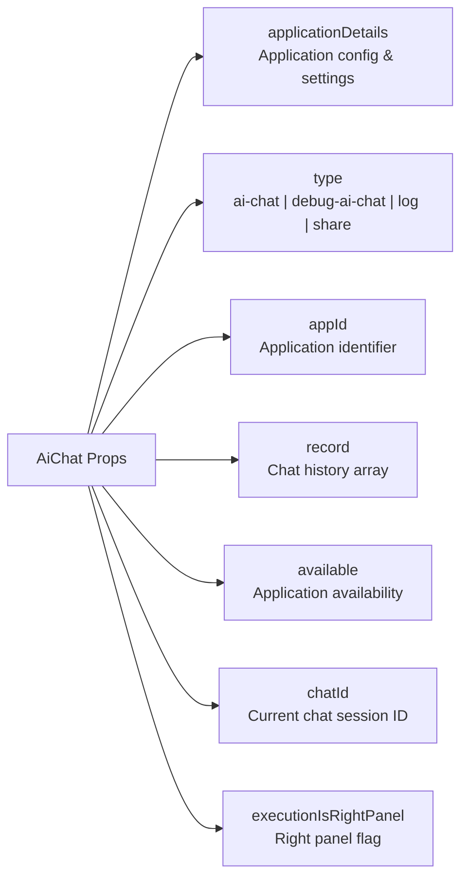
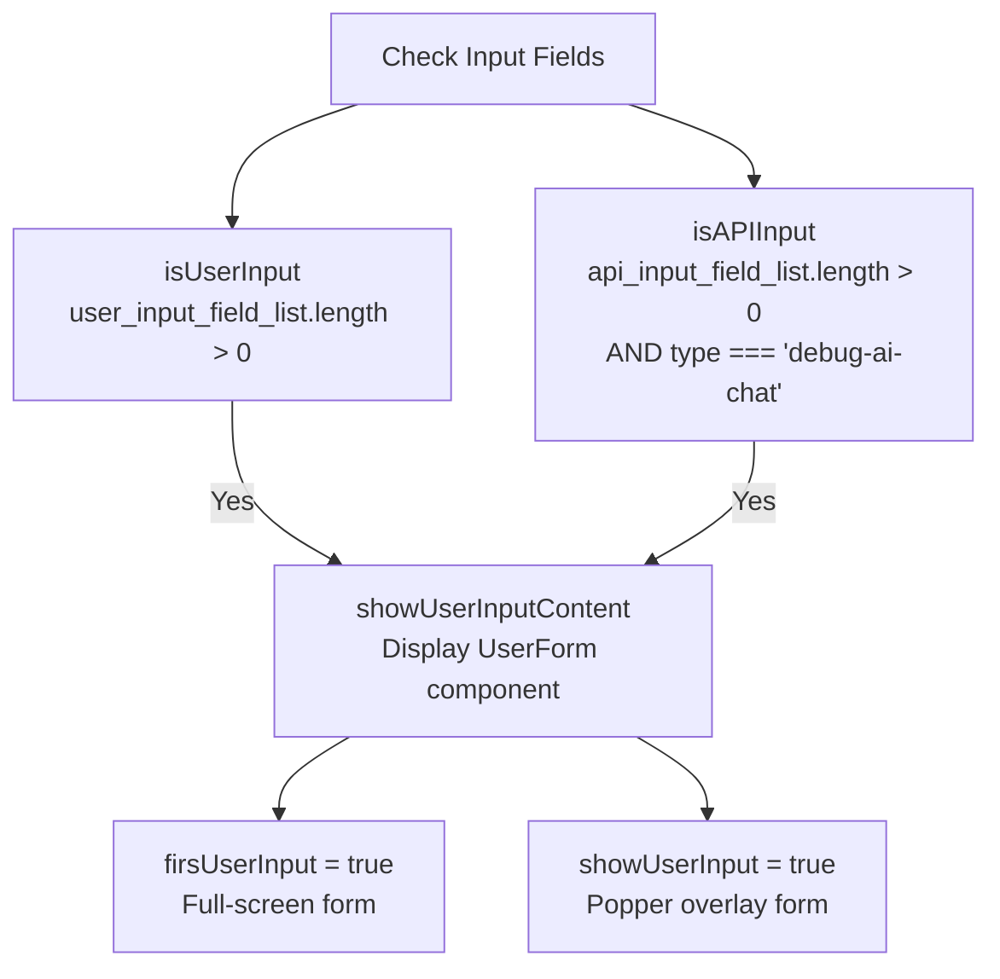

<!-- source: DeepWiki mcp.deepwiki.com · repo 1Panel-dev/MaxKB · page 3.1 Chat Interface Components · fetched 2026-10-29 -->

# Chat Interface Components

Relevant source files

The following files were used as context for generating this wiki page:

- [apps/application/flow/step_node/form_node/i_form_node.py](apps/application/flow/step_node/form_node/i_form_node.py)
- [ui/src/components/ai-chat/component/answer-content/index.vue](ui/src/components/ai-chat/component/answer-content/index.vue)
- [ui/src/components/ai-chat/component/chat-input-operate/TouchChat.vue](ui/src/components/ai-chat/component/chat-input-operate/TouchChat.vue)
- [ui/src/components/ai-chat/component/chat-input-operate/index.vue](ui/src/components/ai-chat/component/chat-input-operate/index.vue)
- [ui/src/components/ai-chat/component/operation-button/ChatOperationButton.vue](ui/src/components/ai-chat/component/operation-button/ChatOperationButton.vue)
- [ui/src/components/ai-chat/component/operation-button/LogOperationButton.vue](ui/src/components/ai-chat/component/operation-button/LogOperationButton.vue)
- [ui/src/components/ai-chat/component/operation-button/MobileVoteReasonDrawer.vue](ui/src/components/ai-chat/component/operation-button/MobileVoteReasonDrawer.vue)
- [ui/src/components/ai-chat/component/operation-button/VoteReasonContent.vue](ui/src/components/ai-chat/component/operation-button/VoteReasonContent.vue)
- [ui/src/components/ai-chat/component/operation-button/index.vue](ui/src/components/ai-chat/component/operation-button/index.vue)
- [ui/src/components/ai-chat/component/prologue-content/index.vue](ui/src/components/ai-chat/component/prologue-content/index.vue)
- [ui/src/components/ai-chat/component/question-content/index.vue](ui/src/components/ai-chat/component/question-content/index.vue)
- [ui/src/components/ai-chat/component/user-form/index.vue](ui/src/components/ai-chat/component/user-form/index.vue)
- [ui/src/components/ai-chat/index.scss](ui/src/components/ai-chat/index.scss)
- [ui/src/components/ai-chat/index.vue](ui/src/components/ai-chat/index.vue)
- [ui/src/components/app-icon/icons/application.ts](ui/src/components/app-icon/icons/application.ts)
- [ui/src/components/markdown/EchartsRander.vue](ui/src/components/markdown/EchartsRander.vue)
- [ui/src/components/markdown/FormRander.vue](ui/src/components/markdown/FormRander.vue)
- [ui/src/components/markdown/HtmlRander.vue](ui/src/components/markdown/HtmlRander.vue)
- [ui/src/components/markdown/IframeRender.vue](ui/src/components/markdown/IframeRender.vue)
- [ui/src/components/markdown/MdRenderer.vue](ui/src/components/markdown/MdRenderer.vue)
- [ui/src/components/markdown/tool-calls-render/content/index.vue](ui/src/components/markdown/tool-calls-render/content/index.vue)
- [ui/src/components/markdown/tool-calls-render/content/simple-tool-calls/index.vue](ui/src/components/markdown/tool-calls-render/content/simple-tool-calls/index.vue)
- [ui/src/components/markdown/tool-calls-render/index.ts](ui/src/components/markdown/tool-calls-render/index.ts)
- [ui/src/components/markdown/tool-calls-render/index.vue](ui/src/components/markdown/tool-calls-render/index.vue)
- [ui/src/locales/lang/en-US/ai-chat.ts](ui/src/locales/lang/en-US/ai-chat.ts)
- [ui/src/locales/lang/en-US/common.ts](ui/src/locales/lang/en-US/common.ts)
- [ui/src/locales/lang/zh-CN/ai-chat.ts](ui/src/locales/lang/zh-CN/ai-chat.ts)
- [ui/src/locales/lang/zh-CN/common.ts](ui/src/locales/lang/zh-CN/common.ts)
- [ui/src/locales/lang/zh-Hant/ai-chat.ts](ui/src/locales/lang/zh-Hant/ai-chat.ts)
- [ui/src/locales/lang/zh-Hant/common.ts](ui/src/locales/lang/zh-Hant/common.ts)
- [ui/src/views/knowledge-workflow/component/action/KnowledgeBase.vue](ui/src/views/knowledge-workflow/component/action/KnowledgeBase.vue)
- [ui/src/workflow/nodes/base-node/component/FileUploadSettingDialog.vue](ui/src/workflow/nodes/base-node/component/FileUploadSettingDialog.vue)
- [ui/src/workflow/nodes/base-node/component/UserInputFieldTable.vue](ui/src/workflow/nodes/base-node/component/UserInputFieldTable.vue)
- [ui/src/workflow/nodes/base-node/component/UserInputTitleDialog.vue](ui/src/workflow/nodes/base-node/component/UserInputTitleDialog.vue)
- [ui/src/workflow/nodes/knowledge-base-node/component/UserInputFieldTable.vue](ui/src/workflow/nodes/knowledge-base-node/component/UserInputFieldTable.vue)

## Purpose and Scope

This document details the Vue.js components that comprise the chat interface in MaxKB. The chat interface is the primary interaction point where users communicate with AI applications. This page covers the component architecture, sub-components, props/events, and integration patterns across PC, mobile, and embedded views.

---

## Component Architecture Overview

The chat interface is built around a central `AiChat` component that orchestrates multiple sub-components to provide a complete chat experience. The component supports three distinct modes: standard chat (`ai-chat`), debug mode (`debug-ai-chat`), and read-only log mode (`log`).

### Component Hierarchy

**Sources:** [ui/src/components/ai-chat/index.vue:1-160](), [ui/src/components/ai-chat/component/chat-input-operate/index.vue:1-210](), [ui/src/components/ai-chat/component/answer-content/index.vue:1-117]()

---

## AiChat Component

The `AiChat` component is the root component that manages the entire chat interface lifecycle, including message rendering, user input handling, and API communication.

### Component Types and Modes

The component supports operational modes controlled by the `type` prop:

| Type | Purpose | Read-Only | Shows Input |
|------|---------|-----------|-------------|
| `ai-chat` | Standard user chat | No | Yes |
| `debug-ai-chat` | Workflow debugging | No | Yes |
| `log` | View historical logs | Yes | No |
| `share` | Shared chat record | Yes | No |

**Sources:** [ui/src/components/ai-chat/index.vue:156-167]()

### Key Props and Configuration

**Sources:** [ui/src/components/ai-chat/index.vue:153-168]()

### User Input Field Handling

The component handles external parameters defined in the application's workflow (usually in the `base-node`). These are rendered using the `UserForm` component.

**Sources:** [ui/src/components/ai-chat/index.vue:10-83](), [ui/src/workflow/nodes/base-node/component/UserInputFieldTable.vue:107-128]()

---

## Sub-Components

### QuestionContent

Renders user questions and uploaded media. It supports inline editing for the last message in a conversation.

- **Media Support:** Displays `document_list`, `image_list`, `audio_list`, `video_list`, and `other_list`.
- **Interaction:** Provides a download interface for files [ui/src/components/ai-chat/component/question-content/index.vue:10-23]().
- **Editing:** Allows re-editing and re-sending the question via an `el-input` textarea [ui/src/components/ai-chat/component/question-content/index.vue:100-110]().

**Sources:** [ui/src/components/ai-chat/component/question-content/index.vue:1-166]()

### AnswerContent

Displays AI responses with support for streaming, Markdown rendering, and knowledge attribution.

- **Streaming Progress:** Displays the currently executing node type and name while the answer is being generated [ui/src/components/ai-chat/component/answer-content/index.vue:129-137]().
- **Markdown Rendering:** Uses `MdRenderer` to display content, including reasoning content for specific models [ui/src/components/ai-chat/component/answer-content/index.vue:44-54]().
- **Knowledge Attribution:** Integrates `KnowledgeSourceComponent` to show which segments were cited [ui/src/components/ai-chat/component/answer-content/index.vue:63-73]().
- **Operations:** Includes `OperationButton` for feedback and text-to-speech [ui/src/components/ai-chat/component/answer-content/index.vue:86-95]().

**Sources:** [ui/src/components/ai-chat/component/answer-content/index.vue:1-117]()

### ChatInputOperate

The primary input interface for the user, handling text, files, and voice.

- **File Management:** Manages lists for documents, images, audio, and video before sending [ui/src/components/ai-chat/component/chat-input-operate/index.vue:12-22]().
- **Stop Response:** Provides a button to stop the current AI generation [ui/src/components/ai-chat/component/chat-input-operate/index.vue:3-8]().
- **Voice Interaction:** Integrates `TouchChat` for mobile voice recording [ui/src/components/ai-chat/component/chat-input-operate/TouchChat.vue]().

**Sources:** [ui/src/components/ai-chat/component/chat-input-operate/index.vue:1-210]()

### ChatOperationButton

Located within the `AnswerContent`, this component provides per-message actions.

- **TTS Control:** Play/Pause audio playback of the response [ui/src/components/ai-chat/component/operation-button/ChatOperationButton.vue:9-38]().
- **Feedback:** Thumbs up (like) and Thumbs down (oppose) buttons with reason collection via `VoteReasonContent` [ui/src/components/ai-chat/component/operation-button/ChatOperationButton.vue:63-138]().
- **Utilities:** Copy to clipboard and regenerate response [ui/src/components/ai-chat/component/operation-button/ChatOperationButton.vue:41-54]().

**Sources:** [ui/src/components/ai-chat/component/operation-button/ChatOperationButton.vue:1-156]()

---

## Data Flow and Integration

### User Input Configuration

The `base-node` in the workflow defines what external parameters are exposed to the chat interface. These are managed in the `UserInputFieldTable`.

| Entity | Code Reference | Description |
|--------|----------------|-------------|
| **Field List** | `nodeModel.properties.user_input_field_list` | The array of defined input fields. |
| **Field Config** | `inputFieldConfig` | UI metadata like titles and menu labels. |
| **Exposed Fields** | `user_input_field_list_setting.exposed_fields` | Fields currently visible in the chat UI. |

**Sources:** [ui/src/workflow/nodes/base-node/component/UserInputFieldTable.vue:18-51](), [ui/src/workflow/nodes/base-node/component/UserInputFieldTable.vue:107-128]()

### Internationalization (i18n)

The chat interface relies on localized strings for placeholders, tips, and operation labels.

- **Placeholders:** `aiChat.inputPlaceholder.default` ("Type your question") [ui/src/locales/lang/en-US/ai-chat.ts:74]().
- **Status Tips:** `aiChat.tip.answerLoading` ("Generating Response") [ui/src/locales/lang/en-US/ai-chat.ts:58]().
- **Operations:** `aiChat.operation.stopChat` ("Stop Response") [ui/src/locales/lang/en-US/ai-chat.ts:38]().

**Sources:** [ui/src/locales/lang/en-US/ai-chat.ts:1-152](), [ui/src/locales/lang/zh-CN/ai-chat.ts:1-150]()

### Scroll Management

`AiChat` uses `el-scrollbar` to manage the message list. It includes a "Back to Bottom" button (`back-bottom-button`) that appears when the user scrolls up [ui/src/components/ai-chat/index.vue:164-168]().

**Sources:** [ui/src/components/ai-chat/index.vue:85-91]()

---

