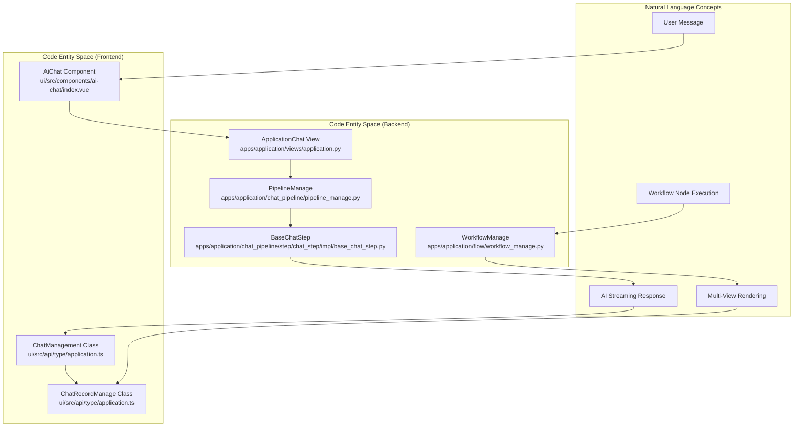
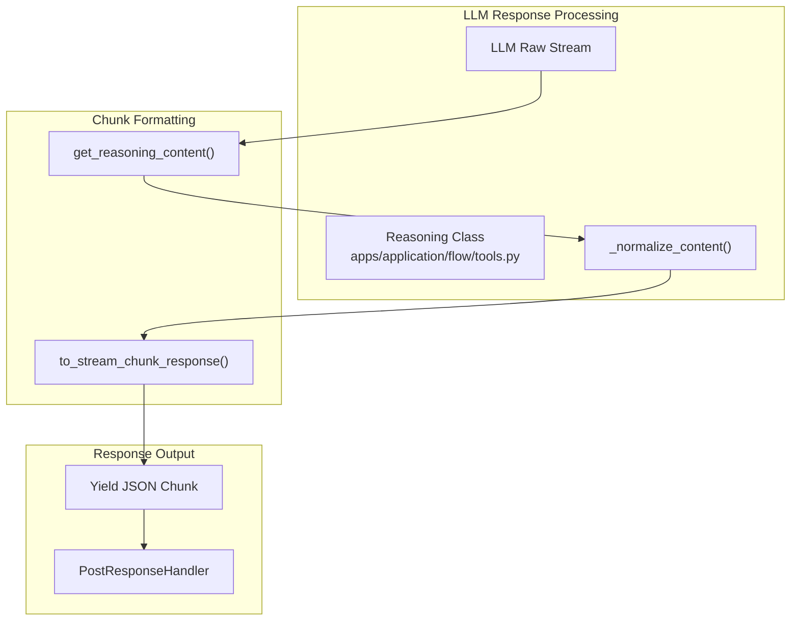
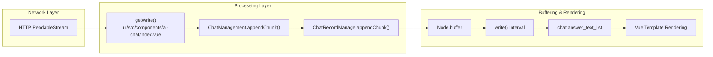

<!-- source: DeepWiki mcp.deepwiki.com · repo 1Panel-dev/MaxKB · page 3.2 Chat Message Processing and Streaming · fetched 2026-10-29 -->

# Chat Message Processing and Streaming

Relevant source files

The following files were used as context for generating this wiki page:

- [apps/application/api/application_api.py](apps/application/api/application_api.py)
- [apps/application/chat_pipeline/step/chat_step/i_chat_step.py](apps/application/chat_pipeline/step/chat_step/i_chat_step.py)
- [apps/application/chat_pipeline/step/chat_step/impl/base_chat_step.py](apps/application/chat_pipeline/step/chat_step/impl/base_chat_step.py)
- [apps/application/flow/i_step_node.py](apps/application/flow/i_step_node.py)
- [apps/application/flow/step_node/ai_chat_step_node/i_chat_node.py](apps/application/flow/step_node/ai_chat_step_node/i_chat_node.py)
- [apps/application/flow/step_node/ai_chat_step_node/impl/base_chat_node.py](apps/application/flow/step_node/ai_chat_step_node/impl/base_chat_node.py)
- [apps/application/flow/step_node/intent_node/impl/base_intent_node.py](apps/application/flow/step_node/intent_node/impl/base_intent_node.py)
- [apps/application/flow/step_node/parameter_extraction_node/impl/base_parameter_extraction_node.py](apps/application/flow/step_node/parameter_extraction_node/impl/base_parameter_extraction_node.py)
- [apps/application/flow/step_node/question_node/i_question_node.py](apps/application/flow/step_node/question_node/i_question_node.py)
- [apps/application/flow/step_node/question_node/impl/base_question_node.py](apps/application/flow/step_node/question_node/impl/base_question_node.py)
- [apps/application/flow/step_node/variable_splitting_node/impl/base_variable_splitting_node.py](apps/application/flow/step_node/variable_splitting_node/impl/base_variable_splitting_node.py)
- [apps/application/flow/tools.py](apps/application/flow/tools.py)
- [apps/application/flow/workflow_manage.py](apps/application/flow/workflow_manage.py)
- [apps/application/long_term_memory/__init__.py](apps/application/long_term_memory/__init__.py)
- [apps/application/models/application.py](apps/application/models/application.py)
- [apps/application/models/application_chat.py](apps/application/models/application_chat.py)
- [apps/application/serializers/application.py](apps/application/serializers/application.py)
- [apps/application/serializers/common.py](apps/application/serializers/common.py)
- [apps/application/urls.py](apps/application/urls.py)
- [apps/application/views/__init__.py](apps/application/views/__init__.py)
- [apps/application/views/application.py](apps/application/views/application.py)
- [apps/chat/api/chat_api.py](apps/chat/api/chat_api.py)
- [apps/chat/serializers/chat.py](apps/chat/serializers/chat.py)
- [apps/chat/serializers/chat_record.py](apps/chat/serializers/chat_record.py)
- [apps/chat/urls.py](apps/chat/urls.py)
- [apps/chat/views/chat.py](apps/chat/views/chat.py)
- [apps/chat/views/chat_record.py](apps/chat/views/chat_record.py)
- [apps/knowledge/task/handler.py](apps/knowledge/task/handler.py)
- [apps/maxkb/settings/auth/model.py](apps/maxkb/settings/auth/model.py)
- [apps/maxkb/settings/auth/web.py](apps/maxkb/settings/auth/web.py)
- [apps/models_provider/impl/ollama_model_provider/ollama_model_provider.py](apps/models_provider/impl/ollama_model_provider/ollama_model_provider.py)
- [ui/src/api/type/application.ts](ui/src/api/type/application.ts)

This page documents the frontend and backend mechanisms for handling chat message processing and streaming in MaxKB. It details the `ChatManagement` and `ChatRecordManage` classes on the frontend, and the corresponding streaming logic in the backend chat pipeline and workflow engine.

## Overview

MaxKB uses a streaming architecture to provide real-time AI responses. The backend generates chunks of data (including reasoning content, metadata, and node status), which are transmitted via `StreamingHttpResponse`. The frontend buffers these chunks and renders them progressively to ensure a smooth user experience.

### Architecture Bridge: Natural Language to Code Space

This diagram maps the high-level streaming concepts to the specific code entities responsible for their implementation.

**Streaming Architecture Bridge**

Sources: [apps/application/views/application.py:1-100](), [ui/src/api/type/application.ts:122-546](), [apps/application/chat_pipeline/step/chat_step/impl/base_chat_step.py:72-183]()

## Backend Processing and Streaming

### Chat Message Serialization
The `ChatMessageSerializers` class in `apps/chat/serializers/chat.py` defines the structure for incoming chat requests, including the message content, streaming preference, and associated metadata like `chat_record_id` and file lists (`image_list`, `document_list`).

Sources: [apps/chat/serializers/chat.py:74-98]()

### Streaming Response Generation
The backend generates stream chunks using `event_content` in `BaseChatStep`. This function processes the raw response from the LLM, handles reasoning content (thinking process), and yields formatted JSON chunks.

**Backend Streaming Flow**

Sources: [apps/application/chat_pipeline/step/chat_step/impl/base_chat_step.py:72-183](), [apps/application/flow/tools.py:86-167]()

### Reasoning Content Handling
The `Reasoning` class manages "thinking" tags (e.g., ``). It extracts content between these tags and separates it from the final answer content, allowing the frontend to render the reasoning process differently.

Sources: [apps/application/flow/tools.py:86-129](), [apps/application/chat_pipeline/step/chat_step/impl/base_chat_step.py:91-111]()

## Frontend Stream Management

### ChatRecordManage Class
`ChatRecordManage` is the primary class for managing the lifecycle of a single chat record's streaming response. It maintains a buffer and a timer to control the write speed to the UI.

- **Buffering**: Incoming chunks are pushed into `node_list` and their respective `buffer` arrays.
- **Writing**: The `write()` method uses `setInterval` to periodically move content from the buffer to the `answer_text_list` used for rendering.

Sources: [ui/src/api/type/application.ts:122-141](), [ui/src/api/type/application.ts:276-372]()

### Multi-View Content Rendering
MaxKB supports "Multi-View" rendering, where multiple nodes in a workflow can contribute to the same chat response card or separate cards. This is managed via the `answer_text_list` (a 2D array) and the `view_type` attribute in chunks.

| View Type | Description | Implementation |
| :--- | :--- | :--- |
| `single_view` | Each node output is rendered in a new separate card. | Creates a new index in `answer_text_list`. |
| `many_view` | Multiple nodes can append content to the same card. | Appends to the existing array at the current index. |

Sources: [ui/src/api/type/application.ts:71-80](), [ui/src/api/type/application.ts:203-237]()

### Frontend Data Flow Diagram
This diagram maps the data flow from the received HTTP stream to the final UI update.

**Frontend Data Processing**

Sources: [ui/src/components/ai-chat/index.vue:424-469](), [ui/src/api/type/application.ts:392-423](), [ui/src/api/type/application.ts:276-372]()

## Workflow Message Processing

### WorkflowManage and Node Results
In workflow-based applications, `WorkflowManage` coordinates the execution of nodes. Each node (like `BaseChatNode`) can operate in stream or block mode.

- **Stream Mode**: Nodes yield chunks that are collected by `NodeChunkManage`.
- **Context Writing**: After execution, `_write_context` updates the node and workflow variables, including token counts and execution time.

Sources: [apps/application/flow/workflow_manage.py:92-141](), [apps/application/flow/step_node/ai_chat_step_node/impl/base_chat_node.py:51-96]()

### Node Chunk Management
`NodeChunkManage` handles the queuing of chunks from different nodes. It ensures that chunks are popped and sent to the response stream in the correct order, even when multiple nodes are executing.

Sources: [apps/application/flow/workflow_manage.py:54-89]()

## Long-Term Memory Integration
After a chat interaction completes, the system can optionally trigger long-term memory extraction. The `WorkFlowPostHandler` and `PostHandler` classes initiate an asynchronous Celery task (`extract_long_term_memory`) to summarize the conversation and update the user's profile.

Sources: [apps/application/chat_pipeline/step/chat_step/impl/base_chat_step.py:163-173](), [apps/application/flow/i_step_node:106-114](), [apps/application/long_term_memory/__init__.py:216-253]()

---

