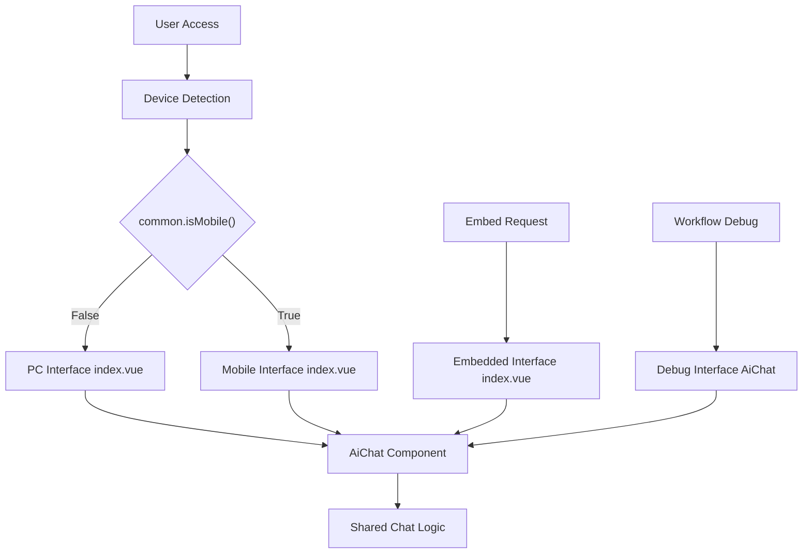
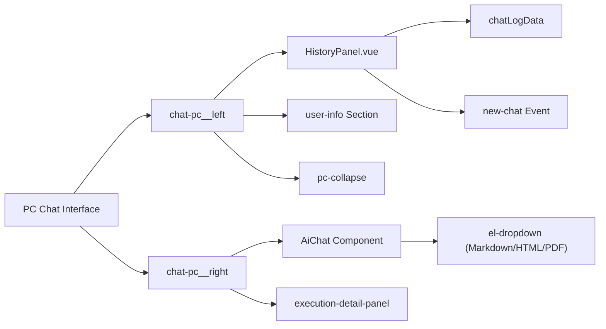

<!-- source: DeepWiki mcp.deepwiki.com · repo 1Panel-dev/MaxKB · page 3.3 Chat Views and Multi-Platform Support · fetched 2026-10-29 -->

# Chat Views and Multi-Platform Support

<details>
<summary>Relevant source files</summary>

The following files were used as context for generating this wiki page:

- [ui/admin.html](ui/admin.html)
- [ui/chat.html](ui/chat.html)
- [ui/env/.env](ui/env/.env)
- [ui/env/.env.chat](ui/env/.env.chat)
- [ui/src/request/chat/index.ts](ui/src/request/chat/index.ts)
- [ui/src/router/chat/index.ts](ui/src/router/chat/index.ts)
- [ui/src/router/chat/routes.ts](ui/src/router/chat/routes.ts)
- [ui/src/views/application-workflow/component/PublishHistory.vue](ui/src/views/application-workflow/component/PublishHistory.vue)
- [ui/src/views/application-workflow/index.vue](ui/src/views/application-workflow/index.vue)
- [ui/src/views/application/component/CopyApplicationDialog.vue](ui/src/views/application/component/CopyApplicationDialog.vue)
- [ui/src/views/application/component/CreateApplicationDialog.vue](ui/src/views/application/component/CreateApplicationDialog.vue)
- [ui/src/views/chat/component/EditTitleDialog.vue](ui/src/views/chat/component/EditTitleDialog.vue)
- [ui/src/views/chat/component/HistoryPanel.vue](ui/src/views/chat/component/HistoryPanel.vue)
- [ui/src/views/chat/embed/component/ChatHistoryDrawer.vue](ui/src/views/chat/embed/component/ChatHistoryDrawer.vue)
- [ui/src/views/chat/embed/index.vue](ui/src/views/chat/embed/index.vue)
- [ui/src/views/chat/mobile/component/ChatHistoryDrawer.vue](ui/src/views/chat/mobile/component/ChatHistoryDrawer.vue)
- [ui/src/views/chat/mobile/component/ResetPasswordDrawer.vue](ui/src/views/chat/mobile/component/ResetPasswordDrawer.vue)
- [ui/src/views/chat/mobile/component/UserCenterDrawer.vue](ui/src/views/chat/mobile/component/UserCenterDrawer.vue)
- [ui/src/views/chat/mobile/index.vue](ui/src/views/chat/mobile/index.vue)
- [ui/src/views/chat/no-service/index.vue](ui/src/views/chat/no-service/index.vue)
- [ui/src/views/chat/pc/index.vue](ui/src/views/chat/pc/index.vue)

</details>


This document covers MaxKB's multi-platform chat interface system, which provides adaptive user interfaces for desktop, mobile, embedded, and debug environments. The system implements responsive design patterns and platform-specific optimizations while maintaining consistent functionality across all views.

For information about the underlying chat message processing and AI integration, see [Chat Message Processing and Streaming (3.2)](). For chat history persistence and session management, see [Chat History and Session Management (3.4)]().

## Overview

MaxKB implements four distinct chat interface views to support different user contexts and device capabilities:

| Interface Type | File Path | Primary Use Case |
|---|---|---|
| PC Interface | [ui/src/views/chat/pc/index.vue]() | Full-featured desktop experience |
| Mobile Interface | [ui/src/views/chat/mobile/index.vue]() | Touch-optimized mobile experience |
| Embedded Interface | [ui/src/views/chat/embed/index.vue]() | Widget for external website integration |
| Debug Interface | [ui/src/views/application-workflow/index.vue]() | Development and testing environment |

All interfaces share the core `AiChat` component while implementing platform-specific layouts, navigation patterns, and interaction models.

## Platform Detection and Routing

The system uses device detection and route parameters to determine the appropriate interface:

**Natural Language to Code Entity Mapping: Platform Routing**


Sources: [ui/src/views/chat/pc/index.vue:95-103](), [ui/src/views/chat/mobile/index.vue:113-115](), [ui/src/router/chat/index.ts:19-42]()

## PC Interface Architecture

The PC interface provides the most comprehensive chat experience with a multi-panel layout. It utilizes the `HistoryPanel` for conversation management and `AiChat` for the primary interaction.

**Natural Language to Code Entity Mapping: PC Layout**


### Layout Management
The PC interface implements responsive layout with a collapsible sidebar and dynamic panel sizing:
- **Sidebar**: Managed by `isPcCollapse` state [ui/src/views/chat/pc/index.vue:99-104]().
- **Right Panel**: Uses a CSS variable `--execution-detail-panel-width` to calculate the chat area width dynamically [ui/src/views/chat/pc/index.vue:110-113]().
- **User Info**: Supports local user profiles and dropdown menus for password reset or logout [ui/src/views/chat/pc/index.vue:38-93]().

Sources: [ui/src/views/chat/pc/index.vue:22-113](), [ui/src/views/chat/pc/index.vue:38-93]()

## Mobile Interface Architecture

The mobile interface adapts the chat experience for touch devices, moving history into a drawer component.

- **Header**: Contains `app-mobile-open-history` icon to trigger the history drawer [ui/src/views/chat/mobile/index.vue:24-30]().
- **Drawer**: Implements `ChatHistoryDrawer` which wraps the shared `HistoryPanel` [ui/src/views/chat/mobile/index.vue:86-98]().
- **Infinite Scroll**: Provided to the history list via `provide('scrollData', loadInfiniteScroll)` [ui/src/views/chat/mobile/index.vue:110-111]().

Sources: [ui/src/views/chat/mobile/index.vue:21-85](), [ui/src/views/chat/mobile/component/ChatHistoryDrawer.vue:1-35]()

## Embedded Interface Architecture

The embedded interface is optimized for integration into third-party sites via iFrames.

- **Branding**: Displays the application icon and name prominently in the header [ui/src/views/chat/embed/index.vue:31-45]().
- **Customization**: Uses `customStyle` computed property to apply `theme_color` and `header_font_color` from the application profile [ui/src/views/chat/embed/index.vue:138-143]().
- **History**: Uses `ChatHistoryDrawer` similar to the mobile view to save space [ui/src/views/chat/embed/index.vue:87-99]().

Sources: [ui/src/views/chat/embed/index.vue:1-102](), [ui/src/views/chat/embed/component/ChatHistoryDrawer.vue:1-83]()

## Debug Interface Integration

The workflow debug interface provides integrated chat testing within the application builder.

- **Toggle**: Triggered by `clickShowDebug` in the workflow editor [ui/src/views/application-workflow/index.vue:41-44]().
- **Container**: `workflow-debug-container` provides a floating chat window [ui/src/views/application-workflow/index.vue:99-100]().
- **Resize**: Supports an `enlarge` state to toggle between standard and expanded views [ui/src/views/application-workflow/index.vue:120-127]().
- **Component**: Directly renders `AiChat` with `type="'debug-ai-chat'"` [ui/src/views/application-workflow/index.vue:137]().

Sources: [ui/src/views/application-workflow/index.vue:99-140]()

## Shared Components and Data Flow

All interfaces utilize the `HistoryPanel` and `AiChat` components, maintaining a consistent data flow pattern.

### Common Data Flow
1. **History Loading**: Components call `chatAPI.pageChat` to populate the conversation list [ui/src/views/chat/pc/index.vue:208-220]().
2. **Record Retrieval**: When a conversation is selected, `chatAPI.pageChatRecord` fetches messages for that specific `currentChatId` [ui/src/views/chat/pc/index.vue:227-234]().
3. **Session State**: `currentChatId` is maintained across components to track the active session [ui/src/views/chat/pc/index.vue:136]().
4. **Pagination**: Managed via `paginationConfig` which tracks `current_page`, `page_size`, and `total` [ui/src/views/chat/pc/index.vue:130-134]().

Sources: [ui/src/views/chat/pc/index.vue:129-234](), [ui/src/views/chat/component/HistoryPanel.vue:58-118]()

## Theme and Customization System

MaxKB allows applications to define their own visual identity, which is injected into the chat views via CSS variables.

| CSS Variable | Source Property | Description |
|---|---|---|
| `--el-color-primary` | `theme_color` | Main brand color |
| `--el-color-primary-light-9` | `hexToRgba(color, 0.1)` | Light background tint |
| `backgroundImage` | `chat_background` | Chat area background image |

Implementation logic:
```javascript
// Example of hex to RGBA conversion for theme variants
hexToRgba(applicationDetail?.custom_theme?.theme_color || '#3370FF', 0.1)
```

Sources: [ui/src/views/chat/pc/index.vue:6-20](), [ui/src/views/chat/mobile/index.vue:4-19](), [ui/src/views/chat/embed/index.vue:5-20]()

## Export Features

The PC interface supports exporting chat history in multiple formats.

- **Markdown**: Iterates through `currentRecordList` to build a string of questions and answers [ui/src/views/chat/pc/index.vue:455-474]().
- **HTML**: Converts Markdown content using the `marked` library [ui/src/views/chat/pc/index.vue:463-470]().
- **PDF**: Handled via `openPDFExport` which triggers a specialized print or PDF generation view [ui/src/views/chat/pc/index.vue:156-158]().

Sources: [ui/src/views/chat/pc/index.vue:144-161](), [ui/src/views/chat/pc/index.vue:455-474]()

---

