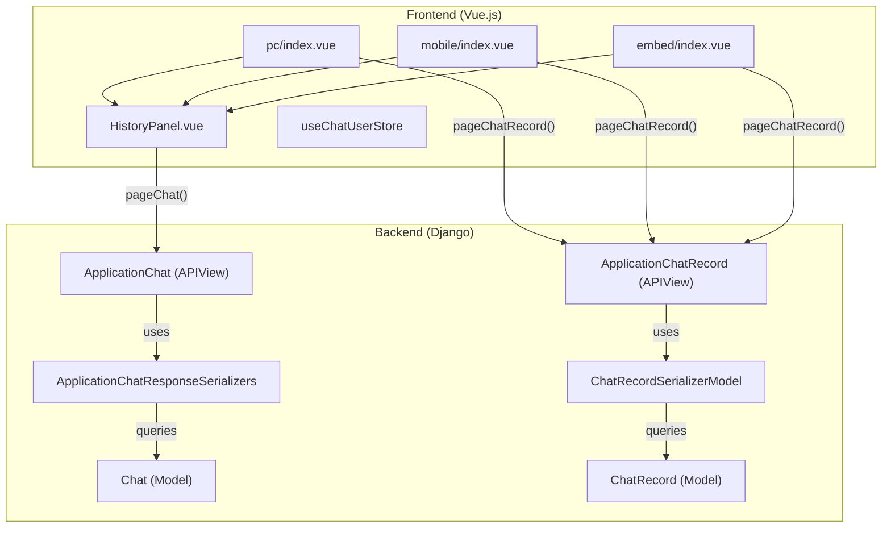
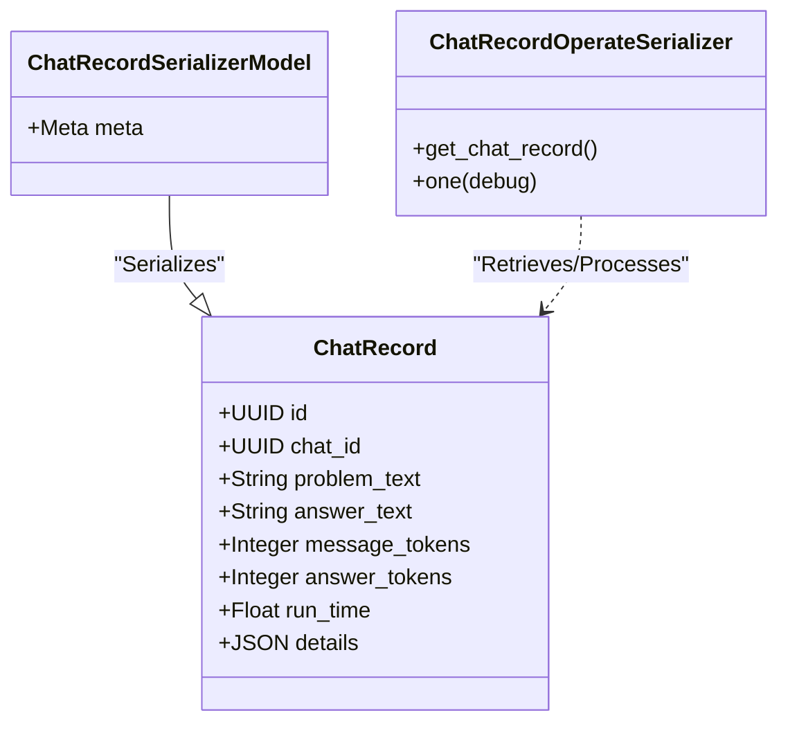

<!-- source: DeepWiki mcp.deepwiki.com · repo 1Panel-dev/MaxKB · page 3.4 Chat History and Session Management · fetched 2026-10-29 -->

# Chat History and Session Management

Relevant source files

The following files were used as context for generating this wiki page:

- [apps/application/api/application_chat.py](apps/application/api/application_chat.py)
- [apps/application/api/application_chat_record.py](apps/application/api/application_chat_record.py)
- [apps/application/serializers/application_chat.py](apps/application/serializers/application_chat.py)
- [apps/application/serializers/application_chat_record.py](apps/application/serializers/application_chat_record.py)
- [apps/application/serializers/application_stats.py](apps/application/serializers/application_stats.py)
- [apps/application/sql/export_application_chat.sql](apps/application/sql/export_application_chat.sql)
- [apps/application/sql/export_application_chat_ee.sql](apps/application/sql/export_application_chat_ee.sql)
- [apps/application/sql/get_token_usage.sql](apps/application/sql/get_token_usage.sql)
- [apps/application/sql/list_application_chat.sql](apps/application/sql/list_application_chat.sql)
- [apps/application/sql/list_application_chat_ee.sql](apps/application/sql/list_application_chat_ee.sql)
- [apps/application/sql/top_questions.sql](apps/application/sql/top_questions.sql)
- [apps/application/views/application_access_token.py](apps/application/views/application_access_token.py)
- [apps/application/views/application_api_key.py](apps/application/views/application_api_key.py)
- [apps/application/views/application_chat.py](apps/application/views/application_chat.py)
- [apps/application/views/application_chat_record.py](apps/application/views/application_chat_record.py)
- [apps/application/views/application_stats.py](apps/application/views/application_stats.py)
- [apps/application/views/application_version.py](apps/application/views/application_version.py)
- [apps/models_provider/impl/aliyun_bai_lian_model_provider/model/ttv.py](apps/models_provider/impl/aliyun_bai_lian_model_provider/model/ttv.py)
- [apps/models_provider/impl/base_chat_open_ai.py](apps/models_provider/impl/base_chat_open_ai.py)
- [apps/models_provider/impl/tencent_model_provider/credential/stt.py](apps/models_provider/impl/tencent_model_provider/credential/stt.py)
- [apps/models_provider/impl/vllm_model_provider/credential/reranker.py](apps/models_provider/impl/vllm_model_provider/credential/reranker.py)
- [apps/models_provider/impl/vllm_model_provider/model/reranker.py](apps/models_provider/impl/vllm_model_provider/model/reranker.py)
- [apps/models_provider/impl/vllm_model_provider/vllm_model_provider.py](apps/models_provider/impl/vllm_model_provider/vllm_model_provider.py)
- [apps/models_provider/impl/xf_model_provider/model/stt.py](apps/models_provider/impl/xf_model_provider/model/stt.py)
- [ui/src/components/select-knowledge-document/index.vue](ui/src/components/select-knowledge-document/index.vue)
- [ui/src/locales/lang/en-US/views/chat-log.ts](ui/src/locales/lang/en-US/views/chat-log.ts)
- [ui/src/locales/lang/zh-CN/views/chat-log.ts](ui/src/locales/lang/zh-CN/views/chat-log.ts)
- [ui/src/locales/lang/zh-Hant/views/chat-log.ts](ui/src/locales/lang/zh-Hant/views/chat-log.ts)
- [ui/src/views/application-workflow/component/PublishHistory.vue](ui/src/views/application-workflow/component/PublishHistory.vue)
- [ui/src/views/application-workflow/index.vue](ui/src/views/application-workflow/index.vue)
- [ui/src/views/application/component/CopyApplicationDialog.vue](ui/src/views/application/component/CopyApplicationDialog.vue)
- [ui/src/views/application/component/CreateApplicationDialog.vue](ui/src/views/application/component/CreateApplicationDialog.vue)
- [ui/src/views/chat-log/component/ChatRecordDrawer.vue](ui/src/views/chat-log/component/ChatRecordDrawer.vue)
- [ui/src/views/chat-log/component/EditContentDialog.vue](ui/src/views/chat-log/component/EditContentDialog.vue)
- [ui/src/views/chat-log/index.vue](ui/src/views/chat-log/index.vue)
- [ui/src/views/chat/component/EditTitleDialog.vue](ui/src/views/chat/component/EditTitleDialog.vue)
- [ui/src/views/chat/component/HistoryPanel.vue](ui/src/views/chat/component/HistoryPanel.vue)
- [ui/src/views/chat/embed/component/ChatHistoryDrawer.vue](ui/src/views/chat/embed/component/ChatHistoryDrawer.vue)
- [ui/src/views/chat/embed/index.vue](ui/src/views/chat/embed/index.vue)
- [ui/src/views/chat/mobile/component/ChatHistoryDrawer.vue](ui/src/views/chat/mobile/component/ChatHistoryDrawer.vue)
- [ui/src/views/chat/mobile/component/ResetPasswordDrawer.vue](ui/src/views/chat/mobile/component/ResetPasswordDrawer.vue)
- [ui/src/views/chat/mobile/component/UserCenterDrawer.vue](ui/src/views/chat/mobile/component/UserCenterDrawer.vue)
- [ui/src/views/chat/mobile/index.vue](ui/src/views/chat/mobile/index.vue)
- [ui/src/views/chat/pc/index.vue](ui/src/views/chat/pc/index.vue)

This document covers the chat history and session management system in MaxKB, which handles conversation persistence, session state management, conversation pagination, and history panel functionality across all chat interfaces.

## Overview

The chat history system manages conversation sessions and provides persistent storage for chat interactions. It includes history panel UI components, session switching capabilities, pagination for long conversations, and export functionality. The system works consistently across PC, mobile, and embedded chat interfaces.

**Key Components:**
- **Session Management**: Handling lifecycle from temporary "new" states to persistent database records.
- **History Panels**: UI components (`HistoryPanel.vue`, `ChatHistoryDrawer.vue`) for navigating past sessions.
- **Pagination**: Efficiently loading message history using scroll-based triggers.
- **Log Management**: Backend serialization and storage of chat records, including metadata for performance (tokens, run time).

Sources: [ui/src/views/chat/pc/index.vue:1-94](), [ui/src/views/chat/component/HistoryPanel.vue:1-123](), [apps/application/serializers/application_chat_record.py:35-41]()

## System Architecture

### Chat Session Data Flow

The following diagram illustrates the flow from the frontend chat interfaces to the backend storage and retrieval logic.

Sources: [ui/src/views/chat/pc/index.vue:24-37](), [ui/src/views/chat/mobile/index.vue:108-111](), [apps/application/views/application_chat_record.py:26-50](), [apps/application/serializers/application_chat.py:34-45]()

### Chat Record Entity Space

This diagram bridges the code entities involved in representing a single conversation turn (ChatRecord).

Sources: [apps/application/serializers/application_chat_record.py:35-41](), [apps/application/serializers/application_chat_record.py:44-88]()

## Chat Session Management

### History Panel and Drawers

The `HistoryPanel` is the core component for session navigation. In mobile and embedded views, this functionality is wrapped in a `ChatHistoryDrawer`.

- **PC History**: Persistent left sidebar in `pc/index.vue` [ui/src/views/chat/pc/index.vue:23-94]().
- **Mobile/Embed History**: Uses `ChatHistoryDrawer.vue` which implements an `el-drawer` to save screen space [ui/src/views/chat/mobile/index.vue:86-98](), [ui/src/views/chat/embed/index.vue:87-99]().

**Key Functions:**
- `newChat()`: Resets the local state `currentChatId` to `'new'` and clears `currentRecordList` [ui/src/views/chat/pc/index.vue:356-373]().
- `clearChat()`: Invokes `chatAPI.clearChat` to remove all history for the current user/application context [ui/src/views/chat/mobile/index.vue:152-162]().
- `deleteLog(row)`: Removes a specific session from the list and resets the view if the deleted session was active [ui/src/views/chat/pc/index.vue:425-440]().

Sources: [ui/src/views/chat/component/HistoryPanel.vue:1-123](), [ui/src/views/chat/mobile/index.vue:152-200](), [ui/src/views/chat/pc/index.vue:425-440]()

### Session State Tracking

Conversations are tracked using a combination of local reactive state and backend persistence:
- **`currentChatId`**: A reactive string. Defaults to `'new'` for unsaved sessions [ui/src/views/chat/pc/index.vue:305]().
- **`chatLogData`**: An array of objects representing the list of historical sessions (abstracts) [ui/src/views/chat/pc/index.vue:301]().
- **`currentRecordList`**: An array containing the message pairs (Question/Answer) for the active session [ui/src/views/chat/pc/index.vue:304]().

Sources: [ui/src/views/chat/pc/index.vue:301-305](), [ui/src/views/chat/mobile/index.vue:135-137]()

## Conversation Pagination

To handle long conversation histories without performance degradation, MaxKB implements infinite scrolling and backend pagination.

### Implementation Logic
1. **Initial Load**: When a session is selected, `getChatRecord()` fetches the first page of messages (default size 20) [ui/src/views/chat/pc/index.vue:398-423]().
2. **Scroll Trigger**: The `AiChat` component emits a `scroll` event. The parent view's `handleScroll` function checks if `scrollTop === 0` (user reached the top) [ui/src/views/chat/pc/index.vue:342-354]().
3. **Incremental Loading**: If more records exist (`paginationConfig.total > currentRecordList.length`), `paginationConfig.current_page` is incremented, and `getChatRecord()` is called again [ui/src/views/chat/pc/index.vue:348-353]().

### Backend Pagination
The `ApplicationChatRecord.Page` view handles paginated requests, utilizing `ApplicationChatRecordQuerySerializers` to return a subset of `ChatRecord` entries [apps/application/views/application_chat_record.py:52-78]().

Sources: [ui/src/views/chat/pc/index.vue:342-354](), [ui/src/views/chat/pc/index.vue:398-423](), [apps/application/views/application_chat_record.py:52-78]()

## Chat Log Management

The "Chat Log" interface (distinct from the end-user chat history) allows administrators to audit and manage conversations across the application.

### Search and Filtering
The log interface provides complex filtering capabilities:
- **Time Range**: Filter by `history_day` (7 days, 30 days, or custom range) [ui/src/views/chat-log/index.vue:26-45]().
- **Content Search**: Search by session abstract or username [ui/src/views/chat-log/index.vue:9-25]().
- **Feedback Filter**: Filter sessions based on user feedback (likes/stars and dislikes/tramples) using `min_star` and `min_trample` parameters [ui/src/views/chat-log/index.vue:86-149]().

### Backend Query Logic
The `ApplicationChatQuerySerializers` constructs dynamic SQL/ORM queries based on these filters. It handles logic for `and/or` comparisons between star and trample counts [apps/application/serializers/application_chat.py:113-130]().

Sources: [ui/src/views/chat-log/index.vue:1-186](), [apps/application/serializers/application_chat.py:52-134]()

## Export and Knowledge Integration

### Data Export
Users can export individual sessions from the PC interface in multiple formats:
- **Markdown**: `exportMarkdown()` iterates through `currentRecordList` to build a text file [ui/src/views/chat/pc/index.vue:455-463]().
- **HTML**: `exportHTML()` converts markdown content to HTML using the `marked` library [ui/src/views/chat/pc/index.vue:465-474]().

### Adding to Knowledge Base
Administrators can select specific chat records from the log and add them to a knowledge base. This process uses the `ApplicationChatRecordAddKnowledge` API, which maps chat records to `Paragraph` and `Problem` models [apps/application/views/application_chat_record.py:111-131](), [ui/src/views/chat-log/index.vue:54-60]().

Sources: [ui/src/views/chat/pc/index.vue:455-474](), [apps/application/views/application_chat_record.py:111-131](), [ui/src/views/chat-log/index.vue:54-60]()

---

