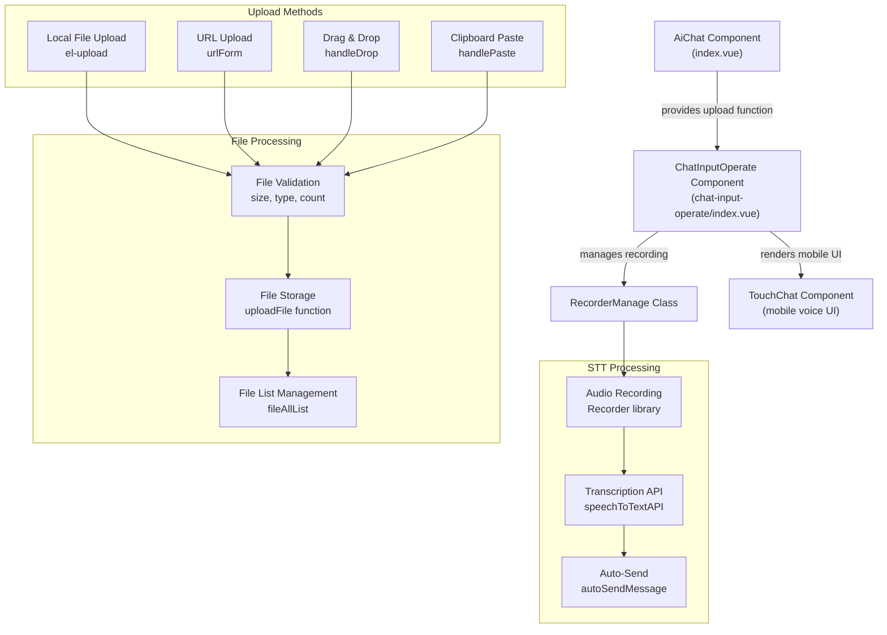
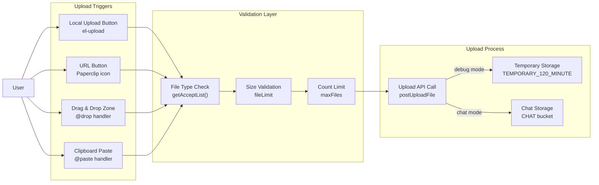
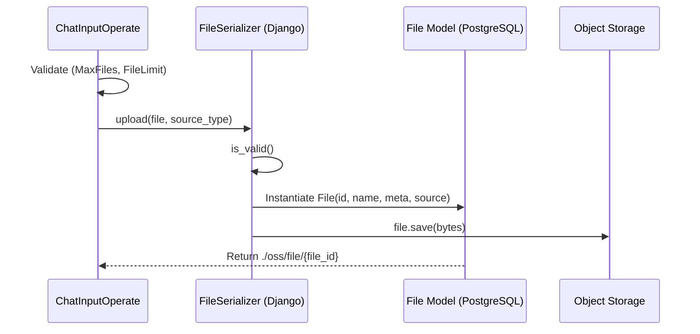
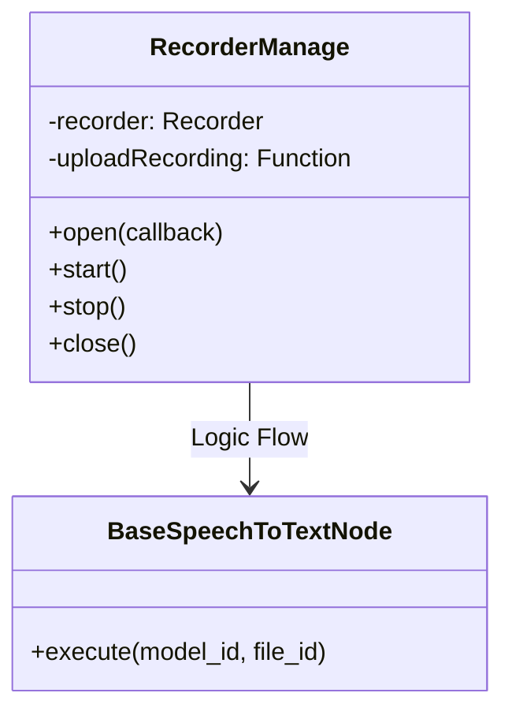

<!-- source: DeepWiki mcp.deepwiki.com · repo 1Panel-dev/MaxKB · page 3.5 File Upload and Speech-to-Text · fetched 2026-10-29 -->

# File Upload and Speech-to-Text

<details>
<summary>Relevant source files</summary>

The following files were used as context for generating this wiki page:

- [apps/application/flow/step_node/document_extract_node/i_document_extract_node.py](apps/application/flow/step_node/document_extract_node/i_document_extract_node.py)
- [apps/application/flow/step_node/document_extract_node/impl/base_document_extract_node.py](apps/application/flow/step_node/document_extract_node/impl/base_document_extract_node.py)
- [apps/application/flow/step_node/image_generate_step_node/i_image_generate_node.py](apps/application/flow/step_node/image_generate_step_node/i_image_generate_node.py)
- [apps/application/flow/step_node/image_generate_step_node/impl/base_image_generate_node.py](apps/application/flow/step_node/image_generate_step_node/impl/base_image_generate_node.py)
- [apps/application/flow/step_node/image_to_video_step_node/impl/base_image_to_video_node.py](apps/application/flow/step_node/image_to_video_step_node/impl/base_image_to_video_node.py)
- [apps/application/flow/step_node/image_understand_step_node/i_image_understand_node.py](apps/application/flow/step_node/image_understand_step_node/i_image_understand_node.py)
- [apps/application/flow/step_node/image_understand_step_node/impl/base_image_understand_node.py](apps/application/flow/step_node/image_understand_step_node/impl/base_image_understand_node.py)
- [apps/application/flow/step_node/intent_node/i_intent_node.py](apps/application/flow/step_node/intent_node/i_intent_node.py)
- [apps/application/flow/step_node/speech_to_text_step_node/i_speech_to_text_node.py](apps/application/flow/step_node/speech_to_text_step_node/i_speech_to_text_node.py)
- [apps/application/flow/step_node/speech_to_text_step_node/impl/base_speech_to_text_node.py](apps/application/flow/step_node/speech_to_text_step_node/impl/base_speech_to_text_node.py)
- [apps/application/flow/step_node/text_to_speech_step_node/i_text_to_speech_node.py](apps/application/flow/step_node/text_to_speech_step_node/i_text_to_speech_node.py)
- [apps/application/flow/step_node/text_to_speech_step_node/impl/base_text_to_speech_node.py](apps/application/flow/step_node/text_to_speech_step_node/impl/base_text_to_speech_node.py)
- [apps/application/flow/step_node/text_to_video_step_node/impl/base_text_to_video_node.py](apps/application/flow/step_node/text_to_video_step_node/impl/base_text_to_video_node.py)
- [apps/knowledge/api/file.py](apps/knowledge/api/file.py)
- [apps/models_provider/impl/siliconCloud_model_provider/credential/tts.py](apps/models_provider/impl/siliconCloud_model_provider/credential/tts.py)
- [apps/models_provider/impl/siliconCloud_model_provider/siliconCloud_model_provider.py](apps/models_provider/impl/siliconCloud_model_provider/siliconCloud_model_provider.py)
- [apps/oss/retrieval_urls.py](apps/oss/retrieval_urls.py)
- [apps/oss/serializers/file.py](apps/oss/serializers/file.py)
- [apps/oss/urls.py](apps/oss/urls.py)
- [apps/oss/views/file.py](apps/oss/views/file.py)
- [ui/env.d.ts](ui/env.d.ts)
- [ui/src/components/ai-chat/component/answer-content/index.vue](ui/src/components/ai-chat/component/answer-content/index.vue)
- [ui/src/components/ai-chat/component/chat-input-operate/TouchChat.vue](ui/src/components/ai-chat/component/chat-input-operate/TouchChat.vue)
- [ui/src/components/ai-chat/component/chat-input-operate/index.vue](ui/src/components/ai-chat/component/chat-input-operate/index.vue)
- [ui/src/components/ai-chat/component/knowledge-source-component/ParagraphCard.vue](ui/src/components/ai-chat/component/knowledge-source-component/ParagraphCard.vue)
- [ui/src/components/ai-chat/component/knowledge-source-component/ParagraphDocumentContent.vue](ui/src/components/ai-chat/component/knowledge-source-component/ParagraphDocumentContent.vue)
- [ui/src/components/ai-chat/component/knowledge-source-component/index.vue](ui/src/components/ai-chat/component/knowledge-source-component/index.vue)
- [ui/src/components/ai-chat/component/operation-button/ChatOperationButton.vue](ui/src/components/ai-chat/component/operation-button/ChatOperationButton.vue)
- [ui/src/components/ai-chat/component/operation-button/LogOperationButton.vue](ui/src/components/ai-chat/component/operation-button/LogOperationButton.vue)
- [ui/src/components/ai-chat/component/operation-button/MobileVoteReasonDrawer.vue](ui/src/components/ai-chat/component/operation-button/MobileVoteReasonDrawer.vue)
- [ui/src/components/ai-chat/component/operation-button/VoteReasonContent.vue](ui/src/components/ai-chat/component/operation-button/VoteReasonContent.vue)
- [ui/src/components/ai-chat/component/operation-button/index.vue](ui/src/components/ai-chat/component/operation-button/index.vue)
- [ui/src/components/ai-chat/component/prologue-content/index.vue](ui/src/components/ai-chat/component/prologue-content/index.vue)
- [ui/src/components/ai-chat/component/question-content/index.vue](ui/src/components/ai-chat/component/question-content/index.vue)
- [ui/src/components/ai-chat/component/user-form/index.vue](ui/src/components/ai-chat/component/user-form/index.vue)
- [ui/src/components/ai-chat/index.scss](ui/src/components/ai-chat/index.scss)
- [ui/src/components/ai-chat/index.vue](ui/src/components/ai-chat/index.vue)
- [ui/src/components/app-icon/icons/application.ts](ui/src/components/app-icon/icons/application.ts)
- [ui/src/utils/common.ts](ui/src/utils/common.ts)
- [ui/src/workflow/nodes/base-node/component/FileUploadSettingDialog.vue](ui/src/workflow/nodes/base-node/component/FileUploadSettingDialog.vue)
- [ui/src/workflow/nodes/document-extract-node/index.vue](ui/src/workflow/nodes/document-extract-node/index.vue)

</details>


This document describes the file upload and speech-to-text (STT) capabilities integrated into the MaxKB chat interface. These features allow users to enrich their chat interactions by uploading files (images, documents, audio, video) and using voice input that is automatically transcribed to text.

For information about the overall chat system architecture and message handling, see [AI Chat System](). For details about chat UI components, see [Chat Interface Components]().

## Overview

The file upload and speech-to-text features are implemented primarily in the `ChatInputOperate` component and provide:

- **File Upload**: Support for multiple file types with drag-and-drop, paste, URL, and local file upload methods.
- **Speech-to-Text**: Voice recording with automatic transcription using configured STT models.
- **Multi-Platform Support**: Different interaction patterns for PC, mobile, and embedded views.
- **Real-Time Feedback**: Upload progress, transcription status, and file preview capabilities.

Sources: [ui/src/components/ai-chat/component/chat-input-operate/index.vue:1-1014]()

## Component Architecture



Sources: [ui/src/components/ai-chat/component/chat-input-operate/index.vue:1-50](), [ui/src/components/ai-chat/index.vue:141-145]()

## File Upload System

### Upload Interface

The file upload system provides multiple input methods integrated into the chat input area:



Sources: [ui/src/components/ai-chat/component/chat-input-operate/index.vue:258-312](), [ui/src/components/ai-chat/component/chat-input-operate/index.vue:585-632]()

### File Type Support

The system supports multiple file categories with configurable extensions. These are defined in the `FileUploadSettingDialog.vue` component used during workflow configuration:

| Category | Extensions | Source |
|----------|-----------|----------|
| **Images** | JPG, JPEG, PNG, GIF, BMP | [ui/src/workflow/nodes/base-node/component/FileUploadSettingDialog.vue:92]() |
| **Documents** | PDF, DOCX, TXT, XLS, XLSX, MD, HTML, CSV | [ui/src/workflow/nodes/base-node/component/FileUploadSettingDialog.vue:64]() |
| **Audio** | MP3, WAV, OGG, AAC, M4A | [ui/src/workflow/nodes/base-node/component/FileUploadSettingDialog.vue:121]() |
| **Video** | MP4, AVI, MKV, MOV, FLV, WMV | [ui/src/workflow/nodes/base-node/component/FileUploadSettingDialog.vue:154]() |

The accepted file types are determined by application configuration at runtime:

```typescript
const getAcceptList = () => {
  const {image, document, audio, video, other} = props.applicationDetails.file_upload_setting
  let accepts: any = []
  if (image) accepts = [...imageExtensions]
  if (document) accepts = [...accepts, ...documentExtensions]
  if (audio) accepts = [...accepts, ...audioExtensions]
  if (video) accepts = [...accepts, ...videoExtensions]
  if (other) accepts = [...accepts, ...otherExtensions.value]
  
  return accepts.map((ext: any) => '.' + ext).join(',')
}
```

Sources: [ui/src/components/ai-chat/component/chat-input-operate/index.vue:490-521](), [ui/src/workflow/nodes/base-node/component/FileUploadSettingDialog.vue:64-154]()

### File Validation and Backend Storage

Upload validation occurs in the `uploadFile` function in the frontend. On the backend, files are handled by the `FileSerializer` and stored using the `File` model.



- **Max Files**: Controlled by `applicationDetails.file_upload_setting.maxFiles` [ui/src/workflow/nodes/base-node/component/FileUploadSettingDialog.vue:24]().
- **File Size**: Controlled by `applicationDetails.file_upload_setting.fileLimit` [ui/src/workflow/nodes/base-node/component/FileUploadSettingDialog.vue:33]().
- **Backend Serialization**: The `FileSerializer` handles incoming uploads and determines the `source_type` (e.g., `TEMPORARY_120_MINUTE`) [apps/oss/serializers/file.py:68-94]().

Sources: [ui/src/components/ai-chat/component/chat-input-operate/index.vue:534-584](), [apps/oss/serializers/file.py:68-132](), [apps/knowledge/models.py:11]()

## Speech-to-Text System

### Recording Architecture

The STT system uses the `recorder-core` library. Recording management is encapsulated in the `RecorderManage` class.



The transcription logic on the backend is defined in `BaseSpeechToTextNode`, which receives a `file_id` and utilizes the configured model to perform transcription [apps/application/flow/step_node/speech_to_text_step_node/impl/base_speech_to_text_node.py:1-40]().

Sources: [ui/src/components/ai-chat/component/chat-input-operate/index.vue:703-796](), [apps/application/flow/step_node/speech_to_text_step_node/impl/base_speech_to_text_node.py:12-35]()

### Transcription Flow

1.  **Audio Capture**: The frontend `RecorderManage` class captures audio as an MP3 blob [ui/src/components/ai-chat/component/chat-input-operate/index.vue:714]().
2.  **Upload**: The blob is uploaded via `uploadRecording`, which calls `speechToTextAPI` [ui/src/components/ai-chat/component/chat-input-operate/index.vue:809-844]().
3.  **Processing**: The backend `speech_to_text` node retrieves the file from storage and sends it to the configured STT model [apps/application/flow/step_node/speech_to_text_step_node/impl/base_speech_to_text_node.py:25-35]().
4.  **Auto-Send**: If `stt_autosend` is enabled, the transcribed text is immediately sent to the chat pipeline [ui/src/components/ai-chat/component/chat-input-operate/index.vue:834-838]().

## Document Extraction and Vision

Beyond simple uploads, MaxKB provides advanced processing for specific file types:

### Document Extraction
The `BaseDocumentExtractNode` handles the extraction of text from uploaded documents (PDF, DOCX, etc.). It uses `FileBufferHandle` to retrieve bytes and various split handles to parse content [apps/application/flow/step_node/document_extract_node/impl/base_document_extract_node.py:17-80]().

### Image Understanding
The `BaseImageUnderstandNode` handles multi-modal inputs. It converts uploaded image `file_id`s to base64 strings and passes them to Vision-capable LLMs [apps/application/flow/step_node/image_understand_step_node/impl/base_image_understand_node.py:120-170]().

Sources: [apps/application/flow/step_node/document_extract_node/impl/base_document_extract_node.py:17-80](), [apps/application/flow/step_node/image_understand_step_node/impl/base_image_understand_node.py:127-170]()

## User Interaction and Display

### Question Content Rendering
The `QuestionContent` component is responsible for rendering the files sent by the user in the chat history. It handles:
- **Images**: Rendered with `el-image` and support preview/zoom [ui/src/components/ai-chat/component/question-content/index.vue:31-42]().
- **Audio/Video**: Rendered with native HTML5 `<audio>` and `<video>` tags [ui/src/components/ai-chat/component/question-content/index.vue:51-71]().
- **Documents**: Rendered as cards with download buttons [ui/src/components/ai-chat/component/question-content/index.vue:10-23]().

### Text-to-Speech (TTS)
Conversely, the `LogOperationButton` and `ChatOperationButton` components provide TTS capabilities for AI responses, allowing users to play back the text generated by the application [ui/src/components/ai-chat/component/operation-button/ChatOperationButton.vue:9-39](), [ui/src/components/ai-chat/component/operation-button/LogOperationButton.vue:186-218]().

Sources: [ui/src/components/ai-chat/component/question-content/index.vue:1-98](), [ui/src/components/ai-chat/component/operation-button/ChatOperationButton.vue:9-39](), [ui/src/components/ai-chat/component/operation-button/LogOperationButton.vue:186-218]()

---

