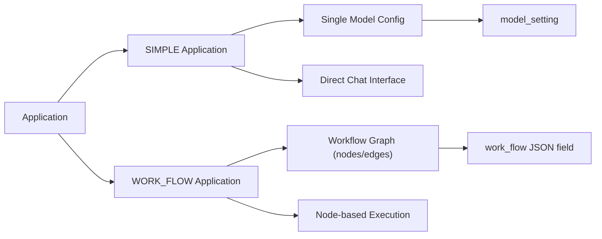
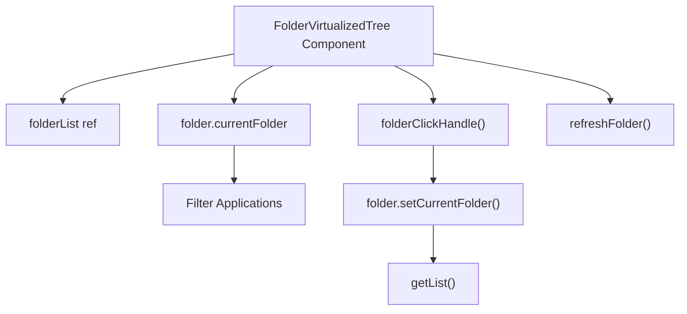
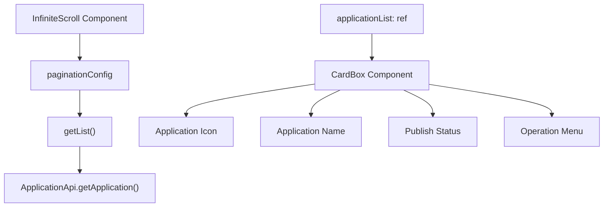

<!-- source: DeepWiki mcp.deepwiki.com · repo 1Panel-dev/MaxKB · page 4 Application Management · fetched 2026-10-29 -->

# Application Management

Relevant source files

The following files were used as context for generating this wiki page:

- [apps/application/api/application_api.py](apps/application/api/application_api.py)
- [apps/application/serializers/application.py](apps/application/serializers/application.py)
- [apps/application/serializers/common.py](apps/application/serializers/common.py)
- [apps/application/urls.py](apps/application/urls.py)
- [apps/application/views/__init__.py](apps/application/views/__init__.py)
- [apps/application/views/application.py](apps/application/views/application.py)
- [apps/chat/serializers/chat.py](apps/chat/serializers/chat.py)
- [ui/src/components/folder-tree/index.vue](ui/src/components/folder-tree/index.vue)
- [ui/src/components/layout-container/index.vue](ui/src/components/layout-container/index.vue)
- [ui/src/views/application/component/AddKnowledgeDialog.vue](ui/src/views/application/component/AddKnowledgeDialog.vue)
- [ui/src/views/application/index.vue](ui/src/views/application/index.vue)
- [ui/src/views/knowledge/component/KnowledgeListContainer.vue](ui/src/views/knowledge/component/KnowledgeListContainer.vue)
- [ui/src/views/knowledge/index.vue](ui/src/views/knowledge/index.vue)
- [ui/src/views/model/component/ModelCard.vue](ui/src/views/model/component/ModelCard.vue)
- [ui/src/views/model/index.vue](ui/src/views/model/index.vue)
- [ui/src/views/tool/component/ToolListContainer.vue](ui/src/views/tool/component/ToolListContainer.vue)
- [ui/src/views/tool/index.vue](ui/src/views/tool/index.vue)

## Overview

Application Management is the system responsible for creating, configuring, and managing AI agent applications in MaxKB. It handles two types of applications: simple chat-based applications and advanced workflow-based applications. This document covers the frontend UI components, backend data models, API endpoints, and configuration options for applications.

For information about workflow execution, see [Workflow Engine](#5). For chat functionality within applications, see [AI Chat System](#3).

Sources: [ui/src/views/application/index.vue:1-753](), [apps/application/models/application.py:1-185]()

---

## Application Types

Applications in MaxKB are classified into two distinct types defined by the `ApplicationTypeChoices` enum:

| Type | Value | Description |
|------|-------|-------------|
| Simple | `SIMPLE` | Basic chat application with single model configuration |
| Workflow | `WORK_FLOW` | Advanced application with node-based workflow orchestration |

The application type is stored in the `Application.type` field and determines which configuration interface and execution engine is used.

Sources: [apps/application/models/application.py:35-38](), [ui/src/views/application/index.vue:81-116]()

---

## Application List and Organization

### Folder Structure

Applications are organized in a hierarchical folder structure using the `ApplicationFolder` model. The UI uses a virtualized tree component to handle navigation and organization.

**Key Components:**

- `FolderVirtualizedTree` component displays the folder hierarchy [ui/src/views/application/index.vue:6-13]().
- `ApplicationFolder` model handles the database representation [apps/application/models/application.py:20-33]().
- `folder.currentFolder` state tracks the active folder in the store [ui/src/views/application/index.vue:53-53]().

Sources: [ui/src/views/application/index.vue:6-13](), [ui/src/views/application/index.vue:706-714](), [apps/application/models/application.py:20-33]()

### Application List View

The main application list view (`index.vue`) displays applications as cards with infinite scrolling. It supports complex searching by creator, name, or publish status.

**Search and Filter:**

The view supports search types defined in `search_type` [ui/src/views/application/index.vue:22-33]():
- `name` - Filter by application name.
- `create_user` - Filter by creator [ui/src/views/application/index.vue:43-53]().
- `publish_status` - Filter by published/unpublished status [ui/src/views/application/index.vue:54-64]().

Sources: [ui/src/views/application/index.vue:154-305](), [ui/src/views/application/index.vue:366-371](), [ui/src/views/application/index.vue:734-745]()

---

## Application Configuration

For details, see [Application Configuration and Settings](#4.1).

### Model and Prompt Configuration

Simple applications configure a single model via `model_id` and `model_setting`. The `model_setting` contains prompts such as `system`, `prompt` (references found), and `no_references_prompt` (no references found).

Sources: [apps/application/models/application.py:108-120](), [apps/application/serializers/application.py:130-154]()

### Knowledge Base Integration

Applications can be associated with multiple knowledge bases. Retrieval parameters like `top_n`, `similarity`, and `search_mode` (embedding, keywords, or blend) are configured in the `KnowledgeSettingSerializer`.

Sources: [apps/application/serializers/application.py:135-154](), [apps/application/models/application.py:126-132]()

### Skills and Tools

Applications can integrate with:
- **Custom Tools**: Defined in `tool_ids` [apps/application/models/application.py:105-105]().
- **MCP Tools**: Model Context Protocol tools [apps/application/models/application.py:103-104]().
- **Sub-Applications**: Chaining other applications via `application_ids` [apps/application/models/application.py:106-106]().

Sources: [apps/application/models/application.py:103-107](), [apps/application/serializers/application.py:80-104]()

---

## Application Backend APIs and Data Models

For details, see [Application Backend APIs and Data Models](#4.3).

### Data Models

- **`Application`**: The primary model storing configuration, type, and associated resources [apps/application/models/application.py:59-107]().
- **`ApplicationVersion`**: Snapshots of application state created during publishing to allow rollbacks and history tracking [apps/application/models/application.py:136-182]().

### API Architecture

The backend provides endpoints for CRUD operations, publishing, and statistics.

| Endpoint | Logic |
|----------|-------|
| `/workspace/<workspace_id>/application` | CRUD for applications [apps/application/urls.py:10-10]() |
| `/.../application/<id>/publish` | Versioning and publishing logic [apps/application/urls.py:16-16]() |
| `/.../application/<id>/chat` | Entry point for chat interactions [apps/application/urls.py:28-28]() |

Sources: [apps/application/urls.py:1-46](), [apps/application/models/application.py:59-185]()

---

## Application Management UI

For details, see [Application Management UI](#4.2).

The UI is built with Vue.js and Element Plus, featuring:
- **Folder Organization**: Using `FolderVirtualizedTree` [ui/src/views/application/index.vue:6-13]().
- **Batch Operations**: Support for batch deleting and moving applications [ui/src/views/application/index.vue:66-78]().
- **Template Center**: Creating applications from predefined templates [ui/src/views/application/index.vue:80-87]().

Sources: [ui/src/views/application/index.vue:1-165](), [ui/src/components/folder-tree/index.vue:1-159]()

---

