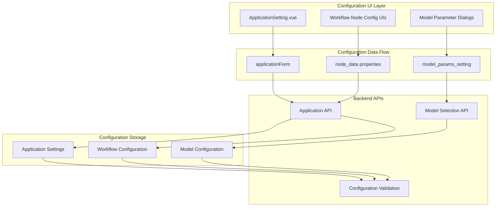
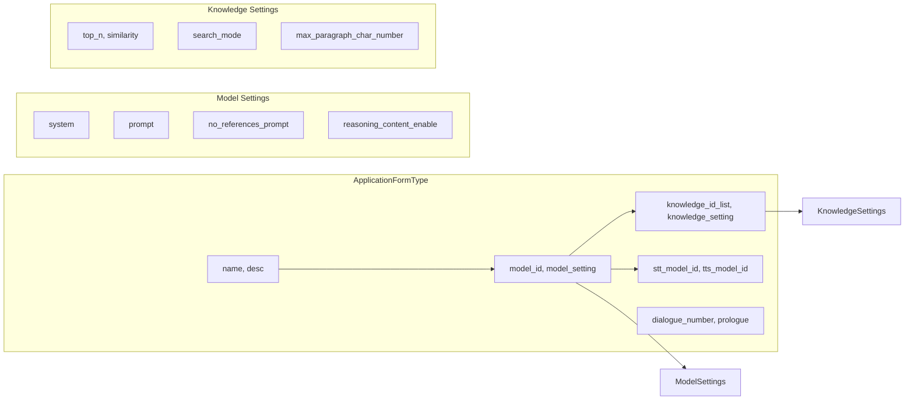
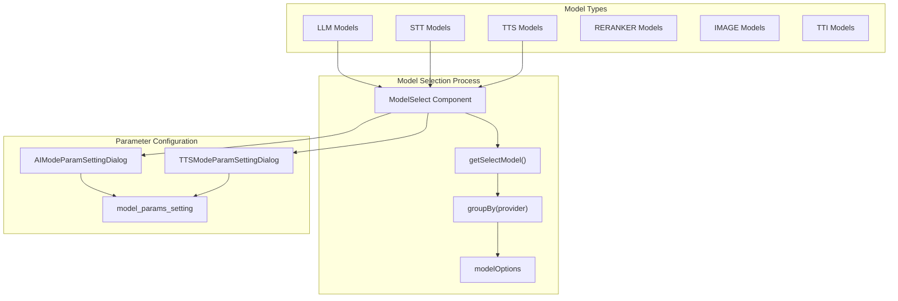
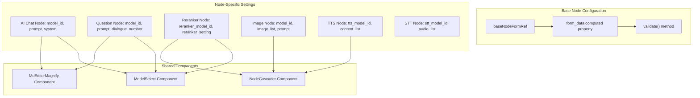
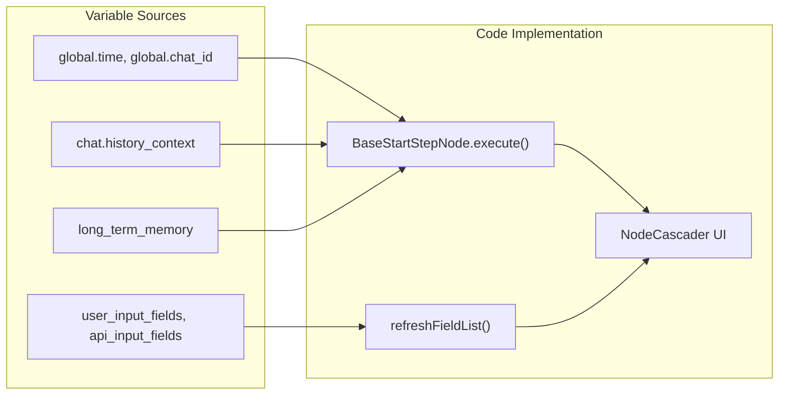
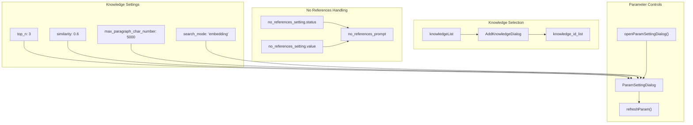
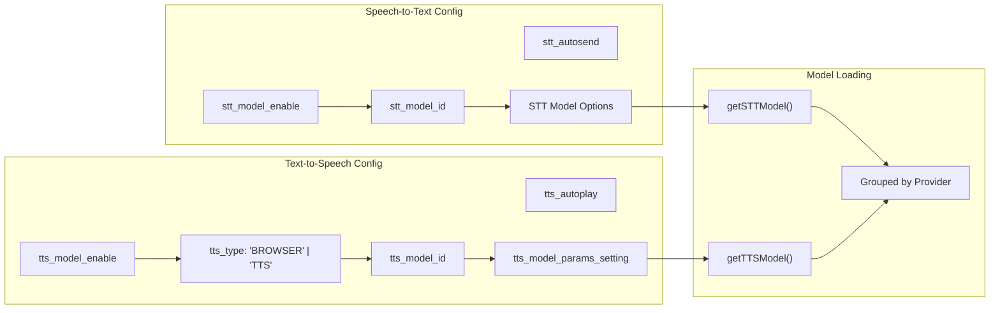

<!-- source: DeepWiki mcp.deepwiki.com · repo 1Panel-dev/MaxKB · page 4.1 Application Configuration and Settings · fetched 2026-10-29 -->

# Application Configuration and Settings

Relevant source files

The following files were used as context for generating this wiki page:

- [apps/application/flow/step_node/start_node/i_start_node.py](apps/application/flow/step_node/start_node/i_start_node.py)
- [apps/application/flow/step_node/start_node/impl/base_start_node.py](apps/application/flow/step_node/start_node/impl/base_start_node.py)
- [apps/application/migrations/0003_application_stt_model_params_setting_and_more.py](apps/application/migrations/0003_application_stt_model_params_setting_and_more.py)
- [apps/chat/template/generate_prompt_system](apps/chat/template/generate_prompt_system)
- [apps/models_provider/impl/aliyun_bai_lian_model_provider/credential/stt/asr_stt.py](apps/models_provider/impl/aliyun_bai_lian_model_provider/credential/stt/asr_stt.py)
- [apps/models_provider/impl/aliyun_bai_lian_model_provider/credential/stt/omni_stt.py](apps/models_provider/impl/aliyun_bai_lian_model_provider/credential/stt/omni_stt.py)
- [apps/models_provider/impl/xf_model_provider/credential/zh_en_stt.py](apps/models_provider/impl/xf_model_provider/credential/zh_en_stt.py)
- [apps/models_provider/impl/xf_model_provider/model/zh_en_stt.py](apps/models_provider/impl/xf_model_provider/model/zh_en_stt.py)
- [apps/models_provider/impl/xf_model_provider/xf_model_provider.py](apps/models_provider/impl/xf_model_provider/xf_model_provider.py)
- [ui/src/api/system/chat-user.ts](ui/src/api/system/chat-user.ts)
- [ui/src/api/type/systemChatUser.ts](ui/src/api/type/systemChatUser.ts)
- [ui/src/assets/icon_qr_outlined.svg](ui/src/assets/icon_qr_outlined.svg)
- [ui/src/assets/logo/logo_slack.svg](ui/src/assets/logo/logo_slack.svg)
- [ui/src/assets/logo/logo_wechat-bot.svg](ui/src/assets/logo/logo_wechat-bot.svg)
- [ui/src/locales/lang/en-US/views/application.ts](ui/src/locales/lang/en-US/views/application.ts)
- [ui/src/locales/lang/zh-CN/views/application.ts](ui/src/locales/lang/zh-CN/views/application.ts)
- [ui/src/locales/lang/zh-Hant/views/application.ts](ui/src/locales/lang/zh-Hant/views/application.ts)
- [ui/src/views/application/ApplicationAccess.vue](ui/src/views/application/ApplicationAccess.vue)
- [ui/src/views/application/ApplicationSetting.vue](ui/src/views/application/ApplicationSetting.vue)
- [ui/src/views/application/component/AccessSettingDrawer.vue](ui/src/views/application/component/AccessSettingDrawer.vue)
- [ui/src/views/application/component/GeneratePromptDialog.vue](ui/src/views/application/component/GeneratePromptDialog.vue)
- [ui/src/views/application/component/STTModelParamSettingDialog.vue](ui/src/views/application/component/STTModelParamSettingDialog.vue)
- [ui/src/views/login/scanCompinents/larkQrCode.vue](ui/src/views/login/scanCompinents/larkQrCode.vue)
- [ui/src/views/system-chat-user/authentication/component/EditModal.vue](ui/src/views/system-chat-user/authentication/component/EditModal.vue)
- [ui/src/views/system-setting/authentication/component/EditModal.vue](ui/src/views/system-setting/authentication/component/EditModal.vue)
- [ui/src/workflow/nodes/ai-chat-node/index.vue](ui/src/workflow/nodes/ai-chat-node/index.vue)
- [ui/src/workflow/nodes/base-node/component/ApiFieldFormDialog.vue](ui/src/workflow/nodes/base-node/component/ApiFieldFormDialog.vue)
- [ui/src/workflow/nodes/base-node/component/ApiInputFieldTable.vue](ui/src/workflow/nodes/base-node/component/ApiInputFieldTable.vue)
- [ui/src/workflow/nodes/base-node/index.vue](ui/src/workflow/nodes/base-node/index.vue)
- [ui/src/workflow/nodes/condition-node/index.vue](ui/src/workflow/nodes/condition-node/index.vue)
- [ui/src/workflow/nodes/start-node/index.vue](ui/src/workflow/nodes/start-node/index.vue)

This document covers the application configuration and settings system in MaxKB, including the main application configuration interface, model selection and parameter management, knowledge base integration, and workflow node configuration. This system allows users to create and customize AI applications with specific models, prompts, and behavioral settings.

For information about workflow design and execution, see [Workflow Engine](#5). For details about model management and provider integration, see [Model Management](#7).

## Configuration System Overview

The application configuration system in MaxKB provides a comprehensive interface for setting up AI applications with customizable parameters, model selections, and behavioral settings. The system supports both simple application configurations and complex workflow-based applications.

**Sources**: [ui/src/views/application/ApplicationSetting.vue:1-821](), [ui/src/workflow/nodes/base-node/index.vue:1-375](), [ui/src/workflow/nodes/ai-chat-node/index.vue:1-351]()

## Core Application Configuration Interface

The main application configuration is handled through the `ApplicationSetting.vue` component, which provides a comprehensive form for setting up application parameters. The interface is split into two main sections: configuration settings on the left and a live testing interface on the right.

### Application Form Structure

**Sources**: [ui/src/views/application/ApplicationSetting.vue:450-534](), [ui/src/views/application/ApplicationSetting.vue:501-533]()

### Configuration Parameters

| Parameter | Type | Description | Default |
|-----------|------|-------------|---------|
| `name` | String | Application name (max 64 chars) | Required |
| `desc` | String | Application description (max 256 chars) | Optional |
| `model_id` | String | Selected AI model identifier | Required |
| `dialogue_number` | Number | Number of history records to maintain | 1 |
| `prologue` | String | Initial greeting message | Default greeting |
| `knowledge_id_list` | Array | Linked knowledge base IDs | [] |
| `stt_model_enable` | Boolean | Enable speech-to-text | false |
| `tts_model_enable` | Boolean | Enable text-to-speech | false |

**Sources**: [ui/src/views/application/ApplicationSetting.vue:501-533](), [ui/src/views/application/ApplicationSetting.vue:536-544]()

## Model Configuration System

The model configuration system allows selection and parameterization of different AI models for various functions within an application.

### Model Selection and Parameter Management

**Sources**: [ui/src/views/application/ApplicationSetting.vue:687-708](), [ui/src/views/application/ApplicationSetting.vue:710-730](), [ui/src/views/application/ApplicationSetting.vue:605-613]()

### Prompt Generation

MaxKB includes an AI-driven prompt generation tool accessible via the `GeneratePromptDialog.vue` component. This tool uses a predefined template to help users craft structured system prompts (Role, Goals, Core Skills, Workflow, Constraints) based on a simple topic.

**Sources**: [ui/src/views/application/component/GeneratePromptDialog.vue:130-195](), [ui/src/views/application/ApplicationSetting.vue:113-121]()

## Workflow Node Configuration

Individual workflow nodes have their own configuration interfaces that follow similar patterns to the main application configuration.

### Node Configuration Pattern

**Sources**: [ui/src/workflow/nodes/ai-chat-node/index.vue:246-266](), [ui/src/workflow/nodes/base-node/index.vue:1-375](), [ui/src/workflow/nodes/condition-node/index.vue:1-159]()

### Variable Referencing in Nodes

Workflow nodes support referencing variables from previous steps or global contexts. The `StartNode` and `BaseStartStepNode` initialize these variables, including system-provided fields like `{question}`, `{time}`, and `{memory}`.

**Sources**: [apps/application/flow/step_node/start_node/impl/base_start_node.py:30-42](), [ui/src/workflow/nodes/start-node/index.vue:58-66](), [apps/application/flow/step_node/start_node/impl/base_start_node.py:84-95]()

## Knowledge Base Integration

Applications can be linked to one or more knowledge bases to provide context for AI responses.

### Knowledge Configuration Interface

The knowledge base integration allows applications to search and reference external knowledge sources:

**Sources**: [ui/src/views/application/ApplicationSetting.vue:508-517](), [ui/src/views/application/ApplicationSetting.vue:629-631](), [ui/src/views/application/ApplicationSetting.vue:654-661]()

## Voice and Multi-Modal Configuration

MaxKB supports voice input/output and multi-modal capabilities through STT (Speech-to-Text) and TTS (Text-to-Speech) model configuration.

### Voice Configuration Settings

**Sources**: [ui/src/views/application/ApplicationSetting.vue:762-773](), [ui/src/views/application/ApplicationSetting.vue:754-761](), [ui/src/views/application/ApplicationSetting.vue:710-752]()

## Third-Party Access Configuration

Applications can be integrated with third-party platforms like WeChat, DingTalk, and Lark. This is managed via the `ApplicationAccess.vue` and `AccessSettingDrawer.vue` components.

### Supported Platforms
*   **WeCom Bot**: Integration with Enterprise WeChat intelligent bots.
*   **DingTalk**: Integration with DingTalk apps.
*   **Lark**: Integration with Feishu/Lark apps.
*   **Slack**: Integration with Slack workspaces.

**Sources**: [ui/src/views/application/ApplicationAccess.vue:71-120](), [ui/src/views/application/component/AccessSettingDrawer.vue:140-165]()

---

