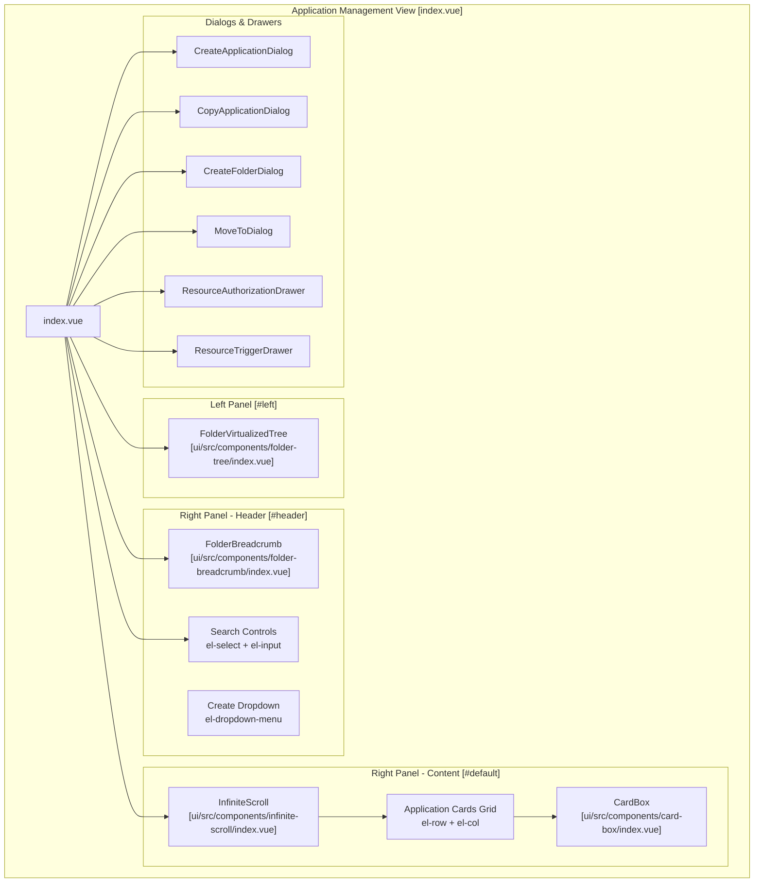
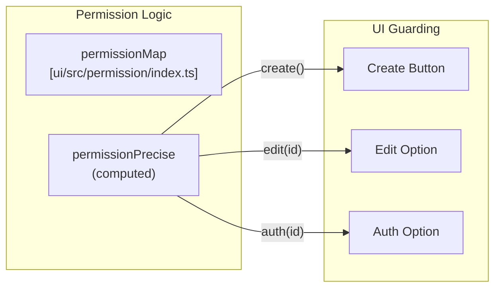

<!-- source: DeepWiki mcp.deepwiki.com · repo 1Panel-dev/MaxKB · page 4.2 Application Management UI · fetched 2026-10-29 -->

# Application Management UI

Relevant source files

The following files were used as context for generating this wiki page:

- [apps/application/models/__init__.py](apps/application/models/__init__.py)
- [apps/application/models/application_access_token.py](apps/application/models/application_access_token.py)
- [apps/application/serializers/application_access_token.py](apps/application/serializers/application_access_token.py)
- [ui/src/api/application/application-key.ts](ui/src/api/application/application-key.ts)
- [ui/src/api/application/application.ts](ui/src/api/application/application.ts)
- [ui/src/api/system-resource-management/application-key.ts](ui/src/api/system-resource-management/application-key.ts)
- [ui/src/api/system/api-key.ts](ui/src/api/system/api-key.ts)
- [ui/src/components/folder-tree/index.vue](ui/src/components/folder-tree/index.vue)
- [ui/src/components/layout-container/index.vue](ui/src/components/layout-container/index.vue)
- [ui/src/layout/layout-header/avatar/APIKeyDialog.vue](ui/src/layout/layout-header/avatar/APIKeyDialog.vue)
- [ui/src/locales/lang/en-US/views/application-overview.ts](ui/src/locales/lang/en-US/views/application-overview.ts)
- [ui/src/locales/lang/zh-CN/views/application-overview.ts](ui/src/locales/lang/zh-CN/views/application-overview.ts)
- [ui/src/locales/lang/zh-Hant/views/application-overview.ts](ui/src/locales/lang/zh-Hant/views/application-overview.ts)
- [ui/src/views/application-overview/component/APIKeyDialog.vue](ui/src/views/application-overview/component/APIKeyDialog.vue)
- [ui/src/views/application-overview/component/DisplaySettingDialog.vue](ui/src/views/application-overview/component/DisplaySettingDialog.vue)
- [ui/src/views/application-overview/component/EmbedDialog.vue](ui/src/views/application-overview/component/EmbedDialog.vue)
- [ui/src/views/application-overview/component/LimitDialog.vue](ui/src/views/application-overview/component/LimitDialog.vue)
- [ui/src/views/application-overview/component/SettingAPIKeyDialog.vue](ui/src/views/application-overview/component/SettingAPIKeyDialog.vue)
- [ui/src/views/application-overview/component/SettingAPIKeyDrawer.vue](ui/src/views/application-overview/component/SettingAPIKeyDrawer.vue)
- [ui/src/views/application-overview/index.vue](ui/src/views/application-overview/index.vue)
- [ui/src/views/application-overview/xpack-component/XPackDisplaySettingDialog.vue](ui/src/views/application-overview/xpack-component/XPackDisplaySettingDialog.vue)
- [ui/src/views/application-overview/xpack-component/XPackLimitDrawer.vue](ui/src/views/application-overview/xpack-component/XPackLimitDrawer.vue)
- [ui/src/views/application/component/AddKnowledgeDialog.vue](ui/src/views/application/component/AddKnowledgeDialog.vue)
- [ui/src/views/application/index.vue](ui/src/views/application/index.vue)
- [ui/src/views/document/component/ImportDocumentDialog.vue](ui/src/views/document/component/ImportDocumentDialog.vue)
- [ui/src/views/knowledge/component/KnowledgeListContainer.vue](ui/src/views/knowledge/component/KnowledgeListContainer.vue)
- [ui/src/views/knowledge/index.vue](ui/src/views/knowledge/index.vue)
- [ui/src/views/model/component/ModelCard.vue](ui/src/views/model/component/ModelCard.vue)
- [ui/src/views/model/index.vue](ui/src/views/model/index.vue)
- [ui/src/views/tool/component/ToolListContainer.vue](ui/src/views/tool/component/ToolListContainer.vue)
- [ui/src/views/tool/index.vue](ui/src/views/tool/index.vue)

## Purpose and Scope

This document describes the frontend user interface for managing AI applications in MaxKB. It covers the application list view, folder organization, search/filtering capabilities, CRUD operations, and permission-based UI rendering. For backend API details and data models, see [Application Backend APIs and Data Models](#4.3). For application configuration interfaces, see [Application Configuration and Settings](#4.1).

The Application Management UI provides a visual interface for users to:
- Browse and organize applications in folders.
- Create new applications (simple or workflow-based).
- Search and filter applications by name, creator, or status.
- Perform operations like copy, export, import, and delete.
- Navigate to application settings and chat interfaces.
- Manage permissions and access control.

## Main View Architecture

The application management interface is implemented in `ui/src/views/application/index.vue` and follows a two-panel layout pattern using the `LayoutContainer` component.

### Component Structure Diagram

The following diagram maps UI components to their respective code entities.

**Sources:** [ui/src/views/application/index.vue:1-326](), [ui/src/components/folder-tree/index.vue:1-125]()

## Folder Tree Navigation

The left panel contains a hierarchical folder tree for organizing applications. This is handled by the `FolderVirtualizedTree` component [ui/src/views/application/index.vue:6-13]().

**Key Properties:**
- `source`: Set to `SourceTypeEnum.APPLICATION` [ui/src/views/application/index.vue:7]().
- `data`: `folderList` array fetched from the workspace folder API.
- `currentNodeKey`: The current selected folder ID from `folder.currentFolder?.id` [ui/src/views/application/index.vue:9]().
- `draggable`: Set to `true` to allow folder reordering [ui/src/views/application/index.vue:12]().

**Event Handlers:**
- `@handleNodeClick`: Calls `folderClickHandle` to update the current folder and reset the application list [ui/src/views/application/index.vue:10]().
- `@refreshTree`: Calls `refreshFolder` to reload the folder structure [ui/src/views/application/index.vue:11]().

**Sources:** [ui/src/views/application/index.vue:6-13](), [ui/src/components/folder-tree/index.vue:1-158]()

## Search and Filter System

The search system provides three filter modes accessed through a complex search interface [ui/src/views/application/index.vue:21-65]().

| Search Type | Code Value | UI Component | API Param |
| :--- | :--- | :--- | :--- |
| **Creator** | `create_user` | `el-select` (remote) | `create_user` |
| **Name** | `name` | `el-input` | `name` |
| **Status** | `publish_status` | `el-select` | `publish_status` |

### Search Implementation Logic

The search form maintains reactive state in `search_form` [ui/src/views/application/index.vue:366-371](). When a user changes the search value, `searchHandle` is triggered:

1. Resets `paginationConfig.current_page` to 1 [ui/src/views/application/index.vue:723]().
2. Clears the existing `applicationList` [ui/src/views/application/index.vue:724]().
3. Calls `getList()` to fetch filtered data from the backend [ui/src/views/application/index.vue:725]().

**Sources:** [ui/src/views/application/index.vue:22-65](), [ui/src/views/application/index.vue:722-726]()

## Application Operations (CRUD)

### Creation and Import
The "Create" button [ui/src/views/application/index.vue:89]() provides a dropdown for:
- **Simple Agent**: Quick setup for basic chat [ui/src/views/application/index.vue:97]().
- **Advanced Agent**: Orchestration using the workflow engine [ui/src/views/application/index.vue:116]().
- **Import**: Uploading a `.mk` application file [ui/src/views/application/index.vue:133-143]().

The `importApplication` function [ui/src/views/application/index.vue:658-682]() uses `ApplicationApi.importApplication` to send file data to the backend.

### Management Operations
Each application card [ui/src/views/application/index.vue:168]() provides an action menu with the following capabilities:

| Operation | Code Function | Backend API Call |
| :--- | :--- | :--- |
| **Copy** | `copyApplication(item)` | `ApplicationApi.postApplication` |
| **Export** | `exportApplication(item)` | `ApplicationApi.exportApplication` |
| **Delete** | `deleteApplication(item)` | `ApplicationApi.delApplication` |
| **Move** | `openMoveToDialog(item)` | `ApplicationApi.moveApplication` |

**Sources:** [ui/src/views/application/index.vue:228-296](), [ui/src/api/application/application.ts:46-91]()

## Permission-Based UI Rendering

The UI dynamically renders elements based on the user's permissions in the current workspace.

- **Permission Setup**: The `permissionPrecise` computed property retrieves application-specific permissions for the 'workspace' context [ui/src/views/application/index.vue:358-360]().
- **UI Checks**: Buttons and menu items use `v-if` directives. For example, the Create button checks `permissionPrecise.create()` [ui/src/views/application/index.vue:88]().
- **Batch Operations**: The batch delete and move buttons are only visible if `permissionPrecise.batchDelete()` or `permissionPrecise.batchMove()` returns true [ui/src/views/application/index.vue:68]().

**Sources:** [ui/src/views/application/index.vue:355-360](), [ui/src/views/application/index.vue:88](), [ui/src/views/application/index.vue:68]()

## Application Overview and Access Control

When an application is selected, the overview page (`ui/src/views/application-overview/index.vue`) provides management of access credentials and limits.

### Access Control UI
The `XPackLimitDrawer` component [ui/src/views/application-overview/xpack-component/XPackLimitDrawer.vue:1-186]() allows configuring:
- **Client Query Limits**: Maximum number of queries per day [ui/src/views/application-overview/xpack-component/XPackLimitDrawer.vue:13-28]().
- **Authentication**: Password-based or Login-based access [ui/src/views/application-overview/xpack-component/XPackLimitDrawer.vue:30-160]().
- **Whitelist**: IP or user-based whitelist strings [ui/src/views/application-overview/xpack-component/XPackLimitDrawer.vue:162-176]().

### API and Embed Settings
The overview card [ui/src/views/application-overview/index.vue:10-142]() displays:
- **Public Access Link**: The URL for external chat access [ui/src/views/application-overview/index.vue:27-57]().
- **API Access Credentials**: Base URL and API Key management [ui/src/views/application-overview/index.vue:99-140]().
- **Embed Options**: Button to open the `EmbedDialog` for website integration [ui/src/views/application-overview/index.vue:73-80]().

**Sources:** [ui/src/views/application-overview/index.vue:1-143](), [ui/src/views/application-overview/xpack-component/XPackLimitDrawer.vue:1-186]()

---

