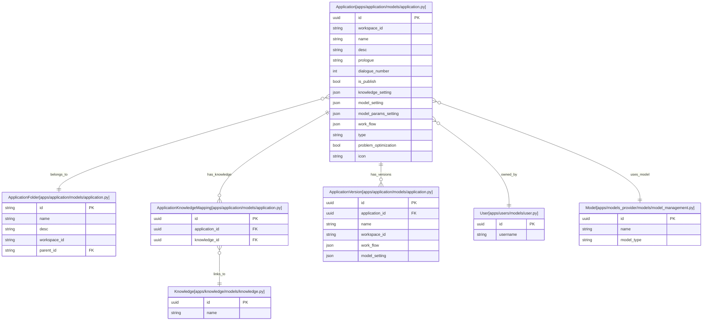
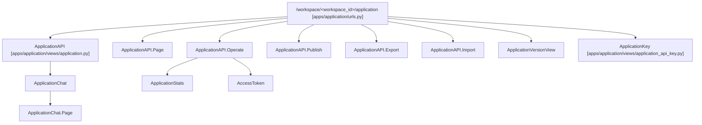

<!-- source: DeepWiki mcp.deepwiki.com · repo 1Panel-dev/MaxKB · page 4.3 Application Backend APIs and Data Models · fetched 2026-10-29 -->

# Application Backend APIs and Data Models

<details>
<summary>Relevant source files</summary>

The following files were used as context for generating this wiki page:

- [apps/application/api/application_api.py](apps/application/api/application_api.py)
- [apps/application/api/application_api_key.py](apps/application/api/application_api_key.py)
- [apps/application/api/application_version.py](apps/application/api/application_version.py)
- [apps/application/migrations/0001_initial.py](apps/application/migrations/0001_initial.py)
- [apps/application/migrations/0012_remove_applicationapikey_user.py](apps/application/migrations/0012_remove_applicationapikey_user.py)
- [apps/application/models/application_api_key.py](apps/application/models/application_api_key.py)
- [apps/application/serializers/application.py](apps/application/serializers/application.py)
- [apps/application/serializers/application_api_key.py](apps/application/serializers/application_api_key.py)
- [apps/application/serializers/application_version.py](apps/application/serializers/application_version.py)
- [apps/application/serializers/common.py](apps/application/serializers/common.py)
- [apps/application/sql/list_application.sql](apps/application/sql/list_application.sql)
- [apps/application/sql/list_application_user.sql](apps/application/sql/list_application_user.sql)
- [apps/application/sql/list_application_user_ee.sql](apps/application/sql/list_application_user_ee.sql)
- [apps/application/urls.py](apps/application/urls.py)
- [apps/application/views/__init__.py](apps/application/views/__init__.py)
- [apps/application/views/application.py](apps/application/views/application.py)
- [apps/chat/serializers/chat.py](apps/chat/serializers/chat.py)
- [apps/common/auth/handle/impl/application_key.py](apps/common/auth/handle/impl/application_key.py)
- [apps/common/cache_data/application_api_key_cache.py](apps/common/cache_data/application_api_key_cache.py)
- [apps/common/mixins/app_model_mixin.py](apps/common/mixins/app_model_mixin.py)
- [apps/common/utils/cache_util.py](apps/common/utils/cache_util.py)
- [apps/knowledge/migrations/0001_initial.py](apps/knowledge/migrations/0001_initial.py)
- [apps/knowledge/models/knowledge.py](apps/knowledge/models/knowledge.py)
- [apps/knowledge/sql/list_knowledge.sql](apps/knowledge/sql/list_knowledge.sql)
- [apps/knowledge/sql/list_knowledge_user.sql](apps/knowledge/sql/list_knowledge_user.sql)
- [apps/knowledge/sql/list_knowledge_user_ee.sql](apps/knowledge/sql/list_knowledge_user_ee.sql)
- [apps/models_provider/migrations/0001_initial.py](apps/models_provider/migrations/0001_initial.py)
- [apps/models_provider/models/model_management.py](apps/models_provider/models/model_management.py)
- [apps/system_manage/migrations/0001_initial.py](apps/system_manage/migrations/0001_initial.py)
- [apps/system_manage/models/log_management.py](apps/system_manage/models/log_management.py)
- [apps/tools/migrations/0001_initial.py](apps/tools/migrations/0001_initial.py)
- [apps/tools/migrations/0003_alter_tool_template_id.py](apps/tools/migrations/0003_alter_tool_template_id.py)
- [apps/tools/migrations/0005_taskrecord.py](apps/tools/migrations/0005_taskrecord.py)
- [apps/tools/migrations/internal_tool.sql](apps/tools/migrations/internal_tool.sql)
- [apps/tools/models/tool.py](apps/tools/models/tool.py)
- [apps/tools/sql/list_tool.sql](apps/tools/sql/list_tool.sql)
- [apps/tools/sql/list_tool_user.sql](apps/tools/sql/list_tool_user.sql)
- [apps/tools/sql/list_tool_user_ee.sql](apps/tools/sql/list_tool_user_ee.sql)
- [apps/users/migrations/0001_initial.py](apps/users/migrations/0001_initial.py)
- [apps/users/models/user.py](apps/users/models/user.py)
- [ui/src/assets/workflow/icon_aggregation.svg](ui/src/assets/workflow/icon_aggregation.svg)
- [ui/src/workflow/icons/variable-aggregation-node-icon.vue](ui/src/workflow/icons/variable-aggregation-node-icon.vue)

</details>


This document covers the Django backend APIs, models, and processing logic for MaxKB application management. It focuses on the server-side implementation of application lifecycle management, data persistence, and integration with the chat pipeline system.

## Application Data Models

The application system uses several Django models to manage application data, organization, and versioning.

### Core Application Model Structure



The `Application` model serves as the central entity with configurable settings for chat behavior, knowledge integration, and workflow execution. The `ApplicationTypeChoices` enum defines two types: `SIMPLE` for basic Q&A applications and `WORK_FLOW` for complex workflow-based applications.

**Sources:** [apps/application/models/application.py:20-164](), [apps/users/models/user.py:16-28](), [apps/knowledge/models/knowledge.py:119-140]()

### Application Settings and Serializers

Applications contain several JSON configuration fields that control their behavior, managed via `ApplicationSerializerModel` and specialized serializers:

| Setting Field | Purpose | Default / Constraint |
|---------------|---------|---------------------|
| `knowledge_setting` | Controls search parameters | Managed by `KnowledgeSettingSerializer` [apps/application/serializers/application.py:135-154]() |
| `model_setting` | Defines prompts | `prompt` and `no_references_prompt` [apps/application/serializers/common.py:134-142]() |
| `work_flow` | Workflow DAG definition | Used when `type` is `WORK_FLOW` [apps/application/models/application.py:38]() |

The `KnowledgeSettingSerializer` enforces constraints such as `top_n` (1-10000) and `search_mode` (embedding, keywords, or blend).

**Sources:** [apps/application/serializers/application.py:117-154](), [apps/application/models/application.py:41-56]()

## API Endpoint Structure

The application API system is organized around RESTful endpoints with workspace-scoped operations.

### URL Routing Pattern



**Sources:** [apps/application/urls.py:8-46](), [apps/application/views/application.py:50-160]()

### Key API Endpoints

| Endpoint Pattern | View Class | HTTP Methods | Purpose |
|------------------|------------|--------------|---------|
| `/workspace/<workspace_id>/application` | `ApplicationAPI` | GET, POST | List and create applications [apps/application/urls.py:10]() |
| `/workspace/<workspace_id>/application/<application_id>` | `ApplicationAPI.Operate` | GET, PUT, DELETE | CRUD operations [apps/application/urls.py:15]() |
| `/workspace/<workspace_id>/application/<application_id>/publish` | `ApplicationAPI.Publish` | POST | Snapshot to `ApplicationVersion` [apps/application/urls.py:16]() |
| `/workspace/<workspace_id>/application/<application_id>/chat` | `ApplicationChat` | POST | Chat execution [apps/application/urls.py:28]() |
| `/workspace/<workspace_id>/application/<application_id>/application_key` | `ApplicationKey` | GET, POST | Manage API keys [apps/application/urls.py:18]() |

**Sources:** [apps/application/urls.py:8-46]()

## Backend Processing Logic

### API Key Management

API keys allow external systems to interact with MaxKB applications. The `ApplicationKeySerializer` handles the generation of MD5-hashed secret keys prefixed with `agent-`.

```python
# Generation logic in ApplicationKeySerializer
secret_key = 'agent-' + hashlib.md5(str(uuid.uuid7()).encode()).hexdigest()
```

**Sources:** [apps/application/serializers/application_api_key.py:50-59](), [apps/application/models/application_api_key.py:10-30]()

### Chat Execution Flow

When a chat request is received, the system determines the application type and routes it either through the `PipelineManage` (for simple apps) or `WorkflowManage` (for workflow apps).

```mermaid
graph TD
    "ChatRequest[apps/chat/serializers/chat.py]" --> "ChatInfo.get_cache()[apps/application/serializers/common.py]"
    "ChatInfo.get_cache()[apps/application/serializers/common.py]" --> "AppTypeCheck[apps/application/models/application.py]"
    "AppTypeCheck[apps/application/models/application.py]" -- SIMPLE --> "PipelineManage[apps/application/chat_pipeline/pipeline_manage.py]"
    "AppTypeCheck[apps/application/models/application.py]" -- WORK_FLOW --> "WorkflowManage[apps/application/flow/workflow_manage.py]"
    
    "PipelineManage[apps/application/chat_pipeline/pipeline_manage.py]" --> "BaseChatStep.execute()[apps/application/chat_pipeline/step/chat_step/impl/base_chat_step.py]"
    "BaseChatStep.execute()[apps/application/chat_pipeline/step/chat_step/impl/base_chat_step.py]" --> "PostResponseHandler[apps/chat/serializers/chat.py]"
```

**Sources:** [apps/chat/serializers/chat.py:100-145](), [apps/application/serializers/common.py:98-155]()

### Application Versioning

When an application is published via `ApplicationAPI.Publish`, the system creates an `ApplicationVersion`. This ensures that even if the draft application is modified, the published endpoint remains stable until the next publish action.

*   **Model**: `ApplicationVersion` stores snapshots of `work_flow`, `model_setting`, and `knowledge_setting`.
*   **Retrieval**: The `ChatInfo.get_application()` method prioritizes the latest `ApplicationVersion` for non-debug chats.

**Sources:** [apps/application/models/application.py:124-164](), [apps/application/serializers/common.py:150-155]()

## Data Export and Import

Applications can be exported as zip files containing JSON configurations and associated tools.

1.  **Export**: `ApplicationAPI.Export` uses `ApplicationSerializer.export` to serialize the application, its workflow, and any associated `Tool` entities into a portable format.
2.  **Import**: `ApplicationAPI.Import` parses the uploaded file, reconstructs the `Application` and `Tool` objects, and handles ID mapping to ensure the workflow DAG remains valid in the new environment.

**Sources:** [apps/application/views/application.py:137-160](), [apps/application/serializers/application.py:80-105]()

---

