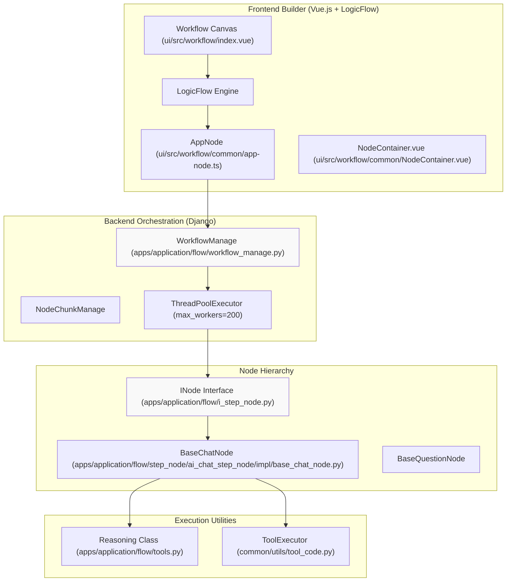
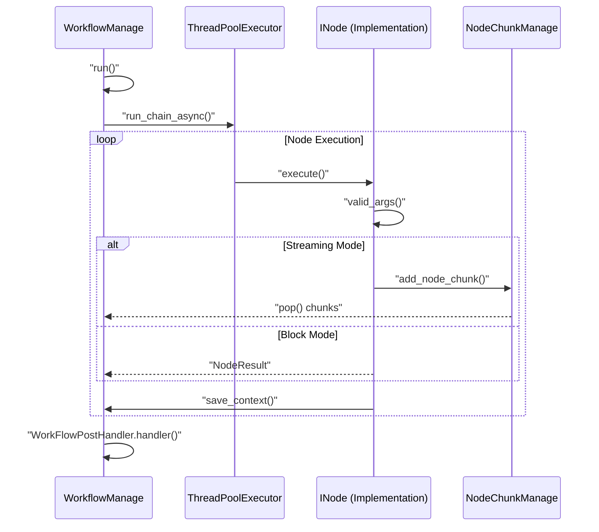

<!-- source: DeepWiki mcp.deepwiki.com · repo 1Panel-dev/MaxKB · page 5 Workflow Engine · fetched 2026-10-29 -->

# Workflow Engine

Relevant source files

The following files were used as context for generating this wiki page:

- [apps/application/chat_pipeline/step/chat_step/i_chat_step.py](apps/application/chat_pipeline/step/chat_step/i_chat_step.py)
- [apps/application/chat_pipeline/step/chat_step/impl/base_chat_step.py](apps/application/chat_pipeline/step/chat_step/impl/base_chat_step.py)
- [apps/application/flow/default_workflow.json](apps/application/flow/default_workflow.json)
- [apps/application/flow/i_step_node.py](apps/application/flow/i_step_node.py)
- [apps/application/flow/step_node/ai_chat_step_node/i_chat_node.py](apps/application/flow/step_node/ai_chat_step_node/i_chat_node.py)
- [apps/application/flow/step_node/ai_chat_step_node/impl/base_chat_node.py](apps/application/flow/step_node/ai_chat_step_node/impl/base_chat_node.py)
- [apps/application/flow/step_node/intent_node/impl/base_intent_node.py](apps/application/flow/step_node/intent_node/impl/base_intent_node.py)
- [apps/application/flow/step_node/parameter_extraction_node/impl/base_parameter_extraction_node.py](apps/application/flow/step_node/parameter_extraction_node/impl/base_parameter_extraction_node.py)
- [apps/application/flow/step_node/question_node/i_question_node.py](apps/application/flow/step_node/question_node/i_question_node.py)
- [apps/application/flow/step_node/question_node/impl/base_question_node.py](apps/application/flow/step_node/question_node/impl/base_question_node.py)
- [apps/application/flow/step_node/variable_splitting_node/impl/base_variable_splitting_node.py](apps/application/flow/step_node/variable_splitting_node/impl/base_variable_splitting_node.py)
- [apps/application/flow/tools.py](apps/application/flow/tools.py)
- [apps/application/flow/workflow_manage.py](apps/application/flow/workflow_manage.py)
- [apps/application/long_term_memory/__init__.py](apps/application/long_term_memory/__init__.py)
- [apps/application/models/application.py](apps/application/models/application.py)
- [apps/knowledge/task/handler.py](apps/knowledge/task/handler.py)
- [apps/models_provider/impl/ollama_model_provider/ollama_model_provider.py](apps/models_provider/impl/ollama_model_provider/ollama_model_provider.py)
- [ui/src/api/type/application.ts](ui/src/api/type/application.ts)
- [ui/src/layout/components/breadcrumb/index.vue](ui/src/layout/components/breadcrumb/index.vue)
- [ui/src/views/hit-test/index.vue](ui/src/views/hit-test/index.vue)
- [ui/src/workflow/common/NodeCascader.vue](ui/src/workflow/common/NodeCascader.vue)
- [ui/src/workflow/common/NodeContainer.vue](ui/src/workflow/common/NodeContainer.vue)
- [ui/src/workflow/common/NodeControl.vue](ui/src/workflow/common/NodeControl.vue)
- [ui/src/workflow/common/NodeSearch.vue](ui/src/workflow/common/NodeSearch.vue)
- [ui/src/workflow/common/app-node.ts](ui/src/workflow/common/app-node.ts)
- [ui/src/workflow/common/edge.ts](ui/src/workflow/common/edge.ts)
- [ui/src/workflow/common/shortcut.ts](ui/src/workflow/common/shortcut.ts)
- [ui/src/workflow/common/teleport.ts](ui/src/workflow/common/teleport.ts)
- [ui/src/workflow/index.vue](ui/src/workflow/index.vue)
- [ui/src/workflow/nodes/base-node/index.ts](ui/src/workflow/nodes/base-node/index.ts)

The Workflow Engine is MaxKB's visual orchestration system that allows users to create complex AI-powered logic using a node-based Directed Acyclic Graph (DAG) design. It facilitates the execution of interconnected nodes representing LLM interactions, data retrieval, and logic branching.

For details on how workflows are associated with specific application instances, see [Application Management](#4).

## Architecture Overview

The system bridges a visual frontend builder with a robust backend execution engine capable of handling high-concurrency, streaming AI responses.

### Workflow Engine Architecture

Sources: [apps/application/flow/workflow_manage.py:30-100](), [apps/application/flow/i_step_node.py:155-259](), [ui/src/workflow/index.vue:9-81](), [ui/src/workflow/common/app-node.ts:17-47]()

## Workflow Execution Engine

The core execution logic resides in `WorkflowManage`. It handles the transition between nodes, maintains the execution context, and manages the lifecycle of a workflow run.

### Execution Flow

Sources: [apps/application/flow/workflow_manage.py:210-335](), [apps/application/flow/workflow_manage.py:54-90](), [apps/application/flow/i_step_node.py:49-114]()

### Key Execution Components

| Component | Purpose | Location |
|-----------|---------|----------|
| `WorkflowManage` | Orchestrates the entire workflow lifecycle and node transitions. | [apps/application/flow/workflow_manage.py:92-146]() |
| `NodeChunkManage` | Collects and sequences streaming data chunks from multiple active nodes. | [apps/application/flow/workflow_manage.py:54-91]() |
| `ThreadPoolExecutor` | Provides a pool of 200 workers to handle concurrent node executions. | [apps/application/flow/workflow_manage.py:30-30]() |
| `WorkFlowPostHandler` | Finalizes the execution by saving `ChatRecord` and calculating tokens. | [apps/application/flow/i_step_node.py:49-114]() |

For more details on execution internals, see [Workflow Execution Engine](#5.2).

## Node System and Types

The node system is designed around the `INode` abstract base class. This ensures a consistent interface for validation, execution, and context management across diverse node types.

### Node Interface and Implementation

Every node must implement the standard execution lifecycle:
1.  **Validation**: `valid_args()` ensures parameters match the expected schema.
2.  **Execution**: `execute()` contains the business logic (e.g., calling an LLM).
3.  **Persistence**: `save_context()` updates the workflow state with results.

Sources: [apps/application/flow/i_step_node.py:155-259](), [apps/application/flow/step_node/ai_chat_step_node/impl/base_chat_node.py:148-156]()

### AI Chat Node and Reasoning
The `BaseChatNode` is a primary implementation that handles LLM interactions. It specifically includes logic for "Reasoning Content" (e.g., DeepSeek `<think>` tags) using the `Reasoning` utility class to separate thought process from the final answer.

Sources: [apps/application/flow/step_node/ai_chat_step_node/impl/base_chat_node.py:157-160](), [apps/application/flow/tools.py:86-130]()

For a catalog of available nodes, see [Workflow Node Types and Components](#5.3). For design details, see [Workflow Design and Node System](#5.1).

## Chat Pipeline System

MaxKB also maintains a "Pipeline" system as an alternative to the DAG-based workflow. While workflows offer arbitrary graph structures, pipelines follow a more rigid, step-based sequence often used for standard RAG (Retrieval-Augmented Generation) flows.

### Pipeline vs. Workflow

| Feature | Workflow Engine | Chat Pipeline |
|---------|-----------------|---------------|
| **Structure** | DAG (Nodes & Edges) | Sequential Steps |
| **Logic** | Complex Branching/Loops | Linear Processing |
| **Use Case** | Custom Agents / Complex Logic | Standard AI Chat / Simple RAG |
| **Manager** | `WorkflowManage` | `PipelineManage` |

Sources: [apps/application/chat_pipeline/pipeline_manage.py:1-100](), [apps/application/chat_pipeline/step/chat_step/impl/base_chat_step.py:17-19]()

For details on the pipeline implementation, see [Chat Pipeline System](#5.4).

## Frontend Workflow Builder

The visual editor is built using `LogicFlow` and custom Vue components.

### Node UI Structure
The `NodeContainer.vue` serves as the base wrapper for all nodes in the UI, providing common features like:
*   **Status Indicators**: Visual feedback for execution success or failure.
*   **Variable Copying**: Easy access to output parameters for downstream nodes.
*   **Node Controls**: Rename, copy, and delete operations.

Sources: [ui/src/workflow/common/NodeContainer.vue:1-121](), [ui/src/workflow/common/app-node.ts:17-47]()

### LogicFlow Integration
The `AppNode` class extends LogicFlow's `HtmlResize.view` to render Vue components within the canvas. It handles anchor connections and provides the bridge to backend node configurations.

Sources: [ui/src/workflow/common/app-node.ts:17-133](), [ui/src/workflow/index.vue:60-81]()

---

