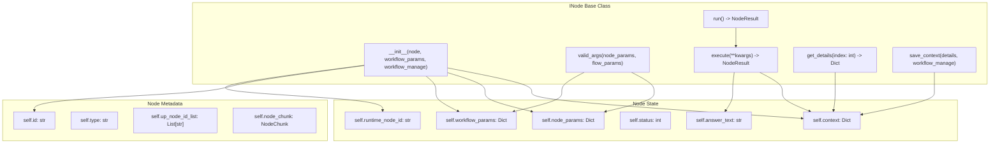
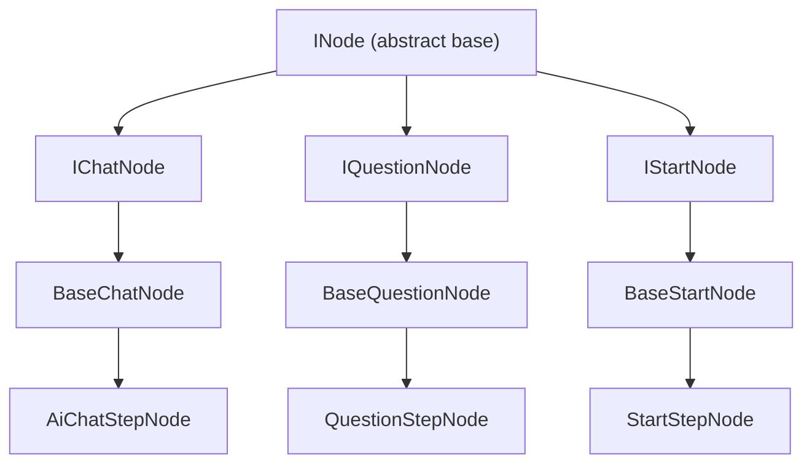
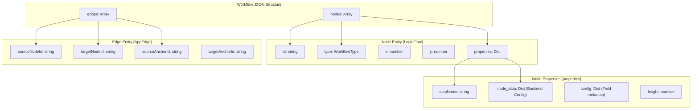
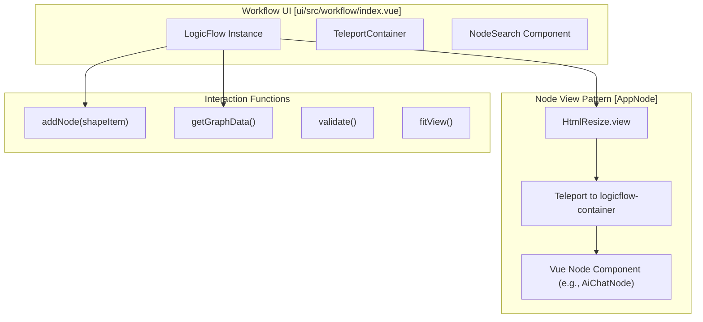

<!-- source: DeepWiki mcp.deepwiki.com · repo 1Panel-dev/MaxKB · page 5.1 Workflow Design and Node System · fetched 2026-10-29 -->

# Workflow Design and Node System

<details>
<summary>Relevant source files</summary>

The following files were used as context for generating this wiki page:

- [apps/application/flow/compare/__init__.py](apps/application/flow/compare/__init__.py)
- [apps/application/flow/compare/end_with.py](apps/application/flow/compare/end_with.py)
- [apps/application/flow/compare/not_equal_compare.py](apps/application/flow/compare/not_equal_compare.py)
- [apps/application/flow/compare/regex_compare.py](apps/application/flow/compare/regex_compare.py)
- [apps/application/flow/compare/start_with.py](apps/application/flow/compare/start_with.py)
- [apps/application/flow/compare/wildcard_compare.py](apps/application/flow/compare/wildcard_compare.py)
- [apps/application/flow/default_workflow.json](apps/application/flow/default_workflow.json)
- [apps/application/flow/step_node/__init__.py](apps/application/flow/step_node/__init__.py)
- [apps/application/flow/step_node/start_node/i_start_node.py](apps/application/flow/step_node/start_node/i_start_node.py)
- [apps/application/flow/step_node/start_node/impl/base_start_node.py](apps/application/flow/step_node/start_node/impl/base_start_node.py)
- [ui/src/enums/application.ts](ui/src/enums/application.ts)
- [ui/src/layout/components/breadcrumb/index.vue](ui/src/layout/components/breadcrumb/index.vue)
- [ui/src/locales/lang/en-US/views/application.ts](ui/src/locales/lang/en-US/views/application.ts)
- [ui/src/locales/lang/zh-CN/views/application.ts](ui/src/locales/lang/zh-CN/views/application.ts)
- [ui/src/locales/lang/zh-Hant/views/application.ts](ui/src/locales/lang/zh-Hant/views/application.ts)
- [ui/src/views/application/ApplicationSetting.vue](ui/src/views/application/ApplicationSetting.vue)
- [ui/src/views/hit-test/index.vue](ui/src/views/hit-test/index.vue)
- [ui/src/workflow/common/NodeCascader.vue](ui/src/workflow/common/NodeCascader.vue)
- [ui/src/workflow/common/NodeContainer.vue](ui/src/workflow/common/NodeContainer.vue)
- [ui/src/workflow/common/NodeControl.vue](ui/src/workflow/common/NodeControl.vue)
- [ui/src/workflow/common/NodeSearch.vue](ui/src/workflow/common/NodeSearch.vue)
- [ui/src/workflow/common/app-node.ts](ui/src/workflow/common/app-node.ts)
- [ui/src/workflow/common/data.ts](ui/src/workflow/common/data.ts)
- [ui/src/workflow/common/edge.ts](ui/src/workflow/common/edge.ts)
- [ui/src/workflow/common/shortcut.ts](ui/src/workflow/common/shortcut.ts)
- [ui/src/workflow/common/teleport.ts](ui/src/workflow/common/teleport.ts)
- [ui/src/workflow/index.vue](ui/src/workflow/index.vue)
- [ui/src/workflow/nodes/ai-chat-node/index.vue](ui/src/workflow/nodes/ai-chat-node/index.vue)
- [ui/src/workflow/nodes/base-node/component/ApiFieldFormDialog.vue](ui/src/workflow/nodes/base-node/component/ApiFieldFormDialog.vue)
- [ui/src/workflow/nodes/base-node/component/ApiInputFieldTable.vue](ui/src/workflow/nodes/base-node/component/ApiInputFieldTable.vue)
- [ui/src/workflow/nodes/base-node/index.ts](ui/src/workflow/nodes/base-node/index.ts)
- [ui/src/workflow/nodes/base-node/index.vue](ui/src/workflow/nodes/base-node/index.vue)
- [ui/src/workflow/nodes/condition-node/index.vue](ui/src/workflow/nodes/condition-node/index.vue)
- [ui/src/workflow/nodes/start-node/index.vue](ui/src/workflow/nodes/start-node/index.vue)

</details>


This document covers the workflow node system architecture in MaxKB, including the `INode` interface, node type hierarchy, workflow graph structure, and the visual workflow editor. The workflow system enables users to create complex AI applications by connecting nodes in a directed acyclic graph (DAG).

For information about workflow execution and runtime behavior, see page 5.2. For details about specific workflow node types and their implementations, see page 5.3. For the alternative pipeline-based execution system, see page 5.4.

## INode Interface and Node Lifecycle

The workflow node system is built on the `INode` interface defined in the backend. All workflow nodes inherit from this base class and implement a standard lifecycle.

### INode Interface Structure



**Key INode Properties:**

| Property | Type | Purpose |
|----------|------|---------|
| `context` | `Dict` | Stores execution state and results for this node |
| `node_params` | `Dict` | Configuration from `node.properties.node_data` |
| `workflow_params` | `Dict` | Global workflow parameters (chat_id, question, etc.) |
| `runtime_node_id` | `str` | SHA1 hash of upstream node IDs + node ID |
| `answer_text` | `str` | Output text if this is a result node |
| `status` | `int` | Execution status (200=success, 500=error) |

**Node Lifecycle Methods:**

1. **`__init__`** - Initializes node with workflow context and upstream node IDs.
2. **`valid_args`** - Validates `node_params` and `workflow_params` using node-specific serializers.
3. **`run`** - Entry point that calls `execute()` and tracks timing/status.
4. **`execute`** - Abstract method where node logic is implemented.
5. **`get_details`** - Returns execution details for storage in chat records.
6. **`save_context`** - Restores node state from saved details.

Sources: `apps/application/flow/step_node/__init__.py`, `apps/application/flow/step_node/start_node/i_start_node.py`

## Node Type Hierarchy

MaxKB implements various node types that inherit from `INode`. Each node type has a specific backend implementation and corresponding frontend component defined in `ui/src/workflow/nodes/`.

### Backend Node Implementations



**Node Type Registry (Frontend):**

The frontend defines node structures in `ui/src/workflow/common/data.ts` using `WorkflowType` enums.

| Node Type | Enum Identifier | Frontend Component Path |
|-----------|----------------|-------------------|
| `start-node` | `WorkflowType.Start` | `ui/src/workflow/nodes/start-node/` |
| `ai-chat-node` | `WorkflowType.AiChat` | `ui/src/workflow/nodes/ai-chat-node/` |
| `question-node` | `WorkflowType.Question` | `ui/src/workflow/nodes/question-node/` |
| `search-knowledge-node` | `WorkflowType.SearchKnowledge` | `ui/src/workflow/nodes/search-knowledge-node/` |
| `condition-node` | `WorkflowType.Condition` | `ui/src/workflow/nodes/condition-node/` |

Sources: `ui/src/workflow/common/data.ts:7-210`(), `ui/src/enums/application.ts`(), `apps/application/flow/step_node/start_node/impl/base_start_node.py`()

## Workflow Graph Structure

A workflow is represented as a directed acyclic graph (DAG). The frontend uses `LogicFlow` to manage the visual graph, while the backend processes the serialized JSON structure.

### Workflow Data Model



**Graph Navigation and Anchors:**
- **Standard Flow:** Nodes are connected via anchors (e.g., `right` anchor to `left` anchor).
- **Conditional Branches:** Nodes like `condition-node` use specific anchor IDs to denote "True" or "False" paths.
- **Dynamic Field Resolution:** Nodes resolve upstream variables using `get_up_node_field_list`.

Sources: `ui/src/workflow/common/app-node.ts:135-152`(), `ui/src/workflow/common/data.ts:7-38`(), `ui/src/workflow/index.vue:101-103`()

## Visual Workflow Editor

The visual editor is built on `LogicFlow` and integrated into the Vue application. It supports drag-and-drop orchestration of AI logic.

### Editor Interaction and Logic



**Key Editor Features:**
- **Node Container:** The `NodeContainer.vue` provides a standard wrapper for all nodes, handling headers, collapse/expand, and node-level actions (rename, copy, delete).
- **Variable Cascader:** `NodeCascader.vue` allows users to select output variables from any upstream node in the DAG.
- **Shortcuts:** `shortcut.ts` defines keyboard commands like `Ctrl+C`, `Ctrl+V`, and `Delete`.

Sources: `ui/src/workflow/index.vue:57-129`(), `ui/src/workflow/common/NodeContainer.vue:1-98`(), `ui/src/workflow/common/shortcut.ts`()

## Node Configuration and Data Flow

Nodes maintain their internal configuration in `properties.node_data`. This object is directly mapped to backend serializers.

### Variable Reference System

Nodes reference upstream data using a specific syntax: `{{NodeStepName.variable}}`.

| Source Node | Available Variables | Example Reference |
|-------------|---------------------|-------------------|
| **Start Node** | `question`, `time`, `history_context` | `{{StartNode.question}}` |
| **AI Chat** | `answer`, `reasoning_content`, `history_message` | `{{AiChat.answer}}` |
| **Search Knowledge**| `paragraph_list`, `data` | `{{SearchKnowledge.data}}` |

### Frontend Data Binding Pattern
In node components (e.g., `ai-chat-node/index.vue`), configuration is managed via a computed `chat_data` or `form_data` property that proxies the `nodeModel.properties.node_data` object.

```typescript
// Example from ai-chat-node/index.vue
const chat_data = computed({
  get: () => {
    if (props.nodeModel.properties.node_data) {
      return props.nodeModel.properties.node_data
    }
    // Initialize default if empty
    set(props.nodeModel.properties, 'node_data', { ...defaultConfig })
    return props.nodeModel.properties.node_data
  },
  set: (val) => set(props.nodeModel.properties, 'node_data', val)
})
```

Sources: `ui/src/workflow/nodes/ai-chat-node/index.vue:488-508`(), `ui/src/workflow/common/data.ts:186-210`(), `ui/src/workflow/common/app-node.ts:64-117`()

## Node Validation

Before a workflow can be published or executed, it must pass validation. Each node component implements a `validate` method.

1. **Form Validation:** Uses Element Plus form validation on `node_data` fields.
2. **Reference Validation:** Ensures that `NodeCascader` references point to valid, existing upstream nodes.
3. **Graph Validation:** Ensures the `start-node` exists and the graph is connected.

Sources: `ui/src/workflow/nodes/ai-chat-node/index.vue:516-520`(), `ui/src/workflow/index.vue:132-134`()

---

