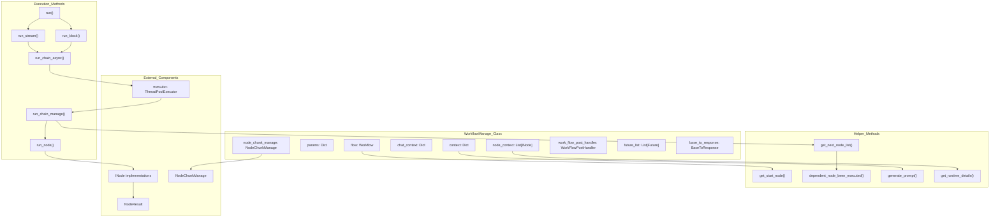
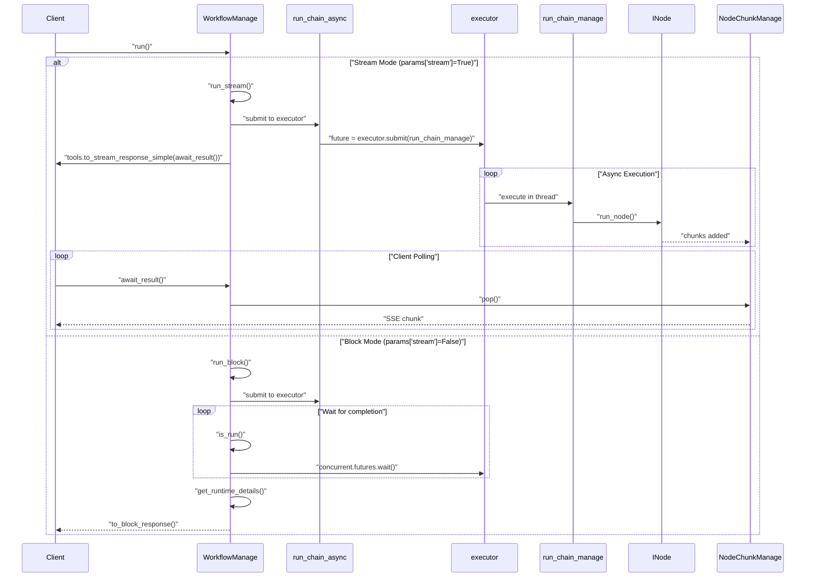
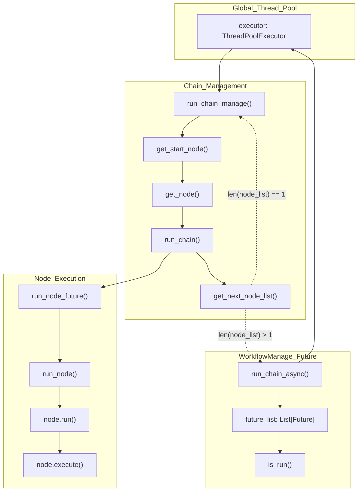
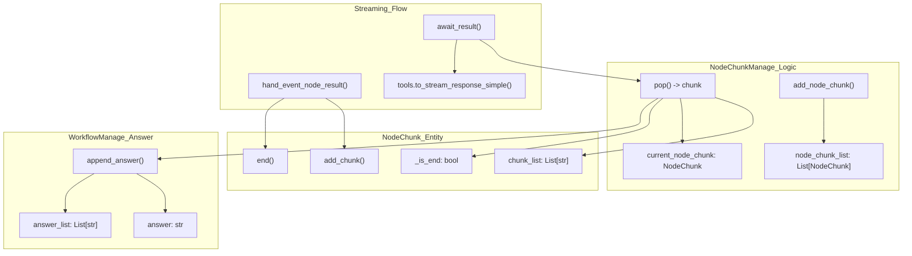

<!-- source: DeepWiki mcp.deepwiki.com · repo 1Panel-dev/MaxKB · page 5.2 Workflow Execution Engine · fetched 2026-10-29 -->

# Workflow Execution Engine

Relevant source files

The following files were used as context for generating this wiki page:

- [apps/application/chat_pipeline/step/chat_step/i_chat_step.py](apps/application/chat_pipeline/step/chat_step/i_chat_step.py)
- [apps/application/chat_pipeline/step/chat_step/impl/base_chat_step.py](apps/application/chat_pipeline/step/chat_step/impl/base_chat_step.py)
- [apps/application/flow/common.py](apps/application/flow/common.py)
- [apps/application/flow/i_step_node.py](apps/application/flow/i_step_node.py)
- [apps/application/flow/knowledge_workflow_manage.py](apps/application/flow/knowledge_workflow_manage.py)
- [apps/application/flow/loop_workflow_manage.py](apps/application/flow/loop_workflow_manage.py)
- [apps/application/flow/step_node/ai_chat_step_node/i_chat_node.py](apps/application/flow/step_node/ai_chat_step_node/i_chat_node.py)
- [apps/application/flow/step_node/ai_chat_step_node/impl/base_chat_node.py](apps/application/flow/step_node/ai_chat_step_node/impl/base_chat_node.py)
- [apps/application/flow/step_node/application_node/i_application_node.py](apps/application/flow/step_node/application_node/i_application_node.py)
- [apps/application/flow/step_node/application_node/impl/base_application_node.py](apps/application/flow/step_node/application_node/impl/base_application_node.py)
- [apps/application/flow/step_node/data_source_web_node/impl/base_data_source_web_node.py](apps/application/flow/step_node/data_source_web_node/impl/base_data_source_web_node.py)
- [apps/application/flow/step_node/direct_reply_node/i_reply_node.py](apps/application/flow/step_node/direct_reply_node/i_reply_node.py)
- [apps/application/flow/step_node/direct_reply_node/impl/base_reply_node.py](apps/application/flow/step_node/direct_reply_node/impl/base_reply_node.py)
- [apps/application/flow/step_node/intent_node/impl/base_intent_node.py](apps/application/flow/step_node/intent_node/impl/base_intent_node.py)
- [apps/application/flow/step_node/loop_node/impl/base_loop_node.py](apps/application/flow/step_node/loop_node/impl/base_loop_node.py)
- [apps/application/flow/step_node/parameter_extraction_node/impl/base_parameter_extraction_node.py](apps/application/flow/step_node/parameter_extraction_node/impl/base_parameter_extraction_node.py)
- [apps/application/flow/step_node/question_node/i_question_node.py](apps/application/flow/step_node/question_node/i_question_node.py)
- [apps/application/flow/step_node/question_node/impl/base_question_node.py](apps/application/flow/step_node/question_node/impl/base_question_node.py)
- [apps/application/flow/step_node/variable_splitting_node/impl/base_variable_splitting_node.py](apps/application/flow/step_node/variable_splitting_node/impl/base_variable_splitting_node.py)
- [apps/application/flow/tools.py](apps/application/flow/tools.py)
- [apps/application/flow/workflow_manage.py](apps/application/flow/workflow_manage.py)
- [apps/application/long_term_memory/__init__.py](apps/application/long_term_memory/__init__.py)
- [apps/application/models/application.py](apps/application/models/application.py)
- [apps/common/encoder/encoder.py](apps/common/encoder/encoder.py)
- [apps/knowledge/task/handler.py](apps/knowledge/task/handler.py)
- [apps/models_provider/impl/local_model_provider/model/embedding/web.py](apps/models_provider/impl/local_model_provider/model/embedding/web.py)
- [apps/models_provider/impl/ollama_model_provider/ollama_model_provider.py](apps/models_provider/impl/ollama_model_provider/ollama_model_provider.py)
- [apps/trigger/handler/impl/task/application_task.py](apps/trigger/handler/impl/task/application_task.py)
- [apps/trigger/handler/impl/trigger/event_trigger.py](apps/trigger/handler/impl/trigger/event_trigger.py)
- [ui/src/api/type/application.ts](ui/src/api/type/application.ts)
- [ui/src/workflow/common/validate.ts](ui/src/workflow/common/validate.ts)
- [ui/src/workflow/nodes/loop-body-node/LoopBodyContainer.vue](ui/src/workflow/nodes/loop-body-node/LoopBodyContainer.vue)
- [ui/src/workflow/nodes/loop-body-node/index.ts](ui/src/workflow/nodes/loop-body-node/index.ts)
- [ui/src/workflow/nodes/loop-body-node/index.vue](ui/src/workflow/nodes/loop-body-node/index.vue)
- [ui/src/workflow/nodes/loop-node/index.vue](ui/src/workflow/nodes/loop-node/index.vue)
- [ui/src/workflow/nodes/loop-start-node/component/LoopFieldTable.vue](ui/src/workflow/nodes/loop-start-node/component/LoopFieldTable.vue)
- [ui/src/workflow/nodes/loop-start-node/index.ts](ui/src/workflow/nodes/loop-start-node/index.ts)
- [ui/src/workflow/nodes/loop-start-node/index.vue](ui/src/workflow/nodes/loop-start-node/index.vue)

## Purpose and Scope

The Workflow Execution Engine is the runtime orchestrator that executes visual workflows built in MaxKB. The `WorkflowManage` class serves as the central execution coordinator, managing node execution through a thread pool (`ThreadPoolExecutor`), handling both streaming and blocking response modes, maintaining multi-level execution context, and coordinating asynchronous chain execution across parallel branches.

This page documents the execution engine's core mechanics, including the `run()`, `run_stream()`, and `run_block()` methods, async chain execution (`run_chain_async()`, `run_chain_manage()`), context management (`context`, `chat_context`, `node_context`), and streaming chunk coordination through `NodeChunkManage`.

For information about the workflow graph structure and node interface design, see page 5.1. For details about specific node type implementations (AI Chat, Search Dataset, etc.), see page 5.3. For the alternative pipeline-based execution system, see page 5.4.

## WorkflowManage Class Architecture

### Core Components and Relationships

The `WorkflowManage` class is initialized with a `Workflow` object containing the node graph, execution parameters (`params`), and a post-handler for persisting results [apps/application/flow/workflow_manage.py:93-146](). It maintains three levels of context: global workflow context (`context`), chat-specific context (`chat_context`), and per-node execution context (`node_context` list) [apps/application/flow/workflow_manage.py:123-145](). The class uses a global `ThreadPoolExecutor` with 200 max workers for parallel node execution [apps/application/flow/workflow_manage.py:30-30]().

**Sources:** [apps/application/flow/workflow_manage.py:93-146](), [apps/application/flow/workflow_manage.py:30-30]()

### Execution Flow: Stream vs Block Modes

The `run()` method dispatches to either `run_stream()` or `run_block()` based on `params['stream']` [apps/application/flow/workflow_manage.py:228-263](). Stream mode returns immediately with a generator that yields chunks as they become available via `await_result()` [apps/application/flow/workflow_manage.py:235-240](), while block mode waits for all futures to complete before returning the full response [apps/application/flow/workflow_manage.py:242-263]().

**Sources:** [apps/application/flow/workflow_manage.py:228-263](), [apps/application/flow/workflow_manage.py:322-351]()

## Async Chain Execution

### Thread Pool and Future Management

The execution engine uses asynchronous chain execution to support parallel node branches and non-blocking execution:

The `run_chain_async()` method submits `run_chain_manage()` to the global thread pool executor and tracks the future in `future_list` [apps/application/flow/workflow_manage.py:525-539](). Each call to `run_chain_manage()` processes one node, then recursively spawns execution for downstream nodes [apps/application/flow/workflow_manage.py:353-378](). Single next nodes are executed synchronously within the same thread, while multiple next nodes spawn new threads for parallel execution [apps/application/flow/workflow_manage.py:373-378]().

**Sources:** [apps/application/flow/workflow_manage.py:525-539](), [apps/application/flow/workflow_manage.py:353-378]()

### Node Result Handling and Context Writing

The `run_node_future()` method wraps node execution in a try-catch, returning a `NodeResultFuture` with either the result or exception [apps/application/flow/workflow_manage.py:529-536](). In stream mode, `hand_event_node_result()` iterates over the result generator, converting each chunk into a streaming response and adding it to the node's chunk buffer [apps/application/flow/workflow_manage.py:417-523](). The `NodeResult.write_context()` method updates both node-level and workflow-level context dictionaries [apps/application/flow/i_step_node.py:31-42]().

**Sources:** [apps/application/flow/workflow_manage.py:529-536](), [apps/application/flow/workflow_manage.py:417-523](), [apps/application/flow/i_step_node.py:31-42]()

## Streaming Response Management

### NodeChunkManage and Chunk Buffer System

The `NodeChunkManage` class coordinates streaming by buffering chunks from multiple concurrent nodes and releasing them in execution order:

The `NodeChunkManage.pop()` method maintains a pointer to the `current_node_chunk` and pops chunks from its `chunk_list` [apps/application/flow/workflow_manage.py:67-89](). When a node's chunk list is empty and `is_end()` returns true, it moves to the next node in `node_chunk_list` [apps/application/flow/workflow_manage.py:79-88]().

**Sources:** [apps/application/flow/workflow_manage.py:54-91](), [apps/application/flow/common.py:70-92]()

### await_result() Generator and Streaming Loop

The `await_result()` generator implements the streaming generator that the frontend consumes [apps/application/flow/workflow_manage.py:322-351](). It uses a dual-loop structure: the outer loop polls `is_run()` to check if any futures are still executing [apps/application/flow/workflow_manage.py:324-331](), while the inner loop drains available chunks from `NodeChunkManage.pop()` [apps/application/flow/workflow_manage.py:326-330](). After completion, it calls the post-handler to persist the chat record [apps/application/flow/workflow_manage.py:343-343]().

**Sources:** [apps/application/flow/workflow_manage.py:322-351](), [apps/application/flow/workflow_manage.py:308-320]()

## Context and State Management

### Three-Level Context Architecture

The `WorkflowManage` class maintains context at three distinct levels:

| Context Level | Scope | Access Pattern | Storage |
|--------------|-------|----------------|---------|
| `context` | Global workflow variables | `workflow.context[key]` or `{{global.fieldName}}` | Single dict [apps/application/flow/workflow_manage.py:123-123]() |
| `chat_context` | Chat session state | `workflow.chat_context[key]` or `{{chat.fieldName}}` | Single dict [apps/application/flow/workflow_manage.py:124-124]() |
| `node_context` | Per-node execution state | `node.context[key]` or `{{NodeName.fieldName}}` | List of node instances [apps/application/flow/workflow_manage.py:145-145]() |

The `init_fields()` method scans nodes and extracts field definitions into sorted lists (`field_list`, `global_field_list`, `chat_field_list`), ensuring longest matches are replaced first during interpolation [apps/application/flow/workflow_manage.py:147-176]().

**Sources:** [apps/application/flow/workflow_manage.py:123-145](), [apps/application/flow/workflow_manage.py:147-176]()

### Prompt Generation and Context Interpolation

The `generate_prompt()` method interpolates context values into template strings [apps/application/flow/workflow_manage.py:735-745](). It first uses `reset_prompt()` to replace placeholder syntax with Jinja2 expressions [apps/application/flow/workflow_manage.py:717-733](), then applies Jinja2 template formatting with the full context dictionary retrieved via `get_workflow_content()` [apps/application/flow/workflow_manage.py:691-715]().

**Sources:** [apps/application/flow/workflow_manage.py:735-745](), [apps/application/flow/workflow_manage.py:717-733](), [apps/application/flow/workflow_manage.py:691-715]()

## Execution Flow Patterns

### Parallel Branch and Conditional Execution

The `get_next_node_list()` method determines next nodes based on edge routing and dependency resolution [apps/application/flow/workflow_manage.py:647-689]().

| Pattern | Detection | Dispatch Method | Use Case |
|---------|-----------|----------------|----------|
| Single next node | `len(node_list) == 1` | `run_chain_manage()` | Sequential flow [apps/application/flow/workflow_manage.py:374-374]() |
| Parallel branches | `len(node_list) > 1` | `executor.submit()` | Forking branches [apps/application/flow/workflow_manage.py:377-378]() |
| Conditional branch | `node_result.is_assertion_result()` | Match `branch_id` | If/Switch routing [apps/application/flow/workflow_manage.py:654-664]() |
| AND dependency | `node.properties['condition'] == 'AND'` | All upstream nodes must complete | Join point [apps/application/flow/workflow_manage.py:680-681]() |

**Sources:** [apps/application/flow/workflow_manage.py:647-689](), [apps/application/flow/workflow_manage.py:373-378]()

### Dependency Resolution and Node Readiness

The `dependent_node_been_executed()` method ensures nodes execute only after required upstream nodes complete [apps/application/flow/workflow_manage.py:635-645](). It checks individual edge satisfaction via `dependent_node()`, verifying node completion and branch matching [apps/application/flow/workflow_manage.py:618-633]().

**Sources:** [apps/application/flow/workflow_manage.py:635-645](), [apps/application/flow/workflow_manage.py:618-633]()

### Error Handling

| Error Type | Handler | Strategy |
|------------|---------|----------|
| Node Execution | `run_node_future()` | Exception capture and status 500 [apps/application/flow/workflow_manage.py:532-536]() |
| Interruption | `is_the_task_interrupted()` | Stop iteration/execution [apps/application/flow/workflow_manage.py:70-71]() |
| Post-Execution | `WorkFlowPostHandler` | State persistence and memory extraction [apps/application/flow/i_step_node.py:49-114]() |

**Sources:** [apps/application/flow/workflow_manage.py:529-536](), [apps/application/flow/workflow_manage.py:70-71](), [apps/application/flow/i_step_node.py:49-114]()

---

