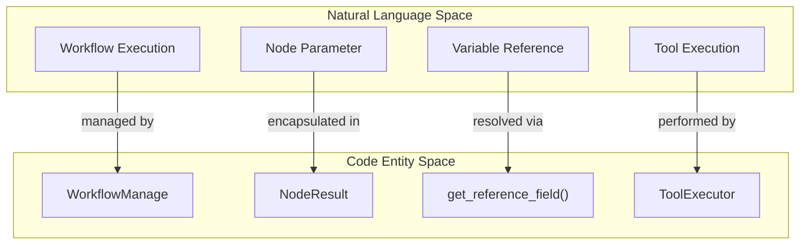
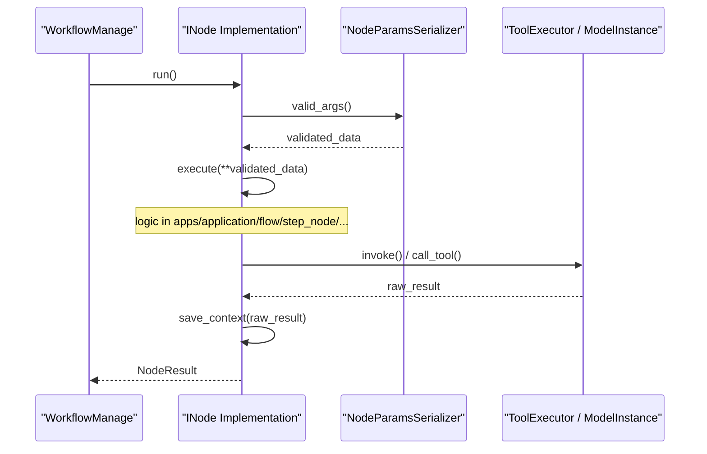

<!-- source: DeepWiki mcp.deepwiki.com · repo 1Panel-dev/MaxKB · page 5.3 Workflow Node Types and Components · fetched 2026-10-29 -->

# Workflow Node Types and Components

<details>
<summary>Relevant source files</summary>

The following files were used as context for generating this wiki page:

- [apps/application/flow/compare/contain_compare.py](apps/application/flow/compare/contain_compare.py)
- [apps/application/flow/compare/is_not_null_compare.py](apps/application/flow/compare/is_not_null_compare.py)
- [apps/application/flow/compare/not_contain_compare.py](apps/application/flow/compare/not_contain_compare.py)
- [apps/application/flow/step_node/document_extract_node/i_document_extract_node.py](apps/application/flow/step_node/document_extract_node/i_document_extract_node.py)
- [apps/application/flow/step_node/document_extract_node/impl/base_document_extract_node.py](apps/application/flow/step_node/document_extract_node/impl/base_document_extract_node.py)
- [apps/application/flow/step_node/document_split_node/i_document_split_node.py](apps/application/flow/step_node/document_split_node/i_document_split_node.py)
- [apps/application/flow/step_node/document_split_node/impl/base_document_split_node.py](apps/application/flow/step_node/document_split_node/impl/base_document_split_node.py)
- [apps/application/flow/step_node/image_generate_step_node/i_image_generate_node.py](apps/application/flow/step_node/image_generate_step_node/i_image_generate_node.py)
- [apps/application/flow/step_node/image_generate_step_node/impl/base_image_generate_node.py](apps/application/flow/step_node/image_generate_step_node/impl/base_image_generate_node.py)
- [apps/application/flow/step_node/image_to_video_step_node/impl/base_image_to_video_node.py](apps/application/flow/step_node/image_to_video_step_node/impl/base_image_to_video_node.py)
- [apps/application/flow/step_node/image_understand_step_node/i_image_understand_node.py](apps/application/flow/step_node/image_understand_step_node/i_image_understand_node.py)
- [apps/application/flow/step_node/image_understand_step_node/impl/base_image_understand_node.py](apps/application/flow/step_node/image_understand_step_node/impl/base_image_understand_node.py)
- [apps/application/flow/step_node/intent_node/i_intent_node.py](apps/application/flow/step_node/intent_node/i_intent_node.py)
- [apps/application/flow/step_node/knowledge_write_node/impl/base_knowledge_write_node.py](apps/application/flow/step_node/knowledge_write_node/impl/base_knowledge_write_node.py)
- [apps/application/flow/step_node/mcp_node/__init__.py](apps/application/flow/step_node/mcp_node/__init__.py)
- [apps/application/flow/step_node/mcp_node/i_mcp_node.py](apps/application/flow/step_node/mcp_node/i_mcp_node.py)
- [apps/application/flow/step_node/mcp_node/impl/__init__.py](apps/application/flow/step_node/mcp_node/impl/__init__.py)
- [apps/application/flow/step_node/mcp_node/impl/base_mcp_node.py](apps/application/flow/step_node/mcp_node/impl/base_mcp_node.py)
- [apps/application/flow/step_node/reranker_node/i_reranker_node.py](apps/application/flow/step_node/reranker_node/i_reranker_node.py)
- [apps/application/flow/step_node/reranker_node/impl/base_reranker_node.py](apps/application/flow/step_node/reranker_node/impl/base_reranker_node.py)
- [apps/application/flow/step_node/search_document_node/__init__.py](apps/application/flow/step_node/search_document_node/__init__.py)
- [apps/application/flow/step_node/search_document_node/i_search_document_node.py](apps/application/flow/step_node/search_document_node/i_search_document_node.py)
- [apps/application/flow/step_node/search_document_node/impl/__init__.py](apps/application/flow/step_node/search_document_node/impl/__init__.py)
- [apps/application/flow/step_node/search_document_node/impl/base_search_document_node.py](apps/application/flow/step_node/search_document_node/impl/base_search_document_node.py)
- [apps/application/flow/step_node/search_knowledge_node/i_search_knowledge_node.py](apps/application/flow/step_node/search_knowledge_node/i_search_knowledge_node.py)
- [apps/application/flow/step_node/search_knowledge_node/impl/base_search_knowledge_node.py](apps/application/flow/step_node/search_knowledge_node/impl/base_search_knowledge_node.py)
- [apps/application/flow/step_node/speech_to_text_step_node/i_speech_to_text_node.py](apps/application/flow/step_node/speech_to_text_step_node/i_speech_to_text_node.py)
- [apps/application/flow/step_node/speech_to_text_step_node/impl/base_speech_to_text_node.py](apps/application/flow/step_node/speech_to_text_step_node/impl/base_speech_to_text_node.py)
- [apps/application/flow/step_node/text_to_speech_step_node/i_text_to_speech_node.py](apps/application/flow/step_node/text_to_speech_step_node/i_text_to_speech_node.py)
- [apps/application/flow/step_node/text_to_speech_step_node/impl/base_text_to_speech_node.py](apps/application/flow/step_node/text_to_speech_step_node/impl/base_text_to_speech_node.py)
- [apps/application/flow/step_node/text_to_video_step_node/impl/base_text_to_video_node.py](apps/application/flow/step_node/text_to_video_step_node/impl/base_text_to_video_node.py)
- [apps/application/flow/step_node/tool_lib_node/impl/base_tool_lib_node.py](apps/application/flow/step_node/tool_lib_node/impl/base_tool_lib_node.py)
- [apps/application/flow/step_node/tool_node/impl/base_tool_node.py](apps/application/flow/step_node/tool_node/impl/base_tool_node.py)
- [apps/application/flow/step_node/variable_aggregation_node/i_variable_aggregation_node.py](apps/application/flow/step_node/variable_aggregation_node/i_variable_aggregation_node.py)
- [apps/application/flow/step_node/variable_aggregation_node/impl/base_variable_aggregation_node.py](apps/application/flow/step_node/variable_aggregation_node/impl/base_variable_aggregation_node.py)
- [apps/application/flow/step_node/variable_assign_node/impl/base_variable_assign_node.py](apps/application/flow/step_node/variable_assign_node/impl/base_variable_assign_node.py)
- [apps/application/sql/list_knowledge_paragraph_by_paragraph_id.sql](apps/application/sql/list_knowledge_paragraph_by_paragraph_id.sql)
- [apps/common/chunk/__init__.py](apps/common/chunk/__init__.py)
- [apps/common/chunk/i_chunk_handle.py](apps/common/chunk/i_chunk_handle.py)
- [apps/common/chunk/impl/mark_chunk_handle.py](apps/common/chunk/impl/mark_chunk_handle.py)
- [apps/common/handle/base_parse_qa_handle.py](apps/common/handle/base_parse_qa_handle.py)
- [apps/common/handle/impl/qa/csv_parse_qa_handle.py](apps/common/handle/impl/qa/csv_parse_qa_handle.py)
- [apps/common/handle/impl/qa/md_parse_qa_handle.py](apps/common/handle/impl/qa/md_parse_qa_handle.py)
- [apps/common/handle/impl/qa/xls_parse_qa_handle.py](apps/common/handle/impl/qa/xls_parse_qa_handle.py)
- [apps/common/handle/impl/qa/xlsx_parse_qa_handle.py](apps/common/handle/impl/qa/xlsx_parse_qa_handle.py)
- [apps/common/handle/impl/qa/zip_parse_qa_handle.py](apps/common/handle/impl/qa/zip_parse_qa_handle.py)
- [apps/common/utils/shared_resource_auth.py](apps/common/utils/shared_resource_auth.py)
- [apps/local_model/serializers/model_apply_serializers.py](apps/local_model/serializers/model_apply_serializers.py)
- [apps/models_provider/impl/siliconCloud_model_provider/credential/tts.py](apps/models_provider/impl/siliconCloud_model_provider/credential/tts.py)
- [apps/models_provider/impl/siliconCloud_model_provider/siliconCloud_model_provider.py](apps/models_provider/impl/siliconCloud_model_provider/siliconCloud_model_provider.py)
- [apps/models_provider/serializers/model_apply_serializers.py](apps/models_provider/serializers/model_apply_serializers.py)
- [apps/trigger/handler/impl/task/tool_task/base_tool_task.py](apps/trigger/handler/impl/task/tool_task/base_tool_task.py)
- [apps/trigger/handler/impl/task/tool_task/workflow_tool_task.py](apps/trigger/handler/impl/task/tool_task/workflow_tool_task.py)
- [ui/src/components/ai-chat/component/knowledge-source-component/ExecutionDetailContent.vue](ui/src/components/ai-chat/component/knowledge-source-component/ExecutionDetailContent.vue)
- [ui/src/components/execution-detail-card/index.vue](ui/src/components/execution-detail-card/index.vue)
- [ui/src/views/application/component/McpServersDialog.vue](ui/src/views/application/component/McpServersDialog.vue)
- [ui/src/views/application/component/ParamSettingDialog.vue](ui/src/views/application/component/ParamSettingDialog.vue)
- [ui/src/workflow/nodes/application-node/index.vue](ui/src/workflow/nodes/application-node/index.vue)
- [ui/src/workflow/nodes/data-source-local-node/index.vue](ui/src/workflow/nodes/data-source-local-node/index.vue)
- [ui/src/workflow/nodes/data-source-web-node/index.vue](ui/src/workflow/nodes/data-source-web-node/index.vue)
- [ui/src/workflow/nodes/document-extract-node/index.vue](ui/src/workflow/nodes/document-extract-node/index.vue)
- [ui/src/workflow/nodes/document-split-node/index.vue](ui/src/workflow/nodes/document-split-node/index.vue)
- [ui/src/workflow/nodes/image-generate/index.vue](ui/src/workflow/nodes/image-generate/index.vue)
- [ui/src/workflow/nodes/image-to-video/index.vue](ui/src/workflow/nodes/image-to-video/index.vue)
- [ui/src/workflow/nodes/image-understand/index.vue](ui/src/workflow/nodes/image-understand/index.vue)
- [ui/src/workflow/nodes/intent-classify-node/index.ts](ui/src/workflow/nodes/intent-classify-node/index.ts)
- [ui/src/workflow/nodes/intent-classify-node/index.vue](ui/src/workflow/nodes/intent-classify-node/index.vue)
- [ui/src/workflow/nodes/mcp-node/index.vue](ui/src/workflow/nodes/mcp-node/index.vue)
- [ui/src/workflow/nodes/question-node/index.vue](ui/src/workflow/nodes/question-node/index.vue)
- [ui/src/workflow/nodes/reply-node/index.vue](ui/src/workflow/nodes/reply-node/index.vue)
- [ui/src/workflow/nodes/reranker-node/ParamSettingDialog.vue](ui/src/workflow/nodes/reranker-node/ParamSettingDialog.vue)
- [ui/src/workflow/nodes/reranker-node/index.vue](ui/src/workflow/nodes/reranker-node/index.vue)
- [ui/src/workflow/nodes/search-document-node/index.vue](ui/src/workflow/nodes/search-document-node/index.vue)
- [ui/src/workflow/nodes/search-knowledge-node/index.vue](ui/src/workflow/nodes/search-knowledge-node/index.vue)
- [ui/src/workflow/nodes/speech-to-text-node/index.vue](ui/src/workflow/nodes/speech-to-text-node/index.vue)
- [ui/src/workflow/nodes/text-to-speech-node/index.vue](ui/src/workflow/nodes/text-to-speech-node/index.vue)
- [ui/src/workflow/nodes/text-to-video/index.vue](ui/src/workflow/nodes/text-to-video/index.vue)
- [ui/src/workflow/nodes/tool-lib-node/index.vue](ui/src/workflow/nodes/tool-lib-node/index.vue)
- [ui/src/workflow/nodes/tool-node/index.vue](ui/src/workflow/nodes/tool-node/index.vue)
- [ui/src/workflow/nodes/variable-aggregation-node/component/GroupFieldDialog.vue](ui/src/workflow/nodes/variable-aggregation-node/component/GroupFieldDialog.vue)
- [ui/src/workflow/nodes/variable-aggregation-node/index.ts](ui/src/workflow/nodes/variable-aggregation-node/index.ts)
- [ui/src/workflow/nodes/variable-aggregation-node/index.vue](ui/src/workflow/nodes/variable-aggregation-node/index.vue)
- [ui/src/workflow/nodes/variable-assign-node/index.vue](ui/src/workflow/nodes/variable-assign-node/index.vue)
- [ui/src/workflow/nodes/variable-splitting/component/VariableFieldDialog.vue](ui/src/workflow/nodes/variable-splitting/component/VariableFieldDialog.vue)
- [ui/src/workflow/nodes/video-understand/index.vue](ui/src/workflow/nodes/video-understand/index.vue)

</details>


## Purpose and Scope

This document describes the various node types available in MaxKB's workflow system and their implementations. Each node type represents a specific operation or capability that can be orchestrated in a workflow, from AI chat interactions to knowledge base searches to multimedia processing. 

For information about the workflow execution engine and orchestration, see [Workflow Execution Engine](#5.2). For the overall workflow design and graph structure, see [Workflow Design and Node System](#5.1). For the pipeline-based execution alternative, see [Chat Pipeline System](#5.4).

## Node Architecture Overview

All workflow nodes in MaxKB inherit from the `INode` base interface, which defines the core contract for node execution, validation, and context management.

### Base Node Interface

The `INode` class [apps/application/flow/i_step_node.py:207-314]() provides the foundation for all workflow nodes:

```
INode
├── Node identification (id, runtime_node_id, up_node_id_list)
├── Context management (context dict, answer_text)
├── Execution lifecycle (run(), _run(), execute())
├── Validation (valid_args(), get_node_params_serializer_class())
├── Result handling (get_details(), save_context())
└── Field referencing (get_reference_field())
```

Key responsibilities:
- **Validation**: Each node validates its parameters using serializers before execution [apps/application/flow/i_step_node.py:247-257]().
- **Context Management**: Maintains execution state and output data in `context` dictionary [apps/application/flow/i_step_node.py:234-234]().
- **Result Generation**: Returns `NodeResult` objects containing node and workflow variables [apps/application/flow/i_step_node.py:143-164]().
- **Runtime Identification**: Uses SHA1 hash of node path for unique runtime identification [apps/application/flow/i_step_node.py:214-220]().

Sources: [apps/application/flow/i_step_node.py:143-314]()

## Node Categories

### 1. Chat and LLM Nodes

These nodes interact with Large Language Models to generate conversational responses.

#### AI Chat Node (`ai-chat-node`)

**Backend Implementation**: [apps/application/flow/step_node/ai_chat_step_node/impl/base_chat_node.py:144-351]()
**Frontend Component**: [ui/src/workflow/nodes/ai-chat-node/index.vue:1-716]()

The AI Chat Node is the primary LLM interaction node supporting:
- Multi-turn conversation history (NODE or WORKFLOW context) [apps/application/flow/step_node/ai_chat_step_node/impl/base_chat_node.py:166-173]().
- System prompts and user prompts with variable substitution.
- Model parameter customization (temperature, max_tokens).
- Tool integration via MCP (Model Context Protocol) [apps/application/flow/step_node/ai_chat_step_node/impl/base_chat_node.py:210-285]().
- Custom tools and application agents.
- Reasoning content display [apps/application/flow/step_node/ai_chat_step_node/impl/base_chat_node.py:47-92]().
- Streaming and block response modes.

**Key Configuration Parameters**:

| Parameter | Type | Required | Description |
|-----------|------|----------|-------------|
| `model_id` | string | Yes | LLM model identifier |
| `system` | string | No | System/role prompt |
| `prompt` | string | Yes | User prompt template with variable references |
| `dialogue_number` | integer | Yes | Number of history messages to include |
| `dialogue_type` | string | No | Context type: "NODE" or "WORKFLOW" |
| `mcp_servers` | JSON | No | Custom MCP server configuration |
| `mcp_tool_ids` | list | No | Referenced MCP tool IDs |
| `tool_ids` | list | No | Custom tool IDs |
| `application_ids` | list | No | Agent application IDs |
| `is_result` | boolean | No | Whether to return as workflow output |

Sources: [apps/application/flow/step_node/ai_chat_step_node/impl/base_chat_node.py:144-351](), [ui/src/workflow/nodes/ai-chat-node/index.vue:1-716]()

#### Question Node (`question-node`)

**Backend Implementation**: [apps/application/flow/step_node/question_node/impl/base_question_node.py:75-159]()
**Frontend Component**: [ui/src/workflow/nodes/question-node/index.vue:1-275]()

The Question Node is a simpler LLM node focused on question rewriting or reformulation. It is typically used for query expansion or multi-turn conversation without tool integration [apps/application/flow/step_node/question_node/impl/base_question_node.py:100-110]().

Sources: [apps/application/flow/step_node/question_node/impl/base_question_node.py:75-159](), [ui/src/workflow/nodes/question-node/index.vue:1-275]()

### 2. Knowledge Retrieval and Processing Nodes

#### Search Knowledge Node (`search-dataset-node`)

**Backend Implementation**: [apps/application/flow/step_node/search_knowledge_node/impl/base_search_knowledge_node.py:23-74]()
**Frontend Component**: [ui/src/workflow/nodes/search-knowledge-node/index.vue:1-236]()

Retrieves relevant paragraphs from knowledge bases using vector similarity search or full-text search [ui/src/workflow/nodes/search-knowledge-node/index.vue:130-162]().

**Key Configuration Parameters**:
- `knowledge_id_list`: Knowledge base IDs to search [ui/src/workflow/nodes/search-knowledge-node/index.vue:43-62]().
- `search_mode`: Search strategy (Embedding, Full Text, or Blend) [ui/src/workflow/nodes/search-knowledge-node/index.vue:131-139]().
- `similarity`: Minimum similarity threshold [ui/src/workflow/nodes/search-knowledge-node/index.vue:141-148]().
- `top_n`: Maximum paragraphs to return [ui/src/workflow/nodes/search-knowledge-node/index.vue:149-153]().

Sources: [apps/application/flow/step_node/search_knowledge_node/impl/base_search_knowledge_node.py:23-74](), [ui/src/workflow/nodes/search-knowledge-node/index.vue:1-236]()

#### Reranker Node (`reranker-node`)

**Backend Implementation**: [apps/application/flow/step_node/reranker_node/impl/base_reranker_node.py:25-83]()
**Frontend Component**: [ui/src/workflow/nodes/reranker-node/index.vue:1-288]()

Scores and re-orders candidate paragraphs using a dedicated Reranker model for higher precision [apps/application/flow/step_node/reranker_node/impl/base_reranker_node.py:53-65]().

Sources: [apps/application/flow/step_node/reranker_node/impl/base_reranker_node.py:25-83](), [ui/src/workflow/nodes/reranker-node/index.vue:1-288]()

#### Document Extract Node

**Backend Implementation**: [apps/application/flow/step_node/document_extract_node/impl/base_document_extract_node.py:17-80]()

Extracts text content from uploaded files. It iterates through supported handlers (PDF, DOCX, XLSX, etc.) to parse file buffers [apps/application/flow/step_node/document_extract_node/impl/base_document_extract_node.py:71-78](). It also handles image extraction from `.doc` files [apps/application/flow/step_node/document_extract_node/impl/base_document_extract_node.py:43-63]().

Sources: [apps/application/flow/step_node/document_extract_node/impl/base_document_extract_node.py:17-80]()

### 3. Logic and Tool Nodes

#### Intent Classification Node (`intent-classify-node`)

**Backend Implementation**: [apps/application/flow/step_node/intent_classify_step_node/impl/base_intent_classify_node.py:133-214]()
**Frontend Component**: [ui/src/workflow/nodes/intent-classify-node/index.vue:1-418]()

Classifies user intent into predefined branches using an LLM [ui/src/workflow/nodes/intent-classify-node/index.ts:1-86]().

Sources: [ui/src/workflow/nodes/intent-classify-node/index.vue:1-418](), [ui/src/workflow/nodes/intent-classify-node/index.ts:1-86]()

#### Tool Library Node

**Backend Implementation**: [apps/application/flow/step_node/tool_lib_node/impl/base_tool_lib_node.py:172-233]()
**Frontend Component**: [ui/src/workflow/nodes/tool-lib-node/index.vue:1-267]()

Executes custom Python tools or API-based tools from the library. It uses `ToolExecutor` to run code in a secure environment [apps/application/flow/step_node/tool_lib_node/impl/base_tool_lib_node.py:31-37](). It handles complex parameter conversion including variable referencing [apps/application/flow/step_node/tool_lib_node/impl/base_tool_lib_node.py:87-113]().

Sources: [apps/application/flow/step_node/tool_lib_node/impl/base_tool_lib_node.py:172-233](), [ui/src/workflow/nodes/tool-lib-node/index.vue:1-267]()

#### MCP Node

**Backend Implementation**: [apps/application/flow/step_node/mcp_node/impl/base_mcp_node.py:15-48]()
**Frontend Component**: [ui/src/workflow/nodes/mcp-node/index.vue:1-269]()

Interacts with Model Context Protocol (MCP) servers. It supports both custom server configurations and referencing existing tools [apps/application/flow/step_node/mcp_node/impl/base_mcp_node.py:23-33](). Execution is performed asynchronously using `MultiServerMCPClient` [apps/application/flow/step_node/mcp_node/impl/base_mcp_node.py:40-45]().

Sources: [apps/application/flow/step_node/mcp_node/impl/base_mcp_node.py:15-48](), [ui/src/workflow/nodes/mcp-node/index.vue:1-269]()

### 4. Multimedia Nodes

#### Image Understanding Node

**Backend Implementation**: [apps/application/flow/step_node/image_understand_step_node/impl/base_image_understand_node.py:127-210]()
**Frontend Component**: [ui/src/workflow/nodes/image-understand/index.vue:1-370]()

Uses vision-capable LLMs to analyze images. It converts file IDs to base64 for model consumption [apps/application/flow/step_node/image_understand_step_node/impl/base_image_understand_node.py:120-124]().

Sources: [apps/application/flow/step_node/image_understand_step_node/impl/base_image_understand_node.py:127-210](), [ui/src/workflow/nodes/image-understand/index.vue:1-370]()

#### Speech-to-Text (STT) and Text-to-Speech (TTS) Nodes

- **TTS Node**: Converts text to audio using a TTS model [apps/application/flow/step_node/text_to_speech_step_node/impl/base_text_to_speech_node.py:17-48]().
- **STT Node**: Transcribes audio to text using an STT model [apps/application/flow/step_node/speech_to_text_step_node/impl/base_speech_to_text_node.py:17-46]().

Sources: [apps/application/flow/step_node/text_to_speech_step_node/impl/base_text_to_speech_node.py:17-48](), [apps/application/flow/speech_to_text_step_node/impl/base_speech_to_text_node.py:17-46]()

## Data Flow and Logic

### Natural Language to Code Entity Mapping

The following diagram maps high-level workflow concepts to their corresponding code entities in the MaxKB backend.

**Diagram: Workflow Conceptual Mapping**

Sources: [apps/application/flow/i_step_node.py:143-164](), [apps/application/flow/workflow_manage.py:691-708](), [apps/application/flow/step_node/tool_lib_node/impl/base_tool_lib_node.py:31-37]()

### Node Execution Sequence

The diagram below illustrates the association between system operations and the specific classes/functions that implement them.

**Diagram: Node Runtime Association**

Sources: [apps/application/flow/i_step_node.py:237-299](), [apps/application/flow/step_node/mcp_node/impl/base_mcp_node.py:40-47]()

### Execution Details Visualization

The frontend uses `ExecutionDetailCard` to visualize the output and runtime metrics of each node during debugging or history review [ui/src/components/execution-detail-card/index.vue:1-175]().

**Key Visual Components**:
- **Token Usage**: Displays input/output tokens for LLM nodes [ui/src/components/execution-detail-card/index.vue:17-29]().
- **Run Time**: Shows execution duration in seconds [ui/src/components/execution-detail-card/index.vue:30-32]().
- **Status Icons**: Success, loading, or error states [ui/src/components/execution-detail-card/index.vue:33-41]().
- **Content Previews**: Renders images, audio players, or video players depending on the node type [ui/src/components/execution-detail-card/index.vue:82-125]().

Sources: [ui/src/components/execution-detail-card/index.vue:1-175]()

---

