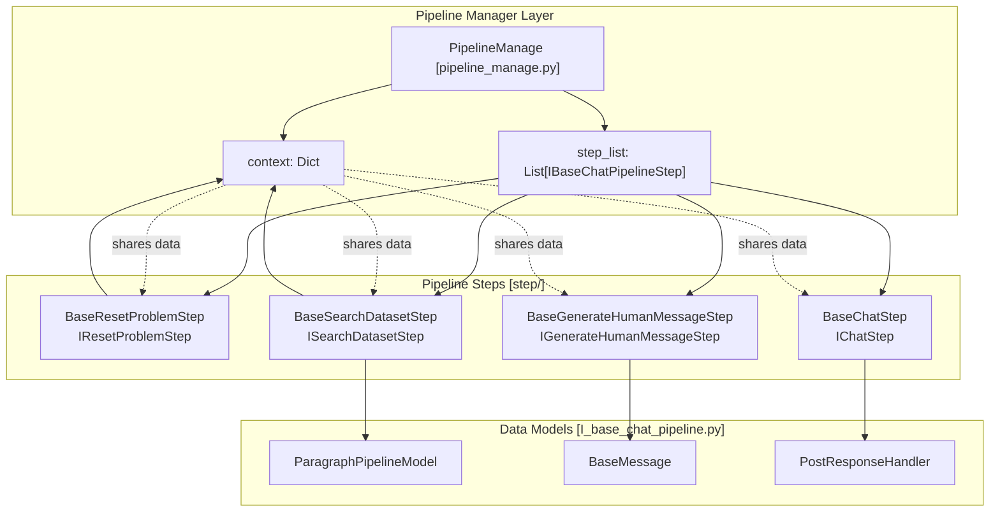
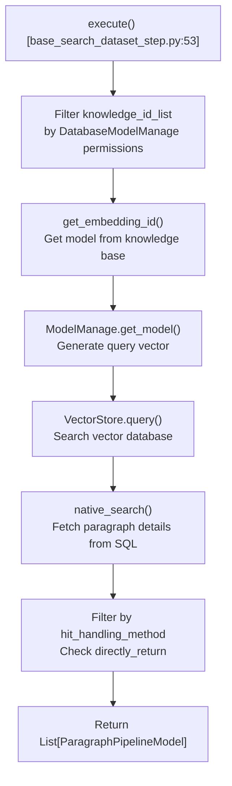
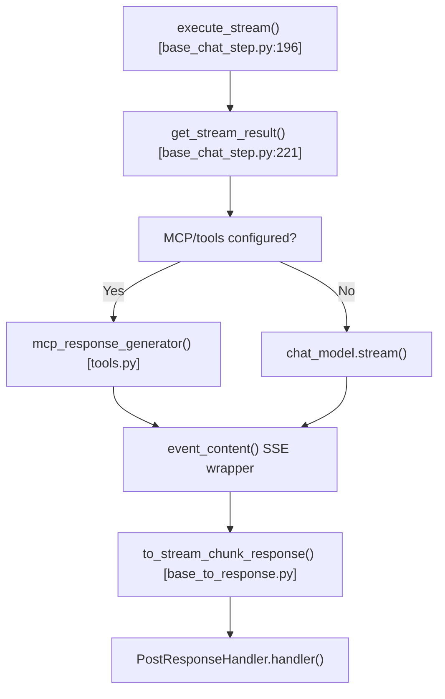
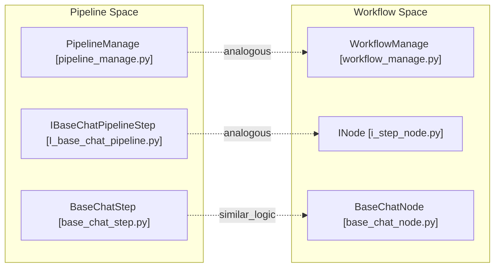

<!-- source: DeepWiki mcp.deepwiki.com · repo 1Panel-dev/MaxKB · page 5.4 Chat Pipeline System · fetched 2026-10-29 -->

# Chat Pipeline System

<details>
<summary>Relevant source files</summary>

The following files were used as context for generating this wiki page:

- [apps/application/chat_pipeline/I_base_chat_pipeline.py](apps/application/chat_pipeline/I_base_chat_pipeline.py)
- [apps/application/chat_pipeline/step/chat_step/i_chat_step.py](apps/application/chat_pipeline/step/chat_step/i_chat_step.py)
- [apps/application/chat_pipeline/step/chat_step/impl/base_chat_step.py](apps/application/chat_pipeline/step/chat_step/impl/base_chat_step.py)
- [apps/application/chat_pipeline/step/generate_human_message_step/i_generate_human_message_step.py](apps/application/chat_pipeline/step/generate_human_message_step/i_generate_human_message_step.py)
- [apps/application/chat_pipeline/step/generate_human_message_step/impl/base_generate_human_message_step.py](apps/application/chat_pipeline/step/generate_human_message_step/impl/base_generate_human_message_step.py)
- [apps/application/chat_pipeline/step/reset_problem_step/i_reset_problem_step.py](apps/application/chat_pipeline/step/reset_problem_step/i_reset_problem_step.py)
- [apps/application/chat_pipeline/step/reset_problem_step/impl/base_reset_problem_step.py](apps/application/chat_pipeline/step/reset_problem_step/impl/base_reset_problem_step.py)
- [apps/application/chat_pipeline/step/search_dataset_step/i_search_dataset_step.py](apps/application/chat_pipeline/step/search_dataset_step/i_search_dataset_step.py)
- [apps/application/chat_pipeline/step/search_dataset_step/impl/base_search_dataset_step.py](apps/application/chat_pipeline/step/search_dataset_step/impl/base_search_dataset_step.py)
- [apps/application/flow/i_step_node.py](apps/application/flow/i_step_node.py)
- [apps/application/flow/step_node/ai_chat_step_node/i_chat_node.py](apps/application/flow/step_node/ai_chat_step_node/i_chat_node.py)
- [apps/application/flow/step_node/ai_chat_step_node/impl/base_chat_node.py](apps/application/flow/step_node/ai_chat_step_node/impl/base_chat_node.py)
- [apps/application/flow/step_node/intent_node/impl/base_intent_node.py](apps/application/flow/step_node/intent_node/impl/base_intent_node.py)
- [apps/application/flow/step_node/parameter_extraction_node/impl/base_parameter_extraction_node.py](apps/application/flow/step_node/parameter_extraction_node/impl/base_parameter_extraction_node.py)
- [apps/application/flow/step_node/question_node/i_question_node.py](apps/application/flow/step_node/question_node/i_question_node.py)
- [apps/application/flow/step_node/question_node/impl/base_question_node.py](apps/application/flow/step_node/question_node/impl/base_question_node.py)
- [apps/application/flow/step_node/tool_lib_node/i_tool_lib_node.py](apps/application/flow/step_node/tool_lib_node/i_tool_lib_node.py)
- [apps/application/flow/step_node/variable_splitting_node/impl/base_variable_splitting_node.py](apps/application/flow/step_node/variable_splitting_node/impl/base_variable_splitting_node.py)
- [apps/application/flow/tools.py](apps/application/flow/tools.py)
- [apps/application/flow/workflow_manage.py](apps/application/flow/workflow_manage.py)
- [apps/application/long_term_memory/__init__.py](apps/application/long_term_memory/__init__.py)
- [apps/application/models/application.py](apps/application/models/application.py)
- [apps/knowledge/task/handler.py](apps/knowledge/task/handler.py)
- [apps/models_provider/impl/ollama_model_provider/ollama_model_provider.py](apps/models_provider/impl/ollama_model_provider/ollama_model_provider.py)
- [apps/models_provider/tools.py](apps/models_provider/tools.py)
- [ui/src/api/type/application.ts](ui/src/api/type/application.ts)

</details>


## Purpose and Scope

The Chat Pipeline System is a linear, step-based execution framework designed for typical AI chat interactions in MaxKB. It provides a simpler alternative to the Workflow Engine for straightforward question-answering scenarios where knowledge base retrieval and LLM chat need to be orchestrated sequentially.

This system handles the standard RAG (Retrieval-Augmented Generation) pattern: question rewriting → knowledge base search → message assembly → LLM chat. For complex scenarios requiring branching logic, conditionals, or loops, see the [Workflow Engine](5.2).

**Sources:**
- [apps/application/chat_pipeline/pipeline_manage.py:1-67]()
- [apps/application/chat_pipeline/I_base_chat_pipeline.py:1-186]()

## System Architecture

### Core Components

The Chat Pipeline System consists of three primary components:

| Component | Class | Responsibility |
|-----------|-------|----------------|
| Pipeline Manager | `PipelineManage` | Orchestrates sequential step execution and manages shared context |
| Pipeline Steps | `IBaseChatPipelineStep` implementations | Execute discrete processing units (search, rewrite, chat) |
| Data Models | `ParagraphPipelineModel` | Represent knowledge base search results passed between steps |

**Pipeline Architecture Overview**


**Sources:**
- [apps/application/chat_pipeline/pipeline_manage.py:18-66]()
- [apps/application/chat_pipeline/I_base_chat_pipeline.py:127-186]()

### PipelineManage Class

The `PipelineManage` class ([apps/application/chat_pipeline/pipeline_manage.py:18-46]()) is the central orchestrator:

```python
class PipelineManage:
    def __init__(self, step_list: List[Type[IBaseChatPipelineStep]],
                 base_to_response: BaseToResponse = SystemToResponse(),
                 debug=False)
```

**Key responsibilities:**
- Instantiates step classes into step instances [apps/application/chat_pipeline/pipeline_manage.py:23-24]().
- Maintains shared `context` dictionary for inter-step communication [apps/application/chat_pipeline/pipeline_manage.py:21]().
- Executes steps sequentially via `run()` method [apps/application/chat_pipeline/pipeline_manage.py:30-42]().
- Tracks token usage (`message_tokens`, `answer_tokens`) [apps/application/chat_pipeline/pipeline_manage.py:26-27]().

**Sources:**
- [apps/application/chat_pipeline/pipeline_manage.py:18-46]()

### IBaseChatPipelineStep Interface

All pipeline steps inherit from `IBaseChatPipelineStep` ([apps/application/chat_pipeline/I_base_chat_pipeline.py:127-186]()):

```python
class IBaseChatPipelineStep:
    context: Dict       # Step-local context
    status: int        # 200 = success, 500 = error
    err_message: str   # Error details if status != 200
```

**Execution lifecycle:**
1. `run()`: Entry point, handles timing and error catching [apps/application/chat_pipeline/I_base_chat_pipeline.py:136-160]().
2. `valid_args()`: Validates inputs using the step's serializer [apps/application/chat_pipeline/I_base_chat_pipeline.py:162-171]().
3. `_run()`: Calls `execute()` and stores results in `manage.context` [apps/application/chat_pipeline/I_base_chat_pipeline.py:173-174]().
4. `execute()`: Performs actual step logic [apps/application/chat_pipeline/I_base_chat_pipeline.py:176-180]().

**Sources:**
- [apps/application/chat_pipeline/I_base_chat_pipeline.py:127-186]()

## Pipeline Steps

### BaseResetProblemStep

**Purpose:** Rewrites user questions using conversation history to resolve ambiguities.

**Implementation:** [apps/application/chat_pipeline/step/reset_problem_step/impl/base_reset_problem_step.py:23-56]()

**Algorithm:**
1. Loads last 3 conversation turns from `history_chat_record` [apps/application/chat_pipeline/step/reset_problem_step/impl/base_reset_problem_step.py:30-34]().
2. Constructs message list with history + rewrite prompt [apps/application/chat_pipeline/step/reset_problem_step/impl/base_reset_problem_step.py:35-37]().
3. Invokes LLM with prompt template containing `{question}` placeholder [apps/application/chat_pipeline/step/reset_problem_step/impl/base_reset_problem_step.py:38-39]().
4. Extracts rewritten question from `<data>` tags in response [apps/application/chat_pipeline/step/reset_problem_step/impl/base_reset_problem_step.py:40-44]().

**Sources:**
- [apps/application/chat_pipeline/step/reset_problem_step/impl/base_reset_problem_step.py:23-69]()

### BaseSearchDatasetStep

**Purpose:** Performs vector similarity search across knowledge bases.

**Implementation:** [apps/application/chat_pipeline/step/search_dataset_step/impl/base_search_dataset_step.py:46-133]()

**Search Logic Flow**


**Sources:**
- [apps/application/chat_pipeline/step/search_dataset_step/impl/base_search_dataset_step.py:46-150]()
- [apps/application/chat_pipeline/step/search_dataset_step/i_search_dataset_step.py:21-77]()

### BaseGenerateHumanMessageStep

**Purpose:** Assembles the final message list for LLM.

**Implementation:** [apps/application/chat_pipeline/step/generate_human_message_step/impl/base_generate_human_message_step.py:21-73]()

**Logic:**
- Formats paragraphs into `<data>` tags [apps/application/chat_pipeline/step/generate_human_message_step/impl/base_generate_human_message_step.py:41-45]().
- Replaces `{data}` and `{question}` in prompt template [apps/application/chat_pipeline/step/generate_human_message_step/impl/base_generate_human_message_step.py:47-49]().
- Handles `no_references_setting` when no paragraphs are found [apps/application/chat_pipeline/step/generate_human_message_step/impl/base_generate_human_message_step.py:53-58]().

**Sources:**
- [apps/application/chat_pipeline/step/generate_human_message_step/impl/base_generate_human_message_step.py:21-81]()

### BaseChatStep

**Purpose:** Executes LLM chat with optional tool/MCP integration.

**Implementation:** [apps/application/chat_pipeline/step/chat_step/impl/base_chat_step.py:163-468]()

**Reasoning Extraction:**
The `Reasoning` class ([apps/application/flow/tools.py:86-130]()) is used to extract thought processes from model responses, specifically looking for tags like `` [apps/application/chat_pipeline/step/chat_step/impl/base_chat_step.py:92-94]().

**Streaming Response Flow**


**Sources:**
- [apps/application/chat_pipeline/step/chat_step/impl/base_chat_step.py:163-468]()
- [apps/application/flow/tools.py:86-130]()

## Comparison with Workflow System

### Architectural Differences

| Aspect | Chat Pipeline | Workflow Engine |
|--------|---------------|-----------------|
| **Execution Model** | Linear sequence of steps | DAG-based node execution |
| **Manager Class** | `PipelineManage` | `WorkflowManage` |
| **Execution Unit** | `IBaseChatPipelineStep` | `INode` |
| **Context Management** | Shared `context` dict | Node-specific and Global context |
| **Concurrency** | Sequential | ThreadPoolExecutor (max_workers=200) |
| **Branching** | None | Supported via graph edges |

**Mapping Pipeline to Workflow Concepts**


**Sources:**
- [apps/application/chat_pipeline/pipeline_manage.py:18-66]()
- [apps/application/flow/workflow_manage.py:92-140]()
- [apps/application/flow/i_step_node.py:49-53]()
- [apps/application/flow/step_node/ai_chat_step_node/impl/base_chat_node.py:148-156]()

---

