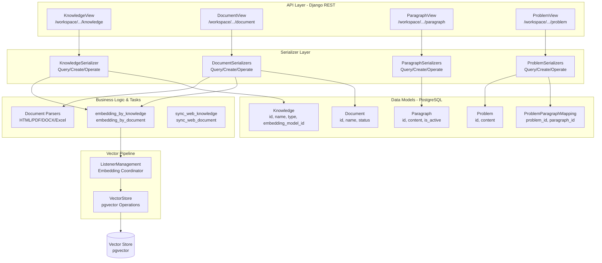
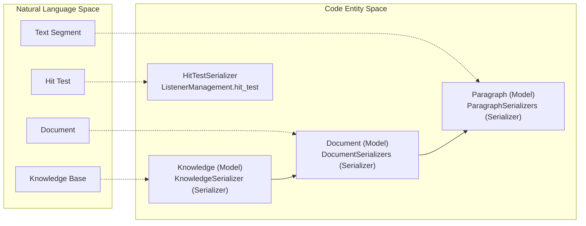
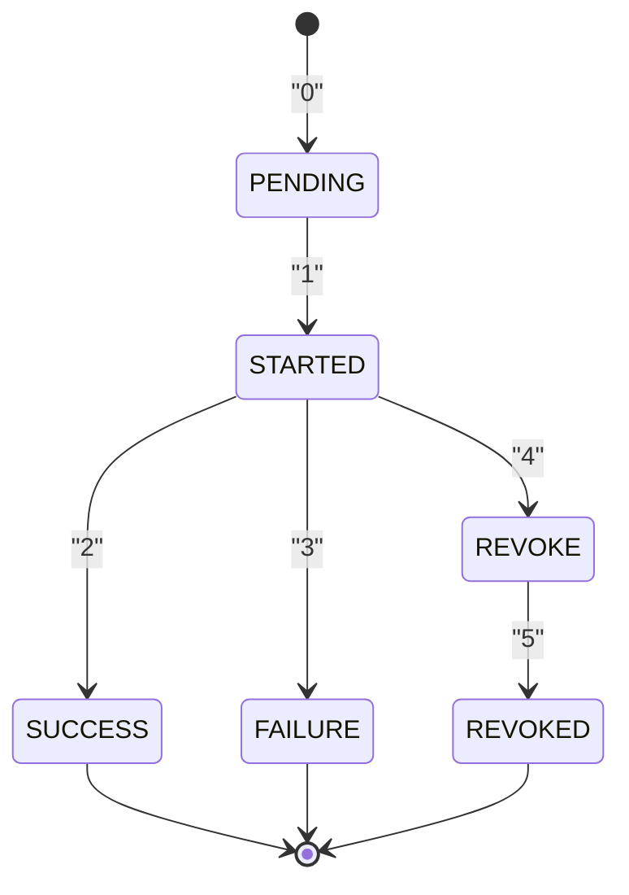

<!-- source: DeepWiki mcp.deepwiki.com · repo 1Panel-dev/MaxKB · page 6 Knowledge Base System · fetched 2026-10-29 -->

# Knowledge Base System

Relevant source files

The following files were used as context for generating this wiki page:

- [apps/application/migrations/0001_initial.py](apps/application/migrations/0001_initial.py)
- [apps/common/mixins/app_model_mixin.py](apps/common/mixins/app_model_mixin.py)
- [apps/folders/views/folder.py](apps/folders/views/folder.py)
- [apps/knowledge/api/document.py](apps/knowledge/api/document.py)
- [apps/knowledge/api/knowledge.py](apps/knowledge/api/knowledge.py)
- [apps/knowledge/api/paragraph.py](apps/knowledge/api/paragraph.py)
- [apps/knowledge/api/problem.py](apps/knowledge/api/problem.py)
- [apps/knowledge/migrations/0001_initial.py](apps/knowledge/migrations/0001_initial.py)
- [apps/knowledge/models/knowledge.py](apps/knowledge/models/knowledge.py)
- [apps/knowledge/serializers/document.py](apps/knowledge/serializers/document.py)
- [apps/knowledge/serializers/knowledge.py](apps/knowledge/serializers/knowledge.py)
- [apps/knowledge/serializers/paragraph.py](apps/knowledge/serializers/paragraph.py)
- [apps/knowledge/serializers/problem.py](apps/knowledge/serializers/problem.py)
- [apps/knowledge/urls.py](apps/knowledge/urls.py)
- [apps/knowledge/views/document.py](apps/knowledge/views/document.py)
- [apps/knowledge/views/knowledge.py](apps/knowledge/views/knowledge.py)
- [apps/knowledge/views/paragraph.py](apps/knowledge/views/paragraph.py)
- [apps/knowledge/views/problem.py](apps/knowledge/views/problem.py)
- [apps/models_provider/migrations/0001_initial.py](apps/models_provider/migrations/0001_initial.py)
- [apps/models_provider/models/model_management.py](apps/models_provider/models/model_management.py)
- [apps/system_manage/migrations/0001_initial.py](apps/system_manage/migrations/0001_initial.py)
- [apps/system_manage/models/log_management.py](apps/system_manage/models/log_management.py)
- [apps/system_manage/views/email_setting.py](apps/system_manage/views/email_setting.py)
- [apps/tools/migrations/0001_initial.py](apps/tools/migrations/0001_initial.py)
- [apps/tools/migrations/0005_taskrecord.py](apps/tools/migrations/0005_taskrecord.py)
- [apps/tools/migrations/internal_tool.sql](apps/tools/migrations/internal_tool.sql)
- [apps/tools/models/tool.py](apps/tools/models/tool.py)
- [apps/users/migrations/0001_initial.py](apps/users/migrations/0001_initial.py)
- [apps/users/models/user.py](apps/users/models/user.py)

## Purpose and Scope

The Knowledge Base System is the core content management subsystem of MaxKB, responsible for storing, processing, and retrieving documents for Retrieval-Augmented Generation (RAG). This system handles the complete lifecycle of knowledge content: from uploading and parsing documents in multiple formats, through segmentation and vectorization, to semantic search and retrieval.

This document covers knowledge base CRUD operations, document processing pipelines, paragraph segmentation, question-answer associations, vector embeddings, and search capabilities.

**Sources:** [apps/knowledge/serializers/knowledge.py:1-650](), [apps/knowledge/views/knowledge.py:1-100](), [apps/knowledge/models/knowledge.py:1-155]()

---

## System Architecture

The Knowledge Base System is organized hierarchically: **Knowledge** → **Document** → **Paragraph** → **Problem**. Each knowledge base contains multiple documents, each document is segmented into paragraphs, and each paragraph can have associated problems (questions) for enhanced retrieval.

### High-Level Architecture Diagram

**Sources:** [apps/knowledge/views/knowledge.py:32-137](), [apps/knowledge/views/document.py:48-150](), [apps/knowledge/serializers/knowledge.py:173-420](), [common/event/listener_manage.py:73-396]()

---

## Data Model

The Knowledge Base System uses several primary models defined in `apps/knowledge/models/knowledge.py`:

| Model | Purpose |
|-------|---------|
| `Knowledge` | Top-level container; defines embedding model and type (BASE, WEB, WORKFLOW). [apps/knowledge/models/knowledge.py:119-140]() |
| `Document` | Individual document metadata and processing status tracking. [apps/knowledge/models/knowledge.py:178-210]() |
| `Paragraph` | Unit of vectorization and retrieval; contains the actual text segments. [apps/knowledge/models/knowledge.py:236-258]() |
| `Problem` | Questions associated with paragraphs to improve semantic hit rates. [apps/knowledge/models/knowledge.py:277-285]() |
| `KnowledgeWorkflow` | Orchestration data for workflow-based knowledge bases. [apps/knowledge/models/knowledge.py:142-155]() |

### Knowledge Types
The system supports several knowledge types via `KnowledgeType`:
- `BASE (0)`: General file-based knowledge.
- `WEB (1)`: Web site scraping.
- `WORKFLOW (4)`: Automated processing via workflow engine.

**Sources:** [apps/knowledge/models/knowledge.py:22-28](), [apps/knowledge/models/knowledge.py:119-140]()

---

## Core Components

### Document Management and Processing
MaxKB supports multi-format parsing including HTML, PDF, DOCX, and Excel. Documents undergo a lifecycle of parsing, splitting into paragraphs, and vectorization. 
For details, see [Document Management and Processing](#6.1).

### Knowledge Base Backend APIs
The system provides a comprehensive set of REST APIs for CRUD operations on knowledge bases, documents, and folders. It includes specialized views for base, web, and workflow knowledge types.
For details, see [Knowledge Base Backend APIs](#6.2).

### Paragraph and Problem Management
Paragraphs are the atomic units of retrieval. The system allows manual editing, active/inactive toggling, and association with "Problems" (Q&A pairs) to enhance search relevance.
For details, see [Paragraph and Problem Management](#6.3).

### Vector Embedding and Search
MaxKB uses `pgvector` for vector storage. The embedding pipeline is managed by `ListenerManagement`, which handles batch vectorization and updates. Search supports `embedding`, `keywords`, and `blend` (hybrid) modes.
For details, see [Vector Embedding and Search](#6.4).

### Batch Operations and Status Tracking
Processing large knowledge bases is handled via asynchronous Celery tasks. The system tracks task states (PENDING, STARTED, SUCCESS, FAILURE) across multiple task types like EMBEDDING and SYNC.
For details, see [Batch Operations and Status Tracking](#6.5).

### Knowledge Workflow
Workflow-based knowledge bases allow for complex ingestion pipelines, enabling automated updates and transformation of data before it enters the vector store.
For details, see [Knowledge Workflow](#6.6).

---

## Code Entity Mapping

This diagram maps high-level concepts to specific code entities within the Knowledge Base system.

**Sources:** [apps/knowledge/models/knowledge.py:119-258](), [apps/knowledge/serializers/knowledge.py:89-105](), [apps/knowledge/serializers/knowledge.py:156-171](), [apps/knowledge/serializers/document.py:40-69]()

---

## Document Status State Machine

The status of a document is represented by a composite string where different positions represent different `TaskType` states (Embedding, Generate Problem, Sync, Tokenize).

**Sources:** [apps/knowledge/models/knowledge.py:30-56](), [apps/knowledge/models/knowledge.py:68-98]()

---

