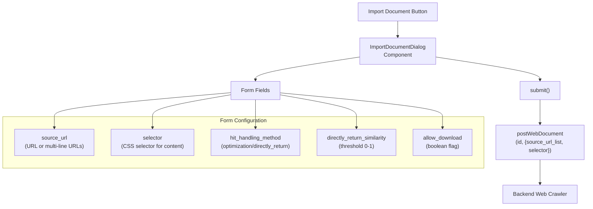
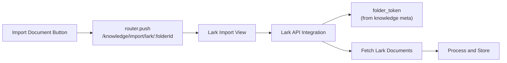
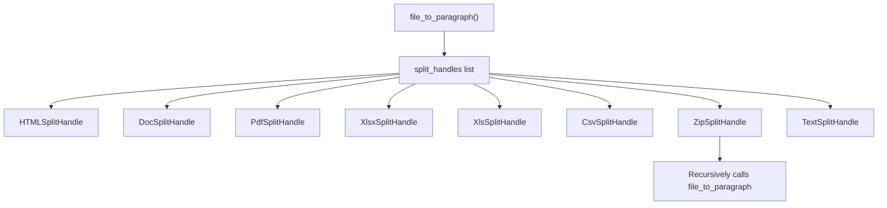
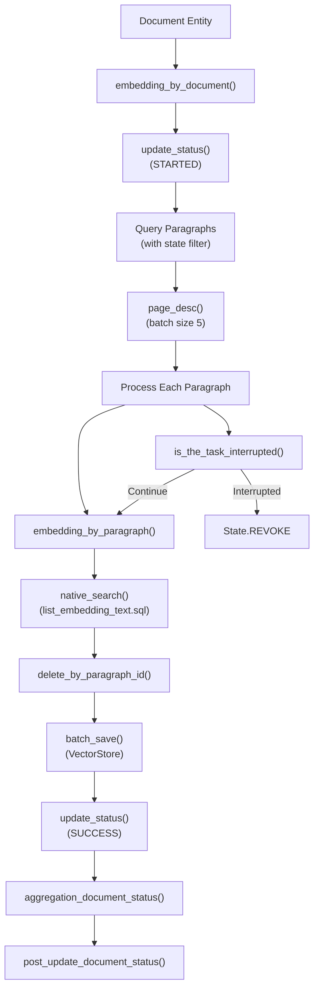
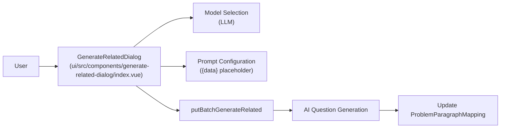

<!-- source: DeepWiki mcp.deepwiki.com · repo 1Panel-dev/MaxKB · page 6.1 Document Management and Processing · fetched 2026-10-29 -->

# Document Management and Processing

Relevant source files

The following files were used as context for generating this wiki page:

- [apps/common/event/listener_manage.py](apps/common/event/listener_manage.py)
- [apps/common/handle/base_parse_table_handle.py](apps/common/handle/base_parse_table_handle.py)
- [apps/common/handle/base_split_handle.py](apps/common/handle/base_split_handle.py)
- [apps/common/handle/impl/table/csv_parse_table_handle.py](apps/common/handle/impl/table/csv_parse_table_handle.py)
- [apps/common/handle/impl/table/xls_parse_table_handle.py](apps/common/handle/impl/table/xls_parse_table_handle.py)
- [apps/common/handle/impl/table/xlsx_parse_table_handle.py](apps/common/handle/impl/table/xlsx_parse_table_handle.py)
- [apps/common/handle/impl/text/csv_split_handle.py](apps/common/handle/impl/text/csv_split_handle.py)
- [apps/common/handle/impl/text/doc_split_handle.py](apps/common/handle/impl/text/doc_split_handle.py)
- [apps/common/handle/impl/text/html_split_handle.py](apps/common/handle/impl/text/html_split_handle.py)
- [apps/common/handle/impl/text/pdf_split_handle.py](apps/common/handle/impl/text/pdf_split_handle.py)
- [apps/common/handle/impl/text/text_split_handle.py](apps/common/handle/impl/text/text_split_handle.py)
- [apps/common/handle/impl/text/xls_split_handle.py](apps/common/handle/impl/text/xls_split_handle.py)
- [apps/common/handle/impl/text/xlsx_split_handle.py](apps/common/handle/impl/text/xlsx_split_handle.py)
- [apps/common/handle/impl/text/zip_split_handle.py](apps/common/handle/impl/text/zip_split_handle.py)
- [apps/common/utils/fork.py](apps/common/utils/fork.py)
- [apps/knowledge/sql/list_document.sql](apps/knowledge/sql/list_document.sql)
- [apps/knowledge/task/sync.py](apps/knowledge/task/sync.py)
- [ui/src/components/dynamics-form/items/table/TableCheckbox.vue](ui/src/components/dynamics-form/items/table/TableCheckbox.vue)
- [ui/src/components/dynamics-form/items/table/TableRadio.vue](ui/src/components/dynamics-form/items/table/TableRadio.vue)
- [ui/src/components/dynamics-form/items/tree/Tree.vue](ui/src/components/dynamics-form/items/tree/Tree.vue)
- [ui/src/components/dynamics-form/items/upload/LocalFileUpload.vue](ui/src/components/dynamics-form/items/upload/LocalFileUpload.vue)
- [ui/src/components/generate-related-dialog/index.vue](ui/src/components/generate-related-dialog/index.vue)
- [ui/src/locales/lang/en-US/views/document.ts](ui/src/locales/lang/en-US/views/document.ts)
- [ui/src/locales/lang/en-US/views/knowledge.ts](ui/src/locales/lang/en-US/views/knowledge.ts)
- [ui/src/locales/lang/en-US/views/problem.ts](ui/src/locales/lang/en-US/views/problem.ts)
- [ui/src/locales/lang/zh-CN/views/document.ts](ui/src/locales/lang/zh-CN/views/document.ts)
- [ui/src/locales/lang/zh-CN/views/knowledge.ts](ui/src/locales/lang/zh-CN/views/knowledge.ts)
- [ui/src/locales/lang/zh-CN/views/problem.ts](ui/src/locales/lang/zh-CN/views/problem.ts)
- [ui/src/locales/lang/zh-Hant/views/document.ts](ui/src/locales/lang/zh-Hant/views/document.ts)
- [ui/src/locales/lang/zh-Hant/views/knowledge.ts](ui/src/locales/lang/zh-Hant/views/knowledge.ts)
- [ui/src/locales/lang/zh-Hant/views/problem.ts](ui/src/locales/lang/zh-Hant/views/problem.ts)
- [ui/src/utils/status.ts](ui/src/utils/status.ts)
- [ui/src/views/document/ImportLarkDocument.vue](ui/src/views/document/ImportLarkDocument.vue)
- [ui/src/views/document/ImportWorkflowDocument.vue](ui/src/views/document/ImportWorkflowDocument.vue)
- [ui/src/views/document/UploadDocument.vue](ui/src/views/document/UploadDocument.vue)
- [ui/src/views/document/component/Status.vue](ui/src/views/document/component/Status.vue)
- [ui/src/views/document/component/StatusTable.vue](ui/src/views/document/component/StatusTable.vue)
- [ui/src/views/document/index.vue](ui/src/views/document/index.vue)
- [ui/src/views/document/tag/CreateTagDialog.vue](ui/src/views/document/tag/CreateTagDialog.vue)
- [ui/src/views/document/tag/EditTagDialog.vue](ui/src/views/document/tag/EditTagDialog.vue)
- [ui/src/views/document/tag/MulAddTagDialog.vue](ui/src/views/document/tag/MulAddTagDialog.vue)
- [ui/src/views/document/tag/TagDrawer.vue](ui/src/views/document/tag/TagDrawer.vue)
- [ui/src/views/document/tag/TagSettingDrawer.vue](ui/src/views/document/tag/TagSettingDrawer.vue)
- [ui/src/views/document/tag/TaglinkedDocumentDialog.vue](ui/src/views/document/tag/TaglinkedDocumentDialog.vue)
- [ui/src/views/document/upload/ResultSuccess.vue](ui/src/views/document/upload/ResultSuccess.vue)
- [ui/src/views/document/upload/SetRules.vue](ui/src/views/document/upload/SetRules.vue)
- [ui/src/views/document/upload/UploadComponent.vue](ui/src/views/document/upload/UploadComponent.vue)
- [ui/src/views/knowledge-workflow/component/DebugDrawer.vue](ui/src/views/knowledge-workflow/component/DebugDrawer.vue)
- [ui/src/views/knowledge-workflow/component/action/DataSource.vue](ui/src/views/knowledge-workflow/component/action/DataSource.vue)
- [ui/src/views/problem/index.vue](ui/src/views/problem/index.vue)
- [ui/src/views/termbase/component/CreateTermbaseDialog.vue](ui/src/views/termbase/component/CreateTermbaseDialog.vue)
- [ui/src/views/termbase/index.vue](ui/src/views/termbase/index.vue)

## Purpose and Scope

This document describes the document management and processing system in MaxKB, covering document upload, multi-format parsing, processing pipelines, and lifecycle management. Documents are the primary data sources for knowledge bases and undergo several processing stages including parsing, splitting, and vectorization before they can be used for retrieval.

For backend APIs related to document operations, see [Knowledge Base Backend APIs](#6.2). For paragraph-level operations and problem management, see [Paragraph and Problem Management](#6.3). For the vectorization and search pipeline, see [Vector Embedding and Search](#6.4).

## Document Types and Sources

MaxKB supports multiple document types, each with different import mechanisms and processing workflows:

| Document Type | `type` Value | Description | Import Method |
|--------------|--------------|-------------|---------------|
| File Upload | `0` | Uploaded files (PDF, DOCX, TXT, etc.) | Direct file upload via UI |
| Web Document | `1` | Web pages crawled from URLs | URL import with CSS selector |
| Lark/Feishu | `2` | Documents from Lark (Feishu) workspace | Lark integration with folder token |
| Workflow-based | `4` | Documents generated from workflow execution | Workflow import trigger |

The document type determines available operations and processing behavior throughout the document lifecycle.

Sources: [ui/src/views/document/index.vue:11-46]()

## Document List View Architecture

The main document management interface is implemented as a Vue component that provides comprehensive CRUD operations and status monitoring.

```mermaid
graph TB
    DocumentIndex["DocumentIndex Component<br/>(ui/src/views/document/index.vue)"]
    AppTable["AppTable Component<br/>Table display with pagination"]
    StatusValue["StatusValue Component<br/>Status visualization"]
    ImportDialog["ImportDocumentDialog<br/>Document import/settings"]
    
    DocumentIndex --> AppTable
    DocumentIndex --> StatusValue
    DocumentIndex --> ImportDialog
    
    subgraph "Document Operations"
        Upload["uploadDocument<br/>(File upload)"]
        Import["importDoc<br/>(Web/Workflow import)"]
        Refresh["refreshDocument<br/>(Re-vectorization)"]
        Sync["syncDocument<br/>(Web/Lark sync)"]
        Export["exportDocument<br/>(Excel/Zip export)"]
        Delete["deleteDocument<br/>(Document deletion)"]
        Migrate["openknowledgeDialog<br/>(KB migration)"]
    end
    
    subgraph "Batch Operations"
        BatchRefresh["batchRefresh<br/>(Multi-doc vectorization)"]
        BatchDelete["deleteMulDocument"]
        BatchExport["exportMulDocument"]
        BatchSync["syncMulDocument"]
        BatchEdit["openBatchEditDocument"]
    end
    
    DocumentIndex --> Upload
    DocumentIndex --> Import
    DocumentIndex --> Refresh
    DocumentIndex --> Sync
    DocumentIndex --> Export
    DocumentIndex --> Delete
    DocumentIndex --> Migrate
    
    DocumentIndex --> BatchRefresh
    DocumentIndex --> BatchDelete
    DocumentIndex --> BatchExport
    DocumentIndex --> BatchSync
    DocumentIndex --> BatchEdit
```

**Key State Management:**

- `documentData`: Array of document records with status tracking.
- `multipleSelection`: Selected documents for batch operations.
- `filterMethod`: Status and property filters.
- `loading`: Loading state for async operations.
- `knowledgeDetail`: Parent knowledge base information.

Sources: [ui/src/views/document/index.vue:745-875]()

## Document Upload and Import

### File Upload (Type 0)

For standard file uploads, users navigate to the upload route which provides a file selection interface supporting multiple formats.

```mermaid
graph LR
    User["User"] --> UploadButton["Upload Document Button"]
    UploadButton --> Router["router.push<br/>/knowledge/document/upload/:folderId/:type"]
    Router --> UploadView["Upload View<br/>(file selection)"]
    UploadView --> API["POST /api/:id/document"]
    API --> Backend["Backend Parser"]
    Backend --> Parser["Format-specific Parser<br/>(HTML/PDF/DOCX/Excel)"]
    Parser --> Splitter["Text Splitter"]
    Splitter --> Paragraph["Paragraph Creation"]
```

Sources: [ui/src/views/document/index.vue:13-19]()

### Web Document Import (Type 1)

Web documents are imported via URL with optional CSS selector for content extraction.

Sources: [ui/src/views/document/index.vue:21-26](), [ui/src/locales/lang/en-US/views/document.ts:168-176]()

### Lark/Feishu Import (Type 2)

Lark documents are imported using folder tokens from the Lark workspace.

Sources: [ui/src/views/document/index.vue:28-40]()

### Workflow Import (Type 4)

Workflow-based documents are generated from workflow execution results. The UI checks if the workflow is published before allowing import.

Sources: [ui/src/views/document/index.vue:42-46](), [ui/src/locales/lang/en-US/views/document.ts:31-32]()

## Multi-Format Parsing and Splitting

MaxKB utilizes a modular parsing architecture to handle various file formats.

### Split Handle Architecture

The system uses specialized "Split Handles" inheriting from `BaseSplitHandle` to process different file types.

**Supported Formats and Handlers:**
- **Zip Archives**: `ZipSplitHandle` processes compressed files, extracts images, and recursively calls parsers for internal files. [apps/common/handle/impl/text/zip_split_handle.py:149-176]()
- **Excel/Tables**: `XlsxParseTableHandle` and `XlsParseTableHandle` manage spreadsheet data, including merged cell value propagation and image extraction from cells. [apps/common/handle/impl/table/xlsx_parse_table_handle.py:20-53](), [apps/common/handle/impl/table/xls_parse_table_handle.py:11-17]()
- **Markdown/Text**: Handled via `TextSplitHandle` with support for Markdown image parsing. [apps/common/handle/impl/text/zip_split_handle.py:28-29]()

Sources: [apps/common/handle/impl/text/zip_split_handle.py:41-58](), [apps/common/handle/impl/table/xlsx_parse_table_handle.py:13-18]()

## Document Processing Pipeline

The document processing pipeline is managed by the `ListenerManagement` class, which orchestrates parsing, splitting, and vectorization tasks.

**Key Classes and Methods:**

- **`ListenerManagement`** [apps/common/event/listener_manage.py:90](): Main orchestration class.
  - `embedding_by_paragraph_list(paragraph_id_list, embedding_model)` [96-118](): Batch paragraph processing using `native_search` and `batch_save`.
  - `embedding_by_paragraph_data_list(data_list, paragraph_id_list, embedding_model)` [120-149](): Core logic for deleting existing vectors and saving new ones.
  - `embedding_by_paragraph(paragraph_id, embedding_model)` [151-187](): Individual paragraph vectorization with interruption checks.
  - `update_status(query_set, taskType, state)` [231-251](): Status tracking updates via bitwise/string manipulation.

Sources: [apps/common/event/listener_manage.py:90-187]()

## Document Status State Machine

Documents and their paragraphs track processing status using a compact bit-encoded status string.

| State | Value | Description |
|-------|-------|-------------|
| `PENDING` | `p` | Waiting to start |
| `STARTED` | `s` | Currently processing |
| `SUCCESS` | `c` | Completed successfully |
| `FAILURE` | `e` | Failed with error |
| `REVOKE` | `r` | Cancellation requested |
| `REVOKED` | `d` | Cancellation complete |

**Task Types:**
- `EMBEDDING`: Vectorization task.
- `GENERATE_PROBLEM`: Question generation task.
- `TOKENIZE`: Tokenization/indexing task.

Sources: [apps/common/event/listener_manage.py:159-186](), [ui/src/locales/lang/en-US/views/document.ts:133-143]()

## Related Question Generation

MaxKB can automatically generate related questions for document segments using AI models. This is handled by the `GenerateRelatedDialog` component.

**Prompting Mechanism:**
The default prompt asks the AI to summarize content and generate 5 questions wrapped in `<question>` tags. [ui/src/locales/lang/zh-CN/views/document.ts:190-199]()

Sources: [ui/src/components/generate-related-dialog/index.vue:1-100](), [ui/src/components/generate-related-dialog/index.vue:193-221]()

## Tag Management

Documents can be organized using a tag system consisting of Keys and Values.

- **Implementation**: Managed via `TagDrawer.vue` and `TagSettingDrawer.vue`.
- **Functionality**: Create tags, add values to tags, and link/unlink documents to specific tag values. [ui/src/views/document/tag/TagDrawer.vue:1-132]()
- **Data Flow**: `getList()` fetches tags from the backend, which are then grouped by key for display in the UI. [ui/src/views/document/tag/TagDrawer.vue:213-220]()

Sources: [ui/src/views/document/tag/TagDrawer.vue:4-132](), [ui/src/locales/lang/en-US/views/document.ts:104-125]()

## Problem and Paragraph Association

The system allows managing "Problems" (questions) and their associations with document "Paragraphs" (segments).

- **Problem Management**: Handled in `ui/src/views/problem/index.vue`.
- **Relating**: Users can manually relate a problem to specific paragraphs or use the AI generation feature. [ui/src/views/problem/index.vue:16-22]()
- **Mapping**: The `ProblemParagraphMapping` model maintains these relationships. [apps/common/event/listener_manage.py:25]()

Sources: [ui/src/views/problem/index.vue:1-156](), [apps/common/event/listener_manage.py:63-69]()

---

