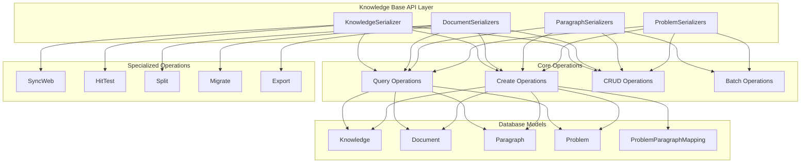
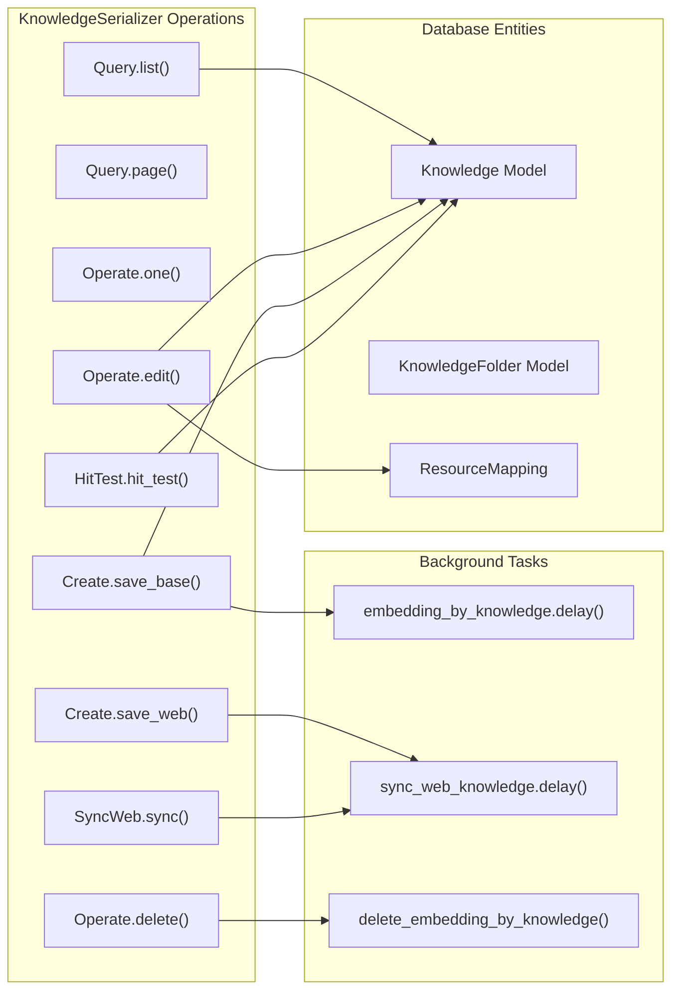

<!-- source: DeepWiki mcp.deepwiki.com · repo 1Panel-dev/MaxKB · page 6.2 Knowledge Base Backend APIs · fetched 2026-10-29 -->

# Knowledge Base Backend APIs

Relevant source files

The following files were used as context for generating this wiki page:

- [apps/folders/views/folder.py](apps/folders/views/folder.py)
- [apps/knowledge/api/document.py](apps/knowledge/api/document.py)
- [apps/knowledge/api/knowledge.py](apps/knowledge/api/knowledge.py)
- [apps/knowledge/api/paragraph.py](apps/knowledge/api/paragraph.py)
- [apps/knowledge/api/problem.py](apps/knowledge/api/problem.py)
- [apps/knowledge/serializers/document.py](apps/knowledge/serializers/document.py)
- [apps/knowledge/serializers/knowledge.py](apps/knowledge/serializers/knowledge.py)
- [apps/knowledge/serializers/paragraph.py](apps/knowledge/serializers/paragraph.py)
- [apps/knowledge/serializers/problem.py](apps/knowledge/serializers/problem.py)
- [apps/knowledge/urls.py](apps/knowledge/urls.py)
- [apps/knowledge/views/document.py](apps/knowledge/views/document.py)
- [apps/knowledge/views/knowledge.py](apps/knowledge/views/knowledge.py)
- [apps/knowledge/views/paragraph.py](apps/knowledge/views/paragraph.py)
- [apps/knowledge/views/problem.py](apps/knowledge/views/problem.py)
- [apps/system_manage/views/email_setting.py](apps/system_manage/views/email_setting.py)
- [ui/src/api/knowledge/document.ts](ui/src/api/knowledge/document.ts)
- [ui/src/api/system-resource-management/chat-user.ts](ui/src/api/system-resource-management/chat-user.ts)
- [ui/src/api/system-resource-management/document.ts](ui/src/api/system-resource-management/document.ts)
- [ui/src/api/system-resource-management/model.ts](ui/src/api/system-resource-management/model.ts)
- [ui/src/api/system-resource-management/paragraph.ts](ui/src/api/system-resource-management/paragraph.ts)
- [ui/src/api/system-resource-management/problem.ts](ui/src/api/system-resource-management/problem.ts)
- [ui/src/api/system-shared/chat-user.ts](ui/src/api/system-shared/chat-user.ts)
- [ui/src/api/system-shared/document.ts](ui/src/api/system-shared/document.ts)
- [ui/src/api/type/knowledge.ts](ui/src/api/type/knowledge.ts)
- [ui/src/assets/workflow/icon_knowledge-base.svg](ui/src/assets/workflow/icon_knowledge-base.svg)
- [ui/src/components/app-icon/KnowledgeIcon.vue](ui/src/components/app-icon/KnowledgeIcon.vue)
- [ui/src/enums/tool.ts](ui/src/enums/tool.ts)
- [ui/src/views/knowledge/KnowledgeSetting.vue](ui/src/views/knowledge/KnowledgeSetting.vue)
- [ui/src/views/knowledge/component/BaseForm.vue](ui/src/views/knowledge/component/BaseForm.vue)
- [ui/src/views/knowledge/create-component/CreateKnowledgeDialog.vue](ui/src/views/knowledge/create-component/CreateKnowledgeDialog.vue)
- [ui/src/views/knowledge/create-component/CreateLarkKnowledgeDialog.vue](ui/src/views/knowledge/create-component/CreateLarkKnowledgeDialog.vue)
- [ui/src/views/knowledge/create-component/CreateWebKnowledgeDialog.vue](ui/src/views/knowledge/create-component/CreateWebKnowledgeDialog.vue)

This document covers the Django serializer classes and backend API processing logic for knowledge base management in MaxKB. These serializers handle validation, data transformation, and database operations for knowledge bases, documents, paragraphs, and problems. For information about the frontend knowledge management UI, see [Document Management and Processing](#6.1). For details about vector search and embedding processes, see [Vector Embedding and Search](#6.4).

## Serializer Architecture Overview

The knowledge base backend APIs are organized into specialized serializer modules that handle different aspects of the knowledge lifecycle. These serializers bridge the gap between HTTP requests and the underlying PostgreSQL/pgvector storage.

Sources: [apps/knowledge/serializers/knowledge.py:89-715](), [apps/knowledge/serializers/document.py:211-1068](), [apps/knowledge/serializers/paragraph.py:93-568](), [apps/knowledge/serializers/problem.py:61-280]()

## Knowledge Base Core Operations

The `KnowledgeSerializer` class provides the primary interface for knowledge base management. It utilizes nested classes to separate concerns such as listing, creation, and synchronization.

| Operation Class | Purpose | Key Methods |
|----------------|---------|-------------|
| `Query` | List and filter knowledge bases within a workspace | `list()`, `page()`, `get_query_set()` |
| `Operate` | CRUD operations on individual knowledge bases | `one()`, `edit()`, `delete()`, `embedding()` |
| `Create` | Logic for creating base, web, and workflow knowledge types | `save_base()`, `save_web()`, `save_workflow()` |
| `SyncWeb` | Synchronize content for web-based knowledge bases | `sync()`, `replace_sync()`, `complete_sync()` |
| `HitTest` | Similarity search testing against a knowledge base | `hit_test()` |

Sources: [apps/knowledge/serializers/knowledge.py:173-714](), [apps/knowledge/views/knowledge.py:32-136](), [apps/knowledge/models.py:1-67]()

## Document Processing and Parsing

Document management is handled by `DocumentSerializers`. It supports multiple file formats through a set of split handlers that extract text and structure from uploaded files.

### Split Handlers
The system identifies the appropriate handler based on the file extension [apps/knowledge/serializers/document.py:96-105]().

| Handler Class | File Types Supported |
|--------------|---------------------|
| `HTMLSplitHandle` | `.html`, `.htm` |
| `DocSplitHandle` | `.doc`, `.docx` |
| `PdfSplitHandle` | `.pdf` |
| `XlsxSplitHandle` | `.xlsx` |
| `XlsSplitHandle` | `.xls` |
| `CsvSplitHandle` | `.csv` |
| `ZipSplitHandle` | `.zip` (recursive processing) |
| `TextSplitHandle` | `.txt`, `.md` and fallback |

### Document Creation Flow
When a document is created, the system follows a pipeline:
1. **Validation**: Check file size and count limits [apps/knowledge/serializers/document.py:465-475]().
2. **Parsing**: Use `split_handles` to extract content [apps/knowledge/serializers/document.py:503-505]().
3. **Storage**: Save `Document` and initial `Paragraph` records [apps/knowledge/serializers/document.py:512-515]().
4. **Embedding**: Trigger `embedding_by_document` Celery task [apps/knowledge/serializers/document.py:517-518]().

Sources: [apps/knowledge/serializers/document.py:95-105](), [apps/knowledge/serializers/document.py:440-520](), [apps/knowledge/views/document.py:48-83]()

## Paragraph and Problem (Q&A) Management

Paragraphs represent the atomic unit of retrieval. Problems (questions) can be associated with paragraphs to improve retrieval accuracy.

### Paragraph Operations
`ParagraphSerializers` handles content updates and status management (active/inactive). When a paragraph's content changes, the system automatically invalidates and re-triggers embedding for that segment [apps/knowledge/serializers/paragraph.py:365-375]().

### Problem-Paragraph Mapping
The system uses the `ProblemParagraphMapping` model to link questions to specific text segments.
* **Association**: `ProblemSerializers.BatchOperate.association()` links multiple problems to paragraphs [apps/knowledge/serializers/problem.py:228-255]().
* **Generation**: `ParagraphSerializers.BatchGenerateRelated` uses LLMs to automatically generate potential questions for a list of paragraphs [apps/knowledge/serializers/paragraph.py:82-91]().

Sources: [apps/knowledge/serializers/paragraph.py:93-176](), [apps/knowledge/serializers/problem.py:61-280](), [apps/knowledge/views/paragraph.py:20-74](), [apps/knowledge/views/problem.py:18-73]()

## Web Content Synchronization

For knowledge bases of type `WEB` [apps/knowledge/models.py:57](), MaxKB provides synchronization capabilities to pull content from URLs.

* **Sync Types**: Supports `replace` (overwrite existing) and `complete` (incremental) synchronization [apps/knowledge/api/knowledge.py:225-230]().
* **Task Processing**: Synchronization is handled asynchronously via `sync_web_knowledge` or `sync_web_document` tasks [apps/knowledge/serializers/knowledge.py:86]().
* **Selectors**: Users can provide CSS selectors to target specific content on the web page [apps/knowledge/serializers/knowledge.py:125]().

Sources: [apps/knowledge/serializers/knowledge.py:657-686](), [apps/knowledge/task/sync.py:1-93](), [apps/knowledge/views/knowledge.py:255-278]()

## API Routing and Views

Backend endpoints are implemented using Django Rest Framework (DRF) `APIView` classes.

| URL Pattern | View Class | Method | Description |
|-------------|------------|--------|-------------|
| `/workspace/<workspace_id>/knowledge` | `KnowledgeView` | GET | List knowledge bases |
| `/workspace/<workspace_id>/knowledge/base` | `KnowledgeBaseView` | POST | Create base knowledge |
| `/workspace/<workspace_id>/knowledge/<id>` | `KnowledgeView.Operate` | DELETE | Delete knowledge base |
| `/workspace/<workspace_id>/knowledge/<id>/hit_test` | `KnowledgeView.HitTest` | POST | Test search retrieval |
| `/workspace/<workspace_id>/knowledge/<id>/document` | `DocumentView` | POST | Create document |
| `/workspace/<workspace_id>/knowledge/<id>/document/batch_cancel_task` | `DocumentView.BatchCancelTask` | PUT | Cancel async jobs |

Sources: [apps/knowledge/urls.py:8-68](), [apps/knowledge/views/document.py:48-121](), [apps/knowledge/views/knowledge.py:32-137]()

## Batch Processing and Status Tracking

To handle large datasets, the API supports batch operations for deletion, migration, and task cancellation.

* **Batch Cancel**: `BatchCancelTaskAPI` allows stopping multiple embedding or synchronization tasks at once [apps/knowledge/serializers/document.py:123-135]().
* **Status Monitoring**: The system tracks progress through the `State` enum (PENDING, RUNNING, SUCCESS, FAILURE) [apps/knowledge/models.py:63]().
* **Event Listeners**: `ListenerManagement` is used to broadcast status changes to the frontend via event-driven updates [apps/knowledge/serializers/knowledge.py:23]().

Sources: [apps/knowledge/serializers/document.py:695-730](), [apps/knowledge/serializers/common.py:69-71](), [apps/knowledge/views/document.py:581-605]()

---

