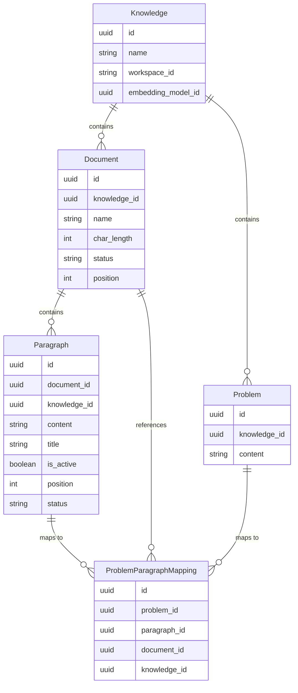
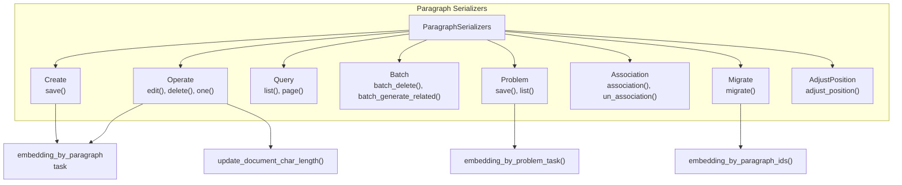
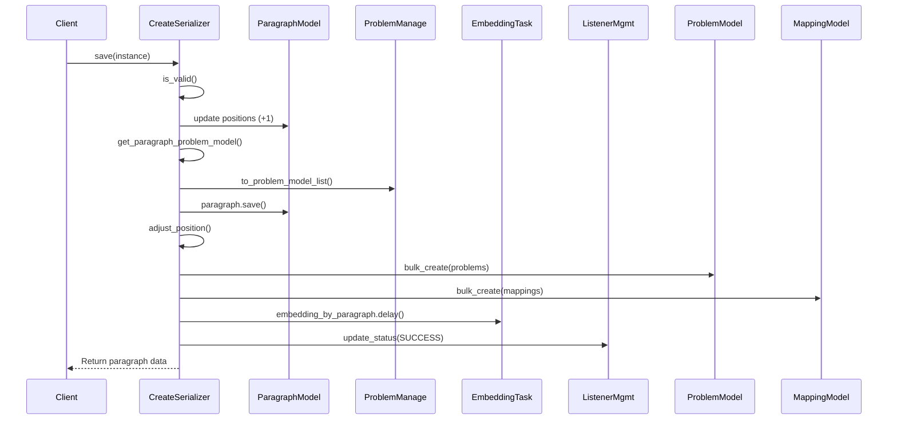
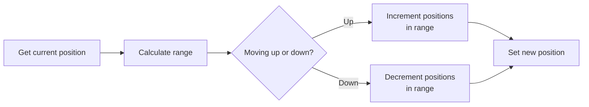
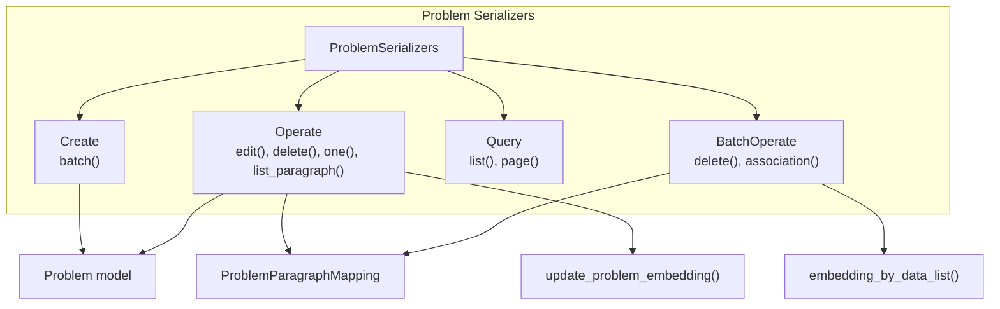
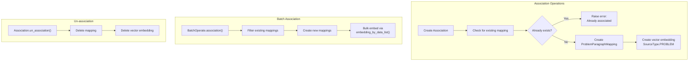
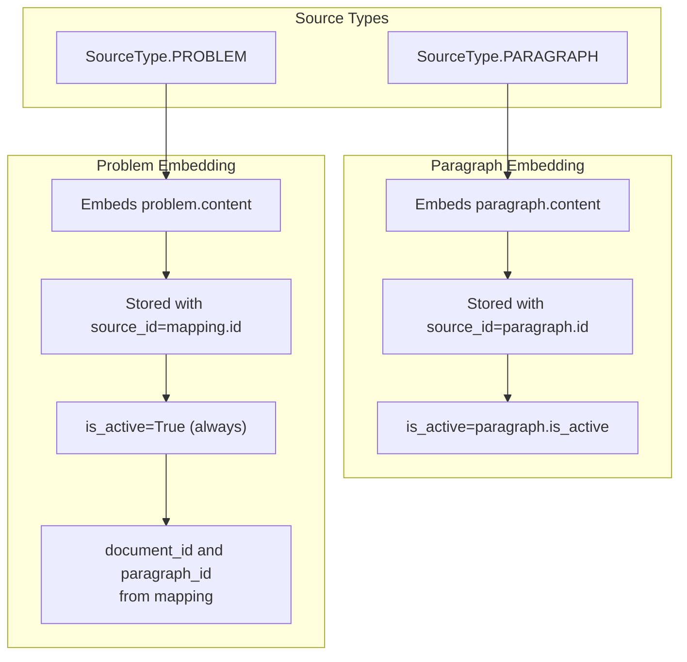
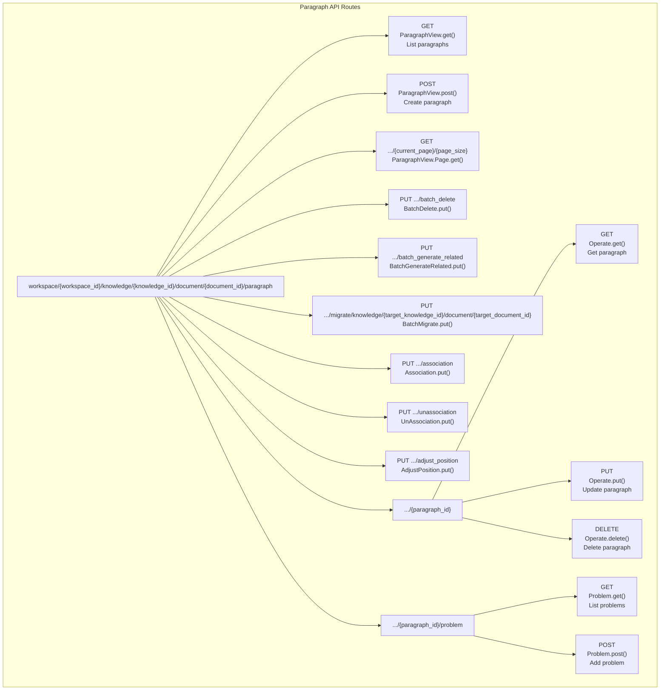

<!-- source: DeepWiki mcp.deepwiki.com · repo 1Panel-dev/MaxKB · page 6.3 Paragraph and Problem Management · fetched 2026-10-29 -->

# Paragraph and Problem Management

Relevant source files

The following files were used as context for generating this wiki page:

- [apps/folders/views/folder.py](apps/folders/views/folder.py)
- [apps/knowledge/api/document.py](apps/knowledge/api/document.py)
- [apps/knowledge/api/knowledge.py](apps/knowledge/api/knowledge.py)
- [apps/knowledge/api/paragraph.py](apps/knowledge/api/paragraph.py)
- [apps/knowledge/api/problem.py](apps/knowledge/api/problem.py)
- [apps/knowledge/serializers/document.py](apps/knowledge/serializers/document.py)
- [apps/knowledge/serializers/knowledge.py](apps/knowledge/serializers/knowledge.py)
- [apps/knowledge/serializers/paragraph.py](apps/knowledge/serializers/paragraph.py)
- [apps/knowledge/serializers/problem.py](apps/knowledge/serializers/problem.py)
- [apps/knowledge/urls.py](apps/knowledge/urls.py)
- [apps/knowledge/views/document.py](apps/knowledge/views/document.py)
- [apps/knowledge/views/knowledge.py](apps/knowledge/views/knowledge.py)
- [apps/knowledge/views/paragraph.py](apps/knowledge/views/paragraph.py)
- [apps/knowledge/views/problem.py](apps/knowledge/views/problem.py)
- [apps/system_manage/views/email_setting.py](apps/system_manage/views/email_setting.py)
- [ui/src/components/app-icon/icons/document.ts](ui/src/components/app-icon/icons/document.ts)
- [ui/src/components/app-table/index.vue](ui/src/components/app-table/index.vue)
- [ui/src/components/read-write/index.vue](ui/src/components/read-write/index.vue)
- [ui/src/enums/common.ts](ui/src/enums/common.ts)
- [ui/src/layout/layout-template/MainLayout.vue](ui/src/layout/layout-template/MainLayout.vue)
- [ui/src/layout/layout-template/SimpleLayout.vue](ui/src/layout/layout-template/SimpleLayout.vue)
- [ui/src/layout/layout-template/SystemMainLayout.vue](ui/src/layout/layout-template/SystemMainLayout.vue)
- [ui/src/stores/modules/common.ts](ui/src/stores/modules/common.ts)
- [ui/src/styles/md-editor.scss](ui/src/styles/md-editor.scss)
- [ui/src/views/document/component/SelectKnowledgeDialog.vue](ui/src/views/document/component/SelectKnowledgeDialog.vue)
- [ui/src/views/knowledge/component/EditParagraphDialog.vue](ui/src/views/knowledge/component/EditParagraphDialog.vue)
- [ui/src/views/knowledge/component/ParagraphList.vue](ui/src/views/knowledge/component/ParagraphList.vue)
- [ui/src/views/knowledge/component/ParagraphPreview.vue](ui/src/views/knowledge/component/ParagraphPreview.vue)
- [ui/src/views/paragraph/component/ParagraphCard.vue](ui/src/views/paragraph/component/ParagraphCard.vue)
- [ui/src/views/paragraph/component/ParagraphDialog.vue](ui/src/views/paragraph/component/ParagraphDialog.vue)
- [ui/src/views/paragraph/component/ParagraphForm.vue](ui/src/views/paragraph/component/ParagraphForm.vue)
- [ui/src/views/paragraph/component/ProblemComponent.vue](ui/src/views/paragraph/component/ProblemComponent.vue)
- [ui/src/views/paragraph/component/SelectDocumentDialog.vue](ui/src/views/paragraph/component/SelectDocumentDialog.vue)
- [ui/src/views/paragraph/index.vue](ui/src/views/paragraph/index.vue)
- [ui/src/views/problem/component/CreateProblemDialog.vue](ui/src/views/problem/component/CreateProblemDialog.vue)
- [ui/src/views/problem/component/DetailProblemDrawer.vue](ui/src/views/problem/component/DetailProblemDrawer.vue)
- [ui/src/views/problem/component/RelateProblemDialog.vue](ui/src/views/problem/component/RelateProblemDialog.vue)

This document covers the paragraph-level content management and question-answer (problem) association system within knowledge bases. Paragraphs represent segments of documents, while problems are questions that can be associated with one or more paragraphs to improve retrieval accuracy during RAG operations.

For document-level operations, see [Document Management and Processing](#6.1). For vector search and retrieval, see [Vector Embedding and Search](#6.4).

## Purpose and Scope

The paragraph and problem management system provides:

- **Paragraph Operations**: Create, read, update, delete individual content segments within documents.
- **Problem Management**: Manage questions/queries associated with paragraphs for enhanced semantic search.
- **Association Management**: Link multiple problems to multiple paragraphs via a many-to-many mapping.
- **Position Control**: Manage paragraph ordering within documents.
- **Batch Operations**: Process multiple paragraphs or problems in single operations.
- **Vectorization Integration**: Automatic embedding generation for both paragraphs and problems.

## Data Model Architecture

### Core Entity Relationships

**Sources:** [apps/knowledge/models.py:49-67](), [apps/knowledge/serializers/paragraph.py:17-26](), [apps/knowledge/serializers/problem.py:20-24]()

### Key Models

| Model | Purpose | Key Fields |
|-------|---------|-----------|
| `Paragraph` | Content segment within a document | `content`, `title`, `is_active`, `position`, `status` |
| `Problem` | Question/query for semantic matching | `content`, `knowledge_id` |
| `ProblemParagraphMapping` | Many-to-many association | `problem_id`, `paragraph_id`, `document_id` |

**Sources:** [apps/knowledge/models.py:59-61](), [apps/knowledge/serializers/paragraph.py:51-55]()

## Paragraph Management Operations

### Serializer Architecture

**Sources:** [apps/knowledge/serializers/paragraph.py:93-723]()

### Paragraph Creation

Paragraphs are created via `ParagraphSerializers.Create.save()` which handles:

1. **Position Management**: New paragraphs are inserted at position 1, shifting existing paragraphs down [apps/knowledge/serializers/paragraph.py:272-296]().
2. **Problem Association**: Optional `problem_list` creates associated problems [apps/knowledge/serializers/paragraph.py:321-337]().
3. **Vector Embedding**: Automatic vectorization via Celery task [apps/knowledge/serializers/paragraph.py:313-316]().
4. **Character Length Update**: Updates parent document statistics [apps/knowledge/serializers/paragraph.py:318]().

**Sources:** [apps/knowledge/serializers/paragraph.py:253-319](), [apps/knowledge/task/embedding.py:22]()

### Paragraph Editing

The `ParagraphSerializers.Operate.edit()` method supports partial updates with automatic re-embedding [apps/knowledge/serializers/paragraph.py:174-226]():

**Post-Processing Behavior:**
- If `is_active` changed: Enables/disables embeddings via `enable_embedding_by_paragraph()` or `disable_embedding_by_paragraph()` [apps/knowledge/serializers/paragraph.py:214-217]().
- If `content`/`title` changed: Re-embeds paragraph via `embedding_by_paragraph()` [apps/knowledge/serializers/paragraph.py:219-222]().
- Always updates document character length [apps/knowledge/serializers/paragraph.py:226]().

**Sources:** [apps/knowledge/serializers/paragraph.py:174-226](), [apps/knowledge/task/embedding.py:35-44]()

### Paragraph Deletion

Deletion workflow via `ParagraphSerializers.Operate.delete()` [apps/knowledge/serializers/paragraph.py:243-251]():

1. Delete paragraph record from database.
2. Delete associated problems and mappings via `delete_problems_and_mappings()` [apps/knowledge/serializers/paragraph.py:246]().
3. Update parent document character length [apps/knowledge/serializers/paragraph.py:247]().
4. Delete vector embeddings via `delete_embedding_by_paragraph()` [apps/knowledge/serializers/paragraph.py:248]().

**Sources:** [apps/knowledge/serializers/paragraph.py:243-251](), [apps/knowledge/serializers/paragraph.py:28-54]()

### Position Management

Paragraphs maintain ordering within documents via the `position` field. The `ParagraphSerializers.AdjustPosition` class handles reordering [apps/knowledge/serializers/paragraph.py:596-640]():

**Algorithm:**
- Moving to lower position (up): Increment all paragraphs in `[new_pos, old_pos)` [apps/knowledge/serializers/paragraph.py:623-625]().
- Moving to higher position (down): Decrement all paragraphs in `(old_pos, new_pos]` [apps/knowledge/serializers/paragraph.py:627-629]().
- Set target paragraph to `new_position` [apps/knowledge/serializers/paragraph.py:632]().

**Sources:** [apps/knowledge/serializers/paragraph.py:596-640]()

### Batch Operations

#### Batch Delete
Deletes multiple paragraphs in a single transaction via `ParagraphSerializers.Batch.batch_delete()` [apps/knowledge/serializers/paragraph.py:453-467]().

#### Batch Generate Related Questions
Generates questions for multiple paragraphs using an LLM via `batch_generate_related()` [apps/knowledge/serializers/paragraph.py:469-492]():

1. Updates paragraph status to `PENDING` for `GENERATE_PROBLEM` task.
2. Queues Celery task `generate_related_by_paragraph_id_list.delay()` [apps/knowledge/serializers/paragraph.py:488]().
3. LLM generates questions based on paragraph content.
4. Associates generated questions as problems.

**Sources:** [apps/knowledge/serializers/paragraph.py:469-492](), [apps/knowledge/task/generate.py:26]()

#### Batch Migrate
Moves paragraphs between documents via `ParagraphSerializers.Migrate.migrate()` [apps/knowledge/serializers/paragraph.py:494-594]():

- Supports cross-knowledge-base migration.
- Handles embedding model changes (re-embeds if models differ) [apps/knowledge/serializers/paragraph.py:557-564]().
- Migrates associated problems and mappings.
- Updates document statistics.

**Sources:** [apps/knowledge/serializers/paragraph.py:494-594]()

## Problem Management Operations

### Problem Serializer Structure

**Sources:** [apps/knowledge/serializers/problem.py:61-280]()

### Problem Creation

Problems are created via `ProblemSerializers.Create.batch()` [apps/knowledge/serializers/problem.py:196-231]():

- Accepts list of problem content strings.
- Deduplicates within knowledge base (checks existing `content`).
- Creates only new problems (skips if content already exists) [apps/knowledge/serializers/problem.py:218-223]().
- Returns list of newly created problem instances.

**Sources:** [apps/knowledge/serializers/problem.py:196-231]()

### Problem Editing

The `ProblemSerializers.Operate.edit()` method updates problem content [apps/knowledge/serializers/problem.py:182-194]():

1. Updates `Problem.content` field.
2. Calls `update_problem_embedding()` to re-embed all mappings [apps/knowledge/serializers/problem.py:192]().
3. Updates vectors for all paragraph associations.

**Sources:** [apps/knowledge/serializers/problem.py:182-194](), [apps/knowledge/task/embedding.py:16]()

### Problem Deletion

Deletion via `ProblemSerializers.Operate.delete()` [apps/knowledge/serializers/problem.py:169-180]():

1. Finds all `ProblemParagraphMapping` records for the problem.
2. Deletes mappings.
3. Deletes problem record.
4. Deletes vector embeddings via `delete_embedding_by_source_ids()` [apps/knowledge/serializers/problem.py:178]().

**Sources:** [apps/knowledge/serializers/problem.py:169-180](), [apps/knowledge/task/embedding.py:15]()

## Problem-Paragraph Associations

### Association Management

Problems and paragraphs have a many-to-many relationship via `ProblemParagraphMapping`:

**Sources:** [apps/knowledge/serializers/paragraph.py:100-141](), [apps/knowledge/serializers/problem.py:88-134]()

### Creating Associations

#### Single Association
Via `ParagraphSerializers.Problem.save()` [apps/knowledge/serializers/paragraph.py:132-172]():

1. Check if problem content exists in knowledge base.
2. Create new `Problem` if needed or reuse existing [apps/knowledge/serializers/paragraph.py:142-146]().
3. Create `ProblemParagraphMapping` [apps/knowledge/serializers/paragraph.py:157-164]().
4. Embed mapping with `SourceType.PROBLEM` [apps/knowledge/serializers/paragraph.py:167-172]().

**Sources:** [apps/knowledge/serializers/paragraph.py:100-141]()

#### Batch Association
Via `ProblemSerializers.BatchOperate.association()` [apps/knowledge/serializers/problem.py:88-134]():

1. Filters out existing mappings (prevents duplicates).
2. Creates cartesian product of problems × paragraphs.
3. Bulk creates mappings.
4. Bulk embeds via `embedding_by_data_list()`.

**Sources:** [apps/knowledge/serializers/problem.py:88-134]()

### Removing Associations

Un-association via `ParagraphSerializers.Association.un_association()` [apps/knowledge/serializers/paragraph.py:710-723]():

1. Finds mapping by `problem_id` and `paragraph_id`.
2. Deletes mapping record.
3. Deletes vector embedding via `delete_embedding_by_source()` [apps/knowledge/serializers/paragraph.py:721]().

**Sources:** [apps/knowledge/serializers/paragraph.py:710-723]()

## Vectorization and Embedding Integration

### Embedding Types for Paragraphs and Problems

**Sources:** [apps/knowledge/models.py:16](), [apps/knowledge/task/embedding.py:22-24]()

### Embedding Tasks

| Task | Trigger | Purpose |
|------|---------|---------|
| `embedding_by_paragraph` | Paragraph create/edit | Embeds paragraph content |
| `embedding_by_problem` | Problem-paragraph association | Embeds problem content with mapping context |
| `update_problem_embedding` | Problem edit | Re-embeds all mappings for a problem |
| `enable_embedding_by_paragraph` | Set `is_active=True` | Activates embeddings |
| `disable_embedding_by_paragraph` | Set `is_active=False` | Deactivates embeddings |
| `delete_embedding_by_paragraph` | Paragraph delete | Removes embeddings |

**Sources:** [apps/knowledge/task/embedding.py:21-24](), [apps/knowledge/serializers/paragraph.py:164-172]()

## API Endpoint Structure

### Paragraph Endpoints

**Sources:** [apps/knowledge/urls.py:68-87](), [apps/knowledge/views/paragraph.py:20-427]()

### Permission Requirements

All paragraph and problem operations require workspace-level or resource-level permissions:

| Operation | Required Permission |
|-----------|-------------------|
| Read paragraphs | `KNOWLEDGE_DOCUMENT_READ` |
| Create/edit paragraphs | `KNOWLEDGE_DOCUMENT_EDIT` |
| Delete paragraphs | `KNOWLEDGE_DOCUMENT_EDIT` |
| Generate related questions | `KNOWLEDGE_DOCUMENT_GENERATE` |

**Permission Model:**
- Workspace managers have full access.
- Regular users need specific resource permissions.
- Uses decorator `@has_permissions()` with multiple permission checks [apps/knowledge/views/paragraph.py:31-37]().

**Sources:** [apps/knowledge/views/paragraph.py:31-37](), [apps/knowledge/views/problem.py:30-35]()

---

