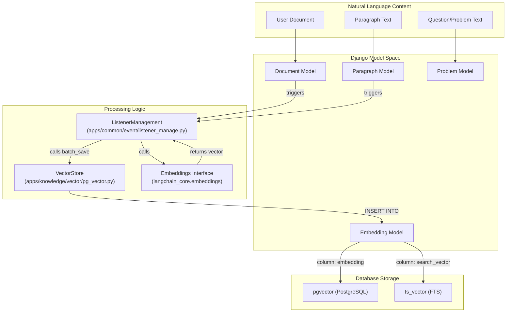
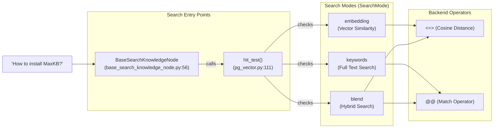

<!-- source: DeepWiki mcp.deepwiki.com · repo 1Panel-dev/MaxKB · page 6.4 Vector Embedding and Search · fetched 2026-10-29 -->

# Vector Embedding and Search

Relevant source files

The following files were used as context for generating this wiki page:

- [apps/application/flow/step_node/reranker_node/i_reranker_node.py](apps/application/flow/step_node/reranker_node/i_reranker_node.py)
- [apps/application/flow/step_node/reranker_node/impl/base_reranker_node.py](apps/application/flow/step_node/reranker_node/impl/base_reranker_node.py)
- [apps/application/flow/step_node/search_document_node/__init__.py](apps/application/flow/step_node/search_document_node/__init__.py)
- [apps/application/flow/step_node/search_document_node/i_search_document_node.py](apps/application/flow/step_node/search_document_node/i_search_document_node.py)
- [apps/application/flow/step_node/search_document_node/impl/__init__.py](apps/application/flow/step_node/search_document_node/impl/__init__.py)
- [apps/application/flow/step_node/search_document_node/impl/base_search_document_node.py](apps/application/flow/step_node/search_document_node/impl/base_search_document_node.py)
- [apps/application/flow/step_node/search_knowledge_node/i_search_knowledge_node.py](apps/application/flow/step_node/search_knowledge_node/i_search_knowledge_node.py)
- [apps/application/flow/step_node/search_knowledge_node/impl/base_search_knowledge_node.py](apps/application/flow/step_node/search_knowledge_node/impl/base_search_knowledge_node.py)
- [apps/application/sql/list_knowledge_paragraph_by_paragraph_id.sql](apps/application/sql/list_knowledge_paragraph_by_paragraph_id.sql)
- [apps/common/event/listener_manage.py](apps/common/event/listener_manage.py)
- [apps/common/utils/shared_resource_auth.py](apps/common/utils/shared_resource_auth.py)
- [apps/knowledge/serializers/common.py](apps/knowledge/serializers/common.py)
- [apps/knowledge/sql/blend_search.sql](apps/knowledge/sql/blend_search.sql)
- [apps/knowledge/sql/embedding_search.sql](apps/knowledge/sql/embedding_search.sql)
- [apps/knowledge/sql/hit_test.sql](apps/knowledge/sql/hit_test.sql)
- [apps/knowledge/sql/keywords_search.sql](apps/knowledge/sql/keywords_search.sql)
- [apps/knowledge/task/embedding.py](apps/knowledge/task/embedding.py)
- [apps/knowledge/vector/base_vector.py](apps/knowledge/vector/base_vector.py)
- [apps/knowledge/vector/pg_vector.py](apps/knowledge/vector/pg_vector.py)
- [ui/src/components/dynamics-form/items/table/TableCheckbox.vue](ui/src/components/dynamics-form/items/table/TableCheckbox.vue)
- [ui/src/components/dynamics-form/items/table/TableRadio.vue](ui/src/components/dynamics-form/items/table/TableRadio.vue)
- [ui/src/views/document/index.vue](ui/src/views/document/index.vue)
- [ui/src/views/document/tag/TaglinkedDocumentDialog.vue](ui/src/views/document/tag/TaglinkedDocumentDialog.vue)
- [ui/src/views/problem/index.vue](ui/src/views/problem/index.vue)
- [ui/src/views/termbase/component/CreateTermbaseDialog.vue](ui/src/views/termbase/component/CreateTermbaseDialog.vue)
- [ui/src/views/termbase/index.vue](ui/src/views/termbase/index.vue)

This document describes the vector embedding pipeline and similarity search system in MaxKB. It covers how textual content from documents and paragraphs is converted into vector embeddings, stored in a vector database, and retrieved through semantic similarity search to enable Retrieval-Augmented Generation (RAG).

For information about document processing before embedding, see [6.1 Document Management and Processing](). For information about asynchronous task execution, see [12.2 Embedding and Vectorization Tasks]().

## Overview

The vector embedding and search system consists of three main phases:

1.  **Vectorization**: Converting text content into numerical vector representations using embedding models.
2.  **Storage**: Persisting vectors in `pgvector` (PostgreSQL extension) alongside metadata in the `Embedding` model [apps/knowledge/models/__init__.py:431-456]().
3.  **Retrieval**: Searching for semantically similar content using vector similarity metrics (Cosine, Euclidean, or Inner Product).

The system supports multiple search modes (embedding-only, keyword-only, and hybrid blend) and integrates with the knowledge base workflow to provide contextual information for LLM responses.

**Sources:** [apps/common/event/listener_manage.py:1-250](), [apps/knowledge/vector/pg_vector.py:29-170]()

## System Architecture

The following diagram bridges the Natural Language concepts with the specific Code Entities used in the embedding and search pipeline.

### Natural Language to Code Entity Space: Embedding Pipeline

**Sources:** [apps/common/event/listener_manage.py:90-149](), [apps/knowledge/vector/pg_vector.py:45-77](), [apps/knowledge/models/__init__.py:431-456]()

## Embedding Pipeline

### ListenerManagement Class

The `ListenerManagement` class [apps/common/event/listener_manage.py:90-396]() orchestrates all embedding operations. It acts as the bridge between Django models and the vector store.

| Method | Purpose | Parameters |
| :--- | :--- | :--- |
| `embedding_by_paragraph` | Vectorize single paragraph | `paragraph_id`, `embedding_model` |
| `embedding_by_paragraph_list` | Vectorize multiple paragraphs | `paragraph_id_list`, `embedding_model` |
| `embedding_by_document` | Vectorize entire document | `document_id`, `embedding_model`, `state_list` |
| `embedding_by_problem` | Vectorize a specific problem/question | `args`, `embedding_model` |

**Sources:** [apps/common/event/listener_manage.py:91-94](), [apps/common/event/listener_manage.py:151-156](), [apps/common/event/listener_manage.py:254-259]()

### Content Vectorization Flow

When a document or paragraph is scheduled for vectorization, the system follows a specific sequence:

1.  **Data Retrieval**: It uses `native_search` with a specialized SQL template `list_embedding_text.sql` to join paragraphs with their associated problems [apps/common/event/listener_manage.py:161-171]().
2.  **Normalization**: Text is cleaned using `normalize_for_embedding` which removes emojis and collapses whitespace [apps/knowledge/vector/base_vector.py:49-55]().
3.  **Inference**: The `embedding_model.embed_documents` or `embed_query` is called to generate the floating-point array [apps/knowledge/vector/pg_vector.py:81]().
4.  **Full-Text Preparation**: For hybrid search, it generates a `ts_vector` using `to_ts_vector`, incorporating custom terms from the `Termbase` [apps/knowledge/vector/pg_vector.py:92-103]().
5.  **Persistence**: Data is saved via `VectorStore.get_embedding_vector().batch_save()` [apps/knowledge/vector/pg_vector.py:79-109]().

**Sources:** [apps/common/event/listener_manage.py:120-135](), [apps/knowledge/vector/pg_vector.py:79-109](), [apps/knowledge/vector/base_vector.py:49-55]()

## Vector Storage (pgvector)

MaxKB uses the `PGVector` implementation [apps/knowledge/vector/pg_vector.py:29-170]() which inherits from `BaseVectorStore`.

### Embedding Model Structure

The `Embedding` model stores both the semantic vector and the full-text search vector:
*   `embedding`: A `VectorField` (from `pgvector`) containing the numerical representation [apps/knowledge/models/__init__.py:446]().
*   `search_vector`: A `SearchVectorField` for PostgreSQL Full-Text Search [apps/knowledge/models/__init__.py:454]().
*   `metadata`: References to `knowledge_id`, `document_id`, and `paragraph_id` to allow scoped retrieval [apps/knowledge/models/__init__.py:433-437]().

**Sources:** [apps/knowledge/models/__init__.py:431-456](), [apps/knowledge/vector/pg_vector.py:65-76]()

## Search and Retrieval

The system supports multiple search strategies via the `hit_test` and `query` methods.

### Natural Language to Code Entity Space: Search Execution

**Sources:** [apps/knowledge/vector/pg_vector.py:111-146](), [apps/application/flow/step_node/search_knowledge_node/impl/base_search_knowledge_node.py:108-117]()

### Search Mode Details

| Mode | Implementation Detail |
| :--- | :--- |
| **Embedding** | Uses `embedding_model.embed_query` and calculates cosine similarity in SQL [apps/knowledge/vector/pg_vector.py:125-133](). |
| **Keywords** | Uses PostgreSQL `to_tsquery` and matches against the `search_vector` column [apps/knowledge/vector/pg_vector.py:74](). |
| **Blend** | Executes both vector and keyword search, then merges results based on a comprehensive score [apps/knowledge/vector/pg_vector.py:145](). |

To optimize performance, when searching across multiple knowledge bases, the system queries each knowledge base individually to leverage partial HNSW indexes (where `knowledge_id = '...'`) before merging and sorting the final result set [apps/knowledge/vector/pg_vector.py:130-146]().

**Sources:** [apps/knowledge/vector/pg_vector.py:128-146](), [apps/knowledge/models/__init__.py:41-44]()

## Reranking

For high-precision retrieval, MaxKB integrates Reranker models (Cross-Encoders) through the `BaseRerankerNode` [apps/application/flow/step_node/reranker_node/impl/base_reranker_node.py:78-112]().

1.  **Input**: Receives a list of candidate documents (paragraphs) and the original question.
2.  **Model Call**: Uses `reranker_model.compress_documents` to score the relevance of each paragraph to the question [apps/application/flow/step_node/reranker_node/impl/base_reranker_node.py:103-105]().
3.  **Filtering**: Applies a `similarity` threshold and `top_n` limit to the reranked results [apps/application/flow/step_node/reranker_node/impl/base_reranker_node.py:106-109]().
4.  **Result**: Returns the most relevant snippets, often used to prune the context before sending to the LLM.

**Sources:** [apps/application/flow/step_node/reranker_node/impl/base_reranker_node.py:87-112]()

## Retrieval-Augmented Generation (RAG) Flow

The search and embedding logic is consumed primarily by the workflow engine:

1.  **Search Knowledge Node**: Executes `VectorStore.query` to find relevant paragraphs [apps/application/flow/step_node/search_knowledge_node/impl/base_search_knowledge_node.py:113-117]().
2.  **Search Document Node**: Filters documents based on metadata or tags before vector search [apps/application/flow/step_node/search_document_node/impl/base_search_document_node.py:29-32]().
3.  **Context Construction**: The retrieved `paragraph_list` is formatted into a string (`data`) for the LLM prompt, respecting `max_paragraph_char_number` limits [apps/application/flow/step_node/search_knowledge_node/impl/base_search_knowledge_node.py:127-129]().

**Sources:** [apps/application/flow/step_node/search_knowledge_node/impl/base_search_knowledge_node.py:76-136](), [apps/application/flow/step_node/search_document_node/impl/base_search_document_node.py:16-91]()

---

