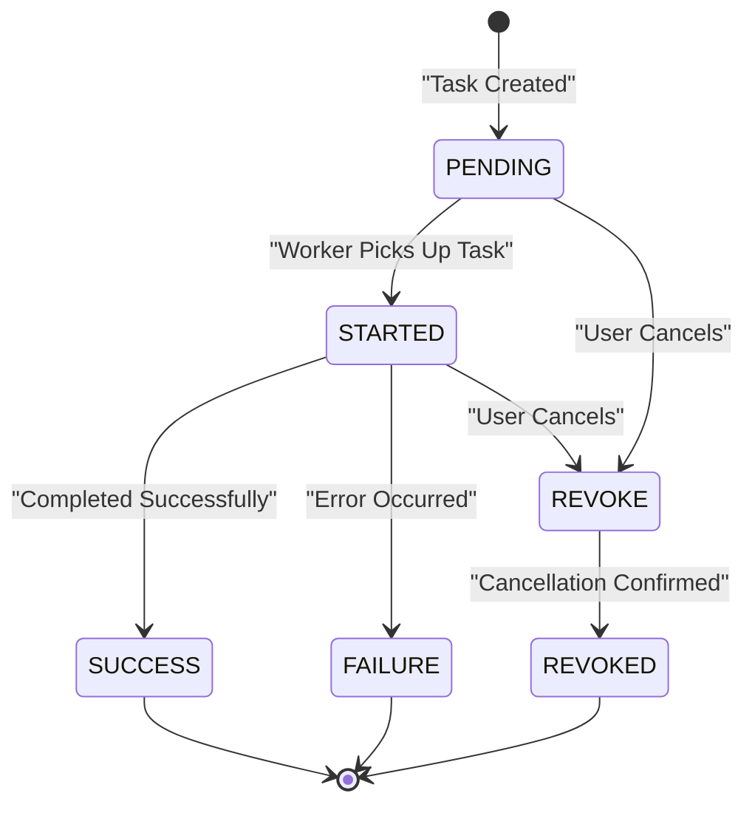
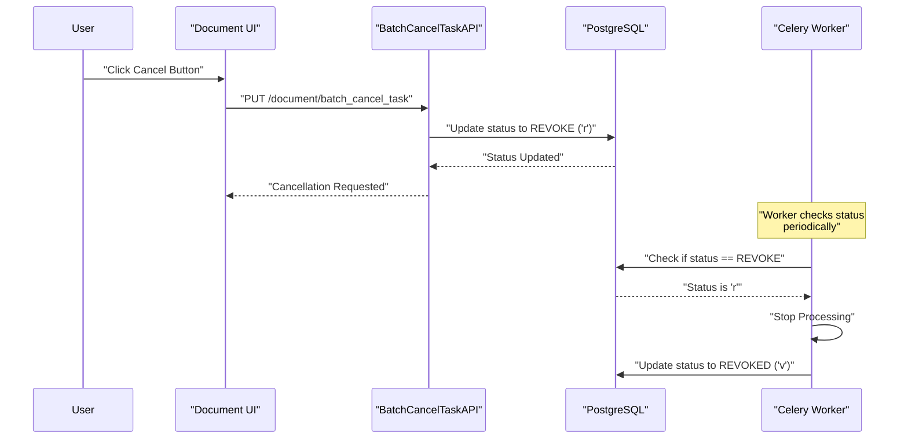

<!-- source: DeepWiki mcp.deepwiki.com · repo 1Panel-dev/MaxKB · page 6.5 Batch Operations and Status Tracking · fetched 2026-10-29 -->

# Batch Operations and Status Tracking

<details>
<summary>Relevant source files</summary>

The following files were used as context for generating this wiki page:

- [apps/common/event/listener_manage.py](apps/common/event/listener_manage.py)
- [apps/folders/views/folder.py](apps/folders/views/folder.py)
- [apps/knowledge/api/document.py](apps/knowledge/api/document.py)
- [apps/knowledge/api/knowledge.py](apps/knowledge/api/knowledge.py)
- [apps/knowledge/api/paragraph.py](apps/knowledge/api/paragraph.py)
- [apps/knowledge/api/problem.py](apps/knowledge/api/problem.py)
- [apps/knowledge/serializers/document.py](apps/knowledge/serializers/document.py)
- [apps/knowledge/serializers/knowledge.py](apps/knowledge/serializers/knowledge.py)
- [apps/knowledge/serializers/paragraph.py](apps/knowledge/serializers/paragraph.py)
- [apps/knowledge/serializers/problem.py](apps/knowledge/serializers/problem.py)
- [apps/knowledge/urls.py](apps/knowledge/urls.py)
- [apps/knowledge/views/document.py](apps/knowledge/views/document.py)
- [apps/knowledge/views/knowledge.py](apps/knowledge/views/knowledge.py)
- [apps/knowledge/views/paragraph.py](apps/knowledge/views/paragraph.py)
- [apps/knowledge/views/problem.py](apps/knowledge/views/problem.py)
- [apps/system_manage/views/email_setting.py](apps/system_manage/views/email_setting.py)
- [ui/src/components/dynamics-form/items/table/TableCheckbox.vue](ui/src/components/dynamics-form/items/table/TableCheckbox.vue)
- [ui/src/components/dynamics-form/items/table/TableRadio.vue](ui/src/components/dynamics-form/items/table/TableRadio.vue)
- [ui/src/components/generate-related-dialog/index.vue](ui/src/components/generate-related-dialog/index.vue)
- [ui/src/locales/lang/en-US/views/document.ts](ui/src/locales/lang/en-US/views/document.ts)
- [ui/src/locales/lang/en-US/views/knowledge.ts](ui/src/locales/lang/en-US/views/knowledge.ts)
- [ui/src/locales/lang/en-US/views/problem.ts](ui/src/locales/lang/en-US/views/problem.ts)
- [ui/src/locales/lang/zh-CN/views/document.ts](ui/src/locales/lang/zh-CN/views/document.ts)
- [ui/src/locales/lang/zh-CN/views/knowledge.ts](ui/src/locales/lang/zh-CN/views/knowledge.ts)
- [ui/src/locales/lang/zh-CN/views/problem.ts](ui/src/locales/lang/zh-CN/views/problem.ts)
- [ui/src/locales/lang/zh-Hant/views/document.ts](ui/src/locales/lang/zh-Hant/views/document.ts)
- [ui/src/locales/lang/zh-Hant/views/knowledge.ts](ui/src/locales/lang/zh-Hant/views/knowledge.ts)
- [ui/src/locales/lang/zh-Hant/views/problem.ts](ui/src/locales/lang/zh-Hant/views/problem.ts)
- [ui/src/utils/status.ts](ui/src/utils/status.ts)
- [ui/src/views/document/component/Status.vue](ui/src/views/document/component/Status.vue)
- [ui/src/views/document/component/StatusTable.vue](ui/src/views/document/component/StatusTable.vue)
- [ui/src/views/document/index.vue](ui/src/views/document/index.vue)
- [ui/src/views/document/tag/TaglinkedDocumentDialog.vue](ui/src/views/document/tag/TaglinkedDocumentDialog.vue)
- [ui/src/views/problem/index.vue](ui/src/views/problem/index.vue)
- [ui/src/views/termbase/component/CreateTermbaseDialog.vue](ui/src/views/termbase/component/CreateTermbaseDialog.vue)
- [ui/src/views/termbase/index.vue](ui/src/views/termbase/index.vue)

</details>


This page documents the batch operation system and status tracking mechanisms used in the Knowledge Base document management system. This covers how multiple documents can be processed simultaneously (vectorization, deletion, synchronization, export), how task status is tracked through a state machine, how users can cancel ongoing operations, and how the UI polls for status updates.

For information about individual document processing and vectorization, see [Vector Embedding and Search](#6.4). For document lifecycle management, see [Document Management and Processing](#6.1).

## Purpose and Scope

The batch operations system enables users to perform operations on multiple documents simultaneously, while the status tracking system provides visibility into the progress and state of long-running asynchronous tasks. This system handles:

- Multi-document selection and batch operations
- Task state machine (`PENDING` → `STARTED` → `SUCCESS`/`FAILURE`)
- Task cancellation and revocation
- Real-time status updates through polling
- Document-level status aggregation from paragraph-level states

## Status State Machine

The status tracking system uses a bitwise status representation where each task type occupies a specific position in the status string. Each position can have one of several states.

### Task Types and States

| Task Type | Position | Description |
|-----------|----------|-------------|
| `EMBEDDING` | 1 | Vectorization task |
| `GENERATE_PROBLEM` | 2 | Question generation task |
| `SYNC` | 3 | Synchronization task |
| `TOKENIZE` | 4 | Word indexing/tokenization task |

**Sources:** [apps/common/event/listener_manage.py:21-32](), [knowledge/models.py:65-68]()

| State | Value | Description |
|-------|-------|-------------|
| `PENDING` | 'p' | Task queued but not started |
| `STARTED` | 's' | Task is currently running |
| `SUCCESS` | 'c' | Task completed successfully |
| `FAILURE` | 'e' | Task failed with error |
| `REVOKE` | 'r' | Task cancellation requested |
| `REVOKED` | 'v' | Task cancellation confirmed |

**Sources:** [apps/common/event/listener_manage.py:28-32](), [knowledge/models.py:63-66]()

### State Transition Diagram



## Status Storage Format

Status is stored as a reversed string where each character represents the state of a task type. For example:

- Status `"sc"` means: `EMBEDDING=SUCCESS` (position 1), `GENERATE_PROBLEM=SUCCESS` (position 2)
- Status `"sp"` means: `EMBEDDING=STARTED` (position 1), `GENERATE_PROBLEM=PENDING` (position 2)
- Status `"er"` means: `EMBEDDING=FAILURE` (position 1), `GENERATE_PROBLEM=REVOKE` (position 2)

The reversed order allows for easy expansion of new task types without database migration.

**Sources:** [apps/common/event/listener_manage.py:151-186]()

## Batch Operation Types

### Overview of Available Batch Operations

The `DocumentView` in `apps/knowledge/views/document.py` handles various batch endpoints, while the frontend `document/index.vue` manages the selection state.

```mermaid
graph TB
    Selection["Document Multi-Selection<br/>(multipleSelection)"]
    
    subgraph "Batch Operations (Frontend)"
        BatchVector["batchRefresh()<br/>Batch Vectorization"]
        BatchTokenize["batchTokenize()<br/>Batch Word Indexing"]
        BatchGenerate["openGenerateDialog()<br/>Batch Question Generation"]
        BatchEdit["openBatchEditDocument()<br/>Batch Settings Edit"]
        BatchMigrate["openknowledgeDialog()<br/>Batch Migration"]
        BatchTag["openAddTagDialog()<br/>Batch Tag Addition"]
        BatchSync["syncMulDocument()<br/>Batch Synchronization"]
        BatchExport["exportMulDocumentZip()<br/>Batch Export Zip"]
        BatchDelete["deleteMulDocument()<br/>Batch Deletion"]
        CancelTask["cancelTaskHandle()<br/>Batch Cancel Task"]
    end
    
    Selection --> BatchVector
    Selection --> BatchTokenize
    Selection --> BatchGenerate
    Selection --> BatchEdit
    Selection --> BatchMigrate
    Selection --> BatchTag
    Selection --> BatchSync
    Selection --> BatchExport
    Selection --> BatchDelete
    Selection --> CancelTask
```



**Sources:** [ui/src/views/document/index.vue:48-124](), [apps/knowledge/urls.py:41-54]()

### Batch Vectorization and Tokenization

Users can select multiple documents and trigger vectorization or tokenization. The UI sends a list of document IDs to the backend.

**Frontend Implementation:**
- `batchRefresh()`: Triggers vectorization via `DocumentView.BatchRefresh`. [ui/src/views/document/index.vue:48-52]()
- `batchTokenize()`: Triggers word indexing via `DocumentView.BatchTokenize`. [ui/src/views/document/index.vue:54-58]()

**Backend Processing:**
The backend uses `embedding_by_document_list` or `tokenize_by_document` which eventually utilizes `ListenerManagement` to update states and process chunks.

**Sources:** [apps/knowledge/serializers/document.py:83-91](), [apps/knowledge/views/document.py:444-445]()

### Batch Question Generation

The frontend opens a `generate-related-dialog` to configure AI parameters. The backend triggers `generate_related_by_knowledge_id` or `generate_related_by_document_id`.

**Sources:** [ui/src/views/document/index.vue:60-64](), [apps/knowledge/serializers/knowledge.py:85](), [apps/knowledge/serializers/document.py:92]()

### Batch Settings and Migration

- **Batch Edit**: Modifies hit handling methods for multiple documents via `BatchEditHitHandlingAPI`. [apps/knowledge/urls.py:52]()
- **Batch Migration**: Moves documents between knowledge bases via `DocumentView.Migrate`. [apps/knowledge/urls.py:55]()
- **Batch Tagging**: Adds tags to multiple documents via `DocumentView.BatchAddTag`. [apps/knowledge/urls.py:54]()

## Task Cancellation and Revocation

Users can cancel ongoing tasks. The process transitions from `REVOKE` (user request) to `REVOKED` (system confirmation).

### Cancellation Flow



**Backend Implementation:**
The `BatchCancelInstanceSerializer` validates the `id_list` and `type` (TaskType). [apps/knowledge/serializers/document.py:123-134]()

**Interruption Logic:**
Inside processing loops (e.g., `embedding_by_paragraph`), the system checks if the task is interrupted.

```python
def is_the_task_interrupted():
    _paragraph = QuerySet(Paragraph).filter(id=paragraph_id).first()
    if _paragraph is None or Status(_paragraph.status)[TaskType.EMBEDDING] == State.REVOKE:
        return True
    return False
```

**Sources:** [apps/common/event/listener_manage.py:175-179](), [apps/knowledge/serializers/document.py:123-134]()

## Status Update Mechanism

### Status Update Implementation

The `ListenerManagement` class provides static methods to update task states in the database.

```python
@staticmethod
def update_status(query_set, taskType, state):
    # Logic to perform bitwise-like string replacement in DB
    # Uses update_paragraph_status.sql
```

**Sources:** [apps/common/event/listener_manage.py:133-135](), [apps/common/event/listener_manage.py:142-144]()

### Document Status Aggregation

Document-level status is often an aggregation of its child paragraphs. If any paragraph fails, the document task may be marked as failed.

**Sources:** [apps/common/event/listener_manage.py:109-111](), [apps/common/event/listener_manage.py:133-144]()

## Status Polling and UI Updates

The frontend UI components (like `Status.vue` and `StatusTable.vue`) interpret the status strings.

### UI Status Interpretation

The UI maps backend state codes to localized strings and visual indicators.

| Code | Localized Key (en-US) | Visual |
|------|-----------------------|--------|
| `c`  | `finish`              | Success |
| `e`  | `FAILURE`             | Error |
| `s`  | `EMBEDDING`/`SYNC`... | Loading |
| `p`  | `PENDING`             | Queue |

**Sources:** [ui/src/locales/lang/en-US/views/document.ts:133-143](), [ui/src/locales/lang/zh-CN/views/document.ts:127-135]()

### Selection State Management

The frontend uses `multipleSelection` to track user interactions in the document list.

```javascript
// ui/src/views/document/index.vue
const multipleSelection = ref([])
const handleSelectionChange = (val) => {
  multipleSelection.value = val
}
```

**Sources:** [ui/src/views/document/index.vue:1-150] (inferred from standard Vue/Element Plus pattern used in truncated content)

## Batch Operations in Problem Management

The Problem (QA) system also implements batching for deletion and associations.

- **Batch Delete**: `ProblemView.BatchDelete` [apps/knowledge/urls.py:73]()
- **Batch Association**: `ProblemView.Association` [apps/knowledge/urls.py:71]()

**Sources:** [apps/knowledge/urls.py:70-75](), [apps/knowledge/views/problem.py]()

---

