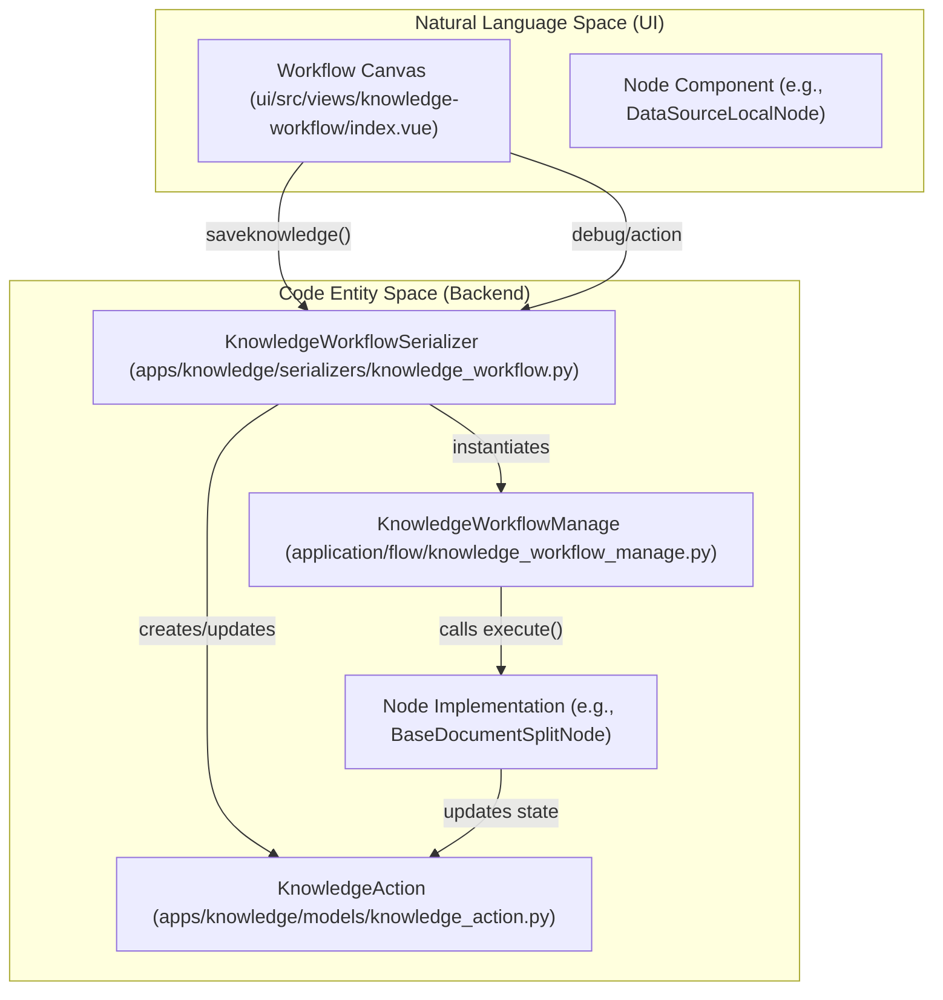
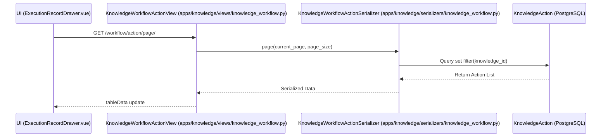

<!-- source: DeepWiki mcp.deepwiki.com · repo 1Panel-dev/MaxKB · page 6.6 Knowledge Workflow · fetched 2026-10-29 -->

# Knowledge Workflow

Relevant source files

The following files were used as context for generating this wiki page:

- [apps/application/flow/step_node/document_split_node/i_document_split_node.py](apps/application/flow/step_node/document_split_node/i_document_split_node.py)
- [apps/application/flow/step_node/document_split_node/impl/base_document_split_node.py](apps/application/flow/step_node/document_split_node/impl/base_document_split_node.py)
- [apps/application/flow/step_node/knowledge_write_node/impl/base_knowledge_write_node.py](apps/application/flow/step_node/knowledge_write_node/impl/base_knowledge_write_node.py)
- [apps/common/chunk/__init__.py](apps/common/chunk/__init__.py)
- [apps/common/chunk/i_chunk_handle.py](apps/common/chunk/i_chunk_handle.py)
- [apps/common/chunk/impl/mark_chunk_handle.py](apps/common/chunk/impl/mark_chunk_handle.py)
- [apps/common/handle/impl/qa/md_parse_qa_handle.py](apps/common/handle/impl/qa/md_parse_qa_handle.py)
- [apps/knowledge/api/knowledge_workflow.py](apps/knowledge/api/knowledge_workflow.py)
- [apps/knowledge/serializers/knowledge_workflow.py](apps/knowledge/serializers/knowledge_workflow.py)
- [apps/knowledge/views/knowledge_workflow.py](apps/knowledge/views/knowledge_workflow.py)
- [ui/src/api/knowledge/knowledge.ts](ui/src/api/knowledge/knowledge.ts)
- [ui/src/api/system-resource-management/knowledge.ts](ui/src/api/system-resource-management/knowledge.ts)
- [ui/src/api/system-shared/knowledge.ts](ui/src/api/system-shared/knowledge.ts)
- [ui/src/locales/lang/en-US/workflow.ts](ui/src/locales/lang/en-US/workflow.ts)
- [ui/src/locales/lang/zh-CN/workflow.ts](ui/src/locales/lang/zh-CN/workflow.ts)
- [ui/src/locales/lang/zh-Hant/workflow.ts](ui/src/locales/lang/zh-Hant/workflow.ts)
- [ui/src/views/knowledge-workflow/component/PublishHistory.vue](ui/src/views/knowledge-workflow/component/PublishHistory.vue)
- [ui/src/views/knowledge-workflow/component/execution-record/ExecutionDetailDrawer.vue](ui/src/views/knowledge-workflow/component/execution-record/ExecutionDetailDrawer.vue)
- [ui/src/views/knowledge-workflow/component/execution-record/ExecutionRecordDrawer.vue](ui/src/views/knowledge-workflow/component/execution-record/ExecutionRecordDrawer.vue)
- [ui/src/views/knowledge-workflow/index.vue](ui/src/views/knowledge-workflow/index.vue)
- [ui/src/workflow/nodes/data-source-local-node/index.vue](ui/src/workflow/nodes/data-source-local-node/index.vue)
- [ui/src/workflow/nodes/data-source-web-node/index.vue](ui/src/workflow/nodes/data-source-web-node/index.vue)
- [ui/src/workflow/nodes/document-split-node/index.vue](ui/src/workflow/nodes/document-split-node/index.vue)

The Knowledge Workflow system in MaxKB provides a node-based Directed Acyclic Graph (DAG) orchestration layer specifically designed for automated document ingestion and processing. Unlike standard chat workflows, knowledge workflows focus on data transformation pipelines—crawling web content, parsing local files, splitting text into semantic chunks, and populating vector databases.

## Overview and Architecture

The Knowledge Workflow allows users to define complex ingestion logic that goes beyond simple file uploads. It leverages the same underlying engine as the application workflows but uses a specialized set of nodes for data handling.

### Core Components
*   **Workflow Canvas**: A visual editor for designing ingestion pipelines [ui/src/views/knowledge-workflow/index.vue:124-127]().
*   **Execution Engine**: Managed by `KnowledgeWorkflowManage`, which handles the execution of nodes in sequence [apps/knowledge/serializers/knowledge_workflow.py:21-21]().
*   **Persistence**: Workflow configurations are stored in the `KnowledgeWorkflow` model, with versioning supported via `KnowledgeWorkflowVersion` [apps/knowledge/serializers/knowledge_workflow.py:39-40]().

### Workflow Execution Flow
The following diagram illustrates the transition from the visual workflow design to the backend execution entities.

**Diagram: Workflow Ingestion Pipeline Architecture**

Sources: [ui/src/views/knowledge-workflow/index.vue:45-127](), [apps/knowledge/serializers/knowledge_workflow.py:21-112](), [apps/knowledge/models/knowledge_action.py:44-44]()

---

## Key Node Types

Knowledge workflows utilize specialized nodes categorized into data sources, processing, and output.

| Category | Node Name | Description | Code Reference |
| :--- | :--- | :--- | :--- |
| **Data Source** | `Web Site` | Crawls web data from a root URL. | [ui/src/locales/lang/en-US/workflow.ts:98-102]() |
| **Data Source** | `Local File` | Handles local document uploads. | [ui/src/locales/lang/en-US/workflow.ts:103-117]() |
| **Processing** | `Document Extract` | Extracts raw text from various file formats. | [ui/src/locales/lang/en-US/workflow.ts:277-278]() |
| **Processing** | `Document Split` | Segments text into chunks using strategies (Auto, QA, Custom). | [apps/application/flow/step_node/document_split_node/impl/base_document_split_node.py:39-52]() |
| **Output** | `Knowledge Write` | Writes processed chunks into the vector store. | [ui/src/locales/lang/en-US/workflow.ts:94-97]() |

### Document Splitting Logic
The `BaseDocumentSplitNode` is a critical component that handles the transformation of documents into paragraphs and chunks. It supports multiple strategies, including `qa` (Question-Answer pairs) and `default` (pattern-based splitting) [apps/application/flow/step_node/document_split_node/impl/base_document_split_node.py:71-75]().

**Document Processing Flow:**
1.  **Input**: A list of documents retrieved from preceding nodes [apps/application/flow/step_node/document_split_node/impl/base_document_split_node.py:54-54]().
2.  **Parsing**: Files are converted to `InMemoryUploadedFile` objects [apps/application/flow/step_node/document_split_node/impl/base_document_split_node.py:70-70]().
3.  **Segmentation**: The `text_to_chunk` utility is called to create vector-ready segments based on `chunk_size` [apps/application/flow/step_node/document_split_node/impl/base_document_split_node.py:130-130]().
4.  **Metadata Enrichment**: Each segment is tagged with its source file ID and knowledge base ID [apps/application/flow/step_node/document_split_node/impl/base_document_split_node.py:111-118]().

Sources: [apps/application/flow/step_node/document_split_node/impl/base_document_split_node.py:39-130]()

---

## Execution and Monitoring

Workflows are executed as "Actions". Every execution generates a `KnowledgeAction` record, which tracks the status, runtime, and logs for debugging.

### Execution Record Management
Users can monitor the status of workflow runs through the `ExecutionRecordDrawer` [ui/src/views/knowledge-workflow/component/execution-record/ExecutionRecordDrawer.vue:2-9]().

*   **States**: Actions can be in `SUCCESS`, `FAILURE`, `STARTED`, `REVOKED`, or `PADDING` [ui/src/views/knowledge-workflow/component/execution-record/ExecutionRecordDrawer.vue:63-82]().
*   **Cancellation**: Active workflows (in `STARTED` or `PADDING` states) can be manually cancelled via `cancelWorkflowAction` [ui/src/views/knowledge-workflow/component/execution-record/ExecutionRecordDrawer.vue:180-189]().
*   **Debugging**: The `DebugVue` component allows real-time testing of workflow nodes before publishing [ui/src/views/knowledge-workflow/index.vue:169-169]().

**Diagram: Execution Record Data Flow**

Sources: [ui/src/views/knowledge-workflow/component/execution-record/ExecutionRecordDrawer.vue:198-206](), [apps/knowledge/views/knowledge_workflow.py:139-142](), [apps/knowledge/serializers/knowledge_workflow.py:112-160]()

---

## Workflow Versioning and Publishing

The system maintains a strict separation between the "Draft" version and the "Published" version of a knowledge workflow.

1.  **Drafting**: Changes are saved to the `KnowledgeWorkflow` model. Auto-save can be toggled in the UI [ui/src/views/knowledge-workflow/index.vue:101-107]().
2.  **Publishing**: When the user clicks "Publish", the current configuration is snapshotted into `KnowledgeWorkflowVersion` [apps/knowledge/serializers/knowledge_workflow.py:40-40]().
3.  **Restoration**: Users can view `Release History` and restore previous versions to the canvas [ui/src/views/knowledge-workflow/index.vue:18-20]().

### Import/Export
Workflows can be exported as `.kbwf` files for migration between environments [ui/src/views/knowledge-workflow/index.vue:63-87](). The `KnowledgeWorkflowImportApi` handles the deserialization and mapping of tool IDs and knowledge IDs to ensure the workflow remains functional in the new workspace [apps/knowledge/serializers/knowledge_workflow.py:57-79]().

Sources: [ui/src/views/knowledge-workflow/index.vue:1-112](), [apps/knowledge/serializers/knowledge_workflow.py:1-100]()

---

