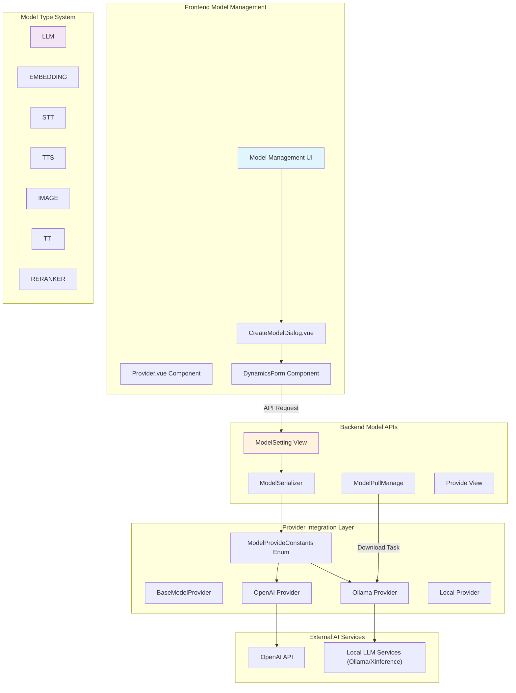
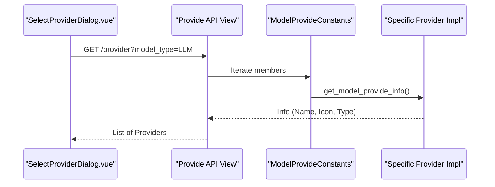

<!-- source: DeepWiki mcp.deepwiki.com · repo 1Panel-dev/MaxKB · page 7 Model Management · fetched 2026-10-29 -->

# Model Management

Relevant source files

The following files were used as context for generating this wiki page:

- [apps/common/sql/list_embedding_text.sql](apps/common/sql/list_embedding_text.sql)
- [apps/models_provider/api/model.py](apps/models_provider/api/model.py)
- [apps/models_provider/api/provide.py](apps/models_provider/api/provide.py)
- [apps/models_provider/impl/aliyun_bai_lian_model_provider/credential/llm.py](apps/models_provider/impl/aliyun_bai_lian_model_provider/credential/llm.py)
- [apps/models_provider/serializers/model_serializer.py](apps/models_provider/serializers/model_serializer.py)
- [apps/models_provider/urls.py](apps/models_provider/urls.py)
- [apps/models_provider/views/model.py](apps/models_provider/views/model.py)
- [apps/models_provider/views/model_apply.py](apps/models_provider/views/model_apply.py)
- [apps/models_provider/views/provide.py](apps/models_provider/views/provide.py)
- [apps/system_manage/api/resource_mapping.py](apps/system_manage/api/resource_mapping.py)
- [apps/system_manage/urls.py](apps/system_manage/urls.py)
- [apps/system_manage/views/__init__.py](apps/system_manage/views/__init__.py)
- [ui/src/api/model/model.ts](ui/src/api/model/model.ts)
- [ui/src/api/model/provider.ts](ui/src/api/model/provider.ts)
- [ui/src/locales/lang/en-US/views/model.ts](ui/src/locales/lang/en-US/views/model.ts)
- [ui/src/locales/lang/zh-CN/views/model.ts](ui/src/locales/lang/zh-CN/views/model.ts)
- [ui/src/locales/lang/zh-Hant/views/model.ts](ui/src/locales/lang/zh-Hant/views/model.ts)
- [ui/src/views/model/component/CreateModelDialog.vue](ui/src/views/model/component/CreateModelDialog.vue)
- [ui/src/views/model/component/EditModel.vue](ui/src/views/model/component/EditModel.vue)
- [ui/src/views/model/component/ParamSettingDialog.vue](ui/src/views/model/component/ParamSettingDialog.vue)
- [ui/src/views/model/component/SelectProviderDialog.vue](ui/src/views/model/component/SelectProviderDialog.vue)
- [ui/src/views/model/component/data.ts](ui/src/views/model/component/data.ts)

The Model Management system provides a centralized framework for integrating, configuring, and managing AI models across different providers in MaxKB. This system enables users to add LLM providers, configure model parameters, and manage model lifecycle including authentication, status monitoring, and provider-specific configurations.

For application-level model configuration and usage within workflows, see [Application Management](#4). For the workflow execution engine that utilizes these models, see [Workflow Engine](#5).

## System Architecture

The Model Management system consists of three primary layers: the frontend model management interface, backend model APIs, and provider integration layer that connects to external AI services.

Sources: [apps/models_provider/views/model.py:57-135](), [apps/models_provider/serializers/model_serializer.py:62-100](), [ui/src/views/model/component/CreateModelDialog.vue:27-134](), [apps/models_provider/constants/model_provider_constants.py:1-25]()

## Model Types and Classification

The system supports multiple distinct model types, each serving specific AI capabilities within the MaxKB platform.

### Model Type Definitions

| Model Type | Code Identifier | Description |
|------------|-----------------|-------------|
| LLM | `LLM` | Large Language Models for chat and reasoning. |
| EMBEDDING | `EMBEDDING` | Models for document vectorization and similarity search. |
| STT | `STT` | Speech-to-Text models for audio transcription. |
| TTS | `TTS` | Text-to-Speech models for voice synthesis. |
| RERANKER | `RERANKER` | Models used to re-rank search results for better accuracy. |
| IMAGE/TTI | `IMAGE`/`TTI` | Visual models for image understanding and generation. |

The model type determines which configuration forms and parameters are available in the UI [ui/src/views/model/component/CreateModelDialog.vue:151-154]().

Sources: [ui/src/locales/lang/zh-Hant/views/model.ts:22-35](), [apps/models_provider/serializers/model_serializer.py:56-57](), [ui/src/views/model/component/CreateModelDialog.vue:59-93]()

## Model Lifecycle and Status Management

Models in MaxKB go through several states, especially those requiring local downloads (like Ollama models).

### Status Transitions

The `ModelPullManage` class handles the asynchronous download process for local models [apps/models_provider/serializers/model_serializer.py:62-64]().

| Status | Code Symbol | Description |
|--------|-------------|-------------|
| Success | `Status.SUCCESS` | Model is configured and ready for use. |
| Error | `Status.ERROR` | Configuration failed or download error occurred. |
| Pause | `Status.PAUSE_DOWNLOAD` | User manually paused the model download. |

### Model Data Structure

The `Model` database entity stores the following key information:
- `credential`: Encrypted authentication data [apps/models_provider/serializers/model_serializer.py:105-105]().
- `meta`: Metadata including download progress (`down_model_chunk`) [apps/models_provider/serializers/model_serializer.py:79-79]().
- `model_params_form`: Dynamic configuration parameters for the model instance [apps/models_provider/serializers/model_serializer.py:49-49]().

Sources: [apps/models_provider/models.py:26-26](), [apps/models_provider/serializers/model_serializer.py:62-99](), [apps/models_provider/views/model.py:29-32]()

## Provider Integration and API

MaxKB uses a provider-based architecture where each AI service (OpenAI, Aliyun, Ollama, etc.) implements a common interface.

### Provider Discovery Flow

For details on specific provider implementations and how to add new ones, see [Model Providers and Integration](#7.2).

Sources: [apps/models_provider/views/provide.py:17-37](), [apps/models_provider/urls.py:11-15](), [ui/src/api/model/model.ts:25-53]()

## Configuration and UI

The frontend utilizes a dynamic form system to render model-specific settings based on the provider's requirements.

- **Base Info**: Includes Model Name, Type, and the underlying Base Model name [ui/src/views/model/component/CreateModelDialog.vue:26-135]().
- **Advanced Info**: Handles specific model parameters (like temperature, top_p) and credential fields (API Keys, Base URLs) [ui/src/views/model/component/CreateModelDialog.vue:136-158]().
- **Shared Models**: System administrators can configure shared models that are accessible across all workspaces [apps/models_provider/urls.py:22-22]().

For a detailed breakdown of the model configuration interface and parameter settings, see [Model Configuration and UI](#7.1).

Sources: [ui/src/views/model/component/CreateModelDialog.vue:1-200](), [apps/models_provider/serializers/model_serializer.py:35-40](), [apps/models_provider/views/model.py:57-135]()

---

