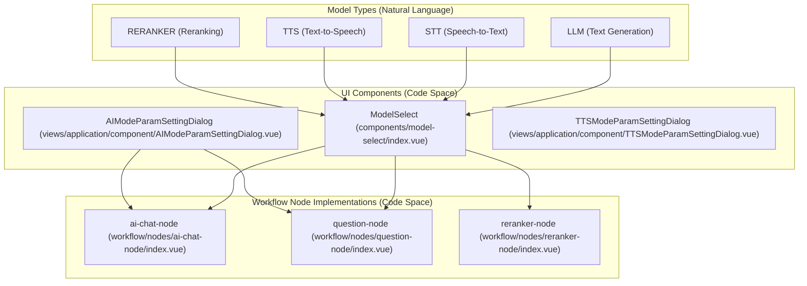
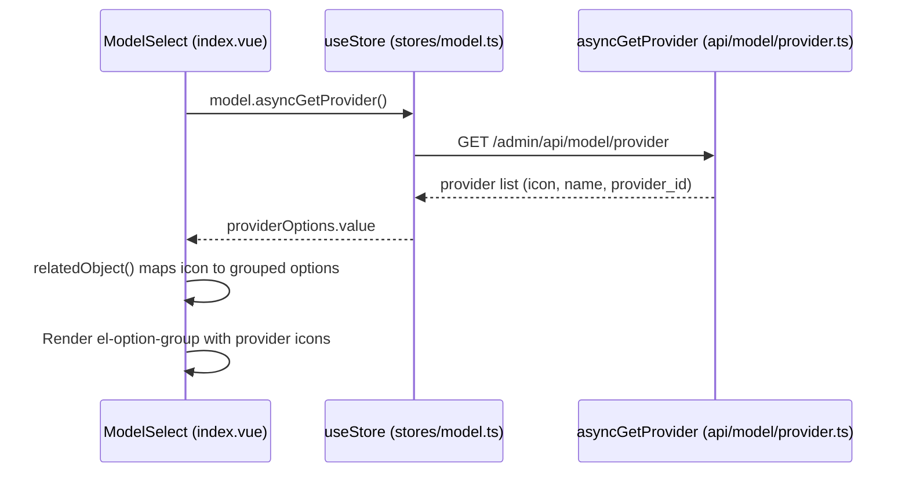

<!-- source: DeepWiki mcp.deepwiki.com · repo 1Panel-dev/MaxKB · page 7.1 Model Configuration and UI · fetched 2026-10-29 -->

# Model Configuration and UI

Relevant source files

The following files were used as context for generating this wiki page:

- [ui/package.json](ui/package.json)
- [ui/src/api/model/model.ts](ui/src/api/model/model.ts)
- [ui/src/api/model/provider.ts](ui/src/api/model/provider.ts)
- [ui/src/components/ai-chat/component/inline-params/InlineFormItem.vue](ui/src/components/ai-chat/component/inline-params/InlineFormItem.vue)
- [ui/src/components/card-box/index.vue](ui/src/components/card-box/index.vue)
- [ui/src/components/common-list/index.vue](ui/src/components/common-list/index.vue)
- [ui/src/components/dynamics-form/constructor/items/KnowledgeConstructor.vue](ui/src/components/dynamics-form/constructor/items/KnowledgeConstructor.vue)
- [ui/src/components/dynamics-form/constructor/items/ModelConstructor.vue](ui/src/components/dynamics-form/constructor/items/ModelConstructor.vue)
- [ui/src/components/dynamics-form/items/common/SelectHeader.vue](ui/src/components/dynamics-form/items/common/SelectHeader.vue)
- [ui/src/components/dynamics-form/items/knowledge/Knowledge.vue](ui/src/components/dynamics-form/items/knowledge/Knowledge.vue)
- [ui/src/components/dynamics-form/items/model/Model.vue](ui/src/components/dynamics-form/items/model/Model.vue)
- [ui/src/components/dynamics-form/items/select/MultiSelect.vue](ui/src/components/dynamics-form/items/select/MultiSelect.vue)
- [ui/src/components/dynamics-form/items/select/SingleSelect.vue](ui/src/components/dynamics-form/items/select/SingleSelect.vue)
- [ui/src/components/index.ts](ui/src/components/index.ts)
- [ui/src/components/model-select/index.vue](ui/src/components/model-select/index.vue)
- [ui/src/enums/model.ts](ui/src/enums/model.ts)
- [ui/src/locales/lang/en-US/views/model.ts](ui/src/locales/lang/en-US/views/model.ts)
- [ui/src/locales/lang/zh-CN/views/model.ts](ui/src/locales/lang/zh-CN/views/model.ts)
- [ui/src/locales/lang/zh-Hant/views/model.ts](ui/src/locales/lang/zh-Hant/views/model.ts)
- [ui/src/styles/app.scss](ui/src/styles/app.scss)
- [ui/src/styles/element-plus.scss](ui/src/styles/element-plus.scss)
- [ui/src/styles/variables.scss](ui/src/styles/variables.scss)
- [ui/src/views/application/component/AIModeParamSettingDialog.vue](ui/src/views/application/component/AIModeParamSettingDialog.vue)
- [ui/src/views/application/component/TTSModeParamSettingDialog.vue](ui/src/views/application/component/TTSModeParamSettingDialog.vue)
- [ui/src/views/model/component/CreateModelDialog.vue](ui/src/views/model/component/CreateModelDialog.vue)
- [ui/src/views/model/component/EditModel.vue](ui/src/views/model/component/EditModel.vue)
- [ui/src/views/model/component/ParamSettingDialog.vue](ui/src/views/model/component/ParamSettingDialog.vue)
- [ui/src/views/model/component/Provider.vue](ui/src/views/model/component/Provider.vue)
- [ui/src/views/model/component/SelectProviderDialog.vue](ui/src/views/model/component/SelectProviderDialog.vue)
- [ui/src/views/model/component/data.ts](ui/src/views/model/component/data.ts)
- [ui/vite.config.ts](ui/vite.config.ts)

This document describes the model configuration and user interface system in MaxKB, covering how users select and configure AI models across different model types (LLM, STT, TTS, Reranker, Image, Video, etc.) in both application settings and workflow nodes. For information about model provider integration and backend processing, see [Model Providers and Integration](#7.2).

---

## Model Types and Categories

MaxKB supports multiple model types, each with specific capabilities and configuration requirements:

| Model Type | Purpose | Usage Context |
|------------|---------|---------------|
| `LLM` | Large Language Models for text generation and conversation | AI Chat, Question nodes, Intent Classification |
| `STT` | Speech-to-Text conversion | Voice input, Speech-to-Text nodes |
| `TTS` | Text-to-Speech synthesis | Voice output, Text-to-Speech nodes |
| `RERANKER` | Document reranking for improved retrieval | Reranker nodes in workflows |
| `IMAGE` | Image understanding and video understanding | Image/Video Understanding nodes |
| `TTI` | Text-to-Image generation | Image Generate nodes |
| `TTV` | Text-to-Video generation | Text-to-Video nodes |
| `ITV` | Image-to-Video generation | Image-to-Video nodes |

### Model Architecture and UI Bridge

The following diagram bridges the high-level model types to the specific Vue components and workflow nodes that implement them.

**Diagram: Model System Code Mapping**

**Sources:** [ui/src/components/model-select/index.vue:1-111](), [ui/src/views/application/component/AIModeParamSettingDialog.vue:1-33](), [ui/src/components/dynamics-form/items/model/Model.vue:62-63]()

---

## Model Selection Component

The `ModelSelect` component is the primary interface for model selection. It utilizes `el-select` with grouped options categorized by model providers.

### Component Logic and Data Flow

The component maintains internal state for provider icons and names, fetching them via `asyncGetProvider` from the model store [ui/src/components/model-select/index.vue:133-151]().

**Diagram: Model Selection Data Flow**

### Key Features
- **Grouping:** Uses `el-option-group` to organize models by their `provider` attribute [ui/src/components/model-select/index.vue:10-13]().
- **Status Handling:** Models with `status !== 'SUCCESS'` are rendered as disabled with an "unavailable" tag [ui/src/components/model-select/index.vue:39-59]().
- **Shared Models:** Shared models are identified with a specific tag using `item.type === 'share'` [ui/src/components/model-select/index.vue:29-31]().
- **Dynamic Creation:** The footer allows users to open `SelectProviderDialog` and `CreateModelDialog` directly from the dropdown [ui/src/components/model-select/index.vue:75-97]().

**Sources:** [ui/src/components/model-select/index.vue:10-60](), [ui/src/components/model-select/index.vue:140-151](), [ui/src/components/model-select/index.vue:153-159]()

---

## Model Configuration Dialogs

Detailed parameter configuration (temperature, max tokens, etc.) is handled by specialized dialogs that render dynamic forms based on model requirements.

### AIModeParamSettingDialog

This dialog uses `DynamicsForm` to render fields specific to a model's requirements.

- **Form Rendering:** It accepts `model_form_field_list` or fetches it via `getModelParamsForm` API [ui/src/views/application/component/AIModeParamSettingDialog.vue:57-62]().
- **State Management:** Uses `dynamicsFormRef.value?.render()` to populate the form with existing `model_setting_data` [ui/src/views/application/component/AIModeParamSettingDialog.vue:85-92]().
- **Default Reset:** The `reset_default` function calculates default values from the form field definitions and emits a refresh event [ui/src/views/application/component/AIModeParamSettingDialog.vue:97-113]().

### Inline Parameter Configuration

In certain chat interfaces, parameters can be configured inline using `InlineFormItem`. This component dynamically switches between input types like `SwitchInput`, `DatePicker`, or `Model` selection [ui/src/components/ai-chat/component/inline-params/InlineFormItem.vue:2-11]().

**Sources:** [ui/src/views/application/component/AIModeParamSettingDialog.vue:12-20](), [ui/src/views/application/component/AIModeParamSettingDialog.vue:70-95](), [ui/src/components/ai-chat/component/inline-params/InlineFormItem.vue:1-45]()

---

## Complex Model Input Component

The `Model.vue` component within the `dynamics-form` system provides a "complex select" interface that combines model selection with a parameter setting shortcut.

### Component Structure
It consists of an `el-select` for the model ID and an `el-button` that triggers the `AIModeParamSettingDialog` [ui/src/components/dynamics-form/items/model/Model.vue:2-53]().

| Code Entity | Role |
|-------------|------|
| `groupedOptions` | Computed property that groups models using `groupBy(list, 'provider')` [ui/src/components/dynamics-form/items/model/Model.vue:84-87]() |
| `handleModelChange` | Updates `model_id` and resets `model_params_setting` to defaults [ui/src/components/dynamics-form/items/model/Model.vue:123-130]() |
| `openParamSetting` | Extracts `model_form_field` from the selected model's attributes and opens the dialog [ui/src/components/dynamics-form/items/model/Model.vue:98-112]() |

**Sources:** [ui/src/components/dynamics-form/items/model/Model.vue:84-130](), [ui/src/components/dynamics-form/items/model/Model.vue:53]()

---

## UI Styling and Theming

Model configuration components adhere to the global styling defined in the SCSS architecture.

### Style Constants
- **Card Dimensions:** Default card widths for model displays are defined in `variables.scss` [ui/src/styles/variables.scss:37-39]().
- **Element Plus Overrides:** Specific overrides for `el-select` and `el-dialog` ensure consistent appearance in model configuration dialogs [ui/src/styles/element-plus.scss:228-249]().
- **Model Icons:** Model icons are rendered using `v-html` to support SVG strings provided by the backend [ui/src/components/model-select/index.vue:24-27]().

**Sources:** [ui/src/styles/variables.scss:37-39](), [ui/src/styles/element-plus.scss:228-249](), [ui/src/components/model-select/index.vue:24-27]()

---

