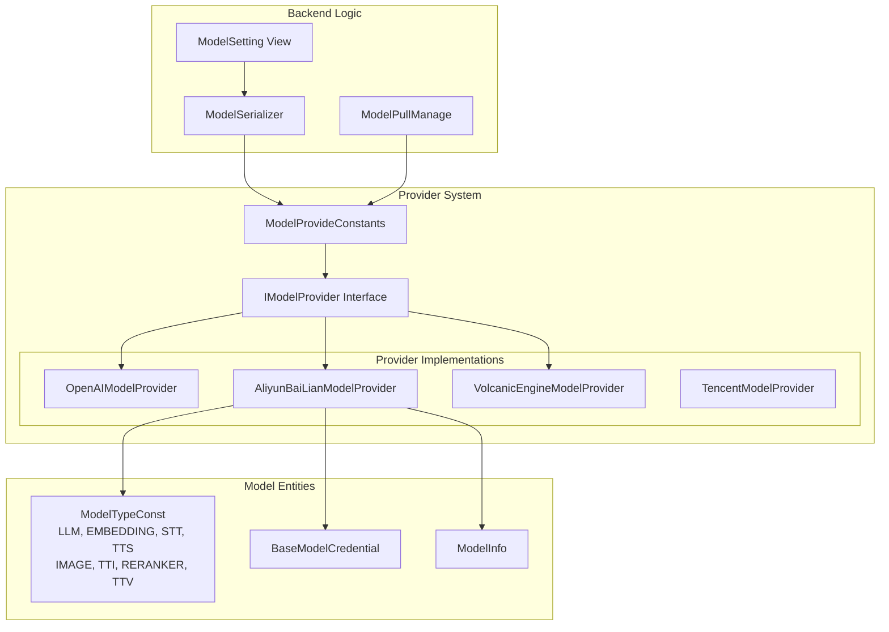
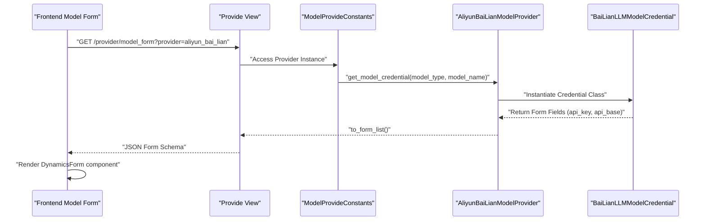
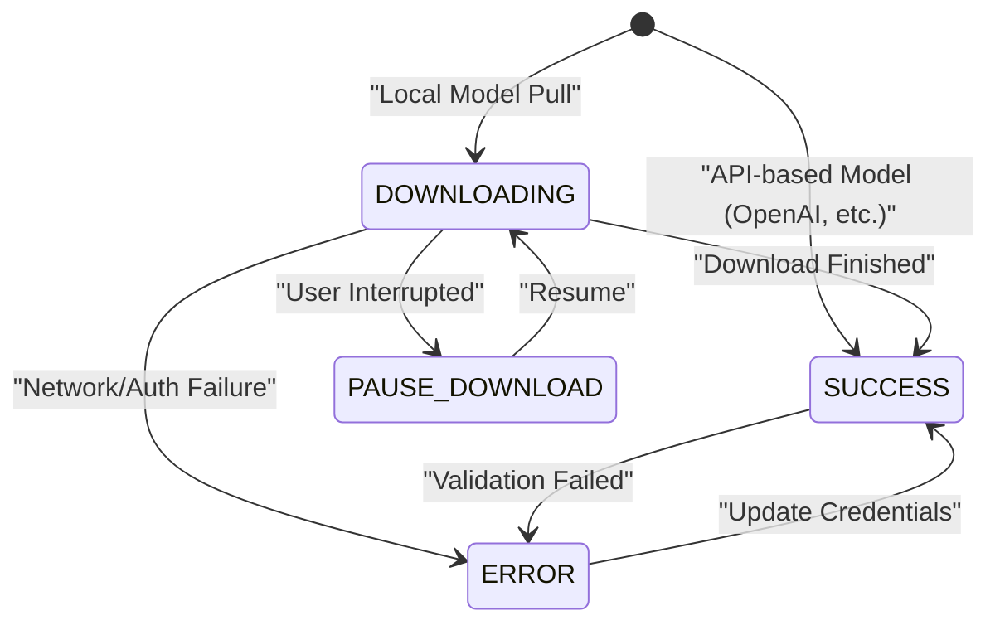
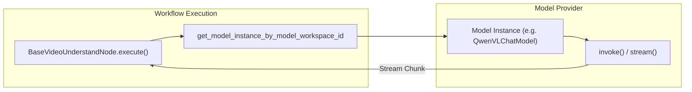

<!-- source: DeepWiki mcp.deepwiki.com · repo 1Panel-dev/MaxKB · page 7.2 Model Providers and Integration · fetched 2026-10-29 -->

# Model Providers and Integration

Relevant source files

The following files were used as context for generating this wiki page:

- [README.md](README.md)
- [README_CN.md](README_CN.md)
- [apps/application/flow/default_workflow_en.json](apps/application/flow/default_workflow_en.json)
- [apps/application/flow/default_workflow_zh.json](apps/application/flow/default_workflow_zh.json)
- [apps/application/flow/default_workflow_zh_Hant.json](apps/application/flow/default_workflow_zh_Hant.json)
- [apps/application/flow/step_node/video_understand_step_node/impl/base_video_understand_node.py](apps/application/flow/step_node/video_understand_step_node/impl/base_video_understand_node.py)
- [apps/common/sql/list_embedding_text.sql](apps/common/sql/list_embedding_text.sql)
- [apps/common/template/email_template_en.html](apps/common/template/email_template_en.html)
- [apps/common/template/email_template_zh.html](apps/common/template/email_template_zh.html)
- [apps/common/template/email_template_zh_Hant.html](apps/common/template/email_template_zh_Hant.html)
- [apps/models_provider/api/model.py](apps/models_provider/api/model.py)
- [apps/models_provider/api/provide.py](apps/models_provider/api/provide.py)
- [apps/models_provider/base_model_provider.py](apps/models_provider/base_model_provider.py)
- [apps/models_provider/constants/model_provider_constants.py](apps/models_provider/constants/model_provider_constants.py)
- [apps/models_provider/impl/aliyun_bai_lian_model_provider/aliyun_bai_lian_model_provider.py](apps/models_provider/impl/aliyun_bai_lian_model_provider/aliyun_bai_lian_model_provider.py)
- [apps/models_provider/impl/aliyun_bai_lian_model_provider/credential/itv.py](apps/models_provider/impl/aliyun_bai_lian_model_provider/credential/itv.py)
- [apps/models_provider/impl/aliyun_bai_lian_model_provider/credential/llm.py](apps/models_provider/impl/aliyun_bai_lian_model_provider/credential/llm.py)
- [apps/models_provider/impl/aliyun_bai_lian_model_provider/credential/reranker.py](apps/models_provider/impl/aliyun_bai_lian_model_provider/credential/reranker.py)
- [apps/models_provider/impl/aliyun_bai_lian_model_provider/credential/stt/__init__.py](apps/models_provider/impl/aliyun_bai_lian_model_provider/credential/stt/__init__.py)
- [apps/models_provider/impl/aliyun_bai_lian_model_provider/credential/stt/stt.py](apps/models_provider/impl/aliyun_bai_lian_model_provider/credential/stt/stt.py)
- [apps/models_provider/impl/aliyun_bai_lian_model_provider/credential/tti.py](apps/models_provider/impl/aliyun_bai_lian_model_provider/credential/tti.py)
- [apps/models_provider/impl/aliyun_bai_lian_model_provider/credential/tts.py](apps/models_provider/impl/aliyun_bai_lian_model_provider/credential/tts.py)
- [apps/models_provider/impl/aliyun_bai_lian_model_provider/credential/ttv.py](apps/models_provider/impl/aliyun_bai_lian_model_provider/credential/ttv.py)
- [apps/models_provider/impl/aliyun_bai_lian_model_provider/model/image.py](apps/models_provider/impl/aliyun_bai_lian_model_provider/model/image.py)
- [apps/models_provider/impl/aliyun_bai_lian_model_provider/model/reranker.py](apps/models_provider/impl/aliyun_bai_lian_model_provider/model/reranker.py)
- [apps/models_provider/impl/aliyun_bai_lian_model_provider/model/stt/__init__.py](apps/models_provider/impl/aliyun_bai_lian_model_provider/model/stt/__init__.py)
- [apps/models_provider/impl/aliyun_bai_lian_model_provider/model/stt/asr_stt.py](apps/models_provider/impl/aliyun_bai_lian_model_provider/model/stt/asr_stt.py)
- [apps/models_provider/impl/aliyun_bai_lian_model_provider/model/stt/omni_stt.py](apps/models_provider/impl/aliyun_bai_lian_model_provider/model/stt/omni_stt.py)
- [apps/models_provider/impl/aliyun_bai_lian_model_provider/model/tti.py](apps/models_provider/impl/aliyun_bai_lian_model_provider/model/tti.py)
- [apps/models_provider/impl/aliyun_bai_lian_model_provider/model/tts.py](apps/models_provider/impl/aliyun_bai_lian_model_provider/model/tts.py)
- [apps/models_provider/impl/azure_model_provider/model/tti.py](apps/models_provider/impl/azure_model_provider/model/tti.py)
- [apps/models_provider/impl/docker_ai_model_provider/model/tti.py](apps/models_provider/impl/docker_ai_model_provider/model/tti.py)
- [apps/models_provider/impl/gemini_model_provider/credential/tti.py](apps/models_provider/impl/gemini_model_provider/credential/tti.py)
- [apps/models_provider/impl/gemini_model_provider/gemini_model_provider.py](apps/models_provider/impl/gemini_model_provider/gemini_model_provider.py)
- [apps/models_provider/impl/gemini_model_provider/model/image.py](apps/models_provider/impl/gemini_model_provider/model/image.py)
- [apps/models_provider/impl/gemini_model_provider/model/llm.py](apps/models_provider/impl/gemini_model_provider/model/llm.py)
- [apps/models_provider/impl/gemini_model_provider/model/stt.py](apps/models_provider/impl/gemini_model_provider/model/stt.py)
- [apps/models_provider/impl/gemini_model_provider/model/tti.py](apps/models_provider/impl/gemini_model_provider/model/tti.py)
- [apps/models_provider/impl/minimax_model_provider/__init__.py](apps/models_provider/impl/minimax_model_provider/__init__.py)
- [apps/models_provider/impl/minimax_model_provider/credential/__init__.py](apps/models_provider/impl/minimax_model_provider/credential/__init__.py)
- [apps/models_provider/impl/minimax_model_provider/credential/itv.py](apps/models_provider/impl/minimax_model_provider/credential/itv.py)
- [apps/models_provider/impl/minimax_model_provider/credential/llm.py](apps/models_provider/impl/minimax_model_provider/credential/llm.py)
- [apps/models_provider/impl/minimax_model_provider/credential/tts.py](apps/models_provider/impl/minimax_model_provider/credential/tts.py)
- [apps/models_provider/impl/minimax_model_provider/icon/__init__.py](apps/models_provider/impl/minimax_model_provider/icon/__init__.py)
- [apps/models_provider/impl/minimax_model_provider/icon/minimax_icon_svg](apps/models_provider/impl/minimax_model_provider/icon/minimax_icon_svg)
- [apps/models_provider/impl/minimax_model_provider/model/__init__.py](apps/models_provider/impl/minimax_model_provider/model/__init__.py)
- [apps/models_provider/impl/minimax_model_provider/model/llm.py](apps/models_provider/impl/minimax_model_provider/model/llm.py)
- [apps/models_provider/impl/minimax_model_provider/model/tts.py](apps/models_provider/impl/minimax_model_provider/model/tts.py)
- [apps/models_provider/impl/ollama_model_provider/model/image.py](apps/models_provider/impl/ollama_model_provider/model/image.py)
- [apps/models_provider/impl/openai_model_provider/model/image.py](apps/models_provider/impl/openai_model_provider/model/image.py)
- [apps/models_provider/impl/openai_model_provider/model/llm.py](apps/models_provider/impl/openai_model_provider/model/llm.py)
- [apps/models_provider/impl/openai_model_provider/model/tti.py](apps/models_provider/impl/openai_model_provider/model/tti.py)
- [apps/models_provider/impl/regolo_model_provider/model/image.py](apps/models_provider/impl/regolo_model_provider/model/image.py)
- [apps/models_provider/impl/regolo_model_provider/model/llm.py](apps/models_provider/impl/regolo_model_provider/model/llm.py)
- [apps/models_provider/impl/regolo_model_provider/model/tti.py](apps/models_provider/impl/regolo_model_provider/model/tti.py)
- [apps/models_provider/impl/siliconCloud_model_provider/model/image.py](apps/models_provider/impl/siliconCloud_model_provider/model/image.py)
- [apps/models_provider/impl/siliconCloud_model_provider/model/tti.py](apps/models_provider/impl/siliconCloud_model_provider/model/tti.py)
- [apps/models_provider/impl/tencent_cloud_model_provider/model/llm.py](apps/models_provider/impl/tencent_cloud_model_provider/model/llm.py)
- [apps/models_provider/impl/tencent_model_provider/model/image.py](apps/models_provider/impl/tencent_model_provider/model/image.py)
- [apps/models_provider/impl/tencent_model_provider/model/stt.py](apps/models_provider/impl/tencent_model_provider/model/stt.py)
- [apps/models_provider/impl/tencent_model_provider/model/tti.py](apps/models_provider/impl/tencent_model_provider/model/tti.py)
- [apps/models_provider/impl/vllm_model_provider/model/image.py](apps/models_provider/impl/vllm_model_provider/model/image.py)
- [apps/models_provider/impl/volcanic_engine_model_provider/credential/bigModel_stt.py](apps/models_provider/impl/volcanic_engine_model_provider/credential/bigModel_stt.py)
- [apps/models_provider/impl/volcanic_engine_model_provider/credential/tti.py](apps/models_provider/impl/volcanic_engine_model_provider/credential/tti.py)
- [apps/models_provider/impl/volcanic_engine_model_provider/credential/ttv.py](apps/models_provider/impl/volcanic_engine_model_provider/credential/ttv.py)
- [apps/models_provider/impl/volcanic_engine_model_provider/model/bigModel_stt.py](apps/models_provider/impl/volcanic_engine_model_provider/model/bigModel_stt.py)
- [apps/models_provider/impl/volcanic_engine_model_provider/model/embedding.py](apps/models_provider/impl/volcanic_engine_model_provider/model/embedding.py)
- [apps/models_provider/impl/volcanic_engine_model_provider/model/image.py](apps/models_provider/impl/volcanic_engine_model_provider/model/image.py)
- [apps/models_provider/impl/volcanic_engine_model_provider/model/tti.py](apps/models_provider/impl/volcanic_engine_model_provider/model/tti.py)
- [apps/models_provider/impl/volcanic_engine_model_provider/model/ttv.py](apps/models_provider/impl/volcanic_engine_model_provider/model/ttv.py)
- [apps/models_provider/impl/volcanic_engine_model_provider/volcanic_engine_model_provider.py](apps/models_provider/impl/volcanic_engine_model_provider/volcanic_engine_model_provider.py)
- [apps/models_provider/impl/wenxin_model_provider/credential/embedding.py](apps/models_provider/impl/wenxin_model_provider/credential/embedding.py)
- [apps/models_provider/impl/wenxin_model_provider/credential/reranker.py](apps/models_provider/impl/wenxin_model_provider/credential/reranker.py)
- [apps/models_provider/impl/wenxin_model_provider/model/embedding.py](apps/models_provider/impl/wenxin_model_provider/model/embedding.py)
- [apps/models_provider/impl/wenxin_model_provider/model/reranker.py](apps/models_provider/impl/wenxin_model_provider/model/reranker.py)
- [apps/models_provider/impl/wenxin_model_provider/wenxin_model_provider.py](apps/models_provider/impl/wenxin_model_provider/wenxin_model_provider.py)
- [apps/models_provider/impl/xinference_model_provider/model/image.py](apps/models_provider/impl/xinference_model_provider/model/image.py)
- [apps/models_provider/impl/zhipu_model_provider/credential/tti.py](apps/models_provider/impl/zhipu_model_provider/credential/tti.py)
- [apps/models_provider/impl/zhipu_model_provider/model/image.py](apps/models_provider/impl/zhipu_model_provider/model/image.py)
- [apps/models_provider/impl/zhipu_model_provider/model/llm.py](apps/models_provider/impl/zhipu_model_provider/model/llm.py)
- [apps/models_provider/impl/zhipu_model_provider/model/tti.py](apps/models_provider/impl/zhipu_model_provider/model/tti.py)
- [apps/models_provider/serializers/model_serializer.py](apps/models_provider/serializers/model_serializer.py)
- [apps/models_provider/urls.py](apps/models_provider/urls.py)
- [apps/models_provider/views/model.py](apps/models_provider/views/model.py)
- [apps/models_provider/views/model_apply.py](apps/models_provider/views/model_apply.py)
- [apps/models_provider/views/provide.py](apps/models_provider/views/provide.py)
- [apps/system_manage/api/resource_mapping.py](apps/system_manage/api/resource_mapping.py)
- [apps/system_manage/urls.py](apps/system_manage/urls.py)
- [apps/system_manage/views/__init__.py](apps/system_manage/views/__init__.py)
- [ui/src/components/folder-virtualized-tree/CreateFolderDialog.vue](ui/src/components/folder-virtualized-tree/CreateFolderDialog.vue)
- [ui/src/components/folder-virtualized-tree/constant.ts](ui/src/components/folder-virtualized-tree/constant.ts)

This document covers MaxKB's model provider system and integration patterns, focusing on how different AI model providers (OpenAI, Anthropic, DeepSeek, and various Chinese providers) are integrated and managed within the system. This includes provider registration, model configuration, credential management, and the dynamic form system used for provider-specific settings.

## Provider Architecture

MaxKB uses a plugin-based provider architecture where different AI model providers are registered through the `ModelProvideConstants` system. Each provider implements a standard interface (`IModelProvider`) to support multiple model types and dynamic configuration forms.

Title: Provider Architecture and Data Flow

Sources: [apps/models_provider/constants/model_provider_constants.py:1-20](), [apps/models_provider/base_model_provider.py:102-150](), [apps/models_provider/serializers/model_serializer.py:62-101]()

## Model Types and Capabilities

The system supports 8+ distinct model types. Providers implement specific logic for these types by inheriting from base implementation classes like `BaseChatOpenAI` or `BaseTextToImage`.

| Model Type | Code Constant | Purpose | Key Base Class |
|------------|---------------|---------|----------------|
| Large Language Model | `LLM` | Text generation and reasoning | `BaseChatOpenAI` |
| Embedding | `EMBEDDING` | Text vectorization | `BaseEmbedding` |
| Reranker | `RERANKER` | Search result optimization | `BaseReranker` |
| Speech-to-Text | `STT` | Audio transcription | `BaseSpeechToText` |
| Text-to-Speech | `TTS` | Audio synthesis | `BaseTextToSpeech` |
| Image Understanding | `IMAGE` | Vision/Multi-modal tasks | `MaxKBBaseModel` |
| Text-to-Image | `TTI` | Image generation | `BaseTextToImage` |
| Text-to-Video | `TTV` | Video generation | `BaseGenerationVideo` |

Sources: [apps/models_provider/base_model_provider.py:17-27](), [apps/models_provider/impl/aliyun_bai_lian_model_provider/model/llm.py:15-20](), [apps/models_provider/impl/volcanic_engine_model_provider/model/ttv.py:10-15]()

## Dynamic Configuration System

MaxKB utilizes a dynamic form system to handle the varying credential requirements (API Keys, Secret IDs, Base URLs) across 15+ providers. Each provider defines its requirements using `BaseForm` fields.

Title: Dynamic Form Generation for "Aliyun Bai Lian"

Sources: [apps/models_provider/views/provide.py:75-85](), [apps/models_provider/impl/aliyun_bai_lian_model_provider/credential/llm.py:10-25](), [apps/models_provider/serializers/model_serializer.py:35-41]()

## Model Lifecycle and Status

Models, especially local or complex cloud models, follow a state machine managed by the `Status` class in `models_provider/models.py`.

Title: Model State Transitions

Sources: [apps/models_provider/models.py:11-20](), [apps/models_provider/serializers/model_serializer.py:83-94]()

## Implementation Example: Aliyun Bai Lian

The Aliyun integration demonstrates how a single provider supports multiple modalities by mapping `ModelInfo` to specific implementation classes.

| Model Name | Type | Implementation Class |
|------------|------|----------------------|
| `qwen-max` | `LLM` | `BaiLianChatModel` |
| `text-embedding-v1` | `EMBEDDING` | `AliyunBaiLianEmbedding` |
| `gte-rerank-v2` | `RERANKER` | `AliyunBaiLianReranker` |
| `wan2.6` | `TTI` | `QwenTextToImageModel` |
| `cosyvoice-v1` | `TTS` | `AliyunBaiLianTextToSpeech` |

Sources: [apps/models_provider/impl/aliyun_bai_lian_model_provider/aliyun_bai_lian_model_provider.py:56-100](), [apps/models_provider/impl/aliyun_bai_lian_model_provider/model/tti.py:13-20]()

## Integration with Workflow Engine

Models are consumed by the workflow engine via the `get_model_instance_by_model_workspace_id` utility. Nodes like `BaseVideoUnderstandNode` use this to dynamically load the correct model instance and parameters during execution.

Title: Model Execution in Workflow

Sources: [apps/application/flow/step_node/video_understand_step_node/impl/base_video_understand_node.py:134-150](), [apps/models_provider/tools.py:45-60]()

## API Endpoints

The model provider system is exposed through several key endpoints defined in `apps/models_provider/urls.py`.

| Path | View Class | Description |
|------|------------|-------------|
| `/provider` | `Provide` | Lists all available model providers |
| `/provider/model_list` | `Provide.ModelList` | Lists base models available for a specific provider |
| `/workspace/<workspace_id>/model` | `ModelSetting` | CRUD for workspace-specific model configurations |
| `/system/shared/workspace/<workspace_id>/model` | `WorkspaceSharedModelSetting` | Manages models shared across the system |

Sources: [apps/models_provider/urls.py:10-23](), [apps/models_provider/views/model.py:57-75]()

---

