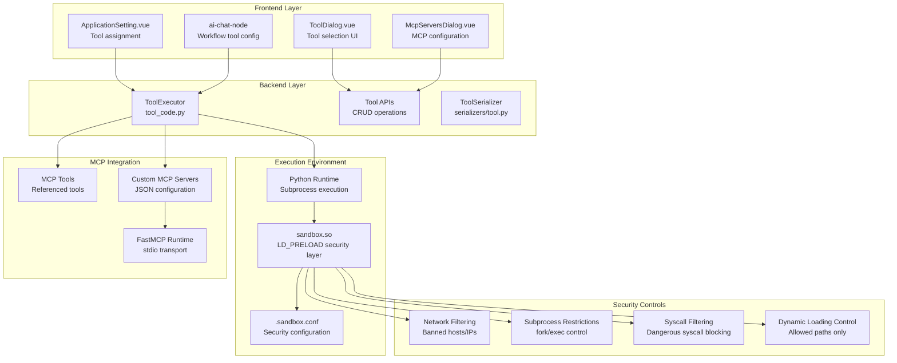
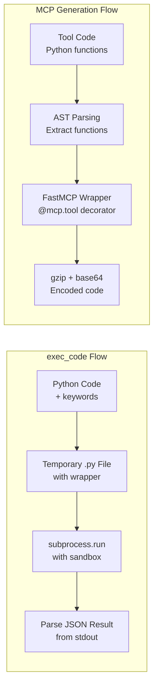
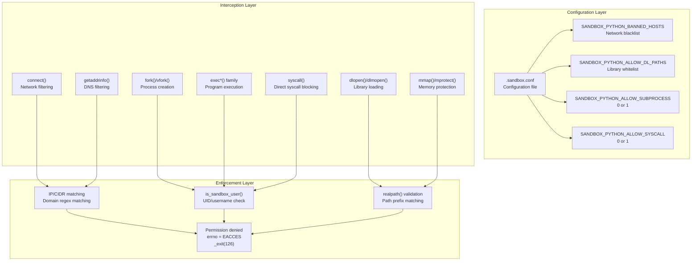

<!-- source: DeepWiki mcp.deepwiki.com · repo 1Panel-dev/MaxKB · page 8 Tool Management and Execution · fetched 2026-10-29 -->

# Tool Management and Execution

<details>
<summary>Relevant source files</summary>

The following files were used as context for generating this wiki page:

- [.dockerignore](.dockerignore)
- [.github/workflows/build-and-push-python-pg.yml](.github/workflows/build-and-push-python-pg.yml)
- [.github/workflows/build-and-push-vector-model.yml](.github/workflows/build-and-push-vector-model.yml)
- [.github/workflows/build-and-push.yml](.github/workflows/build-and-push.yml)
- [apps/application/flow/backend/__init__.py](apps/application/flow/backend/__init__.py)
- [apps/application/flow/backend/sandbox_shell.py](apps/application/flow/backend/sandbox_shell.py)
- [apps/application/migrations/0011_application_skill_tool_ids.py](apps/application/migrations/0011_application_skill_tool_ids.py)
- [apps/common/utils/tool_code.py](apps/common/utils/tool_code.py)
- [apps/tools/api/tool.py](apps/tools/api/tool.py)
- [apps/tools/serializers/tool.py](apps/tools/serializers/tool.py)
- [apps/tools/urls.py](apps/tools/urls.py)
- [apps/tools/views/tool.py](apps/tools/views/tool.py)
- [installer/Dockerfile](installer/Dockerfile)
- [installer/Dockerfile-base](installer/Dockerfile-base)
- [installer/Dockerfile-vector-model](installer/Dockerfile-vector-model)
- [installer/install_model.py](installer/install_model.py)
- [installer/install_model_bert_base_cased.py](installer/install_model_bert_base_cased.py)
- [installer/sandbox.c](installer/sandbox.c)
- [pyproject.toml](pyproject.toml)

</details>


This document covers the custom tool system in MaxKB, including tool creation, code execution, sandboxed security, and MCP (Model Context Protocol) integration. Tools allow applications to extend LLM capabilities by executing Python code in a secure, isolated environment.

For information about applying tools in AI chat workflows, see [Workflow Engine](#5). For model management related to tool execution, see [Model Management](#7).

## Purpose and Scope

The tool management system provides:
- Custom Python tool creation and execution
- Sandboxed code execution environment with security restrictions
- MCP server integration for external tool protocols
- Tool configuration in applications and workflow nodes
- Network, subprocess, and system call restrictions for safe execution

## Tool Architecture Overview



**Sources:** [apps/common/utils/tool_code.py:1-277](), [installer/sandbox.c:1-592](), [apps/tools/serializers/tool.py:52-194](), [apps/tools/views/tool.py:39-164]()

## Tool Backend APIs and Data Models

### ToolExecutor Class

The `ToolExecutor` class is the central component for tool code execution. It provides methods for executing Python code, generating MCP server configurations, and managing sandbox security.

| Method | Purpose | Returns |
|--------|---------|---------|
| `exec_code(code_str, keywords, function_name)` | Executes Python code with parameters in sandbox | Execution result |
| `generate_mcp_server_code(code_str, params, name, description)` | Generates FastMCP server wrapper code | Python code string |
| `get_tool_mcp_config(code, params, name, description)` | Creates MCP tool configuration | Dictionary with command/args |
| `get_app_mcp_config(api_key)` | Creates application MCP configuration | Dictionary with URL/headers |
| `validate_mcp_transport(code_str)` | Validates MCP transport protocols | None (raises on error) |

**ToolExecutor Implementation:**



**Sources:** [apps/common/utils/tool_code.py:42-277]()

### Execution Flow

The code execution process follows these steps:

1. **Code Preparation** [apps/common/utils/tool_code.py:101-137]():
   - Wraps user code with imports and security setup.
   - Sets up restricted `sys.path` to sandbox packages using `_sandbox_python_sys_path` [apps/common/utils/tool_code.py:32]().
   - Switches to `sandbox` user if sandbox is enabled [apps/common/utils/tool_code.py:106-110]().
   - Clears environment variables for isolation.

2. **Sandbox Setup** [apps/common/utils/tool_code.py:106-110]():
   ```python
   set_run_user = (
       f"os.setgid({pwd.getpwnam(_run_user).pw_gid});os.setuid({pwd.getpwnam(_run_user).pw_uid});"
       if _enable_sandbox
       else ""
   )
   ```
   - Changes to non-privileged `sandbox` user defined in `_run_user` [apps/common/utils/tool_code.py:26]().
   - Excludes system Python paths.

3. **Subprocess Execution** [apps/common/utils/tool_code.py:242-261]():
   ```python
   subprocess_result = subprocess.run(
       [sys.executable, execute_file],
       timeout=_process_limit_timeout_seconds,
       text=True,
       capture_output=True,
       env={'LD_PRELOAD': f'{_sandbox_path}/lib/sandbox.so'},
       preexec_fn=_set_resource_limit
   )
   ```
   - `LD_PRELOAD` loads security layer `sandbox.so` before execution.
   - Timeout limits execution time (default 3600 seconds) [apps/common/utils/tool_code.py:33]().
   - Resource limits restrict CPU cores and memory [apps/common/utils/tool_code.py:34-39]().

4. **Result Extraction** [apps/common/utils/tool_code.py:146-155]():
   - Parses JSON from stdout with unique ID marker.
   - Returns result data on success (code 200).
   - Raises exception with error message on failure.

**Sources:** [apps/common/utils/tool_code.py:92-261]()

## Code Execution Sandbox

The sandbox provides multi-layered security through a C library that intercepts system calls using `LD_PRELOAD`.

### Sandbox Architecture



**Sources:** [installer/sandbox.c:1-592]()

### Network Access Control

The sandbox filters network connections at multiple levels:

**IP/CIDR Blocking** [installer/sandbox.c:157-221]():
- Supports IPv4 and IPv6 addresses.
- Handles CIDR notation (e.g., `172.17.0.0/16`).
- Matches against banned host list from configuration.

**Domain Name Filtering** [installer/sandbox.c:133-155]():
- Uses regex matching for domain patterns.
- Case-insensitive comparison.
- Blocks DNS resolution for banned domains.

**Connection Interception** [installer/sandbox.c:224-252]():
- Intercepts `connect()` calls.
- Blocks Unix domain sockets for sandbox users [installer/sandbox.c:231-234]().
- Validates IPv4/IPv6 addresses against `banned_hosts` [installer/sandbox.c:242-246]().

**Default Banned Hosts** [installer/Dockerfile-base:51]():
```
MAXKB_SANDBOX_PYTHON_BANNED_HOSTS="127.0.0.0/8,localhost,host.docker.internal,172.17.0.0/16,maxkb,pgsql,redis,172.31.250.192/26,0.0.0.0/32,::/0"
```

**Sources:** [installer/sandbox.c:124-269](), [installer/Dockerfile-base:51]()

### Subprocess Restriction

All subprocess creation functions are intercepted when `SANDBOX_PYTHON_ALLOW_SUBPROCESS=0`:

**Blocked Functions:**
- `fork()`, `vfork()`, `clone()`, `clone3()` [installer/sandbox.c:335-365]()
- `exec*()` family: `execv`, `execve`, `execvp`, `execvpe`, `execvP`, `execveat` [installer/sandbox.c:282-333]()
- `posix_spawn()`, `posix_spawnp()` [installer/sandbox.c:366-393]()
- `popen()`, `system()` [installer/sandbox.c:394-415]()
- `forkpty()` [installer/sandbox.c:427-434]()

**Enforcement Logic** [installer/sandbox.c:273-276]():
```c
static int allow_create_subprocess() {
    ensure_config_loaded();
    return allow_subprocess || !is_sandbox_user();
}
```

When blocked, functions call `throw_permission_denied_err(true, ...)` which exits with code 126.

**Sources:** [installer/sandbox.c:272-434]()

### System Call Filtering

Direct `syscall()` invocations are intercepted to prevent bypassing other restrictions [installer/sandbox.c:442-513]():

**Blocked Syscalls:**
- Process creation: `SYS_fork`, `SYS_vfork`, `SYS_clone`, `SYS_clone3`.
- Execution: `SYS_execve`, `SYS_execveat`.
- Network: `SYS_socket`, `SYS_connect`, `SYS_bind`, `SYS_listen`, `SYS_accept`.
- Security: `SYS_ptrace`, `SYS_setuid`, `SYS_setgid`.
- Memory: `SYS_mmap`, `SYS_munmap`, `SYS_mprotect`, `SYS_memfd_create`.

**Sources:** [installer/sandbox.c:442-513]()

### Dynamic Library Loading Control

The sandbox restricts which shared libraries can be loaded [installer/sandbox.c:515-562]():

**Path Validation** [installer/sandbox.c:518-542]():
- Only libraries within `SANDBOX_PYTHON_ALLOW_DL_PATHS` are allowed.
- Uses `realpath()` to resolve symbolic links.
- Compares resolved paths with whitelist prefixes.

**Intercepted Functions:**
- `dlopen()` and `__dlopen()` [installer/sandbox.c:543-552]()
- `dlmopen()` and `__dlmopen()` [installer/sandbox.c:553-562]()
- `mmap()` with `PROT_EXEC` [installer/sandbox.c:563-582]()
- `mprotect()` with `PROT_EXEC` [installer/sandbox.c:586-592]()

**Default Allowed Paths** [installer/Dockerfile-base:50]():
```
MAXKB_SANDBOX_PYTHON_PACKAGE_PATHS="/opt/py3/lib/python3.11/site-packages,/opt/maxkb-app/sandbox/python-packages,/opt/maxkb/python-packages"
```

**Sources:** [installer/sandbox.c:515-592](), [installer/Dockerfile-base:50]()

### Sandbox Initialization

The sandbox directory and configuration are initialized once per container startup [apps/common/utils/tool_code.py:47-94]():

1. **Lock File Creation** [apps/common/utils/tool_code.py:53-56]():
   - Creates exclusive lock file `PROJECT_DIR/tmp/tool_executor_init_dir.lock`.

2. **Permission Setup** [apps/common/utils/tool_code.py:62-68]():
   ```python
   os.system("chmod -R g-rwx /dev/shm /dev/mqueue")
   os.system("chmod o-rwx /run/postgresql")
   ```

3. **Configuration File Generation** [apps/common/utils/tool_code.py:70-93]():
   - Writes `.sandbox.conf` next to `sandbox.so`.
   - Merges `banned_hosts` with local IP.
   - Sets `SANDBOX_PYTHON_ALLOW_DL_PATHS` to include system paths and `_sandbox_python_sys_path`.

4. **Directory Permissions** [apps/common/utils/tool_code.py:94]():
   ```python
   os.system(f"chmod -R 550 {_sandbox_path}")
   ```

**Sources:** [apps/common/utils/tool_code.py:44-94]()

### Resource Limits

The sandbox enforces resource limits during execution [apps/common/utils/tool_code.py:246-261]():

```python
def _set_resource_limit():
    if not _enable_sandbox or not sys.platform.startswith("linux"): return
    with suppress(Exception): 
        resource.setrlimit(resource.RLIMIT_AS, (_process_limit_mem_mb * 1024 * 1024,) * 2)
    with suppress(Exception): 
        os.sched_setaffinity(0, set(random.sample(list(os.sched_getaffinity(0)), _process_limit_cpu_cores)))
```

**Configuration Variables** [apps/common/utils/tool_code.py:33-39]():
- `_process_limit_timeout_seconds`: Default 3600.
- `_process_limit_cpu_cores`: Calculated based on affinity or CPU count.
- `_process_limit_mem_mb`: Default 256 MB.

**Sources:** [apps/common/utils/tool_code.py:33-39, 246-261]()

## MCP (Model Context Protocol) Integration

MaxKB supports MCP for integrating external tools and services.

### MCP Configuration Modes

| Mode | Description | Code Pointer |
|------|-------------|--------------|
| **Referencing** | Select from pre-configured MCP tools in the database. | [apps/tools/serializers/tool.py:68-73]() |
| **Custom** | Define external MCP servers via JSON configuration. | [apps/tools/serializers/tool.py:159-169]() |

**Sources:** [apps/tools/serializers/tool.py:68-169]()

### MCP Code Generation for Custom Tools

Custom Python tools are converted to MCP servers using FastMCP [apps/common/utils/tool_code.py:157-230]():

**Generation Process:**

1. **AST Parsing** [apps/common/utils/tool_code.py:159-162]():
   - Parses Python code to AST to extract functions.

2. **FastMCP Wrapper** [apps/common/utils/tool_code.py:189-212]():
   - Wraps the code with `FastMCP` class.
   - Sets transport to `stdio`.
   - Compresses the resulting code using `gzip` and `base64`.

3. **MCP Tool Configuration** [apps/common/utils/tool_code.py:214-230]():
   - Configures the execution command with `sys.executable`.
   - Injects the `LD_PRELOAD` environment variable for sandbox protection.

**Sources:** [apps/common/utils/tool_code.py:157-230]()

### MCP Application Configuration

Applications can be configured as MCP servers for inter-application tool calling [apps/common/utils/tool_code.py:232-240]():

```python
app_config = {
    'url': f'http://127.0.0.1:8080{CONFIG.get_chat_path()}/api/mcp',
    'transport': 'streamable_http',
    'headers': {
        'Authorization': f'Bearer {api_key}',
    },
}
```

**Sources:** [apps/common/utils/tool_code.py:232-240]()

## Security Model Summary

The tool execution security model employs defense in depth:

| Layer | Mechanism | Configuration |
|-------|-----------|---------------|
| **User Isolation** | Switch to `sandbox` user | `MAXKB_SANDBOX=1` [installer/Dockerfile-base:48]() |
| **Network Filtering** | IP/CIDR and domain blacklist | `SANDBOX_PYTHON_BANNED_HOSTS` [installer/sandbox.c:28]() |
| **Subprocess Blocking** | Intercept fork/exec functions | `SANDBOX_PYTHON_ALLOW_SUBPROCESS=0` [installer/sandbox.c:31]() |
| **Syscall Filtering** | Block dangerous syscalls | `SANDBOX_PYTHON_ALLOW_SYSCALL=0` [installer/sandbox.c:32]() |
| **Library Loading** | Whitelist allowed paths | `SANDBOX_PYTHON_ALLOW_DL_PATHS` [installer/sandbox.c:29]() |
| **Resource Limits** | CPU, memory, time limits | `_process_limit_*` [apps/common/utils/tool_code.py:33-39]() |

**Sources:** [installer/sandbox.c:1-592](), [apps/common/utils/tool_code.py:25-40](), [installer/Dockerfile-base:46-52]()

---

