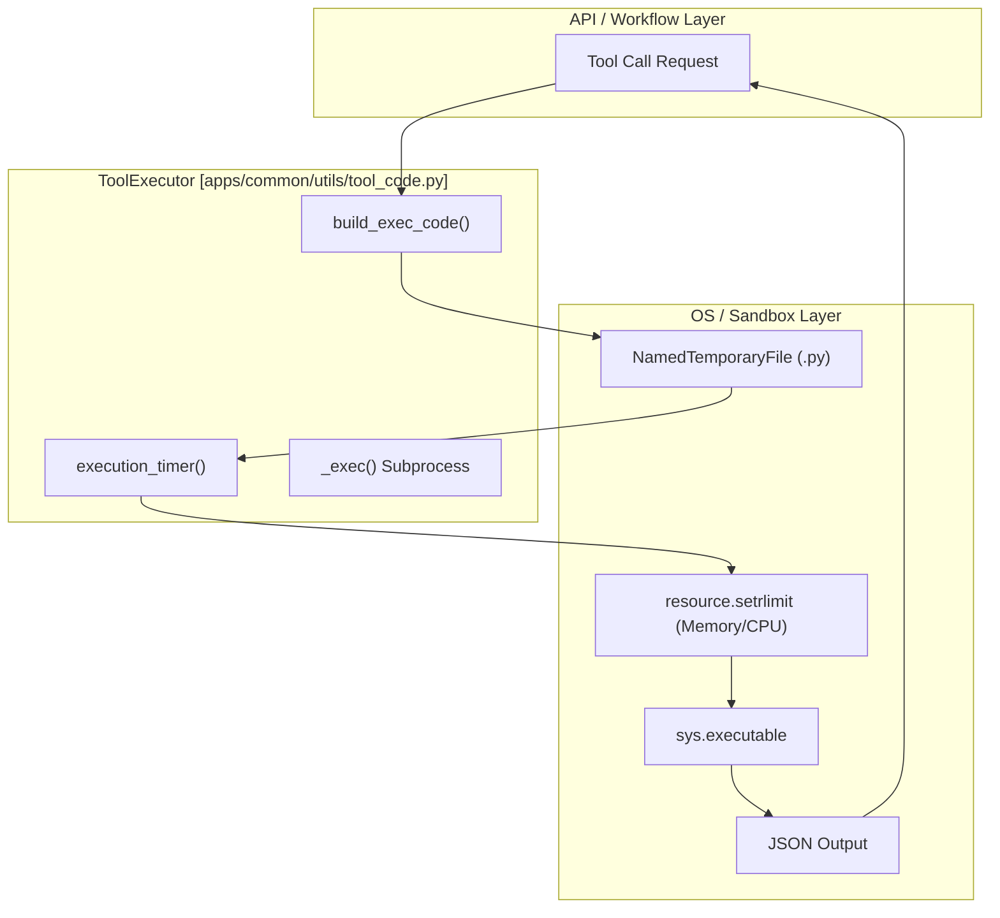
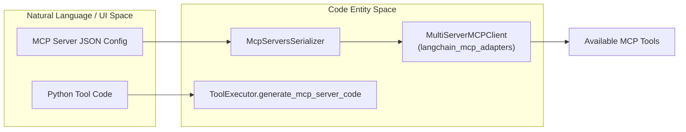

<!-- source: DeepWiki mcp.deepwiki.com · repo 1Panel-dev/MaxKB · page 8.1 Tool APIs and Backend Processing · fetched 2026-10-29 -->

# Tool APIs and Backend Processing

Relevant source files

The following files were used as context for generating this wiki page:

- [apps/application/flow/step_node/video_understand_step_node/i_video_understand_node.py](apps/application/flow/step_node/video_understand_step_node/i_video_understand_node.py)
- [apps/system_manage/serializers/resource_mapping_serializers.py](apps/system_manage/serializers/resource_mapping_serializers.py)
- [apps/system_manage/sql/list_mapping_resource.sql](apps/system_manage/sql/list_mapping_resource.sql)
- [apps/system_manage/sql/list_mapping_resource_ee.sql](apps/system_manage/sql/list_mapping_resource_ee.sql)
- [apps/system_manage/sql/list_resource_mapping.sql](apps/system_manage/sql/list_resource_mapping.sql)
- [apps/system_manage/sql/list_resource_mapping_ee.sql](apps/system_manage/sql/list_resource_mapping_ee.sql)
- [apps/system_manage/views/resource_mapping.py](apps/system_manage/views/resource_mapping.py)
- [apps/tools/api/tool.py](apps/tools/api/tool.py)
- [apps/tools/serializers/tool.py](apps/tools/serializers/tool.py)
- [apps/tools/serializers/tool_version.py](apps/tools/serializers/tool_version.py)
- [apps/tools/serializers/tool_workflow.py](apps/tools/serializers/tool_workflow.py)
- [apps/tools/urls.py](apps/tools/urls.py)
- [apps/tools/views/tool.py](apps/tools/views/tool.py)
- [apps/tools/views/tool_workflow.py](apps/tools/views/tool_workflow.py)
- [ui/src/api/system-resource-management/tool.ts](ui/src/api/system-resource-management/tool.ts)
- [ui/src/api/system-shared/tool.ts](ui/src/api/system-shared/tool.ts)
- [ui/src/api/tool/tool.ts](ui/src/api/tool/tool.ts)
- [ui/src/api/workspace/resource-mapping.ts](ui/src/api/workspace/resource-mapping.ts)
- [ui/src/api/workspace/role.ts](ui/src/api/workspace/role.ts)
- [ui/src/api/workspace/workspace.ts](ui/src/api/workspace/workspace.ts)
- [ui/src/locales/lang/en-US/views/tool.ts](ui/src/locales/lang/en-US/views/tool.ts)
- [ui/src/locales/lang/zh-CN/views/tool.ts](ui/src/locales/lang/zh-CN/views/tool.ts)
- [ui/src/locales/lang/zh-Hant/views/tool.ts](ui/src/locales/lang/zh-Hant/views/tool.ts)
- [ui/src/utils/dynamics-api/shared-api.ts](ui/src/utils/dynamics-api/shared-api.ts)
- [ui/src/views/tool-workflow/index.vue](ui/src/views/tool-workflow/index.vue)
- [ui/src/views/tool/DataSourceToolFormDrawer.vue](ui/src/views/tool/DataSourceToolFormDrawer.vue)
- [ui/src/views/tool/McpToolFormDrawer.vue](ui/src/views/tool/McpToolFormDrawer.vue)
- [ui/src/views/tool/SkillToolFormDrawer.vue](ui/src/views/tool/SkillToolFormDrawer.vue)
- [ui/src/views/tool/ToolDebugDrawer.vue](ui/src/views/tool/ToolDebugDrawer.vue)
- [ui/src/views/tool/ToolFormDrawer.vue](ui/src/views/tool/ToolFormDrawer.vue)
- [ui/src/views/tool/component/EditAvatarDialog.vue](ui/src/views/tool/component/EditAvatarDialog.vue)
- [ui/src/views/tool/component/InitParamDrawer.vue](ui/src/views/tool/component/InitParamDrawer.vue)

## Purpose and Scope

This document describes the backend APIs and processing logic for custom tool creation, execution, and integration within the MaxKB system. It covers the `ToolExecutor` class, tool code execution mechanisms, parameter handling, and MCP (Model Context Protocol) integration.

The tool system allows developers to extend AI capabilities by writing custom Python code or integrating external services via MCP. These tools are then made available to applications and workflows.

---

## Tool Definition and Management

Tools in MaxKB are represented by the `Tool` model and managed through a set of REST APIs.

### Tool Types and Scopes
Tools are categorized into several types and scopes:
- **Tool Types**: `PYTHON` (custom code), `MCP` (Model Context Protocol), `INTERNAL` (built-in system tools), and `WORKFLOW` (complex tools defined by a workflow) [apps/tools/models/tool.py:22-26]().
- **Tool Scopes**: `WORKSPACE` (available only within a specific workspace) and `SHARED` (available across the system) [apps/tools/models/tool.py:15-17]().

### Tool APIs
The backend provides endpoints for the full lifecycle of a tool:

| Operation | Endpoint | View Class | Serializer |
| :--- | :--- | :--- | :--- |
| **Create Tool** | `POST /workspace/{workspace_id}/tool` | `ToolView` [apps/tools/views/tool.py:39-64]() | `ToolSerializer.Create` [apps/tools/serializers/tool.py:381]() |
| **Get List** | `GET /workspace/{workspace_id}/tool` | `ToolView` [apps/tools/views/tool.py:80-92]() | `ToolTreeSerializer.Query` [apps/tools/serializers/tool.py:1004]() |
| **Update** | `PUT /workspace/{workspace_id}/tool/{tool_id}` | `ToolView.Operate` [apps/tools/views/tool.py:142-145]() | `ToolSerializer.Operate` [apps/tools/serializers/tool.py:444]() |
| **Debug** | `POST /workspace/{workspace_id}/tool/debug` | `ToolView.Debug` [apps/tools/views/tool.py:111-114]() | `ToolSerializer.Debug` [apps/tools/serializers/tool.py:533]() |
| **Pylint** | `POST /workspace/{workspace_id}/tool/pylint` | `ToolView.Pylint` [apps/tools/views/tool.py:214-216]() | `ToolSerializer.Pylint` [apps/tools/serializers/tool.py:650]() |

Sources: [apps/tools/urls.py:9-39](), [apps/tools/views/tool.py:39-216]()

---

## ToolExecutor and Code Execution

The `ToolExecutor` class is the central engine for running custom Python tools. It ensures that user-provided code is executed in a controlled environment.

### Execution Flow
When a tool is triggered (e.g., during debugging or workflow execution), the following flow occurs:

**Diagram: Tool Code Execution Architecture**

Sources: [apps/common/utils/tool_code.py:92-138](), [apps/common/utils/tool_code.py:242-261]()

### Security and Resource Limits
The `ToolExecutor` applies strict limits to the execution process via the `_set_resource_limit` function [apps/common/utils/tool_code.py:242-261]():
- **Memory**: Limits address space (`RLIMIT_AS`) based on `SANDBOX_PYTHON_PROCESS_LIMIT_MEM_MB` [apps/common/utils/tool_code.py:251-252]().
- **CPU**: Restricts execution to specific cores using `os.sched_setaffinity` [apps/common/utils/tool_code.py:254-255]().
- **Timeout**: Enforces a maximum execution time defined by `SANDBOX_PYTHON_PROCESS_LIMIT_TIMEOUT_SECONDS` [apps/common/utils/tool_code.py:32]().

### Pylint Validation
Before execution or saving, code is validated using `Pylint`. The `PylintAPI` [apps/tools/api/tool.py:223]() invokes a subprocess to run `pylint` on the code, capturing errors, warnings, and conventions [apps/tools/serializers/tool.py:650-685]().

---

## Tool Parameter Handling

Tools interact with applications through defined input and initialization parameters.

### Parameter Types
- **Init Parameters (`init_field_list`)**: Configuration values set when the tool is added to an application (e.g., API Keys).
- **Input Parameters (`input_field_list`)**: Values provided at runtime by the AI or workflow (e.g., search queries).

### Backend Processing
The `ToolSerializer` handles the validation and encryption of these parameters:
- **Encryption**: Sensitive fields in `init_params` are masked before being sent to the frontend [apps/tools/serializers/tool.py:128-157]().
- **Conversion**: Input values are converted to their expected Python types (String, Integer, Float, Boolean) using `common_convert_value` [apps/tools/serializers/tool.py:566-571]().

Sources: [apps/tools/serializers/tool.py:381-442](), [ui/src/views/tool/ToolFormDrawer.vue:75-171]()

---

## MCP (Model Context Protocol) Integration

MaxKB supports MCP to allow seamless integration with external tool servers.

### MCP Configuration
Users provide a JSON configuration for MCP servers. The backend validates this configuration using `validate_mcp_config` [apps/tools/serializers/tool.py:159-168](), which attempts to connect to the server and fetch available tools using the `MultiServerMCPClient` [apps/tools/serializers/tool.py:161-162]().

### Tool Generation
For Python-based tools, MaxKB can generate MCP-compatible code. The `ToolExecutor` includes methods to:
- **Generate MCP Code**: `_generate_mcp_server_code` uses Python's `ast` module to wrap user functions with `@mcp.tool()` decorators [apps/common/utils/tool_code.py:140-196]().
- **Config Generation**: `get_tool_mcp_config` produces the execution command and environment required to run the tool as an MCP server [apps/common/utils/tool_code.py:214-230]().

**Diagram: NL to Code Mapping for MCP Integration**

Sources: [apps/tools/serializers/tool.py:159-168](), [apps/common/utils/tool_code.py:140-230]()

---

## Workflow-Based Tools

Tools can also be defined as complex workflows using the `ToolWorkflow` model [apps/tools/models/tool_workflow.py:14]().

### Execution and Debugging
Workflow tools are executed via the `ToolWorkflowManage` class [apps/tools/serializers/tool_workflow.py:165](). 
- **Circular Dependency Check**: The system validates that a tool workflow does not reference itself or create a loop through `is_valid_tool_workflow_circular_dependency` [apps/tools/serializers/tool_workflow.py:58-96]().
- **Streaming Support**: Workflow tools support streaming responses, allowing for real-time feedback during execution [apps/tools/serializers/tool_workflow.py:170]().

Sources: [apps/tools/serializers/tool_workflow.py:142-198](), [apps/tools/views/tool_workflow.py:16-118]()

---

