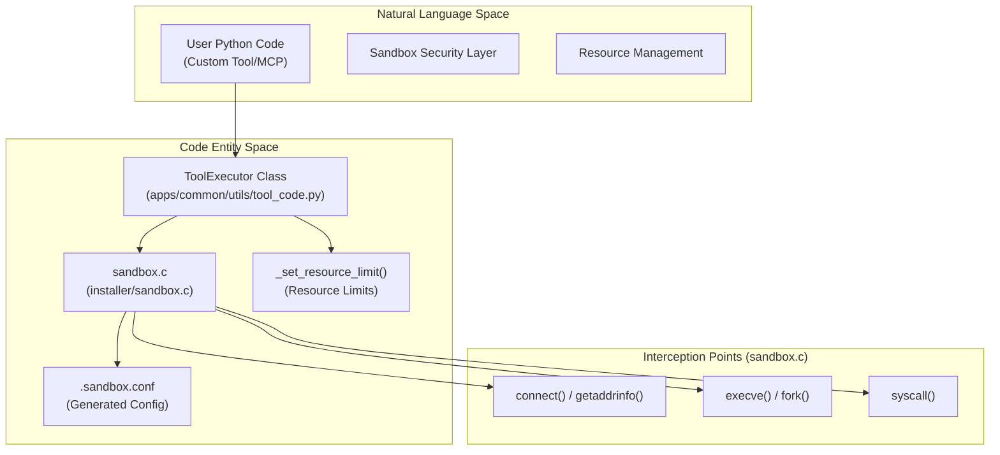
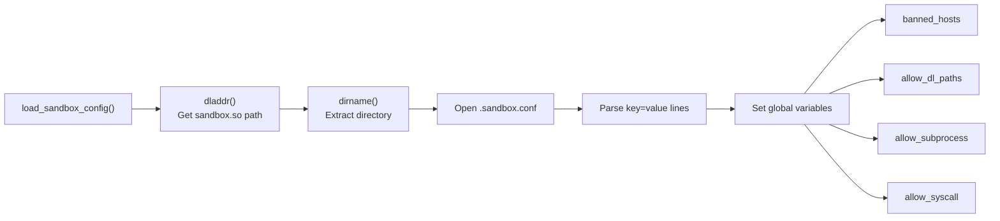
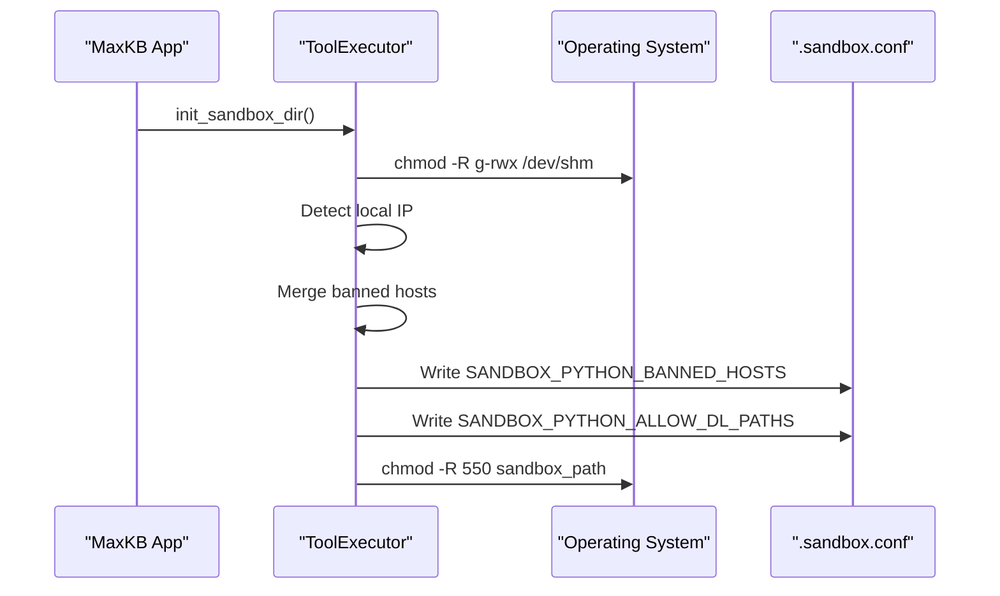

<!-- source: DeepWiki mcp.deepwiki.com · repo 1Panel-dev/MaxKB · page 8.2 Code Execution Sandbox · fetched 2026-10-29 -->

# Code Execution Sandbox

<details>
<summary>Relevant source files</summary>

The following files were used as context for generating this wiki page:

- [.dockerignore](.dockerignore)
- [.github/workflows/build-and-push-python-pg.yml](.github/workflows/build-and-push-python-pg.yml)
- [.github/workflows/build-and-push-vector-model.yml](.github/workflows/build-and-push-vector-model.yml)
- [.github/workflows/build-and-push.yml](.github/workflows/build-and-push.yml)
- [apps/application/flow/backend/__init__.py](apps/application/flow/backend/__init__.py)
- [apps/application/flow/backend/sandbox_shell.py](apps/application/flow/backend/sandbox_shell.py)
- [apps/application/migrations/0011_application_skill_tool_ids.py](apps/application/migrations/0011_application_skill_tool_ids.py)
- [apps/common/utils/tool_code.py](apps/common/utils/tool_code.py)
- [apps/tools/api/tool.py](apps/tools/api/tool.py)
- [apps/tools/serializers/tool.py](apps/tools/serializers/tool.py)
- [apps/tools/urls.py](apps/tools/urls.py)
- [apps/tools/views/tool.py](apps/tools/views/tool.py)
- [installer/Dockerfile](installer/Dockerfile)
- [installer/Dockerfile-base](installer/Dockerfile-base)
- [installer/Dockerfile-vector-model](installer/Dockerfile-vector-model)
- [installer/install_model.py](installer/install_model.py)
- [installer/install_model_bert_base_cased.py](installer/install_model_bert_base_cased.py)
- [installer/sandbox.c](installer/sandbox.c)
- [pyproject.toml](pyproject.toml)

</details>


The Code Execution Sandbox is a security layer that enables safe execution of untrusted user-provided Python code for custom tools and MCP integrations. It provides comprehensive protection against malicious operations through system call interception, network filtering, resource limits, and process isolation.

For information about tool creation and management APIs, see [Tool APIs and Backend Processing](). For MCP integration details, see [MCP Integration]().

## Purpose and Architecture

The sandbox system consists of two primary components: a C-based system call interceptor (`sandbox.so`) loaded via `LD_PRELOAD`, and a Python execution manager (`ToolExecutor`) that orchestrates code execution with resource constraints. The sandbox operates by intercepting libc function calls before they reach the kernel, allowing fine-grained control over network access, subprocess creation, dynamic library loading, and system calls.

### System Components Diagram

The following diagram bridges the high-level security concepts to the specific code entities implementing them.



**Sources:** [apps/common/utils/tool_code.py:42-277](), [installer/sandbox.c:1-592]()

## Sandbox Security Layer

The security layer is implemented in `sandbox.so`, a C shared library compiled from `sandbox.c` and loaded via the `LD_PRELOAD` environment variable. This technique allows the sandbox to intercept standard library function calls before they execute, enabling transparent security enforcement without modifying application code.

### System Call Interception Mechanism

The sandbox uses the `RESOLVE_REAL` macro pattern to dynamically resolve and wrap libc functions:

| Interception Category | Intercepted Functions | Purpose |
|----------------------|----------------------|---------|
| Network Access | `connect()`, `getaddrinfo()` | Block connections to banned hosts/IPs |
| Process Creation | `fork()`, `vfork()`, `clone()`, `clone3()`, `execv*()`, `posix_spawn*()`, `system()`, `popen()` | Prevent subprocess creation |
| Dynamic Loading | `dlopen()`, `dlmopen()`, `mmap()`, `mprotect()` | Restrict loading of unauthorized libraries |
| Raw Syscalls | `syscall()` | Prevent bypassing other restrictions via direct syscalls |

The interception pattern follows this structure at [installer/sandbox.c:124-128]():

```c
#define RESOLVE_REAL(func)                      \
    static typeof(func) *real_##func = NULL;    \
    if (!real_##func) {                         \
        real_##func = dlsym(RTLD_NEXT, #func);  \
    }
```

Each intercepted function first checks if the current user is the `sandbox` user via `is_sandbox_user()` [installer/sandbox.c:102-112](), then enforces the appropriate security policy before delegating to the real implementation.

**Sources:** [installer/sandbox.c:99-128](), [installer/sandbox.c:224-252]()

### Network Access Control

Network filtering operates at two levels: domain-based filtering via `getaddrinfo()` and IP-based filtering via `connect()`. The system supports both IPv4 and IPv6, with CIDR notation for subnet blocking.

#### Domain Blacklist Matching
Domain filtering uses POSIX regular expressions to match against the `banned_hosts` configuration in `match_banned_domain` [installer/sandbox.c:133-155]().

#### IP/CIDR Blacklist Matching
IP filtering supports individual addresses and CIDR ranges for both IPv4 and IPv6 in `match_banned_ip` [installer/sandbox.c:157-221]():
- **IPv4**: Uses 32-bit mask calculation with `htonl(0xFFFFFFFFu << (32 - prefix))` [installer/sandbox.c:187-189]().
- **IPv6**: Byte-by-byte comparison for prefix matching [installer/sandbox.c:207-216]().

**Sources:** [installer/sandbox.c:133-221]()

### Process Creation Prevention

The sandbox intercepts all standard methods of creating subprocesses. When `allow_subprocess` is disabled (default), the following operations are blocked [installer/sandbox.c:273-434]():

| Function Family | Intercepted Variants | Implementation |
|----------------|---------------------|----------------|
| `exec*` | `execv`, `execve`, `execveat`, `execvp`, `execvpe` | Exit with code 126 |
| `fork` | `fork`, `vfork` | Return -1, errno=EACCES |
| `clone` | `clone`, `clone3`, `__libc_clone` | Return -1, errno=EACCES |
| `posix_spawn` | `posix_spawn`, `posix_spawnp` | Return -1, errno=EACCES |
| `system` | `system`, `__libc_system` | Exit with code 126 |

**Sources:** [installer/sandbox.c:273-434]()

## Configuration System

The sandbox loads its configuration from a `.sandbox.conf` file located in the same directory as `sandbox.so` [installer/sandbox.c:27-98]().

### Configuration Loading Process



**Sources:** [installer/sandbox.c:40-98]()

## Python Execution Interface

The `ToolExecutor` class provides the Python interface for executing user code within the sandbox environment.

### Code Execution Flow

The `exec_code()` method [apps/common/utils/tool_code.py:101-155]() executes user-provided code in an isolated subprocess. It generates a wrapper script that performs the following steps:
1. **User switching**: Calls `os.setgid()` and `os.setuid()` to drop privileges to the `sandbox` user [apps/common/utils/tool_code.py:107-110]().
2. **Environment clearing**: Calls `os.environ.clear()` to remove all environment variables [apps/common/utils/tool_code.py:123]().
3. **Resource limit enforcement**: Enforced via `preexec_fn` in `_exec` [apps/common/utils/tool_code.py:246-261]().

```python
def _set_resource_limit():
    # Memory limit via RLIMIT_AS
    resource.setrlimit(resource.RLIMIT_AS, (_process_limit_mem_mb * 1024 * 1024,) * 2)
    # CPU core affinity
    os.sched_setaffinity(0, set(random.sample(list(os.sched_getaffinity(0)), _process_limit_cpu_cores)))
```

**Sources:** [apps/common/utils/tool_code.py:101-155](), [apps/common/utils/tool_code.py:246-261]()

## Deployment and Initialization

### Docker Environment
The sandbox is integrated into the MaxKB Docker image. The `Dockerfile` compiles `sandbox.c` and installs necessary Python packages for the sandbox environment [installer/Dockerfile:16-24]().

### Runtime Initialization
The `init_sandbox_dir()` method [apps/common/utils/tool_code.py:46-95]() initializes the sandbox directory structure, sets permissions, and generates the `.sandbox.conf` file based on system configuration and detected local IP addresses.



**Sources:** [apps/common/utils/tool_code.py:46-95](), [installer/Dockerfile:16-24](), [installer/Dockerfile-base:28-31]()

---

