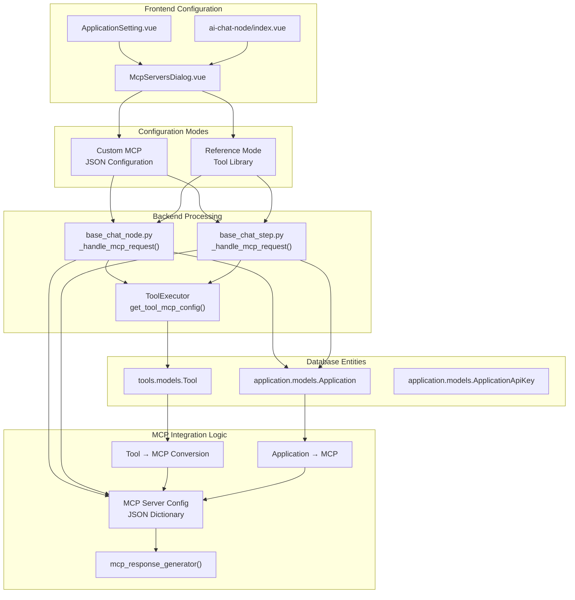
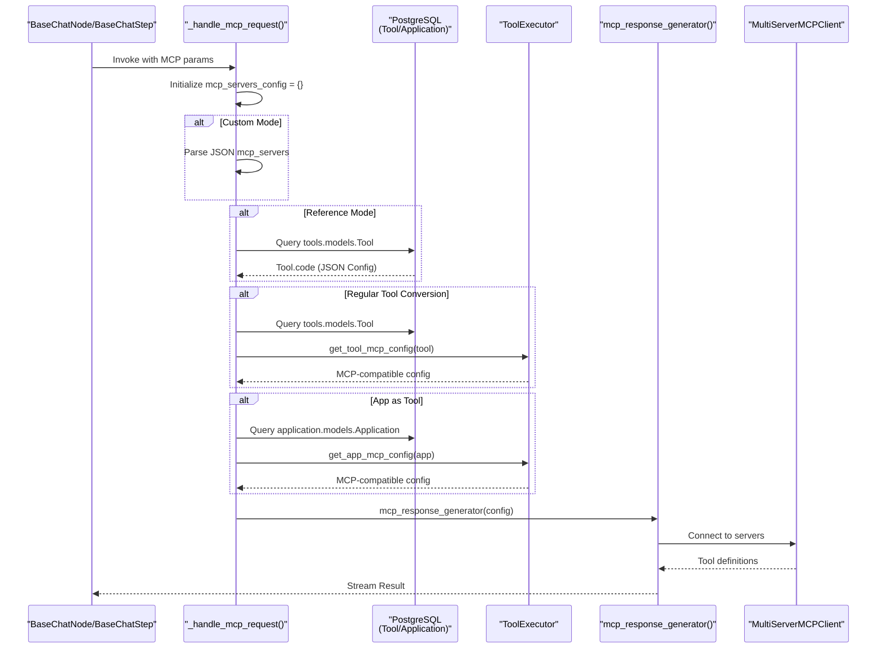

<!-- source: DeepWiki mcp.deepwiki.com · repo 1Panel-dev/MaxKB · page 8.3 MCP (Model Context Protocol) Integration · fetched 2026-10-29 -->

# MCP (Model Context Protocol) Integration

<details>
<summary>Relevant source files</summary>

The following files were used as context for generating this wiki page:

- [.dockerignore](.dockerignore)
- [.github/workflows/build-and-push-python-pg.yml](.github/workflows/build-and-push-python-pg.yml)
- [.github/workflows/build-and-push-vector-model.yml](.github/workflows/build-and-push-vector-model.yml)
- [.github/workflows/build-and-push.yml](.github/workflows/build-and-push.yml)
- [apps/application/chat_pipeline/step/chat_step/i_chat_step.py](apps/application/chat_pipeline/step/chat_step/i_chat_step.py)
- [apps/application/chat_pipeline/step/chat_step/impl/base_chat_step.py](apps/application/chat_pipeline/step/chat_step/impl/base_chat_step.py)
- [apps/application/flow/backend/__init__.py](apps/application/flow/backend/__init__.py)
- [apps/application/flow/backend/sandbox_shell.py](apps/application/flow/backend/sandbox_shell.py)
- [apps/application/flow/i_step_node.py](apps/application/flow/i_step_node.py)
- [apps/application/flow/step_node/ai_chat_step_node/i_chat_node.py](apps/application/flow/step_node/ai_chat_step_node/i_chat_node.py)
- [apps/application/flow/step_node/ai_chat_step_node/impl/base_chat_node.py](apps/application/flow/step_node/ai_chat_step_node/impl/base_chat_node.py)
- [apps/application/flow/step_node/intent_node/impl/base_intent_node.py](apps/application/flow/step_node/intent_node/impl/base_intent_node.py)
- [apps/application/flow/step_node/mcp_node/__init__.py](apps/application/flow/step_node/mcp_node/__init__.py)
- [apps/application/flow/step_node/mcp_node/i_mcp_node.py](apps/application/flow/step_node/mcp_node/i_mcp_node.py)
- [apps/application/flow/step_node/mcp_node/impl/__init__.py](apps/application/flow/step_node/mcp_node/impl/__init__.py)
- [apps/application/flow/step_node/mcp_node/impl/base_mcp_node.py](apps/application/flow/step_node/mcp_node/impl/base_mcp_node.py)
- [apps/application/flow/step_node/parameter_extraction_node/impl/base_parameter_extraction_node.py](apps/application/flow/step_node/parameter_extraction_node/impl/base_parameter_extraction_node.py)
- [apps/application/flow/step_node/question_node/i_question_node.py](apps/application/flow/step_node/question_node/i_question_node.py)
- [apps/application/flow/step_node/question_node/impl/base_question_node.py](apps/application/flow/step_node/question_node/impl/base_question_node.py)
- [apps/application/flow/step_node/variable_splitting_node/impl/base_variable_splitting_node.py](apps/application/flow/step_node/variable_splitting_node/impl/base_variable_splitting_node.py)
- [apps/application/flow/tools.py](apps/application/flow/tools.py)
- [apps/application/flow/workflow_manage.py](apps/application/flow/workflow_manage.py)
- [apps/application/long_term_memory/__init__.py](apps/application/long_term_memory/__init__.py)
- [apps/application/migrations/0011_application_skill_tool_ids.py](apps/application/migrations/0011_application_skill_tool_ids.py)
- [apps/application/models/application.py](apps/application/models/application.py)
- [apps/common/utils/tool_code.py](apps/common/utils/tool_code.py)
- [apps/knowledge/task/handler.py](apps/knowledge/task/handler.py)
- [apps/models_provider/impl/ollama_model_provider/ollama_model_provider.py](apps/models_provider/impl/ollama_model_provider/ollama_model_provider.py)
- [installer/Dockerfile](installer/Dockerfile)
- [installer/Dockerfile-base](installer/Dockerfile-base)
- [installer/Dockerfile-vector-model](installer/Dockerfile-vector-model)
- [installer/install_model.py](installer/install_model.py)
- [installer/install_model_bert_base_cased.py](installer/install_model_bert_base_cased.py)
- [installer/sandbox.c](installer/sandbox.c)
- [pyproject.toml](pyproject.toml)
- [ui/src/api/type/application.ts](ui/src/api/type/application.ts)
- [ui/src/views/application/component/McpServersDialog.vue](ui/src/views/application/component/McpServersDialog.vue)
- [ui/src/workflow/nodes/mcp-node/index.vue](ui/src/workflow/nodes/mcp-node/index.vue)

</details>


## Purpose and Scope

This document describes the MCP (Model Context Protocol) integration system in MaxKB. MCP enables AI applications to interact with external tools and services through a standardized protocol. The integration allows users to configure MCP servers either by referencing existing tools from the tool library or by providing custom MCP server configurations.

For information about tool management and execution outside of MCP, see [Tool Management and Execution](#8). For AI chat node configuration, see [Workflow Node Types and Components](#5.3).

---

## System Architecture Overview

MCP integration is available in two contexts within MaxKB:
1. **Simple Applications** - Through the application settings interface
2. **Workflow Applications** - Through AI Chat nodes in the workflow editor

The core logic for handling MCP requests is encapsulated in the `_handle_mcp_request` method, which is shared across workflow nodes and the chat pipeline.

### MCP Integration Data Flow



**Sources:** [apps/application/flow/step_node/ai_chat_step_node/impl/base_chat_node.py:148-158](), [apps/application/chat_pipeline/step/chat_step/impl/base_chat_step.py:19-20](), [apps/application/flow/tools.py:49-50](), [ui/src/api/type/application.ts:31-40]()

---

## Configuration Modes

MCP can be configured in two distinct modes, selectable through the `mcp_source` field:

### Referencing Mode (`mcp_source: "referencing"`)

Reference existing MCP tools from the tool library. Tools are stored in the database and can be shared across applications.

| Field | Type | Description |
|-------|------|-------------|
| `mcp_tool_ids` | List[UUID] | List of tool IDs to reference from Tool model |
| `mcp_source` | String | Set to `"referencing"` |

### Custom Mode (`mcp_source: "custom"`)

Provide custom MCP server configuration as JSON. Allows dynamic configuration without database entries.

| Field | Type | Description |
|-------|------|-------------|
| `mcp_servers` | JSON | MCP server configuration dictionary |
| `mcp_source` | String | Set to `"custom"` |

**Sources:** [ui/src/api/type/application.ts:31-34](), [apps/application/flow/step_node/ai_chat_step_node/i_chat_node.py:35-39]()

---

## Backend Processing Flow

### MCP Request Handling Pipeline

The system utilizes `MultiServerMCPClient` from `langchain_mcp_adapters` to manage connections to multiple MCP servers simultaneously.



**Sources:** [apps/application/flow/tools.py:49-50](), [apps/application/flow/step_node/ai_chat_step_node/impl/base_chat_node.py:210-285](), [apps/application/chat_pipeline/step/chat_step/impl/base_chat_step.py:229-293]()

### The `_handle_mcp_request` Method

Both workflow nodes and chat pipeline steps implement `_handle_mcp_request()` with identical logic to aggregate MCP server configurations from various sources.

**Processing Steps:**

1. **Initialize Configuration** [apps/application/flow/step_node/ai_chat_step_node/impl/base_chat_node.py:214-232]()
   - Create empty `mcp_servers_config` dictionary.
   - Handle legacy `mcp_tool_id` by merging into `mcp_tool_ids`.

2. **Process Custom MCP Servers** [apps/application/flow/step_node/ai_chat_step_node/impl/base_chat_node.py:224-232]()
   - Parse JSON from `mcp_servers` string.
   - Apply variable substitution via `handle_variables()`.

3. **Process Referenced MCP Tools** [apps/application/flow/step_node/ai_chat_step_node/impl/base_chat_node.py:227-232]()
   - Query `Tool` model with `mcp_tool_ids`.
   - Extract and parse tool `code` field as JSON.
   - Merge into `mcp_servers_config`.

4. **Convert Regular Tools to MCP** [apps/application/flow/step_node/ai_chat_step_node/impl/base_chat_node.py:234-247]()
   - Query `Tool` model with `tool_ids`.
   - Decrypt `init_params` if present using `rsa_long_decrypt`.
   - Call `ToolExecutor.get_tool_mcp_config()`.

5. **Convert Applications to MCP** [apps/application/flow/step_node/ai_chat_step_node/impl/base_chat_node.py:249-274]()
   - Query `Application` and `ApplicationApiKey` models.
   - Validate API key exists and is active.
   - Call `ToolExecutor.get_app_mcp_config()`.

6. **Generate MCP Response** [apps/application/flow/step_node/ai_chat_step_node/impl/base_chat_node.py:276-283]()
   - If config has entries, call `mcp_response_generator()`.
   - Return `NodeResult` with streaming context.

**Sources:** [apps/application/flow/step_node/ai_chat_step_node/impl/base_chat_node.py:210-285](), [apps/application/chat_pipeline/step/chat_step/impl/base_chat_step.py:229-293]()

---

## MCP Tool Generation

### Regular Tool Conversion

The `ToolExecutor` class provides logic to wrap standard MaxKB tools into the MCP protocol. This allows the LLM to call existing Python-based tools using the standard MCP tool-calling interface.

**Sources:** [apps/common/utils/tool_code.py:42-101](), [apps/application/flow/step_node/ai_chat_step_node/impl/base_chat_node.py:245]()

### Application as MCP Tool

Applications can be exposed as MCP tools to other applications. This requires a valid `ApplicationApiKey`.

**Validation Logic:**
- The target application must be published (`is_publish=True`).
- A valid, active `ApplicationApiKey` must be associated with the application.
- Authentication via access tokens is currently not supported for agent-to-agent MCP calls.

**Sources:** [apps/application/flow/step_node/ai_chat_step_node/impl/base_chat_node.py:252-271]()

---

## Variable Substitution System

MCP configurations support dynamic variable substitution using the workflow context via the `handle_variables` method.

### `handle_variables` Logic

```python
def handle_variables(self, tool_params):
    for k, v in tool_params.items():
        if type(v) == str:
            # Generate prompt replaces {{var}} with context values
            tool_params[k] = self.workflow_manage.generate_prompt(tool_params[k])
        if type(v) == dict:
            self.handle_variables(v)
        if (type(v) == list) and (type(v[0]) == str):
            # Resolves node field references
            tool_params[k] = self.get_reference_content(v)
    return tool_params
```

**Sources:** [apps/application/flow/step_node/ai_chat_step_node/impl/base_chat_node.py:287-296]

---

## Data Structures

### Application Configuration (Frontend)

The `ApplicationFormType` interface defines the MCP fields used in the UI and API requests.

| Field | Type | Description |
|-------|------|-------------|
| `mcp_enable` | boolean | Toggle for MCP functionality |
| `mcp_servers` | string | JSON string of custom server configs |
| `mcp_tool_ids` | string[] | IDs of referenced MCP tools |
| `mcp_source` | string | "custom" or "referencing" |
| `mcp_output_enable` | boolean | Whether to include MCP tool output in response |

**Sources:** [ui/src/api/type/application.ts:31-40]()

### AI Chat Node MCP Params

The `ChatNodeSerializer` handles the validation of MCP parameters within a workflow node.

**Sources:** [apps/application/flow/step_node/ai_chat_step_node/i_chat_node.py:35-46]()

---

## Error Handling

### Integration Exceptions

The backend performs strict validation during the MCP request handling phase:

1. **Agent Key Requirement**: If an application is used as a tool but lacks an active API key, an `AppApiException` is raised. [apps/application/flow/step_node/ai_chat_step_node/impl/base_chat_node.py:268-271]()
2. **Auth Mode Restriction**: If an application requires access token authentication, it cannot be used as an MCP tool. [apps/application/flow/step_node/ai_chat_step_node/impl/base_chat_node.py:261-266]()
3. **Syntax Errors**: Custom MCP server configurations are validated as JSON; parsing failures prevent execution. [apps/application/flow/step_node/ai_chat_step_node/impl/base_chat_node.py:225-226]()

**Sources:** [apps/application/flow/step_node/ai_chat_step_node/impl/base_chat_node.py:210-285]()

---

