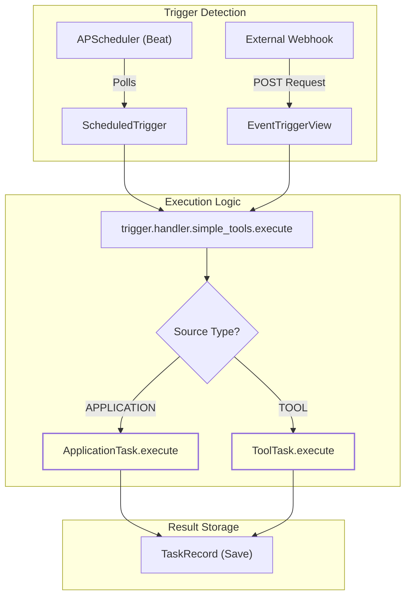
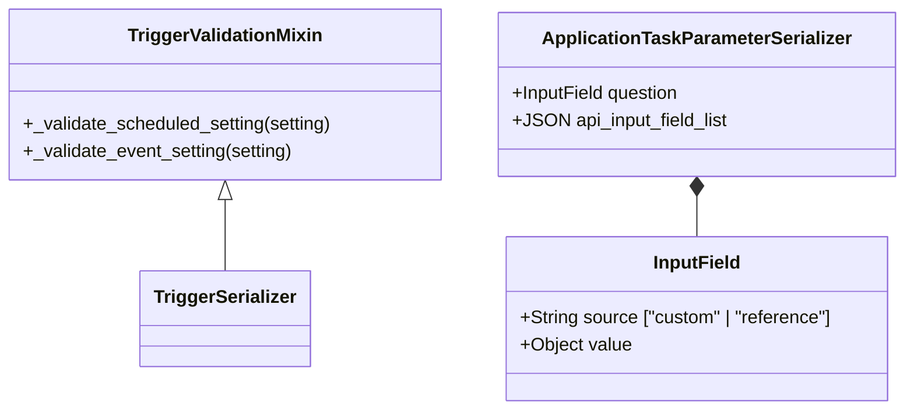

<!-- source: DeepWiki mcp.deepwiki.com · repo 1Panel-dev/MaxKB · page 8.4 Trigger System · fetched 2026-10-29 -->

# Trigger System

Relevant source files

The following files were used as context for generating this wiki page:

- [apps/application/flow/common.py](apps/application/flow/common.py)
- [apps/application/flow/step_node/application_node/i_application_node.py](apps/application/flow/step_node/application_node/i_application_node.py)
- [apps/application/flow/step_node/application_node/impl/base_application_node.py](apps/application/flow/step_node/application_node/impl/base_application_node.py)
- [apps/application/flow/step_node/data_source_web_node/impl/base_data_source_web_node.py](apps/application/flow/step_node/data_source_web_node/impl/base_data_source_web_node.py)
- [apps/common/init/init_template.py](apps/common/init/init_template.py)
- [apps/maxkb/wsgi/web.py](apps/maxkb/wsgi/web.py)
- [apps/models_provider/impl/local_model_provider/model/embedding/web.py](apps/models_provider/impl/local_model_provider/model/embedding/web.py)
- [apps/ops/celery/logger.py](apps/ops/celery/logger.py)
- [apps/ops/celery/signal_handler.py](apps/ops/celery/signal_handler.py)
- [apps/ops/celery/utils.py](apps/ops/celery/utils.py)
- [apps/system_manage/serializers/email_setting.py](apps/system_manage/serializers/email_setting.py)
- [apps/trigger/api/__init__.py](apps/trigger/api/__init__.py)
- [apps/trigger/api/trigger.py](apps/trigger/api/trigger.py)
- [apps/trigger/api/trigger_task.py](apps/trigger/api/trigger_task.py)
- [apps/trigger/handler/base_task.py](apps/trigger/handler/base_task.py)
- [apps/trigger/handler/base_trigger.py](apps/trigger/handler/base_trigger.py)
- [apps/trigger/handler/impl/task/application_task.py](apps/trigger/handler/impl/task/application_task.py)
- [apps/trigger/handler/impl/trigger/event_trigger.py](apps/trigger/handler/impl/trigger/event_trigger.py)
- [apps/trigger/handler/impl/trigger/scheduled_trigger.py](apps/trigger/handler/impl/trigger/scheduled_trigger.py)
- [apps/trigger/handler/simple_tools.py](apps/trigger/handler/simple_tools.py)
- [apps/trigger/migrations/0001_initial.py](apps/trigger/migrations/0001_initial.py)
- [apps/trigger/migrations/0002_remove_taskrecord_trigger_task_and_more.py](apps/trigger/migrations/0002_remove_taskrecord_trigger_task_and_more.py)
- [apps/trigger/models/trigger.py](apps/trigger/models/trigger.py)
- [apps/trigger/serializers/task_source_trigger.py](apps/trigger/serializers/task_source_trigger.py)
- [apps/trigger/serializers/trigger.py](apps/trigger/serializers/trigger.py)
- [apps/trigger/serializers/trigger_task.py](apps/trigger/serializers/trigger_task.py)
- [apps/trigger/sql/get_trigger_page_list.sql](apps/trigger/sql/get_trigger_page_list.sql)
- [apps/trigger/sql/get_trigger_task_record_page_list.sql](apps/trigger/sql/get_trigger_task_record_page_list.sql)
- [apps/trigger/tasks.py](apps/trigger/tasks.py)
- [apps/trigger/urls.py](apps/trigger/urls.py)
- [apps/trigger/views/__init__.py](apps/trigger/views/__init__.py)
- [apps/trigger/views/trigger.py](apps/trigger/views/trigger.py)
- [apps/trigger/views/trigger_task.py](apps/trigger/views/trigger_task.py)
- [apps/users/apps.py](apps/users/apps.py)
- [ui/src/locales/lang/en-US/views/trigger.ts](ui/src/locales/lang/en-US/views/trigger.ts)
- [ui/src/locales/lang/zh-CN/views/trigger.ts](ui/src/locales/lang/zh-CN/views/trigger.ts)
- [ui/src/locales/lang/zh-Hant/views/trigger.ts](ui/src/locales/lang/zh-Hant/views/trigger.ts)
- [ui/src/views/trigger/ResourceTriggerDrawer.vue](ui/src/views/trigger/ResourceTriggerDrawer.vue)
- [ui/src/views/trigger/TriggerDrawer.vue](ui/src/views/trigger/TriggerDrawer.vue)
- [ui/src/views/trigger/execution-record/ExecutionDetailDrawer.vue](ui/src/views/trigger/execution-record/ExecutionDetailDrawer.vue)
- [ui/src/views/trigger/execution-record/TriggerTaskRecordDrawer.vue](ui/src/views/trigger/execution-record/TriggerTaskRecordDrawer.vue)
- [ui/src/views/trigger/index.vue](ui/src/views/trigger/index.vue)

The Trigger System in MaxKB is an event-driven and scheduled automation framework that allows applications and tools to be executed based on specific conditions or time intervals. It bridges external events (via Webhooks) and internal scheduling (via APScheduler/Celery) with the execution of AI workflows and custom tools.

## 1. Trigger Architecture

The system is built on a decoupled architecture where a `Trigger` defines "when" to run, and a `TriggerTask` defines "what" to run.

### Code Entity Mapping
| System Concept | Code Entity | File Path |
| :--- | :--- | :--- |
| **Trigger Definition** | `Trigger` model | [apps/trigger/models/trigger.py:28-28]() |
| **Task Definition** | `TriggerTask` model | [apps/trigger/models/trigger.py:28-28]() |
| **Execution Log** | `TaskRecord` model | [apps/trigger/models/trigger.py:28-28]() |
| **Scheduled Handler** | `ScheduledTrigger` | [apps/trigger/handler/impl/trigger/scheduled_trigger.py:8-8]() |
| **Event Handler** | `EventTrigger` | [apps/trigger/handler/impl/trigger/event_trigger.py:110-110]() |

### Trigger Execution Data Flow
This diagram illustrates how a trigger (either Scheduled or Event-based) moves from detection to execution.

Sources: [apps/trigger/handler/simple_tools.py:131-133](), [apps/trigger/handler/impl/trigger/event_trigger.py:116-134](), [apps/trigger/handler/impl/task/application_task.py:184-189]()

---

## 2. Trigger Types

### 2.1 Scheduled Triggers (`SCHEDULED`)
Scheduled triggers use `APScheduler` to manage time-based execution. They support five sub-types:
*   **Daily**: Executes at specific `HH:MM` every day [apps/trigger/handler/impl/trigger/scheduled_trigger.py:37-40]().
*   **Weekly**: Executes on specific days of the week [apps/trigger/handler/impl/trigger/scheduled_trigger.py:63-67]().
*   **Monthly**: Executes on specific days of the month [apps/trigger/handler/impl/trigger/scheduled_trigger.py:102-106]().
*   **Interval**: Executes every N seconds/minutes/hours/days [apps/trigger/handler/impl/trigger/scheduled_trigger.py:169-173]().
*   **Cron**: Uses standard crontab expressions [apps/trigger/handler/impl/trigger/scheduled_trigger.py:142-146]().

### 2.2 Event Triggers (`EVENT`)
Event triggers provide a Webhook URL and a Bearer Token for external integration.
*   **Endpoint**: `/trigger/v1/webhook/<trigger_id>` [apps/trigger/urls.py:28-28]().
*   **Authentication**: Uses `WebhookAuth` to verify the `Authorization: Bearer <token>` header [apps/trigger/handler/impl/trigger/event_trigger.py:121-123]().
*   **Parameter Mapping**: Incoming JSON body fields are mapped to task parameters based on the `trigger_setting` configuration [apps/trigger/handler/impl/trigger/event_trigger.py:53-68]().

---

## 3. Task Execution Logic

When a trigger fires, it iterates through its associated `TriggerTask` entries. Currently, the system primarily supports `APPLICATION` and `TOOL` task types.

### 3.1 Application Task Execution
The `ApplicationTask` class handles the execution of AI applications.
1.  **Parameter Preparation**: It fetches application metadata and maps trigger inputs (custom values or references) to application variables like `question`, `api_input_field_list`, and `user_input_field_list` [apps/trigger/handler/impl/task/application_task.py:82-112]().
2.  **Workflow Invocation**: It initializes a `Chat` session and calls the application's internal execution engine [apps/trigger/handler/impl/task/application_task.py:195-210]().
3.  **Status Tracking**: It monitors the workflow state (SUCCESS/FAILURE) based on node results [apps/trigger/handler/impl/task/application_task.py:125-131]().

### 3.2 Code Reference and Mapping
The system uses a `InputField` structure to determine if a value is a static `custom` value or a `reference` to an external event's payload.

Sources: [apps/trigger/serializers/trigger.py:46-52](), [apps/trigger/serializers/trigger.py:104-119]()

---

## 4. Lifecycle and Management

### 4.1 Deployment (`deploy` / `undeploy`)
Triggers must be "deployed" to the active scheduler or listener.
*   **Deploy**: When a `SCHEDULED` trigger is activated, `ScheduledTrigger.deploy()` is called to register jobs in the `DjangoJob` table [apps/trigger/handler/impl/trigger/scheduled_trigger.py:212-225]().
*   **Undeploy**: When deactivated or deleted, jobs are removed from the scheduler via `_remove_scheduled_trigger_jobs` [apps/trigger/handler/impl/trigger/scheduled_trigger.py:200-201]().

### 4.2 Cleanup of Orphaned Jobs
During worker startup, the system performs a cleanup to remove jobs whose parent `Trigger` is no longer active or exists in the database.
*   **Function**: `init_scheduler()` [apps/ops/celery/signal_handler.py:23-30]().
*   **Logic**: It filters `DjangoJob` where IDs start with `trigger:`, checks them against the `Trigger` model, and deletes orphaned records [apps/ops/celery/signal_handler.py:32-56]().

---

## 5. UI Integration

The frontend provides a management interface for triggers, allowing users to:
1.  **Search and Filter**: Filter by name, type (Scheduled/Event), status, or creator [ui/src/views/trigger/index.vue:34-46]().
2.  **Configuration**: A drawer interface (`TriggerDrawer.vue`) for setting up schedule cycles or Webhook parameters [ui/src/views/trigger/TriggerDrawer.vue:4-11]().
3.  **Execution Records**: View a history of task executions, including status and duration, via the `TriggerTaskRecordDrawer` [ui/src/views/trigger/execution-record/TriggerTaskRecordDrawer.vue]().

Sources: [ui/src/views/trigger/index.vue:102-130](), [ui/src/views/trigger/TriggerDrawer.vue:137-155]()

---

