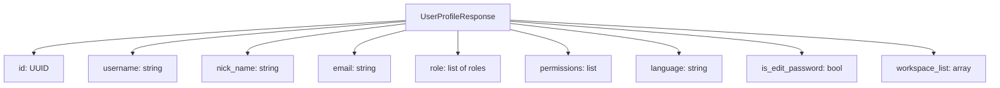
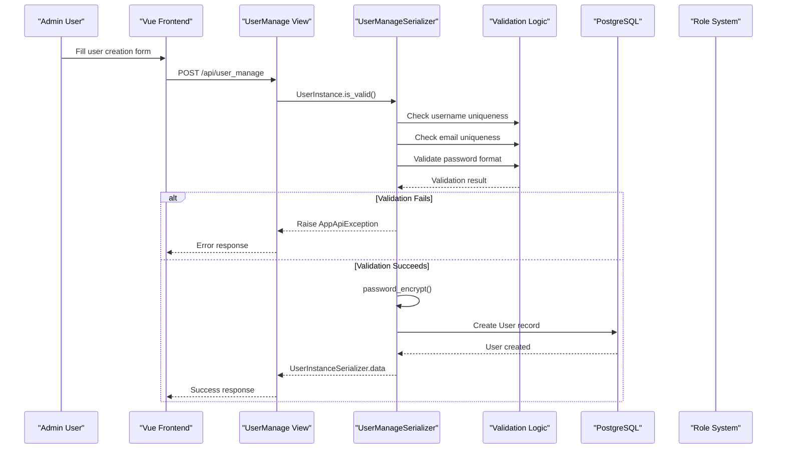
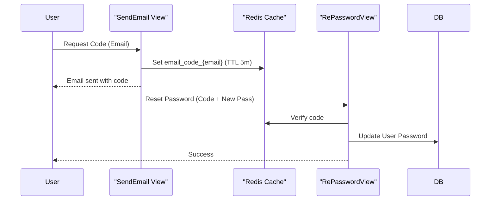

<!-- source: DeepWiki mcp.deepwiki.com · repo 1Panel-dev/MaxKB · page 9 User Management · fetched 2026-10-29 -->

# User Management

<details>
<summary>Relevant source files</summary>

The following files were used as context for generating this wiki page:

- [apps/common/auth/authenticate.py](apps/common/auth/authenticate.py)
- [apps/common/auth/handle/impl/user_token.py](apps/common/auth/handle/impl/user_token.py)
- [apps/common/constants/cache_version.py](apps/common/constants/cache_version.py)
- [apps/common/constants/permission_constants.py](apps/common/constants/permission_constants.py)
- [apps/common/exception/app_exception.py](apps/common/exception/app_exception.py)
- [apps/common/log/log.py](apps/common/log/log.py)
- [apps/common/utils/common.py](apps/common/utils/common.py)
- [apps/locales/en_US/LC_MESSAGES/django.po](apps/locales/en_US/LC_MESSAGES/django.po)
- [apps/locales/zh_CN/LC_MESSAGES/django.po](apps/locales/zh_CN/LC_MESSAGES/django.po)
- [apps/locales/zh_Hant/LC_MESSAGES/django.po](apps/locales/zh_Hant/LC_MESSAGES/django.po)
- [apps/users/api/user.py](apps/users/api/user.py)
- [apps/users/serializers/login.py](apps/users/serializers/login.py)
- [apps/users/serializers/user.py](apps/users/serializers/user.py)
- [apps/users/urls.py](apps/users/urls.py)
- [apps/users/views/login.py](apps/users/views/login.py)
- [apps/users/views/user.py](apps/users/views/user.py)
- [ui/src/api/system/role.ts](ui/src/api/system/role.ts)
- [ui/src/api/type/role.ts](ui/src/api/type/role.ts)
- [ui/src/components/tag-ellipsis/index.vue](ui/src/components/tag-ellipsis/index.vue)
- [ui/src/components/tag-group/index.vue](ui/src/components/tag-group/index.vue)
- [ui/src/layout/layout-header/UserHeader.vue](ui/src/layout/layout-header/UserHeader.vue)
- [ui/src/styles/component.scss](ui/src/styles/component.scss)
- [ui/src/views/system-chat-user/chat-user/component/UserDrawer.vue](ui/src/views/system-chat-user/chat-user/component/UserDrawer.vue)
- [ui/src/views/system-chat-user/chat-user/component/UserPwdDialog.vue](ui/src/views/system-chat-user/chat-user/component/UserPwdDialog.vue)
- [ui/src/views/system-chat-user/chat-user/index.vue](ui/src/views/system-chat-user/chat-user/index.vue)
- [ui/src/views/system/role/component/AddMemberDrawer.vue](ui/src/views/system/role/component/AddMemberDrawer.vue)
- [ui/src/views/system/role/component/CreateOrUpdateRoleDialog.vue](ui/src/views/system/role/component/CreateOrUpdateRoleDialog.vue)
- [ui/src/views/system/role/component/MemberFormContent.vue](ui/src/views/system/role/component/MemberFormContent.vue)
- [ui/src/views/system/user-manage/component/UserDrawer.vue](ui/src/views/system/user-manage/component/UserDrawer.vue)
- [ui/src/views/system/user-manage/index.vue](ui/src/views/system/user-manage/index.vue)
- [ui/src/views/system/workspace/component/AddMemberDrawer.vue](ui/src/views/system/workspace/component/AddMemberDrawer.vue)
- [ui/src/views/system/workspace/component/CreateOrUpdateWorkspaceDialog.vue](ui/src/views/system/workspace/component/CreateOrUpdateWorkspaceDialog.vue)

</details>


This document describes the user management system in MaxKB, covering user CRUD operations, profile management, password management, and language preferences. User management is distinct from authentication and authorization, which are covered in [Authentication and Authorization System](#2). This page focuses on the lifecycle management of user accounts and user-specific settings.

## User Data Model and Storage

The user management system is built around the `User` model which stores user account information in PostgreSQL. The primary user model resides at `apps/users/models.py`.

**User Model Key Fields:**
- `id`: UUID primary key.
- `username`: Unique username (4-64 characters).
- `email`: Unique email address.
- `password`: Encrypted password hash.
- `nick_name`: Display name.
- `phone`: Optional phone number.
- `role`: User's primary role (ADMIN, USER, etc.).
- `source`: Authentication source (LOCAL, LDAP, OAUTH2, etc.).
- `is_active`: Account active status.
- `language`: User's preferred language (en_US, zh_CN, zh_Hant).
- `create_time`, `update_time`: Timestamp fields.

**User Profile Response Structure:**



Sources: [apps/users/serializers/user.py:55-61](), [apps/users/models.py]()

## Backend API Endpoints

The user management API is exposed through Django REST Framework views with token-based authentication. All endpoints require the `TokenAuth` authentication class.

**User Management API Endpoint Map:**

| Endpoint | Method | View Class | Serializer | Purpose |
|----------|--------|------------|------------|---------|
| `/api/user/profile` | GET | `UserProfileView` | `UserProfileSerializer` | Get current user info |
| `/api/user/language` | POST | `SwitchUserLanguageView` | `SwitchLanguageSerializer` | Switch language |
| `/api/user/list` | GET | `UserList` | `UserManageSerializer` | Get all users |
| `/api/user_manage` | POST | `UserManage` | `UserManageSerializer.UserInstance` | Create user |
| `/api/user_manage/<user_id>` | GET | `UserManage.Operate` | `UserManageSerializer.Operate` | Get user details |
| `/api/user_manage/<user_id>` | PUT | `UserManage.Operate` | `UserManageSerializer.UserEditInstance` | Update user |
| `/api/user_manage/<user_id>` | DELETE | `UserManage.Operate` | - | Delete user |
| `/api/user_manage/<user_id>/re_password` | PUT | `UserManage.RePassword` | `RePasswordSerializer` | Reset user password |
| `/api/user/send_email` | POST | `SendEmail` | `SendEmailSerializer` | Send password reset email |
| `/api/user/check_code` | POST | `CheckCode` | `CheckCodeSerializer` | Verify email code |
| `/api/user/re_password` | POST | `RePasswordView` | `RePasswordSerializer` | Reset password with code |
| `/api/workspace/<workspace_id>/user_list` | GET | `WorkspaceUserListView` | `UserManageSerializer` | Get workspace users |

Sources: [apps/users/views/user.py:64-168](), [apps/users/api/user.py:30-32]()

## User Creation and CRUD Operations

### User Creation Flow



Sources: [apps/users/serializers/user.py:64-72](), [apps/users/views/user.py:163-177](), [ui/src/views/system/user-manage/component/UserDrawer.vue:118-146]()

### Password Validation Rules

User passwords must meet specific complexity requirements enforced by regex validation in `apps/users/serializers/user.py`.

```python
# Password must be 6-20 characters with:
# - At least one lowercase letter
# - At least one specified special character
# - At least one uppercase letter OR one digit
PASSWORD_REGEX = re.compile(
    r"^"  # 开始
    r"(?=.*[a-z])"  # 至少一个小写字母
    r"(?=.*[-_!@#$%^&*`~.()+=])"  # 至少一个指定的特殊字符
    r"(?:(?=.*[A-Z])|(?=.*\d))"  # 至少一个大写字母 或 数字
    r"[a-zA-Z0-9-_!@#$%^&*`~.()+=]{6,20}"  # 总长度6~20个合法字符
    r"$"  # 结束
)
```

Sources: [apps/users/serializers/user.py:43-50]()

### User Query and Filtering

The `UserManageSerializer.Query` class provides filtering for user lists in the admin interface.

**Supported Filters:**
- `username`: Partial match on username.
- `nick_name`: Partial match on display name.
- `email`: Partial match on email.
- `is_active`: Filter by active status (boolean).
- `source`: Filter by authentication source (LOCAL, LDAP, CAS, OIDC, etc.).

Sources: [apps/users/serializers/user.py:204-250](), [ui/src/views/system/user-manage/index.vue:30-45]()

## Password Management

### Password Security and Encryption

MaxKB uses Django's `make_password` (PBKDF2) for encryption. It supports transparent migration from legacy MD5 hashes used in older versions.

```python
def password_verify(row_password, hashed_password):
    # First try Django's built-in check (PBKDF2)
    if check_password(row_password, hashed_password):
        return True
    # Fall back to legacy MD5 comparison for not-yet-migrated hashes
    if _is_legacy_md5_hash(hashed_password):
        return _legacy_md5_hash(row_password) == hashed_password
    return False
```

Sources: [apps/common/utils/common.py:44-67](), [apps/users/serializers/login.py:155-158]()

### Forgot Password Flow

Users can reset passwords via email verification. This involves generating a random 6-digit code and storing it in Redis.



Sources: [apps/users/serializers/user.py:446-596](), [apps/users/views/user.py:250-285]()

## Language Preference Management

Users can switch their interface language preference (en_US, zh_CN, zh_Hant). The backend persists this in the `User` model, while the frontend updates `localStorage` and reloads the page.

Sources: [apps/users/serializers/user.py:598-618](), [apps/users/views/user.py:92-109]()

## Operation Logging

User management actions are logged using the `@log` decorator. This captures the user performing the action, the target object, and the operation type for auditing.

Sources: [apps/users/views/user.py:102-103](), [apps/common/log/log.py]()

---

## Child Pages

- [User Backend APIs and Serializers](#9.1) — Document user serializers, API endpoints, user operations, email verification, and password reset flows.
- [Frontend User State Management](#9.2) — Explain the `useUserStore` and `useChatUserStore`, authentication token management, profile loading, and language switching.
- [Operation Logging and Audit Trail](#9.3) — Detail the operation logging system, `@log` decorator, audit trail storage, and log filtering/export functionality.

---

