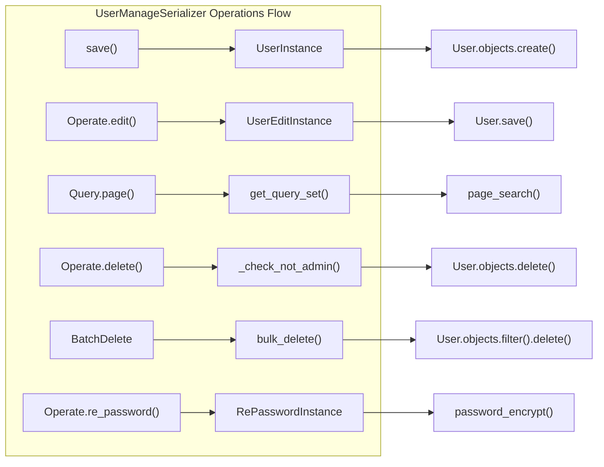
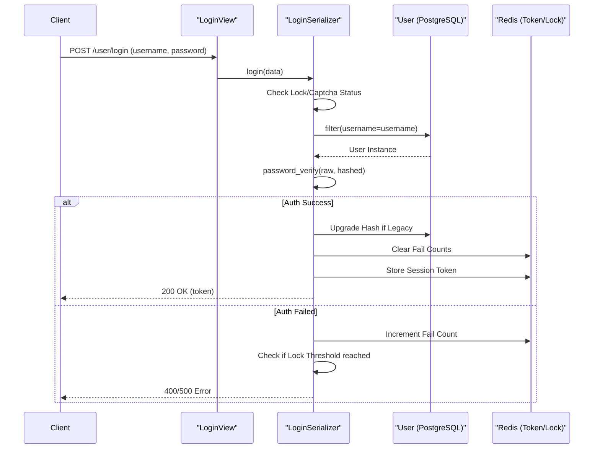
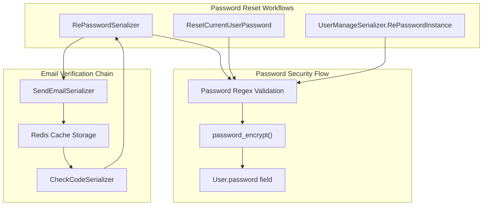
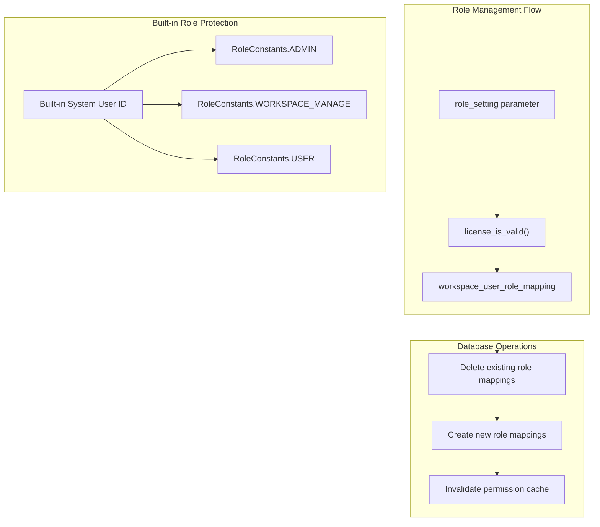
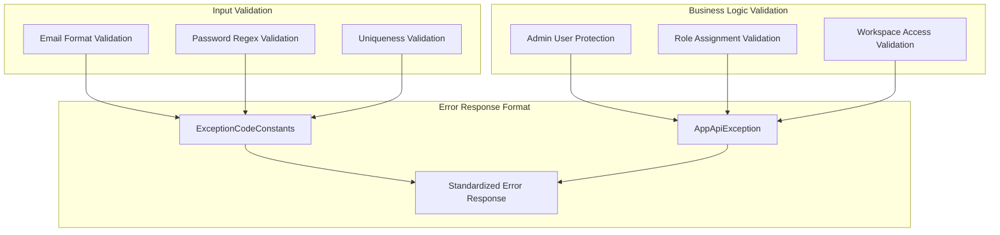

<!-- source: DeepWiki mcp.deepwiki.com · repo 1Panel-dev/MaxKB · page 9.1 User Backend APIs and Serializers · fetched 2026-10-29 -->

# User Backend APIs and Serializers

<details>
<summary>Relevant source files</summary>

The following files were used as context for generating this wiki page:

- [apps/common/auth/authenticate.py](apps/common/auth/authenticate.py)
- [apps/common/auth/handle/impl/user_token.py](apps/common/auth/handle/impl/user_token.py)
- [apps/common/constants/cache_version.py](apps/common/constants/cache_version.py)
- [apps/common/constants/permission_constants.py](apps/common/constants/permission_constants.py)
- [apps/common/exception/app_exception.py](apps/common/exception/app_exception.py)
- [apps/common/log/log.py](apps/common/log/log.py)
- [apps/common/utils/common.py](apps/common/utils/common.py)
- [apps/locales/en_US/LC_MESSAGES/django.po](apps/locales/en_US/LC_MESSAGES/django.po)
- [apps/locales/zh_CN/LC_MESSAGES/django.po](apps/locales/zh_CN/LC_MESSAGES/django.po)
- [apps/locales/zh_Hant/LC_MESSAGES/django.po](apps/locales/zh_Hant/LC_MESSAGES/django.po)
- [apps/users/api/user.py](apps/users/api/user.py)
- [apps/users/serializers/login.py](apps/users/serializers/login.py)
- [apps/users/serializers/user.py](apps/users/serializers/user.py)
- [apps/users/urls.py](apps/users/urls.py)
- [apps/users/views/login.py](apps/users/views/login.py)
- [apps/users/views/user.py](apps/users/views/user.py)
- [ui/src/api/system/license.ts](ui/src/api/system/license.ts)
- [ui/src/api/system/user-manage.ts](ui/src/api/system/user-manage.ts)
- [ui/src/api/type/user.ts](ui/src/api/type/user.ts)
- [ui/src/api/user/user.ts](ui/src/api/user/user.ts)
- [ui/src/layout/layout-header/avatar/AboutDialog.vue](ui/src/layout/layout-header/avatar/AboutDialog.vue)
- [ui/src/layout/layout-header/avatar/ResetPassword.vue](ui/src/layout/layout-header/avatar/ResetPassword.vue)
- [ui/src/layout/layout-header/avatar/index.vue](ui/src/layout/layout-header/avatar/index.vue)
- [ui/src/locales/lang/en-US/views/login.ts](ui/src/locales/lang/en-US/views/login.ts)
- [ui/src/locales/lang/en-US/views/user-manage.ts](ui/src/locales/lang/en-US/views/user-manage.ts)
- [ui/src/locales/lang/zh-CN/views/login.ts](ui/src/locales/lang/zh-CN/views/login.ts)
- [ui/src/locales/lang/zh-CN/views/user-manage.ts](ui/src/locales/lang/zh-CN/views/user-manage.ts)
- [ui/src/locales/lang/zh-Hant/views/login.ts](ui/src/locales/lang/zh-Hant/views/login.ts)
- [ui/src/locales/lang/zh-Hant/views/user-manage.ts](ui/src/locales/lang/zh-Hant/views/user-manage.ts)
- [ui/src/views/login/ForgotPassword.vue](ui/src/views/login/ForgotPassword.vue)
- [ui/src/views/login/ResetPassword.vue](ui/src/views/login/ResetPassword.vue)
- [ui/src/views/system/user-manage/component/UserPwdDialog.vue](ui/src/views/system/user-manage/component/UserPwdDialog.vue)

</details>


This document covers the Django backend serializers and API views that handle user management operations in MaxKB. This includes user creation, authentication, profile management, password operations, and email verification workflows.

For frontend user interface components and state management, see [Frontend User State Management](9.2). For authentication and authorization mechanisms, see [Authentication and Authorization System](2).

## Core User Serializer Architecture

The user management system is built around a set of Django REST Framework serializers that handle different aspects of user operations. The main serializers are organized in a hierarchical structure with specialized nested classes for specific operations.

```mermaid
graph TB
    subgraph "Core User Serializers"
        UPS["UserProfileSerializer"]
        UMS["UserManageSerializer"]
        UPR["UserProfileResponse"]
        UIS["UserInstanceSerializer"]
    end
    
    subgraph "Password Management"
        RPS["RePasswordSerializer"]
        RCUP["ResetCurrentUserPassword"]
        RPI["RePasswordInstance"]
    end
    
    subgraph "Email Verification"
        SES["SendEmailSerializer"]
        CCS["CheckCodeSerializer"]
    end
    
    subgraph "Specialized Operations"
        CUS["CreateUserSerializer"]
        SLS["SwitchLanguageSerializer"]
    end
    
    subgraph "Nested Classes in UserManageSerializer"
        UI["UserInstance"]
        UEI["UserEditInstance"]
        Query["Query"]
        Operate["Operate"]
        BD["BatchDelete"]
    end
    
    UMS --> UI
    UMS --> UEI
    UMS --> Query
    UMS --> Operate
    UMS --> BD
    UMS --> RPI
    
    UI --> "User Creation Logic"
    UEI --> "User Edit Logic"
    Query --> "User Search Logic"
    Operate --> "CRUD Operations"
    BD --> "Batch Delete Logic"
```

**Sources:** [apps/users/serializers/user.py:55-879]()

## User Management Serializer Structure

The `UserManageSerializer` class serves as the central hub for user management operations, containing multiple nested serializer classes that handle specific aspects of user lifecycle management.

### Core Nested Serializers

| Serializer Class | Purpose | Key Methods |
|------------------|---------|-------------|
| `UserInstance` | User creation with validation | `is_valid()`, `_check_unique_username_and_email()` |
| `UserEditInstance` | User profile editing | `_check_unique_email()`, `_check_unique_nick_name()` |
| `Query` | User search and filtering | `get_query_set()`, `list()`, `page()` |
| `Operate` | Individual user operations | `delete()`, `edit()`, `one()`, `re_password()` |
| `RePasswordInstance` | Password validation | `_check_passwords_match()` |
| `BatchDelete` | Bulk user operations | `batch_delete()` |



**Sources:** [apps/users/serializers/user.py:161-576]()

## Authentication and Login Flow

The login system supports local authentication with security features like CAPTCHA, account locking after failed attempts, and transparent password hash upgrades.

### Login Security Mechanism
MaxKB implements a multi-layered security approach for the login process:
1.  **Encrypted Data Handling**: Sensitive login information can be sent via `encryptedData`, which is decrypted using RSA before processing [apps/users/serializers/login.py:102-113]().
2.  **Account Locking**: After a configurable number of failed attempts (`failed_attempts`), the account is locked for a set duration (`lock_time`) [apps/users/serializers/login.py:126-141]().
3.  **CAPTCHA Verification**: If failed attempts exceed `max_attempts`, a CAPTCHA is required for subsequent login tries [apps/users/serializers/login.py:187-195]().
4.  **Hash Upgrade**: The system automatically upgrades legacy MD5 hashes to Django's PBKDF2 when a user successfully logs in [apps/users/serializers/login.py:155-157]().



**Sources:** [apps/users/serializers/login.py:82-176](), [apps/common/utils/common.py:34-90]()

## Password Management and Security

The system implements multiple password management workflows with strong validation and security measures.

### Password Validation Regex
The system enforces a password policy requiring a mix of characters and a specific length.
```python
PASSWORD_REGEX = re.compile(
    r"^"  # Start
    r"(?=.*[a-z])"  # At least one lowercase letter
    r"(?=.*[-_!@#$%^&*`~.()+=])"  # At least one special character
    r"(?:(?=.*[A-Z])|(?=.*\d))"  # At least one uppercase letter OR digit
    r"[a-zA-Z0-9-_!@#$%^&*`~.()+=]{6,20}"  # 6-20 valid characters
    r"$"  # End
)
```
**Sources:** [apps/users/serializers/user.py:43-50]()

### Password Operation Classes



**Sources:** [apps/users/serializers/user.py:650-763](), [apps/common/utils/common.py:44-50]()

## Email Verification System

The email verification system supports both user registration and password reset workflows through a code-based verification process.

### Email Workflow Components

| Component | Purpose | Cache Key Pattern |
|-----------|---------|-------------------|
| `SendEmailSerializer` | Generate and send verification codes | `{email}:{type}` |
| `CheckCodeSerializer` | Validate verification codes | `{email}:{type}` |
| Email Backend | SMTP email delivery | N/A |
| Cache Lock | Prevent spam sending | `{email}:{type}_lock` |

**Sources:** [apps/users/serializers/user.py:765-843](), [apps/users/serializers/user.py:846-871]()

## Role and Workspace Management

The user system integrates with an enterprise role-based access control system through workspace relationships and role mappings.

### Role Assignment Logic
User roles are not just global attributes but are often mapped to specific workspaces. The function `update_user_role` manages the deletion of existing mappings and the creation of new ones within the `workspace_user_role_mapping` model [apps/users/serializers/user.py:582-648]().



**Sources:** [apps/users/serializers/user.py:582-648](), [apps/users/serializers/user.py:74-106]()

## API View Architecture

The user management views are organized in a nested class structure that groups related operations and applies consistent authentication and permission checking.

### Main View Classes

| View Class | Purpose | Auth/Permission |
|------------|---------|-----------------|
| `UserProfileView` | Get current user details | `TokenAuth` |
| `UserManage` | Root class for user CRUD | `TokenAuth` + Permissions |
| `SwitchUserLanguageView` | Change user language | `PermissionConstants.SWITCH_LANGUAGE` |
| `WorkspaceUserListView` | List users in a workspace | `TokenAuth` |

**Sources:** [apps/users/views/user.py:64-377]()

## URL Routing Structure

The user management system exposes a comprehensive set of REST endpoints for all user operations.

### Endpoint Categories

| Endpoint Pattern | Purpose | View Class |
|------------------|---------|------------|
| `/user/profile` | Current user profile | `UserProfileView` |
| `/user_manage` | User CRUD operations | `UserManage` |
| `/user_manage/<user_id>` | Individual user operations | `UserManage.Operate` |
| `/user/re_password` | Public password reset | `RePasswordView` |
| `/user/send_email` | Email verification | `SendEmail` |
| `/workspace/<workspace_id>/user_list` | Workspace users | `WorkspaceUserListView` |

**Sources:** [apps/users/urls.py:9-30]()

## Data Validation and Error Handling

The serializer system implements comprehensive validation with custom error messages and exception handling using the `AppApiException` framework.

### Validation Patterns



**Sources:** [apps/users/serializers/user.py:163-172](), [apps/users/serializers/user.py:440-444](), [apps/users/serializers/user.py:783-787]()

---

