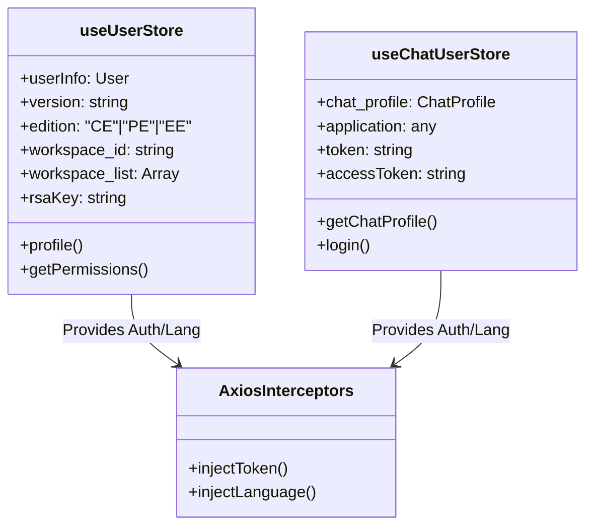
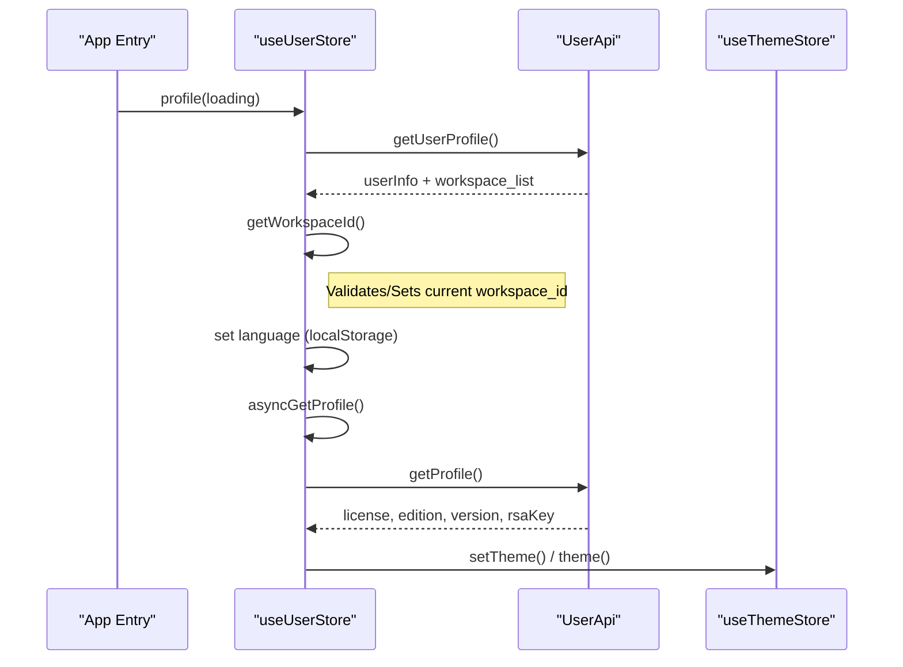
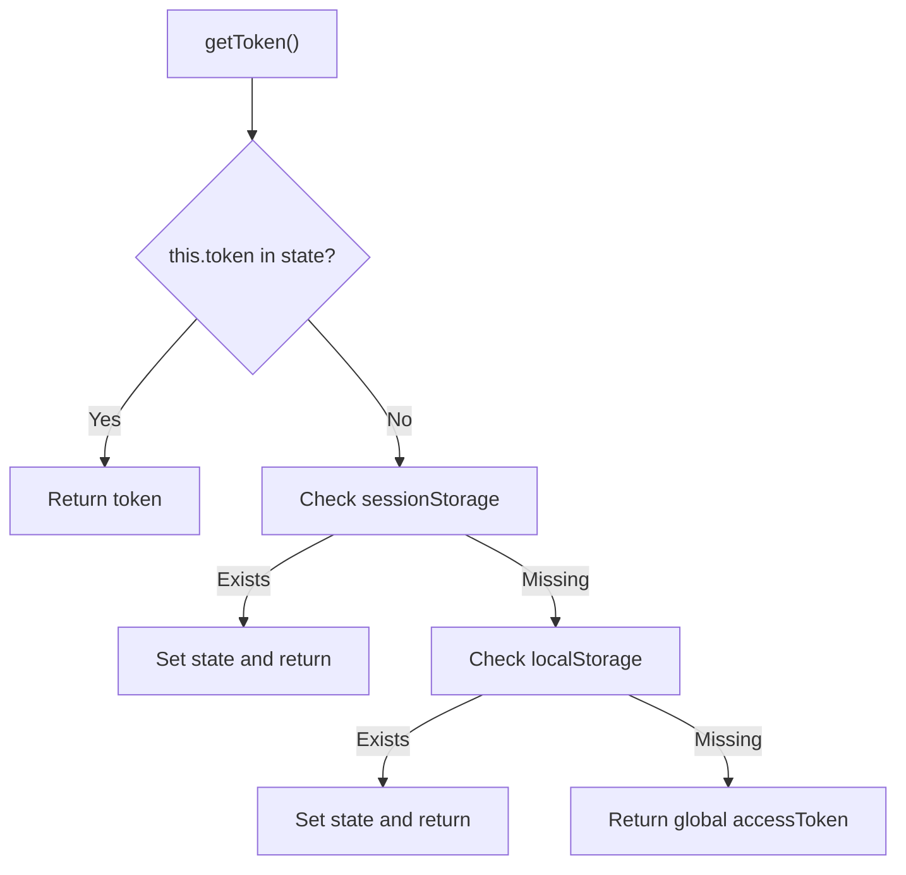

<!-- source: DeepWiki mcp.deepwiki.com · repo 1Panel-dev/MaxKB · page 9.2 Frontend User State Management · fetched 2026-10-29 -->

# Frontend User State Management

<details>
<summary>Relevant source files</summary>

The following files were used as context for generating this wiki page:

- [ui/src/api/chat-user/chat-user.ts](ui/src/api/chat-user/chat-user.ts)
- [ui/src/api/chat/chat.ts](ui/src/api/chat/chat.ts)
- [ui/src/api/shared-workspace.ts](ui/src/api/shared-workspace.ts)
- [ui/src/api/system/user-group.ts](ui/src/api/system/user-group.ts)
- [ui/src/api/type/chat.ts](ui/src/api/type/chat.ts)
- [ui/src/api/type/common.ts](ui/src/api/type/common.ts)
- [ui/src/api/type/login.ts](ui/src/api/type/login.ts)
- [ui/src/locales/lang/en-US/views/chat-user.ts](ui/src/locales/lang/en-US/views/chat-user.ts)
- [ui/src/locales/lang/zh-CN/views/chat-user.ts](ui/src/locales/lang/zh-CN/views/chat-user.ts)
- [ui/src/locales/lang/zh-Hant/views/chat-user.ts](ui/src/locales/lang/zh-Hant/views/chat-user.ts)
- [ui/src/request/index.ts](ui/src/request/index.ts)
- [ui/src/router/modules/application-detail.ts](ui/src/router/modules/application-detail.ts)
- [ui/src/router/modules/document.ts](ui/src/router/modules/document.ts)
- [ui/src/stores/modules/application.ts](ui/src/stores/modules/application.ts)
- [ui/src/stores/modules/chat-user.ts](ui/src/stores/modules/chat-user.ts)
- [ui/src/stores/modules/theme.ts](ui/src/stores/modules/theme.ts)
- [ui/src/stores/modules/user.ts](ui/src/stores/modules/user.ts)
- [ui/src/views/chat-user/index.vue](ui/src/views/chat-user/index.vue)
- [ui/src/views/chat/index.vue](ui/src/views/chat/index.vue)
- [ui/src/views/chat/user-login/index.vue](ui/src/views/chat/user-login/index.vue)
- [ui/src/views/login/index.vue](ui/src/views/login/index.vue)
- [ui/src/views/system-chat-user/chat-user/component/SyncUsersDialog.vue](ui/src/views/system-chat-user/chat-user/component/SyncUsersDialog.vue)
- [ui/src/views/system-chat-user/group/component/CreateGroupUserDialog.vue](ui/src/views/system-chat-user/group/component/CreateGroupUserDialog.vue)

</details>


This document covers the frontend user state management system in MaxKB, implemented using Pinia stores. The system handles user profiles, workspace management, permission handling, localization, and enterprise edition features through two primary stores: `useUserStore` for the administrative backend and `useChatUserStore` for the end-user chat interface.

## Core User State Architecture

MaxKB separates user state into two distinct domains: the administrative user (system/workspace management) and the chat user (end-users interacting with AI applications).

### Store Definitions

| Store | Purpose | File Path |
|-------|---------|-----------|
| `useUserStore` | Manages administrative users, permissions, workspaces, and system edition info. | [ui/src/stores/modules/user.ts:23-23]() |
| `useChatUserStore` | Manages end-user authentication for specific chat applications (LDAP, OAuth2, Password, etc.). | [ui/src/stores/modules/chat-user.ts:21-21]() |

### Data Flow and State Schema



**Sources:** [ui/src/stores/modules/user.ts:13-32](), [ui/src/stores/modules/chat-user.ts:21-26](), [ui/src/request/index.ts:29-35]()

## User Profile and System Loading

The `useUserStore` handles the initialization of the administrative environment by loading both the user's personal profile and the system's global configuration.

### Administrative Profile Loading Flow

The `profile()` action is responsible for synchronizing user data and setting up the workspace context.



1.  **User Profile**: Fetches basic user info and the list of workspaces the user belongs to [ui/src/stores/modules/user.ts:118-123]().
2.  **Workspace Context**: If no workspace is active, it defaults to the first one in the list [ui/src/stores/modules/user.ts:124-127]().
3.  **System Info**: Fetches the edition (CE/PE/EE) and the RSA public key used for login encryption [ui/src/stores/modules/user.ts:142-145]().

**Sources:** [ui/src/stores/modules/user.ts:117-135](), [ui/src/stores/modules/user.ts:137-161]()

## Authentication Token Management

MaxKB uses JWT-based authentication. Tokens are stored and retrieved differently depending on the user context.

### Administrative Token
Managed via `useLoginStore` (integrated with `useUserStore`). Tokens are injected into requests by the Axios interceptor [ui/src/request/index.ts:29-35]().

### Chat User Token
The `useChatUserStore` manages tokens for end-users accessing shared applications. Tokens are scoped to a specific `accessToken` (the application's unique public identifier).



**Sources:** [ui/src/stores/modules/chat-user.ts:61-76](), [ui/src/stores/modules/chat-user.ts:77-81]()

## Language and Localization Switching

The system supports dynamic language switching with persistence in `localStorage`.

### Administrative Language
The language preference is fetched from the user profile or the browser's default [ui/src/stores/modules/user.ts:34-36]().
*   **Update**: `postUserLanguage(lang)` sends the preference to the backend, updates local storage, and triggers a `window.location.reload()` to refresh the UI with new translations [ui/src/stores/modules/user.ts:162-174]().

### Chat User Language
Language settings for the chat interface are scoped to the application's `accessToken`.
*   **Retrieval**: Uses `localStorage.getItem("${this.accessToken}-locale")` [ui/src/stores/modules/chat-user.ts:28-30]().
*   **Sync**: When `applicationProfile()` is called, it syncs the application's default language to the local store [ui/src/stores/modules/chat-user.ts:46-51]().

**Sources:** [ui/src/stores/modules/user.ts:162-174](), [ui/src/stores/modules/chat-user.ts:28-30](), [ui/src/stores/modules/chat-user.ts:46-51]()

## Permission and Edition Logic

The `useUserStore` provides helper methods to gate features based on the system edition and user roles.

### Role and Permission Helpers

| Method | Logic | Purpose |
|--------|-------|---------|
| `is_admin()` | `role.includes('ADMIN')` | Global admin check [ui/src/stores/modules/user.ts:78-80]() |
| `isEE()` | `edition == 'EE' && license_is_valid` | Enterprise Edition check [ui/src/stores/modules/user.ts:96-98]() |
| `getPermissions()` | Merges `userInfo.permissions` with edition-specific tags | Provides full permission set for RBAC [ui/src/stores/modules/user.ts:46-57]() |

### Workspace Permission Check
The `getHasPermissionWorkspaceManage()` function extracts workspace IDs from strings like `WORKSPACE_MANAGE/WORKSPACE/{id}` to verify if the user has management rights over the current active workspace [ui/src/stores/modules/user.ts:99-113]().

**Sources:** [ui/src/stores/modules/user.ts:46-113]()

## Login Implementation Details

The login process uses RSA encryption for password security.

### RSA Encryption Flow
In `ui/src/views/login/index.vue`, the system retrieves the `rsaKey` from the `user` store, encrypts the login form data, and sends the base64 string to the backend.

```typescript
// Example from ui/src/views/login/index.vue
const js = new JSEncrypt();
js.setPublicKey(user.rsaKey);
const jsonData = JSON.stringify(loginForm.value);
const encryptedBase64 = js.encrypt(jsonData);

login.asyncLogin({ encryptedData: encryptedBase64, username: loginForm.value.username });
```

**Sources:** [ui/src/views/login/index.vue:204-211](), [ui/src/stores/modules/user.ts:145-145]()

## Request Interceptor Integration

The Axios configuration in `ui/src/request/index.ts` acts as the consumer of the state managed in the stores.

1.  **Request Interceptor**:
    *   Calls `login.getToken()` to set the `AUTHORIZATION` header [ui/src/request/index.ts:30-35]().
    *   Calls `user.getLanguage()` to set the `Accept-Language` header [ui/src/request/index.ts:31-32]().
2.  **Response Interceptor**:
    *   Handles `401 Unauthorized` by redirecting to the login page [ui/src/request/index.ts:72-79]().
    *   Handles `403 Forbidden` by displaying a permission error message [ui/src/request/index.ts:81-87]().

**Sources:** [ui/src/request/index.ts:21-41](), [ui/src/request/index.ts:44-90]()

---

