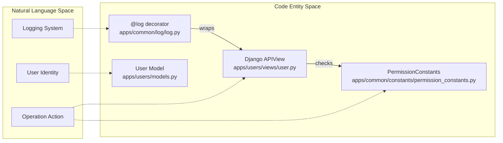
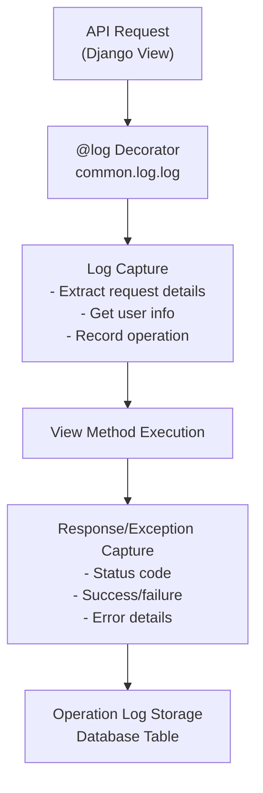
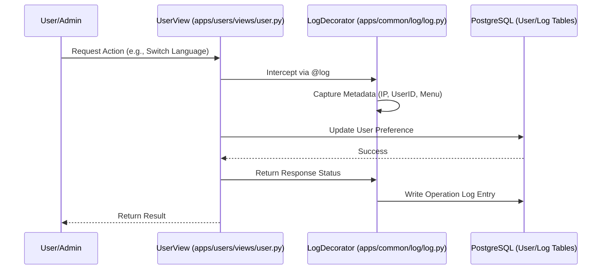

<!-- source: DeepWiki mcp.deepwiki.com · repo 1Panel-dev/MaxKB · page 9.3 Operation Logging and Audit Trail · fetched 2026-10-29 -->

# Operation Logging and Audit Trail

<details>
<summary>Relevant source files</summary>

The following files were used as context for generating this wiki page:

- [apps/common/auth/authenticate.py](apps/common/auth/authenticate.py)
- [apps/common/auth/handle/impl/user_token.py](apps/common/auth/handle/impl/user_token.py)
- [apps/common/config/embedding_config.py](apps/common/config/embedding_config.py)
- [apps/common/constants/cache_version.py](apps/common/constants/cache_version.py)
- [apps/common/constants/permission_constants.py](apps/common/constants/permission_constants.py)
- [apps/common/event/__init__.py](apps/common/event/__init__.py)
- [apps/common/event/common.py](apps/common/event/common.py)
- [apps/common/exception/app_exception.py](apps/common/exception/app_exception.py)
- [apps/common/job/__init__.py](apps/common/job/__init__.py)
- [apps/common/job/clean_chat_job.py](apps/common/job/clean_chat_job.py)
- [apps/common/job/clean_debug_file_job.py](apps/common/job/clean_debug_file_job.py)
- [apps/common/job/client_access_num_job.py](apps/common/job/client_access_num_job.py)
- [apps/common/job/scheduler.py](apps/common/job/scheduler.py)
- [apps/common/log/log.py](apps/common/log/log.py)
- [apps/common/utils/common.py](apps/common/utils/common.py)
- [apps/common/utils/lock.py](apps/common/utils/lock.py)
- [apps/common/utils/rsa_util.py](apps/common/utils/rsa_util.py)
- [apps/locales/en_US/LC_MESSAGES/django.po](apps/locales/en_US/LC_MESSAGES/django.po)
- [apps/locales/zh_CN/LC_MESSAGES/django.po](apps/locales/zh_CN/LC_MESSAGES/django.po)
- [apps/locales/zh_Hant/LC_MESSAGES/django.po](apps/locales/zh_Hant/LC_MESSAGES/django.po)
- [apps/users/api/user.py](apps/users/api/user.py)
- [apps/users/serializers/login.py](apps/users/serializers/login.py)
- [apps/users/serializers/user.py](apps/users/serializers/user.py)
- [apps/users/urls.py](apps/users/urls.py)
- [apps/users/views/login.py](apps/users/views/login.py)
- [apps/users/views/user.py](apps/users/views/user.py)

</details>


## Purpose and Scope

The Operation Logging and Audit Trail system in MaxKB provides comprehensive tracking and monitoring of all user actions within the platform. This system captures detailed information about operations performed through the API layer, including user identification, operation types, timestamps, IP addresses, success/failure status, and contextual details. The audit trail enables security monitoring, compliance reporting, troubleshooting, and usage analysis.

This page covers the logging infrastructure, the `@log` decorator mechanism, log storage and retrieval, the frontend log viewer interface, export capabilities, and cleanup policies.

---

## System Architecture

The operation logging system uses a decorator-based approach to intercept and record API operations. The following diagram illustrates the relationship between the logging infrastructure and core system entities.

### Code Entity Mapping



**System Mapping Diagram**
Sources: [apps/common/log/log.py:1-50](), [apps/users/views/user.py:1-312](), [apps/common/constants/permission_constants.py:1-250]()

### Logging Flow



**Logging Flow Diagram**
Sources: [apps/users/views/user.py:92-108](), [apps/users/views/login.py:1-78]()

---

## The @log Decorator

The `@log` decorator is the core mechanism for capturing operation logs. It intercepts Django REST Framework view methods and automatically records operation details.

### Decorator Parameters

| Parameter | Type | Description |
|-----------|------|-------------|
| `menu` | `str` | The menu/module name (e.g., "User management") |
| `operate` | `str` | The specific operation being performed (e.g., "Switch Language") |
| `get_operation_object` | `Callable` | Lambda function to extract the target object name/identifier |
| `get_details` | `Callable` | Optional lambda to capture additional operation details |

### Usage Examples

**Language Switching Logging:**
In `apps/users/views/user.py`, the `SwitchUserLanguageView` uses the decorator to log when a user changes their interface language.

```python
@log(menu='User management', operate='Switch Language',
     get_operation_object=lambda r, k: {'name': r.user.username})
def post(self, request: Request):
    data = {**request.data, 'user_id': request.user.id}
    return result.success(SwitchLanguageSerializer(data=data).switch())
```
Sources: [apps/users/views/user.py:102-108]()

**Sensitive Data Masking:**
For security, sensitive data like passwords must be masked before logging. The `get_re_password_details` function filters out password fields from the request body.

```python
def get_re_password_details(request):
    path = request.path
    body = request.data
    query = request.query_params
    body_copy = dict(body) if hasattr(body, 'items') else body
    if isinstance(body_copy, dict):
        body_copy.pop('password', None)
        body_copy.pop('re_password', None)
    return {
        "path": path,
        "body": body_copy,
        "query": query
    }
```
Sources: [apps/users/views/user.py:49-61]()

---

## Log Filtering and Cleanup

### Log Filtering
Logs are stored with metadata allowing for complex filtering by user, workspace, and operation type. The system supports multi-tenant filtering using `workspace_id`.

| Field | Source/Entity | Description |
|-------|---------------|-------------|
| `user_id` | `User.id` | The ID of the user performing the action [apps/users/serializers/user.py:139-139]() |
| `workspace_id` | `Workspace.id` | Contextual workspace for the operation [apps/users/serializers/user.py:74-82]() |
| `menu` | `Group` | Functional area defined in permission constants [apps/common/constants/permission_constants.py:18-105]() |

### Cleanup Jobs
MaxKB implements automated cleanup for various logs, including chat logs and temporary files, to maintain system performance.

**Chat Log Cleanup Job:**
The `clean_chat_log_job` runs as a scheduled task to remove records older than the configured `clean_time`.

```python
def clean_chat_log_job():
    clean_chat_log_job_lock()

@lock(lock_key='clean_chat_log_job_execute', timeout=30)
def clean_chat_log_job_lock():
    # ... logic to calculate cutoff dates and delete old ChatRecords
    applications = Application.objects.all().values('id', 'clean_time', 'file_clean_time')
    # ...
```
Sources: [apps/common/job/clean_chat_job.py:16-45]()

---

## Permissions and Audit Access

Access to operation logs is strictly controlled through the Role-Based Access Control (RBAC) system.

### Permission Definitions
Operation log access is governed by specific constants in the permission system.

| Permission Group | Constant | Description |
|------------------|----------|-------------|
| `OPERATION_LOG` | `Group.OPERATION_LOG` | Access to the operation log menu [apps/common/constants/permission_constants.py:100-100]() |
| `READ` | `Operate.READ` | Permission to view log entries [apps/common/constants/permission_constants.py:153-153]() |
| `EXPORT` | `Operate.EXPORT` | Permission to export log data [apps/common/constants/permission_constants.py:162-162]() |

### Access Control Logic
The `has_permissions` decorator is used in views to ensure only authorized roles (like `ADMIN` or `WORKSPACE_MANAGE`) can access or modify user-related data that generates logs.

```python
@has_permissions(PermissionConstants.USER_EDIT, RoleConstants.ADMIN)
def get(self, request: Request):
    return result.success(UserProfileSerializer().profile(request.user, request.auth))
```
Sources: [apps/users/views/user.py:87-89](), [apps/common/constants/permission_constants.py:246-250]()

---

## Integration with User Management

The logging system is tightly integrated with user lifecycle events.

### Entity Interaction Diagram



**User Action Logging Sequence**
Sources: [apps/users/views/user.py:92-108](), [apps/users/urls.py:1-30]()

### Key Integrated Actions
1. **Language Switching**: Logged via `SwitchUserLanguageView` [apps/users/views/user.py:92-108]().
2. **Profile Access**: Tracked for auditing [apps/users/views/user.py:64-76]().
3. **Workspace Operations**: Validated and logged based on workspace permissions [apps/users/views/user.py:111-124]().
4. **Credential Changes**: Password resets and updates are logged with masked details [apps/users/views/user.py:49-61]().

---

