# Page: Overview

# Overview

<details>
<summary>Relevant source files</summary>

The following files were used as context for generating this wiki page:

- [.dockerignore](.dockerignore)
- [.github/workflows/build-and-push-python-pg.yml](.github/workflows/build-and-push-python-pg.yml)
- [.github/workflows/build-and-push-vector-model.yml](.github/workflows/build-and-push-vector-model.yml)
- [.github/workflows/build-and-push.yml](.github/workflows/build-and-push.yml)
- [CODE_OF_CONDUCT.md](CODE_OF_CONDUCT.md)
- [CONTRIBUTING.md](CONTRIBUTING.md)
- [README.md](README.md)
- [README_CN.md](README_CN.md)
- [SECURITY.md](SECURITY.md)
- [USE-CASES.md](USE-CASES.md)
- [apps/application/flow/backend/__init__.py](apps/application/flow/backend/__init__.py)
- [apps/application/flow/backend/sandbox_shell.py](apps/application/flow/backend/sandbox_shell.py)
- [apps/application/migrations/0011_application_skill_tool_ids.py](apps/application/migrations/0011_application_skill_tool_ids.py)
- [apps/common/utils/tool_code.py](apps/common/utils/tool_code.py)
- [apps/models_provider/constants/model_provider_constants.py](apps/models_provider/constants/model_provider_constants.py)
- [apps/models_provider/impl/minimax_model_provider/__init__.py](apps/models_provider/impl/minimax_model_provider/__init__.py)
- [apps/models_provider/impl/minimax_model_provider/credential/__init__.py](apps/models_provider/impl/minimax_model_provider/credential/__init__.py)
- [apps/models_provider/impl/minimax_model_provider/credential/llm.py](apps/models_provider/impl/minimax_model_provider/credential/llm.py)
- [apps/models_provider/impl/minimax_model_provider/credential/tts.py](apps/models_provider/impl/minimax_model_provider/credential/tts.py)
- [apps/models_provider/impl/minimax_model_provider/icon/__init__.py](apps/models_provider/impl/minimax_model_provider/icon/__init__.py)
- [apps/models_provider/impl/minimax_model_provider/icon/minimax_icon_svg](apps/models_provider/impl/minimax_model_provider/icon/minimax_icon_svg)
- [apps/models_provider/impl/minimax_model_provider/model/__init__.py](apps/models_provider/impl/minimax_model_provider/model/__init__.py)
- [apps/models_provider/impl/minimax_model_provider/model/llm.py](apps/models_provider/impl/minimax_model_provider/model/llm.py)
- [apps/models_provider/impl/minimax_model_provider/model/tts.py](apps/models_provider/impl/minimax_model_provider/model/tts.py)
- [installer/Dockerfile](installer/Dockerfile)
- [installer/Dockerfile-base](installer/Dockerfile-base)
- [installer/Dockerfile-vector-model](installer/Dockerfile-vector-model)
- [installer/install_model.py](installer/install_model.py)
- [installer/install_model_bert_base_cased.py](installer/install_model_bert_base_cased.py)
- [installer/sandbox.c](installer/sandbox.c)
- [pyproject.toml](pyproject.toml)
- [ui/src/components/folder-virtualized-tree/CreateFolderDialog.vue](ui/src/components/folder-virtualized-tree/CreateFolderDialog.vue)
- [ui/src/components/folder-virtualized-tree/constant.ts](ui/src/components/folder-virtualized-tree/constant.ts)

</details>


## Purpose and Scope

This document provides an overview of MaxKB, an open-source enterprise-grade AI assistant platform that integrates Retrieval-Augmented Generation (RAG) pipelines with robust workflow capabilities. MaxKB is designed to solve high technical barriers, deployment costs, and long iteration cycles faced by enterprises implementing AI solutions [README.md:14-22]().

This overview covers the high-level system architecture, core components, key features, and technology stack. For detailed information about specific subsystems, see the following related pages:
- For high-level architecture details, see [System Architecture](#1.1)
- For core capabilities and modules, see [Key Features](#1.2)

## System Architecture

MaxKB implements a layered architecture with clear separation of concerns across client, API gateway, application logic, processing, AI integration, and data layers.

### Overall Architecture

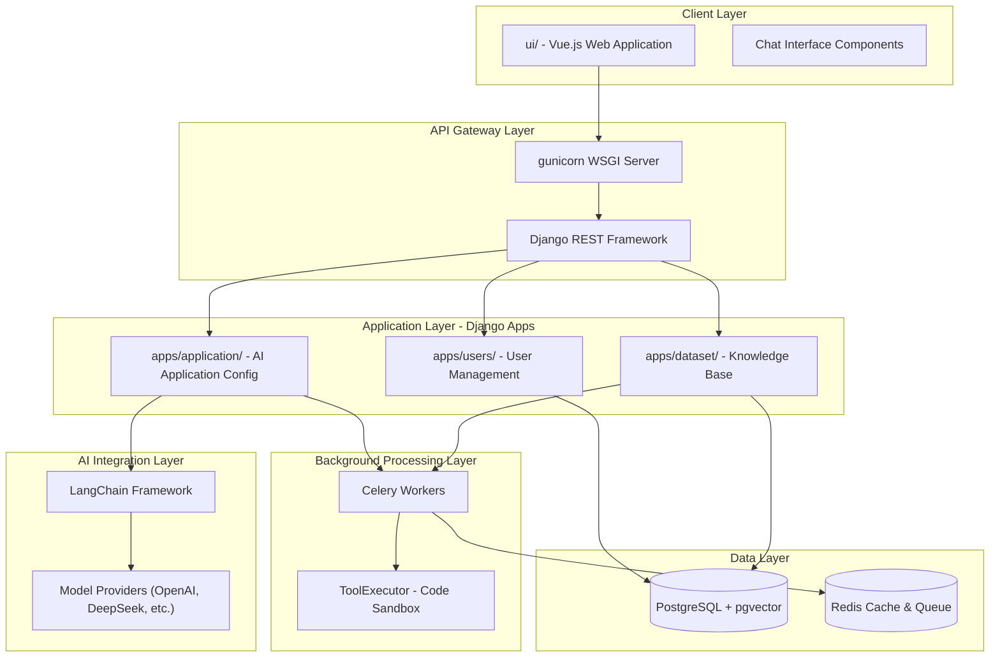

**Sources:** [installer/Dockerfile:32-57](), [pyproject.toml:9-15](), [README.md:52-56]()

## Core Components

### Django Application Structure

MaxKB is organized into several Django apps, each handling a specific domain. The backend is built on Django 5.2.14 [pyproject.toml:9-9]().

### Key Code Entities

| Component | Location | Primary Responsibility |
|-----------|----------|------------------------|
| **ToolExecutor** | [apps/common/utils/tool_code.py:42-44]() | Orchestrates Python code execution within a secure sandbox. |
| **sandbox.so** | [installer/sandbox.c:1-26]() | C-based security layer for system call interception. |
| **CONFIG** | [apps/common/utils/tool_code.py:21-21]() | Global configuration management for the system. |
| **WorkflowManage** | Workflow engine | Orchestrates node-based workflow execution (Detail in [Workflow Engine](#5)). |

### Security and Execution Architecture

MaxKB implements a sophisticated security model for custom tool execution using a C-based sandbox and Python wrapper.

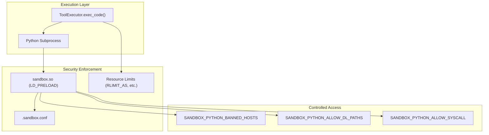

The sandbox implementation (`sandbox.c`) intercepts system calls to enforce network and file access restrictions [installer/sandbox.c:124-133](). The `ToolExecutor` initializes this environment by writing to `.sandbox.conf` [apps/common/utils/tool_code.py:70-93]().

**Sources:** [apps/common/utils/tool_code.py:42-155](), [installer/sandbox.c:27-38](), [installer/Dockerfile:16-16]()

## Key Features

MaxKB provides comprehensive AI assistant capabilities through several integrated systems. For a deep dive into these capabilities, see [Key Features](#1.2).

### RAG (Retrieval-Augmented Generation)
MaxKB implements a complete RAG pipeline:
- **Multi-format Support**: Parses PDF, Word, Excel, and HTML [pyproject.toml:52-56]().
- **Vectorization**: Uses `sentence-transformers` (v5.0.0) for local embedding [pyproject.toml:39-39]().
- **Vector Storage**: Leverages `pgvector` within PostgreSQL for similarity search [installer/Dockerfile-base:18-18]().

### Model Context Protocol (MCP)
MaxKB integrates MCP for standardized tool interaction via `langchain-mcp-adapters` [pyproject.toml:31-31](). It can dynamically generate MCP server code from Python tool definitions [apps/common/utils/tool_code.py:157-173]().

### LLM Provider Support
MaxKB integrates with a wide range of LLM providers [pyproject.toml:24-34]():
- **Public Cloud**: OpenAI, Anthropic, Google Gemini, AWS Bedrock.
- **Chinese Providers**: Baidu Qianfan, ZhipuAI, Volcengine, DeepSeek.
- **Local Hosting**: Ollama, Xinference.

## Technology Stack

MaxKB is built on a modern, scalable technology stack [README.md:52-56]():

| Layer | Technology |
|-----------|------------|
| **Frontend** | Vue.js [installer/Dockerfile:1-1]() |
| **Backend** | Python 3.11, Django 5.2.14 [pyproject.toml:6-9]() |
| **AI Framework** | LangChain 1.2.18, LangGraph 1.1.10 [pyproject.toml:24-35]() |
| **Database** | PostgreSQL 17.10 with pgvector [installer/Dockerfile-base:6-18]() |
| **Task Queue** | Celery 5.5.3 with Redis [pyproject.toml:48-49]() |

**Sources:** [pyproject.toml:1-67](), [installer/Dockerfile-base:1-25](), [README.md:52-56]()

---

# Page: System Architecture

# System Architecture

<details>
<summary>Relevant source files</summary>

The following files were used as context for generating this wiki page:

- [.dockerignore](.dockerignore)
- [.github/workflows/build-and-push-python-pg.yml](.github/workflows/build-and-push-python-pg.yml)
- [.github/workflows/build-and-push-vector-model.yml](.github/workflows/build-and-push-vector-model.yml)
- [.github/workflows/build-and-push.yml](.github/workflows/build-and-push.yml)
- [apps/application/flow/backend/__init__.py](apps/application/flow/backend/__init__.py)
- [apps/application/flow/backend/sandbox_shell.py](apps/application/flow/backend/sandbox_shell.py)
- [apps/application/migrations/0011_application_skill_tool_ids.py](apps/application/migrations/0011_application_skill_tool_ids.py)
- [apps/common/config/tokenizer_manage_config.py](apps/common/config/tokenizer_manage_config.py)
- [apps/common/locale/__init__.py](apps/common/locale/__init__.py)
- [apps/common/locale/cache.py](apps/common/locale/cache.py)
- [apps/common/locale/config_helper.py](apps/common/locale/config_helper.py)
- [apps/common/locale/manager.py](apps/common/locale/manager.py)
- [apps/common/management/__init__.py](apps/common/management/__init__.py)
- [apps/common/management/commands/__init__.py](apps/common/management/commands/__init__.py)
- [apps/common/management/commands/celery.py](apps/common/management/commands/celery.py)
- [apps/common/management/commands/restart.py](apps/common/management/commands/restart.py)
- [apps/common/management/commands/services/__init__.py](apps/common/management/commands/services/__init__.py)
- [apps/common/management/commands/services/command.py](apps/common/management/commands/services/command.py)
- [apps/common/management/commands/services/hands.py](apps/common/management/commands/services/hands.py)
- [apps/common/management/commands/services/services/__init__.py](apps/common/management/commands/services/services/__init__.py)
- [apps/common/management/commands/services/services/base.py](apps/common/management/commands/services/services/base.py)
- [apps/common/management/commands/services/services/celery_base.py](apps/common/management/commands/services/services/celery_base.py)
- [apps/common/management/commands/services/services/celery_default.py](apps/common/management/commands/services/services/celery_default.py)
- [apps/common/management/commands/services/services/gunicorn.py](apps/common/management/commands/services/services/gunicorn.py)
- [apps/common/management/commands/services/services/local_model.py](apps/common/management/commands/services/services/local_model.py)
- [apps/common/management/commands/services/services/scheduler.py](apps/common/management/commands/services/services/scheduler.py)
- [apps/common/utils/logger.py](apps/common/utils/logger.py)
- [apps/common/utils/tool_code.py](apps/common/utils/tool_code.py)
- [apps/maxkb/conf.py](apps/maxkb/conf.py)
- [apps/maxkb/settings/__init__.py](apps/maxkb/settings/__init__.py)
- [apps/maxkb/settings/base/model.py](apps/maxkb/settings/base/model.py)
- [apps/maxkb/settings/base/web.py](apps/maxkb/settings/base/web.py)
- [apps/maxkb/settings/logging.py](apps/maxkb/settings/logging.py)
- [apps/maxkb/settings/mem.py](apps/maxkb/settings/mem.py)
- [installer/Dockerfile](installer/Dockerfile)
- [installer/Dockerfile-base](installer/Dockerfile-base)
- [installer/Dockerfile-vector-model](installer/Dockerfile-vector-model)
- [installer/init.sql](installer/init.sql)
- [installer/install_model.py](installer/install_model.py)
- [installer/install_model_bert_base_cased.py](installer/install_model_bert_base_cased.py)
- [installer/sandbox.c](installer/sandbox.c)
- [installer/start-all.sh](installer/start-all.sh)
- [installer/start-maxkb.sh](installer/start-maxkb.sh)
- [installer/start-postgres.sh](installer/start-postgres.sh)
- [installer/start-redis.sh](installer/start-redis.sh)
- [main.py](main.py)
- [pyproject.toml](pyproject.toml)

</details>


## Purpose and Scope

This document describes the high-level architecture of MaxKB, covering the major system components, their relationships, technology stack, and deployment infrastructure. It provides a structural overview of how the frontend, backend, data storage, AI integration, and security layers work together.

For detailed information about specific subsystems, see:
- User authentication and workspace management: [2]()
- AI chat and conversation systems: [3]()
- Application and workflow management: [4]() and [5]()
- Knowledge base and document processing: [6]()
- Frontend UI components and routing: [10]()
- Deployment and CI/CD pipelines: [11]()

---

## Technology Stack Overview

MaxKB is built as a multi-tier web application with clear separation between presentation, business logic, and data layers.

### Core Technology Stack

| Layer | Technology | Version | Purpose |
|-------|-----------|---------|---------|
| **Frontend** | Vue.js | 3.x | Reactive UI framework |
| | Element Plus | - | UI component library |
| | Pinia | - | State management |
| | Vite | - | Build tool |
| **Backend** | Django | 5.2.14 | Web framework |
| | Django REST Framework | 3.17.1 | REST API framework |
| | Python | 3.11 | Language runtime |
| | Gunicorn | 23.0.0 | WSGI server |
| **AI/ML** | LangChain | 1.2.18 | LLM orchestration |
| | PyTorch | 2.8.0 | ML framework |
| | sentence-transformers | 5.0.0 | Text embeddings |
| **Task Processing** | Celery | 5.5.3 | Distributed task queue |
| | celery-once | 3.0.1 | Task deduplication |
| | django-celery-beat | 2.8.1 | Periodic tasks |
| **Data** | PostgreSQL | 17.10 | Primary database |
| | pgvector | Extension | Vector similarity search |
| | Redis | - | Cache and message broker |
| **Deployment** | Docker | Multi-stage | Containerization |
| | GitHub Actions | - | CI/CD pipeline |

**Sources:** [pyproject.toml:1-67](), [installer/Dockerfile-base:6-19](), [installer/Dockerfile:9-57]()

---

## High-Level Architecture

The system follows a layered architecture pattern with clear separation of concerns across five major layers.

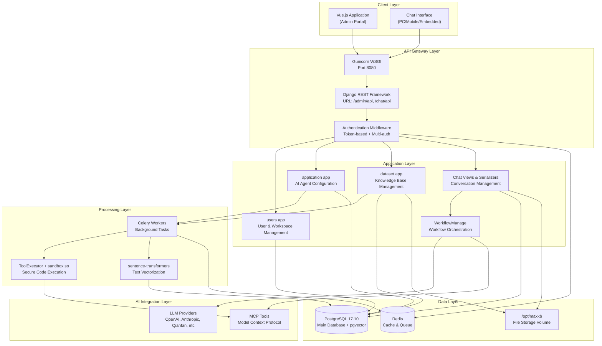

**Sources:** [installer/Dockerfile:9-57](), [pyproject.toml:8-63](), [apps/common/management/commands/services/services/gunicorn.py:9-38]()

---

## Backend Architecture

The Django backend is organized into modular apps following Django's app pattern. The system utilizes `GunicornService` to serve the WSGI application.

### Service Orchestration

The backend services are managed through a custom management command that handles the lifecycle of Gunicorn, Celery, and a local model server.

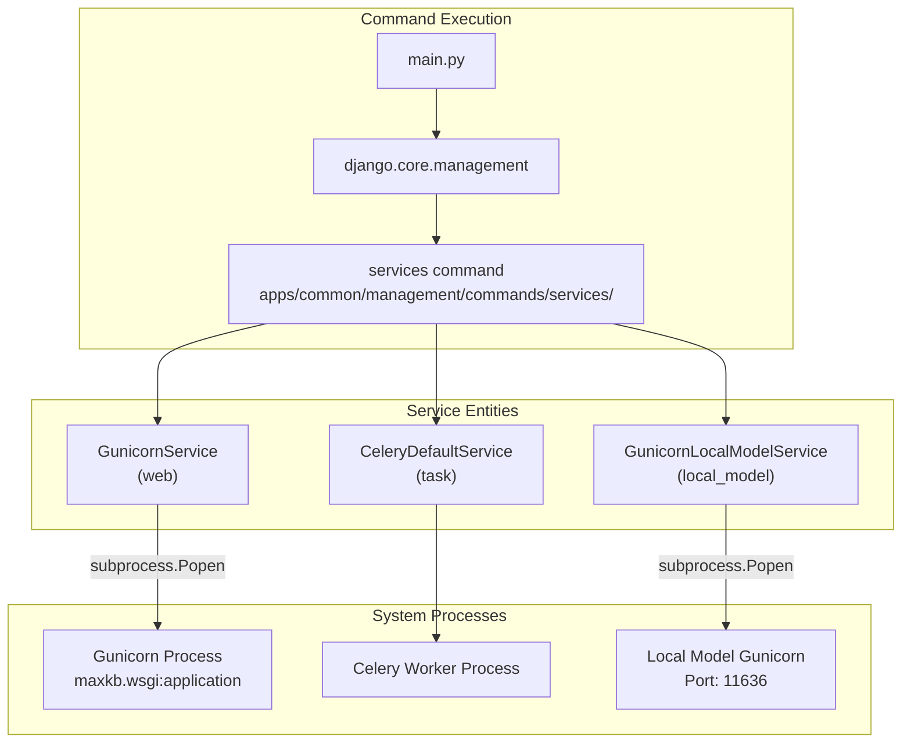

**Sources:** [main.py:65-87](), [apps/common/management/commands/services/services/gunicorn.py:9-54](), [apps/common/management/commands/services/services/local_model.py:18-63]()

---

## Data Layer Architecture

MaxKB uses a hybrid data storage strategy combining a relational database with vector capabilities and a caching layer.

### Database Configuration

The system uses `django-db-connection-pool` to manage PostgreSQL connections efficiently.

| Variable | Default | Purpose |
|----------|---------|---------|
| `MAXKB_DB_HOST` | 127.0.0.1 | PostgreSQL host [apps/maxkb/conf.py:25]() |
| `MAXKB_DB_PORT` | 5432 | PostgreSQL port [apps/maxkb/conf.py:26]() |
| `MAXKB_DB_NAME` | maxkb | Database name [installer/Dockerfile:33]() |
| `MAXKB_DB_USER` | root | Database user [apps/maxkb/conf.py:27]() |
| `MAXKB_DB_PASSWORD` | Password123@postgres | Database password [apps/maxkb/conf.py:28]() |
| `MAXKB_DB_MAX_OVERFLOW` | 80 | Connection pool overflow [apps/maxkb/conf.py:30]() |
| `MAXKB_REDIS_HOST` | 127.0.0.1 | Redis host [apps/maxkb/conf.py:39]() |
| `MAXKB_REDIS_PORT` | 6379 | Redis port [apps/maxkb/conf.py:41]() |

**Sources:** [apps/maxkb/conf.py:22-106](), [installer/Dockerfile:32-42]()

---

## Security and Sandbox Architecture

MaxKB implements a multi-layered security architecture with sandboxed code execution for user-defined tools using a custom C library `sandbox.so`.

### Sandbox Execution Architecture

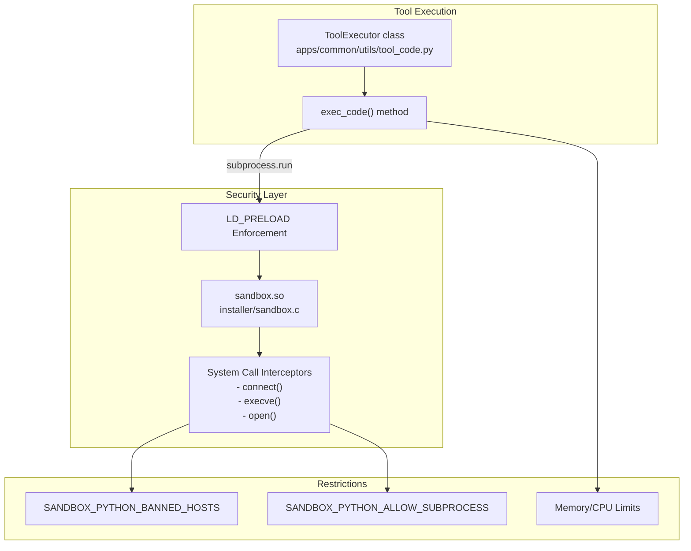

**Sandbox Implementation Details:**

The `ToolExecutor` initializes the sandbox environment by writing configuration to `.sandbox.conf` and setting directory permissions.

| Feature | Implementation | Source |
|---------|----------------|--------|
| Network Filtering | `match_banned_ip` / `match_banned_domain` in C | [installer/sandbox.c:133-220]() |
| Process Isolation | `os.setuid` / `os.setgid` to `sandbox` user | [apps/common/utils/tool_code.py:106-110]() |
| Resource Control | `resource.setrlimit` for memory/CPU | [apps/common/utils/tool_code.py:33-39]() |
| Syscall Interception | `dlsym(RTLD_NEXT, ...)` for libc functions | [installer/sandbox.c:124-128]() |

**Sources:** [apps/common/utils/tool_code.py:42-155](), [installer/sandbox.c:1-128](), [installer/Dockerfile:16]()

---

## Deployment and CI/CD

MaxKB is deployed as a multi-stage Docker container. The build process is automated via GitHub Actions, supporting both `amd64` and `arm64` architectures.

### Build Pipeline

1.  **web-build stage**: Compiles the Vue.js frontend [installer/Dockerfile:1-7]().
2.  **stage-build stage**: Installs Python dependencies via `uv`, compiles the C sandbox, and prepares the backend [installer/Dockerfile:9-24]().
3.  **Final image**: Combines the built assets into a minimal runtime environment based on a pre-configured base image [installer/Dockerfile:27-57]().

**Sources:** [installer/Dockerfile:1-57](), [.github/workflows/build-and-push.yml:1-147]()

---

# Page: Key Features

# Key Features

<details>
<summary>Relevant source files</summary>

The following files were used as context for generating this wiki page:

- [CODE_OF_CONDUCT.md](CODE_OF_CONDUCT.md)
- [CONTRIBUTING.md](CONTRIBUTING.md)
- [README.md](README.md)
- [README_CN.md](README_CN.md)
- [SECURITY.md](SECURITY.md)
- [USE-CASES.md](USE-CASES.md)
- [apps/application/chat_pipeline/step/chat_step/i_chat_step.py](apps/application/chat_pipeline/step/chat_step/i_chat_step.py)
- [apps/application/chat_pipeline/step/chat_step/impl/base_chat_step.py](apps/application/chat_pipeline/step/chat_step/impl/base_chat_step.py)
- [apps/application/flow/i_step_node.py](apps/application/flow/i_step_node.py)
- [apps/application/flow/step_node/ai_chat_step_node/i_chat_node.py](apps/application/flow/step_node/ai_chat_step_node/i_chat_node.py)
- [apps/application/flow/step_node/ai_chat_step_node/impl/base_chat_node.py](apps/application/flow/step_node/ai_chat_step_node/impl/base_chat_node.py)
- [apps/application/flow/step_node/intent_node/impl/base_intent_node.py](apps/application/flow/step_node/intent_node/impl/base_intent_node.py)
- [apps/application/flow/step_node/parameter_extraction_node/impl/base_parameter_extraction_node.py](apps/application/flow/step_node/parameter_extraction_node/impl/base_parameter_extraction_node.py)
- [apps/application/flow/step_node/question_node/i_question_node.py](apps/application/flow/step_node/question_node/i_question_node.py)
- [apps/application/flow/step_node/question_node/impl/base_question_node.py](apps/application/flow/step_node/question_node/impl/base_question_node.py)
- [apps/application/flow/step_node/variable_splitting_node/impl/base_variable_splitting_node.py](apps/application/flow/step_node/variable_splitting_node/impl/base_variable_splitting_node.py)
- [apps/application/flow/tools.py](apps/application/flow/tools.py)
- [apps/application/flow/workflow_manage.py](apps/application/flow/workflow_manage.py)
- [apps/application/long_term_memory/__init__.py](apps/application/long_term_memory/__init__.py)
- [apps/application/models/application.py](apps/application/models/application.py)
- [apps/knowledge/task/handler.py](apps/knowledge/task/handler.py)
- [apps/models_provider/constants/model_provider_constants.py](apps/models_provider/constants/model_provider_constants.py)
- [apps/models_provider/impl/minimax_model_provider/__init__.py](apps/models_provider/impl/minimax_model_provider/__init__.py)
- [apps/models_provider/impl/minimax_model_provider/credential/__init__.py](apps/models_provider/impl/minimax_model_provider/credential/__init__.py)
- [apps/models_provider/impl/minimax_model_provider/credential/llm.py](apps/models_provider/impl/minimax_model_provider/credential/llm.py)
- [apps/models_provider/impl/minimax_model_provider/credential/tts.py](apps/models_provider/impl/minimax_model_provider/credential/tts.py)
- [apps/models_provider/impl/minimax_model_provider/icon/__init__.py](apps/models_provider/impl/minimax_model_provider/icon/__init__.py)
- [apps/models_provider/impl/minimax_model_provider/icon/minimax_icon_svg](apps/models_provider/impl/minimax_model_provider/icon/minimax_icon_svg)
- [apps/models_provider/impl/minimax_model_provider/model/__init__.py](apps/models_provider/impl/minimax_model_provider/model/__init__.py)
- [apps/models_provider/impl/minimax_model_provider/model/llm.py](apps/models_provider/impl/minimax_model_provider/model/llm.py)
- [apps/models_provider/impl/minimax_model_provider/model/tts.py](apps/models_provider/impl/minimax_model_provider/model/tts.py)
- [apps/models_provider/impl/ollama_model_provider/ollama_model_provider.py](apps/models_provider/impl/ollama_model_provider/ollama_model_provider.py)
- [ui/src/api/type/application.ts](ui/src/api/type/application.ts)
- [ui/src/components/folder-virtualized-tree/CreateFolderDialog.vue](ui/src/components/folder-virtualized-tree/CreateFolderDialog.vue)
- [ui/src/components/folder-virtualized-tree/constant.ts](ui/src/components/folder-virtualized-tree/constant.ts)

</details>


This document provides a technical overview of MaxKB's core capabilities and their underlying implementation. MaxKB (Max Knowledge Brain) is designed as an enterprise-grade agent platform focusing on RAG pipelines, flexible workflow orchestration, and extensive model compatibility.

## AI Chat and Multi-Modal Support

MaxKB provides a native multi-modal chat experience supporting text, images, audio, and video. The system handles streaming responses and complex reasoning processes (e.g., "Think" blocks for models like DeepSeek).

### Chat Streaming and Reasoning Flow

The `ChatRecordManage` class in the frontend manages the buffering and rendering of streaming chunks, while the backend uses `Reasoning` and `StreamingHttpResponse` to handle model outputs.

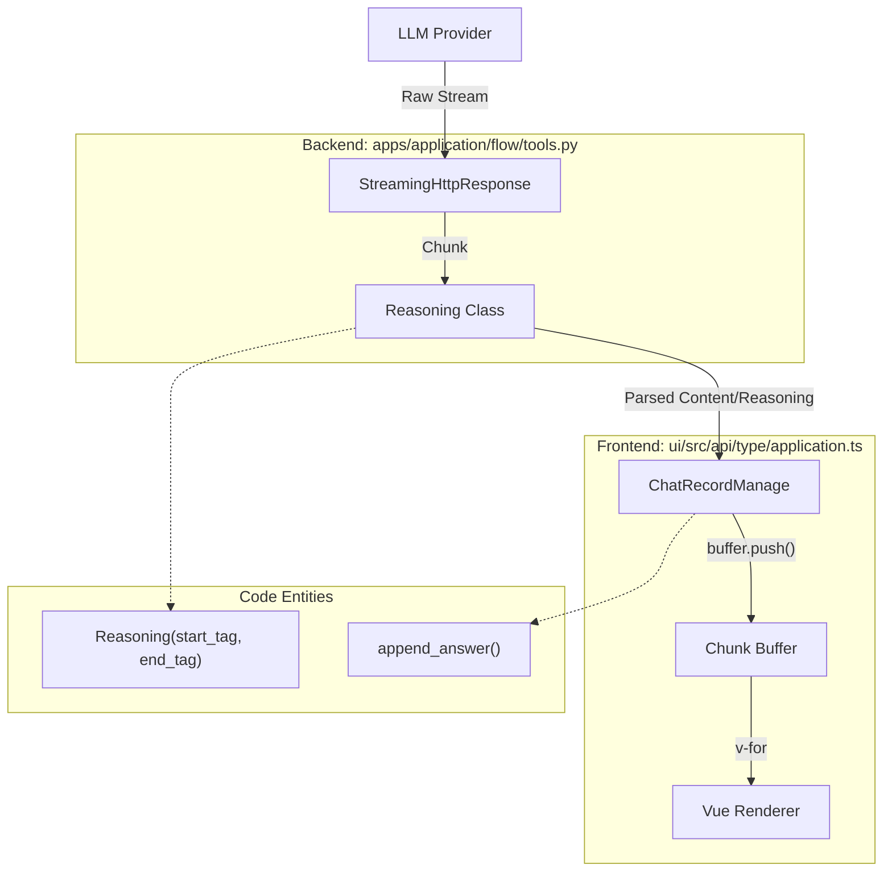

### Key Multi-Modal Components
| Feature | Implementation | Description |
| :--- | :--- | :--- |
| **Reasoning Blocks** | `Reasoning` class | Extracts content between tags like `` for UI separation. [apps/application/flow/tools.py:86-103]() |
| **Audio Processing** | `pydub`, `pysilk` | Handles conversion and processing of voice inputs/outputs. [pyproject.toml:68-70]() |
| **Streaming** | `ChatRecordManage` | Manages `answer_text_list` for multi-view rendering of workflow nodes. [ui/src/api/type/application.ts:122-180]() |

**Sources:** [apps/application/flow/tools.py:86-103](), [ui/src/api/type/application.ts:122-180](), [README.md:20]()

## Workflow Orchestration Engine

The workflow engine allows for complex DAG (Directed Acyclic Graph) execution of AI tasks. It supports multiple node types, including AI Chat, Question, and Tool execution.

### Workflow Execution Architecture

The `WorkflowManage` class acts as the central orchestrator, managing node transitions and context sharing.

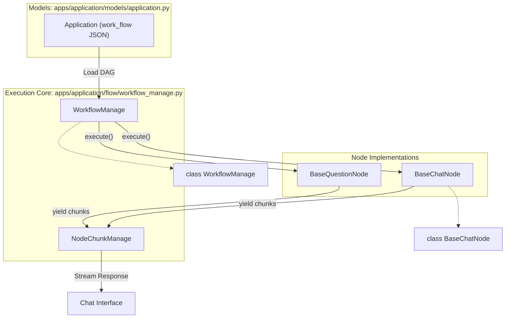

### Workflow Node Capabilities
*   **Context Management**: Nodes share data through a global `workflow_variable` and node-specific `node_variable`. [apps/application/flow/step_node/ai_chat_step_node/impl/base_chat_node.py:36-49]()
*   **Interruption Handling**: Supports task interruption checks during streaming to save resources. [apps/application/flow/step_node/ai_chat_step_node/impl/base_chat_node.py:70-72]()
*   **Dynamic Prompting**: The engine generates prompts by replacing variables in templates. [apps/application/flow/step_node/question_node/impl/base_question_node.py:107-112]()

**Sources:** [apps/application/flow/workflow_manage.py:92-140](), [apps/application/flow/step_node/ai_chat_step_node/impl/base_chat_node.py:148-160](), [apps/application/flow/step_node/question_node/impl/base_question_node.py:74-123]()

## Knowledge Base and RAG Pipeline

MaxKB implements Retrieval-Augmented Generation (RAG) by integrating document processing with vector databases.

*   **Document Ingestion**: Supports direct upload and automatic crawling. [README.md:16]()
*   **Vector Search**: Utilizes `PostgreSQL` with `pgvector` for efficient similarity searches. [README.md:55]()
*   **RAG Configuration**: Applications can be configured with specific knowledge settings, including `top_n`, `similarity` thresholds, and `search_mode`. [apps/application/models/application.py:41-47]()

**Sources:** [README.md:16-19](), [apps/application/models/application.py:71-72]()

## Multi-LLM and Tool Integration

The platform is model-agnostic and supports a wide range of providers and tool protocols.

### Model Providers
MaxKB supports over 15 providers, including:
*   **Private/Local**: DeepSeek, Llama, Qwen (via Ollama/Xinference). [README.md:19]()
*   **Public Cloud**: OpenAI, Claude, Gemini, and major Chinese providers (Zhipu AI, Baidu Qianfan, etc.). [README_CN.md:22]()

### Tool and MCP Integration
*   **MCP (Model Context Protocol)**: Enables advanced tool-use capabilities through standardized adapters. [README.md:14]()
*   **Tool Execution**: Supports custom tool code execution and sandboxed environments. [apps/application/flow/tools.py:40-53]()
*   **Long-Term Memory**: An automated background task提炼 (extracts) user preferences and objective background information from conversations to improve future AI responses. [apps/application/long_term_memory/__init__.py:14-120]()

**Sources:** [README.md:14-19](), [apps/application/long_term_memory/__init__.py:123-155](), [apps/application/flow/tools.py:40-53]()

## Enterprise Features

*   **Multi-Tenant Workspaces**: Isolation of resources and permissions via `workspace_id`. [apps/application/models/application.py:61]()
*   **Application Folders**: Hierarchical organization of AI applications. [apps/application/models/application.py:20-26]()
*   **API Integration**: Zero-coding integration into third-party systems. [README.md:18]()
*   **Long-Term Memory**: Persistent user profiling across sessions based on configurable triggers (e.g., every N rounds). [apps/application/long_term_memory/__init__.py:158-213]()

**Sources:** [apps/application/models/application.py:59-106](), [apps/application/long_term_memory/__init__.py:106-114]()

---

# Page: Authentication and Authorization System

# Authentication and Authorization System

<details>
<summary>Relevant source files</summary>

The following files were used as context for generating this wiki page:

- [apps/common/auth/authenticate.py](apps/common/auth/authenticate.py)
- [apps/common/auth/handle/impl/user_token.py](apps/common/auth/handle/impl/user_token.py)
- [apps/common/constants/cache_version.py](apps/common/constants/cache_version.py)
- [apps/common/constants/permission_constants.py](apps/common/constants/permission_constants.py)
- [apps/common/exception/app_exception.py](apps/common/exception/app_exception.py)
- [apps/common/log/log.py](apps/common/log/log.py)
- [apps/common/utils/common.py](apps/common/utils/common.py)
- [apps/locales/en_US/LC_MESSAGES/django.po](apps/locales/en_US/LC_MESSAGES/django.po)
- [apps/locales/zh_CN/LC_MESSAGES/django.po](apps/locales/zh_CN/LC_MESSAGES/django.po)
- [apps/locales/zh_Hant/LC_MESSAGES/django.po](apps/locales/zh_Hant/LC_MESSAGES/django.po)
- [apps/users/api/user.py](apps/users/api/user.py)
- [apps/users/serializers/login.py](apps/users/serializers/login.py)
- [apps/users/serializers/user.py](apps/users/serializers/user.py)
- [apps/users/urls.py](apps/users/urls.py)
- [apps/users/views/login.py](apps/users/views/login.py)
- [apps/users/views/user.py](apps/users/views/user.py)
- [ui/src/permission/application/system-manage.ts](ui/src/permission/application/system-manage.ts)
- [ui/src/permission/application/workspace.ts](ui/src/permission/application/workspace.ts)
- [ui/src/permission/knowledge/system-manage.ts](ui/src/permission/knowledge/system-manage.ts)
- [ui/src/permission/knowledge/system-share.ts](ui/src/permission/knowledge/system-share.ts)
- [ui/src/permission/knowledge/workspace-share.ts](ui/src/permission/knowledge/workspace-share.ts)
- [ui/src/permission/knowledge/workspace.ts](ui/src/permission/knowledge/workspace.ts)
- [ui/src/permission/model/system-manage.ts](ui/src/permission/model/system-manage.ts)
- [ui/src/permission/model/system-share.ts](ui/src/permission/model/system-share.ts)
- [ui/src/permission/model/workspace.ts](ui/src/permission/model/workspace.ts)
- [ui/src/permission/tool/system-manage.ts](ui/src/permission/tool/system-manage.ts)
- [ui/src/permission/tool/system-share.ts](ui/src/permission/tool/system-share.ts)
- [ui/src/permission/tool/workspace.ts](ui/src/permission/tool/workspace.ts)
- [ui/src/utils/permission/data.ts](ui/src/utils/permission/data.ts)

</details>


This document covers MaxKB's comprehensive authentication and authorization system, including role-based access control (RBAC), permission management, user authentication flows, and workspace-based security. The system provides both system-level and workspace-level permissions with fine-grained resource access control.

For details, see [Permission Constants and Role Management](#2.1), [User Authentication Flow](#2.2), and [Multi-Tenant Workspace System](#2.3).

## System Architecture

MaxKB implements a multi-layered authentication and authorization system that supports both system-wide and workspace-specific permissions. The system is built around a permission constants framework that defines hierarchical access control with support for enterprise multi-tenancy.

```mermaid
graph TB
    subgraph "Permission System Core"
        [PermissionConstants]
        [RoleConstants]
        [Group]
        [Operate]
    end

    subgraph "Authentication Layer"
        [TokenAuth]
        [UserTokenHandle]
        [LoginSerializer]
        [UserProfileSerializer]
    end

    subgraph "User Management"
        User["User Model (apps/users/models.py)"]
        [UserManageSerializer]
        [UserViews]
    end

    subgraph "Permission Storage"
        [WorkspaceUserResourcePermission]
        RolePermissionMapping["role_permission_mapping (DatabaseModelManage)"]
        WorkspaceUserRoleMapping["workspace_user_role_mapping (DatabaseModelManage)"]
    end

    subgraph "API Endpoints"
        LoginView["/user/login (apps/users/views/login.py)"]
        UserProfileView["/user/profile (apps/users/views/user.py)"]
        UserManageView["/user_manage (apps/users/views/user.py)"]
    end

    [TokenAuth] --> [UserTokenHandle]
    [UserTokenHandle] --> [PermissionConstants]
    LoginView --> [LoginSerializer]
    UserProfileView --> [UserProfileSerializer]
    UserManageView --> [UserManageSerializer]
    
    [PermissionConstants] --> [Group]
    [PermissionConstants] --> [Operate]
    [RoleConstants] --> [PermissionConstants]
    
    [UserManageSerializer] --> User
    [UserTokenHandle] --> [WorkspaceUserResourcePermission]
    [UserTokenHandle] --> RolePermissionMapping
```

**Permission System Architecture**

Sources: [apps/common/constants/permission_constants.py:1-425](), [apps/common/auth/handle/impl/user_token.py:1-30](), [apps/users/serializers/user.py:74-106]()

## Permission Constants and Role Management

The permission system is built around a comprehensive constants framework that defines access control at multiple levels. Roles are categorized into system roles (e.g., `ADMIN`, `USER`) and workspace roles (e.g., `WORKSPACE_MANAGE`).

### Permission Groups and Operations

| Group Type | Purpose | Examples |
|------------|---------|-----------|
| `Group` | Maps to frontend menu items | `APPLICATION`, `KNOWLEDGE`, `MODEL`, `TOOL` |
| `Operate` | Defines specific operations | `READ`, `EDIT`, `CREATE`, `DELETE`, `USE` |
| `Permission` | Combines group + operation | `APPLICATION_READ`, `KNOWLEDGE_EDIT` |

### Role Hierarchy

The system defines roles in `RoleConstants` enum with inheritance patterns for workspace-specific permissions. A user can be an `ADMIN` at the system level while being a regular `USER` or `WORKSPACE_MANAGE` within a specific workspace context.

For details, see [Permission Constants and Role Management](#2.1).

Sources: [apps/common/constants/permission_constants.py:18-105](), [apps/common/constants/permission_constants.py:148-201](), [apps/users/serializers/user.py:26-27]()

## User Authentication Flow

### Token-Based Authentication

MaxKB uses a token-based authentication system. The login process involves credential verification, optional captcha, and account locking mechanisms for failed attempts.

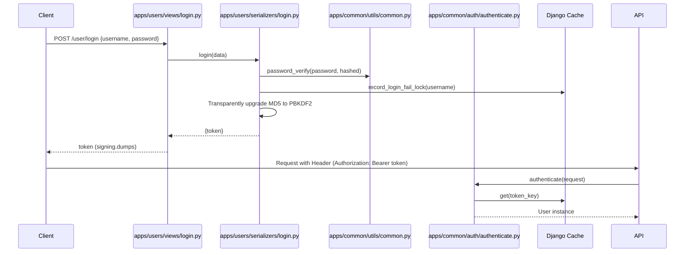

**Authentication Flow Sequence**

### Multi-Factor and External Auth
The system supports standard local login and provides infrastructure for enterprise authentication methods. Password verification includes a transparent upgrade path from legacy MD5 hashes to modern Django PBKDF2 hashes.

For details, see [User Authentication Flow](#2.2).

Sources: [apps/users/serializers/login.py:99-176](), [apps/common/utils/common.py:44-90](), [apps/users/views/user.py:64-75]()

## Multi-Tenant Workspace System

MaxKB implements a workspace-based multi-tenancy architecture. Resources like applications, knowledge bases, and tools are isolated within workspaces.

### Workspace Permission Resolution

The system calculates user permissions through a resolution process that combines system roles, workspace roles, and specific resource permissions.

| Permission Type | String Format Pattern |
|-----------------|-----------------------|
| System | `{permission_id}` |
| Workspace | `{permission_id}:/WORKSPACE/{workspace_id}` |
| Resource | `{permission_id}:/WORKSPACE/{workspace_id}/{resource_type}/{target_id}` |

### Workspace Switching
Users can belong to multiple workspaces and switch contexts. The `UserProfileSerializer` provides a `workspace_list` for the current user to facilitate this.

For details, see [Multi-Tenant Workspace System](#2.3).

Sources: [apps/common/auth/handle/impl/user_token.py:32-68](), [apps/common/auth/handle/impl/user_token.py:107-151](), [apps/users/serializers/user.py:117-151]()

## User Management and Profiles

The system provides APIs for managing user profiles, switching languages, and administrative user management.

| Endpoint | View Class | Permission Required |
|----------|------------|---------------------|
| `/user/profile` | `UserProfileView` | Authenticated |
| `/user/switch_language` | `SwitchUserLanguageView` | `SWITCH_LANGUAGE` |
| `/user/list` | `UserList` | Admin/Workspace Manage |

Sources: [apps/users/views/user.py:64-154](), [apps/users/urls.py:1-29]()

## Resource Permissions in Frontend

The frontend uses a set of utility functions to check permissions before rendering UI elements or allowing actions.

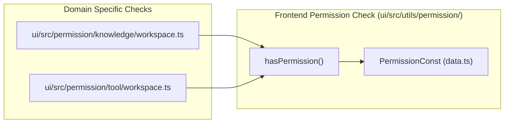

**Frontend Permission Mapping**

Sources: [ui/src/utils/permission/data.ts:26-150](), [ui/src/permission/knowledge/workspace.ts:4-62](), [ui/src/permission/tool/workspace.ts:4-42]()

---

# Page: Permission Constants and Role Management

# Permission Constants and Role Management

<details>
<summary>Relevant source files</summary>

The following files were used as context for generating this wiki page:

- [apps/common/auth/authenticate.py](apps/common/auth/authenticate.py)
- [apps/common/auth/handle/impl/user_token.py](apps/common/auth/handle/impl/user_token.py)
- [apps/common/constants/cache_version.py](apps/common/constants/cache_version.py)
- [apps/common/constants/permission_constants.py](apps/common/constants/permission_constants.py)
- [apps/common/exception/app_exception.py](apps/common/exception/app_exception.py)
- [apps/common/log/log.py](apps/common/log/log.py)
- [apps/common/utils/common.py](apps/common/utils/common.py)
- [apps/folders/serializers/folder.py](apps/folders/serializers/folder.py)
- [apps/knowledge/serializers/knowledge_folder.py](apps/knowledge/serializers/knowledge_folder.py)
- [apps/locales/en_US/LC_MESSAGES/django.po](apps/locales/en_US/LC_MESSAGES/django.po)
- [apps/locales/zh_CN/LC_MESSAGES/django.po](apps/locales/zh_CN/LC_MESSAGES/django.po)
- [apps/locales/zh_Hant/LC_MESSAGES/django.po](apps/locales/zh_Hant/LC_MESSAGES/django.po)
- [apps/system_manage/api/user_resource_permission.py](apps/system_manage/api/user_resource_permission.py)
- [apps/system_manage/migrations/0003_alter_workspaceuserresourcepermission_target.py](apps/system_manage/migrations/0003_alter_workspaceuserresourcepermission_target.py)
- [apps/system_manage/models/workspace_user_permission.py](apps/system_manage/models/workspace_user_permission.py)
- [apps/system_manage/serializers/user_resource_permission.py](apps/system_manage/serializers/user_resource_permission.py)
- [apps/system_manage/sql/get_application_user_resource_permission.sql](apps/system_manage/sql/get_application_user_resource_permission.sql)
- [apps/system_manage/sql/get_knowledge_user_resource_permission.sql](apps/system_manage/sql/get_knowledge_user_resource_permission.sql)
- [apps/system_manage/sql/get_model_user_resource_permission.sql](apps/system_manage/sql/get_model_user_resource_permission.sql)
- [apps/system_manage/sql/get_resource_user_permission_detail.sql](apps/system_manage/sql/get_resource_user_permission_detail.sql)
- [apps/system_manage/sql/get_resource_user_permission_detail_ee.sql](apps/system_manage/sql/get_resource_user_permission_detail_ee.sql)
- [apps/system_manage/sql/get_tool_user_resource_permission.sql](apps/system_manage/sql/get_tool_user_resource_permission.sql)
- [apps/system_manage/views/user_resource_permission.py](apps/system_manage/views/user_resource_permission.py)
- [apps/users/api/user.py](apps/users/api/user.py)
- [apps/users/serializers/login.py](apps/users/serializers/login.py)
- [apps/users/serializers/user.py](apps/users/serializers/user.py)
- [apps/users/urls.py](apps/users/urls.py)
- [apps/users/views/login.py](apps/users/views/login.py)
- [apps/users/views/user.py](apps/users/views/user.py)
- [ui/src/permission/application/system-manage.ts](ui/src/permission/application/system-manage.ts)
- [ui/src/permission/application/workspace.ts](ui/src/permission/application/workspace.ts)
- [ui/src/permission/knowledge/system-manage.ts](ui/src/permission/knowledge/system-manage.ts)
- [ui/src/permission/knowledge/system-share.ts](ui/src/permission/knowledge/system-share.ts)
- [ui/src/permission/knowledge/workspace-share.ts](ui/src/permission/knowledge/workspace-share.ts)
- [ui/src/permission/knowledge/workspace.ts](ui/src/permission/knowledge/workspace.ts)
- [ui/src/permission/model/system-manage.ts](ui/src/permission/model/system-manage.ts)
- [ui/src/permission/model/system-share.ts](ui/src/permission/model/system-share.ts)
- [ui/src/permission/model/workspace.ts](ui/src/permission/model/workspace.ts)
- [ui/src/permission/tool/system-manage.ts](ui/src/permission/tool/system-manage.ts)
- [ui/src/permission/tool/system-share.ts](ui/src/permission/tool/system-share.ts)
- [ui/src/permission/tool/workspace.ts](ui/src/permission/tool/workspace.ts)
- [ui/src/utils/permission/data.ts](ui/src/utils/permission/data.ts)

</details>


This document details the hierarchical permission and role management system in MaxKB, including permission constants, role definitions, resource-based access control, and workspace-level authorization. The system provides fine-grained access control for applications, knowledge bases, models, tools, and system administration functions.

## System Architecture Overview

The permission system is built around several core components that work together to provide comprehensive access control. It bridges the "Natural Language Space" (menus and operations) to the "Code Entity Space" (Enums and Classes).

### Core Permission Architecture

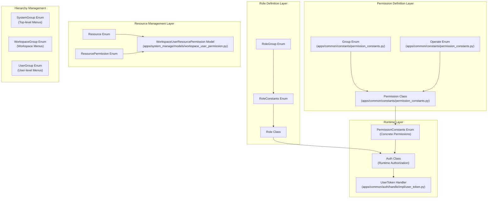

**Sources:** [apps/common/constants/permission_constants.py:18-147](), [apps/common/constants/permission_constants.py:203-244](), [apps/system_manage/models/workspace_user_permission.py:1-50](), [apps/common/auth/handle/impl/user_token.py:16-28]()

## Permission Groups and Operations

The permission system uses a matrix approach where `Group` defines functional areas and `Operate` defines actions.

### Core Permission Groups
Groups typically correspond to frontend menus or resource categories.

| Group Category | Key Groups | Code Identifier |
|----------------|------------|-----------------|
| **Core Resources** | `APPLICATION`, `KNOWLEDGE`, `MODEL`, `TOOL` | `Group.APPLICATION`, `Group.KNOWLEDGE` |
| **Folders** | `APPLICATION_FOLDER`, `KNOWLEDGE_FOLDER`, `TOOL_FOLDER` | `Group.APPLICATION_FOLDER` |
| **System Settings** | `USER`, `ROLE`, `WORKSPACE`, `OPERATION_LOG` | `Group.USER`, `Group.ROLE` |
| **Specific Features** | `KNOWLEDGE_HIT_TEST`, `APPLICATION_CHAT_LOG` | `Group.KNOWLEDGE_HIT_TEST` |

**Sources:** [apps/common/constants/permission_constants.py:18-105]()

### Operation Types
The `Operate` enum defines specific actions allowed within a group.

| Action Category | Operations | Code Identifier |
|-------------------|------------|-----------------|
| **Standard CRUD** | `READ`, `EDIT`, `CREATE`, `DELETE` | `Operate.READ`, `Operate.EDIT` |
| **Resource Specific**| `VECTOR`, `PUBLISH`, `SYNC`, `ANNOTATION` | `Operate.VECTOR`, `Operate.SYNC` |
| **Batch Ops** | `BATCH_DELETE`, `BATCH_MOVE` | `Operate.BATCH_DELETE` |
| **Access Control** | `ADD_MEMBER`, `REMOVE_MEMBER`, `AUTH` | `Operate.ADD_MEMBER`, `Operate.AUTH` |

**Sources:** [apps/common/constants/permission_constants.py:148-201]()

## Role Management System

### Role Hierarchy and Constants
The system defines roles for both system users and chat users.

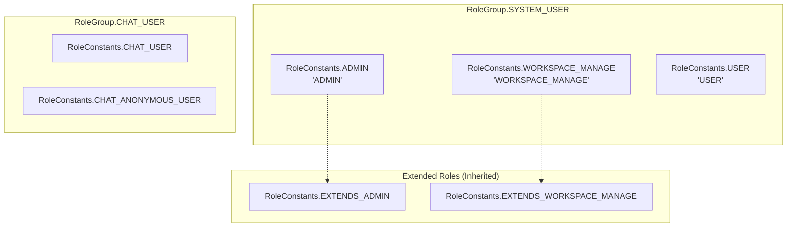

**Sources:** [apps/common/constants/permission_constants.py:203-282]()

### Role-Permission Resolution
Permissions are resolved by mapping roles to permission strings. For workspace-specific roles, the permission string includes the workspace ID.

- **System Permission:** `f"{permission_id}"` [apps/common/auth/handle/impl/user_token.py:40-40]()
- **Workspace Permission:** `f"{permission_id}:/WORKSPACE/{workspace_id}"` [apps/common/auth/handle/impl/user_token.py:56-56]()
- **Role Workspace Permission:** `f"{role}:/WORKSPACE/{workspace_id}"` [apps/common/auth/handle/impl/user_token.py:68-68]()

## Workspace and Resource Permission Management

### Resource Permission Model
Resource permissions allow for fine-grained control over specific instances (e.g., a specific Application or Knowledge Base).

| Permission Level | Enum Value | Description |
|------------------|------------|-------------|
| **View** | `ResourcePermission.VIEW` | Permission to view the resource. |
| **Manage** | `ResourcePermission.MANAGE` | Permission to edit/delete/manage the resource. |
| **Role-based** | `ResourcePermissionRole.ROLE` | Permissions inherited from the user's workspace role. |

**Sources:** [apps/common/constants/permission_constants.py:210-230](), [apps/system_manage/serializers/user_resource_permission.py:38-42]()

### Permission Check Logic
The system provides utility functions to check permissions at various levels:

1.  **Workspace Admin Check:** `is_workspace_manage(user_id, workspace_id)` checks if a user is an admin of a specific workspace. [apps/users/serializers/user.py:74-82]()
2.  **Resource Permission Check:** `UserResourcePermissionSerializer().is_auth(resource_id)` checks if a user has access to a specific resource instance. [apps/system_manage/serializers/user_resource_permission.py:145-156]()
3.  **Folder Permission Check:** `has_target_permission` verifies management rights over folders. [apps/folders/serializers/folder.py:119-122]()

### Data Flow for Permission Calculation
When a user authenticates, `UserToken.get_auth` aggregates permissions from multiple sources.

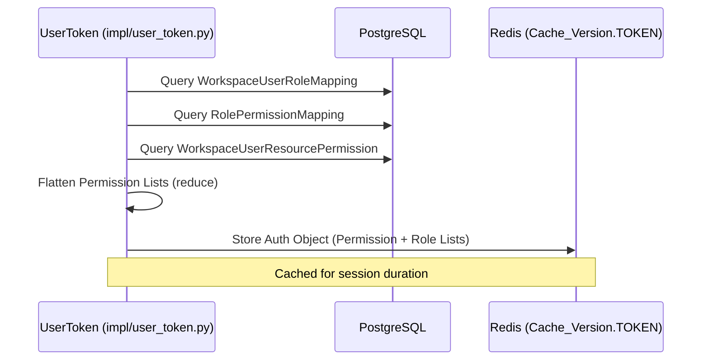

**Sources:** [apps/common/auth/handle/impl/user_token.py:71-104](), [apps/common/auth/handle/impl/user_token.py:172-175]()

## Implementation Details

### Permission Constants Definition
Permissions are explicitly defined as `Permission` objects in `PermissionConstants`. For example:
- `USER_READ = Permission(Group.USER, Operate.READ)` [apps/common/constants/permission_constants.py:442]()
- `APPLICATION_EDIT = Permission(Group.APPLICATION, Operate.EDIT)` [apps/common/constants/permission_constants.py:504]()

### Decorator-based Access Control
The `@has_permissions` decorator is used in Django views to enforce access control. It supports both system-level and workspace-level permission checks.

```python
# Example from apps/users/views/user.py
@has_permissions(PermissionConstants.USER_EDIT, RoleConstants.ADMIN)
def get(self, request: Request):
    ...
```

**Sources:** [apps/users/views/user.py:87-87](), [apps/users/views/user.py:104-105]()

### Internationalization (i18n)
Permission labels are translated using Django's `gettext_lazy`. Mappings are maintained in `Permission_Label`.

**Sources:** [apps/common/constants/permission_constants.py:284-422](), [apps/locales/zh_CN/LC_MESSAGES/django.po:82-91]()

## Key Files and Classes

| File Path | Key Entity | Purpose |
|-----------|------------|---------|
| `apps/common/constants/permission_constants.py` | `PermissionConstants`, `RoleConstants` | Central definition of all permissions and roles. |
| `apps/common/auth/handle/impl/user_token.py` | `get_workspace_permission_list` | Logic for aggregating permissions from DB to Auth object. |
| `apps/system_manage/models/workspace_user_permission.py` | `WorkspaceUserResourcePermission` | Database model for per-resource access control. |
| `apps/users/serializers/user.py` | `is_workspace_manage` | Utility for checking administrative status. |
| `ui/src/utils/permission/data.ts` | `PermissionConst` | Frontend counterparts for permission constants. |

**Sources:** [apps/common/constants/permission_constants.py:1-425](), [apps/common/auth/handle/impl/user_token.py:71-85](), [apps/system_manage/models/workspace_user_permission.py:1-50](), [ui/src/utils/permission/data.ts:26-147]()

---

# Page: User Authentication Flow

# User Authentication Flow

<details>
<summary>Relevant source files</summary>

The following files were used as context for generating this wiki page:

- [apps/common/auth/authenticate.py](apps/common/auth/authenticate.py)
- [apps/common/auth/handle/impl/user_token.py](apps/common/auth/handle/impl/user_token.py)
- [apps/common/constants/cache_version.py](apps/common/constants/cache_version.py)
- [apps/common/constants/permission_constants.py](apps/common/constants/permission_constants.py)
- [apps/common/exception/app_exception.py](apps/common/exception/app_exception.py)
- [apps/common/log/log.py](apps/common/log/log.py)
- [apps/common/utils/common.py](apps/common/utils/common.py)
- [apps/locales/en_US/LC_MESSAGES/django.po](apps/locales/en_US/LC_MESSAGES/django.po)
- [apps/locales/zh_CN/LC_MESSAGES/django.po](apps/locales/zh_CN/LC_MESSAGES/django.po)
- [apps/locales/zh_Hant/LC_MESSAGES/django.po](apps/locales/zh_Hant/LC_MESSAGES/django.po)
- [apps/users/api/user.py](apps/users/api/user.py)
- [apps/users/serializers/login.py](apps/users/serializers/login.py)
- [apps/users/serializers/user.py](apps/users/serializers/user.py)
- [apps/users/urls.py](apps/users/urls.py)
- [apps/users/views/login.py](apps/users/views/login.py)
- [apps/users/views/user.py](apps/users/views/user.py)
- [ui/src/api/chat-user/auth-setting.ts](ui/src/api/chat-user/auth-setting.ts)
- [ui/src/api/chat/chat.ts](ui/src/api/chat/chat.ts)
- [ui/src/api/type/chat.ts](ui/src/api/type/chat.ts)
- [ui/src/api/type/login.ts](ui/src/api/type/login.ts)
- [ui/src/request/index.ts](ui/src/request/index.ts)
- [ui/src/stores/modules/application.ts](ui/src/stores/modules/application.ts)
- [ui/src/stores/modules/chat-user.ts](ui/src/stores/modules/chat-user.ts)
- [ui/src/stores/modules/theme.ts](ui/src/stores/modules/theme.ts)
- [ui/src/stores/modules/user.ts](ui/src/stores/modules/user.ts)
- [ui/src/views/chat/index.vue](ui/src/views/chat/index.vue)
- [ui/src/views/chat/user-login/index.vue](ui/src/views/chat/user-login/index.vue)
- [ui/src/views/chat/user-login/scanCompinents/QrCodeTab.vue](ui/src/views/chat/user-login/scanCompinents/QrCodeTab.vue)
- [ui/src/views/chat/user-login/scanCompinents/dingtalkQrCode.vue](ui/src/views/chat/user-login/scanCompinents/dingtalkQrCode.vue)
- [ui/src/views/chat/user-login/scanCompinents/larkQrCode.vue](ui/src/views/chat/user-login/scanCompinents/larkQrCode.vue)
- [ui/src/views/chat/user-login/scanCompinents/wecomQrCode.vue](ui/src/views/chat/user-login/scanCompinents/wecomQrCode.vue)
- [ui/src/views/login/index.vue](ui/src/views/login/index.vue)
- [ui/src/views/login/scanCompinents/dingtalkQrCode.vue](ui/src/views/login/scanCompinents/dingtalkQrCode.vue)
- [ui/src/views/login/scanCompinents/wecomQrCode.vue](ui/src/views/login/scanCompinents/wecomQrCode.vue)
- [ui/src/views/system-chat-user/authentication/component/CAS.vue](ui/src/views/system-chat-user/authentication/component/CAS.vue)
- [ui/src/views/system-chat-user/authentication/component/LDAP.vue](ui/src/views/system-chat-user/authentication/component/LDAP.vue)
- [ui/src/views/system-chat-user/authentication/component/OAuth2.vue](ui/src/views/system-chat-user/authentication/component/OAuth2.vue)
- [ui/src/views/system-chat-user/authentication/component/OIDC.vue](ui/src/views/system-chat-user/authentication/component/OIDC.vue)
- [ui/src/views/system-chat-user/authentication/component/SCAN.vue](ui/src/views/system-chat-user/authentication/component/SCAN.vue)
- [ui/src/views/system-chat-user/authentication/index.vue](ui/src/views/system-chat-user/authentication/index.vue)
- [ui/src/views/system-setting/authentication/component/CAS.vue](ui/src/views/system-setting/authentication/component/CAS.vue)
- [ui/src/views/system-setting/authentication/component/LDAP.vue](ui/src/views/system-setting/authentication/component/LDAP.vue)
- [ui/src/views/system-setting/authentication/component/OAuth2.vue](ui/src/views/system-setting/authentication/component/OAuth2.vue)
- [ui/src/views/system-setting/authentication/component/OIDC.vue](ui/src/views/system-setting/authentication/component/OIDC.vue)
- [ui/src/views/system-setting/authentication/component/SCAN.vue](ui/src/views/system-setting/authentication/component/SCAN.vue)
- [ui/src/views/system-setting/authentication/index.vue](ui/src/views/system-setting/authentication/index.vue)
- [ui/src/views/system-setting/email/index.vue](ui/src/views/system-setting/email/index.vue)

</details>


## Purpose and Scope

This document covers the multi-method authentication system in MaxKB, including local login, LDAP, OAuth2, OIDC, CAS, SAML2, and QR code authentication. It details the implementation of the authentication pipeline, token management via Django's signing module, and the integration with the frontend Pinia state management.

For information about permission constants and role management, see [ Permission Constants and Role Management](2.1). For details about user management APIs, see [User Management](9).

## Authentication System Overview

MaxKB implements a flexible authentication architecture supporting both internal (local) and external (LDAP/SSO) identity providers. The system uses a token-based mechanism where the backend generates signed tokens and the frontend manages them via persistent storage and request interceptors.

### Code-to-System Mapping

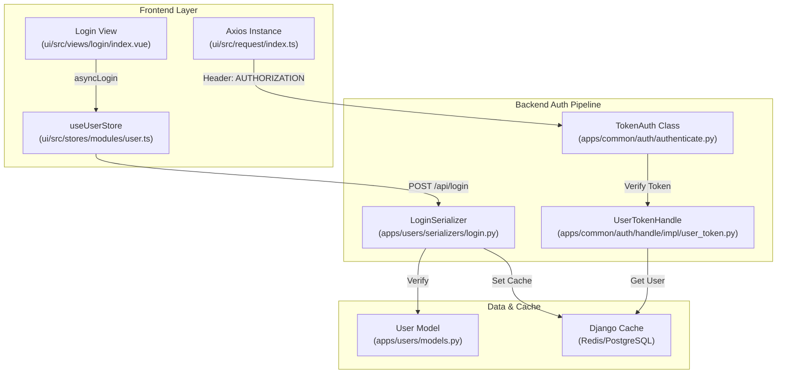
Sources: [ui/src/views/login/index.vue:128-213](), [ui/src/stores/modules/user.ts:23-176](), [apps/common/auth/authenticate.py:18-89](), [apps/common/auth/handle/impl/user_token.py:1-84]()

## Authentication Methods

MaxKB supports a wide array of authentication methods, primarily configured via `SystemSetting` and handled in the login views.

| Method | Implementation Detail | Source |
| :--- | :--- | :--- |
| **Local** | Username/Password with RSA encryption and Captcha validation. | [ui/src/views/login/index.vue:203-211]() |
| **LDAP** | Direct authentication against an LDAP server. | [ui/src/views/login/index.vue:192-198]() |
| **OAuth2 / OIDC** | Redirect-based flow to external providers. | [ui/src/views/login/index.vue:89-104]() |
| **CAS / SAML2** | Enterprise SSO protocols (handled via dedicated components). | [ui/src/views/system-setting/authentication/index.vue:1-100]() |
| **QR Code** | Scanning via DingTalk, WeCom, or Lark. | [ui/src/views/login/index.vue:82-84]() |

### Local Login Security
For local authentication, the system employs RSA encryption for credentials sent over the wire. The frontend uses `JSEncrypt` to encrypt the login form data with a public key fetched from the backend [ui/src/views/login/index.vue:204-208]().

## Token Management and Validation

MaxKB uses Django's `signing` module to create stateless but verifiable tokens. These tokens are stored in the server-side cache for session management.

### Token Generation Flow
When a user successfully authenticates, the `LoginSerializer` (in `apps/users/serializers/login.py`) generates a token containing the user's ID, username, and authentication type.

```python
# Conceptual implementation in LoginSerializer
token = signing.dumps({
    'id': str(user.id),
    'username': user.username,
    'type': AuthenticationType.SYSTEM_USER.value
})
```
Sources: [apps/users/serializers/login.py:55-64](), [apps/common/auth/handle/impl/user_token.py:17-28]()

### Server-Side Validation Pipeline
Every request requiring authentication is processed by the `TokenAuth` class.

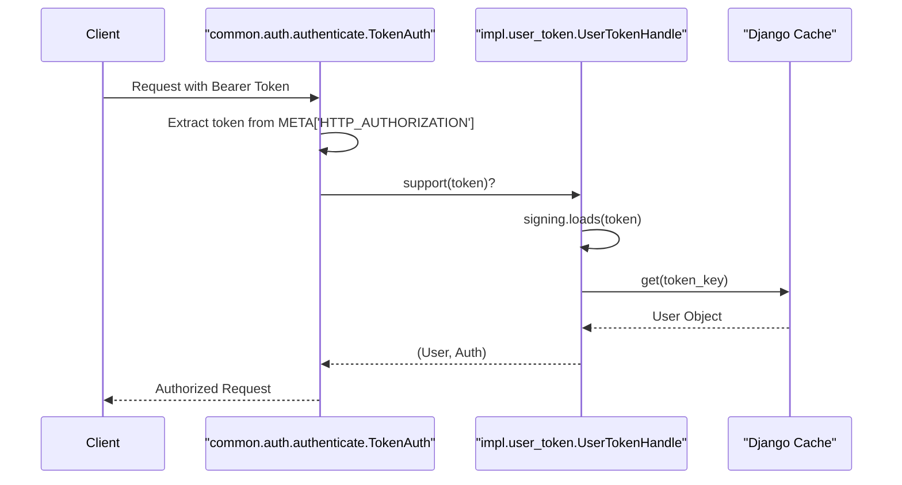
Sources: [apps/common/auth/authenticate.py:76-89](), [apps/common/auth/handle/impl/user_token.py:71-84]()

## Frontend State Management (`useUserStore`)

The `useUserStore` in Pinia acts as the central hub for authentication state on the client side.

### Key State Properties
- `userInfo`: Stores basic user profile, including `permissions` and `role` [ui/src/stores/modules/user.ts:14-25]().
- `workspace_id`: Tracks the current active workspace, persisting to `localStorage` [ui/src/stores/modules/user.ts:37-44]().
- `rsaKey`: The public key used for encrypting passwords during login [ui/src/stores/modules/user.ts:31-145]().

### Profile Synchronization
The `profile()` action fetches the current user's details and synchronizes the local environment (language, theme, workspace list) [ui/src/stores/modules/user.ts:117-135]().

```typescript
async profile(loading?: Ref<boolean>) {
  return UserApi.getUserProfile(loading).then((ok) => {
    this.userInfo = ok.data
    // Handle workspace and language defaults
    this.workspace_list = ok.data.workspace_list
    // ... theme and locale setup
    return this.asyncGetProfile()
  })
}
```
Sources: [ui/src/stores/modules/user.ts:117-135](), [apps/users/views/user.py:64-75]()

## Request and Response Interceptors

The system ensures all outgoing requests are authenticated and all incoming responses are checked for session validity.

### Request Interceptor
Located in `ui/src/request/index.ts`, this interceptor injects the `AUTHORIZATION` header and the `Accept-Language` header for internationalization.

```typescript
instance.interceptors.request.use(
  (config: InternalAxiosRequestConfig) => {
    const { user, login } = useStore()
    const token = login.getToken()
    const language = user.getLanguage()
    config.headers['Accept-Language'] = `${language}`
    if (token) {
      config.headers['AUTHORIZATION'] = `Bearer ${token}`
    }
    return config
  }
)
```
Sources: [ui/src/request/index.ts:21-37]()

### Response Interceptor (401 Handling)
If a response returns a `401 Unauthorized` status, the interceptor redirects the user to the login page, unless the request was for a public chat view.

```typescript
instance.interceptors.response.use(
  (response: any) => response,
  (err: any) => {
    if (err.response?.status === 401) {
      if (!err.response.config.url.includes('chat/open')) {
        router.push({ name: 'login' })
      }
    }
    return Promise.reject(err)
  }
)
```
Sources: [ui/src/request/index.ts:72-79]()

## Multi-Platform Authentication Support

MaxKB provides specialized authentication flows for different contexts:
1.  **System Login**: The primary login for administrators and workspace members [ui/src/views/login/index.vue:1-127]().
2.  **Chat User Login**: A simplified login interface for end-users accessing specific AI applications, supporting password-based application limits [ui/src/views/chat/user-login/index.vue:44-49]().

Sources: [ui/src/views/chat/user-login/index.vue:1-167](), [apps/users/views/user.py:142-155]()

---

# Page: Multi-Tenant Workspace System

# Multi-Tenant Workspace System

<details>
<summary>Relevant source files</summary>

The following files were used as context for generating this wiki page:

- [ui/src/api/system/resource-authorization.ts](ui/src/api/system/resource-authorization.ts)
- [ui/src/components/resource-authorization-drawer/index.vue](ui/src/components/resource-authorization-drawer/index.vue)
- [ui/src/components/resource_mapping/index.vue](ui/src/components/resource_mapping/index.vue)
- [ui/src/components/workspace-dropdown/index.vue](ui/src/components/workspace-dropdown/index.vue)
- [ui/src/enums/system.ts](ui/src/enums/system.ts)
- [ui/src/locales/lang/en-US/views/system.ts](ui/src/locales/lang/en-US/views/system.ts)
- [ui/src/locales/lang/zh-CN/views/system.ts](ui/src/locales/lang/zh-CN/views/system.ts)
- [ui/src/locales/lang/zh-Hant/views/system.ts](ui/src/locales/lang/zh-Hant/views/system.ts)
- [ui/src/utils/dynamics-api/permission-api.ts](ui/src/utils/dynamics-api/permission-api.ts)
- [ui/src/views/system-chat-user/group/index.vue](ui/src/views/system-chat-user/group/index.vue)
- [ui/src/views/system-resource-management/ApplicationResourceIndex.vue](ui/src/views/system-resource-management/ApplicationResourceIndex.vue)
- [ui/src/views/system-resource-management/KnowledgeResourceIndex.vue](ui/src/views/system-resource-management/KnowledgeResourceIndex.vue)
- [ui/src/views/system-resource-management/ModelResourceIndex.vue](ui/src/views/system-resource-management/ModelResourceIndex.vue)
- [ui/src/views/system-resource-management/ToolResourceIndex.vue](ui/src/views/system-resource-management/ToolResourceIndex.vue)
- [ui/src/views/system-setting/authentication/component/Setting.vue](ui/src/views/system-setting/authentication/component/Setting.vue)
- [ui/src/views/system/resource-authorization/component/PermissionTable.vue](ui/src/views/system/resource-authorization/component/PermissionTable.vue)
- [ui/src/views/system/resource-authorization/constant.ts](ui/src/views/system/resource-authorization/constant.ts)
- [ui/src/views/system/resource-authorization/index.vue](ui/src/views/system/resource-authorization/index.vue)
- [ui/src/views/system/role/component/Member.vue](ui/src/views/system/role/component/Member.vue)
- [ui/src/views/system/role/component/PermissionConfiguration.vue](ui/src/views/system/role/component/PermissionConfiguration.vue)
- [ui/src/views/system/role/index.vue](ui/src/views/system/role/index.vue)
- [ui/src/views/system/workspace/component/Member.vue](ui/src/views/system/workspace/component/Member.vue)
- [ui/src/views/system/workspace/index.vue](ui/src/views/system/workspace/index.vue)

</details>


## Purpose and Scope

This document describes MaxKB's multi-tenant workspace system, which provides organizational isolation for resources and users. Each workspace functions as a separate tenant with its own set of applications, knowledge bases, models, tools, and users. The system enables enterprise deployments where multiple teams or organizations can operate independently within the same MaxKB instance.

For information about user authentication and login mechanisms, see [User Authentication Flow](#2.2). For permission enforcement details, see [Permission Constants and Role Management](#2.1).

## Workspace Architecture Overview

The workspace system implements a hierarchical multi-tenancy model where:
- **System Level**: Global administrators and system settings.
- **Workspace Level**: Isolated environments with workspace administrators and members.
- **Resource Level**: Applications, knowledge bases, models, and tools owned by specific workspaces.

**Workspace Multi-Tenancy Architecture**
```mermaid
graph TB
    SystemAdmin["System Administrator<br/>(ADMIN role)"]
    
    subgraph SystemLevel["System Level"]
        SystemSettings["System Settings"]
        SystemResources["Shared Resources"]
        UserManagement["User Management"]
    end
    
    subgraph Workspace1["Workspace: workspace_id_1"]
        WS1Admin["Workspace Manager<br/>(WORKSPACE_MANAGE)"]
        WS1Members["Workspace Members<br/>(USER role)"]
        
        subgraph WS1Resources["Isolated Resources"]
            WS1Apps["Applications"]
            WS1KB["Knowledge Bases"]
            WS1Models["Models"]
            WS1Tools["Tools"]
        end
    end
    
    subgraph Workspace2["Workspace: workspace_id_2"]
        WS2Admin["Workspace Manager"]
        WS2Members["Workspace Members"]
        
        subgraph WS2Resources["Isolated Resources"]
            WS2Apps["Applications"]
            WS2KB["Knowledge Bases"]
            WS2Models["Models"]
            WS2Tools["Tools"]
        end
    end
    
    subgraph WorkspaceDefault["Workspace: default"]
        WSDefAdmin["Workspace Manager"]
        WSDefMembers["Workspace Members"]
        
        subgraph WSDefResources["Isolated Resources"]
            WSDefApps["Applications"]
            WSDefKB["Knowledge Bases"]
            WSDefModels["Models"]
            WSDefTools["Tools"]
        end
    end
    
    SystemAdmin --> SystemSettings
    SystemAdmin --> SystemResources
    SystemAdmin --> UserManagement
    
    SystemAdmin -.->|"can manage all workspaces"| Workspace1
    SystemAdmin -.->|"can manage all workspaces"| Workspace2
    SystemAdmin -.->|"can manage all workspaces"| WorkspaceDefault
    
    WS1Admin --> WS1Resources
    WS1Members --> WS1Resources
    
    WS2Admin --> WS2Resources
    WS2Members --> WS2Resources
    
    WSDefAdmin --> WSDefResources
    WSDefMembers --> WSDefResources
```

Sources: [ui/src/views/system-resource-management/ApplicationResourceIndex.vue:155-160](), [ui/src/views/system-resource-management/KnowledgeResourceIndex.vue:89-94]()

## Workspace Data Model

The multi-tenancy system relies on `workspace_id` scoping across all primary resource tables.

**Workspace Entity Relationships**
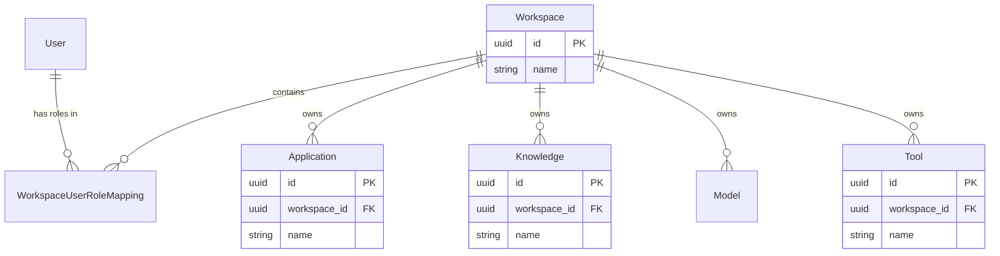

**Key Resource Tables and Scoping:**

| Resource Type | Backend Model Reference | UI Management Component |
| :--- | :--- | :--- |
| Application | `Application` | [ui/src/views/system-resource-management/ApplicationResourceIndex.vue:1-10]() |
| Knowledge Base | `DataSet` | [ui/src/views/system-resource-management/KnowledgeResourceIndex.vue:1-10]() |
| AI Model | `Model` | [ui/src/views/system-resource-management/ModelResourceIndex.vue:1-10]() |
| Custom Tool | `Tool` | [ui/src/views/system-resource-management/ToolResourceIndex.vue:1-10]() |

Sources: [ui/src/views/system-resource-management/ApplicationResourceIndex.vue:155-160](), [ui/src/views/system-resource-management/KnowledgeResourceIndex.vue:89-94](), [ui/src/views/system-resource-management/ModelResourceIndex.vue:109-114](), [ui/src/views/system-resource-management/ToolResourceIndex.vue:128-133]()

## Workspace Role and Permission System

### Resource Authorization

MaxKB provides a granular resource authorization system that allows workspace administrators to delegate specific permissions (View/Manage) for individual resources to specific members.

**Resource Authorization Flow**
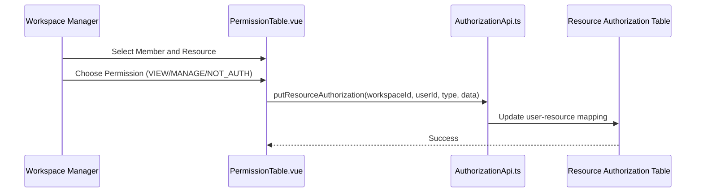

The authorization logic differentiates between resource types:
- **Applications, Knowledge Bases, Tools**: Use folder-based or direct resource authorization [ui/src/views/system/resource-authorization/index.vue:169-181]().
- **Models**: Authorized directly at the model provider/instance level [ui/src/views/system/resource-authorization/index.vue:171-172]().

Sources: [ui/src/views/system/resource-authorization/index.vue:143-155](), [ui/src/views/system/resource-authorization/component/PermissionTable.vue:112-123](), [ui/src/components/resource-authorization-drawer/index.vue:112-121]()

### Permission Options

| Level | Label | Description |
| :--- | :--- | :--- |
| **Manage** | `views.system.resourceAuthorization.setting.management` | Can delete or modify the resource [ui/src/locales/lang/en-US/views/system.ts:137-138](). |
| **View** | `views.system.resourceAuthorization.setting.check` | Can only view and use the resource [ui/src/locales/lang/en-US/views/system.ts:139-140](). |
| **No Auth** | `views.system.resourceAuthorization.setting.notAuthorized` | No access to the resource [ui/src/locales/lang/en-US/views/system.ts:143](). |

Sources: [ui/src/locales/lang/en-US/views/system.ts:136-144](), [ui/src/views/system/resource-authorization/constant.ts:1-20]()

## Workspace Context and Switching

### Frontend Workspace State

The current workspace context is maintained in the `user` store. This state determines which resources are fetched and displayed in the UI.

**Workspace Context Switching**
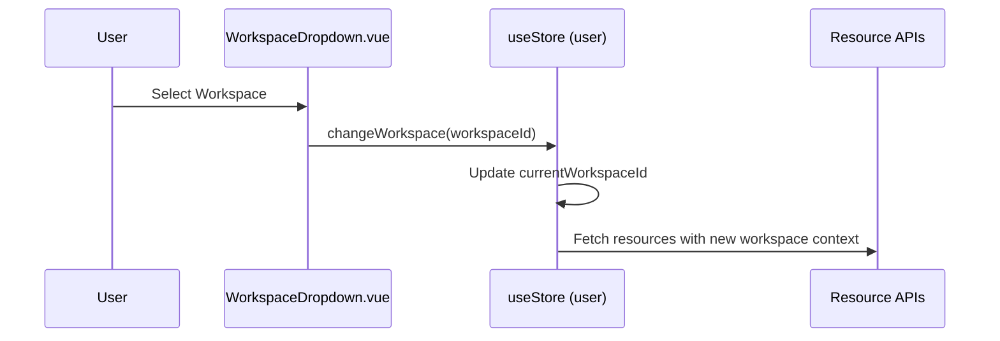

Sources: [ui/src/views/system/resource-authorization/index.vue:16-21](), [ui/src/views/system/resource-authorization/index.vue:96-101]()

### Enterprise Edition (EE) Enhancements

In the Enterprise Edition, administrators can manage resources across all workspaces through a centralized "Resource Management" interface. This interface allows filtering resources by workspace and managing their status globally.

**Global Resource Management**
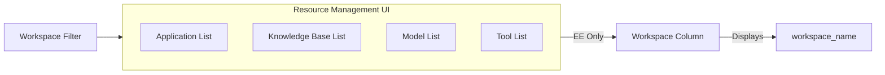

Sources: [ui/src/views/system-resource-management/ApplicationResourceIndex.vue:155-160](), [ui/src/views/system-resource-management/ToolResourceIndex.vue:128-133](), [ui/src/views/system-resource-management/KnowledgeResourceIndex.vue:89-94]()

## Resource Mapping and Dependencies

The system tracks dependencies between resources (e.g., an Application depending on a Knowledge Base). This mapping is workspace-aware and helps prevent accidental deletion of dependent resources.

**Dependency Tracking UI**
- **Dependency**: Resources that the current resource depends on [ui/src/components/resource_mapping/index.vue:107-108]().
- **Dependent**: Resources that depend on the current resource [ui/src/components/resource_mapping/index.vue:247-248]().

Sources: [ui/src/components/resource_mapping/index.vue:1-50](), [ui/src/locales/lang/en-US/views/system.ts:167-172]()

## User and Group Isolation

Users can be organized into groups within a workspace. Permissions can then be applied to these groups rather than individual users, simplifying large-scale multi-tenant management.

**Group Management Hierarchy**
```mermaid
graph TD
    WS["Workspace"] --> Group["User Group"]
    Group --> Member1["Member A"]
    Group --> Member2["Member B"]
    
    WS -.->|"has"| Role["Workspace Role"]
    Role -.->|"assigned to"| Group
```

Sources: [ui/src/views/system-chat-user/group/index.vue:1-14](), [ui/src/views/system-chat-user/group/index.vue:120-138]()

---

# Page: AI Chat System

# AI Chat System

<details>
<summary>Relevant source files</summary>

The following files were used as context for generating this wiki page:

- [ui/src/components/ai-chat/component/answer-content/index.vue](ui/src/components/ai-chat/component/answer-content/index.vue)
- [ui/src/components/ai-chat/component/chat-input-operate/TouchChat.vue](ui/src/components/ai-chat/component/chat-input-operate/TouchChat.vue)
- [ui/src/components/ai-chat/component/chat-input-operate/index.vue](ui/src/components/ai-chat/component/chat-input-operate/index.vue)
- [ui/src/components/ai-chat/component/operation-button/ChatOperationButton.vue](ui/src/components/ai-chat/component/operation-button/ChatOperationButton.vue)
- [ui/src/components/ai-chat/component/operation-button/LogOperationButton.vue](ui/src/components/ai-chat/component/operation-button/LogOperationButton.vue)
- [ui/src/components/ai-chat/component/operation-button/MobileVoteReasonDrawer.vue](ui/src/components/ai-chat/component/operation-button/MobileVoteReasonDrawer.vue)
- [ui/src/components/ai-chat/component/operation-button/VoteReasonContent.vue](ui/src/components/ai-chat/component/operation-button/VoteReasonContent.vue)
- [ui/src/components/ai-chat/component/operation-button/index.vue](ui/src/components/ai-chat/component/operation-button/index.vue)
- [ui/src/components/ai-chat/component/prologue-content/index.vue](ui/src/components/ai-chat/component/prologue-content/index.vue)
- [ui/src/components/ai-chat/component/question-content/index.vue](ui/src/components/ai-chat/component/question-content/index.vue)
- [ui/src/components/ai-chat/component/user-form/index.vue](ui/src/components/ai-chat/component/user-form/index.vue)
- [ui/src/components/ai-chat/index.scss](ui/src/components/ai-chat/index.scss)
- [ui/src/components/ai-chat/index.vue](ui/src/components/ai-chat/index.vue)
- [ui/src/components/app-icon/icons/application.ts](ui/src/components/app-icon/icons/application.ts)
- [ui/src/views/application-workflow/component/PublishHistory.vue](ui/src/views/application-workflow/component/PublishHistory.vue)
- [ui/src/views/application-workflow/index.vue](ui/src/views/application-workflow/index.vue)
- [ui/src/views/application/component/CopyApplicationDialog.vue](ui/src/views/application/component/CopyApplicationDialog.vue)
- [ui/src/views/application/component/CreateApplicationDialog.vue](ui/src/views/application/component/CreateApplicationDialog.vue)
- [ui/src/views/chat/component/EditTitleDialog.vue](ui/src/views/chat/component/EditTitleDialog.vue)
- [ui/src/views/chat/component/HistoryPanel.vue](ui/src/views/chat/component/HistoryPanel.vue)
- [ui/src/views/chat/embed/component/ChatHistoryDrawer.vue](ui/src/views/chat/embed/component/ChatHistoryDrawer.vue)
- [ui/src/views/chat/embed/index.vue](ui/src/views/chat/embed/index.vue)
- [ui/src/views/chat/mobile/component/ChatHistoryDrawer.vue](ui/src/views/chat/mobile/component/ChatHistoryDrawer.vue)
- [ui/src/views/chat/mobile/component/ResetPasswordDrawer.vue](ui/src/views/chat/mobile/component/ResetPasswordDrawer.vue)
- [ui/src/views/chat/mobile/component/UserCenterDrawer.vue](ui/src/views/chat/mobile/component/UserCenterDrawer.vue)
- [ui/src/views/chat/mobile/index.vue](ui/src/views/chat/mobile/index.vue)
- [ui/src/views/chat/pc/index.vue](ui/src/views/chat/pc/index.vue)
- [ui/src/workflow/nodes/base-node/component/FileUploadSettingDialog.vue](ui/src/workflow/nodes/base-node/component/FileUploadSettingDialog.vue)

</details>


The AI Chat System is the core interaction layer of MaxKB, providing a comprehensive interface for users to communicate with AI agents. It manages the entire conversational lifecycle, from capturing multi-modal user input to rendering real-time streaming responses from various Large Language Models (LLMs).

## System Overview

The system is architected to handle both simple RAG (Retrieval-Augmented Generation) flows and complex, multi-step workflows. It supports a variety of interaction modes, including standard PC web views, mobile-responsive interfaces, and embedded chat widgets for third-party websites.

### Core Interaction Flow

```mermaid
graph TD
    subgraph Frontend["Frontend (Vue.js)"]
        AiChat["AiChat Component [index.vue]"]
        ChatInput["ChatInputOperate"]
        UserForm["UserForm (Dynamic Fields)"]
    end

    subgraph Backend["Backend (Django)"]
        ChatAPI["Chat API View"]
        ChatSerializers["ChatSerializers"]
        WorkflowManage["WorkflowManage"]
        PipelineManage["PipelineManage"]
    end

    subgraph DataLayer["Persistence"]
        ChatModel["Chat (Session)"]
        RecordModel["ChatRecord (Messages)"]
    end

    AiChat -->|"sendMessage()"| ChatAPI
    ChatAPI --> ChatSerializers
    ChatSerializers -->|"If Workflow"| WorkflowManage
    ChatSerializers -->|"If Simple"| PipelineManage
    WorkflowManage --> RecordModel
    PipelineManage --> RecordModel
    RecordModel -->|"Stream Chunks"| AiChat
```

Sources:
- [ui/src/components/ai-chat/index.vue:1-91]()
- [ui/src/components/ai-chat/index.vue:423-525]()
- [ui/src/views/chat/pc/index.vue:165-181]()

## Key Capabilities

### 1. Chat Interface Components
The system utilizes a modular component architecture. The primary container is the `AiChat` component, which orchestrates sub-components like `QuestionContent` for user messages and `AnswerContent` for AI responses. It also manages the `UserForm` for capturing structured data required by specific application workflows.

For details, see [Chat Interface Components](#3.1).

### 2. Message Processing and Streaming
MaxKB implements a robust streaming architecture. The frontend uses a `getWrite` function to process `ReadableStream` data from the backend. Chunks are buffered and parsed (typically as JSON objects prefixed with `data:`) to provide real-time feedback, including reasoning steps and final answers.

For details, see [Chat Message Processing and Streaming](#3.2).

### 3. Multi-Platform Support
The chat system is designed for "write once, run anywhere" capability. It provides dedicated views for different environments:
- **PC View**: A full-featured desktop interface with history panels and detailed execution logs.
- **Mobile View**: A touch-optimized interface with drawer-based history.
- **Embedded View**: A lightweight version designed to be integrated into external sites via iframes or scripts.

For details, see [Chat Views and Multi-Platform Support](#3.3).

### 4. History and Session Management
Conversations are organized into sessions (`Chat`). Each session contains multiple `ChatRecord` entries. The system supports paginated history retrieval, session clearing, and the ability to rename or delete specific conversations.

For details, see [Chat History and Session Management](#3.4).

### 5. Multi-Modal Input & STT
Beyond text, the system supports:
- **File Uploads**: Images, documents (PDF, DOCX), and audio/video files can be attached to messages.
- **Speech-to-Text (STT)**: Users can record voice messages which are transcribed in real-time using the `RecorderManage` class and sent as text queries.

For details, see [File Upload and Speech-to-Text](#3.5).

## Component Hierarchy and Data Flow

The following diagram illustrates how system components map to specific code entities and how data flows between them during a typical chat interaction.

```mermaid
graph LR
    subgraph UI_Space["UI Space"]
        Input["ChatInputOperate.vue"]
        Form["UserForm.vue"]
        List["AiChat.vue (Scrollbar)"]
    end

    subgraph Logic_Space["Code Logic Space"]
        SendFn["sendMessage()"]
        StreamFn["getWrite()"]
        RecordMgr["ChatManagement"]
    end

    subgraph Model_Space["Data Space"]
        App["Application Model"]
        Chat["Chat Model"]
        Rec["ChatRecord Model"]
    end

    Input -->|"v-model:inputValue"| SendFn
    Form -->|"api_form_data"| SendFn
    SendFn -->|"POST /api/chat"| Chat
    Chat -->|"Stream Response"| StreamFn
    StreamFn -->|"appendChunk()"| RecordMgr
    RecordMgr -->|"update chatList"| List
    List --> Rec
```

Sources:
- [ui/src/components/ai-chat/index.vue:343-413]()
- [ui/src/components/ai-chat/component/chat-input-operate/index.vue:10-135]()
- [ui/src/components/ai-chat/component/user-form/index.vue:18-36]()

## Detailed Sub-Pages

| Section | Topic | Description |
|:---|:---|:---|
| [Chat Interface Components](#3.1) | **Chat Components** | Details on `AiChat`, `QuestionContent`, `AnswerContent`, and `UserForm`. |
| [Chat Message Processing and Streaming](#3.2) | **Streaming Logic** | Deep dive into `getWrite`, chunk parsing, and reasoning content rendering. |
| [Chat Views and Multi-Platform Support](#3.3) | **Views & Platforms** | Implementation of PC, Mobile, and Embed views. |
| [Chat History and Session Management](#3.4) | **History & Sessions** | Backend session management and frontend history panels. |
| [File Upload and Speech-to-Text](#3.5) | **Files & Voice** | File upload logic and `RecorderManage` for voice input. |

Sources:
- [ui/src/views/chat/pc/index.vue:1-22]()
- [ui/src/views/chat/mobile/index.vue:1-20]()
- [ui/src/views/chat/embed/index.vue:1-21]()

---

# Page: Chat Interface Components

# Chat Interface Components

<details>
<summary>Relevant source files</summary>

The following files were used as context for generating this wiki page:

- [apps/application/flow/step_node/form_node/i_form_node.py](apps/application/flow/step_node/form_node/i_form_node.py)
- [ui/src/components/ai-chat/component/answer-content/index.vue](ui/src/components/ai-chat/component/answer-content/index.vue)
- [ui/src/components/ai-chat/component/chat-input-operate/TouchChat.vue](ui/src/components/ai-chat/component/chat-input-operate/TouchChat.vue)
- [ui/src/components/ai-chat/component/chat-input-operate/index.vue](ui/src/components/ai-chat/component/chat-input-operate/index.vue)
- [ui/src/components/ai-chat/component/operation-button/ChatOperationButton.vue](ui/src/components/ai-chat/component/operation-button/ChatOperationButton.vue)
- [ui/src/components/ai-chat/component/operation-button/LogOperationButton.vue](ui/src/components/ai-chat/component/operation-button/LogOperationButton.vue)
- [ui/src/components/ai-chat/component/operation-button/MobileVoteReasonDrawer.vue](ui/src/components/ai-chat/component/operation-button/MobileVoteReasonDrawer.vue)
- [ui/src/components/ai-chat/component/operation-button/VoteReasonContent.vue](ui/src/components/ai-chat/component/operation-button/VoteReasonContent.vue)
- [ui/src/components/ai-chat/component/operation-button/index.vue](ui/src/components/ai-chat/component/operation-button/index.vue)
- [ui/src/components/ai-chat/component/prologue-content/index.vue](ui/src/components/ai-chat/component/prologue-content/index.vue)
- [ui/src/components/ai-chat/component/question-content/index.vue](ui/src/components/ai-chat/component/question-content/index.vue)
- [ui/src/components/ai-chat/component/user-form/index.vue](ui/src/components/ai-chat/component/user-form/index.vue)
- [ui/src/components/ai-chat/index.scss](ui/src/components/ai-chat/index.scss)
- [ui/src/components/ai-chat/index.vue](ui/src/components/ai-chat/index.vue)
- [ui/src/components/app-icon/icons/application.ts](ui/src/components/app-icon/icons/application.ts)
- [ui/src/components/markdown/EchartsRander.vue](ui/src/components/markdown/EchartsRander.vue)
- [ui/src/components/markdown/FormRander.vue](ui/src/components/markdown/FormRander.vue)
- [ui/src/components/markdown/HtmlRander.vue](ui/src/components/markdown/HtmlRander.vue)
- [ui/src/components/markdown/IframeRender.vue](ui/src/components/markdown/IframeRender.vue)
- [ui/src/components/markdown/MdRenderer.vue](ui/src/components/markdown/MdRenderer.vue)
- [ui/src/components/markdown/tool-calls-render/content/index.vue](ui/src/components/markdown/tool-calls-render/content/index.vue)
- [ui/src/components/markdown/tool-calls-render/content/simple-tool-calls/index.vue](ui/src/components/markdown/tool-calls-render/content/simple-tool-calls/index.vue)
- [ui/src/components/markdown/tool-calls-render/index.ts](ui/src/components/markdown/tool-calls-render/index.ts)
- [ui/src/components/markdown/tool-calls-render/index.vue](ui/src/components/markdown/tool-calls-render/index.vue)
- [ui/src/locales/lang/en-US/ai-chat.ts](ui/src/locales/lang/en-US/ai-chat.ts)
- [ui/src/locales/lang/en-US/common.ts](ui/src/locales/lang/en-US/common.ts)
- [ui/src/locales/lang/zh-CN/ai-chat.ts](ui/src/locales/lang/zh-CN/ai-chat.ts)
- [ui/src/locales/lang/zh-CN/common.ts](ui/src/locales/lang/zh-CN/common.ts)
- [ui/src/locales/lang/zh-Hant/ai-chat.ts](ui/src/locales/lang/zh-Hant/ai-chat.ts)
- [ui/src/locales/lang/zh-Hant/common.ts](ui/src/locales/lang/zh-Hant/common.ts)
- [ui/src/views/knowledge-workflow/component/action/KnowledgeBase.vue](ui/src/views/knowledge-workflow/component/action/KnowledgeBase.vue)
- [ui/src/workflow/nodes/base-node/component/FileUploadSettingDialog.vue](ui/src/workflow/nodes/base-node/component/FileUploadSettingDialog.vue)
- [ui/src/workflow/nodes/base-node/component/UserInputFieldTable.vue](ui/src/workflow/nodes/base-node/component/UserInputFieldTable.vue)
- [ui/src/workflow/nodes/base-node/component/UserInputTitleDialog.vue](ui/src/workflow/nodes/base-node/component/UserInputTitleDialog.vue)
- [ui/src/workflow/nodes/knowledge-base-node/component/UserInputFieldTable.vue](ui/src/workflow/nodes/knowledge-base-node/component/UserInputFieldTable.vue)

</details>


## Purpose and Scope

This document details the Vue.js components that comprise the chat interface in MaxKB. The chat interface is the primary interaction point where users communicate with AI applications. This page covers the component architecture, sub-components, props/events, and integration patterns across PC, mobile, and embedded views.

---

## Component Architecture Overview

The chat interface is built around a central `AiChat` component that orchestrates multiple sub-components to provide a complete chat experience. The component supports three distinct modes: standard chat (`ai-chat`), debug mode (`debug-ai-chat`), and read-only log mode (`log`).

### Component Hierarchy

```mermaid
graph TD
    AiChat["AiChat Component<br/>(index.vue)"]
    
    UserForm["UserForm<br/>(user-form/index.vue)"]
    PrologueContent["PrologueContent<br/>(prologue-content/index.vue)"]
    QuestionContent["QuestionContent<br/>(question-content/index.vue)"]
    AnswerContent["AnswerContent<br/>(answer-content/index.vue)"]
    TransitionContent["TransitionContent<br/>(transition-content/index.vue)"]
    ChatInputOperate["ChatInputOperate<br/>(chat-input-operate/index.vue)"]
    Control["Control<br/>(control/index.vue)"]
    
    DynamicsForm["DynamicsForm<br/>(dynamics-form/index.vue)"]
    TouchChat["TouchChat<br/>(TouchChat.vue)"]
    
    AiChat --> UserForm
    AiChat --> PrologueContent
    AiChat --> QuestionContent
    AiChat --> AnswerContent
    AiChat --> TransitionContent
    AiChat --> ChatInputOperate
    AiChat --> Control
    
    UserForm --> DynamicsForm
    ChatInputOperate --> TouchChat
    
    style AiChat fill:#e1f5ff
    style ChatInputOperate fill:#fff4e1
    style UserForm fill:#ffe1e1
```

**Sources:** [ui/src/components/ai-chat/index.vue:1-160](), [ui/src/components/ai-chat/component/chat-input-operate/index.vue:1-210](), [ui/src/components/ai-chat/component/answer-content/index.vue:1-117]()

---

## AiChat Component

The `AiChat` component is the root component that manages the entire chat interface lifecycle, including message rendering, user input handling, and API communication.

### Component Types and Modes

The component supports operational modes controlled by the `type` prop:

| Type | Purpose | Read-Only | Shows Input |
|------|---------|-----------|-------------|
| `ai-chat` | Standard user chat | No | Yes |
| `debug-ai-chat` | Workflow debugging | No | Yes |
| `log` | View historical logs | Yes | No |
| `share` | Shared chat record | Yes | No |

**Sources:** [ui/src/components/ai-chat/index.vue:156-167]()

### Key Props and Configuration

```mermaid
graph LR
    Props["AiChat Props"]
    
    ApplicationDetails["applicationDetails<br/>Application config & settings"]
    Type["type<br/>ai-chat | debug-ai-chat | log | share"]
    AppId["appId<br/>Application identifier"]
    Record["record<br/>Chat history array"]
    Available["available<br/>Application availability"]
    ChatId["chatId<br/>Current chat session ID"]
    ExecutionPanel["executionIsRightPanel<br/>Right panel flag"]
    
    Props --> ApplicationDetails
    Props --> Type
    Props --> AppId
    Props --> Record
    Props --> Available
    Props --> ChatId
    Props --> ExecutionPanel
```

**Sources:** [ui/src/components/ai-chat/index.vue:153-168]()

### User Input Field Handling

The component handles external parameters defined in the application's workflow (usually in the `base-node`). These are rendered using the `UserForm` component.

```mermaid
graph TD
    InputCheck["Check Input Fields"]
    
    IsUserInput["isUserInput<br/>user_input_field_list.length > 0"]
    IsAPIInput["isAPIInput<br/>api_input_field_list.length > 0<br/>AND type === 'debug-ai-chat'"]
    
    ShowUserInput["showUserInputContent<br/>Display UserForm component"]
    FirstDisplay["firsUserInput = true<br/>Full-screen form"]
    PopperDisplay["showUserInput = true<br/>Popper overlay form"]
    
    InputCheck --> IsUserInput
    InputCheck --> IsAPIInput
    
    IsUserInput -->|Yes| ShowUserInput
    IsAPIInput -->|Yes| ShowUserInput
    
    ShowUserInput --> FirstDisplay
    ShowUserInput --> PopperDisplay
```

**Sources:** [ui/src/components/ai-chat/index.vue:10-83](), [ui/src/workflow/nodes/base-node/component/UserInputFieldTable.vue:107-128]()

---

## Sub-Components

### QuestionContent

Renders user questions and uploaded media. It supports inline editing for the last message in a conversation.

- **Media Support:** Displays `document_list`, `image_list`, `audio_list`, `video_list`, and `other_list`.
- **Interaction:** Provides a download interface for files [ui/src/components/ai-chat/component/question-content/index.vue:10-23]().
- **Editing:** Allows re-editing and re-sending the question via an `el-input` textarea [ui/src/components/ai-chat/component/question-content/index.vue:100-110]().

**Sources:** [ui/src/components/ai-chat/component/question-content/index.vue:1-166]()

### AnswerContent

Displays AI responses with support for streaming, Markdown rendering, and knowledge attribution.

- **Streaming Progress:** Displays the currently executing node type and name while the answer is being generated [ui/src/components/ai-chat/component/answer-content/index.vue:129-137]().
- **Markdown Rendering:** Uses `MdRenderer` to display content, including reasoning content for specific models [ui/src/components/ai-chat/component/answer-content/index.vue:44-54]().
- **Knowledge Attribution:** Integrates `KnowledgeSourceComponent` to show which segments were cited [ui/src/components/ai-chat/component/answer-content/index.vue:63-73]().
- **Operations:** Includes `OperationButton` for feedback and text-to-speech [ui/src/components/ai-chat/component/answer-content/index.vue:86-95]().

**Sources:** [ui/src/components/ai-chat/component/answer-content/index.vue:1-117]()

### ChatInputOperate

The primary input interface for the user, handling text, files, and voice.

- **File Management:** Manages lists for documents, images, audio, and video before sending [ui/src/components/ai-chat/component/chat-input-operate/index.vue:12-22]().
- **Stop Response:** Provides a button to stop the current AI generation [ui/src/components/ai-chat/component/chat-input-operate/index.vue:3-8]().
- **Voice Interaction:** Integrates `TouchChat` for mobile voice recording [ui/src/components/ai-chat/component/chat-input-operate/TouchChat.vue]().

**Sources:** [ui/src/components/ai-chat/component/chat-input-operate/index.vue:1-210]()

### ChatOperationButton

Located within the `AnswerContent`, this component provides per-message actions.

- **TTS Control:** Play/Pause audio playback of the response [ui/src/components/ai-chat/component/operation-button/ChatOperationButton.vue:9-38]().
- **Feedback:** Thumbs up (like) and Thumbs down (oppose) buttons with reason collection via `VoteReasonContent` [ui/src/components/ai-chat/component/operation-button/ChatOperationButton.vue:63-138]().
- **Utilities:** Copy to clipboard and regenerate response [ui/src/components/ai-chat/component/operation-button/ChatOperationButton.vue:41-54]().

**Sources:** [ui/src/components/ai-chat/component/operation-button/ChatOperationButton.vue:1-156]()

---

## Data Flow and Integration

### User Input Configuration

The `base-node` in the workflow defines what external parameters are exposed to the chat interface. These are managed in the `UserInputFieldTable`.

| Entity | Code Reference | Description |
|--------|----------------|-------------|
| **Field List** | `nodeModel.properties.user_input_field_list` | The array of defined input fields. |
| **Field Config** | `inputFieldConfig` | UI metadata like titles and menu labels. |
| **Exposed Fields** | `user_input_field_list_setting.exposed_fields` | Fields currently visible in the chat UI. |

**Sources:** [ui/src/workflow/nodes/base-node/component/UserInputFieldTable.vue:18-51](), [ui/src/workflow/nodes/base-node/component/UserInputFieldTable.vue:107-128]()

### Internationalization (i18n)

The chat interface relies on localized strings for placeholders, tips, and operation labels.

- **Placeholders:** `aiChat.inputPlaceholder.default` ("Type your question") [ui/src/locales/lang/en-US/ai-chat.ts:74]().
- **Status Tips:** `aiChat.tip.answerLoading` ("Generating Response") [ui/src/locales/lang/en-US/ai-chat.ts:58]().
- **Operations:** `aiChat.operation.stopChat` ("Stop Response") [ui/src/locales/lang/en-US/ai-chat.ts:38]().

**Sources:** [ui/src/locales/lang/en-US/ai-chat.ts:1-152](), [ui/src/locales/lang/zh-CN/ai-chat.ts:1-150]()

### Scroll Management

`AiChat` uses `el-scrollbar` to manage the message list. It includes a "Back to Bottom" button (`back-bottom-button`) that appears when the user scrolls up [ui/src/components/ai-chat/index.vue:164-168]().

**Sources:** [ui/src/components/ai-chat/index.vue:85-91]()

---

# Page: Chat Message Processing and Streaming

# Chat Message Processing and Streaming

<details>
<summary>Relevant source files</summary>

The following files were used as context for generating this wiki page:

- [apps/application/api/application_api.py](apps/application/api/application_api.py)
- [apps/application/chat_pipeline/step/chat_step/i_chat_step.py](apps/application/chat_pipeline/step/chat_step/i_chat_step.py)
- [apps/application/chat_pipeline/step/chat_step/impl/base_chat_step.py](apps/application/chat_pipeline/step/chat_step/impl/base_chat_step.py)
- [apps/application/flow/i_step_node.py](apps/application/flow/i_step_node.py)
- [apps/application/flow/step_node/ai_chat_step_node/i_chat_node.py](apps/application/flow/step_node/ai_chat_step_node/i_chat_node.py)
- [apps/application/flow/step_node/ai_chat_step_node/impl/base_chat_node.py](apps/application/flow/step_node/ai_chat_step_node/impl/base_chat_node.py)
- [apps/application/flow/step_node/intent_node/impl/base_intent_node.py](apps/application/flow/step_node/intent_node/impl/base_intent_node.py)
- [apps/application/flow/step_node/parameter_extraction_node/impl/base_parameter_extraction_node.py](apps/application/flow/step_node/parameter_extraction_node/impl/base_parameter_extraction_node.py)
- [apps/application/flow/step_node/question_node/i_question_node.py](apps/application/flow/step_node/question_node/i_question_node.py)
- [apps/application/flow/step_node/question_node/impl/base_question_node.py](apps/application/flow/step_node/question_node/impl/base_question_node.py)
- [apps/application/flow/step_node/variable_splitting_node/impl/base_variable_splitting_node.py](apps/application/flow/step_node/variable_splitting_node/impl/base_variable_splitting_node.py)
- [apps/application/flow/tools.py](apps/application/flow/tools.py)
- [apps/application/flow/workflow_manage.py](apps/application/flow/workflow_manage.py)
- [apps/application/long_term_memory/__init__.py](apps/application/long_term_memory/__init__.py)
- [apps/application/models/application.py](apps/application/models/application.py)
- [apps/application/models/application_chat.py](apps/application/models/application_chat.py)
- [apps/application/serializers/application.py](apps/application/serializers/application.py)
- [apps/application/serializers/common.py](apps/application/serializers/common.py)
- [apps/application/urls.py](apps/application/urls.py)
- [apps/application/views/__init__.py](apps/application/views/__init__.py)
- [apps/application/views/application.py](apps/application/views/application.py)
- [apps/chat/api/chat_api.py](apps/chat/api/chat_api.py)
- [apps/chat/serializers/chat.py](apps/chat/serializers/chat.py)
- [apps/chat/serializers/chat_record.py](apps/chat/serializers/chat_record.py)
- [apps/chat/urls.py](apps/chat/urls.py)
- [apps/chat/views/chat.py](apps/chat/views/chat.py)
- [apps/chat/views/chat_record.py](apps/chat/views/chat_record.py)
- [apps/knowledge/task/handler.py](apps/knowledge/task/handler.py)
- [apps/maxkb/settings/auth/model.py](apps/maxkb/settings/auth/model.py)
- [apps/maxkb/settings/auth/web.py](apps/maxkb/settings/auth/web.py)
- [apps/models_provider/impl/ollama_model_provider/ollama_model_provider.py](apps/models_provider/impl/ollama_model_provider/ollama_model_provider.py)
- [ui/src/api/type/application.ts](ui/src/api/type/application.ts)

</details>


This page documents the frontend and backend mechanisms for handling chat message processing and streaming in MaxKB. It details the `ChatManagement` and `ChatRecordManage` classes on the frontend, and the corresponding streaming logic in the backend chat pipeline and workflow engine.

## Overview

MaxKB uses a streaming architecture to provide real-time AI responses. The backend generates chunks of data (including reasoning content, metadata, and node status), which are transmitted via `StreamingHttpResponse`. The frontend buffers these chunks and renders them progressively to ensure a smooth user experience.

### Architecture Bridge: Natural Language to Code Space

This diagram maps the high-level streaming concepts to the specific code entities responsible for their implementation.

**Streaming Architecture Bridge**
```mermaid
graph TD
    subgraph "Natural Language Concepts"
        UserMessage["User Message"]
        AIStream["AI Streaming Response"]
        NodeExecution["Workflow Node Execution"]
        MultiView["Multi-View Rendering"]
    end

    subgraph "Code Entity Space (Backend)"
        ApplicationChat["ApplicationChat View<br/>apps/application/views/application.py"]
        PipelineManage["PipelineManage<br/>apps/application/chat_pipeline/pipeline_manage.py"]
        WorkflowManage["WorkflowManage<br/>apps/application/flow/workflow_manage.py"]
        BaseChatStep["BaseChatStep<br/>apps/application/chat_pipeline/step/chat_step/impl/base_chat_step.py"]
    end

    subgraph "Code Entity Space (Frontend)"
        ChatManagement["ChatManagement Class<br/>ui/src/api/type/application.ts"]
        ChatRecordManage["ChatRecordManage Class<br/>ui/src/api/type/application.ts"]
        AiChat["AiChat Component<br/>ui/src/components/ai-chat/index.vue"]
    end

    UserMessage --> AiChat
    AiChat --> ApplicationChat
    ApplicationChat --> PipelineManage
    PipelineManage --> BaseChatStep
    BaseChatStep --> AIStream
    AIStream --> ChatManagement
    ChatManagement --> ChatRecordManage
    NodeExecution --> WorkflowManage
    WorkflowManage --> MultiView
    MultiView --> ChatRecordManage
```

Sources: [apps/application/views/application.py:1-100](), [ui/src/api/type/application.ts:122-546](), [apps/application/chat_pipeline/step/chat_step/impl/base_chat_step.py:72-183]()

## Backend Processing and Streaming

### Chat Message Serialization
The `ChatMessageSerializers` class in `apps/chat/serializers/chat.py` defines the structure for incoming chat requests, including the message content, streaming preference, and associated metadata like `chat_record_id` and file lists (`image_list`, `document_list`).

Sources: [apps/chat/serializers/chat.py:74-98]()

### Streaming Response Generation
The backend generates stream chunks using `event_content` in `BaseChatStep`. This function processes the raw response from the LLM, handles reasoning content (thinking process), and yields formatted JSON chunks.

**Backend Streaming Flow**
```mermaid
graph TB
    subgraph "LLM Response Processing"
        LLMStream["LLM Raw Stream"]
        ReasoningClass["Reasoning Class<br/>apps/application/flow/tools.py"]
        Normalize["_normalize_content()"]
    end

    subgraph "Chunk Formatting"
        GetReasoning["get_reasoning_content()"]
        ToStreamChunk["to_stream_chunk_response()"]
    end

    subgraph "Response Output"
        YieldChunk["Yield JSON Chunk"]
        PostHandler["PostResponseHandler"]
    end

    LLMStream --> GetReasoning
    GetReasoning --> Normalize
    Normalize --> ToStreamChunk
    ToStreamChunk --> YieldChunk
    YieldChunk --> PostHandler
```

Sources: [apps/application/chat_pipeline/step/chat_step/impl/base_chat_step.py:72-183](), [apps/application/flow/tools.py:86-167]()

### Reasoning Content Handling
The `Reasoning` class manages "thinking" tags (e.g., ``). It extracts content between these tags and separates it from the final answer content, allowing the frontend to render the reasoning process differently.

Sources: [apps/application/flow/tools.py:86-129](), [apps/application/chat_pipeline/step/chat_step/impl/base_chat_step.py:91-111]()

## Frontend Stream Management

### ChatRecordManage Class
`ChatRecordManage` is the primary class for managing the lifecycle of a single chat record's streaming response. It maintains a buffer and a timer to control the write speed to the UI.

- **Buffering**: Incoming chunks are pushed into `node_list` and their respective `buffer` arrays.
- **Writing**: The `write()` method uses `setInterval` to periodically move content from the buffer to the `answer_text_list` used for rendering.

Sources: [ui/src/api/type/application.ts:122-141](), [ui/src/api/type/application.ts:276-372]()

### Multi-View Content Rendering
MaxKB supports "Multi-View" rendering, where multiple nodes in a workflow can contribute to the same chat response card or separate cards. This is managed via the `answer_text_list` (a 2D array) and the `view_type` attribute in chunks.

| View Type | Description | Implementation |
| :--- | :--- | :--- |
| `single_view` | Each node output is rendered in a new separate card. | Creates a new index in `answer_text_list`. |
| `many_view` | Multiple nodes can append content to the same card. | Appends to the existing array at the current index. |

Sources: [ui/src/api/type/application.ts:71-80](), [ui/src/api/type/application.ts:203-237]()

### Frontend Data Flow Diagram
This diagram maps the data flow from the received HTTP stream to the final UI update.

**Frontend Data Processing**
```mermaid
graph LR
    subgraph "Network Layer"
        HTTPStream["HTTP ReadableStream"]
    end

    subgraph "Processing Layer"
        getWrite["getWrite()<br/>ui/src/components/ai-chat/index.vue"]
        ChatManagement["ChatManagement.appendChunk()"]
        ChatRecordManage["ChatRecordManage.appendChunk()"]
    end

    subgraph "Buffering & Rendering"
        NodeBuffer["Node.buffer"]
        WriteTimer["write() Interval"]
        AnswerTextList["chat.answer_text_list"]
        UI["Vue Template Rendering"]
    end

    HTTPStream --> getWrite
    getWrite --> ChatManagement
    ChatManagement --> ChatRecordManage
    ChatRecordManage --> NodeBuffer
    NodeBuffer --> WriteTimer
    WriteTimer --> AnswerTextList
    AnswerTextList --> UI
```

Sources: [ui/src/components/ai-chat/index.vue:424-469](), [ui/src/api/type/application.ts:392-423](), [ui/src/api/type/application.ts:276-372]()

## Workflow Message Processing

### WorkflowManage and Node Results
In workflow-based applications, `WorkflowManage` coordinates the execution of nodes. Each node (like `BaseChatNode`) can operate in stream or block mode.

- **Stream Mode**: Nodes yield chunks that are collected by `NodeChunkManage`.
- **Context Writing**: After execution, `_write_context` updates the node and workflow variables, including token counts and execution time.

Sources: [apps/application/flow/workflow_manage.py:92-141](), [apps/application/flow/step_node/ai_chat_step_node/impl/base_chat_node.py:51-96]()

### Node Chunk Management
`NodeChunkManage` handles the queuing of chunks from different nodes. It ensures that chunks are popped and sent to the response stream in the correct order, even when multiple nodes are executing.

Sources: [apps/application/flow/workflow_manage.py:54-89]()

## Long-Term Memory Integration
After a chat interaction completes, the system can optionally trigger long-term memory extraction. The `WorkFlowPostHandler` and `PostHandler` classes initiate an asynchronous Celery task (`extract_long_term_memory`) to summarize the conversation and update the user's profile.

Sources: [apps/application/chat_pipeline/step/chat_step/impl/base_chat_step.py:163-173](), [apps/application/flow/i_step_node:106-114](), [apps/application/long_term_memory/__init__.py:216-253]()

---

# Page: Chat Views and Multi-Platform Support

# Chat Views and Multi-Platform Support

<details>
<summary>Relevant source files</summary>

The following files were used as context for generating this wiki page:

- [ui/admin.html](ui/admin.html)
- [ui/chat.html](ui/chat.html)
- [ui/env/.env](ui/env/.env)
- [ui/env/.env.chat](ui/env/.env.chat)
- [ui/src/request/chat/index.ts](ui/src/request/chat/index.ts)
- [ui/src/router/chat/index.ts](ui/src/router/chat/index.ts)
- [ui/src/router/chat/routes.ts](ui/src/router/chat/routes.ts)
- [ui/src/views/application-workflow/component/PublishHistory.vue](ui/src/views/application-workflow/component/PublishHistory.vue)
- [ui/src/views/application-workflow/index.vue](ui/src/views/application-workflow/index.vue)
- [ui/src/views/application/component/CopyApplicationDialog.vue](ui/src/views/application/component/CopyApplicationDialog.vue)
- [ui/src/views/application/component/CreateApplicationDialog.vue](ui/src/views/application/component/CreateApplicationDialog.vue)
- [ui/src/views/chat/component/EditTitleDialog.vue](ui/src/views/chat/component/EditTitleDialog.vue)
- [ui/src/views/chat/component/HistoryPanel.vue](ui/src/views/chat/component/HistoryPanel.vue)
- [ui/src/views/chat/embed/component/ChatHistoryDrawer.vue](ui/src/views/chat/embed/component/ChatHistoryDrawer.vue)
- [ui/src/views/chat/embed/index.vue](ui/src/views/chat/embed/index.vue)
- [ui/src/views/chat/mobile/component/ChatHistoryDrawer.vue](ui/src/views/chat/mobile/component/ChatHistoryDrawer.vue)
- [ui/src/views/chat/mobile/component/ResetPasswordDrawer.vue](ui/src/views/chat/mobile/component/ResetPasswordDrawer.vue)
- [ui/src/views/chat/mobile/component/UserCenterDrawer.vue](ui/src/views/chat/mobile/component/UserCenterDrawer.vue)
- [ui/src/views/chat/mobile/index.vue](ui/src/views/chat/mobile/index.vue)
- [ui/src/views/chat/no-service/index.vue](ui/src/views/chat/no-service/index.vue)
- [ui/src/views/chat/pc/index.vue](ui/src/views/chat/pc/index.vue)

</details>


This document covers MaxKB's multi-platform chat interface system, which provides adaptive user interfaces for desktop, mobile, embedded, and debug environments. The system implements responsive design patterns and platform-specific optimizations while maintaining consistent functionality across all views.

For information about the underlying chat message processing and AI integration, see [Chat Message Processing and Streaming (3.2)](). For chat history persistence and session management, see [Chat History and Session Management (3.4)]().

## Overview

MaxKB implements four distinct chat interface views to support different user contexts and device capabilities:

| Interface Type | File Path | Primary Use Case |
|---|---|---|
| PC Interface | [ui/src/views/chat/pc/index.vue]() | Full-featured desktop experience |
| Mobile Interface | [ui/src/views/chat/mobile/index.vue]() | Touch-optimized mobile experience |
| Embedded Interface | [ui/src/views/chat/embed/index.vue]() | Widget for external website integration |
| Debug Interface | [ui/src/views/application-workflow/index.vue]() | Development and testing environment |

All interfaces share the core `AiChat` component while implementing platform-specific layouts, navigation patterns, and interaction models.

## Platform Detection and Routing

The system uses device detection and route parameters to determine the appropriate interface:

**Natural Language to Code Entity Mapping: Platform Routing**
```mermaid
graph TD
    UserAccess["User Access"] --> DeviceDetection["Device Detection"]
    DeviceDetection --> IsMobile{"common.isMobile()"}
    IsMobile -->|True| MobileView["Mobile Interface index.vue"]
    IsMobile -->|False| PCView["PC Interface index.vue"]
    
    EmbedRequest["Embed Request"] --> EmbedView["Embedded Interface index.vue"]
    WorkflowDebug["Workflow Debug"] --> DebugView["Debug Interface AiChat"]
    
    PCView --> AiChatComponent["AiChat Component"]
    MobileView --> AiChatComponent
    EmbedView --> AiChatComponent
    DebugView --> AiChatComponent
    
    AiChatComponent --> SharedLogic["Shared Chat Logic"]
```

Sources: [ui/src/views/chat/pc/index.vue:95-103](), [ui/src/views/chat/mobile/index.vue:113-115](), [ui/src/router/chat/index.ts:19-42]()

## PC Interface Architecture

The PC interface provides the most comprehensive chat experience with a multi-panel layout. It utilizes the `HistoryPanel` for conversation management and `AiChat` for the primary interaction.

**Natural Language to Code Entity Mapping: PC Layout**
```mermaid
graph LR
    PCInterface["PC Chat Interface"] --> LeftPanel["chat-pc__left"]
    PCInterface --> RightContent["chat-pc__right"]
    
    LeftPanel --> HistoryPanel["HistoryPanel.vue"]
    LeftPanel --> UserInfo["user-info Section"]
    LeftPanel --> CollapseButton["pc-collapse"]
    
    RightContent --> ChatArea["AiChat Component"]
    RightContent --> ExecutionPanel["execution-detail-panel"]
    
    HistoryPanel --> ChatHistory["chatLogData"]
    HistoryPanel --> NewChatButton["new-chat Event"]
    
    ChatArea --> ExportControls["el-dropdown (Markdown/HTML/PDF)"]
```

### Layout Management
The PC interface implements responsive layout with a collapsible sidebar and dynamic panel sizing:
- **Sidebar**: Managed by `isPcCollapse` state [ui/src/views/chat/pc/index.vue:99-104]().
- **Right Panel**: Uses a CSS variable `--execution-detail-panel-width` to calculate the chat area width dynamically [ui/src/views/chat/pc/index.vue:110-113]().
- **User Info**: Supports local user profiles and dropdown menus for password reset or logout [ui/src/views/chat/pc/index.vue:38-93]().

Sources: [ui/src/views/chat/pc/index.vue:22-113](), [ui/src/views/chat/pc/index.vue:38-93]()

## Mobile Interface Architecture

The mobile interface adapts the chat experience for touch devices, moving history into a drawer component.

- **Header**: Contains `app-mobile-open-history` icon to trigger the history drawer [ui/src/views/chat/mobile/index.vue:24-30]().
- **Drawer**: Implements `ChatHistoryDrawer` which wraps the shared `HistoryPanel` [ui/src/views/chat/mobile/index.vue:86-98]().
- **Infinite Scroll**: Provided to the history list via `provide('scrollData', loadInfiniteScroll)` [ui/src/views/chat/mobile/index.vue:110-111]().

Sources: [ui/src/views/chat/mobile/index.vue:21-85](), [ui/src/views/chat/mobile/component/ChatHistoryDrawer.vue:1-35]()

## Embedded Interface Architecture

The embedded interface is optimized for integration into third-party sites via iFrames.

- **Branding**: Displays the application icon and name prominently in the header [ui/src/views/chat/embed/index.vue:31-45]().
- **Customization**: Uses `customStyle` computed property to apply `theme_color` and `header_font_color` from the application profile [ui/src/views/chat/embed/index.vue:138-143]().
- **History**: Uses `ChatHistoryDrawer` similar to the mobile view to save space [ui/src/views/chat/embed/index.vue:87-99]().

Sources: [ui/src/views/chat/embed/index.vue:1-102](), [ui/src/views/chat/embed/component/ChatHistoryDrawer.vue:1-83]()

## Debug Interface Integration

The workflow debug interface provides integrated chat testing within the application builder.

- **Toggle**: Triggered by `clickShowDebug` in the workflow editor [ui/src/views/application-workflow/index.vue:41-44]().
- **Container**: `workflow-debug-container` provides a floating chat window [ui/src/views/application-workflow/index.vue:99-100]().
- **Resize**: Supports an `enlarge` state to toggle between standard and expanded views [ui/src/views/application-workflow/index.vue:120-127]().
- **Component**: Directly renders `AiChat` with `type="'debug-ai-chat'"` [ui/src/views/application-workflow/index.vue:137]().

Sources: [ui/src/views/application-workflow/index.vue:99-140]()

## Shared Components and Data Flow

All interfaces utilize the `HistoryPanel` and `AiChat` components, maintaining a consistent data flow pattern.

### Common Data Flow
1. **History Loading**: Components call `chatAPI.pageChat` to populate the conversation list [ui/src/views/chat/pc/index.vue:208-220]().
2. **Record Retrieval**: When a conversation is selected, `chatAPI.pageChatRecord` fetches messages for that specific `currentChatId` [ui/src/views/chat/pc/index.vue:227-234]().
3. **Session State**: `currentChatId` is maintained across components to track the active session [ui/src/views/chat/pc/index.vue:136]().
4. **Pagination**: Managed via `paginationConfig` which tracks `current_page`, `page_size`, and `total` [ui/src/views/chat/pc/index.vue:130-134]().

Sources: [ui/src/views/chat/pc/index.vue:129-234](), [ui/src/views/chat/component/HistoryPanel.vue:58-118]()

## Theme and Customization System

MaxKB allows applications to define their own visual identity, which is injected into the chat views via CSS variables.

| CSS Variable | Source Property | Description |
|---|---|---|
| `--el-color-primary` | `theme_color` | Main brand color |
| `--el-color-primary-light-9` | `hexToRgba(color, 0.1)` | Light background tint |
| `backgroundImage` | `chat_background` | Chat area background image |

Implementation logic:
```javascript
// Example of hex to RGBA conversion for theme variants
hexToRgba(applicationDetail?.custom_theme?.theme_color || '#3370FF', 0.1)
```

Sources: [ui/src/views/chat/pc/index.vue:6-20](), [ui/src/views/chat/mobile/index.vue:4-19](), [ui/src/views/chat/embed/index.vue:5-20]()

## Export Features

The PC interface supports exporting chat history in multiple formats.

- **Markdown**: Iterates through `currentRecordList` to build a string of questions and answers [ui/src/views/chat/pc/index.vue:455-474]().
- **HTML**: Converts Markdown content using the `marked` library [ui/src/views/chat/pc/index.vue:463-470]().
- **PDF**: Handled via `openPDFExport` which triggers a specialized print or PDF generation view [ui/src/views/chat/pc/index.vue:156-158]().

Sources: [ui/src/views/chat/pc/index.vue:144-161](), [ui/src/views/chat/pc/index.vue:455-474]()

---

# Page: Chat History and Session Management

# Chat History and Session Management

<details>
<summary>Relevant source files</summary>

The following files were used as context for generating this wiki page:

- [apps/application/api/application_chat.py](apps/application/api/application_chat.py)
- [apps/application/api/application_chat_record.py](apps/application/api/application_chat_record.py)
- [apps/application/serializers/application_chat.py](apps/application/serializers/application_chat.py)
- [apps/application/serializers/application_chat_record.py](apps/application/serializers/application_chat_record.py)
- [apps/application/serializers/application_stats.py](apps/application/serializers/application_stats.py)
- [apps/application/sql/export_application_chat.sql](apps/application/sql/export_application_chat.sql)
- [apps/application/sql/export_application_chat_ee.sql](apps/application/sql/export_application_chat_ee.sql)
- [apps/application/sql/get_token_usage.sql](apps/application/sql/get_token_usage.sql)
- [apps/application/sql/list_application_chat.sql](apps/application/sql/list_application_chat.sql)
- [apps/application/sql/list_application_chat_ee.sql](apps/application/sql/list_application_chat_ee.sql)
- [apps/application/sql/top_questions.sql](apps/application/sql/top_questions.sql)
- [apps/application/views/application_access_token.py](apps/application/views/application_access_token.py)
- [apps/application/views/application_api_key.py](apps/application/views/application_api_key.py)
- [apps/application/views/application_chat.py](apps/application/views/application_chat.py)
- [apps/application/views/application_chat_record.py](apps/application/views/application_chat_record.py)
- [apps/application/views/application_stats.py](apps/application/views/application_stats.py)
- [apps/application/views/application_version.py](apps/application/views/application_version.py)
- [apps/models_provider/impl/aliyun_bai_lian_model_provider/model/ttv.py](apps/models_provider/impl/aliyun_bai_lian_model_provider/model/ttv.py)
- [apps/models_provider/impl/base_chat_open_ai.py](apps/models_provider/impl/base_chat_open_ai.py)
- [apps/models_provider/impl/tencent_model_provider/credential/stt.py](apps/models_provider/impl/tencent_model_provider/credential/stt.py)
- [apps/models_provider/impl/vllm_model_provider/credential/reranker.py](apps/models_provider/impl/vllm_model_provider/credential/reranker.py)
- [apps/models_provider/impl/vllm_model_provider/model/reranker.py](apps/models_provider/impl/vllm_model_provider/model/reranker.py)
- [apps/models_provider/impl/vllm_model_provider/vllm_model_provider.py](apps/models_provider/impl/vllm_model_provider/vllm_model_provider.py)
- [apps/models_provider/impl/xf_model_provider/model/stt.py](apps/models_provider/impl/xf_model_provider/model/stt.py)
- [ui/src/components/select-knowledge-document/index.vue](ui/src/components/select-knowledge-document/index.vue)
- [ui/src/locales/lang/en-US/views/chat-log.ts](ui/src/locales/lang/en-US/views/chat-log.ts)
- [ui/src/locales/lang/zh-CN/views/chat-log.ts](ui/src/locales/lang/zh-CN/views/chat-log.ts)
- [ui/src/locales/lang/zh-Hant/views/chat-log.ts](ui/src/locales/lang/zh-Hant/views/chat-log.ts)
- [ui/src/views/application-workflow/component/PublishHistory.vue](ui/src/views/application-workflow/component/PublishHistory.vue)
- [ui/src/views/application-workflow/index.vue](ui/src/views/application-workflow/index.vue)
- [ui/src/views/application/component/CopyApplicationDialog.vue](ui/src/views/application/component/CopyApplicationDialog.vue)
- [ui/src/views/application/component/CreateApplicationDialog.vue](ui/src/views/application/component/CreateApplicationDialog.vue)
- [ui/src/views/chat-log/component/ChatRecordDrawer.vue](ui/src/views/chat-log/component/ChatRecordDrawer.vue)
- [ui/src/views/chat-log/component/EditContentDialog.vue](ui/src/views/chat-log/component/EditContentDialog.vue)
- [ui/src/views/chat-log/index.vue](ui/src/views/chat-log/index.vue)
- [ui/src/views/chat/component/EditTitleDialog.vue](ui/src/views/chat/component/EditTitleDialog.vue)
- [ui/src/views/chat/component/HistoryPanel.vue](ui/src/views/chat/component/HistoryPanel.vue)
- [ui/src/views/chat/embed/component/ChatHistoryDrawer.vue](ui/src/views/chat/embed/component/ChatHistoryDrawer.vue)
- [ui/src/views/chat/embed/index.vue](ui/src/views/chat/embed/index.vue)
- [ui/src/views/chat/mobile/component/ChatHistoryDrawer.vue](ui/src/views/chat/mobile/component/ChatHistoryDrawer.vue)
- [ui/src/views/chat/mobile/component/ResetPasswordDrawer.vue](ui/src/views/chat/mobile/component/ResetPasswordDrawer.vue)
- [ui/src/views/chat/mobile/component/UserCenterDrawer.vue](ui/src/views/chat/mobile/component/UserCenterDrawer.vue)
- [ui/src/views/chat/mobile/index.vue](ui/src/views/chat/mobile/index.vue)
- [ui/src/views/chat/pc/index.vue](ui/src/views/chat/pc/index.vue)

</details>


This document covers the chat history and session management system in MaxKB, which handles conversation persistence, session state management, conversation pagination, and history panel functionality across all chat interfaces.

## Overview

The chat history system manages conversation sessions and provides persistent storage for chat interactions. It includes history panel UI components, session switching capabilities, pagination for long conversations, and export functionality. The system works consistently across PC, mobile, and embedded chat interfaces.

**Key Components:**
- **Session Management**: Handling lifecycle from temporary "new" states to persistent database records.
- **History Panels**: UI components (`HistoryPanel.vue`, `ChatHistoryDrawer.vue`) for navigating past sessions.
- **Pagination**: Efficiently loading message history using scroll-based triggers.
- **Log Management**: Backend serialization and storage of chat records, including metadata for performance (tokens, run time).

Sources: [ui/src/views/chat/pc/index.vue:1-94](), [ui/src/views/chat/component/HistoryPanel.vue:1-123](), [apps/application/serializers/application_chat_record.py:35-41]()

## System Architecture

### Chat Session Data Flow

The following diagram illustrates the flow from the frontend chat interfaces to the backend storage and retrieval logic.

```mermaid
graph TD
    subgraph "Frontend (Vue.js)"
        PC["pc/index.vue"]
        Mobile["mobile/index.vue"]
        Embed["embed/index.vue"]
        HistoryComp["HistoryPanel.vue"]
        ChatStore["useChatUserStore"]
    end

    subgraph "Backend (Django)"
        ChatView["ApplicationChat (APIView)"]
        RecordView["ApplicationChatRecord (APIView)"]
        ChatSerializer["ApplicationChatResponseSerializers"]
        RecordSerializer["ChatRecordSerializerModel"]
        ChatModel["Chat (Model)"]
        RecordModel["ChatRecord (Model)"]
    end

    PC & Mobile & Embed --> HistoryComp
    HistoryComp -- "pageChat()" --> ChatView
    PC & Mobile & Embed -- "pageChatRecord()" --> RecordView
    
    ChatView -- "uses" --> ChatSerializer
    RecordView -- "uses" --> RecordSerializer
    
    ChatSerializer -- "queries" --> ChatModel
    RecordSerializer -- "queries" --> RecordModel
```

Sources: [ui/src/views/chat/pc/index.vue:24-37](), [ui/src/views/chat/mobile/index.vue:108-111](), [apps/application/views/application_chat_record.py:26-50](), [apps/application/serializers/application_chat.py:34-45]()

### Chat Record Entity Space

This diagram bridges the code entities involved in representing a single conversation turn (ChatRecord).

```mermaid
classDiagram
    class ChatRecord {
        +UUID id
        +UUID chat_id
        +String problem_text
        +String answer_text
        +Integer message_tokens
        +Integer answer_tokens
        +Float run_time
        +JSON details
    }
    class ChatRecordSerializerModel {
        +Meta meta
    }
    class ChatRecordOperateSerializer {
        +get_chat_record()
        +one(debug)
    }
    ChatRecordSerializerModel --|> ChatRecord : "Serializes"
    ChatRecordOperateSerializer ..> ChatRecord : "Retrieves/Processes"
```

Sources: [apps/application/serializers/application_chat_record.py:35-41](), [apps/application/serializers/application_chat_record.py:44-88]()

## Chat Session Management

### History Panel and Drawers

The `HistoryPanel` is the core component for session navigation. In mobile and embedded views, this functionality is wrapped in a `ChatHistoryDrawer`.

- **PC History**: Persistent left sidebar in `pc/index.vue` [ui/src/views/chat/pc/index.vue:23-94]().
- **Mobile/Embed History**: Uses `ChatHistoryDrawer.vue` which implements an `el-drawer` to save screen space [ui/src/views/chat/mobile/index.vue:86-98](), [ui/src/views/chat/embed/index.vue:87-99]().

**Key Functions:**
- `newChat()`: Resets the local state `currentChatId` to `'new'` and clears `currentRecordList` [ui/src/views/chat/pc/index.vue:356-373]().
- `clearChat()`: Invokes `chatAPI.clearChat` to remove all history for the current user/application context [ui/src/views/chat/mobile/index.vue:152-162]().
- `deleteLog(row)`: Removes a specific session from the list and resets the view if the deleted session was active [ui/src/views/chat/pc/index.vue:425-440]().

Sources: [ui/src/views/chat/component/HistoryPanel.vue:1-123](), [ui/src/views/chat/mobile/index.vue:152-200](), [ui/src/views/chat/pc/index.vue:425-440]()

### Session State Tracking

Conversations are tracked using a combination of local reactive state and backend persistence:
- **`currentChatId`**: A reactive string. Defaults to `'new'` for unsaved sessions [ui/src/views/chat/pc/index.vue:305]().
- **`chatLogData`**: An array of objects representing the list of historical sessions (abstracts) [ui/src/views/chat/pc/index.vue:301]().
- **`currentRecordList`**: An array containing the message pairs (Question/Answer) for the active session [ui/src/views/chat/pc/index.vue:304]().

Sources: [ui/src/views/chat/pc/index.vue:301-305](), [ui/src/views/chat/mobile/index.vue:135-137]()

## Conversation Pagination

To handle long conversation histories without performance degradation, MaxKB implements infinite scrolling and backend pagination.

### Implementation Logic
1. **Initial Load**: When a session is selected, `getChatRecord()` fetches the first page of messages (default size 20) [ui/src/views/chat/pc/index.vue:398-423]().
2. **Scroll Trigger**: The `AiChat` component emits a `scroll` event. The parent view's `handleScroll` function checks if `scrollTop === 0` (user reached the top) [ui/src/views/chat/pc/index.vue:342-354]().
3. **Incremental Loading**: If more records exist (`paginationConfig.total > currentRecordList.length`), `paginationConfig.current_page` is incremented, and `getChatRecord()` is called again [ui/src/views/chat/pc/index.vue:348-353]().

### Backend Pagination
The `ApplicationChatRecord.Page` view handles paginated requests, utilizing `ApplicationChatRecordQuerySerializers` to return a subset of `ChatRecord` entries [apps/application/views/application_chat_record.py:52-78]().

Sources: [ui/src/views/chat/pc/index.vue:342-354](), [ui/src/views/chat/pc/index.vue:398-423](), [apps/application/views/application_chat_record.py:52-78]()

## Chat Log Management

The "Chat Log" interface (distinct from the end-user chat history) allows administrators to audit and manage conversations across the application.

### Search and Filtering
The log interface provides complex filtering capabilities:
- **Time Range**: Filter by `history_day` (7 days, 30 days, or custom range) [ui/src/views/chat-log/index.vue:26-45]().
- **Content Search**: Search by session abstract or username [ui/src/views/chat-log/index.vue:9-25]().
- **Feedback Filter**: Filter sessions based on user feedback (likes/stars and dislikes/tramples) using `min_star` and `min_trample` parameters [ui/src/views/chat-log/index.vue:86-149]().

### Backend Query Logic
The `ApplicationChatQuerySerializers` constructs dynamic SQL/ORM queries based on these filters. It handles logic for `and/or` comparisons between star and trample counts [apps/application/serializers/application_chat.py:113-130]().

Sources: [ui/src/views/chat-log/index.vue:1-186](), [apps/application/serializers/application_chat.py:52-134]()

## Export and Knowledge Integration

### Data Export
Users can export individual sessions from the PC interface in multiple formats:
- **Markdown**: `exportMarkdown()` iterates through `currentRecordList` to build a text file [ui/src/views/chat/pc/index.vue:455-463]().
- **HTML**: `exportHTML()` converts markdown content to HTML using the `marked` library [ui/src/views/chat/pc/index.vue:465-474]().

### Adding to Knowledge Base
Administrators can select specific chat records from the log and add them to a knowledge base. This process uses the `ApplicationChatRecordAddKnowledge` API, which maps chat records to `Paragraph` and `Problem` models [apps/application/views/application_chat_record.py:111-131](), [ui/src/views/chat-log/index.vue:54-60]().

Sources: [ui/src/views/chat/pc/index.vue:455-474](), [apps/application/views/application_chat_record.py:111-131](), [ui/src/views/chat-log/index.vue:54-60]()

---

# Page: File Upload and Speech-to-Text

# File Upload and Speech-to-Text

<details>
<summary>Relevant source files</summary>

The following files were used as context for generating this wiki page:

- [apps/application/flow/step_node/document_extract_node/i_document_extract_node.py](apps/application/flow/step_node/document_extract_node/i_document_extract_node.py)
- [apps/application/flow/step_node/document_extract_node/impl/base_document_extract_node.py](apps/application/flow/step_node/document_extract_node/impl/base_document_extract_node.py)
- [apps/application/flow/step_node/image_generate_step_node/i_image_generate_node.py](apps/application/flow/step_node/image_generate_step_node/i_image_generate_node.py)
- [apps/application/flow/step_node/image_generate_step_node/impl/base_image_generate_node.py](apps/application/flow/step_node/image_generate_step_node/impl/base_image_generate_node.py)
- [apps/application/flow/step_node/image_to_video_step_node/impl/base_image_to_video_node.py](apps/application/flow/step_node/image_to_video_step_node/impl/base_image_to_video_node.py)
- [apps/application/flow/step_node/image_understand_step_node/i_image_understand_node.py](apps/application/flow/step_node/image_understand_step_node/i_image_understand_node.py)
- [apps/application/flow/step_node/image_understand_step_node/impl/base_image_understand_node.py](apps/application/flow/step_node/image_understand_step_node/impl/base_image_understand_node.py)
- [apps/application/flow/step_node/intent_node/i_intent_node.py](apps/application/flow/step_node/intent_node/i_intent_node.py)
- [apps/application/flow/step_node/speech_to_text_step_node/i_speech_to_text_node.py](apps/application/flow/step_node/speech_to_text_step_node/i_speech_to_text_node.py)
- [apps/application/flow/step_node/speech_to_text_step_node/impl/base_speech_to_text_node.py](apps/application/flow/step_node/speech_to_text_step_node/impl/base_speech_to_text_node.py)
- [apps/application/flow/step_node/text_to_speech_step_node/i_text_to_speech_node.py](apps/application/flow/step_node/text_to_speech_step_node/i_text_to_speech_node.py)
- [apps/application/flow/step_node/text_to_speech_step_node/impl/base_text_to_speech_node.py](apps/application/flow/step_node/text_to_speech_step_node/impl/base_text_to_speech_node.py)
- [apps/application/flow/step_node/text_to_video_step_node/impl/base_text_to_video_node.py](apps/application/flow/step_node/text_to_video_step_node/impl/base_text_to_video_node.py)
- [apps/knowledge/api/file.py](apps/knowledge/api/file.py)
- [apps/models_provider/impl/siliconCloud_model_provider/credential/tts.py](apps/models_provider/impl/siliconCloud_model_provider/credential/tts.py)
- [apps/models_provider/impl/siliconCloud_model_provider/siliconCloud_model_provider.py](apps/models_provider/impl/siliconCloud_model_provider/siliconCloud_model_provider.py)
- [apps/oss/retrieval_urls.py](apps/oss/retrieval_urls.py)
- [apps/oss/serializers/file.py](apps/oss/serializers/file.py)
- [apps/oss/urls.py](apps/oss/urls.py)
- [apps/oss/views/file.py](apps/oss/views/file.py)
- [ui/env.d.ts](ui/env.d.ts)
- [ui/src/components/ai-chat/component/answer-content/index.vue](ui/src/components/ai-chat/component/answer-content/index.vue)
- [ui/src/components/ai-chat/component/chat-input-operate/TouchChat.vue](ui/src/components/ai-chat/component/chat-input-operate/TouchChat.vue)
- [ui/src/components/ai-chat/component/chat-input-operate/index.vue](ui/src/components/ai-chat/component/chat-input-operate/index.vue)
- [ui/src/components/ai-chat/component/knowledge-source-component/ParagraphCard.vue](ui/src/components/ai-chat/component/knowledge-source-component/ParagraphCard.vue)
- [ui/src/components/ai-chat/component/knowledge-source-component/ParagraphDocumentContent.vue](ui/src/components/ai-chat/component/knowledge-source-component/ParagraphDocumentContent.vue)
- [ui/src/components/ai-chat/component/knowledge-source-component/index.vue](ui/src/components/ai-chat/component/knowledge-source-component/index.vue)
- [ui/src/components/ai-chat/component/operation-button/ChatOperationButton.vue](ui/src/components/ai-chat/component/operation-button/ChatOperationButton.vue)
- [ui/src/components/ai-chat/component/operation-button/LogOperationButton.vue](ui/src/components/ai-chat/component/operation-button/LogOperationButton.vue)
- [ui/src/components/ai-chat/component/operation-button/MobileVoteReasonDrawer.vue](ui/src/components/ai-chat/component/operation-button/MobileVoteReasonDrawer.vue)
- [ui/src/components/ai-chat/component/operation-button/VoteReasonContent.vue](ui/src/components/ai-chat/component/operation-button/VoteReasonContent.vue)
- [ui/src/components/ai-chat/component/operation-button/index.vue](ui/src/components/ai-chat/component/operation-button/index.vue)
- [ui/src/components/ai-chat/component/prologue-content/index.vue](ui/src/components/ai-chat/component/prologue-content/index.vue)
- [ui/src/components/ai-chat/component/question-content/index.vue](ui/src/components/ai-chat/component/question-content/index.vue)
- [ui/src/components/ai-chat/component/user-form/index.vue](ui/src/components/ai-chat/component/user-form/index.vue)
- [ui/src/components/ai-chat/index.scss](ui/src/components/ai-chat/index.scss)
- [ui/src/components/ai-chat/index.vue](ui/src/components/ai-chat/index.vue)
- [ui/src/components/app-icon/icons/application.ts](ui/src/components/app-icon/icons/application.ts)
- [ui/src/utils/common.ts](ui/src/utils/common.ts)
- [ui/src/workflow/nodes/base-node/component/FileUploadSettingDialog.vue](ui/src/workflow/nodes/base-node/component/FileUploadSettingDialog.vue)
- [ui/src/workflow/nodes/document-extract-node/index.vue](ui/src/workflow/nodes/document-extract-node/index.vue)

</details>


This document describes the file upload and speech-to-text (STT) capabilities integrated into the MaxKB chat interface. These features allow users to enrich their chat interactions by uploading files (images, documents, audio, video) and using voice input that is automatically transcribed to text.

For information about the overall chat system architecture and message handling, see [AI Chat System](). For details about chat UI components, see [Chat Interface Components]().

## Overview

The file upload and speech-to-text features are implemented primarily in the `ChatInputOperate` component and provide:

- **File Upload**: Support for multiple file types with drag-and-drop, paste, URL, and local file upload methods.
- **Speech-to-Text**: Voice recording with automatic transcription using configured STT models.
- **Multi-Platform Support**: Different interaction patterns for PC, mobile, and embedded views.
- **Real-Time Feedback**: Upload progress, transcription status, and file preview capabilities.

Sources: [ui/src/components/ai-chat/component/chat-input-operate/index.vue:1-1014]()

## Component Architecture

```mermaid
graph TB
    AiChat["AiChat Component<br/>(index.vue)"]
    ChatInputOperate["ChatInputOperate Component<br/>(chat-input-operate/index.vue)"]
    RecorderManage["RecorderManage Class"]
    TouchChat["TouchChat Component<br/>(mobile voice UI)"]
    
    AiChat -->|provides upload function| ChatInputOperate
    ChatInputOperate -->|manages recording| RecorderManage
    ChatInputOperate -->|renders mobile UI| TouchChat
    
    subgraph "Upload Methods"
        LocalUpload["Local File Upload<br/>el-upload"]
        URLUpload["URL Upload<br/>urlForm"]
        DragDrop["Drag & Drop<br/>handleDrop"]
        Paste["Clipboard Paste<br/>handlePaste"]
    end
    
    subgraph "File Processing"
        FileValidation["File Validation<br/>size, type, count"]
        FileStorage["File Storage<br/>uploadFile function"]
        FileList["File List Management<br/>fileAllList"]
    end
    
    subgraph "STT Processing"
        Recording["Audio Recording<br/>Recorder library"]
        Transcription["Transcription API<br/>speechToTextAPI"]
        AutoSend["Auto-Send<br/>autoSendMessage"]
    end
    
    LocalUpload --> FileValidation
    URLUpload --> FileValidation
    DragDrop --> FileValidation
    Paste --> FileValidation
    
    FileValidation --> FileStorage
    FileStorage --> FileList
    
    RecorderManage --> Recording
    Recording --> Transcription
    Transcription --> AutoSend
```

Sources: [ui/src/components/ai-chat/component/chat-input-operate/index.vue:1-50](), [ui/src/components/ai-chat/index.vue:141-145]()

## File Upload System

### Upload Interface

The file upload system provides multiple input methods integrated into the chat input area:

```mermaid
graph LR
    User["User"]
    
    subgraph "Upload Triggers"
        LocalButton["Local Upload Button<br/>el-upload"]
        URLButton["URL Button<br/>Paperclip icon"]
        DragZone["Drag & Drop Zone<br/>@drop handler"]
        ClipboardPaste["Clipboard Paste<br/>@paste handler"]
    end
    
    subgraph "Validation Layer"
        TypeCheck["File Type Check<br/>getAcceptList()"]
        SizeCheck["Size Validation<br/>fileLimit"]
        CountCheck["Count Limit<br/>maxFiles"]
    end
    
    subgraph "Upload Process"
        APICall["Upload API Call<br/>postUploadFile"]
        TempStore["Temporary Storage<br/>TEMPORARY_120_MINUTE"]
        ChatStore["Chat Storage<br/>CHAT bucket"]
    end
    
    User --> LocalButton
    User --> URLButton
    User --> DragZone
    User --> ClipboardPaste
    
    LocalButton --> TypeCheck
    URLButton --> TypeCheck
    DragZone --> TypeCheck
    ClipboardPaste --> TypeCheck
    
    TypeCheck --> SizeCheck
    SizeCheck --> CountCheck
    CountCheck --> APICall
    
    APICall -->|debug mode| TempStore
    APICall -->|chat mode| ChatStore
```

Sources: [ui/src/components/ai-chat/component/chat-input-operate/index.vue:258-312](), [ui/src/components/ai-chat/component/chat-input-operate/index.vue:585-632]()

### File Type Support

The system supports multiple file categories with configurable extensions. These are defined in the `FileUploadSettingDialog.vue` component used during workflow configuration:

| Category | Extensions | Source |
|----------|-----------|----------|
| **Images** | JPG, JPEG, PNG, GIF, BMP | [ui/src/workflow/nodes/base-node/component/FileUploadSettingDialog.vue:92]() |
| **Documents** | PDF, DOCX, TXT, XLS, XLSX, MD, HTML, CSV | [ui/src/workflow/nodes/base-node/component/FileUploadSettingDialog.vue:64]() |
| **Audio** | MP3, WAV, OGG, AAC, M4A | [ui/src/workflow/nodes/base-node/component/FileUploadSettingDialog.vue:121]() |
| **Video** | MP4, AVI, MKV, MOV, FLV, WMV | [ui/src/workflow/nodes/base-node/component/FileUploadSettingDialog.vue:154]() |

The accepted file types are determined by application configuration at runtime:

```typescript
const getAcceptList = () => {
  const {image, document, audio, video, other} = props.applicationDetails.file_upload_setting
  let accepts: any = []
  if (image) accepts = [...imageExtensions]
  if (document) accepts = [...accepts, ...documentExtensions]
  if (audio) accepts = [...accepts, ...audioExtensions]
  if (video) accepts = [...accepts, ...videoExtensions]
  if (other) accepts = [...accepts, ...otherExtensions.value]
  
  return accepts.map((ext: any) => '.' + ext).join(',')
}
```

Sources: [ui/src/components/ai-chat/component/chat-input-operate/index.vue:490-521](), [ui/src/workflow/nodes/base-node/component/FileUploadSettingDialog.vue:64-154]()

### File Validation and Backend Storage

Upload validation occurs in the `uploadFile` function in the frontend. On the backend, files are handled by the `FileSerializer` and stored using the `File` model.

```mermaid
sequenceDiagram
    participant UI as ChatInputOperate
    participant API as FileSerializer (Django)
    participant DB as File Model (PostgreSQL)
    participant OSS as Object Storage
    
    UI->>UI: Validate (MaxFiles, FileLimit)
    UI->>API: upload(file, source_type)
    API->>API: is_valid()
    API->>DB: Instantiate File(id, name, meta, source)
    API->>OSS: file.save(bytes)
    DB-->>UI: Return ./oss/file/{file_id}
```

- **Max Files**: Controlled by `applicationDetails.file_upload_setting.maxFiles` [ui/src/workflow/nodes/base-node/component/FileUploadSettingDialog.vue:24]().
- **File Size**: Controlled by `applicationDetails.file_upload_setting.fileLimit` [ui/src/workflow/nodes/base-node/component/FileUploadSettingDialog.vue:33]().
- **Backend Serialization**: The `FileSerializer` handles incoming uploads and determines the `source_type` (e.g., `TEMPORARY_120_MINUTE`) [apps/oss/serializers/file.py:68-94]().

Sources: [ui/src/components/ai-chat/component/chat-input-operate/index.vue:534-584](), [apps/oss/serializers/file.py:68-132](), [apps/knowledge/models.py:11]()

## Speech-to-Text System

### Recording Architecture

The STT system uses the `recorder-core` library. Recording management is encapsulated in the `RecorderManage` class.

```mermaid
classDiagram
    class RecorderManage {
        -recorder: Recorder
        -uploadRecording: Function
        +open(callback)
        +start()
        +stop()
        +close()
    }
    
    class BaseSpeechToTextNode {
        +execute(model_id, file_id)
    }

    RecorderManage --> BaseSpeechToTextNode : Logic Flow
```

The transcription logic on the backend is defined in `BaseSpeechToTextNode`, which receives a `file_id` and utilizes the configured model to perform transcription [apps/application/flow/step_node/speech_to_text_step_node/impl/base_speech_to_text_node.py:1-40]().

Sources: [ui/src/components/ai-chat/component/chat-input-operate/index.vue:703-796](), [apps/application/flow/step_node/speech_to_text_step_node/impl/base_speech_to_text_node.py:12-35]()

### Transcription Flow

1.  **Audio Capture**: The frontend `RecorderManage` class captures audio as an MP3 blob [ui/src/components/ai-chat/component/chat-input-operate/index.vue:714]().
2.  **Upload**: The blob is uploaded via `uploadRecording`, which calls `speechToTextAPI` [ui/src/components/ai-chat/component/chat-input-operate/index.vue:809-844]().
3.  **Processing**: The backend `speech_to_text` node retrieves the file from storage and sends it to the configured STT model [apps/application/flow/step_node/speech_to_text_step_node/impl/base_speech_to_text_node.py:25-35]().
4.  **Auto-Send**: If `stt_autosend` is enabled, the transcribed text is immediately sent to the chat pipeline [ui/src/components/ai-chat/component/chat-input-operate/index.vue:834-838]().

## Document Extraction and Vision

Beyond simple uploads, MaxKB provides advanced processing for specific file types:

### Document Extraction
The `BaseDocumentExtractNode` handles the extraction of text from uploaded documents (PDF, DOCX, etc.). It uses `FileBufferHandle` to retrieve bytes and various split handles to parse content [apps/application/flow/step_node/document_extract_node/impl/base_document_extract_node.py:17-80]().

### Image Understanding
The `BaseImageUnderstandNode` handles multi-modal inputs. It converts uploaded image `file_id`s to base64 strings and passes them to Vision-capable LLMs [apps/application/flow/step_node/image_understand_step_node/impl/base_image_understand_node.py:120-170]().

Sources: [apps/application/flow/step_node/document_extract_node/impl/base_document_extract_node.py:17-80](), [apps/application/flow/step_node/image_understand_step_node/impl/base_image_understand_node.py:127-170]()

## User Interaction and Display

### Question Content Rendering
The `QuestionContent` component is responsible for rendering the files sent by the user in the chat history. It handles:
- **Images**: Rendered with `el-image` and support preview/zoom [ui/src/components/ai-chat/component/question-content/index.vue:31-42]().
- **Audio/Video**: Rendered with native HTML5 `<audio>` and `<video>` tags [ui/src/components/ai-chat/component/question-content/index.vue:51-71]().
- **Documents**: Rendered as cards with download buttons [ui/src/components/ai-chat/component/question-content/index.vue:10-23]().

### Text-to-Speech (TTS)
Conversely, the `LogOperationButton` and `ChatOperationButton` components provide TTS capabilities for AI responses, allowing users to play back the text generated by the application [ui/src/components/ai-chat/component/operation-button/ChatOperationButton.vue:9-39](), [ui/src/components/ai-chat/component/operation-button/LogOperationButton.vue:186-218]().

Sources: [ui/src/components/ai-chat/component/question-content/index.vue:1-98](), [ui/src/components/ai-chat/component/operation-button/ChatOperationButton.vue:9-39](), [ui/src/components/ai-chat/component/operation-button/LogOperationButton.vue:186-218]()

---

# Page: Application Management

# Application Management

<details>
<summary>Relevant source files</summary>

The following files were used as context for generating this wiki page:

- [apps/application/api/application_api.py](apps/application/api/application_api.py)
- [apps/application/serializers/application.py](apps/application/serializers/application.py)
- [apps/application/serializers/common.py](apps/application/serializers/common.py)
- [apps/application/urls.py](apps/application/urls.py)
- [apps/application/views/__init__.py](apps/application/views/__init__.py)
- [apps/application/views/application.py](apps/application/views/application.py)
- [apps/chat/serializers/chat.py](apps/chat/serializers/chat.py)
- [ui/src/components/folder-tree/index.vue](ui/src/components/folder-tree/index.vue)
- [ui/src/components/layout-container/index.vue](ui/src/components/layout-container/index.vue)
- [ui/src/views/application/component/AddKnowledgeDialog.vue](ui/src/views/application/component/AddKnowledgeDialog.vue)
- [ui/src/views/application/index.vue](ui/src/views/application/index.vue)
- [ui/src/views/knowledge/component/KnowledgeListContainer.vue](ui/src/views/knowledge/component/KnowledgeListContainer.vue)
- [ui/src/views/knowledge/index.vue](ui/src/views/knowledge/index.vue)
- [ui/src/views/model/component/ModelCard.vue](ui/src/views/model/component/ModelCard.vue)
- [ui/src/views/model/index.vue](ui/src/views/model/index.vue)
- [ui/src/views/tool/component/ToolListContainer.vue](ui/src/views/tool/component/ToolListContainer.vue)
- [ui/src/views/tool/index.vue](ui/src/views/tool/index.vue)

</details>


## Overview

Application Management is the system responsible for creating, configuring, and managing AI agent applications in MaxKB. It handles two types of applications: simple chat-based applications and advanced workflow-based applications. This document covers the frontend UI components, backend data models, API endpoints, and configuration options for applications.

For information about workflow execution, see [Workflow Engine](#5). For chat functionality within applications, see [AI Chat System](#3).

Sources: [ui/src/views/application/index.vue:1-753](), [apps/application/models/application.py:1-185]()

---

## Application Types

Applications in MaxKB are classified into two distinct types defined by the `ApplicationTypeChoices` enum:

| Type | Value | Description |
|------|-------|-------------|
| Simple | `SIMPLE` | Basic chat application with single model configuration |
| Workflow | `WORK_FLOW` | Advanced application with node-based workflow orchestration |

The application type is stored in the `Application.type` field and determines which configuration interface and execution engine is used.

```mermaid
graph LR
    Application["Application"]
    Simple["SIMPLE Application"]
    Workflow["WORK_FLOW Application"]
    
    Application --> Simple
    Application --> Workflow
    
    Simple --> SingleModel["Single Model Config"]
    Simple --> DirectChat["Direct Chat Interface"]
    
    Workflow --> WorkflowGraph["Workflow Graph (nodes/edges)"]
    Workflow --> NodeExecution["Node-based Execution"]
    
    SingleModel --> ModelSetting["model_setting"]
    WorkflowGraph --> WorkFlowField["work_flow JSON field"]
```

Sources: [apps/application/models/application.py:35-38](), [ui/src/views/application/index.vue:81-116]()

---

## Application List and Organization

### Folder Structure

Applications are organized in a hierarchical folder structure using the `ApplicationFolder` model. The UI uses a virtualized tree component to handle navigation and organization.

```mermaid
graph TB
    FolderTree["FolderVirtualizedTree Component"]
    FolderList["folderList ref"]
    CurrentFolder["folder.currentFolder"]
    
    FolderTree --> FolderList
    FolderTree --> CurrentFolder
    
    CurrentFolder --> FilterApps["Filter Applications"]
    
    FolderClickHandle["folderClickHandle()"]
    RefreshFolder["refreshFolder()"]
    
    FolderTree --> FolderClickHandle
    FolderTree --> RefreshFolder
    
    FolderClickHandle --> SetCurrentFolder["folder.setCurrentFolder()"]
    SetCurrentFolder --> GetList["getList()"]
```

**Key Components:**

- `FolderVirtualizedTree` component displays the folder hierarchy [ui/src/views/application/index.vue:6-13]().
- `ApplicationFolder` model handles the database representation [apps/application/models/application.py:20-33]().
- `folder.currentFolder` state tracks the active folder in the store [ui/src/views/application/index.vue:53-53]().

Sources: [ui/src/views/application/index.vue:6-13](), [ui/src/views/application/index.vue:706-714](), [apps/application/models/application.py:20-33]()

### Application List View

The main application list view (`index.vue`) displays applications as cards with infinite scrolling. It supports complex searching by creator, name, or publish status.

```mermaid
graph TB
    InfiniteScroll["InfiniteScroll Component"]
    PaginationConfig["paginationConfig"]
    ApplicationList["applicationList: ref"]
    
    InfiniteScroll --> PaginationConfig
    PaginationConfig --> GetList["getList()"]
    GetList --> ApplicationAPI["ApplicationApi.getApplication()"]
    
    CardBox["CardBox Component"]
    ApplicationList --> CardBox
    
    CardBox --> Icon["Application Icon"]
    CardBox --> Name["Application Name"]
    CardBox --> Status["Publish Status"]
    CardBox --> Operations["Operation Menu"]
```

**Search and Filter:**

The view supports search types defined in `search_type` [ui/src/views/application/index.vue:22-33]():
- `name` - Filter by application name.
- `create_user` - Filter by creator [ui/src/views/application/index.vue:43-53]().
- `publish_status` - Filter by published/unpublished status [ui/src/views/application/index.vue:54-64]().

Sources: [ui/src/views/application/index.vue:154-305](), [ui/src/views/application/index.vue:366-371](), [ui/src/views/application/index.vue:734-745]()

---

## Application Configuration

For details, see [Application Configuration and Settings](#4.1).

### Model and Prompt Configuration

Simple applications configure a single model via `model_id` and `model_setting`. The `model_setting` contains prompts such as `system`, `prompt` (references found), and `no_references_prompt` (no references found).

Sources: [apps/application/models/application.py:108-120](), [apps/application/serializers/application.py:130-154]()

### Knowledge Base Integration

Applications can be associated with multiple knowledge bases. Retrieval parameters like `top_n`, `similarity`, and `search_mode` (embedding, keywords, or blend) are configured in the `KnowledgeSettingSerializer`.

Sources: [apps/application/serializers/application.py:135-154](), [apps/application/models/application.py:126-132]()

### Skills and Tools

Applications can integrate with:
- **Custom Tools**: Defined in `tool_ids` [apps/application/models/application.py:105-105]().
- **MCP Tools**: Model Context Protocol tools [apps/application/models/application.py:103-104]().
- **Sub-Applications**: Chaining other applications via `application_ids` [apps/application/models/application.py:106-106]().

Sources: [apps/application/models/application.py:103-107](), [apps/application/serializers/application.py:80-104]()

---

## Application Backend APIs and Data Models

For details, see [Application Backend APIs and Data Models](#4.3).

### Data Models

- **`Application`**: The primary model storing configuration, type, and associated resources [apps/application/models/application.py:59-107]().
- **`ApplicationVersion`**: Snapshots of application state created during publishing to allow rollbacks and history tracking [apps/application/models/application.py:136-182]().

### API Architecture

The backend provides endpoints for CRUD operations, publishing, and statistics.

| Endpoint | Logic |
|----------|-------|
| `/workspace/<workspace_id>/application` | CRUD for applications [apps/application/urls.py:10-10]() |
| `/.../application/<id>/publish` | Versioning and publishing logic [apps/application/urls.py:16-16]() |
| `/.../application/<id>/chat` | Entry point for chat interactions [apps/application/urls.py:28-28]() |

Sources: [apps/application/urls.py:1-46](), [apps/application/models/application.py:59-185]()

---

## Application Management UI

For details, see [Application Management UI](#4.2).

The UI is built with Vue.js and Element Plus, featuring:
- **Folder Organization**: Using `FolderVirtualizedTree` [ui/src/views/application/index.vue:6-13]().
- **Batch Operations**: Support for batch deleting and moving applications [ui/src/views/application/index.vue:66-78]().
- **Template Center**: Creating applications from predefined templates [ui/src/views/application/index.vue:80-87]().

Sources: [ui/src/views/application/index.vue:1-165](), [ui/src/components/folder-tree/index.vue:1-159]()

---

# Page: Application Configuration and Settings

# Application Configuration and Settings

<details>
<summary>Relevant source files</summary>

The following files were used as context for generating this wiki page:

- [apps/application/flow/step_node/start_node/i_start_node.py](apps/application/flow/step_node/start_node/i_start_node.py)
- [apps/application/flow/step_node/start_node/impl/base_start_node.py](apps/application/flow/step_node/start_node/impl/base_start_node.py)
- [apps/application/migrations/0003_application_stt_model_params_setting_and_more.py](apps/application/migrations/0003_application_stt_model_params_setting_and_more.py)
- [apps/chat/template/generate_prompt_system](apps/chat/template/generate_prompt_system)
- [apps/models_provider/impl/aliyun_bai_lian_model_provider/credential/stt/asr_stt.py](apps/models_provider/impl/aliyun_bai_lian_model_provider/credential/stt/asr_stt.py)
- [apps/models_provider/impl/aliyun_bai_lian_model_provider/credential/stt/omni_stt.py](apps/models_provider/impl/aliyun_bai_lian_model_provider/credential/stt/omni_stt.py)
- [apps/models_provider/impl/xf_model_provider/credential/zh_en_stt.py](apps/models_provider/impl/xf_model_provider/credential/zh_en_stt.py)
- [apps/models_provider/impl/xf_model_provider/model/zh_en_stt.py](apps/models_provider/impl/xf_model_provider/model/zh_en_stt.py)
- [apps/models_provider/impl/xf_model_provider/xf_model_provider.py](apps/models_provider/impl/xf_model_provider/xf_model_provider.py)
- [ui/src/api/system/chat-user.ts](ui/src/api/system/chat-user.ts)
- [ui/src/api/type/systemChatUser.ts](ui/src/api/type/systemChatUser.ts)
- [ui/src/assets/icon_qr_outlined.svg](ui/src/assets/icon_qr_outlined.svg)
- [ui/src/assets/logo/logo_slack.svg](ui/src/assets/logo/logo_slack.svg)
- [ui/src/assets/logo/logo_wechat-bot.svg](ui/src/assets/logo/logo_wechat-bot.svg)
- [ui/src/locales/lang/en-US/views/application.ts](ui/src/locales/lang/en-US/views/application.ts)
- [ui/src/locales/lang/zh-CN/views/application.ts](ui/src/locales/lang/zh-CN/views/application.ts)
- [ui/src/locales/lang/zh-Hant/views/application.ts](ui/src/locales/lang/zh-Hant/views/application.ts)
- [ui/src/views/application/ApplicationAccess.vue](ui/src/views/application/ApplicationAccess.vue)
- [ui/src/views/application/ApplicationSetting.vue](ui/src/views/application/ApplicationSetting.vue)
- [ui/src/views/application/component/AccessSettingDrawer.vue](ui/src/views/application/component/AccessSettingDrawer.vue)
- [ui/src/views/application/component/GeneratePromptDialog.vue](ui/src/views/application/component/GeneratePromptDialog.vue)
- [ui/src/views/application/component/STTModelParamSettingDialog.vue](ui/src/views/application/component/STTModelParamSettingDialog.vue)
- [ui/src/views/login/scanCompinents/larkQrCode.vue](ui/src/views/login/scanCompinents/larkQrCode.vue)
- [ui/src/views/system-chat-user/authentication/component/EditModal.vue](ui/src/views/system-chat-user/authentication/component/EditModal.vue)
- [ui/src/views/system-setting/authentication/component/EditModal.vue](ui/src/views/system-setting/authentication/component/EditModal.vue)
- [ui/src/workflow/nodes/ai-chat-node/index.vue](ui/src/workflow/nodes/ai-chat-node/index.vue)
- [ui/src/workflow/nodes/base-node/component/ApiFieldFormDialog.vue](ui/src/workflow/nodes/base-node/component/ApiFieldFormDialog.vue)
- [ui/src/workflow/nodes/base-node/component/ApiInputFieldTable.vue](ui/src/workflow/nodes/base-node/component/ApiInputFieldTable.vue)
- [ui/src/workflow/nodes/base-node/index.vue](ui/src/workflow/nodes/base-node/index.vue)
- [ui/src/workflow/nodes/condition-node/index.vue](ui/src/workflow/nodes/condition-node/index.vue)
- [ui/src/workflow/nodes/start-node/index.vue](ui/src/workflow/nodes/start-node/index.vue)

</details>


This document covers the application configuration and settings system in MaxKB, including the main application configuration interface, model selection and parameter management, knowledge base integration, and workflow node configuration. This system allows users to create and customize AI applications with specific models, prompts, and behavioral settings.

For information about workflow design and execution, see [Workflow Engine](#5). For details about model management and provider integration, see [Model Management](#7).

## Configuration System Overview

The application configuration system in MaxKB provides a comprehensive interface for setting up AI applications with customizable parameters, model selections, and behavioral settings. The system supports both simple application configurations and complex workflow-based applications.

```mermaid
graph TB
    subgraph "Configuration UI Layer"
        AppSettingUI["ApplicationSetting.vue"]
        NodeConfigUI["Workflow Node Config UIs"]
        ModelDialogs["Model Parameter Dialogs"]
    end
    
    subgraph "Configuration Data Flow"
        ApplicationForm["applicationForm"]
        NodeData["node_data properties"]
        ModelParams["model_params_setting"]
    end
    
    subgraph "Backend APIs"
        AppAPI["Application API"]
        ModelAPI["Model Selection API"]
        ValidationAPI["Configuration Validation"]
    end
    
    subgraph "Configuration Storage"
        AppSettings["Application Settings"]
        WorkflowConfig["Workflow Configuration"]
        ModelConfig["Model Configuration"]
    end
    
    AppSettingUI --> ApplicationForm
    NodeConfigUI --> NodeData
    ModelDialogs --> ModelParams
    
    ApplicationForm --> AppAPI
    NodeData --> AppAPI
    ModelParams --> ModelAPI
    
    AppAPI --> AppSettings
    ModelAPI --> ModelConfig
    AppAPI --> WorkflowConfig
    
    AppSettings --> ValidationAPI
    WorkflowConfig --> ValidationAPI
    ModelConfig --> ValidationAPI
```

**Sources**: [ui/src/views/application/ApplicationSetting.vue:1-821](), [ui/src/workflow/nodes/base-node/index.vue:1-375](), [ui/src/workflow/nodes/ai-chat-node/index.vue:1-351]()

## Core Application Configuration Interface

The main application configuration is handled through the `ApplicationSetting.vue` component, which provides a comprehensive form for setting up application parameters. The interface is split into two main sections: configuration settings on the left and a live testing interface on the right.

### Application Form Structure

```mermaid
graph LR
    subgraph "ApplicationFormType"
        BasicInfo["name, desc"]
        ModelConfig["model_id, model_setting"]
        KnowledgeConfig["knowledge_id_list, knowledge_setting"]
        VoiceConfig["stt_model_id, tts_model_id"]
        AdvancedSettings["dialogue_number, prologue"]
    end
    
    subgraph "Model Settings"
        SystemPrompt["system"]
        MainPrompt["prompt"]
        NoRefPrompt["no_references_prompt"]
        ReasoningConfig["reasoning_content_enable"]
    end
    
    subgraph "Knowledge Settings"
        SearchParams["top_n, similarity"]
        SearchMode["search_mode"]
        CharLimit["max_paragraph_char_number"]
    end
    
    BasicInfo --> ModelConfig
    ModelConfig --> ModelSettings
    ModelConfig --> KnowledgeConfig
    KnowledgeConfig --> KnowledgeSettings
    ModelConfig --> VoiceConfig
```

**Sources**: [ui/src/views/application/ApplicationSetting.vue:450-534](), [ui/src/views/application/ApplicationSetting.vue:501-533]()

### Configuration Parameters

| Parameter | Type | Description | Default |
|-----------|------|-------------|---------|
| `name` | String | Application name (max 64 chars) | Required |
| `desc` | String | Application description (max 256 chars) | Optional |
| `model_id` | String | Selected AI model identifier | Required |
| `dialogue_number` | Number | Number of history records to maintain | 1 |
| `prologue` | String | Initial greeting message | Default greeting |
| `knowledge_id_list` | Array | Linked knowledge base IDs | [] |
| `stt_model_enable` | Boolean | Enable speech-to-text | false |
| `tts_model_enable` | Boolean | Enable text-to-speech | false |

**Sources**: [ui/src/views/application/ApplicationSetting.vue:501-533](), [ui/src/views/application/ApplicationSetting.vue:536-544]()

## Model Configuration System

The model configuration system allows selection and parameterization of different AI models for various functions within an application.

### Model Selection and Parameter Management

```mermaid
graph TB
    subgraph "Model Types"
        LLMModels["LLM Models"]
        STTModels["STT Models"] 
        TTSModels["TTS Models"]
        RerankerModels["RERANKER Models"]
        ImageModels["IMAGE Models"]
        TTIModels["TTI Models"]
    end
    
    subgraph "Model Selection Process"
        ModelSelect["ModelSelect Component"]
        GetModels["getSelectModel()"]
        GroupByProvider["groupBy(provider)"]
        ModelOptions["modelOptions"]
    end
    
    subgraph "Parameter Configuration"
        ParamDialog["AIModeParamSettingDialog"]
        TTSParamDialog["TTSModeParamSettingDialog"]
        ModelParamsSetting["model_params_setting"]
    end
    
    LLMModels --> ModelSelect
    STTModels --> ModelSelect
    TTSModels --> ModelSelect
    
    ModelSelect --> GetModels
    GetModels --> GroupByProvider
    GroupByProvider --> ModelOptions
    
    ModelSelect --> ParamDialog
    ModelSelect --> TTSParamDialog
    ParamDialog --> ModelParamsSetting
    TTSParamDialog --> ModelParamsSetting
```

**Sources**: [ui/src/views/application/ApplicationSetting.vue:687-708](), [ui/src/views/application/ApplicationSetting.vue:710-730](), [ui/src/views/application/ApplicationSetting.vue:605-613]()

### Prompt Generation

MaxKB includes an AI-driven prompt generation tool accessible via the `GeneratePromptDialog.vue` component. This tool uses a predefined template to help users craft structured system prompts (Role, Goals, Core Skills, Workflow, Constraints) based on a simple topic.

**Sources**: [ui/src/views/application/component/GeneratePromptDialog.vue:130-195](), [ui/src/views/application/ApplicationSetting.vue:113-121]()

## Workflow Node Configuration

Individual workflow nodes have their own configuration interfaces that follow similar patterns to the main application configuration.

### Node Configuration Pattern

```mermaid
graph TB
    subgraph "Base Node Configuration"
        BaseNodeForm["baseNodeFormRef"]
        FormData["form_data computed property"]
        NodeValidation["validate() method"]
    end
    
    subgraph "Node-Specific Settings"
        AIChatNode["AI Chat Node: model_id, prompt, system"]
        QuestionNode["Question Node: model_id, prompt, dialogue_number"]
        RerankerNode["Reranker Node: reranker_model_id, reranker_setting"]
        ImageNode["Image Node: model_id, image_list, prompt"]
        TTSNode["TTS Node: tts_model_id, content_list"]
        STTNode["STT Node: stt_model_id, audio_list"]
    end
    
    subgraph "Shared Components"
        ModelSelect["ModelSelect Component"]
        NodeCascader["NodeCascader Component"]
        MdEditorMagnify["MdEditorMagnify Component"]
    end
    
    BaseNodeForm --> FormData
    FormData --> NodeValidation
    
    AIChatNode --> ModelSelect
    QuestionNode --> ModelSelect
    RerankerNode --> ModelSelect
    
    RerankerNode --> NodeCascader
    ImageNode --> NodeCascader
    TTSNode --> NodeCascader
    
    AIChatNode --> MdEditorMagnify
    QuestionNode --> MdEditorMagnify
```

**Sources**: [ui/src/workflow/nodes/ai-chat-node/index.vue:246-266](), [ui/src/workflow/nodes/base-node/index.vue:1-375](), [ui/src/workflow/nodes/condition-node/index.vue:1-159]()

### Variable Referencing in Nodes

Workflow nodes support referencing variables from previous steps or global contexts. The `StartNode` and `BaseStartStepNode` initialize these variables, including system-provided fields like `{question}`, `{time}`, and `{memory}`.

```mermaid
graph LR
    subgraph "Variable Sources"
        Global["global.time, global.chat_id"]
        Chat["chat.history_context"]
        Input["user_input_fields, api_input_fields"]
        Memory["long_term_memory"]
    end
    
    subgraph "Code Implementation"
        StartNode["BaseStartStepNode.execute()"]
        RefreshList["refreshFieldList()"]
        NodeCascader["NodeCascader UI"]
    end
    
    Global --> StartNode
    Chat --> StartNode
    Input --> RefreshList
    Memory --> StartNode
    
    StartNode --> NodeCascader
    RefreshList --> NodeCascader
```

**Sources**: [apps/application/flow/step_node/start_node/impl/base_start_node.py:30-42](), [ui/src/workflow/nodes/start-node/index.vue:58-66](), [apps/application/flow/step_node/start_node/impl/base_start_node.py:84-95]()

## Knowledge Base Integration

Applications can be linked to one or more knowledge bases to provide context for AI responses.

### Knowledge Configuration Interface

The knowledge base integration allows applications to search and reference external knowledge sources:

```mermaid
graph TB
    subgraph "Knowledge Selection"
        KnowledgeList["knowledgeList"]
        AddKnowledgeDialog["AddKnowledgeDialog"]
        KnowledgeIdList["knowledge_id_list"]
    end
    
    subgraph "Knowledge Settings"
        TopN["top_n: 3"]
        Similarity["similarity: 0.6"]
        MaxChars["max_paragraph_char_number: 5000"]
        SearchMode["search_mode: 'embedding'"]
    end
    
    subgraph "No References Handling"
        NoRefStatus["no_references_setting.status"]
        NoRefValue["no_references_setting.value"]
        NoRefPrompt["no_references_prompt"]
    end
    
    subgraph "Parameter Controls"
        ParamSettingDialog["ParamSettingDialog"]
        RefreshParam["refreshParam()"]
        OpenParamDialog["openParamSettingDialog()"]
    end
    
    KnowledgeList --> AddKnowledgeDialog
    AddKnowledgeDialog --> KnowledgeIdList
    
    TopN --> ParamSettingDialog
    Similarity --> ParamSettingDialog
    MaxChars --> ParamSettingDialog
    SearchMode --> ParamSettingDialog
    
    NoRefStatus --> NoRefPrompt
    NoRefValue --> NoRefPrompt
    
    ParamSettingDialog --> RefreshParam
    OpenParamDialog --> ParamSettingDialog
```

**Sources**: [ui/src/views/application/ApplicationSetting.vue:508-517](), [ui/src/views/application/ApplicationSetting.vue:629-631](), [ui/src/views/application/ApplicationSetting.vue:654-661]()

## Voice and Multi-Modal Configuration

MaxKB supports voice input/output and multi-modal capabilities through STT (Speech-to-Text) and TTS (Text-to-Speech) model configuration.

### Voice Configuration Settings

```mermaid
graph LR
    subgraph "Speech-to-Text Config"
        STTEnable["stt_model_enable"]
        STTModelId["stt_model_id"]
        STTAutoSend["stt_autosend"]
        STTModels["STT Model Options"]
    end
    
    subgraph "Text-to-Speech Config"
        TTSEnable["tts_model_enable"]
        TTSType["tts_type: 'BROWSER' | 'TTS'"]
        TTSModelId["tts_model_id"]
        TTSAutoPlay["tts_autoplay"]
        TTSParams["tts_model_params_setting"]
    end
    
    subgraph "Model Loading"
        GetSTTModel["getSTTModel()"]
        GetTTSModel["getTTSModel()"]
        ModelOptions["Grouped by Provider"]
    end
    
    STTEnable --> STTModelId
    STTModelId --> STTModels
    STTModels --> GetSTTModel
    
    TTSEnable --> TTSType
    TTSType --> TTSModelId
    TTSModelId --> TTSParams
    TTSParams --> GetTTSModel
    
    GetSTTModel --> ModelOptions
    GetTTSModel --> ModelOptions
```

**Sources**: [ui/src/views/application/ApplicationSetting.vue:762-773](), [ui/src/views/application/ApplicationSetting.vue:754-761](), [ui/src/views/application/ApplicationSetting.vue:710-752]()

## Third-Party Access Configuration

Applications can be integrated with third-party platforms like WeChat, DingTalk, and Lark. This is managed via the `ApplicationAccess.vue` and `AccessSettingDrawer.vue` components.

### Supported Platforms
*   **WeCom Bot**: Integration with Enterprise WeChat intelligent bots.
*   **DingTalk**: Integration with DingTalk apps.
*   **Lark**: Integration with Feishu/Lark apps.
*   **Slack**: Integration with Slack workspaces.

**Sources**: [ui/src/views/application/ApplicationAccess.vue:71-120](), [ui/src/views/application/component/AccessSettingDrawer.vue:140-165]()

---

# Page: Application Management UI

# Application Management UI

<details>
<summary>Relevant source files</summary>

The following files were used as context for generating this wiki page:

- [apps/application/models/__init__.py](apps/application/models/__init__.py)
- [apps/application/models/application_access_token.py](apps/application/models/application_access_token.py)
- [apps/application/serializers/application_access_token.py](apps/application/serializers/application_access_token.py)
- [ui/src/api/application/application-key.ts](ui/src/api/application/application-key.ts)
- [ui/src/api/application/application.ts](ui/src/api/application/application.ts)
- [ui/src/api/system-resource-management/application-key.ts](ui/src/api/system-resource-management/application-key.ts)
- [ui/src/api/system/api-key.ts](ui/src/api/system/api-key.ts)
- [ui/src/components/folder-tree/index.vue](ui/src/components/folder-tree/index.vue)
- [ui/src/components/layout-container/index.vue](ui/src/components/layout-container/index.vue)
- [ui/src/layout/layout-header/avatar/APIKeyDialog.vue](ui/src/layout/layout-header/avatar/APIKeyDialog.vue)
- [ui/src/locales/lang/en-US/views/application-overview.ts](ui/src/locales/lang/en-US/views/application-overview.ts)
- [ui/src/locales/lang/zh-CN/views/application-overview.ts](ui/src/locales/lang/zh-CN/views/application-overview.ts)
- [ui/src/locales/lang/zh-Hant/views/application-overview.ts](ui/src/locales/lang/zh-Hant/views/application-overview.ts)
- [ui/src/views/application-overview/component/APIKeyDialog.vue](ui/src/views/application-overview/component/APIKeyDialog.vue)
- [ui/src/views/application-overview/component/DisplaySettingDialog.vue](ui/src/views/application-overview/component/DisplaySettingDialog.vue)
- [ui/src/views/application-overview/component/EmbedDialog.vue](ui/src/views/application-overview/component/EmbedDialog.vue)
- [ui/src/views/application-overview/component/LimitDialog.vue](ui/src/views/application-overview/component/LimitDialog.vue)
- [ui/src/views/application-overview/component/SettingAPIKeyDialog.vue](ui/src/views/application-overview/component/SettingAPIKeyDialog.vue)
- [ui/src/views/application-overview/component/SettingAPIKeyDrawer.vue](ui/src/views/application-overview/component/SettingAPIKeyDrawer.vue)
- [ui/src/views/application-overview/index.vue](ui/src/views/application-overview/index.vue)
- [ui/src/views/application-overview/xpack-component/XPackDisplaySettingDialog.vue](ui/src/views/application-overview/xpack-component/XPackDisplaySettingDialog.vue)
- [ui/src/views/application-overview/xpack-component/XPackLimitDrawer.vue](ui/src/views/application-overview/xpack-component/XPackLimitDrawer.vue)
- [ui/src/views/application/component/AddKnowledgeDialog.vue](ui/src/views/application/component/AddKnowledgeDialog.vue)
- [ui/src/views/application/index.vue](ui/src/views/application/index.vue)
- [ui/src/views/document/component/ImportDocumentDialog.vue](ui/src/views/document/component/ImportDocumentDialog.vue)
- [ui/src/views/knowledge/component/KnowledgeListContainer.vue](ui/src/views/knowledge/component/KnowledgeListContainer.vue)
- [ui/src/views/knowledge/index.vue](ui/src/views/knowledge/index.vue)
- [ui/src/views/model/component/ModelCard.vue](ui/src/views/model/component/ModelCard.vue)
- [ui/src/views/model/index.vue](ui/src/views/model/index.vue)
- [ui/src/views/tool/component/ToolListContainer.vue](ui/src/views/tool/component/ToolListContainer.vue)
- [ui/src/views/tool/index.vue](ui/src/views/tool/index.vue)

</details>


## Purpose and Scope

This document describes the frontend user interface for managing AI applications in MaxKB. It covers the application list view, folder organization, search/filtering capabilities, CRUD operations, and permission-based UI rendering. For backend API details and data models, see [Application Backend APIs and Data Models](#4.3). For application configuration interfaces, see [Application Configuration and Settings](#4.1).

The Application Management UI provides a visual interface for users to:
- Browse and organize applications in folders.
- Create new applications (simple or workflow-based).
- Search and filter applications by name, creator, or status.
- Perform operations like copy, export, import, and delete.
- Navigate to application settings and chat interfaces.
- Manage permissions and access control.

## Main View Architecture

The application management interface is implemented in `ui/src/views/application/index.vue` and follows a two-panel layout pattern using the `LayoutContainer` component.

### Component Structure Diagram

The following diagram maps UI components to their respective code entities.

```mermaid
graph TB
    subgraph "Application Management View [index.vue]"
        MainView["index.vue"]
        
        subgraph "Left Panel [#left]"
            FolderTreeComp["FolderVirtualizedTree<br/>[ui/src/components/folder-tree/index.vue]"]
        end
        
        subgraph "Right Panel - Header [#header]"
            FolderBreadcrumb["FolderBreadcrumb<br/>[ui/src/components/folder-breadcrumb/index.vue]"]
            SearchBar["Search Controls<br/>el-select + el-input"]
            CreateButton["Create Dropdown<br/>el-dropdown-menu"]
        end
        
        subgraph "Right Panel - Content [#default]"
            InfiniteScrollComp["InfiniteScroll<br/>[ui/src/components/infinite-scroll/index.vue]"]
            ApplicationGrid["Application Cards Grid<br/>el-row + el-col"]
            CardBoxComp["CardBox<br/>[ui/src/components/card-box/index.vue]"]
        end
        
        subgraph "Dialogs & Drawers"
            CreateDialog["CreateApplicationDialog"]
            CopyDialog["CopyApplicationDialog"]
            FolderDialog["CreateFolderDialog"]
            MoveDialog["MoveToDialog"]
            AuthDrawer["ResourceAuthorizationDrawer"]
            TriggerDrawer["ResourceTriggerDrawer"]
        end
    end
    
    MainView --> FolderTreeComp
    MainView --> FolderBreadcrumb
    MainView --> SearchBar
    MainView --> InfiniteScrollComp
    InfiniteScrollComp --> ApplicationGrid
    ApplicationGrid --> CardBoxComp
    MainView --> CreateDialog
    MainView --> CopyDialog
    MainView --> FolderDialog
    MainView --> MoveDialog
    MainView --> AuthDrawer
    MainView --> TriggerDrawer
```

**Sources:** [ui/src/views/application/index.vue:1-326](), [ui/src/components/folder-tree/index.vue:1-125]()

## Folder Tree Navigation

The left panel contains a hierarchical folder tree for organizing applications. This is handled by the `FolderVirtualizedTree` component [ui/src/views/application/index.vue:6-13]().

**Key Properties:**
- `source`: Set to `SourceTypeEnum.APPLICATION` [ui/src/views/application/index.vue:7]().
- `data`: `folderList` array fetched from the workspace folder API.
- `currentNodeKey`: The current selected folder ID from `folder.currentFolder?.id` [ui/src/views/application/index.vue:9]().
- `draggable`: Set to `true` to allow folder reordering [ui/src/views/application/index.vue:12]().

**Event Handlers:**
- `@handleNodeClick`: Calls `folderClickHandle` to update the current folder and reset the application list [ui/src/views/application/index.vue:10]().
- `@refreshTree`: Calls `refreshFolder` to reload the folder structure [ui/src/views/application/index.vue:11]().

**Sources:** [ui/src/views/application/index.vue:6-13](), [ui/src/components/folder-tree/index.vue:1-158]()

## Search and Filter System

The search system provides three filter modes accessed through a complex search interface [ui/src/views/application/index.vue:21-65]().

| Search Type | Code Value | UI Component | API Param |
| :--- | :--- | :--- | :--- |
| **Creator** | `create_user` | `el-select` (remote) | `create_user` |
| **Name** | `name` | `el-input` | `name` |
| **Status** | `publish_status` | `el-select` | `publish_status` |

### Search Implementation Logic

The search form maintains reactive state in `search_form` [ui/src/views/application/index.vue:366-371](). When a user changes the search value, `searchHandle` is triggered:

1. Resets `paginationConfig.current_page` to 1 [ui/src/views/application/index.vue:723]().
2. Clears the existing `applicationList` [ui/src/views/application/index.vue:724]().
3. Calls `getList()` to fetch filtered data from the backend [ui/src/views/application/index.vue:725]().

**Sources:** [ui/src/views/application/index.vue:22-65](), [ui/src/views/application/index.vue:722-726]()

## Application Operations (CRUD)

### Creation and Import
The "Create" button [ui/src/views/application/index.vue:89]() provides a dropdown for:
- **Simple Agent**: Quick setup for basic chat [ui/src/views/application/index.vue:97]().
- **Advanced Agent**: Orchestration using the workflow engine [ui/src/views/application/index.vue:116]().
- **Import**: Uploading a `.mk` application file [ui/src/views/application/index.vue:133-143]().

The `importApplication` function [ui/src/views/application/index.vue:658-682]() uses `ApplicationApi.importApplication` to send file data to the backend.

### Management Operations
Each application card [ui/src/views/application/index.vue:168]() provides an action menu with the following capabilities:

| Operation | Code Function | Backend API Call |
| :--- | :--- | :--- |
| **Copy** | `copyApplication(item)` | `ApplicationApi.postApplication` |
| **Export** | `exportApplication(item)` | `ApplicationApi.exportApplication` |
| **Delete** | `deleteApplication(item)` | `ApplicationApi.delApplication` |
| **Move** | `openMoveToDialog(item)` | `ApplicationApi.moveApplication` |

**Sources:** [ui/src/views/application/index.vue:228-296](), [ui/src/api/application/application.ts:46-91]()

## Permission-Based UI Rendering

The UI dynamically renders elements based on the user's permissions in the current workspace.

```mermaid
graph LR
    subgraph "Permission Logic"
        PM["permissionMap<br/>[ui/src/permission/index.ts]"]
        PP["permissionPrecise<br/>(computed)"]
    end

    subgraph "UI Guarding"
        CreateBtn["Create Button"]
        EditItem["Edit Option"]
        AuthItem["Auth Option"]
    end

    PP -- "create()" --> CreateBtn
    PP -- "edit(id)" --> EditItem
    PP -- "auth(id)" --> AuthItem
```

- **Permission Setup**: The `permissionPrecise` computed property retrieves application-specific permissions for the 'workspace' context [ui/src/views/application/index.vue:358-360]().
- **UI Checks**: Buttons and menu items use `v-if` directives. For example, the Create button checks `permissionPrecise.create()` [ui/src/views/application/index.vue:88]().
- **Batch Operations**: The batch delete and move buttons are only visible if `permissionPrecise.batchDelete()` or `permissionPrecise.batchMove()` returns true [ui/src/views/application/index.vue:68]().

**Sources:** [ui/src/views/application/index.vue:355-360](), [ui/src/views/application/index.vue:88](), [ui/src/views/application/index.vue:68]()

## Application Overview and Access Control

When an application is selected, the overview page (`ui/src/views/application-overview/index.vue`) provides management of access credentials and limits.

### Access Control UI
The `XPackLimitDrawer` component [ui/src/views/application-overview/xpack-component/XPackLimitDrawer.vue:1-186]() allows configuring:
- **Client Query Limits**: Maximum number of queries per day [ui/src/views/application-overview/xpack-component/XPackLimitDrawer.vue:13-28]().
- **Authentication**: Password-based or Login-based access [ui/src/views/application-overview/xpack-component/XPackLimitDrawer.vue:30-160]().
- **Whitelist**: IP or user-based whitelist strings [ui/src/views/application-overview/xpack-component/XPackLimitDrawer.vue:162-176]().

### API and Embed Settings
The overview card [ui/src/views/application-overview/index.vue:10-142]() displays:
- **Public Access Link**: The URL for external chat access [ui/src/views/application-overview/index.vue:27-57]().
- **API Access Credentials**: Base URL and API Key management [ui/src/views/application-overview/index.vue:99-140]().
- **Embed Options**: Button to open the `EmbedDialog` for website integration [ui/src/views/application-overview/index.vue:73-80]().

**Sources:** [ui/src/views/application-overview/index.vue:1-143](), [ui/src/views/application-overview/xpack-component/XPackLimitDrawer.vue:1-186]()

---

# Page: Application Backend APIs and Data Models

# Application Backend APIs and Data Models

<details>
<summary>Relevant source files</summary>

The following files were used as context for generating this wiki page:

- [apps/application/api/application_api.py](apps/application/api/application_api.py)
- [apps/application/api/application_api_key.py](apps/application/api/application_api_key.py)
- [apps/application/api/application_version.py](apps/application/api/application_version.py)
- [apps/application/migrations/0001_initial.py](apps/application/migrations/0001_initial.py)
- [apps/application/migrations/0012_remove_applicationapikey_user.py](apps/application/migrations/0012_remove_applicationapikey_user.py)
- [apps/application/models/application_api_key.py](apps/application/models/application_api_key.py)
- [apps/application/serializers/application.py](apps/application/serializers/application.py)
- [apps/application/serializers/application_api_key.py](apps/application/serializers/application_api_key.py)
- [apps/application/serializers/application_version.py](apps/application/serializers/application_version.py)
- [apps/application/serializers/common.py](apps/application/serializers/common.py)
- [apps/application/sql/list_application.sql](apps/application/sql/list_application.sql)
- [apps/application/sql/list_application_user.sql](apps/application/sql/list_application_user.sql)
- [apps/application/sql/list_application_user_ee.sql](apps/application/sql/list_application_user_ee.sql)
- [apps/application/urls.py](apps/application/urls.py)
- [apps/application/views/__init__.py](apps/application/views/__init__.py)
- [apps/application/views/application.py](apps/application/views/application.py)
- [apps/chat/serializers/chat.py](apps/chat/serializers/chat.py)
- [apps/common/auth/handle/impl/application_key.py](apps/common/auth/handle/impl/application_key.py)
- [apps/common/cache_data/application_api_key_cache.py](apps/common/cache_data/application_api_key_cache.py)
- [apps/common/mixins/app_model_mixin.py](apps/common/mixins/app_model_mixin.py)
- [apps/common/utils/cache_util.py](apps/common/utils/cache_util.py)
- [apps/knowledge/migrations/0001_initial.py](apps/knowledge/migrations/0001_initial.py)
- [apps/knowledge/models/knowledge.py](apps/knowledge/models/knowledge.py)
- [apps/knowledge/sql/list_knowledge.sql](apps/knowledge/sql/list_knowledge.sql)
- [apps/knowledge/sql/list_knowledge_user.sql](apps/knowledge/sql/list_knowledge_user.sql)
- [apps/knowledge/sql/list_knowledge_user_ee.sql](apps/knowledge/sql/list_knowledge_user_ee.sql)
- [apps/models_provider/migrations/0001_initial.py](apps/models_provider/migrations/0001_initial.py)
- [apps/models_provider/models/model_management.py](apps/models_provider/models/model_management.py)
- [apps/system_manage/migrations/0001_initial.py](apps/system_manage/migrations/0001_initial.py)
- [apps/system_manage/models/log_management.py](apps/system_manage/models/log_management.py)
- [apps/tools/migrations/0001_initial.py](apps/tools/migrations/0001_initial.py)
- [apps/tools/migrations/0003_alter_tool_template_id.py](apps/tools/migrations/0003_alter_tool_template_id.py)
- [apps/tools/migrations/0005_taskrecord.py](apps/tools/migrations/0005_taskrecord.py)
- [apps/tools/migrations/internal_tool.sql](apps/tools/migrations/internal_tool.sql)
- [apps/tools/models/tool.py](apps/tools/models/tool.py)
- [apps/tools/sql/list_tool.sql](apps/tools/sql/list_tool.sql)
- [apps/tools/sql/list_tool_user.sql](apps/tools/sql/list_tool_user.sql)
- [apps/tools/sql/list_tool_user_ee.sql](apps/tools/sql/list_tool_user_ee.sql)
- [apps/users/migrations/0001_initial.py](apps/users/migrations/0001_initial.py)
- [apps/users/models/user.py](apps/users/models/user.py)
- [ui/src/assets/workflow/icon_aggregation.svg](ui/src/assets/workflow/icon_aggregation.svg)
- [ui/src/workflow/icons/variable-aggregation-node-icon.vue](ui/src/workflow/icons/variable-aggregation-node-icon.vue)

</details>


This document covers the Django backend APIs, models, and processing logic for MaxKB application management. It focuses on the server-side implementation of application lifecycle management, data persistence, and integration with the chat pipeline system.

## Application Data Models

The application system uses several Django models to manage application data, organization, and versioning.

### Core Application Model Structure

```mermaid
erDiagram
    "Application[apps/application/models/application.py]" {
        uuid id PK
        string workspace_id
        string name
        string desc
        string prologue
        int dialogue_number
        bool is_publish
        json knowledge_setting
        json model_setting
        json model_params_setting
        json work_flow
        string type
        bool problem_optimization
        string icon
    }
    
    "ApplicationFolder[apps/application/models/application.py]" {
        string id PK
        string name
        string desc
        string workspace_id
        string parent_id FK
    }
    
    "ApplicationKnowledgeMapping[apps/application/models/application.py]" {
        uuid id PK
        uuid application_id FK
        uuid knowledge_id FK
    }
    
    "ApplicationVersion[apps/application/models/application.py]" {
        uuid id PK
        uuid application_id FK
        string name
        string workspace_id
        json work_flow
        json model_setting
    }
    
    "User[apps/users/models/user.py]" {
        uuid id PK
        string username
    }
    
    "Model[apps/models_provider/models/model_management.py]" {
        uuid id PK
        string name
        string model_type
    }
    
    "Knowledge[apps/knowledge/models/knowledge.py]" {
        uuid id PK
        string name
    }
    
    "Application[apps/application/models/application.py]" ||--o{ "ApplicationKnowledgeMapping[apps/application/models/application.py]" : "has_knowledge"
    "Application[apps/application/models/application.py]" ||--o{ "ApplicationVersion[apps/application/models/application.py]" : "has_versions"
    "Application[apps/application/models/application.py]" }o--|| "ApplicationFolder[apps/application/models/application.py]" : "belongs_to"
    "Application[apps/application/models/application.py]" }o--|| "User[apps/users/models/user.py]" : "owned_by"
    "Application[apps/application/models/application.py]" }o--|| "Model[apps/models_provider/models/model_management.py]" : "uses_model"
    "ApplicationKnowledgeMapping[apps/application/models/application.py]" }o--|| "Knowledge[apps/knowledge/models/knowledge.py]" : "links_to"
```

The `Application` model serves as the central entity with configurable settings for chat behavior, knowledge integration, and workflow execution. The `ApplicationTypeChoices` enum defines two types: `SIMPLE` for basic Q&A applications and `WORK_FLOW` for complex workflow-based applications.

**Sources:** [apps/application/models/application.py:20-164](), [apps/users/models/user.py:16-28](), [apps/knowledge/models/knowledge.py:119-140]()

### Application Settings and Serializers

Applications contain several JSON configuration fields that control their behavior, managed via `ApplicationSerializerModel` and specialized serializers:

| Setting Field | Purpose | Default / Constraint |
|---------------|---------|---------------------|
| `knowledge_setting` | Controls search parameters | Managed by `KnowledgeSettingSerializer` [apps/application/serializers/application.py:135-154]() |
| `model_setting` | Defines prompts | `prompt` and `no_references_prompt` [apps/application/serializers/common.py:134-142]() |
| `work_flow` | Workflow DAG definition | Used when `type` is `WORK_FLOW` [apps/application/models/application.py:38]() |

The `KnowledgeSettingSerializer` enforces constraints such as `top_n` (1-10000) and `search_mode` (embedding, keywords, or blend).

**Sources:** [apps/application/serializers/application.py:117-154](), [apps/application/models/application.py:41-56]()

## API Endpoint Structure

The application API system is organized around RESTful endpoints with workspace-scoped operations.

### URL Routing Pattern

```mermaid
graph TD
    Root["/workspace/&lt;workspace_id&gt;/application [apps/application/urls.py]"] --> Base["ApplicationAPI [apps/application/views/application.py]"]
    Root --> Page["ApplicationAPI.Page"]
    Root --> Operate["ApplicationAPI.Operate"]
    Root --> Publish["ApplicationAPI.Publish"]
    Root --> Export["ApplicationAPI.Export"]
    Root --> Import["ApplicationAPI.Import"]
    Root --> Versions["ApplicationVersionView"]
    Root --> Keys["ApplicationKey [apps/application/views/application_api_key.py]"]
    
    Base --> Chat["ApplicationChat"]
    Chat --> ChatPage["ApplicationChat.Page"]
    
    Operate --> Stats["ApplicationStats"]
    Operate --> Token["AccessToken"]
```

**Sources:** [apps/application/urls.py:8-46](), [apps/application/views/application.py:50-160]()

### Key API Endpoints

| Endpoint Pattern | View Class | HTTP Methods | Purpose |
|------------------|------------|--------------|---------|
| `/workspace/<workspace_id>/application` | `ApplicationAPI` | GET, POST | List and create applications [apps/application/urls.py:10]() |
| `/workspace/<workspace_id>/application/<application_id>` | `ApplicationAPI.Operate` | GET, PUT, DELETE | CRUD operations [apps/application/urls.py:15]() |
| `/workspace/<workspace_id>/application/<application_id>/publish` | `ApplicationAPI.Publish` | POST | Snapshot to `ApplicationVersion` [apps/application/urls.py:16]() |
| `/workspace/<workspace_id>/application/<application_id>/chat` | `ApplicationChat` | POST | Chat execution [apps/application/urls.py:28]() |
| `/workspace/<workspace_id>/application/<application_id>/application_key` | `ApplicationKey` | GET, POST | Manage API keys [apps/application/urls.py:18]() |

**Sources:** [apps/application/urls.py:8-46]()

## Backend Processing Logic

### API Key Management

API keys allow external systems to interact with MaxKB applications. The `ApplicationKeySerializer` handles the generation of MD5-hashed secret keys prefixed with `agent-`.

```python
# Generation logic in ApplicationKeySerializer
secret_key = 'agent-' + hashlib.md5(str(uuid.uuid7()).encode()).hexdigest()
```

**Sources:** [apps/application/serializers/application_api_key.py:50-59](), [apps/application/models/application_api_key.py:10-30]()

### Chat Execution Flow

When a chat request is received, the system determines the application type and routes it either through the `PipelineManage` (for simple apps) or `WorkflowManage` (for workflow apps).

```mermaid
graph TD
    "ChatRequest[apps/chat/serializers/chat.py]" --> "ChatInfo.get_cache()[apps/application/serializers/common.py]"
    "ChatInfo.get_cache()[apps/application/serializers/common.py]" --> "AppTypeCheck[apps/application/models/application.py]"
    "AppTypeCheck[apps/application/models/application.py]" -- SIMPLE --> "PipelineManage[apps/application/chat_pipeline/pipeline_manage.py]"
    "AppTypeCheck[apps/application/models/application.py]" -- WORK_FLOW --> "WorkflowManage[apps/application/flow/workflow_manage.py]"
    
    "PipelineManage[apps/application/chat_pipeline/pipeline_manage.py]" --> "BaseChatStep.execute()[apps/application/chat_pipeline/step/chat_step/impl/base_chat_step.py]"
    "BaseChatStep.execute()[apps/application/chat_pipeline/step/chat_step/impl/base_chat_step.py]" --> "PostResponseHandler[apps/chat/serializers/chat.py]"
```

**Sources:** [apps/chat/serializers/chat.py:100-145](), [apps/application/serializers/common.py:98-155]()

### Application Versioning

When an application is published via `ApplicationAPI.Publish`, the system creates an `ApplicationVersion`. This ensures that even if the draft application is modified, the published endpoint remains stable until the next publish action.

*   **Model**: `ApplicationVersion` stores snapshots of `work_flow`, `model_setting`, and `knowledge_setting`.
*   **Retrieval**: The `ChatInfo.get_application()` method prioritizes the latest `ApplicationVersion` for non-debug chats.

**Sources:** [apps/application/models/application.py:124-164](), [apps/application/serializers/common.py:150-155]()

## Data Export and Import

Applications can be exported as zip files containing JSON configurations and associated tools.

1.  **Export**: `ApplicationAPI.Export` uses `ApplicationSerializer.export` to serialize the application, its workflow, and any associated `Tool` entities into a portable format.
2.  **Import**: `ApplicationAPI.Import` parses the uploaded file, reconstructs the `Application` and `Tool` objects, and handles ID mapping to ensure the workflow DAG remains valid in the new environment.

**Sources:** [apps/application/views/application.py:137-160](), [apps/application/serializers/application.py:80-105]()

---

# Page: Workflow Engine

# Workflow Engine

<details>
<summary>Relevant source files</summary>

The following files were used as context for generating this wiki page:

- [apps/application/chat_pipeline/step/chat_step/i_chat_step.py](apps/application/chat_pipeline/step/chat_step/i_chat_step.py)
- [apps/application/chat_pipeline/step/chat_step/impl/base_chat_step.py](apps/application/chat_pipeline/step/chat_step/impl/base_chat_step.py)
- [apps/application/flow/default_workflow.json](apps/application/flow/default_workflow.json)
- [apps/application/flow/i_step_node.py](apps/application/flow/i_step_node.py)
- [apps/application/flow/step_node/ai_chat_step_node/i_chat_node.py](apps/application/flow/step_node/ai_chat_step_node/i_chat_node.py)
- [apps/application/flow/step_node/ai_chat_step_node/impl/base_chat_node.py](apps/application/flow/step_node/ai_chat_step_node/impl/base_chat_node.py)
- [apps/application/flow/step_node/intent_node/impl/base_intent_node.py](apps/application/flow/step_node/intent_node/impl/base_intent_node.py)
- [apps/application/flow/step_node/parameter_extraction_node/impl/base_parameter_extraction_node.py](apps/application/flow/step_node/parameter_extraction_node/impl/base_parameter_extraction_node.py)
- [apps/application/flow/step_node/question_node/i_question_node.py](apps/application/flow/step_node/question_node/i_question_node.py)
- [apps/application/flow/step_node/question_node/impl/base_question_node.py](apps/application/flow/step_node/question_node/impl/base_question_node.py)
- [apps/application/flow/step_node/variable_splitting_node/impl/base_variable_splitting_node.py](apps/application/flow/step_node/variable_splitting_node/impl/base_variable_splitting_node.py)
- [apps/application/flow/tools.py](apps/application/flow/tools.py)
- [apps/application/flow/workflow_manage.py](apps/application/flow/workflow_manage.py)
- [apps/application/long_term_memory/__init__.py](apps/application/long_term_memory/__init__.py)
- [apps/application/models/application.py](apps/application/models/application.py)
- [apps/knowledge/task/handler.py](apps/knowledge/task/handler.py)
- [apps/models_provider/impl/ollama_model_provider/ollama_model_provider.py](apps/models_provider/impl/ollama_model_provider/ollama_model_provider.py)
- [ui/src/api/type/application.ts](ui/src/api/type/application.ts)
- [ui/src/layout/components/breadcrumb/index.vue](ui/src/layout/components/breadcrumb/index.vue)
- [ui/src/views/hit-test/index.vue](ui/src/views/hit-test/index.vue)
- [ui/src/workflow/common/NodeCascader.vue](ui/src/workflow/common/NodeCascader.vue)
- [ui/src/workflow/common/NodeContainer.vue](ui/src/workflow/common/NodeContainer.vue)
- [ui/src/workflow/common/NodeControl.vue](ui/src/workflow/common/NodeControl.vue)
- [ui/src/workflow/common/NodeSearch.vue](ui/src/workflow/common/NodeSearch.vue)
- [ui/src/workflow/common/app-node.ts](ui/src/workflow/common/app-node.ts)
- [ui/src/workflow/common/edge.ts](ui/src/workflow/common/edge.ts)
- [ui/src/workflow/common/shortcut.ts](ui/src/workflow/common/shortcut.ts)
- [ui/src/workflow/common/teleport.ts](ui/src/workflow/common/teleport.ts)
- [ui/src/workflow/index.vue](ui/src/workflow/index.vue)
- [ui/src/workflow/nodes/base-node/index.ts](ui/src/workflow/nodes/base-node/index.ts)

</details>


The Workflow Engine is MaxKB's visual orchestration system that allows users to create complex AI-powered logic using a node-based Directed Acyclic Graph (DAG) design. It facilitates the execution of interconnected nodes representing LLM interactions, data retrieval, and logic branching.

For details on how workflows are associated with specific application instances, see [Application Management](#4).

## Architecture Overview

The system bridges a visual frontend builder with a robust backend execution engine capable of handling high-concurrency, streaming AI responses.

### Workflow Engine Architecture

```mermaid
graph TB
    subgraph "Frontend Builder (Vue.js + LogicFlow)"
        WorkflowCanvas["Workflow Canvas (ui/src/workflow/index.vue)"]
        AppNode["AppNode (ui/src/workflow/common/app-node.ts)"]
        NodeContainer["NodeContainer.vue (ui/src/workflow/common/NodeContainer.vue)"]
        LogicFlow["LogicFlow Engine"]
    end

    subgraph "Backend Orchestration (Django)"
        WorkflowManage["WorkflowManage (apps/application/flow/workflow_manage.py)"]
        NodeChunkManage["NodeChunkManage"]
        ThreadPool["ThreadPoolExecutor (max_workers=200)"]
    end

    subgraph "Node Hierarchy"
        INode["INode Interface (apps/application/flow/i_step_node.py)"]
        BaseChatNode["BaseChatNode (apps/application/flow/step_node/ai_chat_step_node/impl/base_chat_node.py)"]
        BaseQuestionNode["BaseQuestionNode"]
    end

    subgraph "Execution Utilities"
        Reasoning["Reasoning Class (apps/application/flow/tools.py)"]
        ToolExecutor["ToolExecutor (common/utils/tool_code.py)"]
    end

    WorkflowCanvas --> LogicFlow
    LogicFlow --> AppNode
    AppNode --> WorkflowManage
    WorkflowManage --> ThreadPool
    ThreadPool --> INode
    INode --> BaseChatNode
    BaseChatNode --> Reasoning
    BaseChatNode --> ToolExecutor

    style WorkflowManage fill:#f9f9f9
    style INode fill:#f9f9f9
```

Sources: [apps/application/flow/workflow_manage.py:30-100](), [apps/application/flow/i_step_node.py:155-259](), [ui/src/workflow/index.vue:9-81](), [ui/src/workflow/common/app-node.ts:17-47]()

## Workflow Execution Engine

The core execution logic resides in `WorkflowManage`. It handles the transition between nodes, maintains the execution context, and manages the lifecycle of a workflow run.

### Execution Flow

```mermaid
sequenceDiagram
    participant WM as WorkflowManage
    participant TP as ThreadPoolExecutor
    participant N as INode (Implementation)
    participant CM as NodeChunkManage

    WM->>WM: "run()"
    WM->>TP: "run_chain_async()"
    
    loop Node Execution
        TP->>N: "execute()"
        N->>N: "valid_args()"
        alt Streaming Mode
            N->>CM: "add_node_chunk()"
            CM-->>WM: "pop() chunks"
        else Block Mode
            N-->>WM: "NodeResult"
        end
        N->>WM: "save_context()"
    end
    
    WM->>WM: "WorkFlowPostHandler.handler()"
```

Sources: [apps/application/flow/workflow_manage.py:210-335](), [apps/application/flow/workflow_manage.py:54-90](), [apps/application/flow/i_step_node.py:49-114]()

### Key Execution Components

| Component | Purpose | Location |
|-----------|---------|----------|
| `WorkflowManage` | Orchestrates the entire workflow lifecycle and node transitions. | [apps/application/flow/workflow_manage.py:92-146]() |
| `NodeChunkManage` | Collects and sequences streaming data chunks from multiple active nodes. | [apps/application/flow/workflow_manage.py:54-91]() |
| `ThreadPoolExecutor` | Provides a pool of 200 workers to handle concurrent node executions. | [apps/application/flow/workflow_manage.py:30-30]() |
| `WorkFlowPostHandler` | Finalizes the execution by saving `ChatRecord` and calculating tokens. | [apps/application/flow/i_step_node.py:49-114]() |

For more details on execution internals, see [Workflow Execution Engine](#5.2).

## Node System and Types

The node system is designed around the `INode` abstract base class. This ensures a consistent interface for validation, execution, and context management across diverse node types.

### Node Interface and Implementation

Every node must implement the standard execution lifecycle:
1.  **Validation**: `valid_args()` ensures parameters match the expected schema.
2.  **Execution**: `execute()` contains the business logic (e.g., calling an LLM).
3.  **Persistence**: `save_context()` updates the workflow state with results.

Sources: [apps/application/flow/i_step_node.py:155-259](), [apps/application/flow/step_node/ai_chat_step_node/impl/base_chat_node.py:148-156]()

### AI Chat Node and Reasoning
The `BaseChatNode` is a primary implementation that handles LLM interactions. It specifically includes logic for "Reasoning Content" (e.g., DeepSeek `<think>` tags) using the `Reasoning` utility class to separate thought process from the final answer.

Sources: [apps/application/flow/step_node/ai_chat_step_node/impl/base_chat_node.py:157-160](), [apps/application/flow/tools.py:86-130]()

For a catalog of available nodes, see [Workflow Node Types and Components](#5.3). For design details, see [Workflow Design and Node System](#5.1).

## Chat Pipeline System

MaxKB also maintains a "Pipeline" system as an alternative to the DAG-based workflow. While workflows offer arbitrary graph structures, pipelines follow a more rigid, step-based sequence often used for standard RAG (Retrieval-Augmented Generation) flows.

### Pipeline vs. Workflow

| Feature | Workflow Engine | Chat Pipeline |
|---------|-----------------|---------------|
| **Structure** | DAG (Nodes & Edges) | Sequential Steps |
| **Logic** | Complex Branching/Loops | Linear Processing |
| **Use Case** | Custom Agents / Complex Logic | Standard AI Chat / Simple RAG |
| **Manager** | `WorkflowManage` | `PipelineManage` |

Sources: [apps/application/chat_pipeline/pipeline_manage.py:1-100](), [apps/application/chat_pipeline/step/chat_step/impl/base_chat_step.py:17-19]()

For details on the pipeline implementation, see [Chat Pipeline System](#5.4).

## Frontend Workflow Builder

The visual editor is built using `LogicFlow` and custom Vue components.

### Node UI Structure
The `NodeContainer.vue` serves as the base wrapper for all nodes in the UI, providing common features like:
*   **Status Indicators**: Visual feedback for execution success or failure.
*   **Variable Copying**: Easy access to output parameters for downstream nodes.
*   **Node Controls**: Rename, copy, and delete operations.

Sources: [ui/src/workflow/common/NodeContainer.vue:1-121](), [ui/src/workflow/common/app-node.ts:17-47]()

### LogicFlow Integration
The `AppNode` class extends LogicFlow's `HtmlResize.view` to render Vue components within the canvas. It handles anchor connections and provides the bridge to backend node configurations.

Sources: [ui/src/workflow/common/app-node.ts:17-133](), [ui/src/workflow/index.vue:60-81]()

---

# Page: Workflow Design and Node System

# Workflow Design and Node System

<details>
<summary>Relevant source files</summary>

The following files were used as context for generating this wiki page:

- [apps/application/flow/compare/__init__.py](apps/application/flow/compare/__init__.py)
- [apps/application/flow/compare/end_with.py](apps/application/flow/compare/end_with.py)
- [apps/application/flow/compare/not_equal_compare.py](apps/application/flow/compare/not_equal_compare.py)
- [apps/application/flow/compare/regex_compare.py](apps/application/flow/compare/regex_compare.py)
- [apps/application/flow/compare/start_with.py](apps/application/flow/compare/start_with.py)
- [apps/application/flow/compare/wildcard_compare.py](apps/application/flow/compare/wildcard_compare.py)
- [apps/application/flow/default_workflow.json](apps/application/flow/default_workflow.json)
- [apps/application/flow/step_node/__init__.py](apps/application/flow/step_node/__init__.py)
- [apps/application/flow/step_node/start_node/i_start_node.py](apps/application/flow/step_node/start_node/i_start_node.py)
- [apps/application/flow/step_node/start_node/impl/base_start_node.py](apps/application/flow/step_node/start_node/impl/base_start_node.py)
- [ui/src/enums/application.ts](ui/src/enums/application.ts)
- [ui/src/layout/components/breadcrumb/index.vue](ui/src/layout/components/breadcrumb/index.vue)
- [ui/src/locales/lang/en-US/views/application.ts](ui/src/locales/lang/en-US/views/application.ts)
- [ui/src/locales/lang/zh-CN/views/application.ts](ui/src/locales/lang/zh-CN/views/application.ts)
- [ui/src/locales/lang/zh-Hant/views/application.ts](ui/src/locales/lang/zh-Hant/views/application.ts)
- [ui/src/views/application/ApplicationSetting.vue](ui/src/views/application/ApplicationSetting.vue)
- [ui/src/views/hit-test/index.vue](ui/src/views/hit-test/index.vue)
- [ui/src/workflow/common/NodeCascader.vue](ui/src/workflow/common/NodeCascader.vue)
- [ui/src/workflow/common/NodeContainer.vue](ui/src/workflow/common/NodeContainer.vue)
- [ui/src/workflow/common/NodeControl.vue](ui/src/workflow/common/NodeControl.vue)
- [ui/src/workflow/common/NodeSearch.vue](ui/src/workflow/common/NodeSearch.vue)
- [ui/src/workflow/common/app-node.ts](ui/src/workflow/common/app-node.ts)
- [ui/src/workflow/common/data.ts](ui/src/workflow/common/data.ts)
- [ui/src/workflow/common/edge.ts](ui/src/workflow/common/edge.ts)
- [ui/src/workflow/common/shortcut.ts](ui/src/workflow/common/shortcut.ts)
- [ui/src/workflow/common/teleport.ts](ui/src/workflow/common/teleport.ts)
- [ui/src/workflow/index.vue](ui/src/workflow/index.vue)
- [ui/src/workflow/nodes/ai-chat-node/index.vue](ui/src/workflow/nodes/ai-chat-node/index.vue)
- [ui/src/workflow/nodes/base-node/component/ApiFieldFormDialog.vue](ui/src/workflow/nodes/base-node/component/ApiFieldFormDialog.vue)
- [ui/src/workflow/nodes/base-node/component/ApiInputFieldTable.vue](ui/src/workflow/nodes/base-node/component/ApiInputFieldTable.vue)
- [ui/src/workflow/nodes/base-node/index.ts](ui/src/workflow/nodes/base-node/index.ts)
- [ui/src/workflow/nodes/base-node/index.vue](ui/src/workflow/nodes/base-node/index.vue)
- [ui/src/workflow/nodes/condition-node/index.vue](ui/src/workflow/nodes/condition-node/index.vue)
- [ui/src/workflow/nodes/start-node/index.vue](ui/src/workflow/nodes/start-node/index.vue)

</details>


This document covers the workflow node system architecture in MaxKB, including the `INode` interface, node type hierarchy, workflow graph structure, and the visual workflow editor. The workflow system enables users to create complex AI applications by connecting nodes in a directed acyclic graph (DAG).

For information about workflow execution and runtime behavior, see page 5.2. For details about specific workflow node types and their implementations, see page 5.3. For the alternative pipeline-based execution system, see page 5.4.

## INode Interface and Node Lifecycle

The workflow node system is built on the `INode` interface defined in the backend. All workflow nodes inherit from this base class and implement a standard lifecycle.

### INode Interface Structure

```mermaid
graph TB
    subgraph "INode Base Class"
        NodeInit["__init__(node, workflow_params, workflow_manage)"]
        ValidArgs["valid_args(node_params, flow_params)"]
        Run["run() -> NodeResult"]
        Execute["execute(**kwargs) -> NodeResult"]
        GetDetails["get_details(index: int) -> Dict"]
        SaveContext["save_context(details, workflow_manage)"]
    end
    
    subgraph "Node State"
        Context["self.context: Dict"]
        NodeParams["self.node_params: Dict"]
        WorkflowParams["self.workflow_params: Dict"]
        Status["self.status: int"]
        AnswerText["self.answer_text: str"]
        RuntimeNodeId["self.runtime_node_id: str"]
    end
    
    subgraph "Node Metadata"
        NodeId["self.id: str"]
        NodeType["self.type: str"]
        UpNodeIdList["self.up_node_id_list: List[str]"]
        NodeChunk["self.node_chunk: NodeChunk"]
    end
    
    NodeInit --> Context
    NodeInit --> NodeParams
    NodeInit --> WorkflowParams
    NodeInit --> NodeId
    NodeInit --> RuntimeNodeId
    
    ValidArgs --> NodeParams
    ValidArgs --> WorkflowParams
    
    Run --> Execute
    Execute --> Context
    Execute --> AnswerText
    
    GetDetails --> Context
    SaveContext --> Context
```

**Key INode Properties:**

| Property | Type | Purpose |
|----------|------|---------|
| `context` | `Dict` | Stores execution state and results for this node |
| `node_params` | `Dict` | Configuration from `node.properties.node_data` |
| `workflow_params` | `Dict` | Global workflow parameters (chat_id, question, etc.) |
| `runtime_node_id` | `str` | SHA1 hash of upstream node IDs + node ID |
| `answer_text` | `str` | Output text if this is a result node |
| `status` | `int` | Execution status (200=success, 500=error) |

**Node Lifecycle Methods:**

1. **`__init__`** - Initializes node with workflow context and upstream node IDs.
2. **`valid_args`** - Validates `node_params` and `workflow_params` using node-specific serializers.
3. **`run`** - Entry point that calls `execute()` and tracks timing/status.
4. **`execute`** - Abstract method where node logic is implemented.
5. **`get_details`** - Returns execution details for storage in chat records.
6. **`save_context`** - Restores node state from saved details.

Sources: `apps/application/flow/step_node/__init__.py`, `apps/application/flow/step_node/start_node/i_start_node.py`

## Node Type Hierarchy

MaxKB implements various node types that inherit from `INode`. Each node type has a specific backend implementation and corresponding frontend component defined in `ui/src/workflow/nodes/`.

### Backend Node Implementations

```mermaid
graph TB
    INode["INode (abstract base)"]
    IChatNode["IChatNode"]
    IQuestionNode["IQuestionNode"]
    IStartNode["IStartNode"]
    
    BaseChatNode["BaseChatNode"]
    BaseQuestionNode["BaseQuestionNode"]
    BaseStartNode["BaseStartNode"]
    
    AiChatStepNode["AiChatStepNode"]
    QuestionStepNode["QuestionStepNode"]
    StartStepNode["StartStepNode"]
    
    INode --> IChatNode
    INode --> IQuestionNode
    INode --> IStartNode
    
    IChatNode --> BaseChatNode
    IQuestionNode --> BaseQuestionNode
    IStartNode --> BaseStartNode
    
    BaseChatNode --> AiChatStepNode
    BaseQuestionNode --> QuestionStepNode
    BaseStartNode --> StartStepNode
```

**Node Type Registry (Frontend):**

The frontend defines node structures in `ui/src/workflow/common/data.ts` using `WorkflowType` enums.

| Node Type | Enum Identifier | Frontend Component Path |
|-----------|----------------|-------------------|
| `start-node` | `WorkflowType.Start` | `ui/src/workflow/nodes/start-node/` |
| `ai-chat-node` | `WorkflowType.AiChat` | `ui/src/workflow/nodes/ai-chat-node/` |
| `question-node` | `WorkflowType.Question` | `ui/src/workflow/nodes/question-node/` |
| `search-knowledge-node` | `WorkflowType.SearchKnowledge` | `ui/src/workflow/nodes/search-knowledge-node/` |
| `condition-node` | `WorkflowType.Condition` | `ui/src/workflow/nodes/condition-node/` |

Sources: `ui/src/workflow/common/data.ts:7-210`(), `ui/src/enums/application.ts`(), `apps/application/flow/step_node/start_node/impl/base_start_node.py`()

## Workflow Graph Structure

A workflow is represented as a directed acyclic graph (DAG). The frontend uses `LogicFlow` to manage the visual graph, while the backend processes the serialized JSON structure.

### Workflow Data Model

```mermaid
graph TB
    subgraph "Workflow JSON Structure"
        Nodes["nodes: Array<Node>"]
        Edges["edges: Array<Edge>"]
    end
    
    subgraph "Node Entity [LogicFlow]"
        NodeId["id: string"]
        NodeType["type: WorkflowType"]
        NodeX["x: number"]
        NodeY["y: number"]
        NodeProps["properties: Dict"]
    end
    
    subgraph "Node Properties [properties]"
        StepName["stepName: string"]
        NodeData["node_data: Dict (Backend Config)"]
        Config["config: Dict (Field metadata)"]
        Height["height: number"]
    end
    
    subgraph "Edge Entity [AppEdge]"
        SourceId["sourceNodeId: string"]
        TargetId["targetNodeId: string"]
        SourceAnchor["sourceAnchorId: string"]
        TargetAnchor["targetAnchorId: string"]
    end
    
    Nodes --> NodeId
    Nodes --> NodeType
    Nodes --> NodeProps
    NodeProps --> StepName
    NodeProps --> NodeData
    
    Edges --> SourceId
    Edges --> TargetId
    Edges --> SourceAnchor
```

**Graph Navigation and Anchors:**
- **Standard Flow:** Nodes are connected via anchors (e.g., `right` anchor to `left` anchor).
- **Conditional Branches:** Nodes like `condition-node` use specific anchor IDs to denote "True" or "False" paths.
- **Dynamic Field Resolution:** Nodes resolve upstream variables using `get_up_node_field_list`.

Sources: `ui/src/workflow/common/app-node.ts:135-152`(), `ui/src/workflow/common/data.ts:7-38`(), `ui/src/workflow/index.vue:101-103`()

## Visual Workflow Editor

The visual editor is built on `LogicFlow` and integrated into the Vue application. It supports drag-and-drop orchestration of AI logic.

### Editor Interaction and Logic

```mermaid
graph TB
    subgraph "Workflow UI [ui/src/workflow/index.vue]"
        LFInstance["LogicFlow Instance"]
        TeleportCont["TeleportContainer"]
        NodeSearchComp["NodeSearch Component"]
    end
    
    subgraph "Node View Pattern [AppNode]"
        HtmlResize["HtmlResize.view"]
        VueComponent["Vue Node Component (e.g., AiChatNode)"]
        Teleport["Teleport to logicflow-container"]
    end
    
    subgraph "Interaction Functions"
        AddNode["addNode(shapeItem)"]
        GetGraphData["getGraphData()"]
        Validate["validate()"]
        FitView["fitView()"]
    end
    
    LFInstance --> HtmlResize
    HtmlResize --> Teleport
    Teleport --> VueComponent
    LFInstance --> AddNode
    LFInstance --> GetGraphData
```

**Key Editor Features:**
- **Node Container:** The `NodeContainer.vue` provides a standard wrapper for all nodes, handling headers, collapse/expand, and node-level actions (rename, copy, delete).
- **Variable Cascader:** `NodeCascader.vue` allows users to select output variables from any upstream node in the DAG.
- **Shortcuts:** `shortcut.ts` defines keyboard commands like `Ctrl+C`, `Ctrl+V`, and `Delete`.

Sources: `ui/src/workflow/index.vue:57-129`(), `ui/src/workflow/common/NodeContainer.vue:1-98`(), `ui/src/workflow/common/shortcut.ts`()

## Node Configuration and Data Flow

Nodes maintain their internal configuration in `properties.node_data`. This object is directly mapped to backend serializers.

### Variable Reference System

Nodes reference upstream data using a specific syntax: `{{NodeStepName.variable}}`.

| Source Node | Available Variables | Example Reference |
|-------------|---------------------|-------------------|
| **Start Node** | `question`, `time`, `history_context` | `{{StartNode.question}}` |
| **AI Chat** | `answer`, `reasoning_content`, `history_message` | `{{AiChat.answer}}` |
| **Search Knowledge**| `paragraph_list`, `data` | `{{SearchKnowledge.data}}` |

### Frontend Data Binding Pattern
In node components (e.g., `ai-chat-node/index.vue`), configuration is managed via a computed `chat_data` or `form_data` property that proxies the `nodeModel.properties.node_data` object.

```typescript
// Example from ai-chat-node/index.vue
const chat_data = computed({
  get: () => {
    if (props.nodeModel.properties.node_data) {
      return props.nodeModel.properties.node_data
    }
    // Initialize default if empty
    set(props.nodeModel.properties, 'node_data', { ...defaultConfig })
    return props.nodeModel.properties.node_data
  },
  set: (val) => set(props.nodeModel.properties, 'node_data', val)
})
```

Sources: `ui/src/workflow/nodes/ai-chat-node/index.vue:488-508`(), `ui/src/workflow/common/data.ts:186-210`(), `ui/src/workflow/common/app-node.ts:64-117`()

## Node Validation

Before a workflow can be published or executed, it must pass validation. Each node component implements a `validate` method.

1. **Form Validation:** Uses Element Plus form validation on `node_data` fields.
2. **Reference Validation:** Ensures that `NodeCascader` references point to valid, existing upstream nodes.
3. **Graph Validation:** Ensures the `start-node` exists and the graph is connected.

Sources: `ui/src/workflow/nodes/ai-chat-node/index.vue:516-520`(), `ui/src/workflow/index.vue:132-134`()

---

# Page: Workflow Execution Engine

# Workflow Execution Engine

<details>
<summary>Relevant source files</summary>

The following files were used as context for generating this wiki page:

- [apps/application/chat_pipeline/step/chat_step/i_chat_step.py](apps/application/chat_pipeline/step/chat_step/i_chat_step.py)
- [apps/application/chat_pipeline/step/chat_step/impl/base_chat_step.py](apps/application/chat_pipeline/step/chat_step/impl/base_chat_step.py)
- [apps/application/flow/common.py](apps/application/flow/common.py)
- [apps/application/flow/i_step_node.py](apps/application/flow/i_step_node.py)
- [apps/application/flow/knowledge_workflow_manage.py](apps/application/flow/knowledge_workflow_manage.py)
- [apps/application/flow/loop_workflow_manage.py](apps/application/flow/loop_workflow_manage.py)
- [apps/application/flow/step_node/ai_chat_step_node/i_chat_node.py](apps/application/flow/step_node/ai_chat_step_node/i_chat_node.py)
- [apps/application/flow/step_node/ai_chat_step_node/impl/base_chat_node.py](apps/application/flow/step_node/ai_chat_step_node/impl/base_chat_node.py)
- [apps/application/flow/step_node/application_node/i_application_node.py](apps/application/flow/step_node/application_node/i_application_node.py)
- [apps/application/flow/step_node/application_node/impl/base_application_node.py](apps/application/flow/step_node/application_node/impl/base_application_node.py)
- [apps/application/flow/step_node/data_source_web_node/impl/base_data_source_web_node.py](apps/application/flow/step_node/data_source_web_node/impl/base_data_source_web_node.py)
- [apps/application/flow/step_node/direct_reply_node/i_reply_node.py](apps/application/flow/step_node/direct_reply_node/i_reply_node.py)
- [apps/application/flow/step_node/direct_reply_node/impl/base_reply_node.py](apps/application/flow/step_node/direct_reply_node/impl/base_reply_node.py)
- [apps/application/flow/step_node/intent_node/impl/base_intent_node.py](apps/application/flow/step_node/intent_node/impl/base_intent_node.py)
- [apps/application/flow/step_node/loop_node/impl/base_loop_node.py](apps/application/flow/step_node/loop_node/impl/base_loop_node.py)
- [apps/application/flow/step_node/parameter_extraction_node/impl/base_parameter_extraction_node.py](apps/application/flow/step_node/parameter_extraction_node/impl/base_parameter_extraction_node.py)
- [apps/application/flow/step_node/question_node/i_question_node.py](apps/application/flow/step_node/question_node/i_question_node.py)
- [apps/application/flow/step_node/question_node/impl/base_question_node.py](apps/application/flow/step_node/question_node/impl/base_question_node.py)
- [apps/application/flow/step_node/variable_splitting_node/impl/base_variable_splitting_node.py](apps/application/flow/step_node/variable_splitting_node/impl/base_variable_splitting_node.py)
- [apps/application/flow/tools.py](apps/application/flow/tools.py)
- [apps/application/flow/workflow_manage.py](apps/application/flow/workflow_manage.py)
- [apps/application/long_term_memory/__init__.py](apps/application/long_term_memory/__init__.py)
- [apps/application/models/application.py](apps/application/models/application.py)
- [apps/common/encoder/encoder.py](apps/common/encoder/encoder.py)
- [apps/knowledge/task/handler.py](apps/knowledge/task/handler.py)
- [apps/models_provider/impl/local_model_provider/model/embedding/web.py](apps/models_provider/impl/local_model_provider/model/embedding/web.py)
- [apps/models_provider/impl/ollama_model_provider/ollama_model_provider.py](apps/models_provider/impl/ollama_model_provider/ollama_model_provider.py)
- [apps/trigger/handler/impl/task/application_task.py](apps/trigger/handler/impl/task/application_task.py)
- [apps/trigger/handler/impl/trigger/event_trigger.py](apps/trigger/handler/impl/trigger/event_trigger.py)
- [ui/src/api/type/application.ts](ui/src/api/type/application.ts)
- [ui/src/workflow/common/validate.ts](ui/src/workflow/common/validate.ts)
- [ui/src/workflow/nodes/loop-body-node/LoopBodyContainer.vue](ui/src/workflow/nodes/loop-body-node/LoopBodyContainer.vue)
- [ui/src/workflow/nodes/loop-body-node/index.ts](ui/src/workflow/nodes/loop-body-node/index.ts)
- [ui/src/workflow/nodes/loop-body-node/index.vue](ui/src/workflow/nodes/loop-body-node/index.vue)
- [ui/src/workflow/nodes/loop-node/index.vue](ui/src/workflow/nodes/loop-node/index.vue)
- [ui/src/workflow/nodes/loop-start-node/component/LoopFieldTable.vue](ui/src/workflow/nodes/loop-start-node/component/LoopFieldTable.vue)
- [ui/src/workflow/nodes/loop-start-node/index.ts](ui/src/workflow/nodes/loop-start-node/index.ts)
- [ui/src/workflow/nodes/loop-start-node/index.vue](ui/src/workflow/nodes/loop-start-node/index.vue)

</details>


## Purpose and Scope

The Workflow Execution Engine is the runtime orchestrator that executes visual workflows built in MaxKB. The `WorkflowManage` class serves as the central execution coordinator, managing node execution through a thread pool (`ThreadPoolExecutor`), handling both streaming and blocking response modes, maintaining multi-level execution context, and coordinating asynchronous chain execution across parallel branches.

This page documents the execution engine's core mechanics, including the `run()`, `run_stream()`, and `run_block()` methods, async chain execution (`run_chain_async()`, `run_chain_manage()`), context management (`context`, `chat_context`, `node_context`), and streaming chunk coordination through `NodeChunkManage`.

For information about the workflow graph structure and node interface design, see page 5.1. For details about specific node type implementations (AI Chat, Search Dataset, etc.), see page 5.3. For the alternative pipeline-based execution system, see page 5.4.

## WorkflowManage Class Architecture

### Core Components and Relationships

```mermaid
graph TB
    subgraph "WorkflowManage_Class"
        flow["flow: Workflow"]
        params["params: Dict"]
        context["context: Dict"]
        chat_context["chat_context: Dict"]
        node_context["node_context: List[INode]"]
        node_chunk_manage["node_chunk_manage: NodeChunkManage"]
        work_flow_post_handler["work_flow_post_handler: WorkFlowPostHandler"]
        future_list["future_list: List[Future]"]
        base_to_response["base_to_response: BaseToResponse"]
    end

    subgraph "Execution_Methods"
        run["run()"]
        run_stream["run_stream()"]
        run_block["run_block()"]
        run_chain_async["run_chain_async()"]
        run_chain_manage["run_chain_manage()"]
        run_node["run_node()"]
    end

    subgraph "Helper_Methods"
        get_start_node["get_start_node()"]
        get_next_node_list["get_next_node_list()"]
        dependent_node_been_executed["dependent_node_been_executed()"]
        generate_prompt["generate_prompt()"]
        get_runtime_details["get_runtime_details()"]
    end

    subgraph "External_Components"
        executor["executor: ThreadPoolExecutor"]
        INode["INode implementations"]
        NodeResult["NodeResult"]
        NodeChunkManage_Class["NodeChunkManage"]
    end

    run --> run_stream
    run --> run_block
    run_stream --> run_chain_async
    run_block --> run_chain_async
    run_chain_async --> executor
    executor --> run_chain_manage
    run_chain_manage --> run_node
    run_node --> INode
    INode --> NodeResult
    run_chain_manage --> get_next_node_list
    get_next_node_list --> dependent_node_been_executed
    
    flow --> get_start_node
    node_chunk_manage --> NodeChunkManage_Class
    context --> generate_prompt
    node_context --> get_runtime_details
```

The `WorkflowManage` class is initialized with a `Workflow` object containing the node graph, execution parameters (`params`), and a post-handler for persisting results [apps/application/flow/workflow_manage.py:93-146](). It maintains three levels of context: global workflow context (`context`), chat-specific context (`chat_context`), and per-node execution context (`node_context` list) [apps/application/flow/workflow_manage.py:123-145](). The class uses a global `ThreadPoolExecutor` with 200 max workers for parallel node execution [apps/application/flow/workflow_manage.py:30-30]().

**Sources:** [apps/application/flow/workflow_manage.py:93-146](), [apps/application/flow/workflow_manage.py:30-30]()

### Execution Flow: Stream vs Block Modes

```mermaid
sequenceDiagram
    participant Client
    participant WorkflowManage
    participant run_chain_async
    participant executor
    participant run_chain_manage
    participant INode
    participant NodeChunkManage

    Client->>WorkflowManage: "run()"
    
    alt "Stream Mode (params['stream']=True)"
        WorkflowManage->>WorkflowManage: "run_stream()"
        WorkflowManage->>run_chain_async: "submit to executor"
        run_chain_async->>executor: "future = executor.submit(run_chain_manage)"
        WorkflowManage->>Client: "tools.to_stream_response_simple(await_result())"
        
        loop "Async Execution"
            executor->>run_chain_manage: "execute in thread"
            run_chain_manage->>INode: "run_node()"
            INode-->>NodeChunkManage: "chunks added"
        end
        
        loop "Client Polling"
            Client->>WorkflowManage: "await_result()"
            WorkflowManage->>NodeChunkManage: "pop()"
            NodeChunkManage-->>Client: "SSE chunk"
        end
    else "Block Mode (params['stream']=False)"
        WorkflowManage->>WorkflowManage: "run_block()"
        WorkflowManage->>run_chain_async: "submit to executor"
        
        loop "Wait for completion"
            WorkflowManage->>WorkflowManage: "is_run()"
            WorkflowManage->>executor: "concurrent.futures.wait()"
        end
        
        WorkflowManage->>WorkflowManage: "get_runtime_details()"
        WorkflowManage-->>Client: "to_block_response()"
    end
```

The `run()` method dispatches to either `run_stream()` or `run_block()` based on `params['stream']` [apps/application/flow/workflow_manage.py:228-263](). Stream mode returns immediately with a generator that yields chunks as they become available via `await_result()` [apps/application/flow/workflow_manage.py:235-240](), while block mode waits for all futures to complete before returning the full response [apps/application/flow/workflow_manage.py:242-263]().

**Sources:** [apps/application/flow/workflow_manage.py:228-263](), [apps/application/flow/workflow_manage.py:322-351]()

## Async Chain Execution

### Thread Pool and Future Management

The execution engine uses asynchronous chain execution to support parallel node branches and non-blocking execution:

```mermaid
graph TB
    subgraph "Global_Thread_Pool"
        executor["executor: ThreadPoolExecutor"]
    end

    subgraph "WorkflowManage_Future"
        run_chain_async["run_chain_async()"]
        future_list["future_list: List[Future]"]
        is_run["is_run()"]
    end

    subgraph "Chain_Management"
        run_chain_manage["run_chain_manage()"]
        get_start_node["get_start_node()"]
        get_node_func["get_node()"]
        run_chain["run_chain()"]
        get_next_node_list["get_next_node_list()"]
    end

    subgraph "Node_Execution"
        run_node_future["run_node_future()"]
        run_node["run_node()"]
        node_run["node.run()"]
        node_execute["node.execute()"]
    end

    run_chain_async --> executor
    executor --> run_chain_manage
    run_chain_manage --> get_start_node
    get_start_node --> get_node_func
    get_node_func --> run_chain
    run_chain --> run_node_future
    run_node_future --> run_node
    run_node --> node_run
    node_run --> node_execute
    run_chain --> get_next_node_list
    
    run_chain_async --> future_list
    future_list --> is_run
    
    get_next_node_list -.->|"len(node_list) == 1"| run_chain_manage
    get_next_node_list -.->|"len(node_list) > 1"| run_chain_async
```

The `run_chain_async()` method submits `run_chain_manage()` to the global thread pool executor and tracks the future in `future_list` [apps/application/flow/workflow_manage.py:525-539](). Each call to `run_chain_manage()` processes one node, then recursively spawns execution for downstream nodes [apps/application/flow/workflow_manage.py:353-378](). Single next nodes are executed synchronously within the same thread, while multiple next nodes spawn new threads for parallel execution [apps/application/flow/workflow_manage.py:373-378]().

**Sources:** [apps/application/flow/workflow_manage.py:525-539](), [apps/application/flow/workflow_manage.py:353-378]()

### Node Result Handling and Context Writing

The `run_node_future()` method wraps node execution in a try-catch, returning a `NodeResultFuture` with either the result or exception [apps/application/flow/workflow_manage.py:529-536](). In stream mode, `hand_event_node_result()` iterates over the result generator, converting each chunk into a streaming response and adding it to the node's chunk buffer [apps/application/flow/workflow_manage.py:417-523](). The `NodeResult.write_context()` method updates both node-level and workflow-level context dictionaries [apps/application/flow/i_step_node.py:31-42]().

**Sources:** [apps/application/flow/workflow_manage.py:529-536](), [apps/application/flow/workflow_manage.py:417-523](), [apps/application/flow/i_step_node.py:31-42]()

## Streaming Response Management

### NodeChunkManage and Chunk Buffer System

The `NodeChunkManage` class coordinates streaming by buffering chunks from multiple concurrent nodes and releasing them in execution order:

```mermaid
graph TB
    subgraph "NodeChunkManage_Logic"
        node_chunk_list["node_chunk_list: List[NodeChunk]"]
        current_node_chunk["current_node_chunk: NodeChunk"]
        pop["pop() -> chunk"]
        add_node_chunk["add_node_chunk()"]
    end

    subgraph "NodeChunk_Entity"
        chunk_list["chunk_list: List[str]"]
        is_end_flag["_is_end: bool"]
        end_method["end()"]
        add_chunk["add_chunk()"]
    end

    subgraph "WorkflowManage_Answer"
        append_answer["append_answer()"]
        answer["answer: str"]
        answer_list["answer_list: List[str]"]
    end

    subgraph "Streaming_Flow"
        hand_event_node_result["hand_event_node_result()"]
        await_result["await_result()"]
        to_stream_response["tools.to_stream_response_simple()"]
    end

    hand_event_node_result --> add_chunk
    hand_event_node_result --> end_method
    add_node_chunk --> node_chunk_list
    
    await_result --> pop
    pop --> chunk_list
    pop --> current_node_chunk
    pop --> is_end_flag
    pop --> append_answer
    append_answer --> answer
    append_answer --> answer_list
    
    await_result --> to_stream_response
```

The `NodeChunkManage.pop()` method maintains a pointer to the `current_node_chunk` and pops chunks from its `chunk_list` [apps/application/flow/workflow_manage.py:67-89](). When a node's chunk list is empty and `is_end()` returns true, it moves to the next node in `node_chunk_list` [apps/application/flow/workflow_manage.py:79-88]().

**Sources:** [apps/application/flow/workflow_manage.py:54-91](), [apps/application/flow/common.py:70-92]()

### await_result() Generator and Streaming Loop

The `await_result()` generator implements the streaming generator that the frontend consumes [apps/application/flow/workflow_manage.py:322-351](). It uses a dual-loop structure: the outer loop polls `is_run()` to check if any futures are still executing [apps/application/flow/workflow_manage.py:324-331](), while the inner loop drains available chunks from `NodeChunkManage.pop()` [apps/application/flow/workflow_manage.py:326-330](). After completion, it calls the post-handler to persist the chat record [apps/application/flow/workflow_manage.py:343-343]().

**Sources:** [apps/application/flow/workflow_manage.py:322-351](), [apps/application/flow/workflow_manage.py:308-320]()

## Context and State Management

### Three-Level Context Architecture

The `WorkflowManage` class maintains context at three distinct levels:

| Context Level | Scope | Access Pattern | Storage |
|--------------|-------|----------------|---------|
| `context` | Global workflow variables | `workflow.context[key]` or `{{global.fieldName}}` | Single dict [apps/application/flow/workflow_manage.py:123-123]() |
| `chat_context` | Chat session state | `workflow.chat_context[key]` or `{{chat.fieldName}}` | Single dict [apps/application/flow/workflow_manage.py:124-124]() |
| `node_context` | Per-node execution state | `node.context[key]` or `{{NodeName.fieldName}}` | List of node instances [apps/application/flow/workflow_manage.py:145-145]() |

The `init_fields()` method scans nodes and extracts field definitions into sorted lists (`field_list`, `global_field_list`, `chat_field_list`), ensuring longest matches are replaced first during interpolation [apps/application/flow/workflow_manage.py:147-176]().

**Sources:** [apps/application/flow/workflow_manage.py:123-145](), [apps/application/flow/workflow_manage.py:147-176]()

### Prompt Generation and Context Interpolation

The `generate_prompt()` method interpolates context values into template strings [apps/application/flow/workflow_manage.py:735-745](). It first uses `reset_prompt()` to replace placeholder syntax with Jinja2 expressions [apps/application/flow/workflow_manage.py:717-733](), then applies Jinja2 template formatting with the full context dictionary retrieved via `get_workflow_content()` [apps/application/flow/workflow_manage.py:691-715]().

**Sources:** [apps/application/flow/workflow_manage.py:735-745](), [apps/application/flow/workflow_manage.py:717-733](), [apps/application/flow/workflow_manage.py:691-715]()

## Execution Flow Patterns

### Parallel Branch and Conditional Execution

The `get_next_node_list()` method determines next nodes based on edge routing and dependency resolution [apps/application/flow/workflow_manage.py:647-689]().

| Pattern | Detection | Dispatch Method | Use Case |
|---------|-----------|----------------|----------|
| Single next node | `len(node_list) == 1` | `run_chain_manage()` | Sequential flow [apps/application/flow/workflow_manage.py:374-374]() |
| Parallel branches | `len(node_list) > 1` | `executor.submit()` | Forking branches [apps/application/flow/workflow_manage.py:377-378]() |
| Conditional branch | `node_result.is_assertion_result()` | Match `branch_id` | If/Switch routing [apps/application/flow/workflow_manage.py:654-664]() |
| AND dependency | `node.properties['condition'] == 'AND'` | All upstream nodes must complete | Join point [apps/application/flow/workflow_manage.py:680-681]() |

**Sources:** [apps/application/flow/workflow_manage.py:647-689](), [apps/application/flow/workflow_manage.py:373-378]()

### Dependency Resolution and Node Readiness

The `dependent_node_been_executed()` method ensures nodes execute only after required upstream nodes complete [apps/application/flow/workflow_manage.py:635-645](). It checks individual edge satisfaction via `dependent_node()`, verifying node completion and branch matching [apps/application/flow/workflow_manage.py:618-633]().

**Sources:** [apps/application/flow/workflow_manage.py:635-645](), [apps/application/flow/workflow_manage.py:618-633]()

### Error Handling

| Error Type | Handler | Strategy |
|------------|---------|----------|
| Node Execution | `run_node_future()` | Exception capture and status 500 [apps/application/flow/workflow_manage.py:532-536]() |
| Interruption | `is_the_task_interrupted()` | Stop iteration/execution [apps/application/flow/workflow_manage.py:70-71]() |
| Post-Execution | `WorkFlowPostHandler` | State persistence and memory extraction [apps/application/flow/i_step_node.py:49-114]() |

**Sources:** [apps/application/flow/workflow_manage.py:529-536](), [apps/application/flow/workflow_manage.py:70-71](), [apps/application/flow/i_step_node.py:49-114]()

---

# Page: Workflow Node Types and Components

# Workflow Node Types and Components

<details>
<summary>Relevant source files</summary>

The following files were used as context for generating this wiki page:

- [apps/application/flow/compare/contain_compare.py](apps/application/flow/compare/contain_compare.py)
- [apps/application/flow/compare/is_not_null_compare.py](apps/application/flow/compare/is_not_null_compare.py)
- [apps/application/flow/compare/not_contain_compare.py](apps/application/flow/compare/not_contain_compare.py)
- [apps/application/flow/step_node/document_extract_node/i_document_extract_node.py](apps/application/flow/step_node/document_extract_node/i_document_extract_node.py)
- [apps/application/flow/step_node/document_extract_node/impl/base_document_extract_node.py](apps/application/flow/step_node/document_extract_node/impl/base_document_extract_node.py)
- [apps/application/flow/step_node/document_split_node/i_document_split_node.py](apps/application/flow/step_node/document_split_node/i_document_split_node.py)
- [apps/application/flow/step_node/document_split_node/impl/base_document_split_node.py](apps/application/flow/step_node/document_split_node/impl/base_document_split_node.py)
- [apps/application/flow/step_node/image_generate_step_node/i_image_generate_node.py](apps/application/flow/step_node/image_generate_step_node/i_image_generate_node.py)
- [apps/application/flow/step_node/image_generate_step_node/impl/base_image_generate_node.py](apps/application/flow/step_node/image_generate_step_node/impl/base_image_generate_node.py)
- [apps/application/flow/step_node/image_to_video_step_node/impl/base_image_to_video_node.py](apps/application/flow/step_node/image_to_video_step_node/impl/base_image_to_video_node.py)
- [apps/application/flow/step_node/image_understand_step_node/i_image_understand_node.py](apps/application/flow/step_node/image_understand_step_node/i_image_understand_node.py)
- [apps/application/flow/step_node/image_understand_step_node/impl/base_image_understand_node.py](apps/application/flow/step_node/image_understand_step_node/impl/base_image_understand_node.py)
- [apps/application/flow/step_node/intent_node/i_intent_node.py](apps/application/flow/step_node/intent_node/i_intent_node.py)
- [apps/application/flow/step_node/knowledge_write_node/impl/base_knowledge_write_node.py](apps/application/flow/step_node/knowledge_write_node/impl/base_knowledge_write_node.py)
- [apps/application/flow/step_node/mcp_node/__init__.py](apps/application/flow/step_node/mcp_node/__init__.py)
- [apps/application/flow/step_node/mcp_node/i_mcp_node.py](apps/application/flow/step_node/mcp_node/i_mcp_node.py)
- [apps/application/flow/step_node/mcp_node/impl/__init__.py](apps/application/flow/step_node/mcp_node/impl/__init__.py)
- [apps/application/flow/step_node/mcp_node/impl/base_mcp_node.py](apps/application/flow/step_node/mcp_node/impl/base_mcp_node.py)
- [apps/application/flow/step_node/reranker_node/i_reranker_node.py](apps/application/flow/step_node/reranker_node/i_reranker_node.py)
- [apps/application/flow/step_node/reranker_node/impl/base_reranker_node.py](apps/application/flow/step_node/reranker_node/impl/base_reranker_node.py)
- [apps/application/flow/step_node/search_document_node/__init__.py](apps/application/flow/step_node/search_document_node/__init__.py)
- [apps/application/flow/step_node/search_document_node/i_search_document_node.py](apps/application/flow/step_node/search_document_node/i_search_document_node.py)
- [apps/application/flow/step_node/search_document_node/impl/__init__.py](apps/application/flow/step_node/search_document_node/impl/__init__.py)
- [apps/application/flow/step_node/search_document_node/impl/base_search_document_node.py](apps/application/flow/step_node/search_document_node/impl/base_search_document_node.py)
- [apps/application/flow/step_node/search_knowledge_node/i_search_knowledge_node.py](apps/application/flow/step_node/search_knowledge_node/i_search_knowledge_node.py)
- [apps/application/flow/step_node/search_knowledge_node/impl/base_search_knowledge_node.py](apps/application/flow/step_node/search_knowledge_node/impl/base_search_knowledge_node.py)
- [apps/application/flow/step_node/speech_to_text_step_node/i_speech_to_text_node.py](apps/application/flow/step_node/speech_to_text_step_node/i_speech_to_text_node.py)
- [apps/application/flow/step_node/speech_to_text_step_node/impl/base_speech_to_text_node.py](apps/application/flow/step_node/speech_to_text_step_node/impl/base_speech_to_text_node.py)
- [apps/application/flow/step_node/text_to_speech_step_node/i_text_to_speech_node.py](apps/application/flow/step_node/text_to_speech_step_node/i_text_to_speech_node.py)
- [apps/application/flow/step_node/text_to_speech_step_node/impl/base_text_to_speech_node.py](apps/application/flow/step_node/text_to_speech_step_node/impl/base_text_to_speech_node.py)
- [apps/application/flow/step_node/text_to_video_step_node/impl/base_text_to_video_node.py](apps/application/flow/step_node/text_to_video_step_node/impl/base_text_to_video_node.py)
- [apps/application/flow/step_node/tool_lib_node/impl/base_tool_lib_node.py](apps/application/flow/step_node/tool_lib_node/impl/base_tool_lib_node.py)
- [apps/application/flow/step_node/tool_node/impl/base_tool_node.py](apps/application/flow/step_node/tool_node/impl/base_tool_node.py)
- [apps/application/flow/step_node/variable_aggregation_node/i_variable_aggregation_node.py](apps/application/flow/step_node/variable_aggregation_node/i_variable_aggregation_node.py)
- [apps/application/flow/step_node/variable_aggregation_node/impl/base_variable_aggregation_node.py](apps/application/flow/step_node/variable_aggregation_node/impl/base_variable_aggregation_node.py)
- [apps/application/flow/step_node/variable_assign_node/impl/base_variable_assign_node.py](apps/application/flow/step_node/variable_assign_node/impl/base_variable_assign_node.py)
- [apps/application/sql/list_knowledge_paragraph_by_paragraph_id.sql](apps/application/sql/list_knowledge_paragraph_by_paragraph_id.sql)
- [apps/common/chunk/__init__.py](apps/common/chunk/__init__.py)
- [apps/common/chunk/i_chunk_handle.py](apps/common/chunk/i_chunk_handle.py)
- [apps/common/chunk/impl/mark_chunk_handle.py](apps/common/chunk/impl/mark_chunk_handle.py)
- [apps/common/handle/base_parse_qa_handle.py](apps/common/handle/base_parse_qa_handle.py)
- [apps/common/handle/impl/qa/csv_parse_qa_handle.py](apps/common/handle/impl/qa/csv_parse_qa_handle.py)
- [apps/common/handle/impl/qa/md_parse_qa_handle.py](apps/common/handle/impl/qa/md_parse_qa_handle.py)
- [apps/common/handle/impl/qa/xls_parse_qa_handle.py](apps/common/handle/impl/qa/xls_parse_qa_handle.py)
- [apps/common/handle/impl/qa/xlsx_parse_qa_handle.py](apps/common/handle/impl/qa/xlsx_parse_qa_handle.py)
- [apps/common/handle/impl/qa/zip_parse_qa_handle.py](apps/common/handle/impl/qa/zip_parse_qa_handle.py)
- [apps/common/utils/shared_resource_auth.py](apps/common/utils/shared_resource_auth.py)
- [apps/local_model/serializers/model_apply_serializers.py](apps/local_model/serializers/model_apply_serializers.py)
- [apps/models_provider/impl/siliconCloud_model_provider/credential/tts.py](apps/models_provider/impl/siliconCloud_model_provider/credential/tts.py)
- [apps/models_provider/impl/siliconCloud_model_provider/siliconCloud_model_provider.py](apps/models_provider/impl/siliconCloud_model_provider/siliconCloud_model_provider.py)
- [apps/models_provider/serializers/model_apply_serializers.py](apps/models_provider/serializers/model_apply_serializers.py)
- [apps/trigger/handler/impl/task/tool_task/base_tool_task.py](apps/trigger/handler/impl/task/tool_task/base_tool_task.py)
- [apps/trigger/handler/impl/task/tool_task/workflow_tool_task.py](apps/trigger/handler/impl/task/tool_task/workflow_tool_task.py)
- [ui/src/components/ai-chat/component/knowledge-source-component/ExecutionDetailContent.vue](ui/src/components/ai-chat/component/knowledge-source-component/ExecutionDetailContent.vue)
- [ui/src/components/execution-detail-card/index.vue](ui/src/components/execution-detail-card/index.vue)
- [ui/src/views/application/component/McpServersDialog.vue](ui/src/views/application/component/McpServersDialog.vue)
- [ui/src/views/application/component/ParamSettingDialog.vue](ui/src/views/application/component/ParamSettingDialog.vue)
- [ui/src/workflow/nodes/application-node/index.vue](ui/src/workflow/nodes/application-node/index.vue)
- [ui/src/workflow/nodes/data-source-local-node/index.vue](ui/src/workflow/nodes/data-source-local-node/index.vue)
- [ui/src/workflow/nodes/data-source-web-node/index.vue](ui/src/workflow/nodes/data-source-web-node/index.vue)
- [ui/src/workflow/nodes/document-extract-node/index.vue](ui/src/workflow/nodes/document-extract-node/index.vue)
- [ui/src/workflow/nodes/document-split-node/index.vue](ui/src/workflow/nodes/document-split-node/index.vue)
- [ui/src/workflow/nodes/image-generate/index.vue](ui/src/workflow/nodes/image-generate/index.vue)
- [ui/src/workflow/nodes/image-to-video/index.vue](ui/src/workflow/nodes/image-to-video/index.vue)
- [ui/src/workflow/nodes/image-understand/index.vue](ui/src/workflow/nodes/image-understand/index.vue)
- [ui/src/workflow/nodes/intent-classify-node/index.ts](ui/src/workflow/nodes/intent-classify-node/index.ts)
- [ui/src/workflow/nodes/intent-classify-node/index.vue](ui/src/workflow/nodes/intent-classify-node/index.vue)
- [ui/src/workflow/nodes/mcp-node/index.vue](ui/src/workflow/nodes/mcp-node/index.vue)
- [ui/src/workflow/nodes/question-node/index.vue](ui/src/workflow/nodes/question-node/index.vue)
- [ui/src/workflow/nodes/reply-node/index.vue](ui/src/workflow/nodes/reply-node/index.vue)
- [ui/src/workflow/nodes/reranker-node/ParamSettingDialog.vue](ui/src/workflow/nodes/reranker-node/ParamSettingDialog.vue)
- [ui/src/workflow/nodes/reranker-node/index.vue](ui/src/workflow/nodes/reranker-node/index.vue)
- [ui/src/workflow/nodes/search-document-node/index.vue](ui/src/workflow/nodes/search-document-node/index.vue)
- [ui/src/workflow/nodes/search-knowledge-node/index.vue](ui/src/workflow/nodes/search-knowledge-node/index.vue)
- [ui/src/workflow/nodes/speech-to-text-node/index.vue](ui/src/workflow/nodes/speech-to-text-node/index.vue)
- [ui/src/workflow/nodes/text-to-speech-node/index.vue](ui/src/workflow/nodes/text-to-speech-node/index.vue)
- [ui/src/workflow/nodes/text-to-video/index.vue](ui/src/workflow/nodes/text-to-video/index.vue)
- [ui/src/workflow/nodes/tool-lib-node/index.vue](ui/src/workflow/nodes/tool-lib-node/index.vue)
- [ui/src/workflow/nodes/tool-node/index.vue](ui/src/workflow/nodes/tool-node/index.vue)
- [ui/src/workflow/nodes/variable-aggregation-node/component/GroupFieldDialog.vue](ui/src/workflow/nodes/variable-aggregation-node/component/GroupFieldDialog.vue)
- [ui/src/workflow/nodes/variable-aggregation-node/index.ts](ui/src/workflow/nodes/variable-aggregation-node/index.ts)
- [ui/src/workflow/nodes/variable-aggregation-node/index.vue](ui/src/workflow/nodes/variable-aggregation-node/index.vue)
- [ui/src/workflow/nodes/variable-assign-node/index.vue](ui/src/workflow/nodes/variable-assign-node/index.vue)
- [ui/src/workflow/nodes/variable-splitting/component/VariableFieldDialog.vue](ui/src/workflow/nodes/variable-splitting/component/VariableFieldDialog.vue)
- [ui/src/workflow/nodes/video-understand/index.vue](ui/src/workflow/nodes/video-understand/index.vue)

</details>


## Purpose and Scope

This document describes the various node types available in MaxKB's workflow system and their implementations. Each node type represents a specific operation or capability that can be orchestrated in a workflow, from AI chat interactions to knowledge base searches to multimedia processing. 

For information about the workflow execution engine and orchestration, see [Workflow Execution Engine](#5.2). For the overall workflow design and graph structure, see [Workflow Design and Node System](#5.1). For the pipeline-based execution alternative, see [Chat Pipeline System](#5.4).

## Node Architecture Overview

All workflow nodes in MaxKB inherit from the `INode` base interface, which defines the core contract for node execution, validation, and context management.

### Base Node Interface

The `INode` class [apps/application/flow/i_step_node.py:207-314]() provides the foundation for all workflow nodes:

```
INode
├── Node identification (id, runtime_node_id, up_node_id_list)
├── Context management (context dict, answer_text)
├── Execution lifecycle (run(), _run(), execute())
├── Validation (valid_args(), get_node_params_serializer_class())
├── Result handling (get_details(), save_context())
└── Field referencing (get_reference_field())
```

Key responsibilities:
- **Validation**: Each node validates its parameters using serializers before execution [apps/application/flow/i_step_node.py:247-257]().
- **Context Management**: Maintains execution state and output data in `context` dictionary [apps/application/flow/i_step_node.py:234-234]().
- **Result Generation**: Returns `NodeResult` objects containing node and workflow variables [apps/application/flow/i_step_node.py:143-164]().
- **Runtime Identification**: Uses SHA1 hash of node path for unique runtime identification [apps/application/flow/i_step_node.py:214-220]().

Sources: [apps/application/flow/i_step_node.py:143-314]()

## Node Categories

### 1. Chat and LLM Nodes

These nodes interact with Large Language Models to generate conversational responses.

#### AI Chat Node (`ai-chat-node`)

**Backend Implementation**: [apps/application/flow/step_node/ai_chat_step_node/impl/base_chat_node.py:144-351]()
**Frontend Component**: [ui/src/workflow/nodes/ai-chat-node/index.vue:1-716]()

The AI Chat Node is the primary LLM interaction node supporting:
- Multi-turn conversation history (NODE or WORKFLOW context) [apps/application/flow/step_node/ai_chat_step_node/impl/base_chat_node.py:166-173]().
- System prompts and user prompts with variable substitution.
- Model parameter customization (temperature, max_tokens).
- Tool integration via MCP (Model Context Protocol) [apps/application/flow/step_node/ai_chat_step_node/impl/base_chat_node.py:210-285]().
- Custom tools and application agents.
- Reasoning content display [apps/application/flow/step_node/ai_chat_step_node/impl/base_chat_node.py:47-92]().
- Streaming and block response modes.

**Key Configuration Parameters**:

| Parameter | Type | Required | Description |
|-----------|------|----------|-------------|
| `model_id` | string | Yes | LLM model identifier |
| `system` | string | No | System/role prompt |
| `prompt` | string | Yes | User prompt template with variable references |
| `dialogue_number` | integer | Yes | Number of history messages to include |
| `dialogue_type` | string | No | Context type: "NODE" or "WORKFLOW" |
| `mcp_servers` | JSON | No | Custom MCP server configuration |
| `mcp_tool_ids` | list | No | Referenced MCP tool IDs |
| `tool_ids` | list | No | Custom tool IDs |
| `application_ids` | list | No | Agent application IDs |
| `is_result` | boolean | No | Whether to return as workflow output |

Sources: [apps/application/flow/step_node/ai_chat_step_node/impl/base_chat_node.py:144-351](), [ui/src/workflow/nodes/ai-chat-node/index.vue:1-716]()

#### Question Node (`question-node`)

**Backend Implementation**: [apps/application/flow/step_node/question_node/impl/base_question_node.py:75-159]()
**Frontend Component**: [ui/src/workflow/nodes/question-node/index.vue:1-275]()

The Question Node is a simpler LLM node focused on question rewriting or reformulation. It is typically used for query expansion or multi-turn conversation without tool integration [apps/application/flow/step_node/question_node/impl/base_question_node.py:100-110]().

Sources: [apps/application/flow/step_node/question_node/impl/base_question_node.py:75-159](), [ui/src/workflow/nodes/question-node/index.vue:1-275]()

### 2. Knowledge Retrieval and Processing Nodes

#### Search Knowledge Node (`search-dataset-node`)

**Backend Implementation**: [apps/application/flow/step_node/search_knowledge_node/impl/base_search_knowledge_node.py:23-74]()
**Frontend Component**: [ui/src/workflow/nodes/search-knowledge-node/index.vue:1-236]()

Retrieves relevant paragraphs from knowledge bases using vector similarity search or full-text search [ui/src/workflow/nodes/search-knowledge-node/index.vue:130-162]().

**Key Configuration Parameters**:
- `knowledge_id_list`: Knowledge base IDs to search [ui/src/workflow/nodes/search-knowledge-node/index.vue:43-62]().
- `search_mode`: Search strategy (Embedding, Full Text, or Blend) [ui/src/workflow/nodes/search-knowledge-node/index.vue:131-139]().
- `similarity`: Minimum similarity threshold [ui/src/workflow/nodes/search-knowledge-node/index.vue:141-148]().
- `top_n`: Maximum paragraphs to return [ui/src/workflow/nodes/search-knowledge-node/index.vue:149-153]().

Sources: [apps/application/flow/step_node/search_knowledge_node/impl/base_search_knowledge_node.py:23-74](), [ui/src/workflow/nodes/search-knowledge-node/index.vue:1-236]()

#### Reranker Node (`reranker-node`)

**Backend Implementation**: [apps/application/flow/step_node/reranker_node/impl/base_reranker_node.py:25-83]()
**Frontend Component**: [ui/src/workflow/nodes/reranker-node/index.vue:1-288]()

Scores and re-orders candidate paragraphs using a dedicated Reranker model for higher precision [apps/application/flow/step_node/reranker_node/impl/base_reranker_node.py:53-65]().

Sources: [apps/application/flow/step_node/reranker_node/impl/base_reranker_node.py:25-83](), [ui/src/workflow/nodes/reranker-node/index.vue:1-288]()

#### Document Extract Node

**Backend Implementation**: [apps/application/flow/step_node/document_extract_node/impl/base_document_extract_node.py:17-80]()

Extracts text content from uploaded files. It iterates through supported handlers (PDF, DOCX, XLSX, etc.) to parse file buffers [apps/application/flow/step_node/document_extract_node/impl/base_document_extract_node.py:71-78](). It also handles image extraction from `.doc` files [apps/application/flow/step_node/document_extract_node/impl/base_document_extract_node.py:43-63]().

Sources: [apps/application/flow/step_node/document_extract_node/impl/base_document_extract_node.py:17-80]()

### 3. Logic and Tool Nodes

#### Intent Classification Node (`intent-classify-node`)

**Backend Implementation**: [apps/application/flow/step_node/intent_classify_step_node/impl/base_intent_classify_node.py:133-214]()
**Frontend Component**: [ui/src/workflow/nodes/intent-classify-node/index.vue:1-418]()

Classifies user intent into predefined branches using an LLM [ui/src/workflow/nodes/intent-classify-node/index.ts:1-86]().

Sources: [ui/src/workflow/nodes/intent-classify-node/index.vue:1-418](), [ui/src/workflow/nodes/intent-classify-node/index.ts:1-86]()

#### Tool Library Node

**Backend Implementation**: [apps/application/flow/step_node/tool_lib_node/impl/base_tool_lib_node.py:172-233]()
**Frontend Component**: [ui/src/workflow/nodes/tool-lib-node/index.vue:1-267]()

Executes custom Python tools or API-based tools from the library. It uses `ToolExecutor` to run code in a secure environment [apps/application/flow/step_node/tool_lib_node/impl/base_tool_lib_node.py:31-37](). It handles complex parameter conversion including variable referencing [apps/application/flow/step_node/tool_lib_node/impl/base_tool_lib_node.py:87-113]().

Sources: [apps/application/flow/step_node/tool_lib_node/impl/base_tool_lib_node.py:172-233](), [ui/src/workflow/nodes/tool-lib-node/index.vue:1-267]()

#### MCP Node

**Backend Implementation**: [apps/application/flow/step_node/mcp_node/impl/base_mcp_node.py:15-48]()
**Frontend Component**: [ui/src/workflow/nodes/mcp-node/index.vue:1-269]()

Interacts with Model Context Protocol (MCP) servers. It supports both custom server configurations and referencing existing tools [apps/application/flow/step_node/mcp_node/impl/base_mcp_node.py:23-33](). Execution is performed asynchronously using `MultiServerMCPClient` [apps/application/flow/step_node/mcp_node/impl/base_mcp_node.py:40-45]().

Sources: [apps/application/flow/step_node/mcp_node/impl/base_mcp_node.py:15-48](), [ui/src/workflow/nodes/mcp-node/index.vue:1-269]()

### 4. Multimedia Nodes

#### Image Understanding Node

**Backend Implementation**: [apps/application/flow/step_node/image_understand_step_node/impl/base_image_understand_node.py:127-210]()
**Frontend Component**: [ui/src/workflow/nodes/image-understand/index.vue:1-370]()

Uses vision-capable LLMs to analyze images. It converts file IDs to base64 for model consumption [apps/application/flow/step_node/image_understand_step_node/impl/base_image_understand_node.py:120-124]().

Sources: [apps/application/flow/step_node/image_understand_step_node/impl/base_image_understand_node.py:127-210](), [ui/src/workflow/nodes/image-understand/index.vue:1-370]()

#### Speech-to-Text (STT) and Text-to-Speech (TTS) Nodes

- **TTS Node**: Converts text to audio using a TTS model [apps/application/flow/step_node/text_to_speech_step_node/impl/base_text_to_speech_node.py:17-48]().
- **STT Node**: Transcribes audio to text using an STT model [apps/application/flow/step_node/speech_to_text_step_node/impl/base_speech_to_text_node.py:17-46]().

Sources: [apps/application/flow/step_node/text_to_speech_step_node/impl/base_text_to_speech_node.py:17-48](), [apps/application/flow/speech_to_text_step_node/impl/base_speech_to_text_node.py:17-46]()

## Data Flow and Logic

### Natural Language to Code Entity Mapping

The following diagram maps high-level workflow concepts to their corresponding code entities in the MaxKB backend.

**Diagram: Workflow Conceptual Mapping**
```mermaid
graph TD
    subgraph "Natural Language Space"
        A["Workflow Execution"]
        B["Node Parameter"]
        C["Variable Reference"]
        D["Tool Execution"]
    end

    subgraph "Code Entity Space"
        A1["WorkflowManage"]
        B1["NodeResult"]
        C1["get_reference_field()"]
        D1["ToolExecutor"]
    end

    A -- "managed by" --> A1
    B -- "encapsulated in" --> B1
    C -- "resolved via" --> C1
    D -- "performed by" --> D1
```
Sources: [apps/application/flow/i_step_node.py:143-164](), [apps/application/flow/workflow_manage.py:691-708](), [apps/application/flow/step_node/tool_lib_node/impl/base_tool_lib_node.py:31-37]()

### Node Execution Sequence

The diagram below illustrates the association between system operations and the specific classes/functions that implement them.

**Diagram: Node Runtime Association**
```mermaid
sequenceDiagram
    participant WM as "WorkflowManage"
    participant Node as "INode Implementation"
    participant Serializer as "NodeParamsSerializer"
    participant Tool as "ToolExecutor / ModelInstance"

    WM->>Node: run()
    Node->>Serializer: valid_args()
    Serializer-->>Node: validated_data
    Node->>Node: execute(**validated_data)
    Note over Node: logic in apps/application/flow/step_node/...
    Node->>Tool: invoke() / call_tool()
    Tool-->>Node: raw_result
    Node->>Node: save_context(raw_result)
    Node-->>WM: NodeResult
```
Sources: [apps/application/flow/i_step_node.py:237-299](), [apps/application/flow/step_node/mcp_node/impl/base_mcp_node.py:40-47]()

### Execution Details Visualization

The frontend uses `ExecutionDetailCard` to visualize the output and runtime metrics of each node during debugging or history review [ui/src/components/execution-detail-card/index.vue:1-175]().

**Key Visual Components**:
- **Token Usage**: Displays input/output tokens for LLM nodes [ui/src/components/execution-detail-card/index.vue:17-29]().
- **Run Time**: Shows execution duration in seconds [ui/src/components/execution-detail-card/index.vue:30-32]().
- **Status Icons**: Success, loading, or error states [ui/src/components/execution-detail-card/index.vue:33-41]().
- **Content Previews**: Renders images, audio players, or video players depending on the node type [ui/src/components/execution-detail-card/index.vue:82-125]().

Sources: [ui/src/components/execution-detail-card/index.vue:1-175]()

---

# Page: Chat Pipeline System

# Chat Pipeline System

<details>
<summary>Relevant source files</summary>

The following files were used as context for generating this wiki page:

- [apps/application/chat_pipeline/I_base_chat_pipeline.py](apps/application/chat_pipeline/I_base_chat_pipeline.py)
- [apps/application/chat_pipeline/step/chat_step/i_chat_step.py](apps/application/chat_pipeline/step/chat_step/i_chat_step.py)
- [apps/application/chat_pipeline/step/chat_step/impl/base_chat_step.py](apps/application/chat_pipeline/step/chat_step/impl/base_chat_step.py)
- [apps/application/chat_pipeline/step/generate_human_message_step/i_generate_human_message_step.py](apps/application/chat_pipeline/step/generate_human_message_step/i_generate_human_message_step.py)
- [apps/application/chat_pipeline/step/generate_human_message_step/impl/base_generate_human_message_step.py](apps/application/chat_pipeline/step/generate_human_message_step/impl/base_generate_human_message_step.py)
- [apps/application/chat_pipeline/step/reset_problem_step/i_reset_problem_step.py](apps/application/chat_pipeline/step/reset_problem_step/i_reset_problem_step.py)
- [apps/application/chat_pipeline/step/reset_problem_step/impl/base_reset_problem_step.py](apps/application/chat_pipeline/step/reset_problem_step/impl/base_reset_problem_step.py)
- [apps/application/chat_pipeline/step/search_dataset_step/i_search_dataset_step.py](apps/application/chat_pipeline/step/search_dataset_step/i_search_dataset_step.py)
- [apps/application/chat_pipeline/step/search_dataset_step/impl/base_search_dataset_step.py](apps/application/chat_pipeline/step/search_dataset_step/impl/base_search_dataset_step.py)
- [apps/application/flow/i_step_node.py](apps/application/flow/i_step_node.py)
- [apps/application/flow/step_node/ai_chat_step_node/i_chat_node.py](apps/application/flow/step_node/ai_chat_step_node/i_chat_node.py)
- [apps/application/flow/step_node/ai_chat_step_node/impl/base_chat_node.py](apps/application/flow/step_node/ai_chat_step_node/impl/base_chat_node.py)
- [apps/application/flow/step_node/intent_node/impl/base_intent_node.py](apps/application/flow/step_node/intent_node/impl/base_intent_node.py)
- [apps/application/flow/step_node/parameter_extraction_node/impl/base_parameter_extraction_node.py](apps/application/flow/step_node/parameter_extraction_node/impl/base_parameter_extraction_node.py)
- [apps/application/flow/step_node/question_node/i_question_node.py](apps/application/flow/step_node/question_node/i_question_node.py)
- [apps/application/flow/step_node/question_node/impl/base_question_node.py](apps/application/flow/step_node/question_node/impl/base_question_node.py)
- [apps/application/flow/step_node/tool_lib_node/i_tool_lib_node.py](apps/application/flow/step_node/tool_lib_node/i_tool_lib_node.py)
- [apps/application/flow/step_node/variable_splitting_node/impl/base_variable_splitting_node.py](apps/application/flow/step_node/variable_splitting_node/impl/base_variable_splitting_node.py)
- [apps/application/flow/tools.py](apps/application/flow/tools.py)
- [apps/application/flow/workflow_manage.py](apps/application/flow/workflow_manage.py)
- [apps/application/long_term_memory/__init__.py](apps/application/long_term_memory/__init__.py)
- [apps/application/models/application.py](apps/application/models/application.py)
- [apps/knowledge/task/handler.py](apps/knowledge/task/handler.py)
- [apps/models_provider/impl/ollama_model_provider/ollama_model_provider.py](apps/models_provider/impl/ollama_model_provider/ollama_model_provider.py)
- [apps/models_provider/tools.py](apps/models_provider/tools.py)
- [ui/src/api/type/application.ts](ui/src/api/type/application.ts)

</details>


## Purpose and Scope

The Chat Pipeline System is a linear, step-based execution framework designed for typical AI chat interactions in MaxKB. It provides a simpler alternative to the Workflow Engine for straightforward question-answering scenarios where knowledge base retrieval and LLM chat need to be orchestrated sequentially.

This system handles the standard RAG (Retrieval-Augmented Generation) pattern: question rewriting → knowledge base search → message assembly → LLM chat. For complex scenarios requiring branching logic, conditionals, or loops, see the [Workflow Engine](5.2).

**Sources:**
- [apps/application/chat_pipeline/pipeline_manage.py:1-67]()
- [apps/application/chat_pipeline/I_base_chat_pipeline.py:1-186]()

## System Architecture

### Core Components

The Chat Pipeline System consists of three primary components:

| Component | Class | Responsibility |
|-----------|-------|----------------|
| Pipeline Manager | `PipelineManage` | Orchestrates sequential step execution and manages shared context |
| Pipeline Steps | `IBaseChatPipelineStep` implementations | Execute discrete processing units (search, rewrite, chat) |
| Data Models | `ParagraphPipelineModel` | Represent knowledge base search results passed between steps |

**Pipeline Architecture Overview**
```mermaid
graph TB
    subgraph "Pipeline Manager Layer"
        PM["PipelineManage [pipeline_manage.py]"]
        Context["context: Dict"]
        StepList["step_list: List[IBaseChatPipelineStep]"]
    end
    
    subgraph "Pipeline Steps [step/]"
        ResetStep["BaseResetProblemStep<br/>IResetProblemStep"]
        SearchStep["BaseSearchDatasetStep<br/>ISearchDatasetStep"]
        GenerateStep["BaseGenerateHumanMessageStep<br/>IGenerateHumanMessageStep"]
        ChatStep["BaseChatStep<br/>IChatStep"]
    end
    
    subgraph "Data Models [I_base_chat_pipeline.py]"
        Paragraph["ParagraphPipelineModel"]
        Message["BaseMessage"]
        PostHandler["PostResponseHandler"]
    end
    
    PM --> Context
    PM --> StepList
    StepList --> ResetStep
    StepList --> SearchStep
    StepList --> GenerateStep
    StepList --> ChatStep
    
    ResetStep --> Context
    SearchStep --> Context
    SearchStep --> Paragraph
    GenerateStep --> Message
    ChatStep --> PostHandler
    
    Context -.shares data.-> ResetStep
    Context -.shares data.-> SearchStep
    Context -.shares data.-> GenerateStep
    Context -.shares data.-> ChatStep
```

**Sources:**
- [apps/application/chat_pipeline/pipeline_manage.py:18-66]()
- [apps/application/chat_pipeline/I_base_chat_pipeline.py:127-186]()

### PipelineManage Class

The `PipelineManage` class ([apps/application/chat_pipeline/pipeline_manage.py:18-46]()) is the central orchestrator:

```python
class PipelineManage:
    def __init__(self, step_list: List[Type[IBaseChatPipelineStep]],
                 base_to_response: BaseToResponse = SystemToResponse(),
                 debug=False)
```

**Key responsibilities:**
- Instantiates step classes into step instances [apps/application/chat_pipeline/pipeline_manage.py:23-24]().
- Maintains shared `context` dictionary for inter-step communication [apps/application/chat_pipeline/pipeline_manage.py:21]().
- Executes steps sequentially via `run()` method [apps/application/chat_pipeline/pipeline_manage.py:30-42]().
- Tracks token usage (`message_tokens`, `answer_tokens`) [apps/application/chat_pipeline/pipeline_manage.py:26-27]().

**Sources:**
- [apps/application/chat_pipeline/pipeline_manage.py:18-46]()

### IBaseChatPipelineStep Interface

All pipeline steps inherit from `IBaseChatPipelineStep` ([apps/application/chat_pipeline/I_base_chat_pipeline.py:127-186]()):

```python
class IBaseChatPipelineStep:
    context: Dict       # Step-local context
    status: int        # 200 = success, 500 = error
    err_message: str   # Error details if status != 200
```

**Execution lifecycle:**
1. `run()`: Entry point, handles timing and error catching [apps/application/chat_pipeline/I_base_chat_pipeline.py:136-160]().
2. `valid_args()`: Validates inputs using the step's serializer [apps/application/chat_pipeline/I_base_chat_pipeline.py:162-171]().
3. `_run()`: Calls `execute()` and stores results in `manage.context` [apps/application/chat_pipeline/I_base_chat_pipeline.py:173-174]().
4. `execute()`: Performs actual step logic [apps/application/chat_pipeline/I_base_chat_pipeline.py:176-180]().

**Sources:**
- [apps/application/chat_pipeline/I_base_chat_pipeline.py:127-186]()

## Pipeline Steps

### BaseResetProblemStep

**Purpose:** Rewrites user questions using conversation history to resolve ambiguities.

**Implementation:** [apps/application/chat_pipeline/step/reset_problem_step/impl/base_reset_problem_step.py:23-56]()

**Algorithm:**
1. Loads last 3 conversation turns from `history_chat_record` [apps/application/chat_pipeline/step/reset_problem_step/impl/base_reset_problem_step.py:30-34]().
2. Constructs message list with history + rewrite prompt [apps/application/chat_pipeline/step/reset_problem_step/impl/base_reset_problem_step.py:35-37]().
3. Invokes LLM with prompt template containing `{question}` placeholder [apps/application/chat_pipeline/step/reset_problem_step/impl/base_reset_problem_step.py:38-39]().
4. Extracts rewritten question from `<data>` tags in response [apps/application/chat_pipeline/step/reset_problem_step/impl/base_reset_problem_step.py:40-44]().

**Sources:**
- [apps/application/chat_pipeline/step/reset_problem_step/impl/base_reset_problem_step.py:23-69]()

### BaseSearchDatasetStep

**Purpose:** Performs vector similarity search across knowledge bases.

**Implementation:** [apps/application/chat_pipeline/step/search_dataset_step/impl/base_search_dataset_step.py:46-133]()

**Search Logic Flow**
```mermaid
graph TD
    Start["execute() [base_search_dataset_step.py:53]"] --> CheckAuth["Filter knowledge_id_list<br/>by DatabaseModelManage permissions"]
    CheckAuth --> GetModel["get_embedding_id()<br/>Get model from knowledge base"]
    GetModel --> Embed["ModelManage.get_model()<br/>Generate query vector"]
    Embed --> Query["VectorStore.query()<br/>Search vector database"]
    Query --> List["native_search()<br/>Fetch paragraph details from SQL"]
    List --> Filter["Filter by hit_handling_method<br/>Check directly_return"]
    Filter --> Return["Return List[ParagraphPipelineModel]"]
```

**Sources:**
- [apps/application/chat_pipeline/step/search_dataset_step/impl/base_search_dataset_step.py:46-150]()
- [apps/application/chat_pipeline/step/search_dataset_step/i_search_dataset_step.py:21-77]()

### BaseGenerateHumanMessageStep

**Purpose:** Assembles the final message list for LLM.

**Implementation:** [apps/application/chat_pipeline/step/generate_human_message_step/impl/base_generate_human_message_step.py:21-73]()

**Logic:**
- Formats paragraphs into `<data>` tags [apps/application/chat_pipeline/step/generate_human_message_step/impl/base_generate_human_message_step.py:41-45]().
- Replaces `{data}` and `{question}` in prompt template [apps/application/chat_pipeline/step/generate_human_message_step/impl/base_generate_human_message_step.py:47-49]().
- Handles `no_references_setting` when no paragraphs are found [apps/application/chat_pipeline/step/generate_human_message_step/impl/base_generate_human_message_step.py:53-58]().

**Sources:**
- [apps/application/chat_pipeline/step/generate_human_message_step/impl/base_generate_human_message_step.py:21-81]()

### BaseChatStep

**Purpose:** Executes LLM chat with optional tool/MCP integration.

**Implementation:** [apps/application/chat_pipeline/step/chat_step/impl/base_chat_step.py:163-468]()

**Reasoning Extraction:**
The `Reasoning` class ([apps/application/flow/tools.py:86-130]()) is used to extract thought processes from model responses, specifically looking for tags like `` [apps/application/chat_pipeline/step/chat_step/impl/base_chat_step.py:92-94]().

**Streaming Response Flow**
```mermaid
graph TD
    Start["execute_stream() [base_chat_step.py:196]"] --> GetResult["get_stream_result() [base_chat_step.py:221]"]
    GetResult --> CheckMCP["MCP/tools configured?"]
    CheckMCP -->|Yes| MCPGen["mcp_response_generator() [tools.py]"]
    CheckMCP -->|No| Stream["chat_model.stream()"]
    MCPGen --> Wrap["event_content() SSE wrapper"]
    Stream --> Wrap
    Wrap --> Chunks["to_stream_chunk_response() [base_to_response.py]"]
    Chunks --> Handler["PostResponseHandler.handler()"]
```

**Sources:**
- [apps/application/chat_pipeline/step/chat_step/impl/base_chat_step.py:163-468]()
- [apps/application/flow/tools.py:86-130]()

## Comparison with Workflow System

### Architectural Differences

| Aspect | Chat Pipeline | Workflow Engine |
|--------|---------------|-----------------|
| **Execution Model** | Linear sequence of steps | DAG-based node execution |
| **Manager Class** | `PipelineManage` | `WorkflowManage` |
| **Execution Unit** | `IBaseChatPipelineStep` | `INode` |
| **Context Management** | Shared `context` dict | Node-specific and Global context |
| **Concurrency** | Sequential | ThreadPoolExecutor (max_workers=200) |
| **Branching** | None | Supported via graph edges |

**Mapping Pipeline to Workflow Concepts**
```mermaid
graph LR
    subgraph "Pipeline Space"
        PM["PipelineManage [pipeline_manage.py]"]
        Step["IBaseChatPipelineStep [I_base_chat_pipeline.py]"]
        ChatStep["BaseChatStep [base_chat_step.py]"]
    end
    
    subgraph "Workflow Space"
        WM["WorkflowManage [workflow_manage.py]"]
        Node["INode [i_step_node.py]"]
        ChatNode["BaseChatNode [base_chat_node.py]"]
    end
    
    PM -.analogous.-> WM
    Step -.analogous.-> Node
    ChatStep -.similar_logic.-> ChatNode
```

**Sources:**
- [apps/application/chat_pipeline/pipeline_manage.py:18-66]()
- [apps/application/flow/workflow_manage.py:92-140]()
- [apps/application/flow/i_step_node.py:49-53]()
- [apps/application/flow/step_node/ai_chat_step_node/impl/base_chat_node.py:148-156]()

---

# Page: Knowledge Base System

# Knowledge Base System

<details>
<summary>Relevant source files</summary>

The following files were used as context for generating this wiki page:

- [apps/application/migrations/0001_initial.py](apps/application/migrations/0001_initial.py)
- [apps/common/mixins/app_model_mixin.py](apps/common/mixins/app_model_mixin.py)
- [apps/folders/views/folder.py](apps/folders/views/folder.py)
- [apps/knowledge/api/document.py](apps/knowledge/api/document.py)
- [apps/knowledge/api/knowledge.py](apps/knowledge/api/knowledge.py)
- [apps/knowledge/api/paragraph.py](apps/knowledge/api/paragraph.py)
- [apps/knowledge/api/problem.py](apps/knowledge/api/problem.py)
- [apps/knowledge/migrations/0001_initial.py](apps/knowledge/migrations/0001_initial.py)
- [apps/knowledge/models/knowledge.py](apps/knowledge/models/knowledge.py)
- [apps/knowledge/serializers/document.py](apps/knowledge/serializers/document.py)
- [apps/knowledge/serializers/knowledge.py](apps/knowledge/serializers/knowledge.py)
- [apps/knowledge/serializers/paragraph.py](apps/knowledge/serializers/paragraph.py)
- [apps/knowledge/serializers/problem.py](apps/knowledge/serializers/problem.py)
- [apps/knowledge/urls.py](apps/knowledge/urls.py)
- [apps/knowledge/views/document.py](apps/knowledge/views/document.py)
- [apps/knowledge/views/knowledge.py](apps/knowledge/views/knowledge.py)
- [apps/knowledge/views/paragraph.py](apps/knowledge/views/paragraph.py)
- [apps/knowledge/views/problem.py](apps/knowledge/views/problem.py)
- [apps/models_provider/migrations/0001_initial.py](apps/models_provider/migrations/0001_initial.py)
- [apps/models_provider/models/model_management.py](apps/models_provider/models/model_management.py)
- [apps/system_manage/migrations/0001_initial.py](apps/system_manage/migrations/0001_initial.py)
- [apps/system_manage/models/log_management.py](apps/system_manage/models/log_management.py)
- [apps/system_manage/views/email_setting.py](apps/system_manage/views/email_setting.py)
- [apps/tools/migrations/0001_initial.py](apps/tools/migrations/0001_initial.py)
- [apps/tools/migrations/0005_taskrecord.py](apps/tools/migrations/0005_taskrecord.py)
- [apps/tools/migrations/internal_tool.sql](apps/tools/migrations/internal_tool.sql)
- [apps/tools/models/tool.py](apps/tools/models/tool.py)
- [apps/users/migrations/0001_initial.py](apps/users/migrations/0001_initial.py)
- [apps/users/models/user.py](apps/users/models/user.py)

</details>


## Purpose and Scope

The Knowledge Base System is the core content management subsystem of MaxKB, responsible for storing, processing, and retrieving documents for Retrieval-Augmented Generation (RAG). This system handles the complete lifecycle of knowledge content: from uploading and parsing documents in multiple formats, through segmentation and vectorization, to semantic search and retrieval.

This document covers knowledge base CRUD operations, document processing pipelines, paragraph segmentation, question-answer associations, vector embeddings, and search capabilities.

**Sources:** [apps/knowledge/serializers/knowledge.py:1-650](), [apps/knowledge/views/knowledge.py:1-100](), [apps/knowledge/models/knowledge.py:1-155]()

---

## System Architecture

The Knowledge Base System is organized hierarchically: **Knowledge** → **Document** → **Paragraph** → **Problem**. Each knowledge base contains multiple documents, each document is segmented into paragraphs, and each paragraph can have associated problems (questions) for enhanced retrieval.

### High-Level Architecture Diagram

```mermaid
graph TB
    subgraph "API Layer - Django REST"
        KBViews["KnowledgeView<br/>/workspace/.../knowledge"]
        DocViews["DocumentView<br/>/workspace/.../document"]
        ParaViews["ParagraphView<br/>/workspace/.../paragraph"]
        ProbViews["ProblemView<br/>/workspace/.../problem"]
    end
    
    subgraph "Serializer Layer"
        KBSer["KnowledgeSerializer<br/>Query/Create/Operate"]
        DocSer["DocumentSerializers<br/>Query/Create/Operate"]
        ParaSer["ParagraphSerializers<br/>Query/Create/Operate"]
        ProbSer["ProblemSerializers<br/>Query/Create/Operate"]
    end
    
    subgraph "Business Logic & Tasks"
        DocParsers["Document Parsers<br/>HTML/PDF/DOCX/Excel"]
        EmbedTask["embedding_by_knowledge<br/>embedding_by_document"]
        SyncTask["sync_web_knowledge<br/>sync_web_document"]
    end
    
    subgraph "Vector Pipeline"
        LM["ListenerManagement<br/>Embedding Coordinator"]
        VS["VectorStore<br/>pgvector Operations"]
    end
    
    subgraph "Data Models - PostgreSQL"
        Knowledge["Knowledge<br/>id, name, type, embedding_model_id"]
        Document["Document<br/>id, name, status"]
        Paragraph["Paragraph<br/>id, content, is_active"]
        Problem["Problem<br/>id, content"]
        ProblemMapping["ProblemParagraphMapping<br/>problem_id, paragraph_id"]
    end
    
    KBViews --> KBSer
    DocViews --> DocSer
    ParaViews --> ParaSer
    ProbViews --> ProbSer
    
    DocSer --> DocParsers
    KBSer --> EmbedTask
    DocSer --> EmbedTask
    
    EmbedTask --> LM
    LM --> VS
    
    KBSer --> Knowledge
    DocSer --> Document
    ParaSer --> Paragraph
    ProbSer --> Problem
    ProbSer --> ProblemMapping
    
    VS --> VectorDB[(Vector Store<br/>pgvector)]
```

**Sources:** [apps/knowledge/views/knowledge.py:32-137](), [apps/knowledge/views/document.py:48-150](), [apps/knowledge/serializers/knowledge.py:173-420](), [common/event/listener_manage.py:73-396]()

---

## Data Model

The Knowledge Base System uses several primary models defined in `apps/knowledge/models/knowledge.py`:

| Model | Purpose |
|-------|---------|
| `Knowledge` | Top-level container; defines embedding model and type (BASE, WEB, WORKFLOW). [apps/knowledge/models/knowledge.py:119-140]() |
| `Document` | Individual document metadata and processing status tracking. [apps/knowledge/models/knowledge.py:178-210]() |
| `Paragraph` | Unit of vectorization and retrieval; contains the actual text segments. [apps/knowledge/models/knowledge.py:236-258]() |
| `Problem` | Questions associated with paragraphs to improve semantic hit rates. [apps/knowledge/models/knowledge.py:277-285]() |
| `KnowledgeWorkflow` | Orchestration data for workflow-based knowledge bases. [apps/knowledge/models/knowledge.py:142-155]() |

### Knowledge Types
The system supports several knowledge types via `KnowledgeType`:
- `BASE (0)`: General file-based knowledge.
- `WEB (1)`: Web site scraping.
- `WORKFLOW (4)`: Automated processing via workflow engine.

**Sources:** [apps/knowledge/models/knowledge.py:22-28](), [apps/knowledge/models/knowledge.py:119-140]()

---

## Core Components

### Document Management and Processing
MaxKB supports multi-format parsing including HTML, PDF, DOCX, and Excel. Documents undergo a lifecycle of parsing, splitting into paragraphs, and vectorization. 
For details, see [Document Management and Processing](#6.1).

### Knowledge Base Backend APIs
The system provides a comprehensive set of REST APIs for CRUD operations on knowledge bases, documents, and folders. It includes specialized views for base, web, and workflow knowledge types.
For details, see [Knowledge Base Backend APIs](#6.2).

### Paragraph and Problem Management
Paragraphs are the atomic units of retrieval. The system allows manual editing, active/inactive toggling, and association with "Problems" (Q&A pairs) to enhance search relevance.
For details, see [Paragraph and Problem Management](#6.3).

### Vector Embedding and Search
MaxKB uses `pgvector` for vector storage. The embedding pipeline is managed by `ListenerManagement`, which handles batch vectorization and updates. Search supports `embedding`, `keywords`, and `blend` (hybrid) modes.
For details, see [Vector Embedding and Search](#6.4).

### Batch Operations and Status Tracking
Processing large knowledge bases is handled via asynchronous Celery tasks. The system tracks task states (PENDING, STARTED, SUCCESS, FAILURE) across multiple task types like EMBEDDING and SYNC.
For details, see [Batch Operations and Status Tracking](#6.5).

### Knowledge Workflow
Workflow-based knowledge bases allow for complex ingestion pipelines, enabling automated updates and transformation of data before it enters the vector store.
For details, see [Knowledge Workflow](#6.6).

---

## Code Entity Mapping

This diagram maps high-level concepts to specific code entities within the Knowledge Base system.

```mermaid
graph LR
    subgraph "Natural Language Space"
        KB["Knowledge Base"]
        Doc["Document"]
        Para["Text Segment"]
        Search["Hit Test"]
    end

    subgraph "Code Entity Space"
        KB_Code["Knowledge (Model)<br/>KnowledgeSerializer (Serializer)"]
        Doc_Code["Document (Model)<br/>DocumentSerializers (Serializer)"]
        Para_Code["Paragraph (Model)<br/>ParagraphSerializers (Serializer)"]
        Search_Code["HitTestSerializer<br/>ListenerManagement.hit_test"]
    end

    KB -.-> KB_Code
    Doc -.-> Doc_Code
    Para -.-> Para_Code
    Search -.-> Search_Code

    KB_Code --> Doc_Code
    Doc_Code --> Para_Code
```

**Sources:** [apps/knowledge/models/knowledge.py:119-258](), [apps/knowledge/serializers/knowledge.py:89-105](), [apps/knowledge/serializers/knowledge.py:156-171](), [apps/knowledge/serializers/document.py:40-69]()

---

## Document Status State Machine

The status of a document is represented by a composite string where different positions represent different `TaskType` states (Embedding, Generate Problem, Sync, Tokenize).

```mermaid
stateDiagram-v2
    [*] --> PENDING: "0"
    PENDING --> STARTED: "1"
    STARTED --> SUCCESS: "2"
    STARTED --> FAILURE: "3"
    STARTED --> REVOKE: "4"
    REVOKE --> REVOKED: "5"
    SUCCESS --> [*]
    FAILURE --> [*]
    REVOKED --> [*]
```

**Sources:** [apps/knowledge/models/knowledge.py:30-56](), [apps/knowledge/models/knowledge.py:68-98]()

---

# Page: Document Management and Processing

# Document Management and Processing

<details>
<summary>Relevant source files</summary>

The following files were used as context for generating this wiki page:

- [apps/common/event/listener_manage.py](apps/common/event/listener_manage.py)
- [apps/common/handle/base_parse_table_handle.py](apps/common/handle/base_parse_table_handle.py)
- [apps/common/handle/base_split_handle.py](apps/common/handle/base_split_handle.py)
- [apps/common/handle/impl/table/csv_parse_table_handle.py](apps/common/handle/impl/table/csv_parse_table_handle.py)
- [apps/common/handle/impl/table/xls_parse_table_handle.py](apps/common/handle/impl/table/xls_parse_table_handle.py)
- [apps/common/handle/impl/table/xlsx_parse_table_handle.py](apps/common/handle/impl/table/xlsx_parse_table_handle.py)
- [apps/common/handle/impl/text/csv_split_handle.py](apps/common/handle/impl/text/csv_split_handle.py)
- [apps/common/handle/impl/text/doc_split_handle.py](apps/common/handle/impl/text/doc_split_handle.py)
- [apps/common/handle/impl/text/html_split_handle.py](apps/common/handle/impl/text/html_split_handle.py)
- [apps/common/handle/impl/text/pdf_split_handle.py](apps/common/handle/impl/text/pdf_split_handle.py)
- [apps/common/handle/impl/text/text_split_handle.py](apps/common/handle/impl/text/text_split_handle.py)
- [apps/common/handle/impl/text/xls_split_handle.py](apps/common/handle/impl/text/xls_split_handle.py)
- [apps/common/handle/impl/text/xlsx_split_handle.py](apps/common/handle/impl/text/xlsx_split_handle.py)
- [apps/common/handle/impl/text/zip_split_handle.py](apps/common/handle/impl/text/zip_split_handle.py)
- [apps/common/utils/fork.py](apps/common/utils/fork.py)
- [apps/knowledge/sql/list_document.sql](apps/knowledge/sql/list_document.sql)
- [apps/knowledge/task/sync.py](apps/knowledge/task/sync.py)
- [ui/src/components/dynamics-form/items/table/TableCheckbox.vue](ui/src/components/dynamics-form/items/table/TableCheckbox.vue)
- [ui/src/components/dynamics-form/items/table/TableRadio.vue](ui/src/components/dynamics-form/items/table/TableRadio.vue)
- [ui/src/components/dynamics-form/items/tree/Tree.vue](ui/src/components/dynamics-form/items/tree/Tree.vue)
- [ui/src/components/dynamics-form/items/upload/LocalFileUpload.vue](ui/src/components/dynamics-form/items/upload/LocalFileUpload.vue)
- [ui/src/components/generate-related-dialog/index.vue](ui/src/components/generate-related-dialog/index.vue)
- [ui/src/locales/lang/en-US/views/document.ts](ui/src/locales/lang/en-US/views/document.ts)
- [ui/src/locales/lang/en-US/views/knowledge.ts](ui/src/locales/lang/en-US/views/knowledge.ts)
- [ui/src/locales/lang/en-US/views/problem.ts](ui/src/locales/lang/en-US/views/problem.ts)
- [ui/src/locales/lang/zh-CN/views/document.ts](ui/src/locales/lang/zh-CN/views/document.ts)
- [ui/src/locales/lang/zh-CN/views/knowledge.ts](ui/src/locales/lang/zh-CN/views/knowledge.ts)
- [ui/src/locales/lang/zh-CN/views/problem.ts](ui/src/locales/lang/zh-CN/views/problem.ts)
- [ui/src/locales/lang/zh-Hant/views/document.ts](ui/src/locales/lang/zh-Hant/views/document.ts)
- [ui/src/locales/lang/zh-Hant/views/knowledge.ts](ui/src/locales/lang/zh-Hant/views/knowledge.ts)
- [ui/src/locales/lang/zh-Hant/views/problem.ts](ui/src/locales/lang/zh-Hant/views/problem.ts)
- [ui/src/utils/status.ts](ui/src/utils/status.ts)
- [ui/src/views/document/ImportLarkDocument.vue](ui/src/views/document/ImportLarkDocument.vue)
- [ui/src/views/document/ImportWorkflowDocument.vue](ui/src/views/document/ImportWorkflowDocument.vue)
- [ui/src/views/document/UploadDocument.vue](ui/src/views/document/UploadDocument.vue)
- [ui/src/views/document/component/Status.vue](ui/src/views/document/component/Status.vue)
- [ui/src/views/document/component/StatusTable.vue](ui/src/views/document/component/StatusTable.vue)
- [ui/src/views/document/index.vue](ui/src/views/document/index.vue)
- [ui/src/views/document/tag/CreateTagDialog.vue](ui/src/views/document/tag/CreateTagDialog.vue)
- [ui/src/views/document/tag/EditTagDialog.vue](ui/src/views/document/tag/EditTagDialog.vue)
- [ui/src/views/document/tag/MulAddTagDialog.vue](ui/src/views/document/tag/MulAddTagDialog.vue)
- [ui/src/views/document/tag/TagDrawer.vue](ui/src/views/document/tag/TagDrawer.vue)
- [ui/src/views/document/tag/TagSettingDrawer.vue](ui/src/views/document/tag/TagSettingDrawer.vue)
- [ui/src/views/document/tag/TaglinkedDocumentDialog.vue](ui/src/views/document/tag/TaglinkedDocumentDialog.vue)
- [ui/src/views/document/upload/ResultSuccess.vue](ui/src/views/document/upload/ResultSuccess.vue)
- [ui/src/views/document/upload/SetRules.vue](ui/src/views/document/upload/SetRules.vue)
- [ui/src/views/document/upload/UploadComponent.vue](ui/src/views/document/upload/UploadComponent.vue)
- [ui/src/views/knowledge-workflow/component/DebugDrawer.vue](ui/src/views/knowledge-workflow/component/DebugDrawer.vue)
- [ui/src/views/knowledge-workflow/component/action/DataSource.vue](ui/src/views/knowledge-workflow/component/action/DataSource.vue)
- [ui/src/views/problem/index.vue](ui/src/views/problem/index.vue)
- [ui/src/views/termbase/component/CreateTermbaseDialog.vue](ui/src/views/termbase/component/CreateTermbaseDialog.vue)
- [ui/src/views/termbase/index.vue](ui/src/views/termbase/index.vue)

</details>


## Purpose and Scope

This document describes the document management and processing system in MaxKB, covering document upload, multi-format parsing, processing pipelines, and lifecycle management. Documents are the primary data sources for knowledge bases and undergo several processing stages including parsing, splitting, and vectorization before they can be used for retrieval.

For backend APIs related to document operations, see [Knowledge Base Backend APIs](#6.2). For paragraph-level operations and problem management, see [Paragraph and Problem Management](#6.3). For the vectorization and search pipeline, see [Vector Embedding and Search](#6.4).

## Document Types and Sources

MaxKB supports multiple document types, each with different import mechanisms and processing workflows:

| Document Type | `type` Value | Description | Import Method |
|--------------|--------------|-------------|---------------|
| File Upload | `0` | Uploaded files (PDF, DOCX, TXT, etc.) | Direct file upload via UI |
| Web Document | `1` | Web pages crawled from URLs | URL import with CSS selector |
| Lark/Feishu | `2` | Documents from Lark (Feishu) workspace | Lark integration with folder token |
| Workflow-based | `4` | Documents generated from workflow execution | Workflow import trigger |

The document type determines available operations and processing behavior throughout the document lifecycle.

Sources: [ui/src/views/document/index.vue:11-46]()

## Document List View Architecture

The main document management interface is implemented as a Vue component that provides comprehensive CRUD operations and status monitoring.

```mermaid
graph TB
    DocumentIndex["DocumentIndex Component<br/>(ui/src/views/document/index.vue)"]
    AppTable["AppTable Component<br/>Table display with pagination"]
    StatusValue["StatusValue Component<br/>Status visualization"]
    ImportDialog["ImportDocumentDialog<br/>Document import/settings"]
    
    DocumentIndex --> AppTable
    DocumentIndex --> StatusValue
    DocumentIndex --> ImportDialog
    
    subgraph "Document Operations"
        Upload["uploadDocument<br/>(File upload)"]
        Import["importDoc<br/>(Web/Workflow import)"]
        Refresh["refreshDocument<br/>(Re-vectorization)"]
        Sync["syncDocument<br/>(Web/Lark sync)"]
        Export["exportDocument<br/>(Excel/Zip export)"]
        Delete["deleteDocument<br/>(Document deletion)"]
        Migrate["openknowledgeDialog<br/>(KB migration)"]
    end
    
    subgraph "Batch Operations"
        BatchRefresh["batchRefresh<br/>(Multi-doc vectorization)"]
        BatchDelete["deleteMulDocument"]
        BatchExport["exportMulDocument"]
        BatchSync["syncMulDocument"]
        BatchEdit["openBatchEditDocument"]
    end
    
    DocumentIndex --> Upload
    DocumentIndex --> Import
    DocumentIndex --> Refresh
    DocumentIndex --> Sync
    DocumentIndex --> Export
    DocumentIndex --> Delete
    DocumentIndex --> Migrate
    
    DocumentIndex --> BatchRefresh
    DocumentIndex --> BatchDelete
    DocumentIndex --> BatchExport
    DocumentIndex --> BatchSync
    DocumentIndex --> BatchEdit
```

**Key State Management:**

- `documentData`: Array of document records with status tracking.
- `multipleSelection`: Selected documents for batch operations.
- `filterMethod`: Status and property filters.
- `loading`: Loading state for async operations.
- `knowledgeDetail`: Parent knowledge base information.

Sources: [ui/src/views/document/index.vue:745-875]()

## Document Upload and Import

### File Upload (Type 0)

For standard file uploads, users navigate to the upload route which provides a file selection interface supporting multiple formats.

```mermaid
graph LR
    User["User"] --> UploadButton["Upload Document Button"]
    UploadButton --> Router["router.push<br/>/knowledge/document/upload/:folderId/:type"]
    Router --> UploadView["Upload View<br/>(file selection)"]
    UploadView --> API["POST /api/:id/document"]
    API --> Backend["Backend Parser"]
    Backend --> Parser["Format-specific Parser<br/>(HTML/PDF/DOCX/Excel)"]
    Parser --> Splitter["Text Splitter"]
    Splitter --> Paragraph["Paragraph Creation"]
```

Sources: [ui/src/views/document/index.vue:13-19]()

### Web Document Import (Type 1)

Web documents are imported via URL with optional CSS selector for content extraction.

```mermaid
graph TB
    ImportBtn["Import Document Button"] --> ImportDialog["ImportDocumentDialog<br/>Component"]
    ImportDialog --> Form["Form Fields"]
    
    subgraph "Form Configuration"
        SourceURL["source_url<br/>(URL or multi-line URLs)"]
        Selector["selector<br/>(CSS selector for content)"]
        HitHandling["hit_handling_method<br/>(optimization/directly_return)"]
        Similarity["directly_return_similarity<br/>(threshold 0-1)"]
        AllowDownload["allow_download<br/>(boolean flag)"]
    end
    
    Form --> SourceURL
    Form --> Selector
    Form --> HitHandling
    Form --> Similarity
    Form --> AllowDownload
    
    ImportDialog --> Submit["submit()"]
    Submit --> PostAPI["postWebDocument<br/>(id, {source_url_list, selector})"]
    PostAPI --> Backend["Backend Web Crawler"]
```

Sources: [ui/src/views/document/index.vue:21-26](), [ui/src/locales/lang/en-US/views/document.ts:168-176]()

### Lark/Feishu Import (Type 2)

Lark documents are imported using folder tokens from the Lark workspace.

```mermaid
graph LR
    ImportBtn["Import Document Button"] --> LarkRoute["router.push<br/>/knowledge/import/lark/:folderId"]
    LarkRoute --> LarkView["Lark Import View"]
    LarkView --> LarkAPI["Lark API Integration"]
    LarkAPI --> FolderToken["folder_token<br/>(from knowledge meta)"]
    LarkAPI --> DocFetch["Fetch Lark Documents"]
    DocFetch --> ProcessDoc["Process and Store"]
```

Sources: [ui/src/views/document/index.vue:28-40]()

### Workflow Import (Type 4)

Workflow-based documents are generated from workflow execution results. The UI checks if the workflow is published before allowing import.

Sources: [ui/src/views/document/index.vue:42-46](), [ui/src/locales/lang/en-US/views/document.ts:31-32]()

## Multi-Format Parsing and Splitting

MaxKB utilizes a modular parsing architecture to handle various file formats.

### Split Handle Architecture

The system uses specialized "Split Handles" inheriting from `BaseSplitHandle` to process different file types.

```mermaid
graph TD
    FileToPara["file_to_paragraph()"] --> SplitHandles["split_handles list"]
    SplitHandles --> HTML["HTMLSplitHandle"]
    SplitHandles --> DOC["DocSplitHandle"]
    SplitHandles --> PDF["PdfSplitHandle"]
    SplitHandles --> XLSX["XlsxSplitHandle"]
    SplitHandles --> XLS["XlsSplitHandle"]
    SplitHandles --> CSV["CsvSplitHandle"]
    SplitHandles --> ZIP["ZipSplitHandle"]
    SplitHandles --> TXT["TextSplitHandle"]

    ZIP --> Recursion["Recursively calls file_to_paragraph"]
```

**Supported Formats and Handlers:**
- **Zip Archives**: `ZipSplitHandle` processes compressed files, extracts images, and recursively calls parsers for internal files. [apps/common/handle/impl/text/zip_split_handle.py:149-176]()
- **Excel/Tables**: `XlsxParseTableHandle` and `XlsParseTableHandle` manage spreadsheet data, including merged cell value propagation and image extraction from cells. [apps/common/handle/impl/table/xlsx_parse_table_handle.py:20-53](), [apps/common/handle/impl/table/xls_parse_table_handle.py:11-17]()
- **Markdown/Text**: Handled via `TextSplitHandle` with support for Markdown image parsing. [apps/common/handle/impl/text/zip_split_handle.py:28-29]()

Sources: [apps/common/handle/impl/text/zip_split_handle.py:41-58](), [apps/common/handle/impl/table/xlsx_parse_table_handle.py:13-18]()

## Document Processing Pipeline

The document processing pipeline is managed by the `ListenerManagement` class, which orchestrates parsing, splitting, and vectorization tasks.

```mermaid
graph TB
    Document["Document Entity"] --> EmbeddingTask["embedding_by_document()"]
    EmbeddingTask --> UpdateStatus["update_status()<br/>(STARTED)"]
    UpdateStatus --> QueryParagraphs["Query Paragraphs<br/>(with state filter)"]
    
    QueryParagraphs --> PageDesc["page_desc()<br/>(batch size 5)"]
    PageDesc --> ParagraphLoop["Process Each Paragraph"]
    
    ParagraphLoop --> EmbedParagraph["embedding_by_paragraph()"]
    EmbedParagraph --> FetchData["native_search()<br/>(list_embedding_text.sql)"]
    FetchData --> DeleteVectors["delete_by_paragraph_id()"]
    DeleteVectors --> BatchSave["batch_save()<br/>(VectorStore)"]
    BatchSave --> UpdateSuccess["update_status()<br/>(SUCCESS)"]
    
    ParagraphLoop --> CheckInterrupt["is_the_task_interrupted()"]
    CheckInterrupt -->|Interrupted| Revoke["State.REVOKE"]
    CheckInterrupt -->|Continue| EmbedParagraph
    
    UpdateSuccess --> AggStatus["aggregation_document_status()"]
    AggStatus --> FinalStatus["post_update_document_status()"]
```

**Key Classes and Methods:**

- **`ListenerManagement`** [apps/common/event/listener_manage.py:90](): Main orchestration class.
  - `embedding_by_paragraph_list(paragraph_id_list, embedding_model)` [96-118](): Batch paragraph processing using `native_search` and `batch_save`.
  - `embedding_by_paragraph_data_list(data_list, paragraph_id_list, embedding_model)` [120-149](): Core logic for deleting existing vectors and saving new ones.
  - `embedding_by_paragraph(paragraph_id, embedding_model)` [151-187](): Individual paragraph vectorization with interruption checks.
  - `update_status(query_set, taskType, state)` [231-251](): Status tracking updates via bitwise/string manipulation.

Sources: [apps/common/event/listener_manage.py:90-187]()

## Document Status State Machine

Documents and their paragraphs track processing status using a compact bit-encoded status string.

| State | Value | Description |
|-------|-------|-------------|
| `PENDING` | `p` | Waiting to start |
| `STARTED` | `s` | Currently processing |
| `SUCCESS` | `c` | Completed successfully |
| `FAILURE` | `e` | Failed with error |
| `REVOKE` | `r` | Cancellation requested |
| `REVOKED` | `d` | Cancellation complete |

**Task Types:**
- `EMBEDDING`: Vectorization task.
- `GENERATE_PROBLEM`: Question generation task.
- `TOKENIZE`: Tokenization/indexing task.

Sources: [apps/common/event/listener_manage.py:159-186](), [ui/src/locales/lang/en-US/views/document.ts:133-143]()

## Related Question Generation

MaxKB can automatically generate related questions for document segments using AI models. This is handled by the `GenerateRelatedDialog` component.

```mermaid
graph LR
    User["User"] --> UI["GenerateRelatedDialog<br/>(ui/src/components/generate-related-dialog/index.vue)"]
    UI --> ModelSelect["Model Selection<br/>(LLM)"]
    UI --> PromptInput["Prompt Configuration<br/>({data} placeholder)"]
    UI --> Submit["putBatchGenerateRelated"]
    Submit --> Backend["AI Question Generation"]
    Backend --> ParagraphMapping["Update ProblemParagraphMapping"]
```

**Prompting Mechanism:**
The default prompt asks the AI to summarize content and generate 5 questions wrapped in `<question>` tags. [ui/src/locales/lang/zh-CN/views/document.ts:190-199]()

Sources: [ui/src/components/generate-related-dialog/index.vue:1-100](), [ui/src/components/generate-related-dialog/index.vue:193-221]()

## Tag Management

Documents can be organized using a tag system consisting of Keys and Values.

- **Implementation**: Managed via `TagDrawer.vue` and `TagSettingDrawer.vue`.
- **Functionality**: Create tags, add values to tags, and link/unlink documents to specific tag values. [ui/src/views/document/tag/TagDrawer.vue:1-132]()
- **Data Flow**: `getList()` fetches tags from the backend, which are then grouped by key for display in the UI. [ui/src/views/document/tag/TagDrawer.vue:213-220]()

Sources: [ui/src/views/document/tag/TagDrawer.vue:4-132](), [ui/src/locales/lang/en-US/views/document.ts:104-125]()

## Problem and Paragraph Association

The system allows managing "Problems" (questions) and their associations with document "Paragraphs" (segments).

- **Problem Management**: Handled in `ui/src/views/problem/index.vue`.
- **Relating**: Users can manually relate a problem to specific paragraphs or use the AI generation feature. [ui/src/views/problem/index.vue:16-22]()
- **Mapping**: The `ProblemParagraphMapping` model maintains these relationships. [apps/common/event/listener_manage.py:25]()

Sources: [ui/src/views/problem/index.vue:1-156](), [apps/common/event/listener_manage.py:63-69]()

---

# Page: Knowledge Base Backend APIs

# Knowledge Base Backend APIs

<details>
<summary>Relevant source files</summary>

The following files were used as context for generating this wiki page:

- [apps/folders/views/folder.py](apps/folders/views/folder.py)
- [apps/knowledge/api/document.py](apps/knowledge/api/document.py)
- [apps/knowledge/api/knowledge.py](apps/knowledge/api/knowledge.py)
- [apps/knowledge/api/paragraph.py](apps/knowledge/api/paragraph.py)
- [apps/knowledge/api/problem.py](apps/knowledge/api/problem.py)
- [apps/knowledge/serializers/document.py](apps/knowledge/serializers/document.py)
- [apps/knowledge/serializers/knowledge.py](apps/knowledge/serializers/knowledge.py)
- [apps/knowledge/serializers/paragraph.py](apps/knowledge/serializers/paragraph.py)
- [apps/knowledge/serializers/problem.py](apps/knowledge/serializers/problem.py)
- [apps/knowledge/urls.py](apps/knowledge/urls.py)
- [apps/knowledge/views/document.py](apps/knowledge/views/document.py)
- [apps/knowledge/views/knowledge.py](apps/knowledge/views/knowledge.py)
- [apps/knowledge/views/paragraph.py](apps/knowledge/views/paragraph.py)
- [apps/knowledge/views/problem.py](apps/knowledge/views/problem.py)
- [apps/system_manage/views/email_setting.py](apps/system_manage/views/email_setting.py)
- [ui/src/api/knowledge/document.ts](ui/src/api/knowledge/document.ts)
- [ui/src/api/system-resource-management/chat-user.ts](ui/src/api/system-resource-management/chat-user.ts)
- [ui/src/api/system-resource-management/document.ts](ui/src/api/system-resource-management/document.ts)
- [ui/src/api/system-resource-management/model.ts](ui/src/api/system-resource-management/model.ts)
- [ui/src/api/system-resource-management/paragraph.ts](ui/src/api/system-resource-management/paragraph.ts)
- [ui/src/api/system-resource-management/problem.ts](ui/src/api/system-resource-management/problem.ts)
- [ui/src/api/system-shared/chat-user.ts](ui/src/api/system-shared/chat-user.ts)
- [ui/src/api/system-shared/document.ts](ui/src/api/system-shared/document.ts)
- [ui/src/api/type/knowledge.ts](ui/src/api/type/knowledge.ts)
- [ui/src/assets/workflow/icon_knowledge-base.svg](ui/src/assets/workflow/icon_knowledge-base.svg)
- [ui/src/components/app-icon/KnowledgeIcon.vue](ui/src/components/app-icon/KnowledgeIcon.vue)
- [ui/src/enums/tool.ts](ui/src/enums/tool.ts)
- [ui/src/views/knowledge/KnowledgeSetting.vue](ui/src/views/knowledge/KnowledgeSetting.vue)
- [ui/src/views/knowledge/component/BaseForm.vue](ui/src/views/knowledge/component/BaseForm.vue)
- [ui/src/views/knowledge/create-component/CreateKnowledgeDialog.vue](ui/src/views/knowledge/create-component/CreateKnowledgeDialog.vue)
- [ui/src/views/knowledge/create-component/CreateLarkKnowledgeDialog.vue](ui/src/views/knowledge/create-component/CreateLarkKnowledgeDialog.vue)
- [ui/src/views/knowledge/create-component/CreateWebKnowledgeDialog.vue](ui/src/views/knowledge/create-component/CreateWebKnowledgeDialog.vue)

</details>


This document covers the Django serializer classes and backend API processing logic for knowledge base management in MaxKB. These serializers handle validation, data transformation, and database operations for knowledge bases, documents, paragraphs, and problems. For information about the frontend knowledge management UI, see [Document Management and Processing](#6.1). For details about vector search and embedding processes, see [Vector Embedding and Search](#6.4).

## Serializer Architecture Overview

The knowledge base backend APIs are organized into specialized serializer modules that handle different aspects of the knowledge lifecycle. These serializers bridge the gap between HTTP requests and the underlying PostgreSQL/pgvector storage.

```mermaid
graph TB
    subgraph "Knowledge Base API Layer"
        KnowledgeSerializer["KnowledgeSerializer"]
        DocumentSerializers["DocumentSerializers"]
        ParagraphSerializers["ParagraphSerializers"]
        ProblemSerializers["ProblemSerializers"]
    end
    
    subgraph "Core Operations"
        Query["Query Operations"]
        Create["Create Operations"]
        Operate["CRUD Operations"]
        Batch["Batch Operations"]
    end
    
    subgraph "Specialized Operations"
        SyncWeb["SyncWeb"]
        HitTest["HitTest"]
        Split["Split"]
        Migrate["Migrate"]
        Export["Export"]
    end
    
    subgraph "Database Models"
        Knowledge["Knowledge"]
        Document["Document"]
        Paragraph["Paragraph"]
        Problem["Problem"]
        ProblemParagraphMapping["ProblemParagraphMapping"]
    end
    
    KnowledgeSerializer --> Query
    KnowledgeSerializer --> Create
    KnowledgeSerializer --> Operate
    KnowledgeSerializer --> SyncWeb
    KnowledgeSerializer --> HitTest
    
    DocumentSerializers --> Query
    DocumentSerializers --> Create
    DocumentSerializers --> Operate
    DocumentSerializers --> Split
    DocumentSerializers --> Migrate
    DocumentSerializers --> Export
    
    ParagraphSerializers --> Query
    ParagraphSerializers --> Create
    ParagraphSerializers --> Operate
    ParagraphSerializers --> Batch
    
    ProblemSerializers --> Query
    ProblemSerializers --> Create
    ProblemSerializers --> Operate
    ProblemSerializers --> Batch
    
    Query --> Knowledge
    Query --> Document
    Query --> Paragraph
    Query --> Problem
    
    Create --> Knowledge
    Create --> Document
    Create --> Paragraph
    Create --> Problem
    Create --> ProblemParagraphMapping
```

Sources: [apps/knowledge/serializers/knowledge.py:89-715](), [apps/knowledge/serializers/document.py:211-1068](), [apps/knowledge/serializers/paragraph.py:93-568](), [apps/knowledge/serializers/problem.py:61-280]()

## Knowledge Base Core Operations

The `KnowledgeSerializer` class provides the primary interface for knowledge base management. It utilizes nested classes to separate concerns such as listing, creation, and synchronization.

| Operation Class | Purpose | Key Methods |
|----------------|---------|-------------|
| `Query` | List and filter knowledge bases within a workspace | `list()`, `page()`, `get_query_set()` |
| `Operate` | CRUD operations on individual knowledge bases | `one()`, `edit()`, `delete()`, `embedding()` |
| `Create` | Logic for creating base, web, and workflow knowledge types | `save_base()`, `save_web()`, `save_workflow()` |
| `SyncWeb` | Synchronize content for web-based knowledge bases | `sync()`, `replace_sync()`, `complete_sync()` |
| `HitTest` | Similarity search testing against a knowledge base | `hit_test()` |

```mermaid
graph LR
    subgraph "KnowledgeSerializer Operations"
        Query_list["Query.list()"]
        Query_page["Query.page()"]
        Operate_one["Operate.one()"]
        Operate_edit["Operate.edit()"]
        Operate_delete["Operate.delete()"]
        Create_save_base["Create.save_base()"]
        Create_save_web["Create.save_web()"]
        SyncWeb_sync["SyncWeb.sync()"]
        HitTest_hit_test["HitTest.hit_test()"]
    end
    
    subgraph "Database Entities"
        Knowledge_DB["Knowledge Model"]
        Folder_DB["KnowledgeFolder Model"]
        ResourceMapping["ResourceMapping"]
    end
    
    subgraph "Background Tasks"
        embedding_by_knowledge["embedding_by_knowledge.delay()"]
        sync_web_knowledge["sync_web_knowledge.delay()"]
        delete_embedding_by_knowledge["delete_embedding_by_knowledge()"]
    end
    
    Query_list --> Knowledge_DB
    Operate_edit --> Knowledge_DB
    Operate_edit --> ResourceMapping
    Operate_delete --> delete_embedding_by_knowledge
    
    Create_save_base --> Knowledge_DB
    Create_save_base --> embedding_by_knowledge
    Create_save_web --> sync_web_knowledge
    
    SyncWeb_sync --> sync_web_knowledge
    HitTest_hit_test --> Knowledge_DB
```

Sources: [apps/knowledge/serializers/knowledge.py:173-714](), [apps/knowledge/views/knowledge.py:32-136](), [apps/knowledge/models.py:1-67]()

## Document Processing and Parsing

Document management is handled by `DocumentSerializers`. It supports multiple file formats through a set of split handlers that extract text and structure from uploaded files.

### Split Handlers
The system identifies the appropriate handler based on the file extension [apps/knowledge/serializers/document.py:96-105]().

| Handler Class | File Types Supported |
|--------------|---------------------|
| `HTMLSplitHandle` | `.html`, `.htm` |
| `DocSplitHandle` | `.doc`, `.docx` |
| `PdfSplitHandle` | `.pdf` |
| `XlsxSplitHandle` | `.xlsx` |
| `XlsSplitHandle` | `.xls` |
| `CsvSplitHandle` | `.csv` |
| `ZipSplitHandle` | `.zip` (recursive processing) |
| `TextSplitHandle` | `.txt`, `.md` and fallback |

### Document Creation Flow
When a document is created, the system follows a pipeline:
1. **Validation**: Check file size and count limits [apps/knowledge/serializers/document.py:465-475]().
2. **Parsing**: Use `split_handles` to extract content [apps/knowledge/serializers/document.py:503-505]().
3. **Storage**: Save `Document` and initial `Paragraph` records [apps/knowledge/serializers/document.py:512-515]().
4. **Embedding**: Trigger `embedding_by_document` Celery task [apps/knowledge/serializers/document.py:517-518]().

Sources: [apps/knowledge/serializers/document.py:95-105](), [apps/knowledge/serializers/document.py:440-520](), [apps/knowledge/views/document.py:48-83]()

## Paragraph and Problem (Q&A) Management

Paragraphs represent the atomic unit of retrieval. Problems (questions) can be associated with paragraphs to improve retrieval accuracy.

### Paragraph Operations
`ParagraphSerializers` handles content updates and status management (active/inactive). When a paragraph's content changes, the system automatically invalidates and re-triggers embedding for that segment [apps/knowledge/serializers/paragraph.py:365-375]().

### Problem-Paragraph Mapping
The system uses the `ProblemParagraphMapping` model to link questions to specific text segments.
* **Association**: `ProblemSerializers.BatchOperate.association()` links multiple problems to paragraphs [apps/knowledge/serializers/problem.py:228-255]().
* **Generation**: `ParagraphSerializers.BatchGenerateRelated` uses LLMs to automatically generate potential questions for a list of paragraphs [apps/knowledge/serializers/paragraph.py:82-91]().

Sources: [apps/knowledge/serializers/paragraph.py:93-176](), [apps/knowledge/serializers/problem.py:61-280](), [apps/knowledge/views/paragraph.py:20-74](), [apps/knowledge/views/problem.py:18-73]()

## Web Content Synchronization

For knowledge bases of type `WEB` [apps/knowledge/models.py:57](), MaxKB provides synchronization capabilities to pull content from URLs.

* **Sync Types**: Supports `replace` (overwrite existing) and `complete` (incremental) synchronization [apps/knowledge/api/knowledge.py:225-230]().
* **Task Processing**: Synchronization is handled asynchronously via `sync_web_knowledge` or `sync_web_document` tasks [apps/knowledge/serializers/knowledge.py:86]().
* **Selectors**: Users can provide CSS selectors to target specific content on the web page [apps/knowledge/serializers/knowledge.py:125]().

Sources: [apps/knowledge/serializers/knowledge.py:657-686](), [apps/knowledge/task/sync.py:1-93](), [apps/knowledge/views/knowledge.py:255-278]()

## API Routing and Views

Backend endpoints are implemented using Django Rest Framework (DRF) `APIView` classes.

| URL Pattern | View Class | Method | Description |
|-------------|------------|--------|-------------|
| `/workspace/<workspace_id>/knowledge` | `KnowledgeView` | GET | List knowledge bases |
| `/workspace/<workspace_id>/knowledge/base` | `KnowledgeBaseView` | POST | Create base knowledge |
| `/workspace/<workspace_id>/knowledge/<id>` | `KnowledgeView.Operate` | DELETE | Delete knowledge base |
| `/workspace/<workspace_id>/knowledge/<id>/hit_test` | `KnowledgeView.HitTest` | POST | Test search retrieval |
| `/workspace/<workspace_id>/knowledge/<id>/document` | `DocumentView` | POST | Create document |
| `/workspace/<workspace_id>/knowledge/<id>/document/batch_cancel_task` | `DocumentView.BatchCancelTask` | PUT | Cancel async jobs |

Sources: [apps/knowledge/urls.py:8-68](), [apps/knowledge/views/document.py:48-121](), [apps/knowledge/views/knowledge.py:32-137]()

## Batch Processing and Status Tracking

To handle large datasets, the API supports batch operations for deletion, migration, and task cancellation.

* **Batch Cancel**: `BatchCancelTaskAPI` allows stopping multiple embedding or synchronization tasks at once [apps/knowledge/serializers/document.py:123-135]().
* **Status Monitoring**: The system tracks progress through the `State` enum (PENDING, RUNNING, SUCCESS, FAILURE) [apps/knowledge/models.py:63]().
* **Event Listeners**: `ListenerManagement` is used to broadcast status changes to the frontend via event-driven updates [apps/knowledge/serializers/knowledge.py:23]().

Sources: [apps/knowledge/serializers/document.py:695-730](), [apps/knowledge/serializers/common.py:69-71](), [apps/knowledge/views/document.py:581-605]()

---

# Page: Paragraph and Problem Management

# Paragraph and Problem Management

<details>
<summary>Relevant source files</summary>

The following files were used as context for generating this wiki page:

- [apps/folders/views/folder.py](apps/folders/views/folder.py)
- [apps/knowledge/api/document.py](apps/knowledge/api/document.py)
- [apps/knowledge/api/knowledge.py](apps/knowledge/api/knowledge.py)
- [apps/knowledge/api/paragraph.py](apps/knowledge/api/paragraph.py)
- [apps/knowledge/api/problem.py](apps/knowledge/api/problem.py)
- [apps/knowledge/serializers/document.py](apps/knowledge/serializers/document.py)
- [apps/knowledge/serializers/knowledge.py](apps/knowledge/serializers/knowledge.py)
- [apps/knowledge/serializers/paragraph.py](apps/knowledge/serializers/paragraph.py)
- [apps/knowledge/serializers/problem.py](apps/knowledge/serializers/problem.py)
- [apps/knowledge/urls.py](apps/knowledge/urls.py)
- [apps/knowledge/views/document.py](apps/knowledge/views/document.py)
- [apps/knowledge/views/knowledge.py](apps/knowledge/views/knowledge.py)
- [apps/knowledge/views/paragraph.py](apps/knowledge/views/paragraph.py)
- [apps/knowledge/views/problem.py](apps/knowledge/views/problem.py)
- [apps/system_manage/views/email_setting.py](apps/system_manage/views/email_setting.py)
- [ui/src/components/app-icon/icons/document.ts](ui/src/components/app-icon/icons/document.ts)
- [ui/src/components/app-table/index.vue](ui/src/components/app-table/index.vue)
- [ui/src/components/read-write/index.vue](ui/src/components/read-write/index.vue)
- [ui/src/enums/common.ts](ui/src/enums/common.ts)
- [ui/src/layout/layout-template/MainLayout.vue](ui/src/layout/layout-template/MainLayout.vue)
- [ui/src/layout/layout-template/SimpleLayout.vue](ui/src/layout/layout-template/SimpleLayout.vue)
- [ui/src/layout/layout-template/SystemMainLayout.vue](ui/src/layout/layout-template/SystemMainLayout.vue)
- [ui/src/stores/modules/common.ts](ui/src/stores/modules/common.ts)
- [ui/src/styles/md-editor.scss](ui/src/styles/md-editor.scss)
- [ui/src/views/document/component/SelectKnowledgeDialog.vue](ui/src/views/document/component/SelectKnowledgeDialog.vue)
- [ui/src/views/knowledge/component/EditParagraphDialog.vue](ui/src/views/knowledge/component/EditParagraphDialog.vue)
- [ui/src/views/knowledge/component/ParagraphList.vue](ui/src/views/knowledge/component/ParagraphList.vue)
- [ui/src/views/knowledge/component/ParagraphPreview.vue](ui/src/views/knowledge/component/ParagraphPreview.vue)
- [ui/src/views/paragraph/component/ParagraphCard.vue](ui/src/views/paragraph/component/ParagraphCard.vue)
- [ui/src/views/paragraph/component/ParagraphDialog.vue](ui/src/views/paragraph/component/ParagraphDialog.vue)
- [ui/src/views/paragraph/component/ParagraphForm.vue](ui/src/views/paragraph/component/ParagraphForm.vue)
- [ui/src/views/paragraph/component/ProblemComponent.vue](ui/src/views/paragraph/component/ProblemComponent.vue)
- [ui/src/views/paragraph/component/SelectDocumentDialog.vue](ui/src/views/paragraph/component/SelectDocumentDialog.vue)
- [ui/src/views/paragraph/index.vue](ui/src/views/paragraph/index.vue)
- [ui/src/views/problem/component/CreateProblemDialog.vue](ui/src/views/problem/component/CreateProblemDialog.vue)
- [ui/src/views/problem/component/DetailProblemDrawer.vue](ui/src/views/problem/component/DetailProblemDrawer.vue)
- [ui/src/views/problem/component/RelateProblemDialog.vue](ui/src/views/problem/component/RelateProblemDialog.vue)

</details>


This document covers the paragraph-level content management and question-answer (problem) association system within knowledge bases. Paragraphs represent segments of documents, while problems are questions that can be associated with one or more paragraphs to improve retrieval accuracy during RAG operations.

For document-level operations, see [Document Management and Processing](#6.1). For vector search and retrieval, see [Vector Embedding and Search](#6.4).

## Purpose and Scope

The paragraph and problem management system provides:

- **Paragraph Operations**: Create, read, update, delete individual content segments within documents.
- **Problem Management**: Manage questions/queries associated with paragraphs for enhanced semantic search.
- **Association Management**: Link multiple problems to multiple paragraphs via a many-to-many mapping.
- **Position Control**: Manage paragraph ordering within documents.
- **Batch Operations**: Process multiple paragraphs or problems in single operations.
- **Vectorization Integration**: Automatic embedding generation for both paragraphs and problems.

## Data Model Architecture

### Core Entity Relationships

```mermaid
erDiagram
    Knowledge ||--o{ Document : "contains"
    Document ||--o{ Paragraph : "contains"
    Knowledge ||--o{ Problem : "contains"
    Paragraph ||--o{ ProblemParagraphMapping : "maps to"
    Problem ||--o{ ProblemParagraphMapping : "maps to"
    Document ||--o{ ProblemParagraphMapping : "references"
    
    Knowledge {
        uuid id
        string name
        string workspace_id
        uuid embedding_model_id
    }
    
    Document {
        uuid id
        uuid knowledge_id
        string name
        int char_length
        string status
        int position
    }
    
    Paragraph {
        uuid id
        uuid document_id
        uuid knowledge_id
        string content
        string title
        boolean is_active
        int position
        string status
    }
    
    Problem {
        uuid id
        uuid knowledge_id
        string content
    }
    
    ProblemParagraphMapping {
        uuid id
        uuid problem_id
        uuid paragraph_id
        uuid document_id
        uuid knowledge_id
    }
```

**Sources:** [apps/knowledge/models.py:49-67](), [apps/knowledge/serializers/paragraph.py:17-26](), [apps/knowledge/serializers/problem.py:20-24]()

### Key Models

| Model | Purpose | Key Fields |
|-------|---------|-----------|
| `Paragraph` | Content segment within a document | `content`, `title`, `is_active`, `position`, `status` |
| `Problem` | Question/query for semantic matching | `content`, `knowledge_id` |
| `ProblemParagraphMapping` | Many-to-many association | `problem_id`, `paragraph_id`, `document_id` |

**Sources:** [apps/knowledge/models.py:59-61](), [apps/knowledge/serializers/paragraph.py:51-55]()

## Paragraph Management Operations

### Serializer Architecture

```mermaid
graph TB
    subgraph "Paragraph Serializers"
        ParagraphSerializers["ParagraphSerializers"]
        
        Create["Create<br/>save()"]
        Operate["Operate<br/>edit(), delete(), one()"]
        Query["Query<br/>list(), page()"]
        Batch["Batch<br/>batch_delete(), batch_generate_related()"]
        Problem["Problem<br/>save(), list()"]
        Association["Association<br/>association(), un_association()"]
        Migrate["Migrate<br/>migrate()"]
        AdjustPosition["AdjustPosition<br/>adjust_position()"]
    end
    
    ParagraphSerializers --> Create
    ParagraphSerializers --> Operate
    ParagraphSerializers --> Query
    ParagraphSerializers --> Batch
    ParagraphSerializers --> Problem
    ParagraphSerializers --> Association
    ParagraphSerializers --> Migrate
    ParagraphSerializers --> AdjustPosition
    
    Create --> embedding_by_paragraph["embedding_by_paragraph<br/>task"]
    Operate --> embedding_by_paragraph
    Operate --> update_document_char_length["update_document_char_length()"]
    Problem --> embedding_by_problem_task["embedding_by_problem_task()"]
    Migrate --> embedding_by_paragraph_ids["embedding_by_paragraph_ids()"]
```

**Sources:** [apps/knowledge/serializers/paragraph.py:93-723]()

### Paragraph Creation

Paragraphs are created via `ParagraphSerializers.Create.save()` which handles:

1. **Position Management**: New paragraphs are inserted at position 1, shifting existing paragraphs down [apps/knowledge/serializers/paragraph.py:272-296]().
2. **Problem Association**: Optional `problem_list` creates associated problems [apps/knowledge/serializers/paragraph.py:321-337]().
3. **Vector Embedding**: Automatic vectorization via Celery task [apps/knowledge/serializers/paragraph.py:313-316]().
4. **Character Length Update**: Updates parent document statistics [apps/knowledge/serializers/paragraph.py:318]().

```mermaid
sequenceDiagram
    participant Client
    participant CreateSerializer
    participant ParagraphModel
    participant ProblemManage
    participant EmbeddingTask
    participant ListenerMgmt
    
    Client->>CreateSerializer: save(instance)
    CreateSerializer->>CreateSerializer: is_valid()
    CreateSerializer->>ParagraphModel: update positions (+1)
    CreateSerializer->>CreateSerializer: get_paragraph_problem_model()
    CreateSerializer->>ProblemManage: to_problem_model_list()
    CreateSerializer->>ParagraphModel: paragraph.save()
    CreateSerializer->>CreateSerializer: adjust_position()
    CreateSerializer->>ProblemModel: bulk_create(problems)
    CreateSerializer->>MappingModel: bulk_create(mappings)
    CreateSerializer->>EmbeddingTask: embedding_by_paragraph.delay()
    CreateSerializer->>ListenerMgmt: update_status(SUCCESS)
    CreateSerializer-->>Client: Return paragraph data
```

**Sources:** [apps/knowledge/serializers/paragraph.py:253-319](), [apps/knowledge/task/embedding.py:22]()

### Paragraph Editing

The `ParagraphSerializers.Operate.edit()` method supports partial updates with automatic re-embedding [apps/knowledge/serializers/paragraph.py:174-226]():

**Post-Processing Behavior:**
- If `is_active` changed: Enables/disables embeddings via `enable_embedding_by_paragraph()` or `disable_embedding_by_paragraph()` [apps/knowledge/serializers/paragraph.py:214-217]().
- If `content`/`title` changed: Re-embeds paragraph via `embedding_by_paragraph()` [apps/knowledge/serializers/paragraph.py:219-222]().
- Always updates document character length [apps/knowledge/serializers/paragraph.py:226]().

**Sources:** [apps/knowledge/serializers/paragraph.py:174-226](), [apps/knowledge/task/embedding.py:35-44]()

### Paragraph Deletion

Deletion workflow via `ParagraphSerializers.Operate.delete()` [apps/knowledge/serializers/paragraph.py:243-251]():

1. Delete paragraph record from database.
2. Delete associated problems and mappings via `delete_problems_and_mappings()` [apps/knowledge/serializers/paragraph.py:246]().
3. Update parent document character length [apps/knowledge/serializers/paragraph.py:247]().
4. Delete vector embeddings via `delete_embedding_by_paragraph()` [apps/knowledge/serializers/paragraph.py:248]().

**Sources:** [apps/knowledge/serializers/paragraph.py:243-251](), [apps/knowledge/serializers/paragraph.py:28-54]()

### Position Management

Paragraphs maintain ordering within documents via the `position` field. The `ParagraphSerializers.AdjustPosition` class handles reordering [apps/knowledge/serializers/paragraph.py:596-640]():

```mermaid
graph LR
    A["Get current position"] --> B["Calculate range"]
    B --> C{"Moving up or down?"}
    C -->|Up| D["Increment positions<br/>in range"]
    C -->|Down| E["Decrement positions<br/>in range"]
    D --> F["Set new position"]
    E --> F
```

**Algorithm:**
- Moving to lower position (up): Increment all paragraphs in `[new_pos, old_pos)` [apps/knowledge/serializers/paragraph.py:623-625]().
- Moving to higher position (down): Decrement all paragraphs in `(old_pos, new_pos]` [apps/knowledge/serializers/paragraph.py:627-629]().
- Set target paragraph to `new_position` [apps/knowledge/serializers/paragraph.py:632]().

**Sources:** [apps/knowledge/serializers/paragraph.py:596-640]()

### Batch Operations

#### Batch Delete
Deletes multiple paragraphs in a single transaction via `ParagraphSerializers.Batch.batch_delete()` [apps/knowledge/serializers/paragraph.py:453-467]().

#### Batch Generate Related Questions
Generates questions for multiple paragraphs using an LLM via `batch_generate_related()` [apps/knowledge/serializers/paragraph.py:469-492]():

1. Updates paragraph status to `PENDING` for `GENERATE_PROBLEM` task.
2. Queues Celery task `generate_related_by_paragraph_id_list.delay()` [apps/knowledge/serializers/paragraph.py:488]().
3. LLM generates questions based on paragraph content.
4. Associates generated questions as problems.

**Sources:** [apps/knowledge/serializers/paragraph.py:469-492](), [apps/knowledge/task/generate.py:26]()

#### Batch Migrate
Moves paragraphs between documents via `ParagraphSerializers.Migrate.migrate()` [apps/knowledge/serializers/paragraph.py:494-594]():

- Supports cross-knowledge-base migration.
- Handles embedding model changes (re-embeds if models differ) [apps/knowledge/serializers/paragraph.py:557-564]().
- Migrates associated problems and mappings.
- Updates document statistics.

**Sources:** [apps/knowledge/serializers/paragraph.py:494-594]()

## Problem Management Operations

### Problem Serializer Structure

```mermaid
graph TB
    subgraph "Problem Serializers"
        ProblemSerializers["ProblemSerializers"]
        
        Create["Create<br/>batch()"]
        Operate["Operate<br/>edit(), delete(), one(), list_paragraph()"]
        Query["Query<br/>list(), page()"]
        BatchOperate["BatchOperate<br/>delete(), association()"]
    end
    
    ProblemSerializers --> Create
    ProblemSerializers --> Operate
    ProblemSerializers --> Query
    ProblemSerializers --> BatchOperate
    
    Create --> Problem["Problem model"]
    Operate --> Problem
    Operate --> ProblemParagraphMapping["ProblemParagraphMapping"]
    BatchOperate --> ProblemParagraphMapping
    
    Operate --> update_problem_embedding["update_problem_embedding()"]
    BatchOperate --> embedding_by_data_list["embedding_by_data_list()"]
```

**Sources:** [apps/knowledge/serializers/problem.py:61-280]()

### Problem Creation

Problems are created via `ProblemSerializers.Create.batch()` [apps/knowledge/serializers/problem.py:196-231]():

- Accepts list of problem content strings.
- Deduplicates within knowledge base (checks existing `content`).
- Creates only new problems (skips if content already exists) [apps/knowledge/serializers/problem.py:218-223]().
- Returns list of newly created problem instances.

**Sources:** [apps/knowledge/serializers/problem.py:196-231]()

### Problem Editing

The `ProblemSerializers.Operate.edit()` method updates problem content [apps/knowledge/serializers/problem.py:182-194]():

1. Updates `Problem.content` field.
2. Calls `update_problem_embedding()` to re-embed all mappings [apps/knowledge/serializers/problem.py:192]().
3. Updates vectors for all paragraph associations.

**Sources:** [apps/knowledge/serializers/problem.py:182-194](), [apps/knowledge/task/embedding.py:16]()

### Problem Deletion

Deletion via `ProblemSerializers.Operate.delete()` [apps/knowledge/serializers/problem.py:169-180]():

1. Finds all `ProblemParagraphMapping` records for the problem.
2. Deletes mappings.
3. Deletes problem record.
4. Deletes vector embeddings via `delete_embedding_by_source_ids()` [apps/knowledge/serializers/problem.py:178]().

**Sources:** [apps/knowledge/serializers/problem.py:169-180](), [apps/knowledge/task/embedding.py:15]()

## Problem-Paragraph Associations

### Association Management

Problems and paragraphs have a many-to-many relationship via `ProblemParagraphMapping`:

```mermaid
graph TB
    subgraph "Association Operations"
        A["Create Association"] --> B["Check for existing mapping"]
        B --> C{"Already exists?"}
        C -->|Yes| D["Raise error:<br/>Already associated"]
        C -->|No| E["Create ProblemParagraphMapping"]
        E --> F["Create vector embedding<br/>SourceType.PROBLEM"]
    end
    
    subgraph "Batch Association"
        G["BatchOperate.association()"] --> H["Filter existing mappings"]
        H --> I["Create new mappings"]
        I --> J["Bulk embed via<br/>embedding_by_data_list()"]
    end
    
    subgraph "Un-association"
        K["Association.un_association()"] --> L["Delete mapping"]
        L --> M["Delete vector embedding"]
    end
```

**Sources:** [apps/knowledge/serializers/paragraph.py:100-141](), [apps/knowledge/serializers/problem.py:88-134]()

### Creating Associations

#### Single Association
Via `ParagraphSerializers.Problem.save()` [apps/knowledge/serializers/paragraph.py:132-172]():

1. Check if problem content exists in knowledge base.
2. Create new `Problem` if needed or reuse existing [apps/knowledge/serializers/paragraph.py:142-146]().
3. Create `ProblemParagraphMapping` [apps/knowledge/serializers/paragraph.py:157-164]().
4. Embed mapping with `SourceType.PROBLEM` [apps/knowledge/serializers/paragraph.py:167-172]().

**Sources:** [apps/knowledge/serializers/paragraph.py:100-141]()

#### Batch Association
Via `ProblemSerializers.BatchOperate.association()` [apps/knowledge/serializers/problem.py:88-134]():

1. Filters out existing mappings (prevents duplicates).
2. Creates cartesian product of problems × paragraphs.
3. Bulk creates mappings.
4. Bulk embeds via `embedding_by_data_list()`.

**Sources:** [apps/knowledge/serializers/problem.py:88-134]()

### Removing Associations

Un-association via `ParagraphSerializers.Association.un_association()` [apps/knowledge/serializers/paragraph.py:710-723]():

1. Finds mapping by `problem_id` and `paragraph_id`.
2. Deletes mapping record.
3. Deletes vector embedding via `delete_embedding_by_source()` [apps/knowledge/serializers/paragraph.py:721]().

**Sources:** [apps/knowledge/serializers/paragraph.py:710-723]()

## Vectorization and Embedding Integration

### Embedding Types for Paragraphs and Problems

```mermaid
graph TB
    subgraph "Source Types"
        PARA["SourceType.PARAGRAPH"]
        PROB["SourceType.PROBLEM"]
    end
    
    subgraph "Paragraph Embedding"
        PARA --> PE["Embeds paragraph.content"]
        PE --> PV["Stored with source_id=paragraph.id"]
        PV --> PS["is_active=paragraph.is_active"]
    end
    
    subgraph "Problem Embedding"
        PROB --> PRE["Embeds problem.content"]
        PRE --> PRV["Stored with source_id=mapping.id"]
        PRV --> PRS["is_active=True (always)"]
        PRS --> PRD["document_id and paragraph_id<br/>from mapping"]
    end
```

**Sources:** [apps/knowledge/models.py:16](), [apps/knowledge/task/embedding.py:22-24]()

### Embedding Tasks

| Task | Trigger | Purpose |
|------|---------|---------|
| `embedding_by_paragraph` | Paragraph create/edit | Embeds paragraph content |
| `embedding_by_problem` | Problem-paragraph association | Embeds problem content with mapping context |
| `update_problem_embedding` | Problem edit | Re-embeds all mappings for a problem |
| `enable_embedding_by_paragraph` | Set `is_active=True` | Activates embeddings |
| `disable_embedding_by_paragraph` | Set `is_active=False` | Deactivates embeddings |
| `delete_embedding_by_paragraph` | Paragraph delete | Removes embeddings |

**Sources:** [apps/knowledge/task/embedding.py:21-24](), [apps/knowledge/serializers/paragraph.py:164-172]()

## API Endpoint Structure

### Paragraph Endpoints

```mermaid
graph TB
    subgraph "Paragraph API Routes"
        base["workspace/{workspace_id}/knowledge/{knowledge_id}/document/{document_id}/paragraph"]
        
        base --> list["GET<br/>ParagraphView.get()<br/>List paragraphs"]
        base --> create["POST<br/>ParagraphView.post()<br/>Create paragraph"]
        
        base --> page["GET .../{current_page}/{page_size}<br/>ParagraphView.Page.get()"]
        
        base --> batch_del["PUT .../batch_delete<br/>BatchDelete.put()"]
        base --> batch_gen["PUT .../batch_generate_related<br/>BatchGenerateRelated.put()"]
        base --> batch_mig["PUT .../migrate/knowledge/{target_knowledge_id}/document/{target_document_id}<br/>BatchMigrate.put()"]
        
        base --> assoc["PUT .../association<br/>Association.put()"]
        base --> unassoc["PUT .../unassociation<br/>UnAssociation.put()"]
        base --> adjust["PUT .../adjust_position<br/>AdjustPosition.put()"]
        
        operate[".../{paragraph_id}"]
        base --> operate
        operate --> get["GET<br/>Operate.get()<br/>Get paragraph"]
        operate --> put["PUT<br/>Operate.put()<br/>Update paragraph"]
        operate --> del["DELETE<br/>Operate.delete()<br/>Delete paragraph"]
        
        problem[".../{paragraph_id}/problem"]
        base --> problem
        problem --> prob_get["GET<br/>Problem.get()<br/>List problems"]
        problem --> prob_post["POST<br/>Problem.post()<br/>Add problem"]
    end
```

**Sources:** [apps/knowledge/urls.py:68-87](), [apps/knowledge/views/paragraph.py:20-427]()

### Permission Requirements

All paragraph and problem operations require workspace-level or resource-level permissions:

| Operation | Required Permission |
|-----------|-------------------|
| Read paragraphs | `KNOWLEDGE_DOCUMENT_READ` |
| Create/edit paragraphs | `KNOWLEDGE_DOCUMENT_EDIT` |
| Delete paragraphs | `KNOWLEDGE_DOCUMENT_EDIT` |
| Generate related questions | `KNOWLEDGE_DOCUMENT_GENERATE` |

**Permission Model:**
- Workspace managers have full access.
- Regular users need specific resource permissions.
- Uses decorator `@has_permissions()` with multiple permission checks [apps/knowledge/views/paragraph.py:31-37]().

**Sources:** [apps/knowledge/views/paragraph.py:31-37](), [apps/knowledge/views/problem.py:30-35]()

---

# Page: Vector Embedding and Search

# Vector Embedding and Search

<details>
<summary>Relevant source files</summary>

The following files were used as context for generating this wiki page:

- [apps/application/flow/step_node/reranker_node/i_reranker_node.py](apps/application/flow/step_node/reranker_node/i_reranker_node.py)
- [apps/application/flow/step_node/reranker_node/impl/base_reranker_node.py](apps/application/flow/step_node/reranker_node/impl/base_reranker_node.py)
- [apps/application/flow/step_node/search_document_node/__init__.py](apps/application/flow/step_node/search_document_node/__init__.py)
- [apps/application/flow/step_node/search_document_node/i_search_document_node.py](apps/application/flow/step_node/search_document_node/i_search_document_node.py)
- [apps/application/flow/step_node/search_document_node/impl/__init__.py](apps/application/flow/step_node/search_document_node/impl/__init__.py)
- [apps/application/flow/step_node/search_document_node/impl/base_search_document_node.py](apps/application/flow/step_node/search_document_node/impl/base_search_document_node.py)
- [apps/application/flow/step_node/search_knowledge_node/i_search_knowledge_node.py](apps/application/flow/step_node/search_knowledge_node/i_search_knowledge_node.py)
- [apps/application/flow/step_node/search_knowledge_node/impl/base_search_knowledge_node.py](apps/application/flow/step_node/search_knowledge_node/impl/base_search_knowledge_node.py)
- [apps/application/sql/list_knowledge_paragraph_by_paragraph_id.sql](apps/application/sql/list_knowledge_paragraph_by_paragraph_id.sql)
- [apps/common/event/listener_manage.py](apps/common/event/listener_manage.py)
- [apps/common/utils/shared_resource_auth.py](apps/common/utils/shared_resource_auth.py)
- [apps/knowledge/serializers/common.py](apps/knowledge/serializers/common.py)
- [apps/knowledge/sql/blend_search.sql](apps/knowledge/sql/blend_search.sql)
- [apps/knowledge/sql/embedding_search.sql](apps/knowledge/sql/embedding_search.sql)
- [apps/knowledge/sql/hit_test.sql](apps/knowledge/sql/hit_test.sql)
- [apps/knowledge/sql/keywords_search.sql](apps/knowledge/sql/keywords_search.sql)
- [apps/knowledge/task/embedding.py](apps/knowledge/task/embedding.py)
- [apps/knowledge/vector/base_vector.py](apps/knowledge/vector/base_vector.py)
- [apps/knowledge/vector/pg_vector.py](apps/knowledge/vector/pg_vector.py)
- [ui/src/components/dynamics-form/items/table/TableCheckbox.vue](ui/src/components/dynamics-form/items/table/TableCheckbox.vue)
- [ui/src/components/dynamics-form/items/table/TableRadio.vue](ui/src/components/dynamics-form/items/table/TableRadio.vue)
- [ui/src/views/document/index.vue](ui/src/views/document/index.vue)
- [ui/src/views/document/tag/TaglinkedDocumentDialog.vue](ui/src/views/document/tag/TaglinkedDocumentDialog.vue)
- [ui/src/views/problem/index.vue](ui/src/views/problem/index.vue)
- [ui/src/views/termbase/component/CreateTermbaseDialog.vue](ui/src/views/termbase/component/CreateTermbaseDialog.vue)
- [ui/src/views/termbase/index.vue](ui/src/views/termbase/index.vue)

</details>


This document describes the vector embedding pipeline and similarity search system in MaxKB. It covers how textual content from documents and paragraphs is converted into vector embeddings, stored in a vector database, and retrieved through semantic similarity search to enable Retrieval-Augmented Generation (RAG).

For information about document processing before embedding, see [6.1 Document Management and Processing](). For information about asynchronous task execution, see [12.2 Embedding and Vectorization Tasks]().

## Overview

The vector embedding and search system consists of three main phases:

1.  **Vectorization**: Converting text content into numerical vector representations using embedding models.
2.  **Storage**: Persisting vectors in `pgvector` (PostgreSQL extension) alongside metadata in the `Embedding` model [apps/knowledge/models/__init__.py:431-456]().
3.  **Retrieval**: Searching for semantically similar content using vector similarity metrics (Cosine, Euclidean, or Inner Product).

The system supports multiple search modes (embedding-only, keyword-only, and hybrid blend) and integrates with the knowledge base workflow to provide contextual information for LLM responses.

**Sources:** [apps/common/event/listener_manage.py:1-250](), [apps/knowledge/vector/pg_vector.py:29-170]()

## System Architecture

The following diagram bridges the Natural Language concepts with the specific Code Entities used in the embedding and search pipeline.

### Natural Language to Code Entity Space: Embedding Pipeline

```mermaid
graph TB
    subgraph "Natural Language Content"
        UserDoc["User Document"]
        ParaText["Paragraph Text"]
        QText["Question/Problem Text"]
    end
    
    subgraph "Django Model Space"
        Document["Document Model"]
        Paragraph["Paragraph Model"]
        Problem["Problem Model"]
        Embedding["Embedding Model"]
    end
    
    subgraph "Processing Logic"
        ListenerMgmt["ListenerManagement<br/>(apps/common/event/listener_manage.py)"]
        VectorStore["VectorStore<br/>(apps/knowledge/vector/pg_vector.py)"]
        EmbedModel["Embeddings Interface<br/>(langchain_core.embeddings)"]
    end
    
    subgraph "Database Storage"
        PGVector["pgvector (PostgreSQL)"]
        SearchVector["ts_vector (FTS)"]
    end
    
    UserDoc --> Document
    ParaText --> Paragraph
    QText --> Problem
    
    Document -- "triggers" --> ListenerMgmt
    Paragraph -- "triggers" --> ListenerMgmt
    
    ListenerMgmt -- "calls" --> EmbedModel
    EmbedModel -- "returns vector" --> ListenerMgmt
    ListenerMgmt -- "calls batch_save" --> VectorStore
    
    VectorStore -- "INSERT INTO" --> Embedding
    Embedding -- "column: embedding" --> PGVector
    Embedding -- "column: search_vector" --> SearchVector
```

**Sources:** [apps/common/event/listener_manage.py:90-149](), [apps/knowledge/vector/pg_vector.py:45-77](), [apps/knowledge/models/__init__.py:431-456]()

## Embedding Pipeline

### ListenerManagement Class

The `ListenerManagement` class [apps/common/event/listener_manage.py:90-396]() orchestrates all embedding operations. It acts as the bridge between Django models and the vector store.

| Method | Purpose | Parameters |
| :--- | :--- | :--- |
| `embedding_by_paragraph` | Vectorize single paragraph | `paragraph_id`, `embedding_model` |
| `embedding_by_paragraph_list` | Vectorize multiple paragraphs | `paragraph_id_list`, `embedding_model` |
| `embedding_by_document` | Vectorize entire document | `document_id`, `embedding_model`, `state_list` |
| `embedding_by_problem` | Vectorize a specific problem/question | `args`, `embedding_model` |

**Sources:** [apps/common/event/listener_manage.py:91-94](), [apps/common/event/listener_manage.py:151-156](), [apps/common/event/listener_manage.py:254-259]()

### Content Vectorization Flow

When a document or paragraph is scheduled for vectorization, the system follows a specific sequence:

1.  **Data Retrieval**: It uses `native_search` with a specialized SQL template `list_embedding_text.sql` to join paragraphs with their associated problems [apps/common/event/listener_manage.py:161-171]().
2.  **Normalization**: Text is cleaned using `normalize_for_embedding` which removes emojis and collapses whitespace [apps/knowledge/vector/base_vector.py:49-55]().
3.  **Inference**: The `embedding_model.embed_documents` or `embed_query` is called to generate the floating-point array [apps/knowledge/vector/pg_vector.py:81]().
4.  **Full-Text Preparation**: For hybrid search, it generates a `ts_vector` using `to_ts_vector`, incorporating custom terms from the `Termbase` [apps/knowledge/vector/pg_vector.py:92-103]().
5.  **Persistence**: Data is saved via `VectorStore.get_embedding_vector().batch_save()` [apps/knowledge/vector/pg_vector.py:79-109]().

**Sources:** [apps/common/event/listener_manage.py:120-135](), [apps/knowledge/vector/pg_vector.py:79-109](), [apps/knowledge/vector/base_vector.py:49-55]()

## Vector Storage (pgvector)

MaxKB uses the `PGVector` implementation [apps/knowledge/vector/pg_vector.py:29-170]() which inherits from `BaseVectorStore`.

### Embedding Model Structure

The `Embedding` model stores both the semantic vector and the full-text search vector:
*   `embedding`: A `VectorField` (from `pgvector`) containing the numerical representation [apps/knowledge/models/__init__.py:446]().
*   `search_vector`: A `SearchVectorField` for PostgreSQL Full-Text Search [apps/knowledge/models/__init__.py:454]().
*   `metadata`: References to `knowledge_id`, `document_id`, and `paragraph_id` to allow scoped retrieval [apps/knowledge/models/__init__.py:433-437]().

**Sources:** [apps/knowledge/models/__init__.py:431-456](), [apps/knowledge/vector/pg_vector.py:65-76]()

## Search and Retrieval

The system supports multiple search strategies via the `hit_test` and `query` methods.

### Natural Language to Code Entity Space: Search Execution

```mermaid
graph LR
    UserQuery["'How to install MaxKB?'"]
    
    subgraph "Search Entry Points"
        HitTest["hit_test()<br/>(pg_vector.py:111)"]
        SearchNode["BaseSearchKnowledgeNode<br/>(base_search_knowledge_node.py:56)"]
    end
    
    subgraph "Search Modes (SearchMode)"
        EmbeddingMode["embedding<br/>(Vector Similarity)"]
        KeywordsMode["keywords<br/>(Full Text Search)"]
        BlendMode["blend<br/>(Hybrid Search)"]
    end
    
    subgraph "Backend Operators"
        CosineOp["<=> (Cosine Distance)"]
        FTSOp["@@ (Match Operator)"]
    end
    
    UserQuery --> SearchNode
    SearchNode -- "calls" --> HitTest
    HitTest -- "checks" --> EmbeddingMode
    HitTest -- "checks" --> KeywordsMode
    HitTest -- "checks" --> BlendMode
    
    EmbeddingMode --> CosineOp
    KeywordsMode --> FTSOp
    BlendMode --> CosineOp
    BlendMode --> FTSOp
```

**Sources:** [apps/knowledge/vector/pg_vector.py:111-146](), [apps/application/flow/step_node/search_knowledge_node/impl/base_search_knowledge_node.py:108-117]()

### Search Mode Details

| Mode | Implementation Detail |
| :--- | :--- |
| **Embedding** | Uses `embedding_model.embed_query` and calculates cosine similarity in SQL [apps/knowledge/vector/pg_vector.py:125-133](). |
| **Keywords** | Uses PostgreSQL `to_tsquery` and matches against the `search_vector` column [apps/knowledge/vector/pg_vector.py:74](). |
| **Blend** | Executes both vector and keyword search, then merges results based on a comprehensive score [apps/knowledge/vector/pg_vector.py:145](). |

To optimize performance, when searching across multiple knowledge bases, the system queries each knowledge base individually to leverage partial HNSW indexes (where `knowledge_id = '...'`) before merging and sorting the final result set [apps/knowledge/vector/pg_vector.py:130-146]().

**Sources:** [apps/knowledge/vector/pg_vector.py:128-146](), [apps/knowledge/models/__init__.py:41-44]()

## Reranking

For high-precision retrieval, MaxKB integrates Reranker models (Cross-Encoders) through the `BaseRerankerNode` [apps/application/flow/step_node/reranker_node/impl/base_reranker_node.py:78-112]().

1.  **Input**: Receives a list of candidate documents (paragraphs) and the original question.
2.  **Model Call**: Uses `reranker_model.compress_documents` to score the relevance of each paragraph to the question [apps/application/flow/step_node/reranker_node/impl/base_reranker_node.py:103-105]().
3.  **Filtering**: Applies a `similarity` threshold and `top_n` limit to the reranked results [apps/application/flow/step_node/reranker_node/impl/base_reranker_node.py:106-109]().
4.  **Result**: Returns the most relevant snippets, often used to prune the context before sending to the LLM.

**Sources:** [apps/application/flow/step_node/reranker_node/impl/base_reranker_node.py:87-112]()

## Retrieval-Augmented Generation (RAG) Flow

The search and embedding logic is consumed primarily by the workflow engine:

1.  **Search Knowledge Node**: Executes `VectorStore.query` to find relevant paragraphs [apps/application/flow/step_node/search_knowledge_node/impl/base_search_knowledge_node.py:113-117]().
2.  **Search Document Node**: Filters documents based on metadata or tags before vector search [apps/application/flow/step_node/search_document_node/impl/base_search_document_node.py:29-32]().
3.  **Context Construction**: The retrieved `paragraph_list` is formatted into a string (`data`) for the LLM prompt, respecting `max_paragraph_char_number` limits [apps/application/flow/step_node/search_knowledge_node/impl/base_search_knowledge_node.py:127-129]().

**Sources:** [apps/application/flow/step_node/search_knowledge_node/impl/base_search_knowledge_node.py:76-136](), [apps/application/flow/step_node/search_document_node/impl/base_search_document_node.py:16-91]()

---

# Page: Batch Operations and Status Tracking

# Batch Operations and Status Tracking

<details>
<summary>Relevant source files</summary>

The following files were used as context for generating this wiki page:

- [apps/common/event/listener_manage.py](apps/common/event/listener_manage.py)
- [apps/folders/views/folder.py](apps/folders/views/folder.py)
- [apps/knowledge/api/document.py](apps/knowledge/api/document.py)
- [apps/knowledge/api/knowledge.py](apps/knowledge/api/knowledge.py)
- [apps/knowledge/api/paragraph.py](apps/knowledge/api/paragraph.py)
- [apps/knowledge/api/problem.py](apps/knowledge/api/problem.py)
- [apps/knowledge/serializers/document.py](apps/knowledge/serializers/document.py)
- [apps/knowledge/serializers/knowledge.py](apps/knowledge/serializers/knowledge.py)
- [apps/knowledge/serializers/paragraph.py](apps/knowledge/serializers/paragraph.py)
- [apps/knowledge/serializers/problem.py](apps/knowledge/serializers/problem.py)
- [apps/knowledge/urls.py](apps/knowledge/urls.py)
- [apps/knowledge/views/document.py](apps/knowledge/views/document.py)
- [apps/knowledge/views/knowledge.py](apps/knowledge/views/knowledge.py)
- [apps/knowledge/views/paragraph.py](apps/knowledge/views/paragraph.py)
- [apps/knowledge/views/problem.py](apps/knowledge/views/problem.py)
- [apps/system_manage/views/email_setting.py](apps/system_manage/views/email_setting.py)
- [ui/src/components/dynamics-form/items/table/TableCheckbox.vue](ui/src/components/dynamics-form/items/table/TableCheckbox.vue)
- [ui/src/components/dynamics-form/items/table/TableRadio.vue](ui/src/components/dynamics-form/items/table/TableRadio.vue)
- [ui/src/components/generate-related-dialog/index.vue](ui/src/components/generate-related-dialog/index.vue)
- [ui/src/locales/lang/en-US/views/document.ts](ui/src/locales/lang/en-US/views/document.ts)
- [ui/src/locales/lang/en-US/views/knowledge.ts](ui/src/locales/lang/en-US/views/knowledge.ts)
- [ui/src/locales/lang/en-US/views/problem.ts](ui/src/locales/lang/en-US/views/problem.ts)
- [ui/src/locales/lang/zh-CN/views/document.ts](ui/src/locales/lang/zh-CN/views/document.ts)
- [ui/src/locales/lang/zh-CN/views/knowledge.ts](ui/src/locales/lang/zh-CN/views/knowledge.ts)
- [ui/src/locales/lang/zh-CN/views/problem.ts](ui/src/locales/lang/zh-CN/views/problem.ts)
- [ui/src/locales/lang/zh-Hant/views/document.ts](ui/src/locales/lang/zh-Hant/views/document.ts)
- [ui/src/locales/lang/zh-Hant/views/knowledge.ts](ui/src/locales/lang/zh-Hant/views/knowledge.ts)
- [ui/src/locales/lang/zh-Hant/views/problem.ts](ui/src/locales/lang/zh-Hant/views/problem.ts)
- [ui/src/utils/status.ts](ui/src/utils/status.ts)
- [ui/src/views/document/component/Status.vue](ui/src/views/document/component/Status.vue)
- [ui/src/views/document/component/StatusTable.vue](ui/src/views/document/component/StatusTable.vue)
- [ui/src/views/document/index.vue](ui/src/views/document/index.vue)
- [ui/src/views/document/tag/TaglinkedDocumentDialog.vue](ui/src/views/document/tag/TaglinkedDocumentDialog.vue)
- [ui/src/views/problem/index.vue](ui/src/views/problem/index.vue)
- [ui/src/views/termbase/component/CreateTermbaseDialog.vue](ui/src/views/termbase/component/CreateTermbaseDialog.vue)
- [ui/src/views/termbase/index.vue](ui/src/views/termbase/index.vue)

</details>


This page documents the batch operation system and status tracking mechanisms used in the Knowledge Base document management system. This covers how multiple documents can be processed simultaneously (vectorization, deletion, synchronization, export), how task status is tracked through a state machine, how users can cancel ongoing operations, and how the UI polls for status updates.

For information about individual document processing and vectorization, see [Vector Embedding and Search](#6.4). For document lifecycle management, see [Document Management and Processing](#6.1).

## Purpose and Scope

The batch operations system enables users to perform operations on multiple documents simultaneously, while the status tracking system provides visibility into the progress and state of long-running asynchronous tasks. This system handles:

- Multi-document selection and batch operations
- Task state machine (`PENDING` → `STARTED` → `SUCCESS`/`FAILURE`)
- Task cancellation and revocation
- Real-time status updates through polling
- Document-level status aggregation from paragraph-level states

## Status State Machine

The status tracking system uses a bitwise status representation where each task type occupies a specific position in the status string. Each position can have one of several states.

### Task Types and States

| Task Type | Position | Description |
|-----------|----------|-------------|
| `EMBEDDING` | 1 | Vectorization task |
| `GENERATE_PROBLEM` | 2 | Question generation task |
| `SYNC` | 3 | Synchronization task |
| `TOKENIZE` | 4 | Word indexing/tokenization task |

**Sources:** [apps/common/event/listener_manage.py:21-32](), [knowledge/models.py:65-68]()

| State | Value | Description |
|-------|-------|-------------|
| `PENDING` | 'p' | Task queued but not started |
| `STARTED` | 's' | Task is currently running |
| `SUCCESS` | 'c' | Task completed successfully |
| `FAILURE` | 'e' | Task failed with error |
| `REVOKE` | 'r' | Task cancellation requested |
| `REVOKED` | 'v' | Task cancellation confirmed |

**Sources:** [apps/common/event/listener_manage.py:28-32](), [knowledge/models.py:63-66]()

### State Transition Diagram

```mermaid
stateDiagram-v2
    [*] --> PENDING: "Task Created"
    PENDING --> STARTED: "Worker Picks Up Task"
    PENDING --> REVOKE: "User Cancels"
    STARTED --> SUCCESS: "Completed Successfully"
    STARTED --> FAILURE: "Error Occurred"
    STARTED --> REVOKE: "User Cancels"
    REVOKE --> REVOKED: "Cancellation Confirmed"
    SUCCESS --> [*]
    FAILURE --> [*]
    REVOKED --> [*]
```

## Status Storage Format

Status is stored as a reversed string where each character represents the state of a task type. For example:

- Status `"sc"` means: `EMBEDDING=SUCCESS` (position 1), `GENERATE_PROBLEM=SUCCESS` (position 2)
- Status `"sp"` means: `EMBEDDING=STARTED` (position 1), `GENERATE_PROBLEM=PENDING` (position 2)
- Status `"er"` means: `EMBEDDING=FAILURE` (position 1), `GENERATE_PROBLEM=REVOKE` (position 2)

The reversed order allows for easy expansion of new task types without database migration.

**Sources:** [apps/common/event/listener_manage.py:151-186]()

## Batch Operation Types

### Overview of Available Batch Operations

The `DocumentView` in `apps/knowledge/views/document.py` handles various batch endpoints, while the frontend `document/index.vue` manages the selection state.

```mermaid
graph TB
    Selection["Document Multi-Selection<br/>(multipleSelection)"]
    
    subgraph "Batch Operations (Frontend)"
        BatchVector["batchRefresh()<br/>Batch Vectorization"]
        BatchTokenize["batchTokenize()<br/>Batch Word Indexing"]
        BatchGenerate["openGenerateDialog()<br/>Batch Question Generation"]
        BatchEdit["openBatchEditDocument()<br/>Batch Settings Edit"]
        BatchMigrate["openknowledgeDialog()<br/>Batch Migration"]
        BatchTag["openAddTagDialog()<br/>Batch Tag Addition"]
        BatchSync["syncMulDocument()<br/>Batch Synchronization"]
        BatchExport["exportMulDocumentZip()<br/>Batch Export Zip"]
        BatchDelete["deleteMulDocument()<br/>Batch Deletion"]
        CancelTask["cancelTaskHandle()<br/>Batch Cancel Task"]
    end
    
    Selection --> BatchVector
    Selection --> BatchTokenize
    Selection --> BatchGenerate
    Selection --> BatchEdit
    Selection --> BatchMigrate
    Selection --> BatchTag
    Selection --> BatchSync
    Selection --> BatchExport
    Selection --> BatchDelete
    Selection --> CancelTask
```

**Sources:** [ui/src/views/document/index.vue:48-124](), [apps/knowledge/urls.py:41-54]()

### Batch Vectorization and Tokenization

Users can select multiple documents and trigger vectorization or tokenization. The UI sends a list of document IDs to the backend.

**Frontend Implementation:**
- `batchRefresh()`: Triggers vectorization via `DocumentView.BatchRefresh`. [ui/src/views/document/index.vue:48-52]()
- `batchTokenize()`: Triggers word indexing via `DocumentView.BatchTokenize`. [ui/src/views/document/index.vue:54-58]()

**Backend Processing:**
The backend uses `embedding_by_document_list` or `tokenize_by_document` which eventually utilizes `ListenerManagement` to update states and process chunks.

**Sources:** [apps/knowledge/serializers/document.py:83-91](), [apps/knowledge/views/document.py:444-445]()

### Batch Question Generation

The frontend opens a `generate-related-dialog` to configure AI parameters. The backend triggers `generate_related_by_knowledge_id` or `generate_related_by_document_id`.

**Sources:** [ui/src/views/document/index.vue:60-64](), [apps/knowledge/serializers/knowledge.py:85](), [apps/knowledge/serializers/document.py:92]()

### Batch Settings and Migration

- **Batch Edit**: Modifies hit handling methods for multiple documents via `BatchEditHitHandlingAPI`. [apps/knowledge/urls.py:52]()
- **Batch Migration**: Moves documents between knowledge bases via `DocumentView.Migrate`. [apps/knowledge/urls.py:55]()
- **Batch Tagging**: Adds tags to multiple documents via `DocumentView.BatchAddTag`. [apps/knowledge/urls.py:54]()

## Task Cancellation and Revocation

Users can cancel ongoing tasks. The process transitions from `REVOKE` (user request) to `REVOKED` (system confirmation).

### Cancellation Flow

```mermaid
sequenceDiagram
    participant User
    participant UI as "Document UI"
    participant API as "BatchCancelTaskAPI"
    participant DB as "PostgreSQL"
    participant Worker as "Celery Worker"
    
    User->>UI: "Click Cancel Button"
    UI->>API: "PUT /document/batch_cancel_task"
    API->>DB: "Update status to REVOKE ('r')"
    DB-->>API: "Status Updated"
    API-->>UI: "Cancellation Requested"
    
    Note over Worker: "Worker checks status<br/>periodically"
    Worker->>DB: "Check if status == REVOKE"
    DB-->>Worker: "Status is 'r'"
    Worker->>Worker: "Stop Processing"
    Worker->>DB: "Update status to REVOKED ('v')"
```

**Backend Implementation:**
The `BatchCancelInstanceSerializer` validates the `id_list` and `type` (TaskType). [apps/knowledge/serializers/document.py:123-134]()

**Interruption Logic:**
Inside processing loops (e.g., `embedding_by_paragraph`), the system checks if the task is interrupted.

```python
def is_the_task_interrupted():
    _paragraph = QuerySet(Paragraph).filter(id=paragraph_id).first()
    if _paragraph is None or Status(_paragraph.status)[TaskType.EMBEDDING] == State.REVOKE:
        return True
    return False
```

**Sources:** [apps/common/event/listener_manage.py:175-179](), [apps/knowledge/serializers/document.py:123-134]()

## Status Update Mechanism

### Status Update Implementation

The `ListenerManagement` class provides static methods to update task states in the database.

```python
@staticmethod
def update_status(query_set, taskType, state):
    # Logic to perform bitwise-like string replacement in DB
    # Uses update_paragraph_status.sql
```

**Sources:** [apps/common/event/listener_manage.py:133-135](), [apps/common/event/listener_manage.py:142-144]()

### Document Status Aggregation

Document-level status is often an aggregation of its child paragraphs. If any paragraph fails, the document task may be marked as failed.

**Sources:** [apps/common/event/listener_manage.py:109-111](), [apps/common/event/listener_manage.py:133-144]()

## Status Polling and UI Updates

The frontend UI components (like `Status.vue` and `StatusTable.vue`) interpret the status strings.

### UI Status Interpretation

The UI maps backend state codes to localized strings and visual indicators.

| Code | Localized Key (en-US) | Visual |
|------|-----------------------|--------|
| `c`  | `finish`              | Success |
| `e`  | `FAILURE`             | Error |
| `s`  | `EMBEDDING`/`SYNC`... | Loading |
| `p`  | `PENDING`             | Queue |

**Sources:** [ui/src/locales/lang/en-US/views/document.ts:133-143](), [ui/src/locales/lang/zh-CN/views/document.ts:127-135]()

### Selection State Management

The frontend uses `multipleSelection` to track user interactions in the document list.

```javascript
// ui/src/views/document/index.vue
const multipleSelection = ref([])
const handleSelectionChange = (val) => {
  multipleSelection.value = val
}
```

**Sources:** [ui/src/views/document/index.vue:1-150] (inferred from standard Vue/Element Plus pattern used in truncated content)

## Batch Operations in Problem Management

The Problem (QA) system also implements batching for deletion and associations.

- **Batch Delete**: `ProblemView.BatchDelete` [apps/knowledge/urls.py:73]()
- **Batch Association**: `ProblemView.Association` [apps/knowledge/urls.py:71]()

**Sources:** [apps/knowledge/urls.py:70-75](), [apps/knowledge/views/problem.py]()

---

# Page: Knowledge Workflow

# Knowledge Workflow

<details>
<summary>Relevant source files</summary>

The following files were used as context for generating this wiki page:

- [apps/application/flow/step_node/document_split_node/i_document_split_node.py](apps/application/flow/step_node/document_split_node/i_document_split_node.py)
- [apps/application/flow/step_node/document_split_node/impl/base_document_split_node.py](apps/application/flow/step_node/document_split_node/impl/base_document_split_node.py)
- [apps/application/flow/step_node/knowledge_write_node/impl/base_knowledge_write_node.py](apps/application/flow/step_node/knowledge_write_node/impl/base_knowledge_write_node.py)
- [apps/common/chunk/__init__.py](apps/common/chunk/__init__.py)
- [apps/common/chunk/i_chunk_handle.py](apps/common/chunk/i_chunk_handle.py)
- [apps/common/chunk/impl/mark_chunk_handle.py](apps/common/chunk/impl/mark_chunk_handle.py)
- [apps/common/handle/impl/qa/md_parse_qa_handle.py](apps/common/handle/impl/qa/md_parse_qa_handle.py)
- [apps/knowledge/api/knowledge_workflow.py](apps/knowledge/api/knowledge_workflow.py)
- [apps/knowledge/serializers/knowledge_workflow.py](apps/knowledge/serializers/knowledge_workflow.py)
- [apps/knowledge/views/knowledge_workflow.py](apps/knowledge/views/knowledge_workflow.py)
- [ui/src/api/knowledge/knowledge.ts](ui/src/api/knowledge/knowledge.ts)
- [ui/src/api/system-resource-management/knowledge.ts](ui/src/api/system-resource-management/knowledge.ts)
- [ui/src/api/system-shared/knowledge.ts](ui/src/api/system-shared/knowledge.ts)
- [ui/src/locales/lang/en-US/workflow.ts](ui/src/locales/lang/en-US/workflow.ts)
- [ui/src/locales/lang/zh-CN/workflow.ts](ui/src/locales/lang/zh-CN/workflow.ts)
- [ui/src/locales/lang/zh-Hant/workflow.ts](ui/src/locales/lang/zh-Hant/workflow.ts)
- [ui/src/views/knowledge-workflow/component/PublishHistory.vue](ui/src/views/knowledge-workflow/component/PublishHistory.vue)
- [ui/src/views/knowledge-workflow/component/execution-record/ExecutionDetailDrawer.vue](ui/src/views/knowledge-workflow/component/execution-record/ExecutionDetailDrawer.vue)
- [ui/src/views/knowledge-workflow/component/execution-record/ExecutionRecordDrawer.vue](ui/src/views/knowledge-workflow/component/execution-record/ExecutionRecordDrawer.vue)
- [ui/src/views/knowledge-workflow/index.vue](ui/src/views/knowledge-workflow/index.vue)
- [ui/src/workflow/nodes/data-source-local-node/index.vue](ui/src/workflow/nodes/data-source-local-node/index.vue)
- [ui/src/workflow/nodes/data-source-web-node/index.vue](ui/src/workflow/nodes/data-source-web-node/index.vue)
- [ui/src/workflow/nodes/document-split-node/index.vue](ui/src/workflow/nodes/document-split-node/index.vue)

</details>


The Knowledge Workflow system in MaxKB provides a node-based Directed Acyclic Graph (DAG) orchestration layer specifically designed for automated document ingestion and processing. Unlike standard chat workflows, knowledge workflows focus on data transformation pipelines—crawling web content, parsing local files, splitting text into semantic chunks, and populating vector databases.

## Overview and Architecture

The Knowledge Workflow allows users to define complex ingestion logic that goes beyond simple file uploads. It leverages the same underlying engine as the application workflows but uses a specialized set of nodes for data handling.

### Core Components
*   **Workflow Canvas**: A visual editor for designing ingestion pipelines [ui/src/views/knowledge-workflow/index.vue:124-127]().
*   **Execution Engine**: Managed by `KnowledgeWorkflowManage`, which handles the execution of nodes in sequence [apps/knowledge/serializers/knowledge_workflow.py:21-21]().
*   **Persistence**: Workflow configurations are stored in the `KnowledgeWorkflow` model, with versioning supported via `KnowledgeWorkflowVersion` [apps/knowledge/serializers/knowledge_workflow.py:39-40]().

### Workflow Execution Flow
The following diagram illustrates the transition from the visual workflow design to the backend execution entities.

**Diagram: Workflow Ingestion Pipeline Architecture**
```mermaid
graph TD
    subgraph "Natural Language Space (UI)"
        UI_Canvas["Workflow Canvas (ui/src/views/knowledge-workflow/index.vue)"]
        UI_Node["Node Component (e.g., DataSourceLocalNode)"]
    end

    subgraph "Code Entity Space (Backend)"
        KWS["KnowledgeWorkflowSerializer (apps/knowledge/serializers/knowledge_workflow.py)"]
        KWM["KnowledgeWorkflowManage (application/flow/knowledge_workflow_manage.py)"]
        NodeImpl["Node Implementation (e.g., BaseDocumentSplitNode)"]
        KA["KnowledgeAction (apps/knowledge/models/knowledge_action.py)"]
    end

    UI_Canvas -- "saveknowledge()" --> KWS
    KWS -- "creates/updates" --> KA
    UI_Canvas -- "debug/action" --> KWS
    KWS -- "instantiates" --> KWM
    KWM -- "calls execute()" --> NodeImpl
    NodeImpl -- "updates state" --> KA
```
Sources: [ui/src/views/knowledge-workflow/index.vue:45-127](), [apps/knowledge/serializers/knowledge_workflow.py:21-112](), [apps/knowledge/models/knowledge_action.py:44-44]()

---

## Key Node Types

Knowledge workflows utilize specialized nodes categorized into data sources, processing, and output.

| Category | Node Name | Description | Code Reference |
| :--- | :--- | :--- | :--- |
| **Data Source** | `Web Site` | Crawls web data from a root URL. | [ui/src/locales/lang/en-US/workflow.ts:98-102]() |
| **Data Source** | `Local File` | Handles local document uploads. | [ui/src/locales/lang/en-US/workflow.ts:103-117]() |
| **Processing** | `Document Extract` | Extracts raw text from various file formats. | [ui/src/locales/lang/en-US/workflow.ts:277-278]() |
| **Processing** | `Document Split` | Segments text into chunks using strategies (Auto, QA, Custom). | [apps/application/flow/step_node/document_split_node/impl/base_document_split_node.py:39-52]() |
| **Output** | `Knowledge Write` | Writes processed chunks into the vector store. | [ui/src/locales/lang/en-US/workflow.ts:94-97]() |

### Document Splitting Logic
The `BaseDocumentSplitNode` is a critical component that handles the transformation of documents into paragraphs and chunks. It supports multiple strategies, including `qa` (Question-Answer pairs) and `default` (pattern-based splitting) [apps/application/flow/step_node/document_split_node/impl/base_document_split_node.py:71-75]().

**Document Processing Flow:**
1.  **Input**: A list of documents retrieved from preceding nodes [apps/application/flow/step_node/document_split_node/impl/base_document_split_node.py:54-54]().
2.  **Parsing**: Files are converted to `InMemoryUploadedFile` objects [apps/application/flow/step_node/document_split_node/impl/base_document_split_node.py:70-70]().
3.  **Segmentation**: The `text_to_chunk` utility is called to create vector-ready segments based on `chunk_size` [apps/application/flow/step_node/document_split_node/impl/base_document_split_node.py:130-130]().
4.  **Metadata Enrichment**: Each segment is tagged with its source file ID and knowledge base ID [apps/application/flow/step_node/document_split_node/impl/base_document_split_node.py:111-118]().

Sources: [apps/application/flow/step_node/document_split_node/impl/base_document_split_node.py:39-130]()

---

## Execution and Monitoring

Workflows are executed as "Actions". Every execution generates a `KnowledgeAction` record, which tracks the status, runtime, and logs for debugging.

### Execution Record Management
Users can monitor the status of workflow runs through the `ExecutionRecordDrawer` [ui/src/views/knowledge-workflow/component/execution-record/ExecutionRecordDrawer.vue:2-9]().

*   **States**: Actions can be in `SUCCESS`, `FAILURE`, `STARTED`, `REVOKED`, or `PADDING` [ui/src/views/knowledge-workflow/component/execution-record/ExecutionRecordDrawer.vue:63-82]().
*   **Cancellation**: Active workflows (in `STARTED` or `PADDING` states) can be manually cancelled via `cancelWorkflowAction` [ui/src/views/knowledge-workflow/component/execution-record/ExecutionRecordDrawer.vue:180-189]().
*   **Debugging**: The `DebugVue` component allows real-time testing of workflow nodes before publishing [ui/src/views/knowledge-workflow/index.vue:169-169]().

**Diagram: Execution Record Data Flow**
```mermaid
sequenceDiagram
    participant User as UI (ExecutionRecordDrawer.vue)
    participant API as KnowledgeWorkflowActionView (apps/knowledge/views/knowledge_workflow.py)
    participant Serializer as KnowledgeWorkflowActionSerializer (apps/knowledge/serializers/knowledge_workflow.py)
    participant DB as KnowledgeAction (PostgreSQL)

    User->>API: GET /workflow/action/page/
    API->>Serializer: page(current_page, page_size)
    Serializer->>DB: Query set filter(knowledge_id)
    DB-->>Serializer: Return Action List
    Serializer-->>API: Serialized Data
    API-->>User: tableData update
```
Sources: [ui/src/views/knowledge-workflow/component/execution-record/ExecutionRecordDrawer.vue:198-206](), [apps/knowledge/views/knowledge_workflow.py:139-142](), [apps/knowledge/serializers/knowledge_workflow.py:112-160]()

---

## Workflow Versioning and Publishing

The system maintains a strict separation between the "Draft" version and the "Published" version of a knowledge workflow.

1.  **Drafting**: Changes are saved to the `KnowledgeWorkflow` model. Auto-save can be toggled in the UI [ui/src/views/knowledge-workflow/index.vue:101-107]().
2.  **Publishing**: When the user clicks "Publish", the current configuration is snapshotted into `KnowledgeWorkflowVersion` [apps/knowledge/serializers/knowledge_workflow.py:40-40]().
3.  **Restoration**: Users can view `Release History` and restore previous versions to the canvas [ui/src/views/knowledge-workflow/index.vue:18-20]().

### Import/Export
Workflows can be exported as `.kbwf` files for migration between environments [ui/src/views/knowledge-workflow/index.vue:63-87](). The `KnowledgeWorkflowImportApi` handles the deserialization and mapping of tool IDs and knowledge IDs to ensure the workflow remains functional in the new workspace [apps/knowledge/serializers/knowledge_workflow.py:57-79]().

Sources: [ui/src/views/knowledge-workflow/index.vue:1-112](), [apps/knowledge/serializers/knowledge_workflow.py:1-100]()

---

# Page: Model Management

# Model Management

<details>
<summary>Relevant source files</summary>

The following files were used as context for generating this wiki page:

- [apps/common/sql/list_embedding_text.sql](apps/common/sql/list_embedding_text.sql)
- [apps/models_provider/api/model.py](apps/models_provider/api/model.py)
- [apps/models_provider/api/provide.py](apps/models_provider/api/provide.py)
- [apps/models_provider/impl/aliyun_bai_lian_model_provider/credential/llm.py](apps/models_provider/impl/aliyun_bai_lian_model_provider/credential/llm.py)
- [apps/models_provider/serializers/model_serializer.py](apps/models_provider/serializers/model_serializer.py)
- [apps/models_provider/urls.py](apps/models_provider/urls.py)
- [apps/models_provider/views/model.py](apps/models_provider/views/model.py)
- [apps/models_provider/views/model_apply.py](apps/models_provider/views/model_apply.py)
- [apps/models_provider/views/provide.py](apps/models_provider/views/provide.py)
- [apps/system_manage/api/resource_mapping.py](apps/system_manage/api/resource_mapping.py)
- [apps/system_manage/urls.py](apps/system_manage/urls.py)
- [apps/system_manage/views/__init__.py](apps/system_manage/views/__init__.py)
- [ui/src/api/model/model.ts](ui/src/api/model/model.ts)
- [ui/src/api/model/provider.ts](ui/src/api/model/provider.ts)
- [ui/src/locales/lang/en-US/views/model.ts](ui/src/locales/lang/en-US/views/model.ts)
- [ui/src/locales/lang/zh-CN/views/model.ts](ui/src/locales/lang/zh-CN/views/model.ts)
- [ui/src/locales/lang/zh-Hant/views/model.ts](ui/src/locales/lang/zh-Hant/views/model.ts)
- [ui/src/views/model/component/CreateModelDialog.vue](ui/src/views/model/component/CreateModelDialog.vue)
- [ui/src/views/model/component/EditModel.vue](ui/src/views/model/component/EditModel.vue)
- [ui/src/views/model/component/ParamSettingDialog.vue](ui/src/views/model/component/ParamSettingDialog.vue)
- [ui/src/views/model/component/SelectProviderDialog.vue](ui/src/views/model/component/SelectProviderDialog.vue)
- [ui/src/views/model/component/data.ts](ui/src/views/model/component/data.ts)

</details>


The Model Management system provides a centralized framework for integrating, configuring, and managing AI models across different providers in MaxKB. This system enables users to add LLM providers, configure model parameters, and manage model lifecycle including authentication, status monitoring, and provider-specific configurations.

For application-level model configuration and usage within workflows, see [Application Management](#4). For the workflow execution engine that utilizes these models, see [Workflow Engine](#5).

## System Architecture

The Model Management system consists of three primary layers: the frontend model management interface, backend model APIs, and provider integration layer that connects to external AI services.

```mermaid
graph TB
    subgraph "Frontend Model Management"
        ModelUI["Model Management UI"]
        ProviderVue["Provider.vue Component"]
        CreateModelDialog["CreateModelDialog.vue"]
        ModelForm["DynamicsForm Component"]
    end

    subgraph "Backend Model APIs"
        ModelSetting["ModelSetting View"]
        ModelSerializer["ModelSerializer"]
        ModelPullManage["ModelPullManage"]
        ProvideView["Provide View"]
    end

    subgraph "Model Type System"
        LLM["LLM"]
        EMBEDDING["EMBEDDING"]
        STT["STT"]
        TTS["TTS"]
        IMAGE["IMAGE"]
        TTI["TTI"]
        RERANKER["RERANKER"]
    end

    subgraph "Provider Integration Layer"
        ModelProvideConstants["ModelProvideConstants Enum"]
        BaseModelProvider["BaseModelProvider"]
        OpenAIProvider["OpenAI Provider"]
        OllamaProvider["Ollama Provider"]
        LocalProvider["Local Provider"]
    end

    subgraph "External AI Services"
        OpenAI["OpenAI API"]
        LocalLLM["Local LLM Services (Ollama/Xinference)"]
    end

    ModelUI --> CreateModelDialog
    CreateModelDialog --> ModelForm
    
    ModelForm -- "API Request" --> ModelSetting
    ModelSetting --> ModelSerializer
    ModelSerializer --> ModelProvideConstants
    
    ModelProvideConstants --> OpenAIProvider
    ModelProvideConstants --> OllamaProvider
    
    ModelPullManage -- "Download Task" --> OllamaProvider
    OllamaProvider --> LocalLLM
    OpenAIProvider --> OpenAI

    style ModelUI fill:#e1f5fe
    style LLM fill:#f3e5f5
    style ModelSetting fill:#fff3e0
```

Sources: [apps/models_provider/views/model.py:57-135](), [apps/models_provider/serializers/model_serializer.py:62-100](), [ui/src/views/model/component/CreateModelDialog.vue:27-134](), [apps/models_provider/constants/model_provider_constants.py:1-25]()

## Model Types and Classification

The system supports multiple distinct model types, each serving specific AI capabilities within the MaxKB platform.

### Model Type Definitions

| Model Type | Code Identifier | Description |
|------------|-----------------|-------------|
| LLM | `LLM` | Large Language Models for chat and reasoning. |
| EMBEDDING | `EMBEDDING` | Models for document vectorization and similarity search. |
| STT | `STT` | Speech-to-Text models for audio transcription. |
| TTS | `TTS` | Text-to-Speech models for voice synthesis. |
| RERANKER | `RERANKER` | Models used to re-rank search results for better accuracy. |
| IMAGE/TTI | `IMAGE`/`TTI` | Visual models for image understanding and generation. |

The model type determines which configuration forms and parameters are available in the UI [ui/src/views/model/component/CreateModelDialog.vue:151-154]().

Sources: [ui/src/locales/lang/zh-Hant/views/model.ts:22-35](), [apps/models_provider/serializers/model_serializer.py:56-57](), [ui/src/views/model/component/CreateModelDialog.vue:59-93]()

## Model Lifecycle and Status Management

Models in MaxKB go through several states, especially those requiring local downloads (like Ollama models).

### Status Transitions

The `ModelPullManage` class handles the asynchronous download process for local models [apps/models_provider/serializers/model_serializer.py:62-64]().

| Status | Code Symbol | Description |
|--------|-------------|-------------|
| Success | `Status.SUCCESS` | Model is configured and ready for use. |
| Error | `Status.ERROR` | Configuration failed or download error occurred. |
| Pause | `Status.PAUSE_DOWNLOAD` | User manually paused the model download. |

### Model Data Structure

The `Model` database entity stores the following key information:
- `credential`: Encrypted authentication data [apps/models_provider/serializers/model_serializer.py:105-105]().
- `meta`: Metadata including download progress (`down_model_chunk`) [apps/models_provider/serializers/model_serializer.py:79-79]().
- `model_params_form`: Dynamic configuration parameters for the model instance [apps/models_provider/serializers/model_serializer.py:49-49]().

Sources: [apps/models_provider/models.py:26-26](), [apps/models_provider/serializers/model_serializer.py:62-99](), [apps/models_provider/views/model.py:29-32]()

## Provider Integration and API

MaxKB uses a provider-based architecture where each AI service (OpenAI, Aliyun, Ollama, etc.) implements a common interface.

### Provider Discovery Flow

```mermaid
sequenceDiagram
    participant UI as "SelectProviderDialog.vue"
    participant ProvideView as "Provide API View"
    participant MPC as "ModelProvideConstants"
    participant Provider as "Specific Provider Impl"

    UI->>ProvideView: GET /provider?model_type=LLM
    ProvideView->>MPC: Iterate members
    MPC->>Provider: get_model_provide_info()
    Provider-->>ProvideView: Info (Name, Icon, Type)
    ProvideView-->>UI: List of Providers
```

For details on specific provider implementations and how to add new ones, see [Model Providers and Integration](#7.2).

Sources: [apps/models_provider/views/provide.py:17-37](), [apps/models_provider/urls.py:11-15](), [ui/src/api/model/model.ts:25-53]()

## Configuration and UI

The frontend utilizes a dynamic form system to render model-specific settings based on the provider's requirements.

- **Base Info**: Includes Model Name, Type, and the underlying Base Model name [ui/src/views/model/component/CreateModelDialog.vue:26-135]().
- **Advanced Info**: Handles specific model parameters (like temperature, top_p) and credential fields (API Keys, Base URLs) [ui/src/views/model/component/CreateModelDialog.vue:136-158]().
- **Shared Models**: System administrators can configure shared models that are accessible across all workspaces [apps/models_provider/urls.py:22-22]().

For a detailed breakdown of the model configuration interface and parameter settings, see [Model Configuration and UI](#7.1).

Sources: [ui/src/views/model/component/CreateModelDialog.vue:1-200](), [apps/models_provider/serializers/model_serializer.py:35-40](), [apps/models_provider/views/model.py:57-135]()

---

# Page: Model Configuration and UI

# Model Configuration and UI

<details>
<summary>Relevant source files</summary>

The following files were used as context for generating this wiki page:

- [ui/package.json](ui/package.json)
- [ui/src/api/model/model.ts](ui/src/api/model/model.ts)
- [ui/src/api/model/provider.ts](ui/src/api/model/provider.ts)
- [ui/src/components/ai-chat/component/inline-params/InlineFormItem.vue](ui/src/components/ai-chat/component/inline-params/InlineFormItem.vue)
- [ui/src/components/card-box/index.vue](ui/src/components/card-box/index.vue)
- [ui/src/components/common-list/index.vue](ui/src/components/common-list/index.vue)
- [ui/src/components/dynamics-form/constructor/items/KnowledgeConstructor.vue](ui/src/components/dynamics-form/constructor/items/KnowledgeConstructor.vue)
- [ui/src/components/dynamics-form/constructor/items/ModelConstructor.vue](ui/src/components/dynamics-form/constructor/items/ModelConstructor.vue)
- [ui/src/components/dynamics-form/items/common/SelectHeader.vue](ui/src/components/dynamics-form/items/common/SelectHeader.vue)
- [ui/src/components/dynamics-form/items/knowledge/Knowledge.vue](ui/src/components/dynamics-form/items/knowledge/Knowledge.vue)
- [ui/src/components/dynamics-form/items/model/Model.vue](ui/src/components/dynamics-form/items/model/Model.vue)
- [ui/src/components/dynamics-form/items/select/MultiSelect.vue](ui/src/components/dynamics-form/items/select/MultiSelect.vue)
- [ui/src/components/dynamics-form/items/select/SingleSelect.vue](ui/src/components/dynamics-form/items/select/SingleSelect.vue)
- [ui/src/components/index.ts](ui/src/components/index.ts)
- [ui/src/components/model-select/index.vue](ui/src/components/model-select/index.vue)
- [ui/src/enums/model.ts](ui/src/enums/model.ts)
- [ui/src/locales/lang/en-US/views/model.ts](ui/src/locales/lang/en-US/views/model.ts)
- [ui/src/locales/lang/zh-CN/views/model.ts](ui/src/locales/lang/zh-CN/views/model.ts)
- [ui/src/locales/lang/zh-Hant/views/model.ts](ui/src/locales/lang/zh-Hant/views/model.ts)
- [ui/src/styles/app.scss](ui/src/styles/app.scss)
- [ui/src/styles/element-plus.scss](ui/src/styles/element-plus.scss)
- [ui/src/styles/variables.scss](ui/src/styles/variables.scss)
- [ui/src/views/application/component/AIModeParamSettingDialog.vue](ui/src/views/application/component/AIModeParamSettingDialog.vue)
- [ui/src/views/application/component/TTSModeParamSettingDialog.vue](ui/src/views/application/component/TTSModeParamSettingDialog.vue)
- [ui/src/views/model/component/CreateModelDialog.vue](ui/src/views/model/component/CreateModelDialog.vue)
- [ui/src/views/model/component/EditModel.vue](ui/src/views/model/component/EditModel.vue)
- [ui/src/views/model/component/ParamSettingDialog.vue](ui/src/views/model/component/ParamSettingDialog.vue)
- [ui/src/views/model/component/Provider.vue](ui/src/views/model/component/Provider.vue)
- [ui/src/views/model/component/SelectProviderDialog.vue](ui/src/views/model/component/SelectProviderDialog.vue)
- [ui/src/views/model/component/data.ts](ui/src/views/model/component/data.ts)
- [ui/vite.config.ts](ui/vite.config.ts)

</details>


This document describes the model configuration and user interface system in MaxKB, covering how users select and configure AI models across different model types (LLM, STT, TTS, Reranker, Image, Video, etc.) in both application settings and workflow nodes. For information about model provider integration and backend processing, see [Model Providers and Integration](#7.2).

---

## Model Types and Categories

MaxKB supports multiple model types, each with specific capabilities and configuration requirements:

| Model Type | Purpose | Usage Context |
|------------|---------|---------------|
| `LLM` | Large Language Models for text generation and conversation | AI Chat, Question nodes, Intent Classification |
| `STT` | Speech-to-Text conversion | Voice input, Speech-to-Text nodes |
| `TTS` | Text-to-Speech synthesis | Voice output, Text-to-Speech nodes |
| `RERANKER` | Document reranking for improved retrieval | Reranker nodes in workflows |
| `IMAGE` | Image understanding and video understanding | Image/Video Understanding nodes |
| `TTI` | Text-to-Image generation | Image Generate nodes |
| `TTV` | Text-to-Video generation | Text-to-Video nodes |
| `ITV` | Image-to-Video generation | Image-to-Video nodes |

### Model Architecture and UI Bridge

The following diagram bridges the high-level model types to the specific Vue components and workflow nodes that implement them.

**Diagram: Model System Code Mapping**
```mermaid
graph TB
    subgraph "Model Types (Natural Language)"
        LLM["LLM (Text Generation)"]
        STT["STT (Speech-to-Text)"]
        TTS["TTS (Text-to-Speech)"]
        RERANKER["RERANKER (Reranking)"]
    end
    
    subgraph "UI Components (Code Space)"
        ModelSelect["ModelSelect (components/model-select/index.vue)"]
        AIModeParamDialog["AIModeParamSettingDialog (views/application/component/AIModeParamSettingDialog.vue)"]
        TTSParamDialog["TTSModeParamSettingDialog (views/application/component/TTSModeParamSettingDialog.vue)"]
    end
    
    subgraph "Workflow Node Implementations (Code Space)"
        AIChatNode["ai-chat-node (workflow/nodes/ai-chat-node/index.vue)"]
        QuestionNode["question-node (workflow/nodes/question-node/index.vue)"]
        RerankerNode["reranker-node (workflow/nodes/reranker-node/index.vue)"]
    end
    
    LLM --> ModelSelect
    STT --> ModelSelect
    TTS --> ModelSelect
    RERANKER --> ModelSelect
    
    ModelSelect --> AIChatNode
    ModelSelect --> QuestionNode
    ModelSelect --> RerankerNode
    
    AIModeParamDialog --> AIChatNode
    AIModeParamDialog --> QuestionNode
```
**Sources:** [ui/src/components/model-select/index.vue:1-111](), [ui/src/views/application/component/AIModeParamSettingDialog.vue:1-33](), [ui/src/components/dynamics-form/items/model/Model.vue:62-63]()

---

## Model Selection Component

The `ModelSelect` component is the primary interface for model selection. It utilizes `el-select` with grouped options categorized by model providers.

### Component Logic and Data Flow

The component maintains internal state for provider icons and names, fetching them via `asyncGetProvider` from the model store [ui/src/components/model-select/index.vue:133-151]().

**Diagram: Model Selection Data Flow**
```mermaid
sequenceDiagram
    participant MS as ModelSelect (index.vue)
    participant Store as useStore (stores/model.ts)
    participant API as asyncGetProvider (api/model/provider.ts)
    
    MS->>Store: model.asyncGetProvider()
    Store->>API: GET /admin/api/model/provider
    API-->>Store: provider list (icon, name, provider_id)
    Store-->>MS: providerOptions.value
    MS->>MS: relatedObject() maps icon to grouped options
    MS->>MS: Render el-option-group with provider icons
```

### Key Features
- **Grouping:** Uses `el-option-group` to organize models by their `provider` attribute [ui/src/components/model-select/index.vue:10-13]().
- **Status Handling:** Models with `status !== 'SUCCESS'` are rendered as disabled with an "unavailable" tag [ui/src/components/model-select/index.vue:39-59]().
- **Shared Models:** Shared models are identified with a specific tag using `item.type === 'share'` [ui/src/components/model-select/index.vue:29-31]().
- **Dynamic Creation:** The footer allows users to open `SelectProviderDialog` and `CreateModelDialog` directly from the dropdown [ui/src/components/model-select/index.vue:75-97]().

**Sources:** [ui/src/components/model-select/index.vue:10-60](), [ui/src/components/model-select/index.vue:140-151](), [ui/src/components/model-select/index.vue:153-159]()

---

## Model Configuration Dialogs

Detailed parameter configuration (temperature, max tokens, etc.) is handled by specialized dialogs that render dynamic forms based on model requirements.

### AIModeParamSettingDialog

This dialog uses `DynamicsForm` to render fields specific to a model's requirements.

- **Form Rendering:** It accepts `model_form_field_list` or fetches it via `getModelParamsForm` API [ui/src/views/application/component/AIModeParamSettingDialog.vue:57-62]().
- **State Management:** Uses `dynamicsFormRef.value?.render()` to populate the form with existing `model_setting_data` [ui/src/views/application/component/AIModeParamSettingDialog.vue:85-92]().
- **Default Reset:** The `reset_default` function calculates default values from the form field definitions and emits a refresh event [ui/src/views/application/component/AIModeParamSettingDialog.vue:97-113]().

### Inline Parameter Configuration

In certain chat interfaces, parameters can be configured inline using `InlineFormItem`. This component dynamically switches between input types like `SwitchInput`, `DatePicker`, or `Model` selection [ui/src/components/ai-chat/component/inline-params/InlineFormItem.vue:2-11]().

**Sources:** [ui/src/views/application/component/AIModeParamSettingDialog.vue:12-20](), [ui/src/views/application/component/AIModeParamSettingDialog.vue:70-95](), [ui/src/components/ai-chat/component/inline-params/InlineFormItem.vue:1-45]()

---

## Complex Model Input Component

The `Model.vue` component within the `dynamics-form` system provides a "complex select" interface that combines model selection with a parameter setting shortcut.

### Component Structure
It consists of an `el-select` for the model ID and an `el-button` that triggers the `AIModeParamSettingDialog` [ui/src/components/dynamics-form/items/model/Model.vue:2-53]().

| Code Entity | Role |
|-------------|------|
| `groupedOptions` | Computed property that groups models using `groupBy(list, 'provider')` [ui/src/components/dynamics-form/items/model/Model.vue:84-87]() |
| `handleModelChange` | Updates `model_id` and resets `model_params_setting` to defaults [ui/src/components/dynamics-form/items/model/Model.vue:123-130]() |
| `openParamSetting` | Extracts `model_form_field` from the selected model's attributes and opens the dialog [ui/src/components/dynamics-form/items/model/Model.vue:98-112]() |

**Sources:** [ui/src/components/dynamics-form/items/model/Model.vue:84-130](), [ui/src/components/dynamics-form/items/model/Model.vue:53]()

---

## UI Styling and Theming

Model configuration components adhere to the global styling defined in the SCSS architecture.

### Style Constants
- **Card Dimensions:** Default card widths for model displays are defined in `variables.scss` [ui/src/styles/variables.scss:37-39]().
- **Element Plus Overrides:** Specific overrides for `el-select` and `el-dialog` ensure consistent appearance in model configuration dialogs [ui/src/styles/element-plus.scss:228-249]().
- **Model Icons:** Model icons are rendered using `v-html` to support SVG strings provided by the backend [ui/src/components/model-select/index.vue:24-27]().

**Sources:** [ui/src/styles/variables.scss:37-39](), [ui/src/styles/element-plus.scss:228-249](), [ui/src/components/model-select/index.vue:24-27]()

---

# Page: Model Providers and Integration

# Model Providers and Integration

<details>
<summary>Relevant source files</summary>

The following files were used as context for generating this wiki page:

- [README.md](README.md)
- [README_CN.md](README_CN.md)
- [apps/application/flow/default_workflow_en.json](apps/application/flow/default_workflow_en.json)
- [apps/application/flow/default_workflow_zh.json](apps/application/flow/default_workflow_zh.json)
- [apps/application/flow/default_workflow_zh_Hant.json](apps/application/flow/default_workflow_zh_Hant.json)
- [apps/application/flow/step_node/video_understand_step_node/impl/base_video_understand_node.py](apps/application/flow/step_node/video_understand_step_node/impl/base_video_understand_node.py)
- [apps/common/sql/list_embedding_text.sql](apps/common/sql/list_embedding_text.sql)
- [apps/common/template/email_template_en.html](apps/common/template/email_template_en.html)
- [apps/common/template/email_template_zh.html](apps/common/template/email_template_zh.html)
- [apps/common/template/email_template_zh_Hant.html](apps/common/template/email_template_zh_Hant.html)
- [apps/models_provider/api/model.py](apps/models_provider/api/model.py)
- [apps/models_provider/api/provide.py](apps/models_provider/api/provide.py)
- [apps/models_provider/base_model_provider.py](apps/models_provider/base_model_provider.py)
- [apps/models_provider/constants/model_provider_constants.py](apps/models_provider/constants/model_provider_constants.py)
- [apps/models_provider/impl/aliyun_bai_lian_model_provider/aliyun_bai_lian_model_provider.py](apps/models_provider/impl/aliyun_bai_lian_model_provider/aliyun_bai_lian_model_provider.py)
- [apps/models_provider/impl/aliyun_bai_lian_model_provider/credential/itv.py](apps/models_provider/impl/aliyun_bai_lian_model_provider/credential/itv.py)
- [apps/models_provider/impl/aliyun_bai_lian_model_provider/credential/llm.py](apps/models_provider/impl/aliyun_bai_lian_model_provider/credential/llm.py)
- [apps/models_provider/impl/aliyun_bai_lian_model_provider/credential/reranker.py](apps/models_provider/impl/aliyun_bai_lian_model_provider/credential/reranker.py)
- [apps/models_provider/impl/aliyun_bai_lian_model_provider/credential/stt/__init__.py](apps/models_provider/impl/aliyun_bai_lian_model_provider/credential/stt/__init__.py)
- [apps/models_provider/impl/aliyun_bai_lian_model_provider/credential/stt/stt.py](apps/models_provider/impl/aliyun_bai_lian_model_provider/credential/stt/stt.py)
- [apps/models_provider/impl/aliyun_bai_lian_model_provider/credential/tti.py](apps/models_provider/impl/aliyun_bai_lian_model_provider/credential/tti.py)
- [apps/models_provider/impl/aliyun_bai_lian_model_provider/credential/tts.py](apps/models_provider/impl/aliyun_bai_lian_model_provider/credential/tts.py)
- [apps/models_provider/impl/aliyun_bai_lian_model_provider/credential/ttv.py](apps/models_provider/impl/aliyun_bai_lian_model_provider/credential/ttv.py)
- [apps/models_provider/impl/aliyun_bai_lian_model_provider/model/image.py](apps/models_provider/impl/aliyun_bai_lian_model_provider/model/image.py)
- [apps/models_provider/impl/aliyun_bai_lian_model_provider/model/reranker.py](apps/models_provider/impl/aliyun_bai_lian_model_provider/model/reranker.py)
- [apps/models_provider/impl/aliyun_bai_lian_model_provider/model/stt/__init__.py](apps/models_provider/impl/aliyun_bai_lian_model_provider/model/stt/__init__.py)
- [apps/models_provider/impl/aliyun_bai_lian_model_provider/model/stt/asr_stt.py](apps/models_provider/impl/aliyun_bai_lian_model_provider/model/stt/asr_stt.py)
- [apps/models_provider/impl/aliyun_bai_lian_model_provider/model/stt/omni_stt.py](apps/models_provider/impl/aliyun_bai_lian_model_provider/model/stt/omni_stt.py)
- [apps/models_provider/impl/aliyun_bai_lian_model_provider/model/tti.py](apps/models_provider/impl/aliyun_bai_lian_model_provider/model/tti.py)
- [apps/models_provider/impl/aliyun_bai_lian_model_provider/model/tts.py](apps/models_provider/impl/aliyun_bai_lian_model_provider/model/tts.py)
- [apps/models_provider/impl/azure_model_provider/model/tti.py](apps/models_provider/impl/azure_model_provider/model/tti.py)
- [apps/models_provider/impl/docker_ai_model_provider/model/tti.py](apps/models_provider/impl/docker_ai_model_provider/model/tti.py)
- [apps/models_provider/impl/gemini_model_provider/credential/tti.py](apps/models_provider/impl/gemini_model_provider/credential/tti.py)
- [apps/models_provider/impl/gemini_model_provider/gemini_model_provider.py](apps/models_provider/impl/gemini_model_provider/gemini_model_provider.py)
- [apps/models_provider/impl/gemini_model_provider/model/image.py](apps/models_provider/impl/gemini_model_provider/model/image.py)
- [apps/models_provider/impl/gemini_model_provider/model/llm.py](apps/models_provider/impl/gemini_model_provider/model/llm.py)
- [apps/models_provider/impl/gemini_model_provider/model/stt.py](apps/models_provider/impl/gemini_model_provider/model/stt.py)
- [apps/models_provider/impl/gemini_model_provider/model/tti.py](apps/models_provider/impl/gemini_model_provider/model/tti.py)
- [apps/models_provider/impl/minimax_model_provider/__init__.py](apps/models_provider/impl/minimax_model_provider/__init__.py)
- [apps/models_provider/impl/minimax_model_provider/credential/__init__.py](apps/models_provider/impl/minimax_model_provider/credential/__init__.py)
- [apps/models_provider/impl/minimax_model_provider/credential/itv.py](apps/models_provider/impl/minimax_model_provider/credential/itv.py)
- [apps/models_provider/impl/minimax_model_provider/credential/llm.py](apps/models_provider/impl/minimax_model_provider/credential/llm.py)
- [apps/models_provider/impl/minimax_model_provider/credential/tts.py](apps/models_provider/impl/minimax_model_provider/credential/tts.py)
- [apps/models_provider/impl/minimax_model_provider/icon/__init__.py](apps/models_provider/impl/minimax_model_provider/icon/__init__.py)
- [apps/models_provider/impl/minimax_model_provider/icon/minimax_icon_svg](apps/models_provider/impl/minimax_model_provider/icon/minimax_icon_svg)
- [apps/models_provider/impl/minimax_model_provider/model/__init__.py](apps/models_provider/impl/minimax_model_provider/model/__init__.py)
- [apps/models_provider/impl/minimax_model_provider/model/llm.py](apps/models_provider/impl/minimax_model_provider/model/llm.py)
- [apps/models_provider/impl/minimax_model_provider/model/tts.py](apps/models_provider/impl/minimax_model_provider/model/tts.py)
- [apps/models_provider/impl/ollama_model_provider/model/image.py](apps/models_provider/impl/ollama_model_provider/model/image.py)
- [apps/models_provider/impl/openai_model_provider/model/image.py](apps/models_provider/impl/openai_model_provider/model/image.py)
- [apps/models_provider/impl/openai_model_provider/model/llm.py](apps/models_provider/impl/openai_model_provider/model/llm.py)
- [apps/models_provider/impl/openai_model_provider/model/tti.py](apps/models_provider/impl/openai_model_provider/model/tti.py)
- [apps/models_provider/impl/regolo_model_provider/model/image.py](apps/models_provider/impl/regolo_model_provider/model/image.py)
- [apps/models_provider/impl/regolo_model_provider/model/llm.py](apps/models_provider/impl/regolo_model_provider/model/llm.py)
- [apps/models_provider/impl/regolo_model_provider/model/tti.py](apps/models_provider/impl/regolo_model_provider/model/tti.py)
- [apps/models_provider/impl/siliconCloud_model_provider/model/image.py](apps/models_provider/impl/siliconCloud_model_provider/model/image.py)
- [apps/models_provider/impl/siliconCloud_model_provider/model/tti.py](apps/models_provider/impl/siliconCloud_model_provider/model/tti.py)
- [apps/models_provider/impl/tencent_cloud_model_provider/model/llm.py](apps/models_provider/impl/tencent_cloud_model_provider/model/llm.py)
- [apps/models_provider/impl/tencent_model_provider/model/image.py](apps/models_provider/impl/tencent_model_provider/model/image.py)
- [apps/models_provider/impl/tencent_model_provider/model/stt.py](apps/models_provider/impl/tencent_model_provider/model/stt.py)
- [apps/models_provider/impl/tencent_model_provider/model/tti.py](apps/models_provider/impl/tencent_model_provider/model/tti.py)
- [apps/models_provider/impl/vllm_model_provider/model/image.py](apps/models_provider/impl/vllm_model_provider/model/image.py)
- [apps/models_provider/impl/volcanic_engine_model_provider/credential/bigModel_stt.py](apps/models_provider/impl/volcanic_engine_model_provider/credential/bigModel_stt.py)
- [apps/models_provider/impl/volcanic_engine_model_provider/credential/tti.py](apps/models_provider/impl/volcanic_engine_model_provider/credential/tti.py)
- [apps/models_provider/impl/volcanic_engine_model_provider/credential/ttv.py](apps/models_provider/impl/volcanic_engine_model_provider/credential/ttv.py)
- [apps/models_provider/impl/volcanic_engine_model_provider/model/bigModel_stt.py](apps/models_provider/impl/volcanic_engine_model_provider/model/bigModel_stt.py)
- [apps/models_provider/impl/volcanic_engine_model_provider/model/embedding.py](apps/models_provider/impl/volcanic_engine_model_provider/model/embedding.py)
- [apps/models_provider/impl/volcanic_engine_model_provider/model/image.py](apps/models_provider/impl/volcanic_engine_model_provider/model/image.py)
- [apps/models_provider/impl/volcanic_engine_model_provider/model/tti.py](apps/models_provider/impl/volcanic_engine_model_provider/model/tti.py)
- [apps/models_provider/impl/volcanic_engine_model_provider/model/ttv.py](apps/models_provider/impl/volcanic_engine_model_provider/model/ttv.py)
- [apps/models_provider/impl/volcanic_engine_model_provider/volcanic_engine_model_provider.py](apps/models_provider/impl/volcanic_engine_model_provider/volcanic_engine_model_provider.py)
- [apps/models_provider/impl/wenxin_model_provider/credential/embedding.py](apps/models_provider/impl/wenxin_model_provider/credential/embedding.py)
- [apps/models_provider/impl/wenxin_model_provider/credential/reranker.py](apps/models_provider/impl/wenxin_model_provider/credential/reranker.py)
- [apps/models_provider/impl/wenxin_model_provider/model/embedding.py](apps/models_provider/impl/wenxin_model_provider/model/embedding.py)
- [apps/models_provider/impl/wenxin_model_provider/model/reranker.py](apps/models_provider/impl/wenxin_model_provider/model/reranker.py)
- [apps/models_provider/impl/wenxin_model_provider/wenxin_model_provider.py](apps/models_provider/impl/wenxin_model_provider/wenxin_model_provider.py)
- [apps/models_provider/impl/xinference_model_provider/model/image.py](apps/models_provider/impl/xinference_model_provider/model/image.py)
- [apps/models_provider/impl/zhipu_model_provider/credential/tti.py](apps/models_provider/impl/zhipu_model_provider/credential/tti.py)
- [apps/models_provider/impl/zhipu_model_provider/model/image.py](apps/models_provider/impl/zhipu_model_provider/model/image.py)
- [apps/models_provider/impl/zhipu_model_provider/model/llm.py](apps/models_provider/impl/zhipu_model_provider/model/llm.py)
- [apps/models_provider/impl/zhipu_model_provider/model/tti.py](apps/models_provider/impl/zhipu_model_provider/model/tti.py)
- [apps/models_provider/serializers/model_serializer.py](apps/models_provider/serializers/model_serializer.py)
- [apps/models_provider/urls.py](apps/models_provider/urls.py)
- [apps/models_provider/views/model.py](apps/models_provider/views/model.py)
- [apps/models_provider/views/model_apply.py](apps/models_provider/views/model_apply.py)
- [apps/models_provider/views/provide.py](apps/models_provider/views/provide.py)
- [apps/system_manage/api/resource_mapping.py](apps/system_manage/api/resource_mapping.py)
- [apps/system_manage/urls.py](apps/system_manage/urls.py)
- [apps/system_manage/views/__init__.py](apps/system_manage/views/__init__.py)
- [ui/src/components/folder-virtualized-tree/CreateFolderDialog.vue](ui/src/components/folder-virtualized-tree/CreateFolderDialog.vue)
- [ui/src/components/folder-virtualized-tree/constant.ts](ui/src/components/folder-virtualized-tree/constant.ts)

</details>


This document covers MaxKB's model provider system and integration patterns, focusing on how different AI model providers (OpenAI, Anthropic, DeepSeek, and various Chinese providers) are integrated and managed within the system. This includes provider registration, model configuration, credential management, and the dynamic form system used for provider-specific settings.

## Provider Architecture

MaxKB uses a plugin-based provider architecture where different AI model providers are registered through the `ModelProvideConstants` system. Each provider implements a standard interface (`IModelProvider`) to support multiple model types and dynamic configuration forms.

Title: Provider Architecture and Data Flow
```mermaid
graph TB
    subgraph "Provider System"
        ModelProvideConstants["ModelProvideConstants"]
        IModelProvider["IModelProvider Interface"]
        
        subgraph "Provider Implementations"
            OpenAI["OpenAIModelProvider"]
            Aliyun["AliyunBaiLianModelProvider"] 
            Volcengine["VolcanicEngineModelProvider"]
            Tencent["TencentModelProvider"]
        end
    end
    
    subgraph "Model Entities"
        ModelTypeConst["ModelTypeConst<br/>LLM, EMBEDDING, STT, TTS<br/>IMAGE, TTI, RERANKER, TTV"]
        BaseModelCredential["BaseModelCredential"]
        ModelInfo["ModelInfo"]
    end
    
    subgraph "Backend Logic"
        ModelSerializer["ModelSerializer"]
        ModelPullManage["ModelPullManage"]  
        ModelSetting["ModelSetting View"]
    end
    
    ModelProvideConstants --> IModelProvider
    IModelProvider --> OpenAI
    IModelProvider --> Aliyun
    IModelProvider --> Volcengine
    
    Aliyun --> ModelTypeConst
    Aliyun --> BaseModelCredential
    Aliyun --> ModelInfo
    
    ModelSerializer --> ModelProvideConstants
    ModelSetting --> ModelSerializer
    ModelPullManage --> ModelProvideConstants
```
Sources: [apps/models_provider/constants/model_provider_constants.py:1-20](), [apps/models_provider/base_model_provider.py:102-150](), [apps/models_provider/serializers/model_serializer.py:62-101]()

## Model Types and Capabilities

The system supports 8+ distinct model types. Providers implement specific logic for these types by inheriting from base implementation classes like `BaseChatOpenAI` or `BaseTextToImage`.

| Model Type | Code Constant | Purpose | Key Base Class |
|------------|---------------|---------|----------------|
| Large Language Model | `LLM` | Text generation and reasoning | `BaseChatOpenAI` |
| Embedding | `EMBEDDING` | Text vectorization | `BaseEmbedding` |
| Reranker | `RERANKER` | Search result optimization | `BaseReranker` |
| Speech-to-Text | `STT` | Audio transcription | `BaseSpeechToText` |
| Text-to-Speech | `TTS` | Audio synthesis | `BaseTextToSpeech` |
| Image Understanding | `IMAGE` | Vision/Multi-modal tasks | `MaxKBBaseModel` |
| Text-to-Image | `TTI` | Image generation | `BaseTextToImage` |
| Text-to-Video | `TTV` | Video generation | `BaseGenerationVideo` |

Sources: [apps/models_provider/base_model_provider.py:17-27](), [apps/models_provider/impl/aliyun_bai_lian_model_provider/model/llm.py:15-20](), [apps/models_provider/impl/volcanic_engine_model_provider/model/ttv.py:10-15]()

## Dynamic Configuration System

MaxKB utilizes a dynamic form system to handle the varying credential requirements (API Keys, Secret IDs, Base URLs) across 15+ providers. Each provider defines its requirements using `BaseForm` fields.

Title: Dynamic Form Generation for "Aliyun Bai Lian"
```mermaid
sequenceDiagram
    participant UI as "Frontend Model Form"
    participant API as "Provide View"
    participant Const as "ModelProvideConstants"
    participant Provider as "AliyunBaiLianModelProvider"
    participant Cred as "BaiLianLLMModelCredential"
    
    UI->>API: "GET /provider/model_form?provider=aliyun_bai_lian"
    API->>Const: "Access Provider Instance"
    Const->>Provider: "get_model_credential(model_type, model_name)"
    Provider->>Cred: "Instantiate Credential Class"
    Cred-->>Provider: "Return Form Fields (api_key, api_base)"
    Provider-->>API: "to_form_list()"
    API-->>UI: "JSON Form Schema"
    UI->>UI: "Render DynamicsForm component"
```
Sources: [apps/models_provider/views/provide.py:75-85](), [apps/models_provider/impl/aliyun_bai_lian_model_provider/credential/llm.py:10-25](), [apps/models_provider/serializers/model_serializer.py:35-41]()

## Model Lifecycle and Status

Models, especially local or complex cloud models, follow a state machine managed by the `Status` class in `models_provider/models.py`.

Title: Model State Transitions
```mermaid
stateDiagram-v2
    [*] --> SUCCESS: "API-based Model (OpenAI, etc.)"
    [*] --> DOWNLOADING: "Local Model Pull"
    DOWNLOADING --> SUCCESS: "Download Finished"
    DOWNLOADING --> PAUSE_DOWNLOAD: "User Interrupted"
    DOWNLOADING --> ERROR: "Network/Auth Failure"
    PAUSE_DOWNLOAD --> DOWNLOADING: "Resume"
    SUCCESS --> ERROR: "Validation Failed"
    ERROR --> SUCCESS: "Update Credentials"
```
Sources: [apps/models_provider/models.py:11-20](), [apps/models_provider/serializers/model_serializer.py:83-94]()

## Implementation Example: Aliyun Bai Lian

The Aliyun integration demonstrates how a single provider supports multiple modalities by mapping `ModelInfo` to specific implementation classes.

| Model Name | Type | Implementation Class |
|------------|------|----------------------|
| `qwen-max` | `LLM` | `BaiLianChatModel` |
| `text-embedding-v1` | `EMBEDDING` | `AliyunBaiLianEmbedding` |
| `gte-rerank-v2` | `RERANKER` | `AliyunBaiLianReranker` |
| `wan2.6` | `TTI` | `QwenTextToImageModel` |
| `cosyvoice-v1` | `TTS` | `AliyunBaiLianTextToSpeech` |

Sources: [apps/models_provider/impl/aliyun_bai_lian_model_provider/aliyun_bai_lian_model_provider.py:56-100](), [apps/models_provider/impl/aliyun_bai_lian_model_provider/model/tti.py:13-20]()

## Integration with Workflow Engine

Models are consumed by the workflow engine via the `get_model_instance_by_model_workspace_id` utility. Nodes like `BaseVideoUnderstandNode` use this to dynamically load the correct model instance and parameters during execution.

Title: Model Execution in Workflow
```mermaid
graph LR
    subgraph "Workflow Execution"
        Node["BaseVideoUnderstandNode.execute()"]
        Tool["get_model_instance_by_model_workspace_id"]
    end
    
    subgraph "Model Provider"
        Instance["Model Instance (e.g. QwenVLChatModel)"]
        Invoke["invoke() / stream()"]
    end
    
    Node --> Tool
    Tool --> Instance
    Instance --> Invoke
    Invoke -- "Stream Chunk" --> Node
```
Sources: [apps/application/flow/step_node/video_understand_step_node/impl/base_video_understand_node.py:134-150](), [apps/models_provider/tools.py:45-60]()

## API Endpoints

The model provider system is exposed through several key endpoints defined in `apps/models_provider/urls.py`.

| Path | View Class | Description |
|------|------------|-------------|
| `/provider` | `Provide` | Lists all available model providers |
| `/provider/model_list` | `Provide.ModelList` | Lists base models available for a specific provider |
| `/workspace/<workspace_id>/model` | `ModelSetting` | CRUD for workspace-specific model configurations |
| `/system/shared/workspace/<workspace_id>/model` | `WorkspaceSharedModelSetting` | Manages models shared across the system |

Sources: [apps/models_provider/urls.py:10-23](), [apps/models_provider/views/model.py:57-75]()

---

# Page: Tool Management and Execution

# Tool Management and Execution

<details>
<summary>Relevant source files</summary>

The following files were used as context for generating this wiki page:

- [.dockerignore](.dockerignore)
- [.github/workflows/build-and-push-python-pg.yml](.github/workflows/build-and-push-python-pg.yml)
- [.github/workflows/build-and-push-vector-model.yml](.github/workflows/build-and-push-vector-model.yml)
- [.github/workflows/build-and-push.yml](.github/workflows/build-and-push.yml)
- [apps/application/flow/backend/__init__.py](apps/application/flow/backend/__init__.py)
- [apps/application/flow/backend/sandbox_shell.py](apps/application/flow/backend/sandbox_shell.py)
- [apps/application/migrations/0011_application_skill_tool_ids.py](apps/application/migrations/0011_application_skill_tool_ids.py)
- [apps/common/utils/tool_code.py](apps/common/utils/tool_code.py)
- [apps/tools/api/tool.py](apps/tools/api/tool.py)
- [apps/tools/serializers/tool.py](apps/tools/serializers/tool.py)
- [apps/tools/urls.py](apps/tools/urls.py)
- [apps/tools/views/tool.py](apps/tools/views/tool.py)
- [installer/Dockerfile](installer/Dockerfile)
- [installer/Dockerfile-base](installer/Dockerfile-base)
- [installer/Dockerfile-vector-model](installer/Dockerfile-vector-model)
- [installer/install_model.py](installer/install_model.py)
- [installer/install_model_bert_base_cased.py](installer/install_model_bert_base_cased.py)
- [installer/sandbox.c](installer/sandbox.c)
- [pyproject.toml](pyproject.toml)

</details>


This document covers the custom tool system in MaxKB, including tool creation, code execution, sandboxed security, and MCP (Model Context Protocol) integration. Tools allow applications to extend LLM capabilities by executing Python code in a secure, isolated environment.

For information about applying tools in AI chat workflows, see [Workflow Engine](#5). For model management related to tool execution, see [Model Management](#7).

## Purpose and Scope

The tool management system provides:
- Custom Python tool creation and execution
- Sandboxed code execution environment with security restrictions
- MCP server integration for external tool protocols
- Tool configuration in applications and workflow nodes
- Network, subprocess, and system call restrictions for safe execution

## Tool Architecture Overview

```mermaid
graph TB
    subgraph "Frontend Layer"
        ToolDialog["ToolDialog.vue<br/>Tool selection UI"]
        McpDialog["McpServersDialog.vue<br/>MCP configuration"]
        AppSetting["ApplicationSetting.vue<br/>Tool assignment"]
        AiChatNode["ai-chat-node<br/>Workflow tool config"]
    end
    
    subgraph "Backend Layer"
        ToolExecutor["ToolExecutor<br/>tool_code.py"]
        ToolAPI["Tool APIs<br/>CRUD operations"]
        ToolSerializer["ToolSerializer<br/>serializers/tool.py"]
    end
    
    subgraph "Execution Environment"
        PythonRuntime["Python Runtime<br/>Subprocess execution"]
        SandboxSO["sandbox.so<br/>LD_PRELOAD security layer"]
        SandboxConf[".sandbox.conf<br/>Security configuration"]
    end
    
    subgraph "Security Controls"
        NetworkFilter["Network Filtering<br/>Banned hosts/IPs"]
        SubprocessBlock["Subprocess Restrictions<br/>fork/exec control"]
        SyscallFilter["Syscall Filtering<br/>Dangerous syscall blocking"]
        DLFilter["Dynamic Loading Control<br/>Allowed paths only"]
    end
    
    subgraph "MCP Integration"
        MCPTools["MCP Tools<br/>Referenced tools"]
        CustomMCP["Custom MCP Servers<br/>JSON configuration"]
        MCPRuntime["FastMCP Runtime<br/>stdio transport"]
    end
    
    ToolDialog --> ToolAPI
    McpDialog --> ToolAPI
    AppSetting --> ToolExecutor
    AiChatNode --> ToolExecutor
    
    ToolExecutor --> PythonRuntime
    PythonRuntime --> SandboxSO
    SandboxSO --> SandboxConf
    
    SandboxSO --> NetworkFilter
    SandboxSO --> SubprocessBlock
    SandboxSO --> SyscallFilter
    SandboxSO --> DLFilter
    
    ToolExecutor --> MCPTools
    ToolExecutor --> CustomMCP
    CustomMCP --> MCPRuntime
```

**Sources:** [apps/common/utils/tool_code.py:1-277](), [installer/sandbox.c:1-592](), [apps/tools/serializers/tool.py:52-194](), [apps/tools/views/tool.py:39-164]()

## Tool Backend APIs and Data Models

### ToolExecutor Class

The `ToolExecutor` class is the central component for tool code execution. It provides methods for executing Python code, generating MCP server configurations, and managing sandbox security.

| Method | Purpose | Returns |
|--------|---------|---------|
| `exec_code(code_str, keywords, function_name)` | Executes Python code with parameters in sandbox | Execution result |
| `generate_mcp_server_code(code_str, params, name, description)` | Generates FastMCP server wrapper code | Python code string |
| `get_tool_mcp_config(code, params, name, description)` | Creates MCP tool configuration | Dictionary with command/args |
| `get_app_mcp_config(api_key)` | Creates application MCP configuration | Dictionary with URL/headers |
| `validate_mcp_transport(code_str)` | Validates MCP transport protocols | None (raises on error) |

**ToolExecutor Implementation:**

```mermaid
graph LR
    subgraph "exec_code Flow"
        CodeInput["Python Code<br/>+ keywords"]
        TempFile["Temporary .py File<br/>with wrapper"]
        Subprocess["subprocess.run<br/>with sandbox"]
        ResultParse["Parse JSON Result<br/>from stdout"]
    end
    
    subgraph "MCP Generation Flow"
        ToolCode["Tool Code<br/>Python functions"]
        ASTParser["AST Parsing<br/>Extract functions"]
        MCPWrapper["FastMCP Wrapper<br/>@mcp.tool decorator"]
        Base64Compress["gzip + base64<br/>Encoded code"]
    end
    
    CodeInput --> TempFile
    TempFile --> Subprocess
    Subprocess --> ResultParse
    
    ToolCode --> ASTParser
    ASTParser --> MCPWrapper
    MCPWrapper --> Base64Compress
```

**Sources:** [apps/common/utils/tool_code.py:42-277]()

### Execution Flow

The code execution process follows these steps:

1. **Code Preparation** [apps/common/utils/tool_code.py:101-137]():
   - Wraps user code with imports and security setup.
   - Sets up restricted `sys.path` to sandbox packages using `_sandbox_python_sys_path` [apps/common/utils/tool_code.py:32]().
   - Switches to `sandbox` user if sandbox is enabled [apps/common/utils/tool_code.py:106-110]().
   - Clears environment variables for isolation.

2. **Sandbox Setup** [apps/common/utils/tool_code.py:106-110]():
   ```python
   set_run_user = (
       f"os.setgid({pwd.getpwnam(_run_user).pw_gid});os.setuid({pwd.getpwnam(_run_user).pw_uid});"
       if _enable_sandbox
       else ""
   )
   ```
   - Changes to non-privileged `sandbox` user defined in `_run_user` [apps/common/utils/tool_code.py:26]().
   - Excludes system Python paths.

3. **Subprocess Execution** [apps/common/utils/tool_code.py:242-261]():
   ```python
   subprocess_result = subprocess.run(
       [sys.executable, execute_file],
       timeout=_process_limit_timeout_seconds,
       text=True,
       capture_output=True,
       env={'LD_PRELOAD': f'{_sandbox_path}/lib/sandbox.so'},
       preexec_fn=_set_resource_limit
   )
   ```
   - `LD_PRELOAD` loads security layer `sandbox.so` before execution.
   - Timeout limits execution time (default 3600 seconds) [apps/common/utils/tool_code.py:33]().
   - Resource limits restrict CPU cores and memory [apps/common/utils/tool_code.py:34-39]().

4. **Result Extraction** [apps/common/utils/tool_code.py:146-155]():
   - Parses JSON from stdout with unique ID marker.
   - Returns result data on success (code 200).
   - Raises exception with error message on failure.

**Sources:** [apps/common/utils/tool_code.py:92-261]()

## Code Execution Sandbox

The sandbox provides multi-layered security through a C library that intercepts system calls using `LD_PRELOAD`.

### Sandbox Architecture

```mermaid
graph TB
    subgraph "Configuration Layer"
        SandboxConf[".sandbox.conf<br/>Configuration file"]
        BannedHosts["SANDBOX_PYTHON_BANNED_HOSTS<br/>Network blacklist"]
        AllowDL["SANDBOX_PYTHON_ALLOW_DL_PATHS<br/>Library whitelist"]
        AllowSubprocess["SANDBOX_PYTHON_ALLOW_SUBPROCESS<br/>0 or 1"]
        AllowSyscall["SANDBOX_PYTHON_ALLOW_SYSCALL<br/>0 or 1"]
    end
    
    subgraph "Interception Layer"
        Connect["connect()<br/>Network filtering"]
        Getaddrinfo["getaddrinfo()<br/>DNS filtering"]
        Fork["fork()/vfork()<br/>Process creation"]
        Exec["exec*() family<br/>Program execution"]
        Syscall["syscall()<br/>Direct syscall blocking"]
        Dlopen["dlopen()/dlmopen()<br/>Library loading"]
        Mmap["mmap()/mprotect()<br/>Memory protection"]
    end
    
    subgraph "Enforcement Layer"
        NetworkCheck["IP/CIDR matching<br/>Domain regex matching"]
        UserCheck["is_sandbox_user()<br/>UID/username check"]
        PathCheck["realpath() validation<br/>Path prefix matching"]
        PermDenied["Permission denied<br/>errno = EACCES<br/>_exit(126)"]
    end
    
    SandboxConf --> BannedHosts
    SandboxConf --> AllowDL
    SandboxConf --> AllowSubprocess
    SandboxConf --> AllowSyscall
    
    Connect --> NetworkCheck
    Getaddrinfo --> NetworkCheck
    Fork --> UserCheck
    Exec --> UserCheck
    Syscall --> UserCheck
    Dlopen --> PathCheck
    Mmap --> PathCheck
    
    NetworkCheck --> PermDenied
    UserCheck --> PermDenied
    PathCheck --> PermDenied
```

**Sources:** [installer/sandbox.c:1-592]()

### Network Access Control

The sandbox filters network connections at multiple levels:

**IP/CIDR Blocking** [installer/sandbox.c:157-221]():
- Supports IPv4 and IPv6 addresses.
- Handles CIDR notation (e.g., `172.17.0.0/16`).
- Matches against banned host list from configuration.

**Domain Name Filtering** [installer/sandbox.c:133-155]():
- Uses regex matching for domain patterns.
- Case-insensitive comparison.
- Blocks DNS resolution for banned domains.

**Connection Interception** [installer/sandbox.c:224-252]():
- Intercepts `connect()` calls.
- Blocks Unix domain sockets for sandbox users [installer/sandbox.c:231-234]().
- Validates IPv4/IPv6 addresses against `banned_hosts` [installer/sandbox.c:242-246]().

**Default Banned Hosts** [installer/Dockerfile-base:51]():
```
MAXKB_SANDBOX_PYTHON_BANNED_HOSTS="127.0.0.0/8,localhost,host.docker.internal,172.17.0.0/16,maxkb,pgsql,redis,172.31.250.192/26,0.0.0.0/32,::/0"
```

**Sources:** [installer/sandbox.c:124-269](), [installer/Dockerfile-base:51]()

### Subprocess Restriction

All subprocess creation functions are intercepted when `SANDBOX_PYTHON_ALLOW_SUBPROCESS=0`:

**Blocked Functions:**
- `fork()`, `vfork()`, `clone()`, `clone3()` [installer/sandbox.c:335-365]()
- `exec*()` family: `execv`, `execve`, `execvp`, `execvpe`, `execvP`, `execveat` [installer/sandbox.c:282-333]()
- `posix_spawn()`, `posix_spawnp()` [installer/sandbox.c:366-393]()
- `popen()`, `system()` [installer/sandbox.c:394-415]()
- `forkpty()` [installer/sandbox.c:427-434]()

**Enforcement Logic** [installer/sandbox.c:273-276]():
```c
static int allow_create_subprocess() {
    ensure_config_loaded();
    return allow_subprocess || !is_sandbox_user();
}
```

When blocked, functions call `throw_permission_denied_err(true, ...)` which exits with code 126.

**Sources:** [installer/sandbox.c:272-434]()

### System Call Filtering

Direct `syscall()` invocations are intercepted to prevent bypassing other restrictions [installer/sandbox.c:442-513]():

**Blocked Syscalls:**
- Process creation: `SYS_fork`, `SYS_vfork`, `SYS_clone`, `SYS_clone3`.
- Execution: `SYS_execve`, `SYS_execveat`.
- Network: `SYS_socket`, `SYS_connect`, `SYS_bind`, `SYS_listen`, `SYS_accept`.
- Security: `SYS_ptrace`, `SYS_setuid`, `SYS_setgid`.
- Memory: `SYS_mmap`, `SYS_munmap`, `SYS_mprotect`, `SYS_memfd_create`.

**Sources:** [installer/sandbox.c:442-513]()

### Dynamic Library Loading Control

The sandbox restricts which shared libraries can be loaded [installer/sandbox.c:515-562]():

**Path Validation** [installer/sandbox.c:518-542]():
- Only libraries within `SANDBOX_PYTHON_ALLOW_DL_PATHS` are allowed.
- Uses `realpath()` to resolve symbolic links.
- Compares resolved paths with whitelist prefixes.

**Intercepted Functions:**
- `dlopen()` and `__dlopen()` [installer/sandbox.c:543-552]()
- `dlmopen()` and `__dlmopen()` [installer/sandbox.c:553-562]()
- `mmap()` with `PROT_EXEC` [installer/sandbox.c:563-582]()
- `mprotect()` with `PROT_EXEC` [installer/sandbox.c:586-592]()

**Default Allowed Paths** [installer/Dockerfile-base:50]():
```
MAXKB_SANDBOX_PYTHON_PACKAGE_PATHS="/opt/py3/lib/python3.11/site-packages,/opt/maxkb-app/sandbox/python-packages,/opt/maxkb/python-packages"
```

**Sources:** [installer/sandbox.c:515-592](), [installer/Dockerfile-base:50]()

### Sandbox Initialization

The sandbox directory and configuration are initialized once per container startup [apps/common/utils/tool_code.py:47-94]():

1. **Lock File Creation** [apps/common/utils/tool_code.py:53-56]():
   - Creates exclusive lock file `PROJECT_DIR/tmp/tool_executor_init_dir.lock`.

2. **Permission Setup** [apps/common/utils/tool_code.py:62-68]():
   ```python
   os.system("chmod -R g-rwx /dev/shm /dev/mqueue")
   os.system("chmod o-rwx /run/postgresql")
   ```

3. **Configuration File Generation** [apps/common/utils/tool_code.py:70-93]():
   - Writes `.sandbox.conf` next to `sandbox.so`.
   - Merges `banned_hosts` with local IP.
   - Sets `SANDBOX_PYTHON_ALLOW_DL_PATHS` to include system paths and `_sandbox_python_sys_path`.

4. **Directory Permissions** [apps/common/utils/tool_code.py:94]():
   ```python
   os.system(f"chmod -R 550 {_sandbox_path}")
   ```

**Sources:** [apps/common/utils/tool_code.py:44-94]()

### Resource Limits

The sandbox enforces resource limits during execution [apps/common/utils/tool_code.py:246-261]():

```python
def _set_resource_limit():
    if not _enable_sandbox or not sys.platform.startswith("linux"): return
    with suppress(Exception): 
        resource.setrlimit(resource.RLIMIT_AS, (_process_limit_mem_mb * 1024 * 1024,) * 2)
    with suppress(Exception): 
        os.sched_setaffinity(0, set(random.sample(list(os.sched_getaffinity(0)), _process_limit_cpu_cores)))
```

**Configuration Variables** [apps/common/utils/tool_code.py:33-39]():
- `_process_limit_timeout_seconds`: Default 3600.
- `_process_limit_cpu_cores`: Calculated based on affinity or CPU count.
- `_process_limit_mem_mb`: Default 256 MB.

**Sources:** [apps/common/utils/tool_code.py:33-39, 246-261]()

## MCP (Model Context Protocol) Integration

MaxKB supports MCP for integrating external tools and services.

### MCP Configuration Modes

| Mode | Description | Code Pointer |
|------|-------------|--------------|
| **Referencing** | Select from pre-configured MCP tools in the database. | [apps/tools/serializers/tool.py:68-73]() |
| **Custom** | Define external MCP servers via JSON configuration. | [apps/tools/serializers/tool.py:159-169]() |

**Sources:** [apps/tools/serializers/tool.py:68-169]()

### MCP Code Generation for Custom Tools

Custom Python tools are converted to MCP servers using FastMCP [apps/common/utils/tool_code.py:157-230]():

**Generation Process:**

1. **AST Parsing** [apps/common/utils/tool_code.py:159-162]():
   - Parses Python code to AST to extract functions.

2. **FastMCP Wrapper** [apps/common/utils/tool_code.py:189-212]():
   - Wraps the code with `FastMCP` class.
   - Sets transport to `stdio`.
   - Compresses the resulting code using `gzip` and `base64`.

3. **MCP Tool Configuration** [apps/common/utils/tool_code.py:214-230]():
   - Configures the execution command with `sys.executable`.
   - Injects the `LD_PRELOAD` environment variable for sandbox protection.

**Sources:** [apps/common/utils/tool_code.py:157-230]()

### MCP Application Configuration

Applications can be configured as MCP servers for inter-application tool calling [apps/common/utils/tool_code.py:232-240]():

```python
app_config = {
    'url': f'http://127.0.0.1:8080{CONFIG.get_chat_path()}/api/mcp',
    'transport': 'streamable_http',
    'headers': {
        'Authorization': f'Bearer {api_key}',
    },
}
```

**Sources:** [apps/common/utils/tool_code.py:232-240]()

## Security Model Summary

The tool execution security model employs defense in depth:

| Layer | Mechanism | Configuration |
|-------|-----------|---------------|
| **User Isolation** | Switch to `sandbox` user | `MAXKB_SANDBOX=1` [installer/Dockerfile-base:48]() |
| **Network Filtering** | IP/CIDR and domain blacklist | `SANDBOX_PYTHON_BANNED_HOSTS` [installer/sandbox.c:28]() |
| **Subprocess Blocking** | Intercept fork/exec functions | `SANDBOX_PYTHON_ALLOW_SUBPROCESS=0` [installer/sandbox.c:31]() |
| **Syscall Filtering** | Block dangerous syscalls | `SANDBOX_PYTHON_ALLOW_SYSCALL=0` [installer/sandbox.c:32]() |
| **Library Loading** | Whitelist allowed paths | `SANDBOX_PYTHON_ALLOW_DL_PATHS` [installer/sandbox.c:29]() |
| **Resource Limits** | CPU, memory, time limits | `_process_limit_*` [apps/common/utils/tool_code.py:33-39]() |

**Sources:** [installer/sandbox.c:1-592](), [apps/common/utils/tool_code.py:25-40](), [installer/Dockerfile-base:46-52]()

---

# Page: Tool APIs and Backend Processing

# Tool APIs and Backend Processing

<details>
<summary>Relevant source files</summary>

The following files were used as context for generating this wiki page:

- [apps/application/flow/step_node/video_understand_step_node/i_video_understand_node.py](apps/application/flow/step_node/video_understand_step_node/i_video_understand_node.py)
- [apps/system_manage/serializers/resource_mapping_serializers.py](apps/system_manage/serializers/resource_mapping_serializers.py)
- [apps/system_manage/sql/list_mapping_resource.sql](apps/system_manage/sql/list_mapping_resource.sql)
- [apps/system_manage/sql/list_mapping_resource_ee.sql](apps/system_manage/sql/list_mapping_resource_ee.sql)
- [apps/system_manage/sql/list_resource_mapping.sql](apps/system_manage/sql/list_resource_mapping.sql)
- [apps/system_manage/sql/list_resource_mapping_ee.sql](apps/system_manage/sql/list_resource_mapping_ee.sql)
- [apps/system_manage/views/resource_mapping.py](apps/system_manage/views/resource_mapping.py)
- [apps/tools/api/tool.py](apps/tools/api/tool.py)
- [apps/tools/serializers/tool.py](apps/tools/serializers/tool.py)
- [apps/tools/serializers/tool_version.py](apps/tools/serializers/tool_version.py)
- [apps/tools/serializers/tool_workflow.py](apps/tools/serializers/tool_workflow.py)
- [apps/tools/urls.py](apps/tools/urls.py)
- [apps/tools/views/tool.py](apps/tools/views/tool.py)
- [apps/tools/views/tool_workflow.py](apps/tools/views/tool_workflow.py)
- [ui/src/api/system-resource-management/tool.ts](ui/src/api/system-resource-management/tool.ts)
- [ui/src/api/system-shared/tool.ts](ui/src/api/system-shared/tool.ts)
- [ui/src/api/tool/tool.ts](ui/src/api/tool/tool.ts)
- [ui/src/api/workspace/resource-mapping.ts](ui/src/api/workspace/resource-mapping.ts)
- [ui/src/api/workspace/role.ts](ui/src/api/workspace/role.ts)
- [ui/src/api/workspace/workspace.ts](ui/src/api/workspace/workspace.ts)
- [ui/src/locales/lang/en-US/views/tool.ts](ui/src/locales/lang/en-US/views/tool.ts)
- [ui/src/locales/lang/zh-CN/views/tool.ts](ui/src/locales/lang/zh-CN/views/tool.ts)
- [ui/src/locales/lang/zh-Hant/views/tool.ts](ui/src/locales/lang/zh-Hant/views/tool.ts)
- [ui/src/utils/dynamics-api/shared-api.ts](ui/src/utils/dynamics-api/shared-api.ts)
- [ui/src/views/tool-workflow/index.vue](ui/src/views/tool-workflow/index.vue)
- [ui/src/views/tool/DataSourceToolFormDrawer.vue](ui/src/views/tool/DataSourceToolFormDrawer.vue)
- [ui/src/views/tool/McpToolFormDrawer.vue](ui/src/views/tool/McpToolFormDrawer.vue)
- [ui/src/views/tool/SkillToolFormDrawer.vue](ui/src/views/tool/SkillToolFormDrawer.vue)
- [ui/src/views/tool/ToolDebugDrawer.vue](ui/src/views/tool/ToolDebugDrawer.vue)
- [ui/src/views/tool/ToolFormDrawer.vue](ui/src/views/tool/ToolFormDrawer.vue)
- [ui/src/views/tool/component/EditAvatarDialog.vue](ui/src/views/tool/component/EditAvatarDialog.vue)
- [ui/src/views/tool/component/InitParamDrawer.vue](ui/src/views/tool/component/InitParamDrawer.vue)

</details>


## Purpose and Scope

This document describes the backend APIs and processing logic for custom tool creation, execution, and integration within the MaxKB system. It covers the `ToolExecutor` class, tool code execution mechanisms, parameter handling, and MCP (Model Context Protocol) integration.

The tool system allows developers to extend AI capabilities by writing custom Python code or integrating external services via MCP. These tools are then made available to applications and workflows.

---

## Tool Definition and Management

Tools in MaxKB are represented by the `Tool` model and managed through a set of REST APIs.

### Tool Types and Scopes
Tools are categorized into several types and scopes:
- **Tool Types**: `PYTHON` (custom code), `MCP` (Model Context Protocol), `INTERNAL` (built-in system tools), and `WORKFLOW` (complex tools defined by a workflow) [apps/tools/models/tool.py:22-26]().
- **Tool Scopes**: `WORKSPACE` (available only within a specific workspace) and `SHARED` (available across the system) [apps/tools/models/tool.py:15-17]().

### Tool APIs
The backend provides endpoints for the full lifecycle of a tool:

| Operation | Endpoint | View Class | Serializer |
| :--- | :--- | :--- | :--- |
| **Create Tool** | `POST /workspace/{workspace_id}/tool` | `ToolView` [apps/tools/views/tool.py:39-64]() | `ToolSerializer.Create` [apps/tools/serializers/tool.py:381]() |
| **Get List** | `GET /workspace/{workspace_id}/tool` | `ToolView` [apps/tools/views/tool.py:80-92]() | `ToolTreeSerializer.Query` [apps/tools/serializers/tool.py:1004]() |
| **Update** | `PUT /workspace/{workspace_id}/tool/{tool_id}` | `ToolView.Operate` [apps/tools/views/tool.py:142-145]() | `ToolSerializer.Operate` [apps/tools/serializers/tool.py:444]() |
| **Debug** | `POST /workspace/{workspace_id}/tool/debug` | `ToolView.Debug` [apps/tools/views/tool.py:111-114]() | `ToolSerializer.Debug` [apps/tools/serializers/tool.py:533]() |
| **Pylint** | `POST /workspace/{workspace_id}/tool/pylint` | `ToolView.Pylint` [apps/tools/views/tool.py:214-216]() | `ToolSerializer.Pylint` [apps/tools/serializers/tool.py:650]() |

Sources: [apps/tools/urls.py:9-39](), [apps/tools/views/tool.py:39-216]()

---

## ToolExecutor and Code Execution

The `ToolExecutor` class is the central engine for running custom Python tools. It ensures that user-provided code is executed in a controlled environment.

### Execution Flow
When a tool is triggered (e.g., during debugging or workflow execution), the following flow occurs:

```mermaid
graph TD
    subgraph "API / Workflow Layer"
        Call["Tool Call Request"]
    end

    subgraph "ToolExecutor [apps/common/utils/tool_code.py]"
        Build["build_exec_code()"]
        Timer["execution_timer()"]
        Exec["_exec() Subprocess"]
    end

    subgraph "OS / Sandbox Layer"
        Temp["NamedTemporaryFile (.py)"]
        Limits["resource.setrlimit (Memory/CPU)"]
        Python["sys.executable"]
        Result["JSON Output"]
    end

    Call --> Build
    Build --> Temp
    Temp --> Timer
    Timer --> Limits
    Limits --> Python
    Python --> Result
    Result --> Call
```
**Diagram: Tool Code Execution Architecture**

Sources: [apps/common/utils/tool_code.py:92-138](), [apps/common/utils/tool_code.py:242-261]()

### Security and Resource Limits
The `ToolExecutor` applies strict limits to the execution process via the `_set_resource_limit` function [apps/common/utils/tool_code.py:242-261]():
- **Memory**: Limits address space (`RLIMIT_AS`) based on `SANDBOX_PYTHON_PROCESS_LIMIT_MEM_MB` [apps/common/utils/tool_code.py:251-252]().
- **CPU**: Restricts execution to specific cores using `os.sched_setaffinity` [apps/common/utils/tool_code.py:254-255]().
- **Timeout**: Enforces a maximum execution time defined by `SANDBOX_PYTHON_PROCESS_LIMIT_TIMEOUT_SECONDS` [apps/common/utils/tool_code.py:32]().

### Pylint Validation
Before execution or saving, code is validated using `Pylint`. The `PylintAPI` [apps/tools/api/tool.py:223]() invokes a subprocess to run `pylint` on the code, capturing errors, warnings, and conventions [apps/tools/serializers/tool.py:650-685]().

---

## Tool Parameter Handling

Tools interact with applications through defined input and initialization parameters.

### Parameter Types
- **Init Parameters (`init_field_list`)**: Configuration values set when the tool is added to an application (e.g., API Keys).
- **Input Parameters (`input_field_list`)**: Values provided at runtime by the AI or workflow (e.g., search queries).

### Backend Processing
The `ToolSerializer` handles the validation and encryption of these parameters:
- **Encryption**: Sensitive fields in `init_params` are masked before being sent to the frontend [apps/tools/serializers/tool.py:128-157]().
- **Conversion**: Input values are converted to their expected Python types (String, Integer, Float, Boolean) using `common_convert_value` [apps/tools/serializers/tool.py:566-571]().

Sources: [apps/tools/serializers/tool.py:381-442](), [ui/src/views/tool/ToolFormDrawer.vue:75-171]()

---

## MCP (Model Context Protocol) Integration

MaxKB supports MCP to allow seamless integration with external tool servers.

### MCP Configuration
Users provide a JSON configuration for MCP servers. The backend validates this configuration using `validate_mcp_config` [apps/tools/serializers/tool.py:159-168](), which attempts to connect to the server and fetch available tools using the `MultiServerMCPClient` [apps/tools/serializers/tool.py:161-162]().

### Tool Generation
For Python-based tools, MaxKB can generate MCP-compatible code. The `ToolExecutor` includes methods to:
- **Generate MCP Code**: `_generate_mcp_server_code` uses Python's `ast` module to wrap user functions with `@mcp.tool()` decorators [apps/common/utils/tool_code.py:140-196]().
- **Config Generation**: `get_tool_mcp_config` produces the execution command and environment required to run the tool as an MCP server [apps/common/utils/tool_code.py:214-230]().

```mermaid
graph LR
    subgraph "Natural Language / UI Space"
        UI_Config["MCP Server JSON Config"]
        UI_Code["Python Tool Code"]
    end

    subgraph "Code Entity Space"
        McpClient["MultiServerMCPClient<br/>(langchain_mcp_adapters)"]
        McpSerializer["McpServersSerializer"]
        ToolExec["ToolExecutor.generate_mcp_server_code"]
    end

    UI_Config --> McpSerializer
    McpSerializer --> McpClient
    UI_Code --> ToolExec
    McpClient --> Result["Available MCP Tools"]
```
**Diagram: NL to Code Mapping for MCP Integration**

Sources: [apps/tools/serializers/tool.py:159-168](), [apps/common/utils/tool_code.py:140-230]()

---

## Workflow-Based Tools

Tools can also be defined as complex workflows using the `ToolWorkflow` model [apps/tools/models/tool_workflow.py:14]().

### Execution and Debugging
Workflow tools are executed via the `ToolWorkflowManage` class [apps/tools/serializers/tool_workflow.py:165](). 
- **Circular Dependency Check**: The system validates that a tool workflow does not reference itself or create a loop through `is_valid_tool_workflow_circular_dependency` [apps/tools/serializers/tool_workflow.py:58-96]().
- **Streaming Support**: Workflow tools support streaming responses, allowing for real-time feedback during execution [apps/tools/serializers/tool_workflow.py:170]().

Sources: [apps/tools/serializers/tool_workflow.py:142-198](), [apps/tools/views/tool_workflow.py:16-118]()

---

# Page: Code Execution Sandbox

# Code Execution Sandbox

<details>
<summary>Relevant source files</summary>

The following files were used as context for generating this wiki page:

- [.dockerignore](.dockerignore)
- [.github/workflows/build-and-push-python-pg.yml](.github/workflows/build-and-push-python-pg.yml)
- [.github/workflows/build-and-push-vector-model.yml](.github/workflows/build-and-push-vector-model.yml)
- [.github/workflows/build-and-push.yml](.github/workflows/build-and-push.yml)
- [apps/application/flow/backend/__init__.py](apps/application/flow/backend/__init__.py)
- [apps/application/flow/backend/sandbox_shell.py](apps/application/flow/backend/sandbox_shell.py)
- [apps/application/migrations/0011_application_skill_tool_ids.py](apps/application/migrations/0011_application_skill_tool_ids.py)
- [apps/common/utils/tool_code.py](apps/common/utils/tool_code.py)
- [apps/tools/api/tool.py](apps/tools/api/tool.py)
- [apps/tools/serializers/tool.py](apps/tools/serializers/tool.py)
- [apps/tools/urls.py](apps/tools/urls.py)
- [apps/tools/views/tool.py](apps/tools/views/tool.py)
- [installer/Dockerfile](installer/Dockerfile)
- [installer/Dockerfile-base](installer/Dockerfile-base)
- [installer/Dockerfile-vector-model](installer/Dockerfile-vector-model)
- [installer/install_model.py](installer/install_model.py)
- [installer/install_model_bert_base_cased.py](installer/install_model_bert_base_cased.py)
- [installer/sandbox.c](installer/sandbox.c)
- [pyproject.toml](pyproject.toml)

</details>


The Code Execution Sandbox is a security layer that enables safe execution of untrusted user-provided Python code for custom tools and MCP integrations. It provides comprehensive protection against malicious operations through system call interception, network filtering, resource limits, and process isolation.

For information about tool creation and management APIs, see [Tool APIs and Backend Processing](). For MCP integration details, see [MCP Integration]().

## Purpose and Architecture

The sandbox system consists of two primary components: a C-based system call interceptor (`sandbox.so`) loaded via `LD_PRELOAD`, and a Python execution manager (`ToolExecutor`) that orchestrates code execution with resource constraints. The sandbox operates by intercepting libc function calls before they reach the kernel, allowing fine-grained control over network access, subprocess creation, dynamic library loading, and system calls.

### System Components Diagram

The following diagram bridges the high-level security concepts to the specific code entities implementing them.

```mermaid
graph TB
    subgraph "Natural Language Space"
        UserCode["User Python Code<br/>(Custom Tool/MCP)"]
        SandboxLayer["Sandbox Security Layer"]
        ResourceMgmt["Resource Management"]
    end

    subgraph "Code Entity Space"
        ToolExecutor["ToolExecutor Class<br/>(apps/common/utils/tool_code.py)"]
        SandboxC["sandbox.c<br/>(installer/sandbox.c)"]
        SandboxConf[".sandbox.conf<br/>(Generated Config)"]
        SetResourceLimit["_set_resource_limit()<br/>(Resource Limits)"]
    end

    UserCode --> ToolExecutor
    ToolExecutor --> SandboxC
    SandboxC --> SandboxConf
    ToolExecutor --> SetResourceLimit

    subgraph "Interception Points (sandbox.c)"
        Connect["connect() / getaddrinfo()"]
        Execve["execve() / fork()"]
        Syscall["syscall()"]
    end

    SandboxC --> Connect
    SandboxC --> Execve
    SandboxC --> Syscall
```

**Sources:** [apps/common/utils/tool_code.py:42-277](), [installer/sandbox.c:1-592]()

## Sandbox Security Layer

The security layer is implemented in `sandbox.so`, a C shared library compiled from `sandbox.c` and loaded via the `LD_PRELOAD` environment variable. This technique allows the sandbox to intercept standard library function calls before they execute, enabling transparent security enforcement without modifying application code.

### System Call Interception Mechanism

The sandbox uses the `RESOLVE_REAL` macro pattern to dynamically resolve and wrap libc functions:

| Interception Category | Intercepted Functions | Purpose |
|----------------------|----------------------|---------|
| Network Access | `connect()`, `getaddrinfo()` | Block connections to banned hosts/IPs |
| Process Creation | `fork()`, `vfork()`, `clone()`, `clone3()`, `execv*()`, `posix_spawn*()`, `system()`, `popen()` | Prevent subprocess creation |
| Dynamic Loading | `dlopen()`, `dlmopen()`, `mmap()`, `mprotect()` | Restrict loading of unauthorized libraries |
| Raw Syscalls | `syscall()` | Prevent bypassing other restrictions via direct syscalls |

The interception pattern follows this structure at [installer/sandbox.c:124-128]():

```c
#define RESOLVE_REAL(func)                      \
    static typeof(func) *real_##func = NULL;    \
    if (!real_##func) {                         \
        real_##func = dlsym(RTLD_NEXT, #func);  \
    }
```

Each intercepted function first checks if the current user is the `sandbox` user via `is_sandbox_user()` [installer/sandbox.c:102-112](), then enforces the appropriate security policy before delegating to the real implementation.

**Sources:** [installer/sandbox.c:99-128](), [installer/sandbox.c:224-252]()

### Network Access Control

Network filtering operates at two levels: domain-based filtering via `getaddrinfo()` and IP-based filtering via `connect()`. The system supports both IPv4 and IPv6, with CIDR notation for subnet blocking.

#### Domain Blacklist Matching
Domain filtering uses POSIX regular expressions to match against the `banned_hosts` configuration in `match_banned_domain` [installer/sandbox.c:133-155]().

#### IP/CIDR Blacklist Matching
IP filtering supports individual addresses and CIDR ranges for both IPv4 and IPv6 in `match_banned_ip` [installer/sandbox.c:157-221]():
- **IPv4**: Uses 32-bit mask calculation with `htonl(0xFFFFFFFFu << (32 - prefix))` [installer/sandbox.c:187-189]().
- **IPv6**: Byte-by-byte comparison for prefix matching [installer/sandbox.c:207-216]().

**Sources:** [installer/sandbox.c:133-221]()

### Process Creation Prevention

The sandbox intercepts all standard methods of creating subprocesses. When `allow_subprocess` is disabled (default), the following operations are blocked [installer/sandbox.c:273-434]():

| Function Family | Intercepted Variants | Implementation |
|----------------|---------------------|----------------|
| `exec*` | `execv`, `execve`, `execveat`, `execvp`, `execvpe` | Exit with code 126 |
| `fork` | `fork`, `vfork` | Return -1, errno=EACCES |
| `clone` | `clone`, `clone3`, `__libc_clone` | Return -1, errno=EACCES |
| `posix_spawn` | `posix_spawn`, `posix_spawnp` | Return -1, errno=EACCES |
| `system` | `system`, `__libc_system` | Exit with code 126 |

**Sources:** [installer/sandbox.c:273-434]()

## Configuration System

The sandbox loads its configuration from a `.sandbox.conf` file located in the same directory as `sandbox.so` [installer/sandbox.c:27-98]().

### Configuration Loading Process

```mermaid
graph LR
    A["load_sandbox_config()"] --> B["dladdr()<br/>Get sandbox.so path"]
    B --> C["dirname()<br/>Extract directory"]
    C --> D["Open .sandbox.conf"]
    D --> E["Parse key=value lines"]
    E --> F["Set global variables"]
    
    F --> G["banned_hosts"]
    F --> H["allow_dl_paths"]
    F --> I["allow_subprocess"]
    F --> J["allow_syscall"]
```

**Sources:** [installer/sandbox.c:40-98]()

## Python Execution Interface

The `ToolExecutor` class provides the Python interface for executing user code within the sandbox environment.

### Code Execution Flow

The `exec_code()` method [apps/common/utils/tool_code.py:101-155]() executes user-provided code in an isolated subprocess. It generates a wrapper script that performs the following steps:
1. **User switching**: Calls `os.setgid()` and `os.setuid()` to drop privileges to the `sandbox` user [apps/common/utils/tool_code.py:107-110]().
2. **Environment clearing**: Calls `os.environ.clear()` to remove all environment variables [apps/common/utils/tool_code.py:123]().
3. **Resource limit enforcement**: Enforced via `preexec_fn` in `_exec` [apps/common/utils/tool_code.py:246-261]().

```python
def _set_resource_limit():
    # Memory limit via RLIMIT_AS
    resource.setrlimit(resource.RLIMIT_AS, (_process_limit_mem_mb * 1024 * 1024,) * 2)
    # CPU core affinity
    os.sched_setaffinity(0, set(random.sample(list(os.sched_getaffinity(0)), _process_limit_cpu_cores)))
```

**Sources:** [apps/common/utils/tool_code.py:101-155](), [apps/common/utils/tool_code.py:246-261]()

## Deployment and Initialization

### Docker Environment
The sandbox is integrated into the MaxKB Docker image. The `Dockerfile` compiles `sandbox.c` and installs necessary Python packages for the sandbox environment [installer/Dockerfile:16-24]().

### Runtime Initialization
The `init_sandbox_dir()` method [apps/common/utils/tool_code.py:46-95]() initializes the sandbox directory structure, sets permissions, and generates the `.sandbox.conf` file based on system configuration and detected local IP addresses.

```mermaid
sequenceDiagram
    participant App as "MaxKB App"
    participant TE as "ToolExecutor"
    participant OS as "Operating System"
    participant Conf as ".sandbox.conf"

    App->>TE: init_sandbox_dir()
    TE->>OS: chmod -R g-rwx /dev/shm
    TE->>TE: Detect local IP
    TE->>TE: Merge banned hosts
    TE->>Conf: Write SANDBOX_PYTHON_BANNED_HOSTS
    TE->>Conf: Write SANDBOX_PYTHON_ALLOW_DL_PATHS
    TE->>OS: chmod -R 550 sandbox_path
```

**Sources:** [apps/common/utils/tool_code.py:46-95](), [installer/Dockerfile:16-24](), [installer/Dockerfile-base:28-31]()

---

# Page: MCP (Model Context Protocol) Integration

# MCP (Model Context Protocol) Integration

<details>
<summary>Relevant source files</summary>

The following files were used as context for generating this wiki page:

- [.dockerignore](.dockerignore)
- [.github/workflows/build-and-push-python-pg.yml](.github/workflows/build-and-push-python-pg.yml)
- [.github/workflows/build-and-push-vector-model.yml](.github/workflows/build-and-push-vector-model.yml)
- [.github/workflows/build-and-push.yml](.github/workflows/build-and-push.yml)
- [apps/application/chat_pipeline/step/chat_step/i_chat_step.py](apps/application/chat_pipeline/step/chat_step/i_chat_step.py)
- [apps/application/chat_pipeline/step/chat_step/impl/base_chat_step.py](apps/application/chat_pipeline/step/chat_step/impl/base_chat_step.py)
- [apps/application/flow/backend/__init__.py](apps/application/flow/backend/__init__.py)
- [apps/application/flow/backend/sandbox_shell.py](apps/application/flow/backend/sandbox_shell.py)
- [apps/application/flow/i_step_node.py](apps/application/flow/i_step_node.py)
- [apps/application/flow/step_node/ai_chat_step_node/i_chat_node.py](apps/application/flow/step_node/ai_chat_step_node/i_chat_node.py)
- [apps/application/flow/step_node/ai_chat_step_node/impl/base_chat_node.py](apps/application/flow/step_node/ai_chat_step_node/impl/base_chat_node.py)
- [apps/application/flow/step_node/intent_node/impl/base_intent_node.py](apps/application/flow/step_node/intent_node/impl/base_intent_node.py)
- [apps/application/flow/step_node/mcp_node/__init__.py](apps/application/flow/step_node/mcp_node/__init__.py)
- [apps/application/flow/step_node/mcp_node/i_mcp_node.py](apps/application/flow/step_node/mcp_node/i_mcp_node.py)
- [apps/application/flow/step_node/mcp_node/impl/__init__.py](apps/application/flow/step_node/mcp_node/impl/__init__.py)
- [apps/application/flow/step_node/mcp_node/impl/base_mcp_node.py](apps/application/flow/step_node/mcp_node/impl/base_mcp_node.py)
- [apps/application/flow/step_node/parameter_extraction_node/impl/base_parameter_extraction_node.py](apps/application/flow/step_node/parameter_extraction_node/impl/base_parameter_extraction_node.py)
- [apps/application/flow/step_node/question_node/i_question_node.py](apps/application/flow/step_node/question_node/i_question_node.py)
- [apps/application/flow/step_node/question_node/impl/base_question_node.py](apps/application/flow/step_node/question_node/impl/base_question_node.py)
- [apps/application/flow/step_node/variable_splitting_node/impl/base_variable_splitting_node.py](apps/application/flow/step_node/variable_splitting_node/impl/base_variable_splitting_node.py)
- [apps/application/flow/tools.py](apps/application/flow/tools.py)
- [apps/application/flow/workflow_manage.py](apps/application/flow/workflow_manage.py)
- [apps/application/long_term_memory/__init__.py](apps/application/long_term_memory/__init__.py)
- [apps/application/migrations/0011_application_skill_tool_ids.py](apps/application/migrations/0011_application_skill_tool_ids.py)
- [apps/application/models/application.py](apps/application/models/application.py)
- [apps/common/utils/tool_code.py](apps/common/utils/tool_code.py)
- [apps/knowledge/task/handler.py](apps/knowledge/task/handler.py)
- [apps/models_provider/impl/ollama_model_provider/ollama_model_provider.py](apps/models_provider/impl/ollama_model_provider/ollama_model_provider.py)
- [installer/Dockerfile](installer/Dockerfile)
- [installer/Dockerfile-base](installer/Dockerfile-base)
- [installer/Dockerfile-vector-model](installer/Dockerfile-vector-model)
- [installer/install_model.py](installer/install_model.py)
- [installer/install_model_bert_base_cased.py](installer/install_model_bert_base_cased.py)
- [installer/sandbox.c](installer/sandbox.c)
- [pyproject.toml](pyproject.toml)
- [ui/src/api/type/application.ts](ui/src/api/type/application.ts)
- [ui/src/views/application/component/McpServersDialog.vue](ui/src/views/application/component/McpServersDialog.vue)
- [ui/src/workflow/nodes/mcp-node/index.vue](ui/src/workflow/nodes/mcp-node/index.vue)

</details>


## Purpose and Scope

This document describes the MCP (Model Context Protocol) integration system in MaxKB. MCP enables AI applications to interact with external tools and services through a standardized protocol. The integration allows users to configure MCP servers either by referencing existing tools from the tool library or by providing custom MCP server configurations.

For information about tool management and execution outside of MCP, see [Tool Management and Execution](#8). For AI chat node configuration, see [Workflow Node Types and Components](#5.3).

---

## System Architecture Overview

MCP integration is available in two contexts within MaxKB:
1. **Simple Applications** - Through the application settings interface
2. **Workflow Applications** - Through AI Chat nodes in the workflow editor

The core logic for handling MCP requests is encapsulated in the `_handle_mcp_request` method, which is shared across workflow nodes and the chat pipeline.

### MCP Integration Data Flow

```mermaid
graph TB
    subgraph "Frontend Configuration"
        AppSettings["ApplicationSetting.vue"]
        AIChatNode["ai-chat-node/index.vue"]
        McpDialog["McpServersDialog.vue"]
    end
    
    subgraph "Configuration Modes"
        CustomMode["Custom MCP<br/>JSON Configuration"]
        ReferenceMode["Reference Mode<br/>Tool Library"]
    end
    
    subgraph "Backend Processing"
        BaseChatNode["base_chat_node.py<br/>_handle_mcp_request()"]
        BaseChatStep["base_chat_step.py<br/>_handle_mcp_request()"]
        ToolExecutor["ToolExecutor<br/>get_tool_mcp_config()"]
    end
    
    subgraph "MCP Integration Logic"
        McpServerConfig["MCP Server Config<br/>JSON Dictionary"]
        ToolConversion["Tool → MCP Conversion"]
        AppConversion["Application → MCP"]
        ResponseGen["mcp_response_generator()"]
    end
    
    subgraph "Database Entities"
        ToolModel["tools.models.Tool"]
        AppModel["application.models.Application"]
        ApiKeyModel["application.models.ApplicationApiKey"]
    end
    
    AppSettings --> McpDialog
    AIChatNode --> McpDialog
    
    McpDialog --> CustomMode
    McpDialog --> ReferenceMode
    
    CustomMode --> BaseChatNode
    CustomMode --> BaseChatStep
    ReferenceMode --> BaseChatNode
    ReferenceMode --> BaseChatStep
    
    BaseChatNode --> ToolExecutor
    BaseChatStep --> ToolExecutor
    
    ToolExecutor --> ToolModel
    BaseChatNode --> AppModel
    BaseChatStep --> AppModel
    
    BaseChatNode --> McpServerConfig
    BaseChatStep --> McpServerConfig
    McpServerConfig --> ResponseGen
    
    ToolModel --> ToolConversion
    AppModel --> AppConversion
    ToolConversion --> McpServerConfig
    AppConversion --> McpServerConfig
```

**Sources:** [apps/application/flow/step_node/ai_chat_step_node/impl/base_chat_node.py:148-158](), [apps/application/chat_pipeline/step/chat_step/impl/base_chat_step.py:19-20](), [apps/application/flow/tools.py:49-50](), [ui/src/api/type/application.ts:31-40]()

---

## Configuration Modes

MCP can be configured in two distinct modes, selectable through the `mcp_source` field:

### Referencing Mode (`mcp_source: "referencing"`)

Reference existing MCP tools from the tool library. Tools are stored in the database and can be shared across applications.

| Field | Type | Description |
|-------|------|-------------|
| `mcp_tool_ids` | List[UUID] | List of tool IDs to reference from Tool model |
| `mcp_source` | String | Set to `"referencing"` |

### Custom Mode (`mcp_source: "custom"`)

Provide custom MCP server configuration as JSON. Allows dynamic configuration without database entries.

| Field | Type | Description |
|-------|------|-------------|
| `mcp_servers` | JSON | MCP server configuration dictionary |
| `mcp_source` | String | Set to `"custom"` |

**Sources:** [ui/src/api/type/application.ts:31-34](), [apps/application/flow/step_node/ai_chat_step_node/i_chat_node.py:35-39]()

---

## Backend Processing Flow

### MCP Request Handling Pipeline

The system utilizes `MultiServerMCPClient` from `langchain_mcp_adapters` to manage connections to multiple MCP servers simultaneously.

```mermaid
sequenceDiagram
    participant Node as "BaseChatNode/BaseChatStep"
    participant Handler as "_handle_mcp_request()"
    participant DB as "PostgreSQL<br/>(Tool/Application)"
    participant Executor as "ToolExecutor"
    participant Generator as "mcp_response_generator()"
    participant Client as "MultiServerMCPClient"
    
    Node->>Handler: Invoke with MCP params
    Handler->>Handler: Initialize mcp_servers_config = {}
    
    alt Custom Mode
        Handler->>Handler: Parse JSON mcp_servers
    end
    
    alt Reference Mode
        Handler->>DB: Query tools.models.Tool
        DB-->>Handler: Tool.code (JSON Config)
    end
    
    alt Regular Tool Conversion
        Handler->>DB: Query tools.models.Tool
        Handler->>Executor: get_tool_mcp_config(tool)
        Executor-->>Handler: MCP-compatible config
    end
    
    alt App as Tool
        Handler->>DB: Query application.models.Application
        Handler->>Executor: get_app_mcp_config(app)
        Executor-->>Handler: MCP-compatible config
    end
    
    Handler->>Generator: mcp_response_generator(config)
    Generator->>Client: Connect to servers
    Client-->>Generator: Tool definitions
    Generator-->>Node: Stream Result
```

**Sources:** [apps/application/flow/tools.py:49-50](), [apps/application/flow/step_node/ai_chat_step_node/impl/base_chat_node.py:210-285](), [apps/application/chat_pipeline/step/chat_step/impl/base_chat_step.py:229-293]()

### The `_handle_mcp_request` Method

Both workflow nodes and chat pipeline steps implement `_handle_mcp_request()` with identical logic to aggregate MCP server configurations from various sources.

**Processing Steps:**

1. **Initialize Configuration** [apps/application/flow/step_node/ai_chat_step_node/impl/base_chat_node.py:214-232]()
   - Create empty `mcp_servers_config` dictionary.
   - Handle legacy `mcp_tool_id` by merging into `mcp_tool_ids`.

2. **Process Custom MCP Servers** [apps/application/flow/step_node/ai_chat_step_node/impl/base_chat_node.py:224-232]()
   - Parse JSON from `mcp_servers` string.
   - Apply variable substitution via `handle_variables()`.

3. **Process Referenced MCP Tools** [apps/application/flow/step_node/ai_chat_step_node/impl/base_chat_node.py:227-232]()
   - Query `Tool` model with `mcp_tool_ids`.
   - Extract and parse tool `code` field as JSON.
   - Merge into `mcp_servers_config`.

4. **Convert Regular Tools to MCP** [apps/application/flow/step_node/ai_chat_step_node/impl/base_chat_node.py:234-247]()
   - Query `Tool` model with `tool_ids`.
   - Decrypt `init_params` if present using `rsa_long_decrypt`.
   - Call `ToolExecutor.get_tool_mcp_config()`.

5. **Convert Applications to MCP** [apps/application/flow/step_node/ai_chat_step_node/impl/base_chat_node.py:249-274]()
   - Query `Application` and `ApplicationApiKey` models.
   - Validate API key exists and is active.
   - Call `ToolExecutor.get_app_mcp_config()`.

6. **Generate MCP Response** [apps/application/flow/step_node/ai_chat_step_node/impl/base_chat_node.py:276-283]()
   - If config has entries, call `mcp_response_generator()`.
   - Return `NodeResult` with streaming context.

**Sources:** [apps/application/flow/step_node/ai_chat_step_node/impl/base_chat_node.py:210-285](), [apps/application/chat_pipeline/step/chat_step/impl/base_chat_step.py:229-293]()

---

## MCP Tool Generation

### Regular Tool Conversion

The `ToolExecutor` class provides logic to wrap standard MaxKB tools into the MCP protocol. This allows the LLM to call existing Python-based tools using the standard MCP tool-calling interface.

**Sources:** [apps/common/utils/tool_code.py:42-101](), [apps/application/flow/step_node/ai_chat_step_node/impl/base_chat_node.py:245]()

### Application as MCP Tool

Applications can be exposed as MCP tools to other applications. This requires a valid `ApplicationApiKey`.

**Validation Logic:**
- The target application must be published (`is_publish=True`).
- A valid, active `ApplicationApiKey` must be associated with the application.
- Authentication via access tokens is currently not supported for agent-to-agent MCP calls.

**Sources:** [apps/application/flow/step_node/ai_chat_step_node/impl/base_chat_node.py:252-271]()

---

## Variable Substitution System

MCP configurations support dynamic variable substitution using the workflow context via the `handle_variables` method.

### `handle_variables` Logic

```python
def handle_variables(self, tool_params):
    for k, v in tool_params.items():
        if type(v) == str:
            # Generate prompt replaces {{var}} with context values
            tool_params[k] = self.workflow_manage.generate_prompt(tool_params[k])
        if type(v) == dict:
            self.handle_variables(v)
        if (type(v) == list) and (type(v[0]) == str):
            # Resolves node field references
            tool_params[k] = self.get_reference_content(v)
    return tool_params
```

**Sources:** [apps/application/flow/step_node/ai_chat_step_node/impl/base_chat_node.py:287-296]

---

## Data Structures

### Application Configuration (Frontend)

The `ApplicationFormType` interface defines the MCP fields used in the UI and API requests.

| Field | Type | Description |
|-------|------|-------------|
| `mcp_enable` | boolean | Toggle for MCP functionality |
| `mcp_servers` | string | JSON string of custom server configs |
| `mcp_tool_ids` | string[] | IDs of referenced MCP tools |
| `mcp_source` | string | "custom" or "referencing" |
| `mcp_output_enable` | boolean | Whether to include MCP tool output in response |

**Sources:** [ui/src/api/type/application.ts:31-40]()

### AI Chat Node MCP Params

The `ChatNodeSerializer` handles the validation of MCP parameters within a workflow node.

**Sources:** [apps/application/flow/step_node/ai_chat_step_node/i_chat_node.py:35-46]()

---

## Error Handling

### Integration Exceptions

The backend performs strict validation during the MCP request handling phase:

1. **Agent Key Requirement**: If an application is used as a tool but lacks an active API key, an `AppApiException` is raised. [apps/application/flow/step_node/ai_chat_step_node/impl/base_chat_node.py:268-271]()
2. **Auth Mode Restriction**: If an application requires access token authentication, it cannot be used as an MCP tool. [apps/application/flow/step_node/ai_chat_step_node/impl/base_chat_node.py:261-266]()
3. **Syntax Errors**: Custom MCP server configurations are validated as JSON; parsing failures prevent execution. [apps/application/flow/step_node/ai_chat_step_node/impl/base_chat_node.py:225-226]()

**Sources:** [apps/application/flow/step_node/ai_chat_step_node/impl/base_chat_node.py:210-285]()

---

# Page: Trigger System

# Trigger System

<details>
<summary>Relevant source files</summary>

The following files were used as context for generating this wiki page:

- [apps/application/flow/common.py](apps/application/flow/common.py)
- [apps/application/flow/step_node/application_node/i_application_node.py](apps/application/flow/step_node/application_node/i_application_node.py)
- [apps/application/flow/step_node/application_node/impl/base_application_node.py](apps/application/flow/step_node/application_node/impl/base_application_node.py)
- [apps/application/flow/step_node/data_source_web_node/impl/base_data_source_web_node.py](apps/application/flow/step_node/data_source_web_node/impl/base_data_source_web_node.py)
- [apps/common/init/init_template.py](apps/common/init/init_template.py)
- [apps/maxkb/wsgi/web.py](apps/maxkb/wsgi/web.py)
- [apps/models_provider/impl/local_model_provider/model/embedding/web.py](apps/models_provider/impl/local_model_provider/model/embedding/web.py)
- [apps/ops/celery/logger.py](apps/ops/celery/logger.py)
- [apps/ops/celery/signal_handler.py](apps/ops/celery/signal_handler.py)
- [apps/ops/celery/utils.py](apps/ops/celery/utils.py)
- [apps/system_manage/serializers/email_setting.py](apps/system_manage/serializers/email_setting.py)
- [apps/trigger/api/__init__.py](apps/trigger/api/__init__.py)
- [apps/trigger/api/trigger.py](apps/trigger/api/trigger.py)
- [apps/trigger/api/trigger_task.py](apps/trigger/api/trigger_task.py)
- [apps/trigger/handler/base_task.py](apps/trigger/handler/base_task.py)
- [apps/trigger/handler/base_trigger.py](apps/trigger/handler/base_trigger.py)
- [apps/trigger/handler/impl/task/application_task.py](apps/trigger/handler/impl/task/application_task.py)
- [apps/trigger/handler/impl/trigger/event_trigger.py](apps/trigger/handler/impl/trigger/event_trigger.py)
- [apps/trigger/handler/impl/trigger/scheduled_trigger.py](apps/trigger/handler/impl/trigger/scheduled_trigger.py)
- [apps/trigger/handler/simple_tools.py](apps/trigger/handler/simple_tools.py)
- [apps/trigger/migrations/0001_initial.py](apps/trigger/migrations/0001_initial.py)
- [apps/trigger/migrations/0002_remove_taskrecord_trigger_task_and_more.py](apps/trigger/migrations/0002_remove_taskrecord_trigger_task_and_more.py)
- [apps/trigger/models/trigger.py](apps/trigger/models/trigger.py)
- [apps/trigger/serializers/task_source_trigger.py](apps/trigger/serializers/task_source_trigger.py)
- [apps/trigger/serializers/trigger.py](apps/trigger/serializers/trigger.py)
- [apps/trigger/serializers/trigger_task.py](apps/trigger/serializers/trigger_task.py)
- [apps/trigger/sql/get_trigger_page_list.sql](apps/trigger/sql/get_trigger_page_list.sql)
- [apps/trigger/sql/get_trigger_task_record_page_list.sql](apps/trigger/sql/get_trigger_task_record_page_list.sql)
- [apps/trigger/tasks.py](apps/trigger/tasks.py)
- [apps/trigger/urls.py](apps/trigger/urls.py)
- [apps/trigger/views/__init__.py](apps/trigger/views/__init__.py)
- [apps/trigger/views/trigger.py](apps/trigger/views/trigger.py)
- [apps/trigger/views/trigger_task.py](apps/trigger/views/trigger_task.py)
- [apps/users/apps.py](apps/users/apps.py)
- [ui/src/locales/lang/en-US/views/trigger.ts](ui/src/locales/lang/en-US/views/trigger.ts)
- [ui/src/locales/lang/zh-CN/views/trigger.ts](ui/src/locales/lang/zh-CN/views/trigger.ts)
- [ui/src/locales/lang/zh-Hant/views/trigger.ts](ui/src/locales/lang/zh-Hant/views/trigger.ts)
- [ui/src/views/trigger/ResourceTriggerDrawer.vue](ui/src/views/trigger/ResourceTriggerDrawer.vue)
- [ui/src/views/trigger/TriggerDrawer.vue](ui/src/views/trigger/TriggerDrawer.vue)
- [ui/src/views/trigger/execution-record/ExecutionDetailDrawer.vue](ui/src/views/trigger/execution-record/ExecutionDetailDrawer.vue)
- [ui/src/views/trigger/execution-record/TriggerTaskRecordDrawer.vue](ui/src/views/trigger/execution-record/TriggerTaskRecordDrawer.vue)
- [ui/src/views/trigger/index.vue](ui/src/views/trigger/index.vue)

</details>


The Trigger System in MaxKB is an event-driven and scheduled automation framework that allows applications and tools to be executed based on specific conditions or time intervals. It bridges external events (via Webhooks) and internal scheduling (via APScheduler/Celery) with the execution of AI workflows and custom tools.

## 1. Trigger Architecture

The system is built on a decoupled architecture where a `Trigger` defines "when" to run, and a `TriggerTask` defines "what" to run.

### Code Entity Mapping
| System Concept | Code Entity | File Path |
| :--- | :--- | :--- |
| **Trigger Definition** | `Trigger` model | [apps/trigger/models/trigger.py:28-28]() |
| **Task Definition** | `TriggerTask` model | [apps/trigger/models/trigger.py:28-28]() |
| **Execution Log** | `TaskRecord` model | [apps/trigger/models/trigger.py:28-28]() |
| **Scheduled Handler** | `ScheduledTrigger` | [apps/trigger/handler/impl/trigger/scheduled_trigger.py:8-8]() |
| **Event Handler** | `EventTrigger` | [apps/trigger/handler/impl/trigger/event_trigger.py:110-110]() |

### Trigger Execution Data Flow
This diagram illustrates how a trigger (either Scheduled or Event-based) moves from detection to execution.

```mermaid
graph TD
    subgraph "Trigger Detection"
        A["APScheduler (Beat)"] -- "Polls" --> B["ScheduledTrigger"]
        C["External Webhook"] -- "POST Request" --> D["EventTriggerView"]
    end

    subgraph "Execution Logic"
        B --> E["trigger.handler.simple_tools.execute"]
        D --> E
        E --> F{"Source Type?"}
        F -- "APPLICATION" --> G["ApplicationTask.execute"]
        F -- "TOOL" --> H["ToolTask.execute"]
    end

    subgraph "Result Storage"
        G --> I["TaskRecord (Save)"]
        H --> I
    end

    style G fill:none,stroke-width:2px
    style H fill:none,stroke-width:2px
```
Sources: [apps/trigger/handler/simple_tools.py:131-133](), [apps/trigger/handler/impl/trigger/event_trigger.py:116-134](), [apps/trigger/handler/impl/task/application_task.py:184-189]()

---

## 2. Trigger Types

### 2.1 Scheduled Triggers (`SCHEDULED`)
Scheduled triggers use `APScheduler` to manage time-based execution. They support five sub-types:
*   **Daily**: Executes at specific `HH:MM` every day [apps/trigger/handler/impl/trigger/scheduled_trigger.py:37-40]().
*   **Weekly**: Executes on specific days of the week [apps/trigger/handler/impl/trigger/scheduled_trigger.py:63-67]().
*   **Monthly**: Executes on specific days of the month [apps/trigger/handler/impl/trigger/scheduled_trigger.py:102-106]().
*   **Interval**: Executes every N seconds/minutes/hours/days [apps/trigger/handler/impl/trigger/scheduled_trigger.py:169-173]().
*   **Cron**: Uses standard crontab expressions [apps/trigger/handler/impl/trigger/scheduled_trigger.py:142-146]().

### 2.2 Event Triggers (`EVENT`)
Event triggers provide a Webhook URL and a Bearer Token for external integration.
*   **Endpoint**: `/trigger/v1/webhook/<trigger_id>` [apps/trigger/urls.py:28-28]().
*   **Authentication**: Uses `WebhookAuth` to verify the `Authorization: Bearer <token>` header [apps/trigger/handler/impl/trigger/event_trigger.py:121-123]().
*   **Parameter Mapping**: Incoming JSON body fields are mapped to task parameters based on the `trigger_setting` configuration [apps/trigger/handler/impl/trigger/event_trigger.py:53-68]().

---

## 3. Task Execution Logic

When a trigger fires, it iterates through its associated `TriggerTask` entries. Currently, the system primarily supports `APPLICATION` and `TOOL` task types.

### 3.1 Application Task Execution
The `ApplicationTask` class handles the execution of AI applications.
1.  **Parameter Preparation**: It fetches application metadata and maps trigger inputs (custom values or references) to application variables like `question`, `api_input_field_list`, and `user_input_field_list` [apps/trigger/handler/impl/task/application_task.py:82-112]().
2.  **Workflow Invocation**: It initializes a `Chat` session and calls the application's internal execution engine [apps/trigger/handler/impl/task/application_task.py:195-210]().
3.  **Status Tracking**: It monitors the workflow state (SUCCESS/FAILURE) based on node results [apps/trigger/handler/impl/task/application_task.py:125-131]().

### 3.2 Code Reference and Mapping
The system uses a `InputField` structure to determine if a value is a static `custom` value or a `reference` to an external event's payload.

```mermaid
classDiagram
    class TriggerValidationMixin {
        +_validate_scheduled_setting(setting)
        +_validate_event_setting(setting)
    }
    class InputField {
        +String source ["custom" | "reference"]
        +Object value
    }
    class ApplicationTaskParameterSerializer {
        +InputField question
        +JSON api_input_field_list
    }
    
    TriggerValidationMixin <|-- TriggerSerializer
    ApplicationTaskParameterSerializer *-- InputField
```
Sources: [apps/trigger/serializers/trigger.py:46-52](), [apps/trigger/serializers/trigger.py:104-119]()

---

## 4. Lifecycle and Management

### 4.1 Deployment (`deploy` / `undeploy`)
Triggers must be "deployed" to the active scheduler or listener.
*   **Deploy**: When a `SCHEDULED` trigger is activated, `ScheduledTrigger.deploy()` is called to register jobs in the `DjangoJob` table [apps/trigger/handler/impl/trigger/scheduled_trigger.py:212-225]().
*   **Undeploy**: When deactivated or deleted, jobs are removed from the scheduler via `_remove_scheduled_trigger_jobs` [apps/trigger/handler/impl/trigger/scheduled_trigger.py:200-201]().

### 4.2 Cleanup of Orphaned Jobs
During worker startup, the system performs a cleanup to remove jobs whose parent `Trigger` is no longer active or exists in the database.
*   **Function**: `init_scheduler()` [apps/ops/celery/signal_handler.py:23-30]().
*   **Logic**: It filters `DjangoJob` where IDs start with `trigger:`, checks them against the `Trigger` model, and deletes orphaned records [apps/ops/celery/signal_handler.py:32-56]().

---

## 5. UI Integration

The frontend provides a management interface for triggers, allowing users to:
1.  **Search and Filter**: Filter by name, type (Scheduled/Event), status, or creator [ui/src/views/trigger/index.vue:34-46]().
2.  **Configuration**: A drawer interface (`TriggerDrawer.vue`) for setting up schedule cycles or Webhook parameters [ui/src/views/trigger/TriggerDrawer.vue:4-11]().
3.  **Execution Records**: View a history of task executions, including status and duration, via the `TriggerTaskRecordDrawer` [ui/src/views/trigger/execution-record/TriggerTaskRecordDrawer.vue]().

Sources: [ui/src/views/trigger/index.vue:102-130](), [ui/src/views/trigger/TriggerDrawer.vue:137-155]()

---

# Page: User Management

# User Management

<details>
<summary>Relevant source files</summary>

The following files were used as context for generating this wiki page:

- [apps/common/auth/authenticate.py](apps/common/auth/authenticate.py)
- [apps/common/auth/handle/impl/user_token.py](apps/common/auth/handle/impl/user_token.py)
- [apps/common/constants/cache_version.py](apps/common/constants/cache_version.py)
- [apps/common/constants/permission_constants.py](apps/common/constants/permission_constants.py)
- [apps/common/exception/app_exception.py](apps/common/exception/app_exception.py)
- [apps/common/log/log.py](apps/common/log/log.py)
- [apps/common/utils/common.py](apps/common/utils/common.py)
- [apps/locales/en_US/LC_MESSAGES/django.po](apps/locales/en_US/LC_MESSAGES/django.po)
- [apps/locales/zh_CN/LC_MESSAGES/django.po](apps/locales/zh_CN/LC_MESSAGES/django.po)
- [apps/locales/zh_Hant/LC_MESSAGES/django.po](apps/locales/zh_Hant/LC_MESSAGES/django.po)
- [apps/users/api/user.py](apps/users/api/user.py)
- [apps/users/serializers/login.py](apps/users/serializers/login.py)
- [apps/users/serializers/user.py](apps/users/serializers/user.py)
- [apps/users/urls.py](apps/users/urls.py)
- [apps/users/views/login.py](apps/users/views/login.py)
- [apps/users/views/user.py](apps/users/views/user.py)
- [ui/src/api/system/role.ts](ui/src/api/system/role.ts)
- [ui/src/api/type/role.ts](ui/src/api/type/role.ts)
- [ui/src/components/tag-ellipsis/index.vue](ui/src/components/tag-ellipsis/index.vue)
- [ui/src/components/tag-group/index.vue](ui/src/components/tag-group/index.vue)
- [ui/src/layout/layout-header/UserHeader.vue](ui/src/layout/layout-header/UserHeader.vue)
- [ui/src/styles/component.scss](ui/src/styles/component.scss)
- [ui/src/views/system-chat-user/chat-user/component/UserDrawer.vue](ui/src/views/system-chat-user/chat-user/component/UserDrawer.vue)
- [ui/src/views/system-chat-user/chat-user/component/UserPwdDialog.vue](ui/src/views/system-chat-user/chat-user/component/UserPwdDialog.vue)
- [ui/src/views/system-chat-user/chat-user/index.vue](ui/src/views/system-chat-user/chat-user/index.vue)
- [ui/src/views/system/role/component/AddMemberDrawer.vue](ui/src/views/system/role/component/AddMemberDrawer.vue)
- [ui/src/views/system/role/component/CreateOrUpdateRoleDialog.vue](ui/src/views/system/role/component/CreateOrUpdateRoleDialog.vue)
- [ui/src/views/system/role/component/MemberFormContent.vue](ui/src/views/system/role/component/MemberFormContent.vue)
- [ui/src/views/system/user-manage/component/UserDrawer.vue](ui/src/views/system/user-manage/component/UserDrawer.vue)
- [ui/src/views/system/user-manage/index.vue](ui/src/views/system/user-manage/index.vue)
- [ui/src/views/system/workspace/component/AddMemberDrawer.vue](ui/src/views/system/workspace/component/AddMemberDrawer.vue)
- [ui/src/views/system/workspace/component/CreateOrUpdateWorkspaceDialog.vue](ui/src/views/system/workspace/component/CreateOrUpdateWorkspaceDialog.vue)

</details>


This document describes the user management system in MaxKB, covering user CRUD operations, profile management, password management, and language preferences. User management is distinct from authentication and authorization, which are covered in [Authentication and Authorization System](#2). This page focuses on the lifecycle management of user accounts and user-specific settings.

## User Data Model and Storage

The user management system is built around the `User` model which stores user account information in PostgreSQL. The primary user model resides at `apps/users/models.py`.

**User Model Key Fields:**
- `id`: UUID primary key.
- `username`: Unique username (4-64 characters).
- `email`: Unique email address.
- `password`: Encrypted password hash.
- `nick_name`: Display name.
- `phone`: Optional phone number.
- `role`: User's primary role (ADMIN, USER, etc.).
- `source`: Authentication source (LOCAL, LDAP, OAUTH2, etc.).
- `is_active`: Account active status.
- `language`: User's preferred language (en_US, zh_CN, zh_Hant).
- `create_time`, `update_time`: Timestamp fields.

**User Profile Response Structure:**

```mermaid
graph TB
    UserProfile["UserProfileResponse"]
    UserProfile --> id["id: UUID"]
    UserProfile --> username["username: string"]
    UserProfile --> nick_name["nick_name: string"]
    UserProfile --> email["email: string"]
    UserProfile --> role["role: list of roles"]
    UserProfile --> permissions["permissions: list"]
    UserProfile --> language["language: string"]
    UserProfile --> is_edit_password["is_edit_password: bool"]
    UserProfile --> workspace_list["workspace_list: array"]
```

Sources: [apps/users/serializers/user.py:55-61](), [apps/users/models.py]()

## Backend API Endpoints

The user management API is exposed through Django REST Framework views with token-based authentication. All endpoints require the `TokenAuth` authentication class.

**User Management API Endpoint Map:**

| Endpoint | Method | View Class | Serializer | Purpose |
|----------|--------|------------|------------|---------|
| `/api/user/profile` | GET | `UserProfileView` | `UserProfileSerializer` | Get current user info |
| `/api/user/language` | POST | `SwitchUserLanguageView` | `SwitchLanguageSerializer` | Switch language |
| `/api/user/list` | GET | `UserList` | `UserManageSerializer` | Get all users |
| `/api/user_manage` | POST | `UserManage` | `UserManageSerializer.UserInstance` | Create user |
| `/api/user_manage/<user_id>` | GET | `UserManage.Operate` | `UserManageSerializer.Operate` | Get user details |
| `/api/user_manage/<user_id>` | PUT | `UserManage.Operate` | `UserManageSerializer.UserEditInstance` | Update user |
| `/api/user_manage/<user_id>` | DELETE | `UserManage.Operate` | - | Delete user |
| `/api/user_manage/<user_id>/re_password` | PUT | `UserManage.RePassword` | `RePasswordSerializer` | Reset user password |
| `/api/user/send_email` | POST | `SendEmail` | `SendEmailSerializer` | Send password reset email |
| `/api/user/check_code` | POST | `CheckCode` | `CheckCodeSerializer` | Verify email code |
| `/api/user/re_password` | POST | `RePasswordView` | `RePasswordSerializer` | Reset password with code |
| `/api/workspace/<workspace_id>/user_list` | GET | `WorkspaceUserListView` | `UserManageSerializer` | Get workspace users |

Sources: [apps/users/views/user.py:64-168](), [apps/users/api/user.py:30-32]()

## User Creation and CRUD Operations

### User Creation Flow

```mermaid
sequenceDiagram
    participant Admin as "Admin User"
    participant UI as "Vue Frontend"
    participant API as "UserManage View"
    participant Serializer as "UserManageSerializer"
    participant Validator as "Validation Logic"
    participant DB as "PostgreSQL"
    participant RoleModel as "Role System"
    
    Admin->>UI: Fill user creation form
    UI->>API: POST /api/user_manage
    API->>Serializer: UserInstance.is_valid()
    Serializer->>Validator: Check username uniqueness
    Serializer->>Validator: Check email uniqueness
    Serializer->>Validator: Validate password format
    Validator-->>Serializer: Validation result
    
    alt Validation Fails
        Serializer-->>API: Raise AppApiException
        API-->>UI: Error response
    else Validation Succeeds
        Serializer->>Serializer: password_encrypt()
        Serializer->>DB: Create User record
        DB-->>Serializer: User created
        Serializer-->>API: UserInstanceSerializer.data
        API-->>UI: Success response
    end
```

Sources: [apps/users/serializers/user.py:64-72](), [apps/users/views/user.py:163-177](), [ui/src/views/system/user-manage/component/UserDrawer.vue:118-146]()

### Password Validation Rules

User passwords must meet specific complexity requirements enforced by regex validation in `apps/users/serializers/user.py`.

```python
# Password must be 6-20 characters with:
# - At least one lowercase letter
# - At least one specified special character
# - At least one uppercase letter OR one digit
PASSWORD_REGEX = re.compile(
    r"^"  # 开始
    r"(?=.*[a-z])"  # 至少一个小写字母
    r"(?=.*[-_!@#$%^&*`~.()+=])"  # 至少一个指定的特殊字符
    r"(?:(?=.*[A-Z])|(?=.*\d))"  # 至少一个大写字母 或 数字
    r"[a-zA-Z0-9-_!@#$%^&*`~.()+=]{6,20}"  # 总长度6~20个合法字符
    r"$"  # 结束
)
```

Sources: [apps/users/serializers/user.py:43-50]()

### User Query and Filtering

The `UserManageSerializer.Query` class provides filtering for user lists in the admin interface.

**Supported Filters:**
- `username`: Partial match on username.
- `nick_name`: Partial match on display name.
- `email`: Partial match on email.
- `is_active`: Filter by active status (boolean).
- `source`: Filter by authentication source (LOCAL, LDAP, CAS, OIDC, etc.).

Sources: [apps/users/serializers/user.py:204-250](), [ui/src/views/system/user-manage/index.vue:30-45]()

## Password Management

### Password Security and Encryption

MaxKB uses Django's `make_password` (PBKDF2) for encryption. It supports transparent migration from legacy MD5 hashes used in older versions.

```python
def password_verify(row_password, hashed_password):
    # First try Django's built-in check (PBKDF2)
    if check_password(row_password, hashed_password):
        return True
    # Fall back to legacy MD5 comparison for not-yet-migrated hashes
    if _is_legacy_md5_hash(hashed_password):
        return _legacy_md5_hash(row_password) == hashed_password
    return False
```

Sources: [apps/common/utils/common.py:44-67](), [apps/users/serializers/login.py:155-158]()

### Forgot Password Flow

Users can reset passwords via email verification. This involves generating a random 6-digit code and storing it in Redis.

```mermaid
sequenceDiagram
    participant User
    participant SendAPI as "SendEmail View"
    participant Cache as "Redis Cache"
    participant ResetAPI as "RePasswordView"
    
    User->>SendAPI: Request Code (Email)
    SendAPI->>Cache: Set email_code_{email} (TTL 5m)
    SendAPI-->>User: Email sent with code
    User->>ResetAPI: Reset Password (Code + New Pass)
    ResetAPI->>Cache: Verify code
    ResetAPI->>DB: Update User Password
    ResetAPI-->>User: Success
```

Sources: [apps/users/serializers/user.py:446-596](), [apps/users/views/user.py:250-285]()

## Language Preference Management

Users can switch their interface language preference (en_US, zh_CN, zh_Hant). The backend persists this in the `User` model, while the frontend updates `localStorage` and reloads the page.

Sources: [apps/users/serializers/user.py:598-618](), [apps/users/views/user.py:92-109]()

## Operation Logging

User management actions are logged using the `@log` decorator. This captures the user performing the action, the target object, and the operation type for auditing.

Sources: [apps/users/views/user.py:102-103](), [apps/common/log/log.py]()

---

## Child Pages

- [User Backend APIs and Serializers](#9.1) — Document user serializers, API endpoints, user operations, email verification, and password reset flows.
- [Frontend User State Management](#9.2) — Explain the `useUserStore` and `useChatUserStore`, authentication token management, profile loading, and language switching.
- [Operation Logging and Audit Trail](#9.3) — Detail the operation logging system, `@log` decorator, audit trail storage, and log filtering/export functionality.

---

# Page: User Backend APIs and Serializers

# User Backend APIs and Serializers

<details>
<summary>Relevant source files</summary>

The following files were used as context for generating this wiki page:

- [apps/common/auth/authenticate.py](apps/common/auth/authenticate.py)
- [apps/common/auth/handle/impl/user_token.py](apps/common/auth/handle/impl/user_token.py)
- [apps/common/constants/cache_version.py](apps/common/constants/cache_version.py)
- [apps/common/constants/permission_constants.py](apps/common/constants/permission_constants.py)
- [apps/common/exception/app_exception.py](apps/common/exception/app_exception.py)
- [apps/common/log/log.py](apps/common/log/log.py)
- [apps/common/utils/common.py](apps/common/utils/common.py)
- [apps/locales/en_US/LC_MESSAGES/django.po](apps/locales/en_US/LC_MESSAGES/django.po)
- [apps/locales/zh_CN/LC_MESSAGES/django.po](apps/locales/zh_CN/LC_MESSAGES/django.po)
- [apps/locales/zh_Hant/LC_MESSAGES/django.po](apps/locales/zh_Hant/LC_MESSAGES/django.po)
- [apps/users/api/user.py](apps/users/api/user.py)
- [apps/users/serializers/login.py](apps/users/serializers/login.py)
- [apps/users/serializers/user.py](apps/users/serializers/user.py)
- [apps/users/urls.py](apps/users/urls.py)
- [apps/users/views/login.py](apps/users/views/login.py)
- [apps/users/views/user.py](apps/users/views/user.py)
- [ui/src/api/system/license.ts](ui/src/api/system/license.ts)
- [ui/src/api/system/user-manage.ts](ui/src/api/system/user-manage.ts)
- [ui/src/api/type/user.ts](ui/src/api/type/user.ts)
- [ui/src/api/user/user.ts](ui/src/api/user/user.ts)
- [ui/src/layout/layout-header/avatar/AboutDialog.vue](ui/src/layout/layout-header/avatar/AboutDialog.vue)
- [ui/src/layout/layout-header/avatar/ResetPassword.vue](ui/src/layout/layout-header/avatar/ResetPassword.vue)
- [ui/src/layout/layout-header/avatar/index.vue](ui/src/layout/layout-header/avatar/index.vue)
- [ui/src/locales/lang/en-US/views/login.ts](ui/src/locales/lang/en-US/views/login.ts)
- [ui/src/locales/lang/en-US/views/user-manage.ts](ui/src/locales/lang/en-US/views/user-manage.ts)
- [ui/src/locales/lang/zh-CN/views/login.ts](ui/src/locales/lang/zh-CN/views/login.ts)
- [ui/src/locales/lang/zh-CN/views/user-manage.ts](ui/src/locales/lang/zh-CN/views/user-manage.ts)
- [ui/src/locales/lang/zh-Hant/views/login.ts](ui/src/locales/lang/zh-Hant/views/login.ts)
- [ui/src/locales/lang/zh-Hant/views/user-manage.ts](ui/src/locales/lang/zh-Hant/views/user-manage.ts)
- [ui/src/views/login/ForgotPassword.vue](ui/src/views/login/ForgotPassword.vue)
- [ui/src/views/login/ResetPassword.vue](ui/src/views/login/ResetPassword.vue)
- [ui/src/views/system/user-manage/component/UserPwdDialog.vue](ui/src/views/system/user-manage/component/UserPwdDialog.vue)

</details>


This document covers the Django backend serializers and API views that handle user management operations in MaxKB. This includes user creation, authentication, profile management, password operations, and email verification workflows.

For frontend user interface components and state management, see [Frontend User State Management](9.2). For authentication and authorization mechanisms, see [Authentication and Authorization System](2).

## Core User Serializer Architecture

The user management system is built around a set of Django REST Framework serializers that handle different aspects of user operations. The main serializers are organized in a hierarchical structure with specialized nested classes for specific operations.

```mermaid
graph TB
    subgraph "Core User Serializers"
        UPS["UserProfileSerializer"]
        UMS["UserManageSerializer"]
        UPR["UserProfileResponse"]
        UIS["UserInstanceSerializer"]
    end
    
    subgraph "Password Management"
        RPS["RePasswordSerializer"]
        RCUP["ResetCurrentUserPassword"]
        RPI["RePasswordInstance"]
    end
    
    subgraph "Email Verification"
        SES["SendEmailSerializer"]
        CCS["CheckCodeSerializer"]
    end
    
    subgraph "Specialized Operations"
        CUS["CreateUserSerializer"]
        SLS["SwitchLanguageSerializer"]
    end
    
    subgraph "Nested Classes in UserManageSerializer"
        UI["UserInstance"]
        UEI["UserEditInstance"]
        Query["Query"]
        Operate["Operate"]
        BD["BatchDelete"]
    end
    
    UMS --> UI
    UMS --> UEI
    UMS --> Query
    UMS --> Operate
    UMS --> BD
    UMS --> RPI
    
    UI --> "User Creation Logic"
    UEI --> "User Edit Logic"
    Query --> "User Search Logic"
    Operate --> "CRUD Operations"
    BD --> "Batch Delete Logic"
```

**Sources:** [apps/users/serializers/user.py:55-879]()

## User Management Serializer Structure

The `UserManageSerializer` class serves as the central hub for user management operations, containing multiple nested serializer classes that handle specific aspects of user lifecycle management.

### Core Nested Serializers

| Serializer Class | Purpose | Key Methods |
|------------------|---------|-------------|
| `UserInstance` | User creation with validation | `is_valid()`, `_check_unique_username_and_email()` |
| `UserEditInstance` | User profile editing | `_check_unique_email()`, `_check_unique_nick_name()` |
| `Query` | User search and filtering | `get_query_set()`, `list()`, `page()` |
| `Operate` | Individual user operations | `delete()`, `edit()`, `one()`, `re_password()` |
| `RePasswordInstance` | Password validation | `_check_passwords_match()` |
| `BatchDelete` | Bulk user operations | `batch_delete()` |

```mermaid
graph LR
    subgraph "UserManageSerializer Operations Flow"
        Create["save()"] --> UI["UserInstance"]
        Edit["Operate.edit()"] --> UEI["UserEditInstance"] 
        Search["Query.page()"] --> QS["get_query_set()"]
        Delete["Operate.delete()"] --> Validation["_check_not_admin()"]
        BatchOp["BatchDelete"] --> BulkDel["bulk_delete()"]
        Password["Operate.re_password()"] --> RPI["RePasswordInstance"]
    end
    
    UI --> UserCreation["User.objects.create()"]
    UEI --> UserUpdate["User.save()"]
    QS --> PageSearch["page_search()"]
    Validation --> UserDeletion["User.objects.delete()"]
    BulkDel --> BulkUserDel["User.objects.filter().delete()"]
    RPI --> PasswordUpdate["password_encrypt()"]
```

**Sources:** [apps/users/serializers/user.py:161-576]()

## Authentication and Login Flow

The login system supports local authentication with security features like CAPTCHA, account locking after failed attempts, and transparent password hash upgrades.

### Login Security Mechanism
MaxKB implements a multi-layered security approach for the login process:
1.  **Encrypted Data Handling**: Sensitive login information can be sent via `encryptedData`, which is decrypted using RSA before processing [apps/users/serializers/login.py:102-113]().
2.  **Account Locking**: After a configurable number of failed attempts (`failed_attempts`), the account is locked for a set duration (`lock_time`) [apps/users/serializers/login.py:126-141]().
3.  **CAPTCHA Verification**: If failed attempts exceed `max_attempts`, a CAPTCHA is required for subsequent login tries [apps/users/serializers/login.py:187-195]().
4.  **Hash Upgrade**: The system automatically upgrades legacy MD5 hashes to Django's PBKDF2 when a user successfully logs in [apps/users/serializers/login.py:155-157]().

```mermaid
sequenceDiagram
    participant Client
    participant LoginView as "LoginView"
    participant LoginSerializer as "LoginSerializer"
    participant UserModel as "User (PostgreSQL)"
    participant Cache as "Redis (Token/Lock)"

    Client->>LoginView: POST /user/login (username, password)
    LoginView->>LoginSerializer: login(data)
    LoginSerializer->>LoginSerializer: Check Lock/Captcha Status
    LoginSerializer->>UserModel: filter(username=username)
    UserModel-->>LoginSerializer: User Instance
    LoginSerializer->>LoginSerializer: password_verify(raw, hashed)
    
    alt Auth Success
        LoginSerializer->>UserModel: Upgrade Hash if Legacy
        LoginSerializer->>Cache: Clear Fail Counts
        LoginSerializer->>Cache: Store Session Token
        LoginSerializer-->>Client: 200 OK (token)
    else Auth Failed
        LoginSerializer->>Cache: Increment Fail Count
        LoginSerializer->>LoginSerializer: Check if Lock Threshold reached
        LoginSerializer-->>Client: 400/500 Error
    end
```

**Sources:** [apps/users/serializers/login.py:82-176](), [apps/common/utils/common.py:34-90]()

## Password Management and Security

The system implements multiple password management workflows with strong validation and security measures.

### Password Validation Regex
The system enforces a password policy requiring a mix of characters and a specific length.
```python
PASSWORD_REGEX = re.compile(
    r"^"  # Start
    r"(?=.*[a-z])"  # At least one lowercase letter
    r"(?=.*[-_!@#$%^&*`~.()+=])"  # At least one special character
    r"(?:(?=.*[A-Z])|(?=.*\d))"  # At least one uppercase letter OR digit
    r"[a-zA-Z0-9-_!@#$%^&*`~.()+=]{6,20}"  # 6-20 valid characters
    r"$"  # End
)
```
**Sources:** [apps/users/serializers/user.py:43-50]()

### Password Operation Classes

```mermaid
graph TB
    subgraph "Password Reset Workflows"
        EmailReset["RePasswordSerializer"]
        CurrentReset["ResetCurrentUserPassword"] 
        AdminReset["UserManageSerializer.RePasswordInstance"]
    end
    
    subgraph "Password Security Flow"
        Validation["Password Regex Validation"]
        Encryption["password_encrypt()"]
        Storage["User.password field"]
    end
    
    subgraph "Email Verification Chain"
        SendCode["SendEmailSerializer"]
        CheckCode["CheckCodeSerializer"]
        Cache["Redis Cache Storage"]
    end
    
    EmailReset --> Validation
    CurrentReset --> Validation
    AdminReset --> Validation
    
    Validation --> Encryption
    Encryption --> Storage
    
    EmailReset --> SendCode
    SendCode --> Cache
    Cache --> CheckCode
    CheckCode --> EmailReset
```

**Sources:** [apps/users/serializers/user.py:650-763](), [apps/common/utils/common.py:44-50]()

## Email Verification System

The email verification system supports both user registration and password reset workflows through a code-based verification process.

### Email Workflow Components

| Component | Purpose | Cache Key Pattern |
|-----------|---------|-------------------|
| `SendEmailSerializer` | Generate and send verification codes | `{email}:{type}` |
| `CheckCodeSerializer` | Validate verification codes | `{email}:{type}` |
| Email Backend | SMTP email delivery | N/A |
| Cache Lock | Prevent spam sending | `{email}:{type}_lock` |

**Sources:** [apps/users/serializers/user.py:765-843](), [apps/users/serializers/user.py:846-871]()

## Role and Workspace Management

The user system integrates with an enterprise role-based access control system through workspace relationships and role mappings.

### Role Assignment Logic
User roles are not just global attributes but are often mapped to specific workspaces. The function `update_user_role` manages the deletion of existing mappings and the creation of new ones within the `workspace_user_role_mapping` model [apps/users/serializers/user.py:582-648]().

```mermaid
graph TB
    subgraph "Role Management Flow"
        RoleInput["role_setting parameter"]
        LicenseCheck["license_is_valid()"]
        WorkspaceMapping["workspace_user_role_mapping"]
    end
    
    subgraph "Built-in Role Protection"
        AdminRole["RoleConstants.ADMIN"]
        WorkspaceRole["RoleConstants.WORKSPACE_MANAGE"] 
        UserRole["RoleConstants.USER"]
        SystemUser["Built-in System User ID"]
    end
    
    subgraph "Database Operations"
        DeleteOld["Delete existing role mappings"]
        CreateNew["Create new role mappings"]
        CacheInvalidate["Invalidate permission cache"]
    end
    
    RoleInput --> LicenseCheck
    LicenseCheck --> WorkspaceMapping
    
    SystemUser --> AdminRole
    SystemUser --> WorkspaceRole
    SystemUser --> UserRole
    
    WorkspaceMapping --> DeleteOld
    DeleteOld --> CreateNew
    CreateNew --> CacheInvalidate
```

**Sources:** [apps/users/serializers/user.py:582-648](), [apps/users/serializers/user.py:74-106]()

## API View Architecture

The user management views are organized in a nested class structure that groups related operations and applies consistent authentication and permission checking.

### Main View Classes

| View Class | Purpose | Auth/Permission |
|------------|---------|-----------------|
| `UserProfileView` | Get current user details | `TokenAuth` |
| `UserManage` | Root class for user CRUD | `TokenAuth` + Permissions |
| `SwitchUserLanguageView` | Change user language | `PermissionConstants.SWITCH_LANGUAGE` |
| `WorkspaceUserListView` | List users in a workspace | `TokenAuth` |

**Sources:** [apps/users/views/user.py:64-377]()

## URL Routing Structure

The user management system exposes a comprehensive set of REST endpoints for all user operations.

### Endpoint Categories

| Endpoint Pattern | Purpose | View Class |
|------------------|---------|------------|
| `/user/profile` | Current user profile | `UserProfileView` |
| `/user_manage` | User CRUD operations | `UserManage` |
| `/user_manage/<user_id>` | Individual user operations | `UserManage.Operate` |
| `/user/re_password` | Public password reset | `RePasswordView` |
| `/user/send_email` | Email verification | `SendEmail` |
| `/workspace/<workspace_id>/user_list` | Workspace users | `WorkspaceUserListView` |

**Sources:** [apps/users/urls.py:9-30]()

## Data Validation and Error Handling

The serializer system implements comprehensive validation with custom error messages and exception handling using the `AppApiException` framework.

### Validation Patterns

```mermaid
graph TB
    subgraph "Input Validation"
        EmailValid["Email Format Validation"]
        PasswordValid["Password Regex Validation"]
        UniqueCheck["Uniqueness Validation"]
    end
    
    subgraph "Business Logic Validation"
        AdminProtection["Admin User Protection"]
        RoleValidation["Role Assignment Validation"]
        WorkspaceValidation["Workspace Access Validation"]
    end
    
    subgraph "Error Response Format"
        ExceptionCode["ExceptionCodeConstants"]
        AppApiException["AppApiException"]
        ErrorResponse["Standardized Error Response"]
    end
    
    EmailValid --> ExceptionCode
    PasswordValid --> ExceptionCode
    UniqueCheck --> ExceptionCode
    
    AdminProtection --> AppApiException
    RoleValidation --> AppApiException
    WorkspaceValidation --> AppApiException
    
    ExceptionCode --> ErrorResponse
    AppApiException --> ErrorResponse
```

**Sources:** [apps/users/serializers/user.py:163-172](), [apps/users/serializers/user.py:440-444](), [apps/users/serializers/user.py:783-787]()

---

# Page: Frontend User State Management

# Frontend User State Management

<details>
<summary>Relevant source files</summary>

The following files were used as context for generating this wiki page:

- [ui/src/api/chat-user/chat-user.ts](ui/src/api/chat-user/chat-user.ts)
- [ui/src/api/chat/chat.ts](ui/src/api/chat/chat.ts)
- [ui/src/api/shared-workspace.ts](ui/src/api/shared-workspace.ts)
- [ui/src/api/system/user-group.ts](ui/src/api/system/user-group.ts)
- [ui/src/api/type/chat.ts](ui/src/api/type/chat.ts)
- [ui/src/api/type/common.ts](ui/src/api/type/common.ts)
- [ui/src/api/type/login.ts](ui/src/api/type/login.ts)
- [ui/src/locales/lang/en-US/views/chat-user.ts](ui/src/locales/lang/en-US/views/chat-user.ts)
- [ui/src/locales/lang/zh-CN/views/chat-user.ts](ui/src/locales/lang/zh-CN/views/chat-user.ts)
- [ui/src/locales/lang/zh-Hant/views/chat-user.ts](ui/src/locales/lang/zh-Hant/views/chat-user.ts)
- [ui/src/request/index.ts](ui/src/request/index.ts)
- [ui/src/router/modules/application-detail.ts](ui/src/router/modules/application-detail.ts)
- [ui/src/router/modules/document.ts](ui/src/router/modules/document.ts)
- [ui/src/stores/modules/application.ts](ui/src/stores/modules/application.ts)
- [ui/src/stores/modules/chat-user.ts](ui/src/stores/modules/chat-user.ts)
- [ui/src/stores/modules/theme.ts](ui/src/stores/modules/theme.ts)
- [ui/src/stores/modules/user.ts](ui/src/stores/modules/user.ts)
- [ui/src/views/chat-user/index.vue](ui/src/views/chat-user/index.vue)
- [ui/src/views/chat/index.vue](ui/src/views/chat/index.vue)
- [ui/src/views/chat/user-login/index.vue](ui/src/views/chat/user-login/index.vue)
- [ui/src/views/login/index.vue](ui/src/views/login/index.vue)
- [ui/src/views/system-chat-user/chat-user/component/SyncUsersDialog.vue](ui/src/views/system-chat-user/chat-user/component/SyncUsersDialog.vue)
- [ui/src/views/system-chat-user/group/component/CreateGroupUserDialog.vue](ui/src/views/system-chat-user/group/component/CreateGroupUserDialog.vue)

</details>


This document covers the frontend user state management system in MaxKB, implemented using Pinia stores. The system handles user profiles, workspace management, permission handling, localization, and enterprise edition features through two primary stores: `useUserStore` for the administrative backend and `useChatUserStore` for the end-user chat interface.

## Core User State Architecture

MaxKB separates user state into two distinct domains: the administrative user (system/workspace management) and the chat user (end-users interacting with AI applications).

### Store Definitions

| Store | Purpose | File Path |
|-------|---------|-----------|
| `useUserStore` | Manages administrative users, permissions, workspaces, and system edition info. | [ui/src/stores/modules/user.ts:23-23]() |
| `useChatUserStore` | Manages end-user authentication for specific chat applications (LDAP, OAuth2, Password, etc.). | [ui/src/stores/modules/chat-user.ts:21-21]() |

### Data Flow and State Schema

```mermaid
classDiagram
    class useUserStore {
        +userInfo: User
        +version: string
        +edition: "CE"|"PE"|"EE"
        +workspace_id: string
        +workspace_list: Array
        +rsaKey: string
        +profile()
        +getPermissions()
    }
    class useChatUserStore {
        +chat_profile: ChatProfile
        +application: any
        +token: string
        +accessToken: string
        +getChatProfile()
        +login()
    }
    class AxiosInterceptors {
        +injectToken()
        +injectLanguage()
    }
    useUserStore --> AxiosInterceptors : Provides Auth/Lang
    useChatUserStore --> AxiosInterceptors : Provides Auth/Lang
```

**Sources:** [ui/src/stores/modules/user.ts:13-32](), [ui/src/stores/modules/chat-user.ts:21-26](), [ui/src/request/index.ts:29-35]()

## User Profile and System Loading

The `useUserStore` handles the initialization of the administrative environment by loading both the user's personal profile and the system's global configuration.

### Administrative Profile Loading Flow

The `profile()` action is responsible for synchronizing user data and setting up the workspace context.

```mermaid
sequenceDiagram
    participant UI as "App Entry"
    participant Store as "useUserStore"
    participant UserApi as "UserApi"
    participant Theme as "useThemeStore"

    UI->>Store: profile(loading)
    Store->>UserApi: getUserProfile()
    UserApi-->>Store: userInfo + workspace_list
    Store->>Store: getWorkspaceId()
    Note right of Store: Validates/Sets current workspace_id
    Store->>Store: set language (localStorage)
    Store->>Store: asyncGetProfile()
    Store->>UserApi: getProfile()
    UserApi-->>Store: license, edition, version, rsaKey
    Store->>Theme: setTheme() / theme()
```

1.  **User Profile**: Fetches basic user info and the list of workspaces the user belongs to [ui/src/stores/modules/user.ts:118-123]().
2.  **Workspace Context**: If no workspace is active, it defaults to the first one in the list [ui/src/stores/modules/user.ts:124-127]().
3.  **System Info**: Fetches the edition (CE/PE/EE) and the RSA public key used for login encryption [ui/src/stores/modules/user.ts:142-145]().

**Sources:** [ui/src/stores/modules/user.ts:117-135](), [ui/src/stores/modules/user.ts:137-161]()

## Authentication Token Management

MaxKB uses JWT-based authentication. Tokens are stored and retrieved differently depending on the user context.

### Administrative Token
Managed via `useLoginStore` (integrated with `useUserStore`). Tokens are injected into requests by the Axios interceptor [ui/src/request/index.ts:29-35]().

### Chat User Token
The `useChatUserStore` manages tokens for end-users accessing shared applications. Tokens are scoped to a specific `accessToken` (the application's unique public identifier).

```mermaid
flowchart TD
    A["getToken()"] --> B{"this.token in state?"}
    B -- "Yes" --> C["Return token"]
    B -- "No" --> D["Check sessionStorage"]
    D -- "Exists" --> E["Set state and return"]
    D -- "Missing" --> F["Check localStorage"]
    F -- "Exists" --> G["Set state and return"]
    F -- "Missing" --> H["Return global accessToken"]
```

**Sources:** [ui/src/stores/modules/chat-user.ts:61-76](), [ui/src/stores/modules/chat-user.ts:77-81]()

## Language and Localization Switching

The system supports dynamic language switching with persistence in `localStorage`.

### Administrative Language
The language preference is fetched from the user profile or the browser's default [ui/src/stores/modules/user.ts:34-36]().
*   **Update**: `postUserLanguage(lang)` sends the preference to the backend, updates local storage, and triggers a `window.location.reload()` to refresh the UI with new translations [ui/src/stores/modules/user.ts:162-174]().

### Chat User Language
Language settings for the chat interface are scoped to the application's `accessToken`.
*   **Retrieval**: Uses `localStorage.getItem("${this.accessToken}-locale")` [ui/src/stores/modules/chat-user.ts:28-30]().
*   **Sync**: When `applicationProfile()` is called, it syncs the application's default language to the local store [ui/src/stores/modules/chat-user.ts:46-51]().

**Sources:** [ui/src/stores/modules/user.ts:162-174](), [ui/src/stores/modules/chat-user.ts:28-30](), [ui/src/stores/modules/chat-user.ts:46-51]()

## Permission and Edition Logic

The `useUserStore` provides helper methods to gate features based on the system edition and user roles.

### Role and Permission Helpers

| Method | Logic | Purpose |
|--------|-------|---------|
| `is_admin()` | `role.includes('ADMIN')` | Global admin check [ui/src/stores/modules/user.ts:78-80]() |
| `isEE()` | `edition == 'EE' && license_is_valid` | Enterprise Edition check [ui/src/stores/modules/user.ts:96-98]() |
| `getPermissions()` | Merges `userInfo.permissions` with edition-specific tags | Provides full permission set for RBAC [ui/src/stores/modules/user.ts:46-57]() |

### Workspace Permission Check
The `getHasPermissionWorkspaceManage()` function extracts workspace IDs from strings like `WORKSPACE_MANAGE/WORKSPACE/{id}` to verify if the user has management rights over the current active workspace [ui/src/stores/modules/user.ts:99-113]().

**Sources:** [ui/src/stores/modules/user.ts:46-113]()

## Login Implementation Details

The login process uses RSA encryption for password security.

### RSA Encryption Flow
In `ui/src/views/login/index.vue`, the system retrieves the `rsaKey` from the `user` store, encrypts the login form data, and sends the base64 string to the backend.

```typescript
// Example from ui/src/views/login/index.vue
const js = new JSEncrypt();
js.setPublicKey(user.rsaKey);
const jsonData = JSON.stringify(loginForm.value);
const encryptedBase64 = js.encrypt(jsonData);

login.asyncLogin({ encryptedData: encryptedBase64, username: loginForm.value.username });
```

**Sources:** [ui/src/views/login/index.vue:204-211](), [ui/src/stores/modules/user.ts:145-145]()

## Request Interceptor Integration

The Axios configuration in `ui/src/request/index.ts` acts as the consumer of the state managed in the stores.

1.  **Request Interceptor**:
    *   Calls `login.getToken()` to set the `AUTHORIZATION` header [ui/src/request/index.ts:30-35]().
    *   Calls `user.getLanguage()` to set the `Accept-Language` header [ui/src/request/index.ts:31-32]().
2.  **Response Interceptor**:
    *   Handles `401 Unauthorized` by redirecting to the login page [ui/src/request/index.ts:72-79]().
    *   Handles `403 Forbidden` by displaying a permission error message [ui/src/request/index.ts:81-87]().

**Sources:** [ui/src/request/index.ts:21-41](), [ui/src/request/index.ts:44-90]()

---

# Page: Operation Logging and Audit Trail

# Operation Logging and Audit Trail

<details>
<summary>Relevant source files</summary>

The following files were used as context for generating this wiki page:

- [apps/common/auth/authenticate.py](apps/common/auth/authenticate.py)
- [apps/common/auth/handle/impl/user_token.py](apps/common/auth/handle/impl/user_token.py)
- [apps/common/config/embedding_config.py](apps/common/config/embedding_config.py)
- [apps/common/constants/cache_version.py](apps/common/constants/cache_version.py)
- [apps/common/constants/permission_constants.py](apps/common/constants/permission_constants.py)
- [apps/common/event/__init__.py](apps/common/event/__init__.py)
- [apps/common/event/common.py](apps/common/event/common.py)
- [apps/common/exception/app_exception.py](apps/common/exception/app_exception.py)
- [apps/common/job/__init__.py](apps/common/job/__init__.py)
- [apps/common/job/clean_chat_job.py](apps/common/job/clean_chat_job.py)
- [apps/common/job/clean_debug_file_job.py](apps/common/job/clean_debug_file_job.py)
- [apps/common/job/client_access_num_job.py](apps/common/job/client_access_num_job.py)
- [apps/common/job/scheduler.py](apps/common/job/scheduler.py)
- [apps/common/log/log.py](apps/common/log/log.py)
- [apps/common/utils/common.py](apps/common/utils/common.py)
- [apps/common/utils/lock.py](apps/common/utils/lock.py)
- [apps/common/utils/rsa_util.py](apps/common/utils/rsa_util.py)
- [apps/locales/en_US/LC_MESSAGES/django.po](apps/locales/en_US/LC_MESSAGES/django.po)
- [apps/locales/zh_CN/LC_MESSAGES/django.po](apps/locales/zh_CN/LC_MESSAGES/django.po)
- [apps/locales/zh_Hant/LC_MESSAGES/django.po](apps/locales/zh_Hant/LC_MESSAGES/django.po)
- [apps/users/api/user.py](apps/users/api/user.py)
- [apps/users/serializers/login.py](apps/users/serializers/login.py)
- [apps/users/serializers/user.py](apps/users/serializers/user.py)
- [apps/users/urls.py](apps/users/urls.py)
- [apps/users/views/login.py](apps/users/views/login.py)
- [apps/users/views/user.py](apps/users/views/user.py)

</details>


## Purpose and Scope

The Operation Logging and Audit Trail system in MaxKB provides comprehensive tracking and monitoring of all user actions within the platform. This system captures detailed information about operations performed through the API layer, including user identification, operation types, timestamps, IP addresses, success/failure status, and contextual details. The audit trail enables security monitoring, compliance reporting, troubleshooting, and usage analysis.

This page covers the logging infrastructure, the `@log` decorator mechanism, log storage and retrieval, the frontend log viewer interface, export capabilities, and cleanup policies.

---

## System Architecture

The operation logging system uses a decorator-based approach to intercept and record API operations. The following diagram illustrates the relationship between the logging infrastructure and core system entities.

### Code Entity Mapping

```mermaid
graph LR
    subgraph "Natural Language Space"
        Logging["Logging System"]
        User["User Identity"]
        Action["Operation Action"]
    end

    subgraph "Code Entity Space"
        Decorator["@log decorator<br/>apps/common/log/log.py"]
        UserModel["User Model<br/>apps/users/models.py"]
        View["Django APIView<br/>apps/users/views/user.py"]
        Permissions["PermissionConstants<br/>apps/common/constants/permission_constants.py"]
    end

    Logging -.-> Decorator
    User -.-> UserModel
    Action -.-> View
    Action -.-> Permissions
    
    Decorator -- "wraps" --> View
    View -- "checks" --> Permissions
```

**System Mapping Diagram**
Sources: [apps/common/log/log.py:1-50](), [apps/users/views/user.py:1-312](), [apps/common/constants/permission_constants.py:1-250]()

### Logging Flow

```mermaid
graph TB
    APIRequest["API Request<br/>(Django View)"]
    LogDecorator["@log Decorator<br/>common.log.log"]
    LogCapture["Log Capture<br/>- Extract request details<br/>- Get user info<br/>- Record operation"]
    
    ViewExecution["View Method Execution"]
    ResponseCapture["Response/Exception Capture<br/>- Status code<br/>- Success/failure<br/>- Error details"]
    
    LogStorage["Operation Log Storage<br/>Database Table"]
    
    APIRequest --> LogDecorator
    LogDecorator --> LogCapture
    LogCapture --> ViewExecution
    ViewExecution --> ResponseCapture
    ResponseCapture --> LogStorage
```

**Logging Flow Diagram**
Sources: [apps/users/views/user.py:92-108](), [apps/users/views/login.py:1-78]()

---

## The @log Decorator

The `@log` decorator is the core mechanism for capturing operation logs. It intercepts Django REST Framework view methods and automatically records operation details.

### Decorator Parameters

| Parameter | Type | Description |
|-----------|------|-------------|
| `menu` | `str` | The menu/module name (e.g., "User management") |
| `operate` | `str` | The specific operation being performed (e.g., "Switch Language") |
| `get_operation_object` | `Callable` | Lambda function to extract the target object name/identifier |
| `get_details` | `Callable` | Optional lambda to capture additional operation details |

### Usage Examples

**Language Switching Logging:**
In `apps/users/views/user.py`, the `SwitchUserLanguageView` uses the decorator to log when a user changes their interface language.

```python
@log(menu='User management', operate='Switch Language',
     get_operation_object=lambda r, k: {'name': r.user.username})
def post(self, request: Request):
    data = {**request.data, 'user_id': request.user.id}
    return result.success(SwitchLanguageSerializer(data=data).switch())
```
Sources: [apps/users/views/user.py:102-108]()

**Sensitive Data Masking:**
For security, sensitive data like passwords must be masked before logging. The `get_re_password_details` function filters out password fields from the request body.

```python
def get_re_password_details(request):
    path = request.path
    body = request.data
    query = request.query_params
    body_copy = dict(body) if hasattr(body, 'items') else body
    if isinstance(body_copy, dict):
        body_copy.pop('password', None)
        body_copy.pop('re_password', None)
    return {
        "path": path,
        "body": body_copy,
        "query": query
    }
```
Sources: [apps/users/views/user.py:49-61]()

---

## Log Filtering and Cleanup

### Log Filtering
Logs are stored with metadata allowing for complex filtering by user, workspace, and operation type. The system supports multi-tenant filtering using `workspace_id`.

| Field | Source/Entity | Description |
|-------|---------------|-------------|
| `user_id` | `User.id` | The ID of the user performing the action [apps/users/serializers/user.py:139-139]() |
| `workspace_id` | `Workspace.id` | Contextual workspace for the operation [apps/users/serializers/user.py:74-82]() |
| `menu` | `Group` | Functional area defined in permission constants [apps/common/constants/permission_constants.py:18-105]() |

### Cleanup Jobs
MaxKB implements automated cleanup for various logs, including chat logs and temporary files, to maintain system performance.

**Chat Log Cleanup Job:**
The `clean_chat_log_job` runs as a scheduled task to remove records older than the configured `clean_time`.

```python
def clean_chat_log_job():
    clean_chat_log_job_lock()

@lock(lock_key='clean_chat_log_job_execute', timeout=30)
def clean_chat_log_job_lock():
    # ... logic to calculate cutoff dates and delete old ChatRecords
    applications = Application.objects.all().values('id', 'clean_time', 'file_clean_time')
    # ...
```
Sources: [apps/common/job/clean_chat_job.py:16-45]()

---

## Permissions and Audit Access

Access to operation logs is strictly controlled through the Role-Based Access Control (RBAC) system.

### Permission Definitions
Operation log access is governed by specific constants in the permission system.

| Permission Group | Constant | Description |
|------------------|----------|-------------|
| `OPERATION_LOG` | `Group.OPERATION_LOG` | Access to the operation log menu [apps/common/constants/permission_constants.py:100-100]() |
| `READ` | `Operate.READ` | Permission to view log entries [apps/common/constants/permission_constants.py:153-153]() |
| `EXPORT` | `Operate.EXPORT` | Permission to export log data [apps/common/constants/permission_constants.py:162-162]() |

### Access Control Logic
The `has_permissions` decorator is used in views to ensure only authorized roles (like `ADMIN` or `WORKSPACE_MANAGE`) can access or modify user-related data that generates logs.

```python
@has_permissions(PermissionConstants.USER_EDIT, RoleConstants.ADMIN)
def get(self, request: Request):
    return result.success(UserProfileSerializer().profile(request.user, request.auth))
```
Sources: [apps/users/views/user.py:87-89](), [apps/common/constants/permission_constants.py:246-250]()

---

## Integration with User Management

The logging system is tightly integrated with user lifecycle events.

### Entity Interaction Diagram

```mermaid
sequenceDiagram
    participant U as User/Admin
    participant V as UserView (apps/users/views/user.py)
    participant L as LogDecorator (apps/common/log/log.py)
    participant DB as PostgreSQL (User/Log Tables)

    U->>V: Request Action (e.g., Switch Language)
    V->>L: Intercept via @log
    L->>L: Capture Metadata (IP, UserID, Menu)
    V->>DB: Update User Preference
    DB-->>V: Success
    V->>L: Return Response Status
    L->>DB: Write Operation Log Entry
    V-->>U: Return Result
```

**User Action Logging Sequence**
Sources: [apps/users/views/user.py:92-108](), [apps/users/urls.py:1-30]()

### Key Integrated Actions
1. **Language Switching**: Logged via `SwitchUserLanguageView` [apps/users/views/user.py:92-108]().
2. **Profile Access**: Tracked for auditing [apps/users/views/user.py:64-76]().
3. **Workspace Operations**: Validated and logged based on workspace permissions [apps/users/views/user.py:111-124]().
4. **Credential Changes**: Password resets and updates are logged with masked details [apps/users/views/user.py:49-61]().

---

# Page: UI System and Components

# UI System and Components

<details>
<summary>Relevant source files</summary>

The following files were used as context for generating this wiki page:

- [ui/package.json](ui/package.json)
- [ui/src/App.vue](ui/src/App.vue)
- [ui/src/chat.ts](ui/src/chat.ts)
- [ui/src/components/card-box/index.vue](ui/src/components/card-box/index.vue)
- [ui/src/components/common-list/index.vue](ui/src/components/common-list/index.vue)
- [ui/src/components/index.ts](ui/src/components/index.ts)
- [ui/src/components/markdown/MdEditor.vue](ui/src/components/markdown/MdEditor.vue)
- [ui/src/components/markdown/MdPreview.vue](ui/src/components/markdown/MdPreview.vue)
- [ui/src/enums/model.ts](ui/src/enums/model.ts)
- [ui/src/locales/index.ts](ui/src/locales/index.ts)
- [ui/src/locales/useLocale.ts](ui/src/locales/useLocale.ts)
- [ui/src/main.ts](ui/src/main.ts)
- [ui/src/styles/app.scss](ui/src/styles/app.scss)
- [ui/src/styles/element-plus.scss](ui/src/styles/element-plus.scss)
- [ui/src/styles/index.scss](ui/src/styles/index.scss)
- [ui/src/styles/variables.scss](ui/src/styles/variables.scss)
- [ui/src/utils/message.ts](ui/src/utils/message.ts)
- [ui/src/utils/supPopover.ts](ui/src/utils/supPopover.ts)
- [ui/src/views/model/component/Provider.vue](ui/src/views/model/component/Provider.vue)
- [ui/vite.config.ts](ui/vite.config.ts)

</details>


## Overview

This document describes the frontend architecture, component system, and UI patterns used in the MaxKB application. The UI is built with Vue 3, TypeScript, and Element Plus, providing a responsive interface across desktop, mobile, and embedded chat modes. The system includes reusable components, global styling, state management via Pinia, and a comprehensive API layer.

For details on specific UI topics, see the following child pages:
- [UI Components and Styling](#10.1) — Document reusable UI components (CardBox, FolderTree, etc.), Element Plus customization, and global styling architecture.
- [Routing and API Context Switching](#10.2) — Explain Vue Router configuration, API context switching (workspace/systemManage/systemShare), and dynamic API loading.
- [Request Handling and Interceptors](#10.3) — Detail the Axios request module, interceptors, authentication token injection, error handling, and response processing.
- [Internationalization and Theming](#10.4) — Explain the multi-language support system, translation files, language switching, and theme management.
- [Dashboard and Home View](#10.5) — Document the home dashboard including quick-create shortcuts, resource aggregation statistics, usage charts, and application ranking features.

## Frontend Technology Stack

The MaxKB frontend utilizes a modern reactive stack centered around Vue 3 and Vite.

| Technology | Version | Purpose |
|------------|---------|---------|
| Vue 3 | ^3.5.13 | Core reactive framework |
| TypeScript | ~5.8.0 | Type safety and documentation |
| Element Plus | ^2.13.5 | Primary UI component library |
| Pinia | ^3.0.1 | Centralized state management |
| Vue Router | ^4.5.0 | Client-side navigation |
| Axios | ^1.8.4 | HTTP client for backend communication |
| Vite | ^6.2.4 | Frontend build tool and dev server |
| SCSS | ^1.86.3 | CSS preprocessing and variables |

**Sources:** [ui/package.json:1-91]()

## Frontend Architecture

The application is structured into a main administrative interface and a specialized chat interface, both sharing a core layer of components and styles.

### System Entry Points

```mermaid
graph TB
    subgraph "Entry Points"
        MainEntry["main.ts<br/>Admin Entry"]
        ChatEntry["chat.ts<br/>Chat Entry"]
    end
    
    subgraph "Vue Application"
        Router["Vue Router<br/>router/index.ts"]
        PiniaStores["Pinia Stores<br/>stores/"]
        Components["Component System<br/>components/"]
        Views["Views/Pages<br/>views/"]
    end
    
    subgraph "Core Layers"
        RequestLayer["Request Layer<br/>request/index.ts"]
        APIModules["API Modules<br/>api/"]
        StyleSystem["Style System<br/>styles/"]
    end
    
    MainEntry --> Router
    ChatEntry --> Router
    Router --> Views
    Views --> Components
    Views --> PiniaStores
    Components --> PiniaStores
    Components --> RequestLayer
    RequestLayer --> APIModules
    
    Components --> ElementPlus["Element Plus"]
    StyleSystem --> GlobalStyles["Global Styles<br/>element-plus.scss<br/>app.scss<br/>variables.scss"]
```

**Sources:** [ui/src/main.ts:1-118](), [ui/vite.config.ts:1-115](), [ui/src/chat.ts]()

## Component System

MaxKB utilizes a centralized registration system for global components, allowing common UI patterns like cards and layouts to be used throughout the application without local imports.

### Reusable UI Components

The `install` function in the components directory registers core elements:
- **CardBox**: A flexible card container with hover effects and slot-based headers/footers.
- **AiChat**: The primary interface for AI interaction, supporting streaming and multi-modal input.
- **FolderTree**: Hierarchical navigation used for organizing applications and knowledge bases.
- **AppTable**: Standardized data tables with integrated Element Plus patterns.

For details on component implementations, see [UI Components and Styling](#10.1).

**Sources:** [ui/src/components/index.ts:1-66](), [ui/src/components/card-box/index.vue:1-135]()

## Styling System

The styling system is built on SCSS and CSS Custom Properties, providing a consistent look and feel while allowing for theme customization.

### Global Styles and Variables

The style architecture is divided into:
1. **Variables**: Base units (`--app-base-px`), layout colors, and dimensions.
2. **Framework Overrides**: Customizations for Element Plus components to match the MaxKB design language.
3. **Global Utilities**: CSS classes for flexbox, spacing, and typography.

```mermaid
graph LR
    Styles["styles/index.scss"] --> Var["variables.scss<br/>CSS Variables"]
    Styles --> EP["element-plus.scss<br/>Component Overrides"]
    Styles --> App["app.scss<br/>Global Utilities"]
    
    EP --> Button["el-button"]
    EP --> Card["el-card"]
    App --> Flex[".flex-between"]
    App --> Text[".ellipsis-1"]
```

For details on the CSS architecture, see [UI Components and Styling](#10.1).

**Sources:** [ui/src/styles/variables.scss:1-47](), [ui/src/styles/element-plus.scss:1-326](), [ui/src/styles/app.scss:1-554]()

## Internationalization and Theming

MaxKB supports a robust multi-language system and dynamic UI theming.

- **i18n**: Managed via `vue-i18n`, supporting browser language detection and external locale loading.
- **Theming**: Dynamic CSS variable injection for primary colors and backgrounds, particularly for public chat views.

For details on language and theme management, see [Internationalization and Theming](#10.4).

**Sources:** [ui/src/locales/index.ts:1-142](), [ui/src/utils/message.ts:1-64]()

## Request and Routing

- **Routing**: Client-side navigation handles workspace switching and context-specific views (e.g., system management vs. workspace resources).
- **Request Layer**: An Axios-based module handles authentication headers, language injection, and global error notification.

For details, see [Routing and API Context Switching](#10.2) and [Request Handling and Interceptors](#10.3).

**Sources:** [ui/src/main.ts:111-112](), [ui/vite.config.ts:37-81]()

---

# Page: UI Components and Styling

# UI Components and Styling

<details>
<summary>Relevant source files</summary>

The following files were used as context for generating this wiki page:

- [ui/package.json](ui/package.json)
- [ui/src/components/ai-chat/component/inline-params/constants.ts](ui/src/components/ai-chat/component/inline-params/constants.ts)
- [ui/src/components/ai-chat/component/inline-params/index.vue](ui/src/components/ai-chat/component/inline-params/index.vue)
- [ui/src/components/app-icon/icons/about.ts](ui/src/components/app-icon/icons/about.ts)
- [ui/src/components/app-icon/icons/knowledge.ts](ui/src/components/app-icon/icons/knowledge.ts)
- [ui/src/components/card-box/index.vue](ui/src/components/card-box/index.vue)
- [ui/src/components/common-list/index.vue](ui/src/components/common-list/index.vue)
- [ui/src/components/dynamics-form/Demo.vue](ui/src/components/dynamics-form/Demo.vue)
- [ui/src/components/dynamics-form/DemoConstructor.vue](ui/src/components/dynamics-form/DemoConstructor.vue)
- [ui/src/components/dynamics-form/FormItem.vue](ui/src/components/dynamics-form/FormItem.vue)
- [ui/src/components/dynamics-form/constructor/index.vue](ui/src/components/dynamics-form/constructor/index.vue)
- [ui/src/components/dynamics-form/constructor/items/DatePickerConstructor.vue](ui/src/components/dynamics-form/constructor/items/DatePickerConstructor.vue)
- [ui/src/components/dynamics-form/constructor/items/JsonInputConstructor.vue](ui/src/components/dynamics-form/constructor/items/JsonInputConstructor.vue)
- [ui/src/components/dynamics-form/constructor/items/MultiRowConstructor.vue](ui/src/components/dynamics-form/constructor/items/MultiRowConstructor.vue)
- [ui/src/components/dynamics-form/constructor/items/MultiSelectConstructor.vue](ui/src/components/dynamics-form/constructor/items/MultiSelectConstructor.vue)
- [ui/src/components/dynamics-form/constructor/items/RadioCardConstructor.vue](ui/src/components/dynamics-form/constructor/items/RadioCardConstructor.vue)
- [ui/src/components/dynamics-form/constructor/items/RadioRowConstructor.vue](ui/src/components/dynamics-form/constructor/items/RadioRowConstructor.vue)
- [ui/src/components/dynamics-form/constructor/items/SingleSelectConstructor.vue](ui/src/components/dynamics-form/constructor/items/SingleSelectConstructor.vue)
- [ui/src/components/dynamics-form/constructor/items/SliderConstructor.vue](ui/src/components/dynamics-form/constructor/items/SliderConstructor.vue)
- [ui/src/components/dynamics-form/constructor/items/SwitchInputConstructor.vue](ui/src/components/dynamics-form/constructor/items/SwitchInputConstructor.vue)
- [ui/src/components/dynamics-form/constructor/items/TextInputConstructor.vue](ui/src/components/dynamics-form/constructor/items/TextInputConstructor.vue)
- [ui/src/components/dynamics-form/index.ts](ui/src/components/dynamics-form/index.ts)
- [ui/src/components/dynamics-form/index.vue](ui/src/components/dynamics-form/index.vue)
- [ui/src/components/dynamics-form/items/JsonInput.vue](ui/src/components/dynamics-form/items/JsonInput.vue)
- [ui/src/components/dynamics-form/items/MultiRow.vue](ui/src/components/dynamics-form/items/MultiRow.vue)
- [ui/src/components/dynamics-form/items/complex/ArrayObjectCard.vue](ui/src/components/dynamics-form/items/complex/ArrayObjectCard.vue)
- [ui/src/components/dynamics-form/items/complex/ObjectCard.vue](ui/src/components/dynamics-form/items/complex/ObjectCard.vue)
- [ui/src/components/dynamics-form/items/complex/TabCard.vue](ui/src/components/dynamics-form/items/complex/TabCard.vue)
- [ui/src/components/dynamics-form/items/label/TooltipLabel.vue](ui/src/components/dynamics-form/items/label/TooltipLabel.vue)
- [ui/src/components/dynamics-form/items/radio/RadioCard.vue](ui/src/components/dynamics-form/items/radio/RadioCard.vue)
- [ui/src/components/dynamics-form/items/radio/RadioRow.vue](ui/src/components/dynamics-form/items/radio/RadioRow.vue)
- [ui/src/components/dynamics-form/items/switch/SwitchInput.vue](ui/src/components/dynamics-form/items/switch/SwitchInput.vue)
- [ui/src/components/dynamics-form/items/table/ProgressTableItem.vue](ui/src/components/dynamics-form/items/table/ProgressTableItem.vue)
- [ui/src/components/dynamics-form/items/upload/UploadInput.vue](ui/src/components/dynamics-form/items/upload/UploadInput.vue)
- [ui/src/components/dynamics-form/type.ts](ui/src/components/dynamics-form/type.ts)
- [ui/src/components/dynamics-form/visibility/ConditionRow.vue](ui/src/components/dynamics-form/visibility/ConditionRow.vue)
- [ui/src/components/dynamics-form/visibility/Constructor.vue](ui/src/components/dynamics-form/visibility/Constructor.vue)
- [ui/src/components/dynamics-form/visibility/FieldSelector.vue](ui/src/components/dynamics-form/visibility/FieldSelector.vue)
- [ui/src/components/dynamics-form/visibility/field-type.ts](ui/src/components/dynamics-form/visibility/field-type.ts)
- [ui/src/components/dynamics-form/visibility/index.ts](ui/src/components/dynamics-form/visibility/index.ts)
- [ui/src/components/folder-tree/CreateFolderDialog.vue](ui/src/components/folder-tree/CreateFolderDialog.vue)
- [ui/src/components/folder-virtualized-tree/MoveToDialog.vue](ui/src/components/folder-virtualized-tree/MoveToDialog.vue)
- [ui/src/components/folder-virtualized-tree/VirtualizedTree.vue](ui/src/components/folder-virtualized-tree/VirtualizedTree.vue)
- [ui/src/components/folder-virtualized-tree/index.vue](ui/src/components/folder-virtualized-tree/index.vue)
- [ui/src/components/index.ts](ui/src/components/index.ts)
- [ui/src/components/infinite-scroll/index.vue](ui/src/components/infinite-scroll/index.vue)
- [ui/src/enums/model.ts](ui/src/enums/model.ts)
- [ui/src/layout/layout-header/SystemHeader.vue](ui/src/layout/layout-header/SystemHeader.vue)
- [ui/src/layout/layout-header/top-about/index.vue](ui/src/layout/layout-header/top-about/index.vue)
- [ui/src/locales/lang/en-US/components.ts](ui/src/locales/lang/en-US/components.ts)
- [ui/src/locales/lang/zh-CN/components.ts](ui/src/locales/lang/zh-CN/components.ts)
- [ui/src/locales/lang/zh-Hant/components.ts](ui/src/locales/lang/zh-Hant/components.ts)
- [ui/src/styles/app.scss](ui/src/styles/app.scss)
- [ui/src/styles/element-plus.scss](ui/src/styles/element-plus.scss)
- [ui/src/styles/variables.scss](ui/src/styles/variables.scss)
- [ui/src/views/document/component/EmbeddingContentDialog.vue](ui/src/views/document/component/EmbeddingContentDialog.vue)
- [ui/src/views/model/component/Provider.vue](ui/src/views/model/component/Provider.vue)
- [ui/src/views/system-setting/theme/index.vue](ui/src/views/system-setting/theme/index.vue)
- [ui/src/workflow/common/AddFormCollect.vue](ui/src/workflow/common/AddFormCollect.vue)
- [ui/src/workflow/common/EditFormCollect.vue](ui/src/workflow/common/EditFormCollect.vue)
- [ui/src/workflow/nodes/form-node/index.vue](ui/src/workflow/nodes/form-node/index.vue)
- [ui/vite.config.ts](ui/vite.config.ts)

</details>


This document covers the Vue.js component system, SCSS styling framework, and design system implementation in MaxKB. It details the global styling utilities, Element Plus customizations, reusable UI components, and the overall component architecture.

For routing and permission controls within the UI, see [Routing and API Context Switching](#10.2).

## Styling System Architecture

MaxKB implements a comprehensive SCSS-based styling system with global utility classes, CSS custom properties, and Element Plus framework customizations.

```mermaid
graph TB
    subgraph "Styling Layer"
        AppScss["app.scss<br/>Global Styles & Utilities"]
        Variables["variables.scss<br/>Design Tokens & CSS Custom Properties"]
        ElementPlus["element-plus.scss<br/>Framework Customizations"]
    end
    
    subgraph "Component System"
        ComponentIndex["components/index.ts<br/>Component Registration"]
        CardBox["CardBox<br/>Card Component"]
        LayoutContainer["LayoutContainer<br/>Layout System"]
        ContentContainer["ContentContainer<br/>Content Wrapper"]
        CommonComponents["Common Components<br/>Forms, Tables, etc."]
    end
    
    subgraph "Design System"
        Colors["Color Palette"]
        Typography["Typography Scale"]
        Spacing["Spacing System"]
        BorderRadius["Border Radius"]
        Shadows["Box Shadows"]
    end
    
    Variables --> AppScss
    Variables --> ElementPlus
    Variables --> Design System
    AppScss --> ComponentIndex
    ElementPlus --> ComponentIndex
    ComponentIndex --> CardBox
    ComponentIndex --> LayoutContainer
    ComponentIndex --> ContentContainer
    
    Design System --> Variables
```

**Sources:** [ui/src/styles/app.scss:1-13]() [ui/src/styles/variables.scss:1-12]() [ui/src/styles/element-plus.scss:1-9]() [ui/src/components/index.ts:1-32]()

## CSS Custom Properties and Design Tokens

The styling system uses CSS custom properties defined in `variables.scss` to maintain consistent design tokens across the application.

### Core Design System Variables

| Category | CSS Custom Property | Default Value | Purpose |
|----------|-------------------|---------------|---------|
| Base Unit | `--app-base-px` | `8px` | Base spacing unit for all measurements |
| Layout | `--app-layout-bg-color` | `#f5f6f7` | Background color for layout areas |
| Typography | `--app-text-color-secondary` | `#646a73` | Secondary text color |
| Borders | `--app-border-radius-base` | `8px` | Default border radius |
| Header | `--app-header-height` | `56px` | Fixed header height |
| Sidebar | `--sidebar-width` | `240px` | Fixed sidebar width |
| Cards | `--card-width` | `330px` | Standard card width |

The spacing system is based on multiples of the base unit:

```scss
// Examples from app.scss
.mt-8 { margin-top: var(--app-base-px); }           // 8px [ui/src/styles/app.scss:159-161]()
.mt-16 { margin-top: calc(var(--app-base-px) * 2); } // 16px [ui/src/styles/app.scss:165-167]()
.p-8-16 { padding: var(--app-base-px) calc(var(--app-base-px) * 2); } // 8px 16px [ui/src/styles/app.scss:238-240]()
```

**Sources:** [ui/src/styles/variables.scss:1-48]() [ui/src/styles/app.scss:155-249]()

## Global Utility Classes

The `app.scss` file provides a comprehensive set of utility classes for common styling needs:

### Layout and Flexbox Utilities

```scss
.flex { display: flex; } [ui/src/styles/app.scss:266-268]()
.flex-center { display: flex; align-items: center; justify-content: center; } [ui/src/styles/app.scss:270-274]()
.flex-between { display: flex; justify-content: space-between; align-items: center; } [ui/src/styles/app.scss:276-280]()
.w-full { width: 100%; } [ui/src/styles/app.scss:126-128]()
.h-full { height: 100%; } [ui/src/styles/app.scss:129-131]()
```

### Text and Content Utilities

```scss
.ellipsis { 
  display: inline-block;
  max-width: 130px;
  text-overflow: ellipsis;
  white-space: nowrap;
  overflow: hidden;
} [ui/src/styles/app.scss:378-384]()

.ellipsis-2 {
  display: -webkit-box;
  -webkit-box-orient: vertical;
  -webkit-line-clamp: 2;
  overflow: hidden;
} [ui/src/styles/app.scss:389-394]()
```

### Typography Scale

```scss
h1 { font-size: 24px; } [ui/src/styles/app.scss:91-93]()
h2 { font-size: 20px; font-weight: 500; } [ui/src/styles/app.scss:95-98]()
h3 { font-size: 18px; } [ui/src/styles/app.scss:100-102]()
h4 { font-size: 16px; } [ui/src/styles/app.scss:104-106]()
h5 { font-size: 14px; font-weight: 500; } [ui/src/styles/app.scss:108-111]()
```

**Sources:** [ui/src/styles/app.scss:91-394]()

## Element Plus Framework Customizations

MaxKB extensively customizes the Element Plus UI framework through `element-plus.scss`:

### Component-Specific Customizations

```mermaid
graph LR
    subgraph "Element Plus Customizations"
        Avatar["el-avatar<br/>Custom sizing & colors"]
        Card["el-card<br/>Padding & shadows"]
        Button["el-button<br/>Text styles & focus"]
        Table["el-table<br/>Header styling"]
        Dialog["el-dialog<br/>Border radius & padding"]
        Form["el-form<br/>Label positioning"]
    end
    
    Avatar --> CustomProps["CSS Custom Properties"]
    Card --> CustomProps
    Button --> CustomProps
    Table --> CustomProps
    Dialog --> CustomProps
    Form --> CustomProps
```

### Key Customizations

| Component | Customization | Implementation |
|-----------|--------------|----------------|
| Avatar | Size and border radius | `--el-avatar-size-small: 33px; --el-avatar-border-radius: 8px` [ui/src/styles/element-plus.scss:11-17]() |
| Card | Padding and shadows | `--el-card-padding: calc(var(--app-base-px) * 2)` [ui/src/styles/element-plus.scss:23-38]() |
| Button | Focus states | Custom `:focus` and `:focus-visible` handling [ui/src/styles/element-plus.scss:64-90]() |
| Table | Header background | `--el-table-header-bg-color: var(--app-layout-bg-color)` [ui/src/styles/element-plus.scss:200-225]() |
| Dialog | Responsive design | `width: 90% !important` on mobile [ui/src/styles/element-plus.scss:228-249]() |

**Sources:** [ui/src/styles/element-plus.scss:11-249]()

## Component Registration System

The component system uses a centralized registration pattern in `ui/src/components/index.ts`:

```typescript
export default {
  install(app: App) {
    app.component('LogoFull', LogoFull)
    app.component('CardBox', CardBox)
    app.component('LayoutContainer', LayoutContainer)
    app.component('ContentContainer', ContentContainer)
    // ... other components
  }
}
```

### Registered Components

| Component Name | Purpose | Key Features |
|----------------|---------|--------------|
| `CardBox` | Reusable card component | Hover states, slots for header/footer [ui/src/components/card-box/index.vue]() |
| `LayoutContainer` | Two-column layout | Collapsible sidebar, responsive [ui/src/components/layout-container/index.vue]() |
| `ContentContainer` | Content wrapper | Header slot, scrollable content [ui/src/components/layout-container/ContentContainer.vue]() |
| `AppTable` | Enhanced table | Built on Element Plus table [ui/src/components/app-table/index.vue]() |
| `AiChat` | Chat interface | Message handling, streaming [ui/src/components/ai-chat/index.vue]() |
| `MdEditor` | Markdown editor | WYSIWYG editing [ui/src/components/markdown/MdEditor.vue]() |
| `FolderTree` | Hierarchical navigation | Tree structure display [ui/src/components/folder-tree/index.vue]() |

**Sources:** [ui/src/components/index.ts:33-65]()

## Reusable Card Component

The `CardBox` component provides a standardized card interface with hover states and flexible content slots:

### CardBox Structure

```mermaid
graph TB
    subgraph "CardBox Component"
        Card["el-card.card-box"]
        Header["card-header<br/>Title & Icon"]
        Description["description<br/>Content Area"]
        Footer["card-footer<br/>Actions"]
        StatusTag["status-tag<br/>Positioned Tag"]
    end
    
    Card --> Header
    Card --> Description
    Card --> Footer
    Card --> StatusTag
    
    subgraph "Slots"
        IconSlot["icon slot"]
        TitleSlot["title slot"]
        DefaultSlot["default slot"]
        FooterSlot["footer slot"]
        MouseEnterSlot["mouseEnter slot"]
    end
    
    Header --> IconSlot
    Header --> TitleSlot
    Description --> DefaultSlot
    Footer --> FooterSlot
    Footer --> MouseEnterSlot
```

### Key Features

| Feature | Implementation | CSS |
|---------|---------------|-----|
| Hover States | `cardEnter()` and `cardLeave()` handlers | Dynamic slot visibility [ui/src/components/card-box/index.vue:81-89]() |
| Minimum Dimensions | Fixed card sizing | `min-height: var(--card-min-height)` [ui/src/components/card-box/index.vue:99-101]() |
| Content Truncation | Description text clamping | `-webkit-line-clamp: 2` [ui/src/components/card-box/index.vue:110-115]() |
| Absolute Positioning | Footer and status tag | `position: absolute` [ui/src/components/card-box/index.vue:119-132]() |

**Sources:** [ui/src/components/card-box/index.vue:1-134]()

## Dynamic Form System

MaxKB utilizes a powerful dynamic form system (`dynamicsForm`) to render complex configurations based on metadata.

### Data Flow and Interaction

```mermaid
graph TD
    subgraph "Natural Language Space"
        Config["User configuration intent"]
        Rules["Visibility conditions"]
    end

    subgraph "Code Entity Space"
        DF["dynamicsForm Component"]
        FI["FormItem Component"]
        VM["visibility.ts<br/>computeVisibilityMap"]
        FF["FormField Interface"]
    end

    Config --> DF
    Rules --> VM
    DF --> FI
    FI --> VM
    VM --> FI
    FI --> FF
```

The system supports complex visibility logic through `computeVisibilityMap`, which evaluates rules against the current form state to determine which fields should be rendered [ui/src/components/dynamics-form/index.vue:85-116](). It also includes "Constructor" components for building form schemas, such as `SingleSelectConstructor.vue` [ui/src/components/dynamics-form/constructor/items/SingleSelectConstructor.vue:1-139]() and `MultiSelectConstructor.vue` [ui/src/components/dynamics-form/constructor/items/MultiSelectConstructor.vue:1-144]().

**Sources:** [ui/src/components/dynamics-form/index.vue:1-257]() [ui/src/components/dynamics-form/visibility/index.ts]()

## Scrollbar Customization

The application implements custom webkit scrollbar styling for a consistent cross-browser experience:

```scss
/* ui/src/styles/app.scss:69-83 */
::-webkit-scrollbar {
  width: 6px;  // Vertical scrollbar width
  height: 6px; // Horizontal scrollbar height
}

::-webkit-scrollbar-thumb {
  border-radius: 5px;
}

::-webkit-scrollbar-track {
  border-radius: 5px;
  background-color: transparent;
}
```

**Sources:** [ui/src/styles/app.scss:69-83]()

## Color System and Theming

### Primary Color Palette

The application uses CSS custom properties for theme-able colors:

| Color Token | Default Value | Usage |
|-------------|---------------|-------|
| `--el-color-primary` | `#3370ff` | Primary brand color [ui/src/styles/element-plus.scss:2]() |
| `--el-color-success` | `#34c724` | Success states [ui/src/styles/element-plus.scss:3]() |
| `--el-text-color-primary` | `#1f2329` | Primary text [ui/src/styles/element-plus.scss:4]() |
| `--app-text-color-secondary` | `#646a73` | Secondary text [ui/src/styles/variables.scss:4]() |

### Gradient System

Special gradient definitions for visual elements in `variables.scss`:

```scss
/* ui/src/styles/variables.scss:18-20 */
--app-header-bg-color: linear-gradient(90deg, #ebf1ff 24.34%, #e5fbf8 56.18%, #f2ebfe 90.18%);
--app-logo-color: linear-gradient(180deg, #3370ff 0%, #7f3bf5 100%);
--app-avatar-gradient-color: linear-gradient(270deg, #9258f7 0%, #3370ff 100%);
```

**Sources:** [ui/src/styles/variables.scss:1-21]() [ui/src/styles/element-plus.scss:1-9]()

---

# Page: Routing and API Context Switching

# Routing and API Context Switching

<details>
<summary>Relevant source files</summary>

The following files were used as context for generating this wiki page:

- [ui/src/components/app-icon/icons/menu.ts](ui/src/components/app-icon/icons/menu.ts)
- [ui/src/components/folder-tree/index.vue](ui/src/components/folder-tree/index.vue)
- [ui/src/components/layout-container/index.vue](ui/src/components/layout-container/index.vue)
- [ui/src/directives/hasPermission.ts](ui/src/directives/hasPermission.ts)
- [ui/src/directives/index.ts](ui/src/directives/index.ts)
- [ui/src/layout/layout-header/top-menu/index.vue](ui/src/layout/layout-header/top-menu/index.vue)
- [ui/src/locales/lang/en-US/views/index.ts](ui/src/locales/lang/en-US/views/index.ts)
- [ui/src/locales/lang/zh-CN/views/index.ts](ui/src/locales/lang/zh-CN/views/index.ts)
- [ui/src/locales/lang/zh-Hant/views/index.ts](ui/src/locales/lang/zh-Hant/views/index.ts)
- [ui/src/router/index.ts](ui/src/router/index.ts)
- [ui/src/router/modules/application.ts](ui/src/router/modules/application.ts)
- [ui/src/router/modules/knowledge.ts](ui/src/router/modules/knowledge.ts)
- [ui/src/router/modules/model.ts](ui/src/router/modules/model.ts)
- [ui/src/router/modules/system.ts](ui/src/router/modules/system.ts)
- [ui/src/router/modules/tool.ts](ui/src/router/modules/tool.ts)
- [ui/src/router/routes.ts](ui/src/router/routes.ts)
- [ui/src/utils/permission/index.ts](ui/src/utils/permission/index.ts)
- [ui/src/utils/permission/type.ts](ui/src/utils/permission/type.ts)
- [ui/src/views/application/component/AddKnowledgeDialog.vue](ui/src/views/application/component/AddKnowledgeDialog.vue)
- [ui/src/views/application/index.vue](ui/src/views/application/index.vue)
- [ui/src/views/knowledge/component/KnowledgeListContainer.vue](ui/src/views/knowledge/component/KnowledgeListContainer.vue)
- [ui/src/views/knowledge/index.vue](ui/src/views/knowledge/index.vue)
- [ui/src/views/model/component/ModelCard.vue](ui/src/views/model/component/ModelCard.vue)
- [ui/src/views/model/index.vue](ui/src/views/model/index.vue)
- [ui/src/views/tool/component/ToolListContainer.vue](ui/src/views/tool/component/ToolListContainer.vue)
- [ui/src/views/tool/index.vue](ui/src/views/tool/index.vue)

</details>


This document describes the Vue.js frontend routing system and the dynamic API context switching mechanism that allows the application to operate in different contexts (workspace-scoped, system management, system shared resources). It covers how API base URLs are dynamically constructed, how workspace context is managed, and how requests are routed to the appropriate backend endpoints.

## API Context Architecture

The MaxKB frontend operates with multiple API contexts that determine the base URL and scope of API requests. The primary distinction is between **admin APIs** (workspace-scoped operations) and **chat APIs** (public-facing chat interfaces).

### API Base URL Configuration

The application uses a dynamic base URL configuration that adapts based on the deployment environment and the current context:

```
Admin API Base: (window.MaxKB?.prefix || '/admin') + '/api'
Chat API Base:  (window.MaxKB?.prefix || '/chat') + '/api'
```

The `window.MaxKB` object is a global configuration object that can be set during deployment to customize URL prefixes.

**Sources:** [ui/src/request/index.ts:11-16]()

### Context Types and Scoping

The application dynamically determines the API context based on the current route path. This is primarily handled via computed properties in the main resource index views.

| Context Type | Route Path Match | API Base/Prefix | Use Case |
| :--- | :--- | :--- | :--- |
| **System Share** | `includes('shared')` | `systemShare` | Accessing resources shared across the entire system. |
| **System Manage** | `includes('resource-management')` | `systemManage` | Global resource administration by system admins. |
| **Workspace** | Default (else) | `workspace` | Standard multi-tenant resource management. |

**Context Determination Logic:**
The `apiType` is computed by checking the `route.path` to select the appropriate permission set and API endpoint prefix.

**Sources:** [ui/src/views/application/index.vue:355-360](), [ui/src/views/knowledge/index.vue:37-45](), [ui/src/views/tool/index.vue:55-63](), [ui/src/views/model/index.vue:135-143]()

## Dynamic API Prefix System

The application uses a dynamic prefix system for workspace-scoped APIs. This system automatically injects the current workspace ID into API URLs.

### Prefix Object Pattern

The prefix is implemented as an object with a getter that dynamically retrieves the workspace ID from the `userStore`.

```mermaid
graph TD
    subgraph "Natural Language Space"
        User["User Workspace Context"]
        Request["API Request Construction"]
    end

    subgraph "Code Entity Space"
        UserStore["useUserStore()"]
        GetWS["getWorkspaceId()"]
        Prefix["prefix.value (Getter)"]
        API["Application API Methods"]
    end

    User --> UserStore
    UserStore --> GetWS
    GetWS --> Prefix
    Prefix --> API
    API --> Request
```

**Sources:** [ui/src/api/application/application.ts:8-14](), [ui/src/api/chat/chat.ts:19-25]()

## Workspace Management

### Workspace ID Storage and Retrieval

The workspace ID is managed by the user store and persisted in `localStorage` for session continuity.

**Storage Mechanism:**
- **Primary Storage**: `localStorage.getItem('workspace_id')`
- **In-Memory Cache**: `this.workspace_id` in `useUserStore`
- **Default Value**: `'default'` if no workspace is set.

**Sources:** [ui/src/stores/modules/user.ts:37-44]()

### Workspace List and Switching

The user store maintains a list of workspaces available to the current user. If a user has `WORKSPACE_MANAGE` role, the system automatically selects an appropriate workspace by extracting IDs from permission strings (e.g., `WORKSPACE_MANAGE:123`).

**Sources:** [ui/src/stores/modules/user.ts:99-113](), [ui/src/stores/modules/user.ts:117-134]()

## Request Interceptor Integration

### Request Interceptor Flow

The axios request interceptor injects workspace context, authentication tokens, and language preferences.

```mermaid
graph TB
    subgraph "Request Flow"
        Call["Component API Call"]
        Interceptor["Axios Interceptor"]
        Headers["Header Injection"]
    end

    subgraph "Store Entities"
        LoginStore["useLoginStore()"]
        UserStore["useUserStore()"]
    end

    Call --> Interceptor
    Interceptor --> LoginStore
    Interceptor --> UserStore
    LoginStore -- "getToken()" --> Headers
    UserStore -- "getLanguage()" --> Headers
    Headers --> Outbound["Outgoing HTTP Request"]
```

**Sources:** [ui/src/request/index.ts:20-41]()

### Response Interceptor Error Handling

The response interceptor handles authentication and authorization errors by routing to appropriate pages. It specifically allows errors for certain endpoints like `chat/open` to allow the calling component to handle the UI state (e.g., showing a login prompt within the chat).

**Sources:** [ui/src/request/index.ts:43-90]()

## Folder and Resource Routing

Resources like Applications, Knowledge Bases, and Tools are organized into a folder hierarchy. The UI switches context based on the selected folder.

### Folder Context Switching

When a user clicks a node in the `FolderVirtualizedTree`, the `folderStore` updates the `currentFolder`. This triggers a refresh of the resource list (e.g., `application.setApplicationList([])`).

**Sources:** [ui/src/views/application/index.vue:10-13](), [ui/src/views/application/index.vue:395-402](), [ui/src/views/knowledge/index.vue:66-72]()

### Shared Resource Handling

The `FolderVirtualizedTree` component includes a specific "Shared" node for Enterprise Edition (EE) users. Clicking this node switches the context to `share`, changing the API request parameters to fetch shared resources.

**Sources:** [ui/src/components/folder-tree/index.vue:37-52](), [ui/src/components/folder-tree/index.vue:174-175]()

## Chat vs Admin API Separation

The application maintains two distinct API contexts with different base paths and purposes.

| Feature | Admin API | Chat API |
| :--- | :--- | :--- |
| **Base URL** | `/admin/api` | `/chat/api` |
| **Auth Store** | `useLoginStore` | `useChatUserStore` |
| **Token Storage** | `localStorage` | `sessionStorage` / `localStorage` |
| **Token Key** | `token` | `{accessToken}-accessToken` |

**Sources:** [ui/src/request/index.ts:12](), [ui/src/api/chat/chat.ts:43-44](), [ui/src/stores/modules/chat-user.ts:82-116]()

## Route Configuration

The application routing is modularized. The main router imports modules from the `router/modules` directory.

### Core Route Modules

- **System**: Handles user management, workspace management, and resource management (`/system/resource-management`). [ui/src/router/modules/system.ts:1-213]()
- **Application**: Main agent management interface. [ui/src/router/modules/application.ts:1-32]()
- **Workflow**: High-level orchestration routes for applications, knowledge bases, and tools. [ui/src/router/routes.ts:59-77]()
- **Chat**: Public-facing chat routes using `accessToken`. [ui/src/router/routes.ts:79-83]()

**Sources:** [ui/src/router/routes.ts:3-7](), [ui/src/router/index.ts:1-50]()

## Dynamic API Loading (Shared API)

The utility `loadSharedApi` is used to dynamically switch between standard workspace APIs and shared resource APIs based on the current context. This is frequently used in dialogs that need to list resources (like adding a Knowledge Base to an Application).

**Sources:** [ui/src/views/application/component/AddKnowledgeDialog.vue:155](), [ui/src/views/model/component/ModelCard.vue:170](), [ui/src/views/model/index.vue:128]()

---

# Page: Request Handling and Interceptors

# Request Handling and Interceptors

<details>
<summary>Relevant source files</summary>

The following files were used as context for generating this wiki page:

- [ui/admin.html](ui/admin.html)
- [ui/chat.html](ui/chat.html)
- [ui/env/.env](ui/env/.env)
- [ui/env/.env.chat](ui/env/.env.chat)
- [ui/src/api/chat/chat.ts](ui/src/api/chat/chat.ts)
- [ui/src/api/type/chat.ts](ui/src/api/type/chat.ts)
- [ui/src/api/type/login.ts](ui/src/api/type/login.ts)
- [ui/src/request/chat/index.ts](ui/src/request/chat/index.ts)
- [ui/src/request/index.ts](ui/src/request/index.ts)
- [ui/src/router/chat/index.ts](ui/src/router/chat/index.ts)
- [ui/src/router/chat/routes.ts](ui/src/router/chat/routes.ts)
- [ui/src/stores/modules/application.ts](ui/src/stores/modules/application.ts)
- [ui/src/stores/modules/chat-user.ts](ui/src/stores/modules/chat-user.ts)
- [ui/src/stores/modules/theme.ts](ui/src/stores/modules/theme.ts)
- [ui/src/stores/modules/user.ts](ui/src/stores/modules/user.ts)
- [ui/src/views/chat/index.vue](ui/src/views/chat/index.vue)
- [ui/src/views/chat/no-service/index.vue](ui/src/views/chat/no-service/index.vue)
- [ui/src/views/chat/user-login/index.vue](ui/src/views/chat/user-login/index.vue)
- [ui/src/views/login/index.vue](ui/src/views/login/index.vue)

</details>


This document describes the Axios-based HTTP client layer used throughout the MaxKB frontend application. It covers request/response interceptors, authentication token injection, error handling, loading state management, streaming support, and specialized functions for file operations.

## Overview

The request handling system is implemented in [ui/src/request/index.ts]() and provides a centralized Axios instance with interceptors for authentication, language preferences, error handling, and loading state management. The module exports wrapper functions that simplify API calls and provide consistent error handling across the application.

**Sources:** [ui/src/request/index.ts:1-125]()

## Axios Instance Configuration

The Axios instance is configured with a dynamic base URL, credentials settings, and timeout:

```typescript
const axiosConfig = {
  baseURL: (window.MaxKB?.prefix ? window.MaxKB?.prefix : '/admin') + '/api',
  withCredentials: false,
  timeout: 1800000, // 30 minutes
  headers: {},
}

const instance = axios.create(axiosConfig)
```

The `baseURL` construction allows the application to work with different deployment contexts based on the entry point (Admin vs Chat):
- **Admin Context**: `window.MaxKB.prefix` is set to `/admin` in [ui/admin.html:16-17]().
- **Chat Context**: `window.MaxKB.prefix` is set to `/chat` in [ui/chat.html:15-16]().
- The interceptor appends `/api` to form the complete API path [ui/src/request/index.ts:12]().

**Key Configuration Parameters:**

| Parameter | Value | Purpose |
|-----------|-------|---------|
| `baseURL` | `${prefix}/api` | Dynamic API endpoint based on deployment context |
| `withCredentials` | `false` | No cookies sent with cross-origin requests |
| `timeout` | `1800000` ms | 30-minute timeout for long-running operations |

**Sources:** [ui/src/request/index.ts:11-18](), [ui/admin.html:15-19](), [ui/chat.html:14-19]()

## Request Interceptor Flow

The request interceptor ensures every outgoing request is decorated with necessary authentication and localization metadata.

```mermaid
graph TD
    API["API Call<br/>(get/post/put/del)"]
    Interceptor["instance.interceptors.request.use"]
    CheckURL["Check config.url"]
    External["Starts with 'http'?"]
    GetStores["useStore()"]
    GetToken["login.getToken()"]
    GetLang["user.getLanguage()"]
    SetHeaders["Set Headers:<br/>AUTHORIZATION: Bearer {token}<br/>Accept-Language: {language}"]
    SendRequest["Axios Request"]
    
    API --> Interceptor
    Interceptor --> CheckURL
    CheckURL --> External
    External -->|Yes| SendRequest
    External -->|No| GetStores
    GetStores --> GetToken
    GetStores --> GetLang
    GetToken --> SetHeaders
    GetLang --> SetHeaders
    SetHeaders --> SendRequest
```

The request interceptor in [ui/src/request/index.ts:21-41]() performs the following operations:

1. **Header Initialization**: Creates `AxiosHeaders` if not present [ui/src/request/index.ts:23-25]().
2. **External URL Detection**: Bypasses interceptor for absolute URLs starting with 'http' [ui/src/request/index.ts:26-28]().
3. **Store Access**: Retrieves `user` and `login` stores via `useStore()` [ui/src/request/index.ts:29]().
4. **Token Injection**: Adds `AUTHORIZATION: Bearer ${token}` header if a token is retrieved from the store [ui/src/request/index.ts:33-35]().
5. **Language Injection**: Adds `Accept-Language` header from user preferences [ui/src/request/index.ts:31-32]().

**Sources:** [ui/src/request/index.ts:21-41](), [ui/src/stores/modules/user.ts:34-36]()

## Response Interceptor Flow

The response interceptor handles both successful data transformations and global error states like session expiration or resource unavailability.

```mermaid
graph TD
    Response["HTTP Response"]
    CheckData["Check response.data"]
    CheckCode["Check data.code === 200"]
    CheckBlob["Is data instance of Blob?"]
    CheckURL["Check response.config.url"]
    AuthExclusion["/application/authentication?"]
    ValidExclusion["/valid or /tool/debug?"]
    ShowError["MsgError(data.message)"]
    RejectPromise["Promise.reject(data)"]
    ResolvePromise["return response"]
    
    StatusCheck["Check err.response.status"]
    Status404["404 Not Found"]
    Status401["401 Unauthorized"]
    Status403["403 Forbidden"]
    Timeout["ECONNABORTED"]
    
    RedirectLogin["router.push({name: 'login'})"]
    Redirect404["router.push('/404')"]
    ShowPermError["MsgError('No permission')"]
    ShowTimeoutError["MsgError(err.message)"]
    
    Response --> CheckData
    CheckData -->|Has data| CheckCode
    CheckCode -->|!= 200| CheckBlob
    CheckBlob -->|Not Blob| CheckURL
    CheckURL --> AuthExclusion
    AuthExclusion -->|No| ValidExclusion
    ValidExclusion -->|No| ShowError
    ShowError --> RejectPromise
    
    AuthExclusion -->|Yes| RejectPromise
    ValidExclusion -->|Yes| ResolvePromise
    
    CheckCode -->|== 200| ResolvePromise
    CheckBlob -->|Is Blob| ResolvePromise
    
    Response -->|Error| StatusCheck
    StatusCheck --> Status404
    StatusCheck --> Status401
    StatusCheck --> Status403
    StatusCheck --> Timeout
    
    Status404 --> Redirect404
    Status401 --> RedirectLogin
    Status403 --> ShowPermError
    Timeout --> ShowTimeoutError
```

### Success and Application-Level Errors
The success handler [ui/src/request/index.ts:45-61]() filters for application-level status codes (standardized as `code: 200` in the JSON response body). If the code is not 200, it triggers a `MsgError` unless the URL is specifically excluded (e.g., `/valid` or `/tool/debug`).

### HTTP Error Status Handling
The error handler [ui/src/request/index.ts:62-90]() manages standard HTTP status codes:

| Status Code | Logic | Action |
|-------------|-------|--------|
| **404** | If not `/application/authentication` | Redirect to `/404` [ui/src/request/index.ts:67-71]() |
| **401** | If not `chat/open` or `application/profile` | Redirect to `login` route [ui/src/request/index.ts:72-79]() |
| **403** | If not `chat/open` | Show "No permission" message [ui/src/request/index.ts:81-87]() |
| **Timeout** | `ECONNABORTED` | Show error message [ui/src/request/index.ts:63-66]() |

**Sources:** [ui/src/request/index.ts:44-90](), [ui/src/utils/message.ts:2]()

## Loading State Management

The `promise` wrapper function in [ui/src/request/index.ts:95-125]() centralizes the management of loading indicators (both global progress bars and component-level boolean flags).

```typescript
const promise: (
  request: Promise<any>,
  loading?: NProgress | Ref<boolean> | WritableComputedRef<boolean>,
) => Promise<Result<any>> = (request, loading = ref(false)) => {
  return new Promise((resolve, reject) => {
    // Start loading
    if ((loading as NProgress).start) {
      ;(loading as NProgress).start()
    } else {
      ;(loading as Ref).value = true
    }
    
    request
      .then((response) => {
        if (response.status === 200) {
          resolve(response?.data || response)
        } else {
          reject(response?.data || response)
        }
      })
      .catch((error) => {
        reject(error)
      })
      .finally(() => {
        // Stop loading
        if ((loading as NProgress).start) {
          ;(loading as NProgress).done()
        } else {
          ;(loading as Ref).value = false
        }
      })
  })
}
```

**Sources:** [ui/src/request/index.ts:95-125]()

## Streaming Request Support

For real-time AI responses, MaxKB uses the Fetch API instead of Axios to handle Server-Sent Events (SSE) or chunked transfer encoding. The `postStream` function [ui/src/request/index.ts:207-224]() manually constructs the request to ensure authentication tokens are included in the Fetch headers.

```typescript
export const postStream: (url: string, data?: unknown) => Promise<Result<any> | any> = (
  url,
  data,
) => {
  const { user, login } = useStore()
  const token = login.getToken()
  const language = user.getLanguage()
  const headers: HeadersInit = { 'Content-Type': 'application/json' }
  if (token) {
    headers['AUTHORIZATION'] = `Bearer ${token}`
  }
  headers['Accept-Language'] = `${language}`
  return fetch(url, {
    method: 'POST',
    body: data ? JSON.stringify(data) : undefined,
    headers: headers,
  })
}
```

This is utilized in chat APIs to facilitate message streaming [ui/src/api/chat/chat.ts:42-45]().

**Sources:** [ui/src/request/index.ts:207-224](), [ui/src/api/chat/chat.ts:42-45]()

## File Export and Download

MaxKB provides specialized handlers for exporting data to Excel or generic files. These functions manage the transformation of response data into a downloadable `Blob`.

### Excel Export
The `exportExcel` function [ui/src/request/index.ts:226-253]() sets the `responseType` to `blob` and creates a temporary `<a>` element to trigger the browser download.

### Filename Extraction
The utility `extractFilename` [ui/src/request/index.ts:255-283]() parses the `Content-Disposition` header, supporting:
- Standard URL encoding [ui/src/request/index.ts:259-268]()
- Base64 encoded UTF-8 strings [ui/src/request/index.ts:271-280]()

**Sources:** [ui/src/request/index.ts:226-283]()

## Integration with Stores

The request handling module relies on Pinia stores to retrieve session information and user preferences.

| Code Entity | File | Role |
|-------------|------|------|
| `useUserStore` | [ui/src/stores/modules/user.ts:23]() | Provides `getLanguage()` and `getWorkspaceId()` |
| `useChatUserStore` | [ui/src/stores/modules/chat-user.ts:21]() | Manages tokens and profiles for the chat interface |
| `LoginApi` | [ui/src/api/user/login.ts]() | Handles login requests that eventually populate these stores |

In the chat interface, the `useChatUserStore` manages a specific `accessToken` logic where tokens are keyed by the application access token to support multiple concurrent chat sessions [ui/src/stores/modules/chat-user.ts:65-75]().

**Sources:** [ui/src/stores/modules/user.ts:23-44](), [ui/src/stores/modules/chat-user.ts:21-76]()

---

# Page: Internationalization and Theming

# Internationalization and Theming

<details>
<summary>Relevant source files</summary>

The following files were used as context for generating this wiki page:

- [apps/common/auth/authenticate.py](apps/common/auth/authenticate.py)
- [apps/common/auth/handle/impl/user_token.py](apps/common/auth/handle/impl/user_token.py)
- [apps/common/constants/cache_version.py](apps/common/constants/cache_version.py)
- [apps/common/constants/permission_constants.py](apps/common/constants/permission_constants.py)
- [apps/common/exception/app_exception.py](apps/common/exception/app_exception.py)
- [apps/common/log/log.py](apps/common/log/log.py)
- [apps/common/utils/common.py](apps/common/utils/common.py)
- [apps/locales/en_US/LC_MESSAGES/django.po](apps/locales/en_US/LC_MESSAGES/django.po)
- [apps/locales/zh_CN/LC_MESSAGES/django.po](apps/locales/zh_CN/LC_MESSAGES/django.po)
- [apps/locales/zh_Hant/LC_MESSAGES/django.po](apps/locales/zh_Hant/LC_MESSAGES/django.po)
- [apps/users/api/user.py](apps/users/api/user.py)
- [apps/users/serializers/login.py](apps/users/serializers/login.py)
- [apps/users/serializers/user.py](apps/users/serializers/user.py)
- [apps/users/urls.py](apps/users/urls.py)
- [apps/users/views/login.py](apps/users/views/login.py)
- [apps/users/views/user.py](apps/users/views/user.py)
- [ui/src/App.vue](ui/src/App.vue)
- [ui/src/chat.ts](ui/src/chat.ts)
- [ui/src/components/markdown/MdEditor.vue](ui/src/components/markdown/MdEditor.vue)
- [ui/src/components/markdown/MdPreview.vue](ui/src/components/markdown/MdPreview.vue)
- [ui/src/locales/index.ts](ui/src/locales/index.ts)
- [ui/src/locales/lang/en-US/ai-chat.ts](ui/src/locales/lang/en-US/ai-chat.ts)
- [ui/src/locales/lang/en-US/common.ts](ui/src/locales/lang/en-US/common.ts)
- [ui/src/locales/lang/zh-CN/ai-chat.ts](ui/src/locales/lang/zh-CN/ai-chat.ts)
- [ui/src/locales/lang/zh-CN/common.ts](ui/src/locales/lang/zh-CN/common.ts)
- [ui/src/locales/lang/zh-Hant/ai-chat.ts](ui/src/locales/lang/zh-Hant/ai-chat.ts)
- [ui/src/locales/lang/zh-Hant/common.ts](ui/src/locales/lang/zh-Hant/common.ts)
- [ui/src/locales/useLocale.ts](ui/src/locales/useLocale.ts)
- [ui/src/main.ts](ui/src/main.ts)
- [ui/src/styles/index.scss](ui/src/styles/index.scss)
- [ui/src/utils/message.ts](ui/src/utils/message.ts)
- [ui/src/utils/supPopover.ts](ui/src/utils/supPopover.ts)
- [ui/src/views/knowledge-workflow/component/action/KnowledgeBase.vue](ui/src/views/knowledge-workflow/component/action/KnowledgeBase.vue)
- [ui/src/workflow/nodes/base-node/component/UserInputFieldTable.vue](ui/src/workflow/nodes/base-node/component/UserInputFieldTable.vue)
- [ui/src/workflow/nodes/base-node/component/UserInputTitleDialog.vue](ui/src/workflow/nodes/base-node/component/UserInputTitleDialog.vue)
- [ui/src/workflow/nodes/knowledge-base-node/component/UserInputFieldTable.vue](ui/src/workflow/nodes/knowledge-base-node/component/UserInputFieldTable.vue)

</details>


This document describes MaxKB's internationalization (i18n) and theming systems. It covers the backend Django translation framework, frontend Vue i18n implementation, language preference management, and the dynamic theming system that allows customization of the application's visual appearance.

---

## Backend Internationalization System

MaxKB uses Django's built-in internationalization framework based on GNU gettext. The backend provides translations for API error messages, permission labels, and other server-generated content.

### Translation File Structure

The system maintains three language variants with standard `.po` files:

| Language | Locale Code | File Path |
|----------|-------------|-----------|
| English | en_US | `apps/locales/en_US/LC_MESSAGES/django.po` |
| Simplified Chinese | zh_CN | `apps/locales/zh_CN/LC_MESSAGES/django.po` |
| Traditional Chinese | zh_Hant | `apps/locales/zh_Hant/LC_MESSAGES/django.po` |

Each `.po` file contains message pairs with `msgid` (source string) and `msgstr` (translated string).

**Translation File Structure**
```mermaid
graph TB
    SourceCode["Python Source Code<br/>(using gettext_lazy)"]
    POTemplate["django.pot<br/>(Template File)"]
    
    EnPO["en_US/LC_MESSAGES/django.po"]
    ZhCNPO["zh_CN/LC_MESSAGES/django.po"]
    ZhHantPO["zh_Hant/LC_MESSAGES/django.po"]
    
    EnMO["django.mo<br/>(Compiled)"]
    ZhCNMO["django.mo<br/>(Compiled)"]
    ZhHantMO["django.mo<br/>(Compiled)"]
    
    SourceCode -->|"makemessages"| POTemplate
    POTemplate --> EnPO
    POTemplate --> ZhCNPO
    POTemplate --> ZhHantPO
    
    EnPO -->|"compilemessages"| EnMO
    ZhCNPO -->|"compilemessages"| ZhCNMO
    ZhHantPO -->|"compilemessages"| ZhHantMO
    
    Runtime["Runtime Translation<br/>Lookup"]
    EnMO --> Runtime
    ZhCNMO --> Runtime
    ZhHantMO --> Runtime
```
Sources: [apps/locales/zh_CN/LC_MESSAGES/django.po:1-17](), [apps/locales/zh_Hant/LC_MESSAGES/django.po:1-17](), [apps/locales/en_US/LC_MESSAGES/django.po:1-18]()

### Translation Usage in Code

The backend uses `gettext_lazy` (aliased as `_`) to mark translatable strings. This lazy evaluation ensures translations are resolved at render time based on the request's language context.

```python
from django.utils.translation import gettext_lazy as _

# Example usage patterns:
permission_label = _("User Management")
form_field = serializers.CharField(label=_("Username"))
```

Key translation locations:
- **Permission labels**: [apps/common/constants/permission_constants.py:13-13]()
- **API field descriptions**: [apps/users/serializers/user.py:38-38]()
- **Form validation messages**: [apps/users/serializers/user.py:165-168]()

**Backend Translation Flow**
```mermaid
sequenceDiagram
    participant Client
    participant Middleware["Django i18n Middleware"]
    participant View["API View"]
    participant Serializer["UserManageSerializer"]
    participant gettext["Django Translation Engine"]
    
    Client->>Middleware: "HTTP Request<br/>Accept-Language: zh-CN"
    Middleware->>Middleware: "Activate language<br/>based on header"
    Middleware->>View: "Request with<br/>language context"
    View->>Serializer: "Instantiate Serializer"
    Serializer->>gettext: "gettext_lazy('Email')"
    gettext->>Serializer: "邮箱"
    Serializer->>View: "Translated labels"
    View->>Client: "Response with<br/>translated messages"
```
Sources: [apps/users/serializers/user.py:38-38](), [apps/users/serializers/user.py:162-170]()

---

## Frontend Internationalization System

The frontend uses `vue-i18n` for client-side translations, managing UI labels, messages, and dynamic content.

### Language Configuration

The i18n system is configured with multiple locale files located in `ui/src/locales/lang/`.

- **Simplified Chinese**: `ui/src/locales/lang/zh-CN/common.ts` [ui/src/locales/lang/zh-CN/common.ts:1-161]()
- **English**: `ui/src/locales/lang/en-US/common.ts` [ui/src/locales/lang/en-US/common.ts:1-160]()
- **Traditional Chinese**: `ui/src/locales/lang/zh-Hant/common.ts` [ui/src/locales/lang/zh-Hant/common.ts:1-159]()

### Language Selection and Persistence

Language preferences are stored and retrieved through Pinia stores:

1. **User Store** (`useUserStore`):
   - Manages current language state for the main application.
   - Persistence is handled via `localStorage` under the key `MaxKB-locale`.

2. **Chat User Store** (`useChatUserStore`):
   - Separate language storage for external chat users.

**Frontend Language Architecture**
```mermaid
graph TB
    LocalStorage["localStorage<br/>'MaxKB-locale'"]
    UserStore["useUserStore<br/>Pinia Store"]
    
    i18n["vue-i18n<br/>Instance"]
    LocaleFiles["Locale Files<br/>(common.ts, ai-chat.ts)"]
    
    VueComponents["Vue Components<br/>t() function"]
    
    LocalStorage --> UserStore
    UserStore -->|"locale state"| i18n
    LocaleFiles --> i18n
    i18n --> VueComponents
    
    SwitchView["SwitchUserLanguageView"]
    SwitchView -->|"Update language"| UserStore
```
Sources: [ui/src/locales/lang/en-US/common.ts:1-5](), [apps/users/views/user.py:92-108]()

---

## User Language Preference Management

### Backend Language Storage

User language preferences are persisted in the `User` model. The `SwitchLanguageSerializer` handles the logic for updating a user's language setting.

[apps/users/views/user.py:92-108]()

### API Endpoints

| Method | Endpoint | Purpose | View Class |
|--------|----------|---------|------------|
| POST | `/api/user/switch_language` | Update user language preference | `SwitchUserLanguageView` |
| GET | `/api/user/profile` | Retrieve user profile (includes language) | `UserProfileView` |

The `SwitchUserLanguageView` is protected by permissions and logs the operation:
[apps/users/views/user.py:102-108]()

---

## Theme System

MaxKB supports dynamic theming, allowing the application to adapt its visual style (colors, logos, slogans) based on system settings or edition (Community vs. Enterprise).

### Theme Store and State

The theme system is managed on the frontend via state management that interacts with the backend `SystemSetting` model.

**Theme Application Flow**
```mermaid
sequenceDiagram
    participant UI["Vue Frontend"]
    participant ThemeStore["Theme State"]
    participant API["System API"]
    participant DB["SystemSetting Model"]
    
    UI->>ThemeStore: "Load Theme"
    ThemeStore->>API: "GET /system/setting"
    API->>DB: "Query Appearance Settings"
    DB->>API: "Color: #3370FF, Slogan: MaxKB"
    API->>ThemeStore: "Return Settings"
    ThemeStore->>UI: "Apply CSS Variables"
```
Sources: [apps/common/constants/permission_constants.py:92-92](), [apps/users/views/user.py:64-75]()

### Dynamic Theming via CSS Variables

The application utilizes CSS variables to apply theme colors across components. Key elements like the primary color are injected into the DOM at runtime.

### Theming and Branding

The system allows customization of:
- **Primary Color**: Used for buttons, active states, and links.
- **Slogan**: Displayed on login and landing pages.
- **Logo/Icon**: Custom branding for the interface.

---

## Implementation Details

### Request Header Injection

To ensure the backend returns error messages and labels in the correct language, the frontend injects the `Accept-Language` header into every request based on the current locale.

### Utility Functions

The codebase includes utility functions for processing content that might be displayed in the UI, such as `markdown_to_plain_text` to ensure clean rendering in various UI components regardless of language.

[apps/common/utils/common.py:152-183]()

### Operation Logging with i18n

When users perform actions (like switching language), the system logs these events. The logs themselves are internationalized using the `@log` decorator which resolves menu and operation names.

[apps/users/views/user.py:102-103]()

Sources: [apps/common/utils/common.py:25-25](), [apps/users/views/user.py:102-103]()

---

# Page: Dashboard and Home View

# Dashboard and Home View

<details>
<summary>Relevant source files</summary>

The following files were used as context for generating this wiki page:

- [apps/homepage/__init__.py](apps/homepage/__init__.py)
- [apps/homepage/admin.py](apps/homepage/admin.py)
- [apps/homepage/api/home_page_api.py](apps/homepage/api/home_page_api.py)
- [apps/homepage/apps.py](apps/homepage/apps.py)
- [apps/homepage/migrations/__init__.py](apps/homepage/migrations/__init__.py)
- [apps/homepage/serializers/__init__.py](apps/homepage/serializers/__init__.py)
- [apps/homepage/serializers/homepage.py](apps/homepage/serializers/homepage.py)
- [apps/homepage/sql/has_permission.sql](apps/homepage/sql/has_permission.sql)
- [apps/homepage/tests.py](apps/homepage/tests.py)
- [apps/homepage/urls.py](apps/homepage/urls.py)
- [apps/homepage/views/__init__.py](apps/homepage/views/__init__.py)
- [apps/homepage/views/homepage.py](apps/homepage/views/homepage.py)
- [apps/local_model/urls.py](apps/local_model/urls.py)
- [ui/src/api/home-page/home.ts](ui/src/api/home-page/home.ts)
- [ui/src/assets/home/icon_create-agent.svg](ui/src/assets/home/icon_create-agent.svg)
- [ui/src/assets/home/icon_create-knowledge.svg](ui/src/assets/home/icon_create-knowledge.svg)
- [ui/src/assets/home/icon_create-model.svg](ui/src/assets/home/icon_create-model.svg)
- [ui/src/assets/home/icon_create-tool.svg](ui/src/assets/home/icon_create-tool.svg)
- [ui/src/components/app-charts/components/BarCharts.vue](ui/src/components/app-charts/components/BarCharts.vue)
- [ui/src/components/app-charts/components/LineCharts.vue](ui/src/components/app-charts/components/LineCharts.vue)
- [ui/src/components/app-charts/index.vue](ui/src/components/app-charts/index.vue)
- [ui/src/layout/app-main/index.vue](ui/src/layout/app-main/index.vue)
- [ui/src/locales/lang/en-US/layout.ts](ui/src/locales/lang/en-US/layout.ts)
- [ui/src/locales/lang/zh-CN/layout.ts](ui/src/locales/lang/zh-CN/layout.ts)
- [ui/src/locales/lang/zh-Hant/layout.ts](ui/src/locales/lang/zh-Hant/layout.ts)
- [ui/src/utils/time.ts](ui/src/utils/time.ts)
- [ui/src/views/application-overview/component/StatisticsCharts.vue](ui/src/views/application-overview/component/StatisticsCharts.vue)
- [ui/src/views/home/component/QuickCreate.vue](ui/src/views/home/component/QuickCreate.vue)
- [ui/src/views/home/component/Ranking.vue](ui/src/views/home/component/Ranking.vue)
- [ui/src/views/home/component/RankingDrawer.vue](ui/src/views/home/component/RankingDrawer.vue)
- [ui/src/views/home/component/ResourceAggregation.vue](ui/src/views/home/component/ResourceAggregation.vue)
- [ui/src/views/home/component/StatisticsCharts.vue](ui/src/views/home/component/StatisticsCharts.vue)
- [ui/src/views/home/index.vue](ui/src/views/home/index.vue)

</details>


The Dashboard and Home View serves as the primary landing page for authenticated users in MaxKB. It provides a high-level overview of system resources, operational monitoring statistics, and resource consumption rankings. The system is designed to provide quick access to resource creation and detailed analytical insights through data aggregation.

## System Overview and Data Flow

The dashboard aggregates data from across the workspace, including applications, knowledge bases, tools, and model usage. Data flow originates from the Django backend via specific aggregation serializers and is consumed by Vue.js components using ECharts for visualization.

### Dashboard Data Flow

The following diagram illustrates how the frontend components interact with the backend API to populate the dashboard.

**Dashboard Data Retrieval Flow**

```mermaid
graph TD
    subgraph "Frontend (Vue.js)"
        HomeIndex["home/index.vue"]
        QuickCreate["QuickCreate.vue"]
        ResAgg["ResourceAggregation.vue"]
        StatsCharts["StatisticsCharts.vue"]
        Ranking["Ranking.vue"]
    end

    subgraph "Backend (Django REST Framework)"
        HomePageAPI["HomePageAPI (views/homepage.py)"]
        HPSerializer["HomePageSerializer (serializers/homepage.py)"]
        AuthCheck["has_all_permission / is_workspace_manage"]
    end

    subgraph "Database (PostgreSQL)"
        AppTable["application_application"]
        ChatRecord["application_chatrecord"]
        KnowledgeTable["knowledge_knowledge"]
    end

    HomeIndex --> ResAgg
    HomeIndex --> StatsCharts
    HomeIndex --> Ranking

    ResAgg -- "GET /aggregation" --> HomePageAPI
    StatsCharts -- "GET /monitoring/aggregation" --> HomePageAPI
    Ranking -- "GET /ranking" --> HomePageAPI

    HomePageAPI --> HPSerializer
    HPSerializer --> AuthCheck
    AuthCheck --> AppTable
    HPSerializer --> ChatRecord
```

**Sources:** [apps/homepage/views/homepage.py:23-24](), [ui/src/views/home/index.vue:1-50](), [apps/homepage/serializers/homepage.py:87-94]()

## Core Components

### 1. Quick Create Shortcuts
The `QuickCreate.vue` component provides immediate action items for users to build new assets. These shortcuts link directly to the creation workflows for:
- **Applications**: AI agents and workflows.
- **Knowledge Bases**: Document and dataset management.
- **Models**: LLM and embedding provider configuration.
- **Tools**: Custom API and code execution tools.

**Sources:** [ui/src/assets/home/icon_create-agent.svg:1-5](), [ui/src/assets/home/icon_create-knowledge.svg:1-5]()

### 2. Resource Aggregation Statistics
The `ResourceAggregation.vue` component displays the total count of resources within the current workspace context. The backend fetches these counts by filtering based on the user's workspace permissions.

| Resource Type | Backend Model | Aggregation Logic |
| :--- | :--- | :--- |
| Applications | `Application` | Counts applications where user has `VIEW` or `MANAGE` permissions [apps/homepage/serializers/homepage.py:35-36](). |
| Knowledge Bases | `Knowledge` | Counts datasets associated with the workspace. |
| Tools | `Tool` | Counts integrated tools (Custom or MCP). |
| Models | `Model` | Counts configured model providers. |

**Sources:** [apps/homepage/urls.py:10-17](), [apps/homepage/serializers/homepage.py:24-33]()

### 3. Monitoring Statistics and Charts
The `StatisticsCharts.vue` component visualizes system usage over time. It supports filtering by time range (7, 30, 90, 183 days or custom) [ui/src/views/home/component/StatisticsCharts.vue:152-173]().

Key metrics include:
- **Active Users**: Daily count of unique chat users [ui/src/views/home/component/StatisticsCharts.vue:204-219]().
- **Chat Count**: Total number of chat records generated [ui/src/views/home/component/StatisticsCharts.vue:158-173]().
- **Token Consumption**: Aggregated tokens used by LLM calls [ui/src/views/home/component/StatisticsCharts.vue:175-191]().
- **User Satisfaction**: Aggregation of "Star" (approval) and "Trample" (disapproval) feedback [ui/src/views/home/component/StatisticsCharts.vue:193-218]().

**Sources:** [ui/src/views/home/component/StatisticsCharts.vue:1-138](), [apps/homepage/views/homepage.py:14-18]()

## Ranking and Usage Features

The dashboard includes a ranking system to identify the most utilized resources and the highest-consuming users.

### Ranking Logic Implementation
Rankings are calculated in `HomePageSerializer` using Django's aggregation functions. For example, `ApplicationTokensRanking` calculates total tokens by summing `message_tokens` and `answer_tokens` from `ChatRecord` [apps/homepage/serializers/homepage.py:37-38]().

**Entity Association Diagram**

```mermaid
classDiagram
    class HomePageAPI {
        +ApplicationTokensRanking()
        +ApplicationQuestionRanking()
        +UserTokensRanking()
    }
    class HomePageSerializer {
        +ChatRecordAggregation()
        +TokensAggregation()
        +ranking(auth, current_page, page_size)
    }
    class ChatRecord {
        +UUID id
        +Integer message_tokens
        +Integer answer_tokens
        +DateTime create_time
    }
    class Application {
        +UUID id
        +String name
    }

    HomePageAPI --> HomePageSerializer : Uses
    HomePageSerializer ..> ChatRecord : Aggregates
    ChatRecord --> Application : Belongs to
```

**Sources:** [apps/homepage/serializers/homepage.py:87-148](), [apps/homepage/views/homepage.py:92-112]()

### Ranking Types
1. **Application Token Usage**: Top 5 applications by token consumption [ui/src/views/home/component/Ranking.vue:33-45]().
2. **Application Chat Count**: Top 5 applications by volume of messages [ui/src/views/home/component/Ranking.vue:86-101]().
3. **User Token Usage**: Top 5 users consuming tokens across all applications [ui/src/views/home/component/Ranking.vue:143-160]().

### Detail and Export
The `RankingDrawer.vue` component provides an expanded view of these rankings with pagination support via `app-table` [ui/src/views/home/component/RankingDrawer.vue:52-61](). It also allows exporting ranking data to Excel files using the `RankingBaseExportAPI` [apps/homepage/views/homepage.py:114-134]().

**Sources:** [ui/src/views/home/component/RankingDrawer.vue:1-123](), [apps/homepage/api/home_page_api.py:108-142]()

## Permission and Security
The dashboard enforces strict workspace isolation.
- **Permission Checking**: The functions `has_all_permission` and `is_workspace_manage` verify if the requesting user has the rights to view specific application data within a workspace [apps/homepage/serializers/homepage.py:56-68]().
- **Query Filtering**: All aggregation queries are filtered by `workspace_id` and the user's `permission_list` [apps/homepage/serializers/homepage.py:102-143]().

**Sources:** [apps/homepage/serializers/homepage.py:40-69]()

---

# Page: Deployment and Infrastructure

# Deployment and Infrastructure

<details>
<summary>Relevant source files</summary>

The following files were used as context for generating this wiki page:

- [.dockerignore](.dockerignore)
- [.github/workflows/build-and-push-python-pg.yml](.github/workflows/build-and-push-python-pg.yml)
- [.github/workflows/build-and-push-vector-model.yml](.github/workflows/build-and-push-vector-model.yml)
- [.github/workflows/build-and-push.yml](.github/workflows/build-and-push.yml)
- [apps/application/flow/backend/__init__.py](apps/application/flow/backend/__init__.py)
- [apps/application/flow/backend/sandbox_shell.py](apps/application/flow/backend/sandbox_shell.py)
- [apps/application/migrations/0011_application_skill_tool_ids.py](apps/application/migrations/0011_application_skill_tool_ids.py)
- [apps/common/config/tokenizer_manage_config.py](apps/common/config/tokenizer_manage_config.py)
- [apps/common/utils/logger.py](apps/common/utils/logger.py)
- [apps/common/utils/tool_code.py](apps/common/utils/tool_code.py)
- [apps/maxkb/settings/logging.py](apps/maxkb/settings/logging.py)
- [installer/Dockerfile](installer/Dockerfile)
- [installer/Dockerfile-base](installer/Dockerfile-base)
- [installer/Dockerfile-vector-model](installer/Dockerfile-vector-model)
- [installer/init.sql](installer/init.sql)
- [installer/install_model.py](installer/install_model.py)
- [installer/install_model_bert_base_cased.py](installer/install_model_bert_base_cased.py)
- [installer/sandbox.c](installer/sandbox.c)
- [installer/start-all.sh](installer/start-all.sh)
- [installer/start-maxkb.sh](installer/start-maxkb.sh)
- [installer/start-postgres.sh](installer/start-postgres.sh)
- [installer/start-redis.sh](installer/start-redis.sh)
- [pyproject.toml](pyproject.toml)

</details>


This document covers the deployment architecture, infrastructure setup, and container orchestration for MaxKB. It details the Docker-based deployment system, multi-stage build processes, system configuration management, and CI/CD pipelines.

For information about specific system configurations and dependencies, see [System Configuration and Dependencies](#11.2). For Docker build processes and container orchestration details, see [Docker Build and Deployment](#11.1).

## Deployment Architecture Overview

MaxKB uses a containerized deployment architecture built on Docker with multi-stage builds to optimize image size and deployment efficiency. The system consists of multiple interconnected services including PostgreSQL with `pgvector`, Redis, Celery workers, and the main Django application.

```mermaid
graph TB
    subgraph "Docker Container Infrastructure"
        subgraph "MaxKB Application Container [installer/Dockerfile]"
            Django["Django Backend<br/>(apps/manage.py)"]
            Vue["Vue.js Frontend<br/>(ui/dist)"]
            Celery["Celery Workers<br/>(celery -A maxkb worker)"]
        end
        
        subgraph "Data Services Container [installer/Dockerfile-base]"
            PostgreSQL["PostgreSQL 17.10<br/>(with pgvector)"]
            Redis["Redis Server<br/>(6379)"]
        end
        
        subgraph "AI/ML Container [installer/Dockerfile-vector-model]"
            VectorModels["Vector Models<br/>(shibing624/text2vec-base-chinese)"]
        end
    end
    
    subgraph "External Infrastructure"
        DockerRegistry["Docker Registries<br/>(DockerHub, GHCR)"]
        VolumeStorage["Volume Storage<br/>(/opt/maxkb)"]
        NetworkPorts["Network Ports<br/>(8080)"]
    end
    
    Django --> PostgreSQL
    Django --> Redis
    Celery --> Redis
    Vue --> Django
    Django --> VectorModels
    
    PostgreSQL --> VolumeStorage
    Redis --> VolumeStorage
    Django --> VolumeStorage
    
    Docker["Docker Runtime"] --> DockerRegistry
    Docker --> NetworkPorts
```

**Sources:** [installer/Dockerfile:1-57](), [installer/Dockerfile-base:1-54](), [installer/start-all.sh:12-32]()

## Multi-Stage Docker Build Process

The MaxKB deployment uses a multi-stage Docker build process to separate frontend compilation, backend dependency management, and model inclusion.

```mermaid
graph TD
    subgraph "web-build [installer/Dockerfile:1-7]"
        NodeBase["node:24-alpine"]
        UIBuild["npm run build && build-chat"]
        DistAssets["Built UI Assets<br/>(ui/dist)"]
    end
    
    subgraph "stage-build [installer/Dockerfile:9-25]"
        BaseImage["maxkb-base:python3.11-pg17.10"]
        PythonDeps["uv pip install -r pyproject.toml"]
        SandboxLib["gcc -o sandbox.so sandbox.c"]
        CompileMsg["compilemessages"]
    end
    
    subgraph "vector-model [installer/Dockerfile-vector-model]"
        ModelFetch["python install_model.py"]
        Models["/opt/maxkb-app/model"]
    end
    
    subgraph "Final Runtime [installer/Dockerfile:27-57]"
        RuntimeBase["maxkb-base"]
        CombinedApp["/opt/maxkb-app"]
        EntryPoint["/usr/bin/start-all.sh"]
    end
    
    NodeBase --> UIBuild
    UIBuild --> DistAssets
    
    BaseImage --> PythonDeps
    PythonDeps --> SandboxLib
    SandboxLib --> CompileMsg
    
    ModelFetch --> Models
    
    DistAssets --> CombinedApp
    CompileMsg --> CombinedApp
    Models --> CombinedApp
    RuntimeBase --> CombinedApp
    CombinedApp --> EntryPoint
```

**Sources:** [installer/Dockerfile:1-57](), [installer/Dockerfile-vector-model:13-35](), [installer/Dockerfile-base:4-9]()

### Frontend Build Stage
The frontend uses Node 24 to compile both the main dashboard and the embedded chat interface. It optimizes memory usage during build with `NODE_OPTIONS="--max-old-space-size=4096"`.
**Sources:** [installer/Dockerfile:1-7]()

### Backend and Sandbox Stage
The backend stage utilizes `uv` for high-speed Python dependency installation from `pyproject.toml`. It also compiles the `sandbox.so` security layer and prepares a dedicated Python package environment for sandboxed tool execution.
**Sources:** [installer/Dockerfile:9-25](), [installer/sandbox.c:1-32]()

## Infrastructure Component Dependencies

MaxKB's infrastructure consists of core services defined in the base image and orchestrated via shell scripts.

| Component | Version | Purpose | Configuration Source |
|-----------|---------|---------|---------------------|
| PostgreSQL | 17.10 | Primary database with vector extensions | [installer/Dockerfile-base:6]() |
| Redis | Latest (Testing) | Caching and Celery message broker | [installer/Dockerfile-base:23-24]() |
| Python | 3.11 | Backend runtime environment | [installer/Dockerfile-base:1]() |
| pgvector | 17 | Vector similarity search | [installer/Dockerfile-base:18]() |
| ffmpeg | - | Audio/Video processing | [installer/Dockerfile-base:27]() |

**Sources:** [installer/Dockerfile-base:1-35](), [pyproject.toml:9-67]()

### Service Orchestration
The `start-all.sh` script acts as a lightweight orchestrator, ensuring PostgreSQL and Redis are healthy before launching the MaxKB application.
**Sources:** [installer/start-all.sh:12-32]()

## Environment Configuration Management

MaxKB uses environment variables to manage everything from database credentials to model paths.

| Variable | Default Value | Purpose |
|----------|---------------|---------|
| `MAXKB_DB_NAME` | maxkb | PostgreSQL database name |
| `MAXKB_REDIS_HOST` | 127.0.0.1 | Redis server host |
| `MAXKB_EMBEDDING_MODEL_NAME` | .../shibing624_text2vec-base-chinese | Default vector model |
| `MAXKB_SANDBOX` | 1 | Enable/Disable code sandbox |
| `MAXKB_SANDBOX_HOME` | /opt/maxkb-app/sandbox | Root directory for sandbox files |

**Sources:** [installer/Dockerfile:32-48](), [installer/Dockerfile-base:38-52]()

### Security Sandbox Configuration
The sandbox is configured via `.sandbox.conf`, which is dynamically generated by `ToolExecutor.init_sandbox_dir()`. It enforces network blacklists, restricted syscalls, and file path permissions.
**Sources:** [apps/common/utils/tool_code.py:69-94](), [installer/sandbox.c:27-38]()

## CI/CD Pipelines

MaxKB utilizes GitHub Actions for automated image building across multiple architectures (`amd64`, `arm64`).

*   **Main Build:** `build-and-push.yml` handles the multi-stage build and pushes to DockerHub and FIT2CLOUD registry.
*   **Base Image:** `build-and-push-python-pg.yml` builds the foundational image containing Python 3.11 and PostgreSQL 17.
*   **Vector Models:** `build-and-push-vector-model.yml` packages the embedding models and tokenizers.

**Sources:** [.github/workflows/build-and-push.yml:1-35](), [.github/workflows/build-and-push-python-pg.yml:1-14]()

## Volume and Data Persistence

The system is designed to be stateful with a single primary volume mount point.

| Mount Point | Purpose |
|-------------|---------|
| `/opt/maxkb` | Primary data volume containing PostgreSQL data, Redis AOF, and logs. |
| `/opt/maxkb/logs` | Centralized log storage for Redis, Postgres, and MaxKB. |
| `/opt/maxkb/conf` | Persistent configuration files (e.g., `redis.conf`). |

**Sources:** [installer/Dockerfile:55](), [installer/start-redis.sh:3-15](), [installer/start-maxkb.sh:3-11]()

---

# Page: Docker Build and Deployment

# Docker Build and Deployment

<details>
<summary>Relevant source files</summary>

The following files were used as context for generating this wiki page:

- [.dockerignore](.dockerignore)
- [.github/dependabot.yml](.github/dependabot.yml)
- [.github/workflows/build-and-push-python-pg.yml](.github/workflows/build-and-push-python-pg.yml)
- [.github/workflows/build-and-push-vector-model.yml](.github/workflows/build-and-push-vector-model.yml)
- [.github/workflows/build-and-push.yml](.github/workflows/build-and-push.yml)
- [.gitignore](.gitignore)
- [.idea/icon.png](.idea/icon.png)
- [LICENSE](LICENSE)
- [apps/application/flow/backend/__init__.py](apps/application/flow/backend/__init__.py)
- [apps/application/flow/backend/sandbox_shell.py](apps/application/flow/backend/sandbox_shell.py)
- [apps/application/migrations/0011_application_skill_tool_ids.py](apps/application/migrations/0011_application_skill_tool_ids.py)
- [apps/common/utils/tool_code.py](apps/common/utils/tool_code.py)
- [apps/maxkb/const.py](apps/maxkb/const.py)
- [installer/Dockerfile](installer/Dockerfile)
- [installer/Dockerfile-base](installer/Dockerfile-base)
- [installer/Dockerfile-vector-model](installer/Dockerfile-vector-model)
- [installer/install_model.py](installer/install_model.py)
- [installer/install_model_bert_base_cased.py](installer/install_model_bert_base_cased.py)
- [installer/sandbox.c](installer/sandbox.c)
- [pyproject.toml](pyproject.toml)

</details>


This document covers MaxKB's Docker-based containerization strategy, including multi-stage builds, CI/CD pipelines, and deployment orchestration. The system uses a sophisticated multi-container architecture with separate build stages for frontend, backend, and base infrastructure components.

## Docker Build Architecture Overview

MaxKB employs a multi-stage Docker build strategy that separates concerns across different build phases. The architecture consists of three primary Docker images: a base infrastructure image, a vector model image, and the main application image.

```mermaid
graph TD
    subgraph "Build Pipeline"
        WebBuild["web-build<br/>(Node.js Alpine)"]
        StageBuild["stage-build<br/>(Python + Dependencies)"]
        BaseImage["maxkb-base<br/>(PostgreSQL + Redis)"]
        VectorModel["maxkb-vector-model<br/>(ML Models)"]
    end
    
    subgraph "Source Inputs"
        UISource["ui/ (Vue.js Frontend)"]
        BackendSource["apps/ (Django Backend)"]
        Dependencies["pyproject.toml<br/>UV Dependencies"]
    end
    
    subgraph "Final Image"
        FinalImage["maxkb:latest<br/>(Complete Application)"]
    end
    
    UISource --> WebBuild
    BackendSource --> StageBuild
    Dependencies --> StageBuild
    
    WebBuild --> FinalImage
    StageBuild --> FinalImage
    BaseImage --> StageBuild
    VectorModel --> BaseImage
    
    FinalImage --> Deployment["Container Deployment"]
```

**Sources:** [installer/Dockerfile:1-57](), [installer/Dockerfile-base:1-52](), [installer/Dockerfile-vector-model:1-35]()

## Multi-Stage Build Process

The main Dockerfile implements a three-stage build process that optimizes image size and build efficiency.

### Stage 1: Frontend Build (`web-build`)

The frontend build stage uses Node.js Alpine to compile the Vue.js application:

```mermaid
graph LR
    UIFiles["ui/ Directory"] --> NPMInstall["npm install"]
    NPMInstall --> WebBuild["npm run build"]
    WebBuild --> ChatBuild["npm run build-chat"]
    ChatBuild --> Cleanup["Remove Dev Dependencies"]
    Cleanup --> DistOutput["dist/ Output"]
```

The build process includes memory optimization (`--max-old-space-size=4096`) and produces both the main application and chat interface builds concurrently. Build artifacts are cleaned to minimize the final layer size [installer/Dockerfile:1-7]().

### Stage 2: Backend Build (`stage-build`)

The backend stage installs Python dependencies and prepares the Django application. Notably, it has transitioned from Poetry to `uv` for faster dependency resolution [installer/Dockerfile:18-19]().

| Component | Purpose | Configuration |
|-----------|---------|---------------|
| Python | Runtime | 3.11 [installer/Dockerfile:9]() |
| `uv` | Dependency manager | Used for `pyproject.toml` [installer/Dockerfile:19]() |
| `sandbox.so` | Security layer | Compiled from `sandbox.c` [installer/Dockerfile:16]() |
| `compilemessages` | i18n | Django translation compilation [installer/Dockerfile:21]() |

**Sources:** [installer/Dockerfile:9-25](), [pyproject.toml:1-67]()

### Stage 3: Final Assembly

The final stage combines all components into a minimal production image, using the base image `ghcr.io/1panel-dev/maxkb-base:python3.11-pg17.10-20260525` [installer/Dockerfile:27]().

```mermaid
graph TD
    BaseImg["maxkb-base<br/>(Infrastructure)"] --> FinalStage["Final Image"]
    StageBuild["stage-build<br/>(Backend)"] --> FinalStage
    WebBuild["web-build<br/>(Frontend)"] --> FinalStage
    
    subgraph "Runtime Configuration"
        EnvVars["Environment Variables"]
        Volumes["Volume Mounts"]
        Ports["Port Exposure"]
        EntryPoint["Entry Point Script"]
    end
    
    FinalStage --> EnvVars
    FinalStage --> Volumes
    FinalStage --> Ports
    FinalStage --> EntryPoint
```

**Sources:** [installer/Dockerfile:27-57]()

## Base Infrastructure Image

The base image (`Dockerfile-base`) provides the foundational infrastructure including PostgreSQL 17.10 with pgvector extension and Redis server.

### Infrastructure Components

| Service | Version | Purpose | Configuration |
|---------|---------|---------|---------------|
| PostgreSQL | 17.10 | Primary database | pgvector + age extensions [installer/Dockerfile-base:6,18-19]() |
| Redis | testing | Caching layer | Password protected [installer/Dockerfile-base:24,43]() |
| Python | 3.11-slim | Runtime environment | Virtualenv at `/opt/py3` [installer/Dockerfile-base:1-2]() |
| Vector Model | v2.0.3 | ML embeddings | Pre-bundled models [installer/Dockerfile-base:4]() |

### Security Configuration

The base image implements several security measures:
- Creation of a `sandbox` user with no login shell [installer/Dockerfile-base:29]().
- Restricted file permissions (`chmod g-rx`) on system binaries and libraries [installer/Dockerfile-base:26,30]().
- Pre-configured environment variables for the sandbox environment [installer/Dockerfile-base:49-51]().

**Sources:** [installer/Dockerfile-base:1-52]()

## Vector Model Management

The vector model image (`Dockerfile-vector-model`) handles machine learning model distribution. It uses a scratch-based image to deliver model weights to the base image.

```mermaid
graph LR
    subgraph "Model Sources"
        BertModel["bert-base-cased"]
        ChineseModel["shibing624_text2vec-base-chinese"]
        Tiktoken["cl100k_base.tiktoken"]
    end
    
    subgraph "Build Process"
        Download["Model Download"]
        Stage2["Alpine Stage (Combination)"]
    end
    
    subgraph "Output"
        ModelImage["maxkb-vector-model:latest (Scratch)"]
    end
    
    BertModel --> Download
    ChineseModel --> Stage2
    Tiktoken --> Stage2
    Download --> Stage2
    Stage2 --> ModelImage
```

The process involves downloading specific models like `bert-base-cased` and combining them with pre-existing model layers from previous versions to optimize build time [installer/Dockerfile-vector-model:13-35]().

**Sources:** [installer/Dockerfile-vector-model:1-35]()

## GitHub Actions CI/CD Pipeline

The deployment process is automated through GitHub Actions workflows that handle building and publishing multi-architecture Docker images.

### Main Build Workflow (`build-and-push`)

The `build-and-push.yml` workflow allows manual triggers with specific inputs for tags, architecture, and target registries [ .github/workflows/build-and-push.yml:5-35]().

```mermaid
graph TD
    subgraph "github.event.inputs"
        Tag["dockerImageTag"]
        Arch["architecture"]
        Reg["registry"]
    end
    
    subgraph "GitHub_Actions_Workflow"
        Prepare["Prepare buildx_args"]
        WebBuild["Build Web Artifacts"]
        DockerBuildx["docker buildx build"]
    end
    
    Tag --> Prepare
    Arch --> Prepare
    Prepare --> DockerBuildx
    WebBuild --> DockerBuildx
    DockerBuildx --> Registry["Push to Fit2Cloud/DockerHub"]
```

### Multi-Architecture Support

The build system supports `linux/amd64` and `linux/arm64` through Docker Buildx and QEMU [ .github/workflows/build-and-push.yml:17-25](). It also includes memory management optimizations during the build process, such as dropping caches on the runner [ .github/workflows/build-and-push.yml:90]().

**Sources:** [.github/workflows/build-and-push.yml:1-147](), [.github/workflows/build-and-push-python-pg.yml:1-51]()

## Container Runtime Environment

The final container provides a comprehensive runtime environment with extensive configuration options:

### Environment Configuration

| Variable | Default | Purpose |
|----------|---------|---------|
| `MAXKB_DB_NAME` | maxkb | Database name [installer/Dockerfile:33]() |
| `MAXKB_REDIS_PORT` | 6379 | Cache port [installer/Dockerfile:40]() |
| `MAXKB_EMBEDDING_MODEL_NAME` | shibing624_text2vec-base-chinese | Default embedding model [installer/Dockerfile:44]() |
| `MAXKB_SANDBOX_HOME` | `/opt/maxkb-app/sandbox` | Sandbox root [installer/Dockerfile-base:49]() |
| `MAXKB_LOCAL_MODEL_PORT` | 11636 | Local model service port [installer/Dockerfile:46]() |

### Sandbox Security Implementation

The `ToolExecutor` class in `apps/common/utils/tool_code.py` initializes the sandbox environment by creating a `.sandbox.conf` file [apps/common/utils/tool_code.py:71-93](). This configuration is read by `sandbox.so` (compiled from `sandbox.c`) to enforce:
- **Network Restrictions:** `SANDBOX_PYTHON_BANNED_HOSTS` prevents access to local or sensitive networks [apps/common/utils/tool_code.py:87]().
- **Library Isolation:** `SANDBOX_PYTHON_ALLOW_DL_PATHS` restricts which shared libraries can be loaded [apps/common/utils/tool_code.py:89]().
- **System Call Interception:** Controls for `allow_subprocess` and `allow_syscall` [apps/common/utils/tool_code.py:91-93]().

The `SandboxShellBackend` utilizes `gosu` to switch to the `sandbox` user and injects the `LD_PRELOAD` library for enforcement [apps/application/flow/backend/sandbox_shell.py:65]().

**Sources:** [apps/common/utils/tool_code.py:42-137](), [apps/application/flow/backend/sandbox_shell.py:15-70](), [installer/sandbox.c:1-123]()

## Deployment Orchestration

The application uses a custom entry point script `/usr/bin/start-all.sh` to coordinate the startup of PostgreSQL, Redis, and the Django/Celery services [installer/Dockerfile:57](). 

### Volume Management

The container exposes `/opt/maxkb` as a persistent volume [installer/Dockerfile:55](). This volume is intended to house:
- **PostgreSQL Data:** `/opt/maxkb/data/postgresql/pgdata` [installer/Dockerfile-base:39]().
- **User Packages:** `/opt/maxkb/python-packages` [installer/Dockerfile:48]().

**Sources:** [installer/Dockerfile:27-57](), [installer/Dockerfile-base:38-52]()

---

# Page: System Configuration and Dependencies

# System Configuration and Dependencies

<details>
<summary>Relevant source files</summary>

The following files were used as context for generating this wiki page:

- [.dockerignore](.dockerignore)
- [.github/workflows/build-and-push-python-pg.yml](.github/workflows/build-and-push-python-pg.yml)
- [.github/workflows/build-and-push-vector-model.yml](.github/workflows/build-and-push-vector-model.yml)
- [.github/workflows/build-and-push.yml](.github/workflows/build-and-push.yml)
- [apps/application/flow/backend/__init__.py](apps/application/flow/backend/__init__.py)
- [apps/application/flow/backend/sandbox_shell.py](apps/application/flow/backend/sandbox_shell.py)
- [apps/application/migrations/0011_application_skill_tool_ids.py](apps/application/migrations/0011_application_skill_tool_ids.py)
- [apps/common/locale/__init__.py](apps/common/locale/__init__.py)
- [apps/common/locale/cache.py](apps/common/locale/cache.py)
- [apps/common/locale/config_helper.py](apps/common/locale/config_helper.py)
- [apps/common/locale/manager.py](apps/common/locale/manager.py)
- [apps/common/utils/tool_code.py](apps/common/utils/tool_code.py)
- [apps/maxkb/conf.py](apps/maxkb/conf.py)
- [apps/maxkb/settings/base/model.py](apps/maxkb/settings/base/model.py)
- [apps/maxkb/settings/base/web.py](apps/maxkb/settings/base/web.py)
- [installer/Dockerfile](installer/Dockerfile)
- [installer/Dockerfile-base](installer/Dockerfile-base)
- [installer/Dockerfile-vector-model](installer/Dockerfile-vector-model)
- [installer/install_model.py](installer/install_model.py)
- [installer/install_model_bert_base_cased.py](installer/install_model_bert_base_cased.py)
- [installer/sandbox.c](installer/sandbox.c)
- [pyproject.toml](pyproject.toml)

</details>


This document covers the system configuration architecture, dependency management, environment setup, and infrastructure configuration for MaxKB. It details how the platform manages its technical dependencies, platform-specific builds, and the secure execution environment.

## Overview

MaxKB uses a robust configuration system built around Django's settings, the `uv` package manager for dependency resolution, and multi-stage Docker builds. The system is designed for enterprise environments, featuring a secure code execution sandbox and a localized internationalization management system.

## Dependency Management and Technology Stack

The system utilizes `pyproject.toml` to define its dependency graph. It has migrated to using `uv` for faster, more reliable package installation and environment management [pyproject.toml:69-70]().

### Core Technology Dependencies

```mermaid
graph TB
    subgraph "Web Framework & Core"
        Django["django==5.2.14"]
        DRF["djangorestframework==3.17.1"]
        Redis["django-redis==6.0.0"]
        MPTT["django-mptt==0.17.0"]
        Spectacular["drf-spectacular[sidecar]==0.28.0"]
    end
    
    subgraph "AI & Orchestration"
        LangChain["langchain==1.2.18"]
        LangGraph["langgraph==1.1.10"]
        DeepAgents["deepagents==0.5.8"]
        MCP["langchain-mcp-adapters==0.2.2"]
    end
    
    subgraph "Vector & Model Support"
        Torch["torch==2.8.0"]
        SentenceTransformers["sentence-transformers==5.0.0"]
        Numpy["numpy==1.26.4"]
    end
    
    subgraph "Task Processing"
        Celery["celery[sqlalchemy]==5.5.3"]
        CeleryBeat["django-celery-beat==2.8.1"]
        CeleryOnce["celery-once==3.0.1"]
    end
    
    subgraph "Security & Sandbox"
        CFFI["cffi==1.17.1"]
        SandboxC["sandbox.c (C Source)"]
        UUIDUtils["uuid-utils==0.14.0"]
    end

    Django --> Redis
    LangChain --> MCP
    Celery --> Redis
    DeepAgents --> LangChain
```
**Sources:** [pyproject.toml:8-67](), [installer/Dockerfile:16]()

### Platform-Specific Builds
MaxKB supports cross-platform execution (Linux, Windows, macOS) by utilizing platform markers in the dependency configuration, specifically for high-performance libraries like PyTorch.

| Platform | Torch Index | URL |
| :--- | :--- | :--- |
| Linux | `pytorch` | `https://download.pytorch.org/whl/cpu` |
| Windows | `pytorch` | `https://download.pytorch.org/whl/cpu` |
| macOS (Darwin) | `macpytorch` | `https://download.pytorch.org/whl` |

**Sources:** [pyproject.toml:72-87]()

## Secure Execution Sandbox Configuration

MaxKB implements a secure environment for executing custom tool code. This is achieved through a C-based shared library (`sandbox.so`) that intercepts system calls and a dedicated `sandbox` user.

### Sandbox Implementation Flow

```mermaid
graph TD
    subgraph "Code Entity Space"
        ToolExecutor["ToolExecutor (apps/common/utils/tool_code.py)"]
        SandboxC["sandbox.c (installer/sandbox.c)"]
        Conf["Config (apps/maxkb/conf.py)"]
    end

    subgraph "Logic Flow"
        Init["ToolExecutor.init_sandbox_dir()"]
        GenConf["Generate .sandbox.conf"]
        Exec["ToolExecutor.exec_code()"]
        Intercept["LD_PRELOAD sandbox.so"]
    end

    Conf -- "Read SANDBOX_HOME" --> Init
    Init -- "Write BANNED_HOSTS" --> GenConf
    Exec -- "Setuid/Setgid 'sandbox'" --> Intercept
    SandboxC -- "load_sandbox_config()" --> GenConf
    Intercept -- "Check Permission" --> SandboxC
```
**Sources:** [apps/common/utils/tool_code.py:42-110](), [installer/sandbox.c:40-98](), [installer/Dockerfile:16-18]()

### Sandbox Restrictions
The `sandbox.c` utility enforces the following security boundaries:
*   **Network Filtering:** Banned hosts and CIDR blocks are checked during `connect` and `getaddrinfo` calls [installer/sandbox.c:133-200]().
*   **System Call Interception:** Restricts `execve`, `fork`, and `system` calls unless explicitly allowed via `SANDBOX_PYTHON_ALLOW_SUBPROCESS` [installer/sandbox.c:31-38]().
*   **Resource Limits:** Python process memory is capped via `SANDBOX_PYTHON_PROCESS_LIMIT_MEM_MB` (default 256MB) [apps/common/utils/tool_code.py:39]().

## System Configuration Management

Configuration is handled by the `ConfigManager` class, which supports loading settings from YAML files or environment variables.

### Configuration Hierarchy
1.  **Default Settings:** Defined in `Config.defaults` [apps/maxkb/conf.py:23-50]().
2.  **YAML Files:** Loads `config.yaml` or `config.yml` from the project root [apps/maxkb/conf.py:203-208]().
3.  **Environment Variables:** Variables prefixed with `MAXKB_` or standard DB/Redis variables [installer/Dockerfile:32-48]().

### Key Runtime Variables
| Variable | Default | Description |
| :--- | :--- | :--- |
| `MAXKB_DB_MAX_OVERFLOW` | 80 | Max database connection overflow [apps/maxkb/conf.py:30]() |
| `MAXKB_REDIS_DB` | 0 | Redis database index [apps/maxkb/conf.py:45]() |
| `MAXKB_EMBEDDING_MODEL_PATH` | `/opt/maxkb-app/model/embedding` | Path to local vector models [installer/Dockerfile:43]() |
| `SANDBOX_PYTHON_BANNED_HOSTS` | (Internal IPs) | Network blocks restricted for custom code [installer/Dockerfile-base:51]() |

**Sources:** [apps/maxkb/conf.py:23-143](), [installer/Dockerfile:32-48]()

## Internationalization (i18n) and Localization

MaxKB features a `LocaleManager` that allows for dynamic deployment of external language packages without rebuilding the core application.

### Locale Deployment Process

```mermaid
graph LR
    subgraph "Source Space"
        ExtPath["EXTERNAL_LOCALE_PATH (/opt/maxkb/local/locales)"]
    end

    subgraph "Processing Space"
        LM["LocaleManager (apps/common/locale/manager.py)"]
        Compile["_compile_po_to_mo()"]
    end

    subgraph "Target Space"
        DjangoLocales["apps/locales/ (Backend)"]
        StaticLocales["apps/static/*/locales/ (Frontend)"]
    end

    ExtPath -- ".zip / folder" --> LM
    LM -- "Deploy .po" --> DjangoLocales
    LM -- "Deploy .json" --> StaticLocales
    DjangoLocales --> Compile
```
**Sources:** [apps/common/locale/manager.py:18-83](), [apps/maxkb/conf.py:49]()

The manager automatically detects new `.po` (gettext) and `.json` (frontend) files, compiles them into binary `.mo` files for Django, and updates a static `index.json` for the frontend to consume [apps/common/locale/manager.py:157-205]().

## Build and Deployment Infrastructure

The project uses GitHub Actions for multi-architecture builds (`linux/amd64`, `linux/arm64`).

### Build Pipelines
*   **Base Image Build:** `build-and-push-python-pg.yml` creates the environment with Python 3.11 and PostgreSQL 17.10 [build-and-push-python-pg.yml:28-50]().
*   **Vector Model Build:** `build-and-push-vector-model.yml` packages the embedding models separately to optimize layer caching [build-and-push-vector-model.yml:31-56]().
*   **Application Build:** `build-and-push.yml` orchestrates the final image, combining the Vue.js frontend (built in `web-build` stage) and the Django backend [build-and-push.yml:82-91]().

**Sources:** [.github/workflows/build-and-push.yml:1-147](), [installer/Dockerfile:1-25]()

---

# Page: Runtime Architecture and Services

# Runtime Architecture and Services

<details>
<summary>Relevant source files</summary>

The following files were used as context for generating this wiki page:

- [apps/common/config/tokenizer_manage_config.py](apps/common/config/tokenizer_manage_config.py)
- [apps/common/locale/__init__.py](apps/common/locale/__init__.py)
- [apps/common/locale/cache.py](apps/common/locale/cache.py)
- [apps/common/locale/config_helper.py](apps/common/locale/config_helper.py)
- [apps/common/locale/manager.py](apps/common/locale/manager.py)
- [apps/common/management/__init__.py](apps/common/management/__init__.py)
- [apps/common/management/commands/__init__.py](apps/common/management/commands/__init__.py)
- [apps/common/management/commands/celery.py](apps/common/management/commands/celery.py)
- [apps/common/management/commands/restart.py](apps/common/management/commands/restart.py)
- [apps/common/management/commands/services/__init__.py](apps/common/management/commands/services/__init__.py)
- [apps/common/management/commands/services/command.py](apps/common/management/commands/services/command.py)
- [apps/common/management/commands/services/hands.py](apps/common/management/commands/services/hands.py)
- [apps/common/management/commands/services/services/__init__.py](apps/common/management/commands/services/services/__init__.py)
- [apps/common/management/commands/services/services/base.py](apps/common/management/commands/services/services/base.py)
- [apps/common/management/commands/services/services/celery_base.py](apps/common/management/commands/services/services/celery_base.py)
- [apps/common/management/commands/services/services/celery_default.py](apps/common/management/commands/services/services/celery_default.py)
- [apps/common/management/commands/services/services/gunicorn.py](apps/common/management/commands/services/services/gunicorn.py)
- [apps/common/management/commands/services/services/local_model.py](apps/common/management/commands/services/services/local_model.py)
- [apps/common/management/commands/services/services/scheduler.py](apps/common/management/commands/services/services/scheduler.py)
- [apps/common/utils/logger.py](apps/common/utils/logger.py)
- [apps/maxkb/conf.py](apps/maxkb/conf.py)
- [apps/maxkb/settings/__init__.py](apps/maxkb/settings/__init__.py)
- [apps/maxkb/settings/base/model.py](apps/maxkb/settings/base/model.py)
- [apps/maxkb/settings/base/web.py](apps/maxkb/settings/base/web.py)
- [apps/maxkb/settings/logging.py](apps/maxkb/settings/logging.py)
- [apps/maxkb/settings/mem.py](apps/maxkb/settings/mem.py)
- [installer/init.sql](installer/init.sql)
- [installer/start-all.sh](installer/start-all.sh)
- [installer/start-maxkb.sh](installer/start-maxkb.sh)
- [installer/start-postgres.sh](installer/start-postgres.sh)
- [installer/start-redis.sh](installer/start-redis.sh)
- [main.py](main.py)

</details>


This document describes the runtime architecture of MaxKB, focusing on service orchestration, the Django/Gunicorn application server, Celery task processing, and environment-driven configuration. For information about the Docker build process, see [Docker Build and Deployment]().

## Overview

MaxKB follows a multi-service architecture typically deployed within a single container or orchestrated via Docker Compose. The system coordinates several specialized services to handle HTTP traffic, background processing, and data persistence.

- **Django Application Server**: Handles REST API requests, workspace management, and workflow orchestration.
- **Celery Workers**: Process asynchronous tasks such as document embedding, knowledge base synchronization, and scheduled triggers.
- **PostgreSQL**: Primary relational database with `pgvector` for vector similarity search.
- **Redis**: Acts as the Celery message broker and the application cache backend.
- **Local Model Service**: An internal WSGI server for managing local LLM interactions.

## Service Orchestration and Startup

The system uses a centralized management script `main.py` and Django management commands to orchestrate service lifecycles.

### Startup Sequence

The orchestration logic in `main.py` ensures that the environment is prepared before services start.

```mermaid
sequenceDiagram
    participant Main as main.py
    participant DB as PostgreSQL
    participant Django as Django Management
    participant Services as Service Manager

    Main->>Main: os.environ.setdefault("DJANGO_SETTINGS_MODULE", "maxkb.settings")
    Main->>Main: django.setup()
    Main->>Main: collect_static()
    Main->>DB: perform_db_migrate()
    Note over DB: Retries up to 10 times if DB is starting up
    Main->>Django: call_command('start', services, *args)
    Django->>Services: ServicesUtil.start_and_watch()
    Services->>Services: Popen(gunicorn/celery/local_model)
```
**Sources:** [main.py:15-135](), [apps/common/management/commands/services/command.py:123-125]()

### Service Definitions
The `Services` class defines the available runtime components and maps them to their respective implementation classes.

| Service Name | Implementation Class | Role |
| :--- | :--- | :--- |
| `gunicorn` / `web` | `GunicornService` | Main WSGI HTTP Server for the API and UI. |
| `local_model` | `GunicornLocalModelService` | WSGI Server for internal model management. |
| `celery_default` | `CeleryDefaultService` | Background task worker for embeddings and syncs. |
| `scheduler` | `SchedulerService` | Dedicated Django instance with `ENABLE_SCHEDULER=1`. |

**Sources:** [apps/common/management/commands/services/command.py:10-45](), [apps/common/management/commands/services/services/scheduler.py:9-53]()

## Application Runtime Components

### Gunicorn WSGI Server
The primary web interface is served via Gunicorn using the `gthread` worker class. This provides a balance of performance for both I/O-bound and CPU-bound requests.

**Configuration Details:**
- **Threads**: 200 threads per worker [apps/common/management/commands/services/services/gunicorn.py:26]().
- **Max Requests**: 10240 (with jitter) to prevent memory leaks [apps/common/management/commands/services/services/gunicorn.py:28-29]().
- **Timeouts**: 30s request timeout with a 300s graceful shutdown period [apps/common/management/commands/services/services/gunicorn.py:30-31]().

**Sources:** [apps/common/management/commands/services/services/gunicorn.py:15-38]()

### Local Model Service
MaxKB runs a secondary Gunicorn instance specifically for local model interactions. It binds to the host and port defined in `LOCAL_MODEL_HOST` and `LOCAL_MODEL_PORT`.

**Sources:** [apps/common/management/commands/services/services/local_model.py:25-47]()

### Memory Management
To maintain stability in long-running container environments, MaxKB implements a forced Garbage Collection (GC) mechanism. If `ENABLE_FORCE_GC` is set to "1", a background thread triggers `gc.collect()` and `malloc_trim(0)` every hour to release unreferenced memory back to the OS.

**Sources:** [apps/maxkb/settings/mem.py:14-30]()

## Environment and Configuration

The `Config` and `ConfigManager` classes handle the merging of default values, YAML files, and environment variables.

### Data Flow: Configuration to Code
The following diagram illustrates how runtime configurations are injected into service entities.

```mermaid
graph TD
    subgraph "Configuration Space"
        YML["config.yml"]
        ENV["Environment Variables"]
        Defaults["Config.defaults"]
    end

    subgraph "Code Entity Space"
        CM["ConfigManager"]
        C["Config Class"]
        GS["GunicornService"]
        CS["RedisCache / DB Connection"]
    end

    YML --> CM
    ENV --> CM
    Defaults --> CM
    CM --"load_from_yml()"--> C
    
    C --"get_db_setting()"--> CS
    C --"get_cache_setting()"--> CS
    C --"CONFIG.get('LOCAL_MODEL_PORT')"--> GS
```
**Sources:** [apps/maxkb/conf.py:22-106](), [apps/maxkb/conf.py:157-216]()

### Database and Cache Settings
MaxKB uses `dj_db_conn_pool` for PostgreSQL to manage persistent connections efficiently.

- **DB Engine**: `dj_db_conn_pool.backends.postgresql` [apps/maxkb/conf.py:29]().
- **Connection Pool**: Default size of 20 with a configurable `MAX_OVERFLOW` [apps/maxkb/conf.py:67-73]().
- **Redis Cache**: Uses `django_redis.cache.RedisCache` and supports Sentinel configurations for high availability [apps/maxkb/conf.py:76-106]().

## Internationalization (i18n) Runtime
MaxKB supports dynamic deployment of external language packs without rebuilding the image.

The `LocaleManager` scans the `EXTERNAL_LOCALE_PATH` (default: `/opt/maxkb/local/locales`) for `.zip` or folder-based language packs. During service startup, it:
1. Deploys `.po` files to the internal locales directory [apps/common/locale/manager.py:136-156]().
2. Compiles `.po` to `.mo` using `msgfmt` [apps/common/locale/manager.py:159]().
3. Generates a static `index.json` for the frontend to discover available languages [apps/common/locale/manager.py:189-203]().

**Sources:** [apps/common/locale/manager.py:18-83](), [apps/common/locale/config_helper.py:17-45]()

## Logging Architecture
The system employs a structured logging configuration defined in `apps/maxkb/settings/logging.py`. It uses a custom `DailyTimedRotatingFileHandler` to manage log rotation.

| Logger | Level | Handlers | Destination |
| :--- | :--- | :--- | :--- |
| `max_kb` | Configurable | `console`, `file` | `maxkb.log` |
| `django.request` | Configurable | `console`, `file`, `syslog` | Request audit trail |
| `sqlalchemy` | `ERROR` | `console`, `file` | Database ORM errors |

**Sources:** [apps/maxkb/settings/logging.py:12-120]()

## Shell Scripts and Container Entrypoints
For Docker-based deployments, several shell scripts handle the initial setup of PostgreSQL and Redis before starting the Python application.

- **`start-all.sh`**: Orchestrates the startup of PostgreSQL, Redis, and MaxKB in sequence, using `wait-for-it` to ensure port availability [installer/start-all.sh:12-32]().
- **`start-postgres.sh`**: Initializes the database and applies `init.sql` [installer/start-postgres.sh:1-20]().
- **`start-redis.sh`**: Generates `redis.conf` with optimized persistence settings (AOF + RDB) and starts the server [installer/start-redis.sh:11-39]().
- **`start-maxkb.sh`**: Runs any user-provided initialization scripts in `/opt/maxkb/local/init-shells` before executing `main.py start` [installer/start-maxkb.sh:15-27]().

**Sources:** [installer/start-all.sh:1-37](), [installer/start-redis.sh:1-39](), [installer/start-maxkb.sh:1-27]()

---

# Page: Asynchronous Task Processing

# Asynchronous Task Processing

<details>
<summary>Relevant source files</summary>

The following files were used as context for generating this wiki page:

- [apps/common/config/embedding_config.py](apps/common/config/embedding_config.py)
- [apps/common/event/__init__.py](apps/common/event/__init__.py)
- [apps/common/event/common.py](apps/common/event/common.py)
- [apps/common/job/__init__.py](apps/common/job/__init__.py)
- [apps/common/job/clean_chat_job.py](apps/common/job/clean_chat_job.py)
- [apps/common/job/clean_debug_file_job.py](apps/common/job/clean_debug_file_job.py)
- [apps/common/job/client_access_num_job.py](apps/common/job/client_access_num_job.py)
- [apps/common/job/scheduler.py](apps/common/job/scheduler.py)
- [apps/common/management/__init__.py](apps/common/management/__init__.py)
- [apps/common/management/commands/__init__.py](apps/common/management/commands/__init__.py)
- [apps/common/management/commands/celery.py](apps/common/management/commands/celery.py)
- [apps/common/management/commands/restart.py](apps/common/management/commands/restart.py)
- [apps/common/management/commands/services/__init__.py](apps/common/management/commands/services/__init__.py)
- [apps/common/management/commands/services/command.py](apps/common/management/commands/services/command.py)
- [apps/common/management/commands/services/hands.py](apps/common/management/commands/services/hands.py)
- [apps/common/management/commands/services/services/__init__.py](apps/common/management/commands/services/services/__init__.py)
- [apps/common/management/commands/services/services/base.py](apps/common/management/commands/services/services/base.py)
- [apps/common/management/commands/services/services/celery_base.py](apps/common/management/commands/services/services/celery_base.py)
- [apps/common/management/commands/services/services/celery_default.py](apps/common/management/commands/services/services/celery_default.py)
- [apps/common/management/commands/services/services/gunicorn.py](apps/common/management/commands/services/services/gunicorn.py)
- [apps/common/management/commands/services/services/local_model.py](apps/common/management/commands/services/services/local_model.py)
- [apps/common/management/commands/services/services/scheduler.py](apps/common/management/commands/services/services/scheduler.py)
- [apps/common/utils/lock.py](apps/common/utils/lock.py)
- [apps/common/utils/rsa_util.py](apps/common/utils/rsa_util.py)
- [apps/maxkb/settings/__init__.py](apps/maxkb/settings/__init__.py)
- [apps/maxkb/settings/mem.py](apps/maxkb/settings/mem.py)
- [main.py](main.py)

</details>


This document describes the asynchronous task processing system in MaxKB, which handles long-running operations such as document embedding, web content synchronization, and scheduled jobs. The system is built on Celery with Redis as the message broker and PostgreSQL for result storage.

For details on the Celery configuration and worker setup, see [Celery Architecture and Configuration](#12.1). For information about specific embedding and vectorization task workflows, see [Embedding and Vectorization Tasks](#12.2).

## Overview

MaxKB uses a Celery-based asynchronous task processing system to handle computationally intensive operations that would otherwise block the main Django application. The primary use cases include:

- **Document Vectorization**: Converting document paragraphs into vector embeddings for semantic search.
- **Web Content Synchronization**: Periodically fetching and updating web-based knowledge sources.
- **Problem Generation**: Using LLMs to generate related questions from document content.
- **Batch Operations**: Processing multiple documents or paragraphs in parallel.
- **Scheduled Tasks**: Periodic maintenance, such as cleaning chat logs or temporary files.

The system provides real-time status tracking, task cancellation, and progress monitoring through a state machine integrated with the UI polling mechanism.

Sources: [apps/common/management/commands/services/command.py:10-45](), [apps/common/job/clean_chat_job.py:16-45]()

## System Architecture

The following diagram illustrates the overall architecture of the asynchronous task processing system and how it integrates with other MaxKB components:

```mermaid
graph TB
    subgraph "Client Layer"
        UI["Vue.js UI<br/>document/index.vue"]
        StatusPolling["Status Polling<br/>interval: 6s"]
    end
    
    subgraph "Django Application Layer"
        Views["Document/Knowledge Views"]
        Serializers["Document Serializers"]
        ListenerManage["ListenerManagement<br/>listener_manage.py"]
    end
    
    subgraph "Task Queue Layer"
        CeleryBeat["Celery Beat<br/>django-celery-beat"]
        CeleryWorkers["Celery Workers<br/>celery[sqlalchemy]"]
        CeleryOnce["Task Deduplication<br/>celery-once"]
    end
    
    subgraph "Message Broker"
        Redis["Redis<br/>Message Queue & Locks"]
        RedisLock["RedisLock<br/>Task Coordination"]
    end
    
    subgraph "Data Storage"
        PostgreSQL["PostgreSQL<br/>Document & Status"]
        VectorStore["Vector Store<br/>pgvector"]
    end
    
    subgraph "Embedding Service"
        EmbedModel["Embedding Model<br/>sentence-transformers"]
        LLMProviders["LLM Providers<br/>Question Generation"]
    end
    
    UI --> StatusPolling
    StatusPolling --> Views
    Views --> Serializers
    Serializers --> ListenerManage
    ListenerManage --> CeleryWorkers
    
    CeleryBeat --> CeleryWorkers
    CeleryWorkers --> CeleryOnce
    CeleryWorkers --> Redis
    CeleryWorkers --> RedisLock
    
    ListenerManage --> RedisLock
    
    CeleryWorkers --> PostgreSQL
    CeleryWorkers --> VectorStore
    CeleryWorkers --> EmbedModel
    CeleryWorkers --> LLMProviders
    
    Views --> PostgreSQL
    ListenerManage --> PostgreSQL
    ListenerManage --> VectorStore
```

Sources: [apps/common/management/commands/services/command.py:10-18](), [apps/common/management/commands/services/services/celery_default.py:1-20](), [apps/common/config/embedding_config.py:66-83]()

## Service Management and Lifecycle

MaxKB uses a custom management command system to orchestrate the various background services. The `Services` class defines the available components and their respective service classes.

| Service Name | Code Entity | Role |
|--------------|-------------|------|
| `gunicorn` | `GunicornService` | Main WSGI HTTP Server for the web application [apps/common/management/commands/services/services/gunicorn.py:9-38]() |
| `celery_default` | `CeleryDefaultService` | Standard task worker handling embeddings and sync tasks [apps/common/management/commands/services/services/celery_default.py:1-20]() |
| `local_model` | `GunicornLocalModelService` | WSGI server specifically for local model serving [apps/common/management/commands/services/services/local_model.py:18-47]() |
| `scheduler` | `SchedulerService` | Dedicated service for running periodic jobs [apps/common/management/commands/services/services/scheduler.py:9-38]() |

### Service Startup Flow

```mermaid
graph TD
    Main["main.py"] --> Action{"Action?"}
    Action -->|"start"| DB["perform_db_migrate()"]
    DB --> Static["collect_static()"]
    Static --> Start["start_services()"]
    Start --> Cmd["management.call_command('start')"]
    Cmd --> Util["ServicesUtil.start_and_watch()"]
    Util --> Sub["subprocess.Popen(service_cmd)"]
```

Sources: [main.py:65-87](), [apps/common/management/commands/services/command.py:123-125](), [apps/common/management/commands/services/services/base.py:1-50]()

## Scheduled Jobs

In addition to user-triggered tasks, MaxKB runs several background maintenance jobs using an APScheduler-based system managed via the `SchedulerService`.

| Job Name | Code Entity | Function | Frequency |
|----------|-------------|----------|-----------|
| Clean Chat Log | `clean_chat_log_job` | Removes old chat records and associated files based on application settings [apps/common/job/clean_chat_job.py:16-47]() | Daily (00:05) |
| Clean Debug Files | `clean_debug_file` | Deletes temporary files (30 min, 2 hr, or 24 hr TTL) [apps/common/job/clean_debug_file_job.py:13-31]() | Every 30 minutes |
| Reset Access Num | `client_access_num_reset_job` | Resets daily access counters for application chat users [apps/common/job/client_access_num_job.py:18-28]() | Daily (00:00) |
| Force GC | `enable_force_gc` | Periodically triggers Python garbage collection and memory trimming [apps/maxkb/settings/mem.py:14-27]() | Hourly |

Sources: [apps/common/job/clean_chat_job.py:107-108](), [apps/common/job/clean_debug_file_job.py:42](), [apps/common/job/client_access_num_job.py:39-40]()

## System Initialization Events

When the system starts, certain cleanup and state correction tasks are executed to ensure data consistency, particularly after an unexpected shutdown.

The `run()` function in `apps/common/event/__init__.py` performs the following:
1. **Model Status Reset**: Updates models stuck in `DOWNLOAD` status to `ERROR` [apps/common/event/__init__.py:31-35]().
2. **Document Status Reset**: Executes a raw SQL update to transition documents in transient states (`0`, `1`, `4`) to a safe state (`3`) [apps/common/event/__init__.py:18-22]().
3. **Cache Invalidation**: Deletes cached RSA keys [apps/common/event/__init__.py:38-39]().

Sources: [apps/common/event/__init__.py:25-42]()

## Concurrency and Locking

MaxKB utilizes a `RedisLock` implementation to prevent race conditions during task execution and job scheduling.

- **Distributed Locks**: Used in scheduled jobs (e.g., `clean_chat_log_job`) to ensure only one worker executes the job across a cluster [apps/common/job/clean_chat_job.py:99-110]().
- **Task Locking**: Used in `ListenerManagement` to prevent concurrent embedding tasks for the same document.
- **Memory Management**: A background thread handles `ModelManage.clear_timeout_cache()` to recycle embedding model instances from memory [apps/common/config/embedding_config.py:55-58]().

Sources: [apps/common/utils/lock.py:1-50](), [apps/common/config/embedding_config.py:19-64]()

---

# Page: Celery Architecture and Configuration

# Celery Architecture and Configuration

<details>
<summary>Relevant source files</summary>

The following files were used as context for generating this wiki page:

- [apps/common/config/embedding_config.py](apps/common/config/embedding_config.py)
- [apps/common/event/__init__.py](apps/common/event/__init__.py)
- [apps/common/event/common.py](apps/common/event/common.py)
- [apps/common/init/init_template.py](apps/common/init/init_template.py)
- [apps/common/job/__init__.py](apps/common/job/__init__.py)
- [apps/common/job/clean_chat_job.py](apps/common/job/clean_chat_job.py)
- [apps/common/job/clean_debug_file_job.py](apps/common/job/clean_debug_file_job.py)
- [apps/common/job/client_access_num_job.py](apps/common/job/client_access_num_job.py)
- [apps/common/job/scheduler.py](apps/common/job/scheduler.py)
- [apps/common/management/__init__.py](apps/common/management/__init__.py)
- [apps/common/management/commands/__init__.py](apps/common/management/commands/__init__.py)
- [apps/common/management/commands/celery.py](apps/common/management/commands/celery.py)
- [apps/common/management/commands/restart.py](apps/common/management/commands/restart.py)
- [apps/common/management/commands/services/__init__.py](apps/common/management/commands/services/__init__.py)
- [apps/common/management/commands/services/command.py](apps/common/management/commands/services/command.py)
- [apps/common/management/commands/services/hands.py](apps/common/management/commands/services/hands.py)
- [apps/common/management/commands/services/services/__init__.py](apps/common/management/commands/services/services/__init__.py)
- [apps/common/management/commands/services/services/base.py](apps/common/management/commands/services/services/base.py)
- [apps/common/management/commands/services/services/celery_base.py](apps/common/management/commands/services/services/celery_base.py)
- [apps/common/management/commands/services/services/celery_default.py](apps/common/management/commands/services/services/celery_default.py)
- [apps/common/management/commands/services/services/gunicorn.py](apps/common/management/commands/services/services/gunicorn.py)
- [apps/common/management/commands/services/services/local_model.py](apps/common/management/commands/services/services/local_model.py)
- [apps/common/management/commands/services/services/scheduler.py](apps/common/management/commands/services/services/scheduler.py)
- [apps/common/utils/lock.py](apps/common/utils/lock.py)
- [apps/common/utils/rsa_util.py](apps/common/utils/rsa_util.py)
- [apps/maxkb/settings/__init__.py](apps/maxkb/settings/__init__.py)
- [apps/maxkb/settings/mem.py](apps/maxkb/settings/mem.py)
- [apps/maxkb/wsgi/web.py](apps/maxkb/wsgi/web.py)
- [apps/ops/celery/logger.py](apps/ops/celery/logger.py)
- [apps/ops/celery/signal_handler.py](apps/ops/celery/signal_handler.py)
- [apps/ops/celery/utils.py](apps/ops/celery/utils.py)
- [apps/system_manage/serializers/email_setting.py](apps/system_manage/serializers/email_setting.py)
- [apps/trigger/handler/base_task.py](apps/trigger/handler/base_task.py)
- [apps/trigger/handler/base_trigger.py](apps/trigger/handler/base_trigger.py)
- [apps/trigger/handler/impl/trigger/scheduled_trigger.py](apps/trigger/handler/impl/trigger/scheduled_trigger.py)
- [apps/trigger/handler/simple_tools.py](apps/trigger/handler/simple_tools.py)
- [apps/trigger/migrations/0001_initial.py](apps/trigger/migrations/0001_initial.py)
- [apps/trigger/sql/get_trigger_task_record_page_list.sql](apps/trigger/sql/get_trigger_task_record_page_list.sql)
- [apps/trigger/tasks.py](apps/trigger/tasks.py)
- [apps/users/apps.py](apps/users/apps.py)
- [main.py](main.py)

</details>


## Purpose and Scope

This document details the Celery-based asynchronous task processing architecture in MaxKB. It covers the configuration of Celery workers, task queues, the beat scheduler for periodic tasks, task deduplication mechanisms, and result backends.

MaxKB uses Celery to handle long-running operations asynchronously, including document processing, embedding generation, knowledge base synchronization, and scheduled maintenance tasks.

---

## Overview

MaxKB employs Celery as its distributed task queue system to offload time-consuming operations from the Django web server. The system is orchestrated through a service management layer that handles the lifecycle of Gunicorn, Celery, and local model services.

**Key Components:**
- **Broker**: Redis serves as the message broker for task distribution.
- **Workers**: Multiple Celery worker types (Default and Model) execute tasks.
- **Beat Scheduler**: Managed via `django-celery-beat` and augmented by a custom `SchedulerService`.
- **Deduplication**: Prevention of redundant task execution using `celery-once`.

Sources: [apps/ops/celery/signal_handler.py:7-13](), [apps/common/management/commands/services/command.py:10-18]()

---

## Celery Architecture Components

### High-Level Architecture and Service Management

The diagram below illustrates how the service management layer (invoked via `main.py` or `manage.py services`) bridges the gap between the Natural Language configuration and the actual Code Entities.

```mermaid
graph TB
    subgraph "Service Management (Code Entity Space)"
        Main["main.py"]
        CmdServices["common.management.commands.services.command.Services"]
        Util["ServicesUtil"]
    end

    subgraph "Process Space"
        GunicornService["GunicornService (Web)"]
        CeleryDefault["CeleryDefaultService (Task)"]
        CeleryModel["CeleryModelService (Task)"]
        SchedulerSvc["SchedulerService (Beat)"]
    end

    subgraph "Infrastructure"
        RedisBroker[("Redis Broker")]
        PostgreSQL[("PostgreSQL DB")]
    end

    Main -->|"management.call_command('start')"| CmdServices
    CmdServices -->|"instantiates"| GunicornService
    CmdServices -->|"instantiates"| CeleryDefault
    CmdServices -->|"instantiates"| SchedulerSvc
    
    Util -->|"Popen"| GunicornService
    Util -->|"Popen"| CeleryDefault
    
    CeleryDefault -->|"consume"| RedisBroker
    SchedulerSvc -->|"ENABLE_SCHEDULER=1"| PostgreSQL
```

Sources: [main.py:65-80](), [apps/common/management/commands/services/command.py:20-45](), [apps/common/management/commands/services/services/scheduler.py:44-54]()

### Component Details

| Component | Code Entity / Class | Purpose |
|-----------|----------------------|---------|
| **Service Entry** | `main.py` | Entry point for starting all backend services. |
| **Worker Manager** | `GunicornService` | Manages the Django WSGI application lifecycle. |
| **Default Worker** | `CeleryDefaultService` | Handles standard background tasks (Sync, Cleanup). |
| **Model Worker** | `CeleryModelService` | Specialized worker for embedding and vectorization. |
| **Task Scheduler** | `SchedulerService` | A Gunicorn-wrapped service that enables APScheduler via `ENABLE_SCHEDULER`. |
| **Signal Handler** | `ops.celery.signal_handler` | Manages Celery lifecycle events like `worker_ready`. |

Sources: [apps/common/management/commands/services/command.py:10-18](), [apps/common/management/commands/services/services/scheduler.py:9-15](), [apps/ops/celery/signal_handler.py:67-68]()

---

## Task Queue and Service Configuration

### Service Definition and Worker Scaling

MaxKB defines its services in a structured `TextChoices` class, allowing for granular control over which processes start.

- **Web Services**: Includes `gunicorn` and `local_model`.
- **Task Services**: Includes `celery_default` and `celery_model`.

The number of workers is dynamically calculated based on CPU count:
`default=3 if os.cpu_count() > 6 else max(1, math.floor(os.cpu_count() / 2))`

Sources: [apps/common/management/commands/services/command.py:31-40](), [apps/common/management/commands/services/command.py:98-99]()

### Local Model Service

For environments requiring local model execution, `GunicornLocalModelService` starts a separate WSGI server.

```mermaid
graph LR
    subgraph "Local Model Execution"
        LMS["GunicornLocalModelService"]
        Config["maxkb.const.CONFIG"]
    end
    
    LMS -->|"Bind"| HostPort["LOCAL_MODEL_HOST:PORT"]
    LMS -->|"Env"| SrvName["SERVER_NAME=local_model"]
```

Sources: [apps/common/management/commands/services/services/local_model.py:18-47]()

---

## Task Deduplication with Celery-Once

MaxKB uses `celery-once` to ensure that specific tasks, particularly those related to triggers and scheduling, do not execute concurrently if they are already in the queue.

**Implementation Example: Scheduled Trigger**
The `ScheduledTrigger` utilizes `QueueOnce` to manage task uniqueness.

```python
# apps/trigger/handler/impl/trigger/scheduled_trigger.py
from celery_once import QueueOnce
from ops import celery_app

@celery_app.task(base=QueueOnce, once={'graceful': True})
def execute_task(trigger_id, task_id):
    # Implementation logic
    pass
```

Sources: [apps/trigger/handler/impl/trigger/scheduled_trigger.py:2-9]()

---

## Scheduled Tasks and Beat Architecture

MaxKB employs a dual-scheduler strategy: `django-celery-beat` for distributed tasks and `django-apscheduler` for process-specific jobs.

### Scheduler Initialization Flow

When a Celery worker becomes ready, it triggers the `on_app_ready` signal which initializes the schedulers.

```mermaid
sequenceDiagram
    participant Worker as Celery Worker
    participant Signal as signal_handler.on_app_ready
    participant Init as init_scheduler()
    participant Job as common.job.run()
    participant DB as PostgreSQL (DjangoJob)

    Worker->>Signal: worker_ready signal
    Signal->>Init: Call init_scheduler()
    Init->>Job: Execute common.job.run()
    Init->>DB: Clean orphaned trigger jobs
    Note over Init, DB: Validates Trigger.is_active=True
```

Sources: [apps/ops/celery/signal_handler.py:23-58](), [apps/ops/celery/signal_handler.py:67-74]()

### Core Maintenance Jobs

Several system-level jobs are registered during initialization:

1.  **Chat Log Cleanup**: `clean_chat_log_job` runs daily at 00:05 to remove old records based on application-specific retention settings.
2.  **Debug File Cleanup**: `clean_debug_file` runs every 30 minutes to purge temporary files.
3.  **Access Reset**: `client_access_num_reset_job` resets daily access counters at midnight.

Sources: [apps/common/job/clean_chat_job.py:107-108](), [apps/common/job/clean_debug_file_job.py:42](), [apps/common/job/client_access_num_job.py:39-40]()

---

## Task State and Lifecycle Management

### Interrupted Task Recovery

On system startup, MaxKB performs a cleanup of tasks that were interrupted (e.g., during a container restart). The `apps/common/event/__init__.py` module handles this:

- **Model Status**: Any model stuck in `Status.DOWNLOAD` is moved to `Status.ERROR`.
- **Document Status**: Documents in transient states (0, 1, 4) are reset to status 3 (Error/Interrupted) using raw SQL.

Sources: [apps/common/event/__init__.py:25-37]()

### Memory Management

To prevent memory bloat in long-running worker processes, MaxKB implements a forced Garbage Collection (GC) mechanism.

- **Mechanism**: Uses `gc.collect()` and `ctypes.CDLL("libc.so.6").malloc_trim(0)`.
- **Interval**: Runs every hour (`GC_INTERVAL = 3600`) with a random jitter to prevent synchronized GC spikes across multiple workers.

Sources: [apps/maxkb/settings/mem.py:10-31]()

---

# Page: Embedding and Vectorization Tasks

# Embedding and Vectorization Tasks

<details>
<summary>Relevant source files</summary>

The following files were used as context for generating this wiki page:

- [apps/common/event/listener_manage.py](apps/common/event/listener_manage.py)
- [apps/folders/views/folder.py](apps/folders/views/folder.py)
- [apps/knowledge/api/document.py](apps/knowledge/api/document.py)
- [apps/knowledge/api/knowledge.py](apps/knowledge/api/knowledge.py)
- [apps/knowledge/api/paragraph.py](apps/knowledge/api/paragraph.py)
- [apps/knowledge/api/problem.py](apps/knowledge/api/problem.py)
- [apps/knowledge/serializers/common.py](apps/knowledge/serializers/common.py)
- [apps/knowledge/serializers/document.py](apps/knowledge/serializers/document.py)
- [apps/knowledge/serializers/knowledge.py](apps/knowledge/serializers/knowledge.py)
- [apps/knowledge/serializers/paragraph.py](apps/knowledge/serializers/paragraph.py)
- [apps/knowledge/serializers/problem.py](apps/knowledge/serializers/problem.py)
- [apps/knowledge/sql/blend_search.sql](apps/knowledge/sql/blend_search.sql)
- [apps/knowledge/sql/embedding_search.sql](apps/knowledge/sql/embedding_search.sql)
- [apps/knowledge/sql/hit_test.sql](apps/knowledge/sql/hit_test.sql)
- [apps/knowledge/sql/keywords_search.sql](apps/knowledge/sql/keywords_search.sql)
- [apps/knowledge/task/embedding.py](apps/knowledge/task/embedding.py)
- [apps/knowledge/urls.py](apps/knowledge/urls.py)
- [apps/knowledge/vector/base_vector.py](apps/knowledge/vector/base_vector.py)
- [apps/knowledge/vector/pg_vector.py](apps/knowledge/vector/pg_vector.py)
- [apps/knowledge/views/document.py](apps/knowledge/views/document.py)
- [apps/knowledge/views/knowledge.py](apps/knowledge/views/knowledge.py)
- [apps/knowledge/views/paragraph.py](apps/knowledge/views/paragraph.py)
- [apps/knowledge/views/problem.py](apps/knowledge/views/problem.py)
- [apps/system_manage/views/email_setting.py](apps/system_manage/views/email_setting.py)
- [ui/src/components/dynamics-form/items/table/TableCheckbox.vue](ui/src/components/dynamics-form/items/table/TableCheckbox.vue)
- [ui/src/components/dynamics-form/items/table/TableRadio.vue](ui/src/components/dynamics-form/items/table/TableRadio.vue)
- [ui/src/views/document/index.vue](ui/src/views/document/index.vue)
- [ui/src/views/document/tag/TaglinkedDocumentDialog.vue](ui/src/views/document/tag/TaglinkedDocumentDialog.vue)
- [ui/src/views/problem/index.vue](ui/src/views/problem/index.vue)
- [ui/src/views/termbase/component/CreateTermbaseDialog.vue](ui/src/views/termbase/component/CreateTermbaseDialog.vue)
- [ui/src/views/termbase/index.vue](ui/src/views/termbase/index.vue)

</details>


## Purpose and Scope

This document describes the asynchronous embedding and vectorization task system in MaxKB. It covers how documents and paragraphs are processed into vector embeddings, stored in the vector database, and tracked through their lifecycle states. The system uses Celery workers to perform vectorization tasks asynchronously while maintaining status information for UI feedback.

For information about the Celery configuration and task queue architecture, see [Celery Architecture and Configuration](#12.1). For knowledge base creation and document management workflows, see [Document Management and Processing](#6.1).

---

## System Overview

The embedding and vectorization system transforms text content (documents, paragraphs, and questions) into vector embeddings that enable semantic search. The system operates asynchronously using Celery workers and maintains detailed status tracking for each vectorization task.

### High-Level Architecture

```mermaid
graph TB
    subgraph "API Layer"
        DocAPI["DocumentSerializers.Create"]
        KnowAPI["KnowledgeView.Embedding.put()"]
        ParaAPI["ParagraphSerializers.Create.save()"]
    end
    
    subgraph "Status Management"
        StatusUpdate["ListenerManagement.update_status()"]
        StatusAgg["get_aggregation_document_status()"]
    end
    
    subgraph "Celery Task Queue"
        TaskKnow["embedding_by_knowledge.delay()"]
        TaskDoc["embedding_by_document.delay()"]
        TaskDocList["embedding_by_document_list.delay()"]
        TaskPara["embedding_by_paragraph()"]
    end
    
    subgraph "Execution Layer"
        ListenerMgmt["ListenerManagement"]
        EmbedPara["embedding_by_paragraph()"]
        EmbedDoc["embedding_by_document()"]
        EmbedKnow["embedding_by_knowledge()"]
    end
    
    subgraph "Vector Storage"
        VectorStore["VectorStore.get_embedding_vector()"]
        BatchSave["batch_save()"]
        DeleteOps["delete_by_*()"]
    end
    
    subgraph "Data Layer"
        PG[(PostgreSQL)]
        PGVector[(pgvector)]
        Models["Paragraph/Document/Problem"]
    end
    
    DocAPI --> StatusUpdate
    KnowAPI --> StatusUpdate
    ParaAPI --> StatusUpdate
    
    StatusUpdate --> TaskKnow
    StatusUpdate --> TaskDoc
    StatusUpdate --> TaskDocList
    
    TaskKnow --> EmbedKnow
    TaskDoc --> EmbedDoc
    TaskDocList --> EmbedDoc
    
    EmbedKnow --> EmbedDoc
    EmbedDoc --> EmbedPara
    EmbedPara --> VectorStore
    
    VectorStore --> BatchSave
    VectorStore --> DeleteOps
    
    BatchSave --> PGVector
    DeleteOps --> PGVector
    
    StatusUpdate --> Models
    StatusAgg --> Models
    Models --> PG
```

**Sources:** 
- [apps/common/event/listener_manage.py:90-396]()
- [apps/knowledge/serializers/knowledge.py:246-271]()
- [apps/knowledge/serializers/document.py:518-582]()

---

## Core Components

### ListenerManagement Class

The `ListenerManagement` class in [apps/common/event/listener_manage.py:90-396]() is the central orchestrator for all embedding operations. It provides static methods for vectorization at different granularities.

**Key Methods:**

| Method | Purpose | Scope |
|--------|---------|-------|
| `embedding_by_knowledge()` | Vectorize entire knowledge base | All documents in knowledge |
| `embedding_by_document()` | Vectorize single document | All paragraphs in document |
| `embedding_by_paragraph()` | Vectorize single paragraph | Single paragraph + problems |
| `embedding_by_paragraph_list()` | Vectorize multiple paragraphs | List of paragraphs |
| `update_status()` | Update task status | QuerySet of entities |

```mermaid
graph LR
    subgraph "ListenerManagement Static Methods"
        EmbedKnow["embedding_by_knowledge(knowledge_id, model)"]
        EmbedDoc["embedding_by_document(document_id, model)"]
        EmbedPara["embedding_by_paragraph(paragraph_id, model)"]
        EmbedList["embedding_by_paragraph_list(id_list, model)"]
        UpdateStatus["update_status(query_set, TaskType, State)"]
    end
    
    subgraph "Vector Operations"
        BatchSave["VectorStore.batch_save()"]
        DeleteVec["VectorStore.delete_by_*()"]
    end
    
    EmbedKnow --> EmbedDoc
    EmbedDoc --> EmbedPara
    EmbedList --> EmbedPara
    EmbedPara --> BatchSave
    UpdateStatus --> PostgreSQL[(PostgreSQL)]
```

**Sources:** [apps/common/event/listener_manage.py:90-325]()

### Celery Task Functions

Celery tasks are defined in the `knowledge.task` module to enable asynchronous processing. These tasks wrap the `ListenerManagement` methods and ensure that model instances are correctly initialized before processing.

**Sources:** [apps/knowledge/task/embedding.py]()

---

## Task Lifecycle and Status Management

### Status State Machine

Each document and paragraph maintains a composite status string representing multiple task types. The status is managed using a bit-string approach where each character position represents a specific task type.

**Task Types and States:**

| TaskType | Value | Description |
|----------|-------|-------------|
| EMBEDDING | 1 | Vector embedding generation |
| GENERATE_PROBLEM | 2 | Question generation from content |
| SYNC | 3 | Web document synchronization |

| State | Value | Character |
|-------|-------|-----------|
| PENDING | "0" | Queued, waiting to start |
| STARTED | "1" | Currently processing |
| SUCCESS | "2" | Completed successfully |
| FAILURE | "3" | Failed with error |
| REVOKE | "r" | Cancellation requested |
| REVOKED | "n" | Cancelled and cleaned up |

**Sources:** [apps/knowledge/models.py:63-65](), [apps/common/event/listener_manage.py:230-251]()

### Status Update Mechanism

The `ListenerManagement.update_status()` method updates status using SQL to manipulate the status bit-string. It loads a native SQL template and executes it to ensure atomic updates across large QuerySets.

```mermaid
graph TB
    UpdateCall["ListenerManagement.update_status(query_set, task_type, state)"]
    LoadSQL["Load update_paragraph_status.sql"]
    BuildParams["Build Parameters:<br/>- bit_number<br/>- task_type index<br/>- state value<br/>- timestamp"]
    ExecuteSQL["Execute Native SQL"]
    UpdateDB[(Update PostgreSQL)]
    
    UpdateCall --> LoadSQL
    LoadSQL --> BuildParams
    BuildParams --> ExecuteSQL
    ExecuteSQL --> UpdateDB
```

**Sources:** [apps/common/event/listener_manage.py:230-251]()

---

## Vectorization Workflows

### Knowledge Base Vectorization

Full knowledge base re-vectorization is triggered via the API and processes all documents sequentially.

```mermaid
sequenceDiagram
    participant UI as UI - Document View
    participant API as KnowledgeView.Embedding
    participant Status as ListenerManagement.update_status
    participant Task as embedding_by_knowledge Celery Task
    participant Listener as ListenerManagement
    participant Vector as VectorStore
    
    UI->>API: PUT /knowledge/{id}/embedding
    API->>Status: Set Documents to PENDING
    API->>Status: Set Paragraphs to PENDING
    API->>Task: .delay(knowledge_id, model_id)
    Task-->>UI: 200 OK (async)
    
    Task->>Listener: embedding_by_knowledge()
    loop For each Document
        Listener->>Listener: embedding_by_document()
        loop For each Paragraph
            Listener->>Vector: batch_save(embeddings)
            Listener->>Status: Update to SUCCESS/FAILURE
        end
    end
```

**Key Code Flow:**
1. [apps/knowledge/urls.py:28]() - API route definition.
2. [apps/knowledge/serializers/knowledge.py:246-271]() - `embedding()` method sets PENDING status and triggers task.
3. [apps/knowledge/task/embedding.py]() - Celery task enqueued with `AlreadyQueued` protection.
4. [apps/common/event/listener_manage.py:305-324]() - `embedding_by_knowledge()` iterates through documents.

**Sources:** 
- [apps/knowledge/views/knowledge.py:12-14]()
- [apps/knowledge/serializers/knowledge.py:246-271]()
- [apps/common/event/listener_manage.py:305-324]()

### Document Vectorization

Individual document vectorization processes paragraphs in batches using pagination. This is managed by the `embedding_by_document` function which utilizes a Redis lock to prevent concurrent processing of the same document.

**Batch Processing:**
- Processes 5 paragraphs per batch to manage memory usage.
- Each paragraph's status is individually tracked.
- Document status aggregates from all paragraph statuses using `get_aggregation_document_status`.

**Sources:** [apps/common/event/listener_manage.py:253-303]()

### Paragraph Vectorization

Single paragraph vectorization includes both paragraph content and associated problems (questions).

```mermaid
graph TB
    Start["embedding_by_paragraph(paragraph_id, model)"]
    SetStarted["Set Status to STARTED"]
    QueryData["Query Embedding Data SQL"]
    
    subgraph "Data Query"
        ParaData["Paragraph content"]
        ProblemData["Associated problems"]
        JoinSQL["list_embedding_text.sql"]
    end
    
    DeleteOld["delete_by_paragraph_id()"]
    
    subgraph "Batch Save"
        GenEmbeds["Generate Embeddings via Model"]
        SaveVector["VectorStore.batch_save()"]
        CheckInterrupt{"Task<br/>Interrupted?"}
    end
    
    UpdateSuccess["Set Status to SUCCESS"]
    UpdateFailure["Set Status to FAILURE"]
    
    Start --> SetStarted
    SetStarted --> QueryData
    QueryData --> ParaData
    QueryData --> ProblemData
    ParaData --> JoinSQL
    ProblemData --> JoinSQL
    
    JoinSQL --> DeleteOld
    DeleteOld --> GenEmbeds
    GenEmbeds --> SaveVector
    SaveVector --> CheckInterrupt
    CheckInterrupt -->|Continue| UpdateSuccess
    CheckInterrupt -->|Stop| UpdateFailure
```

**Embedding Text Query:** The SQL at `apps/common/sql/list_embedding_text.sql` joins paragraphs with their associated problems to create combined embedding records for the vector store.

**Sources:** 
- [apps/common/event/listener_manage.py:151-188]()
- [apps/knowledge/serializers/paragraph.py:35-47]()

---

## Status Aggregation

### Document Status Aggregation

Document status is dynamically aggregated from its paragraph statuses to provide real-time feedback in the UI. This is performed by `get_aggregation_document_status` which queries the distribution of states among the document's paragraphs.

**Status Resolution Rules:**
1. If any paragraph is `STARTED` → Document is `STARTED`.
2. If any paragraph is `FAILURE` (and none `STARTED`) → Document is `FAILURE`.
3. If any paragraph is `PENDING` (and none `STARTED/FAILURE`) → Document is `PENDING`.
4. If all paragraphs are `SUCCESS` → Document is `SUCCESS`.

**Sources:** 
- [apps/common/event/listener_manage.py:178-204]()

---

## User Interface Integration

### Document List Status Display

The document list view [ui/src/views/document/index.vue:1-64]() allows users to trigger vectorization and monitor progress.

**Actions:**
- **Vectorization Button:** Triggers `batchRefresh` which calls the `batch_refresh` API.
- **Word Indexing Button:** Triggers `batchTokenize` for keyword search indexing.
- **Status Filtering:** The UI filters documents based on their `status` field.

**Sources:** [ui/src/views/document/index.vue:47-58]()

### Batch Operations

Users can select multiple documents and trigger batch operations via the `DocumentView` API.

**Batch Endpoints:**
- `PUT /workspace/{workspace_id}/knowledge/{knowledge_id}/document/batch_refresh` - Re-vectorize multiple documents.
- `PUT /workspace/{workspace_id}/knowledge/{knowledge_id}/document/batch_cancel_task` - Cancel multiple tasks.

**Sources:** 
- [apps/knowledge/urls.py:43-53]()
- [apps/knowledge/views/document.py:48-83]()

---

## Vector Storage Operations

### VectorStore Interface

The `VectorStore` class provides an abstraction over the vector database (pgvector). It handles the actual insertion, deletion, and searching of vectors.

**Key Operations:**
- `batch_save()`: Handles bulk vector insertion with interruption support.
- `delete_by_paragraph_id()`: Removes vectors associated with a specific paragraph.
- `delete_by_document_id()`: Removes all vectors for a document.

**Sources:** [apps/common/config/embedding_config.py](), [apps/common/event/listener_manage.py:126-132]()

---

## Task Cancellation and Revocation

### Cancel Task Workflow

Users can cancel ongoing vectorization tasks from the UI. This sets the status to `REVOKE` (`r`), which is then picked up by the execution loop.

**Interruption Check Function:**
Within the `batch_save` loop, the system periodically executes a callback to check if the paragraph status has been updated to `REVOKE`. If so, the process terminates early.

**Sources:** 
- [apps/knowledge/views/document.py:53]()
- [apps/knowledge/serializers/document.py:123-134]()
- [apps/common/event/listener_manage.py:175-179]()

---

## Integration Points

### Trigger Points for Vectorization

Vectorization is automatically or manually triggered at several points:

| Trigger | Location | Method |
|---------|----------|--------|
| Knowledge base creation | `KnowledgeBaseView.post()` | Triggers initial embedding |
| Document upload | `DocumentView.post()` | Triggers document embedding |
| Paragraph edit | `ParagraphView.post()` | Triggers paragraph re-embedding |
| Manual re-vectorization | UI button → API | User-initiated batch refresh |

**Sources:**
- [apps/knowledge/views/knowledge.py:13]()
- [apps/knowledge/views/document.py:78-83]()
- [apps/knowledge/serializers/paragraph.py:133-172]()

### Model Provider Integration

The system retrieves embedding models through helper functions in `common.serializers`.

```python
def get_embedding_model_by_knowledge_id(knowledge_id: str):
    knowledge = QuerySet(Knowledge).select_related('embedding_model').filter(id=knowledge_id).first()
    # ... logic to get model instance ...
```

This ensures that the correct model parameters and provider configurations are used during the vectorization process.

**Sources:** [apps/knowledge/serializers/common.py:135-141]()

---

# Page: Glossary

# Glossary

<details>
<summary>Relevant source files</summary>

The following files were used as context for generating this wiki page:

- [.dockerignore](.dockerignore)
- [.github/workflows/build-and-push-python-pg.yml](.github/workflows/build-and-push-python-pg.yml)
- [.github/workflows/build-and-push-vector-model.yml](.github/workflows/build-and-push-vector-model.yml)
- [.github/workflows/build-and-push.yml](.github/workflows/build-and-push.yml)
- [apps/application/chat_pipeline/step/chat_step/i_chat_step.py](apps/application/chat_pipeline/step/chat_step/i_chat_step.py)
- [apps/application/chat_pipeline/step/chat_step/impl/base_chat_step.py](apps/application/chat_pipeline/step/chat_step/impl/base_chat_step.py)
- [apps/application/flow/backend/__init__.py](apps/application/flow/backend/__init__.py)
- [apps/application/flow/backend/sandbox_shell.py](apps/application/flow/backend/sandbox_shell.py)
- [apps/application/flow/compare/__init__.py](apps/application/flow/compare/__init__.py)
- [apps/application/flow/compare/end_with.py](apps/application/flow/compare/end_with.py)
- [apps/application/flow/compare/not_equal_compare.py](apps/application/flow/compare/not_equal_compare.py)
- [apps/application/flow/compare/regex_compare.py](apps/application/flow/compare/regex_compare.py)
- [apps/application/flow/compare/start_with.py](apps/application/flow/compare/start_with.py)
- [apps/application/flow/compare/wildcard_compare.py](apps/application/flow/compare/wildcard_compare.py)
- [apps/application/flow/i_step_node.py](apps/application/flow/i_step_node.py)
- [apps/application/flow/step_node/__init__.py](apps/application/flow/step_node/__init__.py)
- [apps/application/flow/step_node/ai_chat_step_node/i_chat_node.py](apps/application/flow/step_node/ai_chat_step_node/i_chat_node.py)
- [apps/application/flow/step_node/ai_chat_step_node/impl/base_chat_node.py](apps/application/flow/step_node/ai_chat_step_node/impl/base_chat_node.py)
- [apps/application/flow/step_node/intent_node/impl/base_intent_node.py](apps/application/flow/step_node/intent_node/impl/base_intent_node.py)
- [apps/application/flow/step_node/parameter_extraction_node/impl/base_parameter_extraction_node.py](apps/application/flow/step_node/parameter_extraction_node/impl/base_parameter_extraction_node.py)
- [apps/application/flow/step_node/question_node/i_question_node.py](apps/application/flow/step_node/question_node/i_question_node.py)
- [apps/application/flow/step_node/question_node/impl/base_question_node.py](apps/application/flow/step_node/question_node/impl/base_question_node.py)
- [apps/application/flow/step_node/variable_splitting_node/impl/base_variable_splitting_node.py](apps/application/flow/step_node/variable_splitting_node/impl/base_variable_splitting_node.py)
- [apps/application/flow/tools.py](apps/application/flow/tools.py)
- [apps/application/flow/workflow_manage.py](apps/application/flow/workflow_manage.py)
- [apps/application/long_term_memory/__init__.py](apps/application/long_term_memory/__init__.py)
- [apps/application/migrations/0011_application_skill_tool_ids.py](apps/application/migrations/0011_application_skill_tool_ids.py)
- [apps/application/models/application.py](apps/application/models/application.py)
- [apps/common/auth/authenticate.py](apps/common/auth/authenticate.py)
- [apps/common/auth/handle/impl/user_token.py](apps/common/auth/handle/impl/user_token.py)
- [apps/common/constants/cache_version.py](apps/common/constants/cache_version.py)
- [apps/common/constants/permission_constants.py](apps/common/constants/permission_constants.py)
- [apps/common/exception/app_exception.py](apps/common/exception/app_exception.py)
- [apps/common/log/log.py](apps/common/log/log.py)
- [apps/common/utils/common.py](apps/common/utils/common.py)
- [apps/common/utils/tool_code.py](apps/common/utils/tool_code.py)
- [apps/folders/views/folder.py](apps/folders/views/folder.py)
- [apps/knowledge/api/document.py](apps/knowledge/api/document.py)
- [apps/knowledge/api/knowledge.py](apps/knowledge/api/knowledge.py)
- [apps/knowledge/api/paragraph.py](apps/knowledge/api/paragraph.py)
- [apps/knowledge/api/problem.py](apps/knowledge/api/problem.py)
- [apps/knowledge/serializers/document.py](apps/knowledge/serializers/document.py)
- [apps/knowledge/serializers/knowledge.py](apps/knowledge/serializers/knowledge.py)
- [apps/knowledge/serializers/paragraph.py](apps/knowledge/serializers/paragraph.py)
- [apps/knowledge/serializers/problem.py](apps/knowledge/serializers/problem.py)
- [apps/knowledge/task/handler.py](apps/knowledge/task/handler.py)
- [apps/knowledge/urls.py](apps/knowledge/urls.py)
- [apps/knowledge/views/document.py](apps/knowledge/views/document.py)
- [apps/knowledge/views/knowledge.py](apps/knowledge/views/knowledge.py)
- [apps/knowledge/views/paragraph.py](apps/knowledge/views/paragraph.py)
- [apps/knowledge/views/problem.py](apps/knowledge/views/problem.py)
- [apps/locales/en_US/LC_MESSAGES/django.po](apps/locales/en_US/LC_MESSAGES/django.po)
- [apps/locales/zh_CN/LC_MESSAGES/django.po](apps/locales/zh_CN/LC_MESSAGES/django.po)
- [apps/locales/zh_Hant/LC_MESSAGES/django.po](apps/locales/zh_Hant/LC_MESSAGES/django.po)
- [apps/models_provider/impl/ollama_model_provider/ollama_model_provider.py](apps/models_provider/impl/ollama_model_provider/ollama_model_provider.py)
- [apps/system_manage/views/email_setting.py](apps/system_manage/views/email_setting.py)
- [apps/tools/api/tool.py](apps/tools/api/tool.py)
- [apps/tools/serializers/tool.py](apps/tools/serializers/tool.py)
- [apps/tools/urls.py](apps/tools/urls.py)
- [apps/tools/views/tool.py](apps/tools/views/tool.py)
- [apps/users/api/user.py](apps/users/api/user.py)
- [apps/users/serializers/login.py](apps/users/serializers/login.py)
- [apps/users/serializers/user.py](apps/users/serializers/user.py)
- [apps/users/urls.py](apps/users/urls.py)
- [apps/users/views/login.py](apps/users/views/login.py)
- [apps/users/views/user.py](apps/users/views/user.py)
- [installer/Dockerfile](installer/Dockerfile)
- [installer/Dockerfile-base](installer/Dockerfile-base)
- [installer/Dockerfile-vector-model](installer/Dockerfile-vector-model)
- [installer/install_model.py](installer/install_model.py)
- [installer/install_model_bert_base_cased.py](installer/install_model_bert_base_cased.py)
- [installer/sandbox.c](installer/sandbox.c)
- [pyproject.toml](pyproject.toml)
- [ui/src/api/type/application.ts](ui/src/api/type/application.ts)
- [ui/src/components/folder-tree/index.vue](ui/src/components/folder-tree/index.vue)
- [ui/src/components/layout-container/index.vue](ui/src/components/layout-container/index.vue)
- [ui/src/enums/application.ts](ui/src/enums/application.ts)
- [ui/src/views/application/component/AddKnowledgeDialog.vue](ui/src/views/application/component/AddKnowledgeDialog.vue)
- [ui/src/views/application/index.vue](ui/src/views/application/index.vue)
- [ui/src/views/knowledge/component/KnowledgeListContainer.vue](ui/src/views/knowledge/component/KnowledgeListContainer.vue)
- [ui/src/views/knowledge/index.vue](ui/src/views/knowledge/index.vue)
- [ui/src/views/model/component/ModelCard.vue](ui/src/views/model/component/ModelCard.vue)
- [ui/src/views/model/index.vue](ui/src/views/model/index.vue)
- [ui/src/views/tool/component/ToolListContainer.vue](ui/src/views/tool/component/ToolListContainer.vue)
- [ui/src/views/tool/index.vue](ui/src/views/tool/index.vue)
- [ui/src/workflow/common/data.ts](ui/src/workflow/common/data.ts)

</details>


This page provides definitions for codebase-specific terms, jargon, and domain concepts used throughout the MaxKB platform. It serves as a reference for onboarding engineers to understand the mapping between conceptual terminology and technical implementation.

## Core Concepts

### Application (Agent)
In MaxKB, an **Application** (often referred to as an **Agent** in the UI) is the top-level entity that interacts with users. It encapsulates configurations for Large Language Models (LLMs), knowledge base associations, and execution logic (Simple or Workflow-based).
*   **Implementation**: Defined by the `Application` model [apps/application/models/application.py]().
*   **Types**: 
    *   `SIMPLE`: A linear chat pipeline.
    *   `WORK_FLOW`: A directed acyclic graph (DAG) of nodes.
*   **Code Pointer**: [ui/src/views/application/index.vue:108-132]() (UI creation logic).

### Knowledge Base (Dataset)
A collection of documents and structured data used for Retrieval-Augmented Generation (RAG). It manages the lifecycle of data from upload to vectorization.
*   **Implementation**: Managed via the `Knowledge` model [apps/knowledge/models.py]() and processed through `KnowledgeModelSerializer` [apps/knowledge/serializers/knowledge.py:89-106]().
*   **Key Operations**: Document parsing, paragraph splitting, and vector embedding.

### Workspace
A multi-tenant isolation unit. All resources (Applications, Knowledge Bases, Tools) belong to a specific workspace.
*   **Implementation**: Controlled via `WorkspaceUserResourcePermission` [apps/system_manage/models.py]() and validated in serializers [apps/users/serializers/user.py:74-83]().

---

## Technical Jargon & Abbreviations

| Term | Definition | Code Reference |
| :--- | :--- | :--- |
| **RAG** | Retrieval-Augmented Generation. The process of fetching relevant paragraphs to inform LLM responses. | [apps/knowledge/serializers/knowledge.py:156-172]() |
| **STT / TTS** | Speech-to-Text and Text-to-Speech. Modules for voice interaction. | [apps/application/flow/step_node/speech_to_text_step_node/i_speech_to_text_node.py:12]() |
| **MCP** | Model Context Protocol. A standardized way to connect AI models to external data and tools. | [apps/tools/serializers/tool.py:38-40]() |
| **Embedding** | Converting text into high-dimensional vectors for similarity search. | [apps/knowledge/task/embedding.py]() |
| **Hit Test** | A utility to test the retrieval accuracy of a Knowledge Base. | `HitTestSerializer` [apps/knowledge/serializers/knowledge.py:156-172]() |

**Sources:** [apps/knowledge/serializers/knowledge.py:156-172](), [apps/application/flow/step_node/speech_to_text_step_node/i_speech_to_text_node.py:12](), [apps/tools/serializers/tool.py:38-40]()

---

## Execution Components

### Workflow Node
A discrete step in a `WORK_FLOW` application. Each node performs a specific function (e.g., AI Chat, Tool Execution, Condition Branching).
*   **Base Interface**: `INode` [apps/application/flow/i_step_node.py]().
*   **Common Nodes**: 
    *   `ai-chat-node`: Executes LLM prompts [apps/application/flow/step_node/ai_chat_step_node/i_chat_node.py:18]().
    *   `question-node`: Handles user input [apps/application/flow/step_node/question_node/i_question_node.py:18]().

### Tool Executor
The component responsible for executing custom Python code or API calls defined in Tools. It utilizes a sandbox environment for security.
*   **Class**: `ToolExecutor` [apps/common/utils/tool_code.py:42]().
*   **Sandbox**: Implemented via `sandbox.c` and loaded as a shared library `sandbox.so` [installer/Dockerfile:16]().

### Chat Pipeline
A sequential execution flow used for `SIMPLE` applications, consisting of predefined steps like "Search Dataset", "Generate Human Message", and "Chat".
*   **Implementation**: `apps/application/chat_pipeline/` [apps/application/chat_pipeline/step/chat_step/i_chat_step.py:26]().

---

## Domain Mapping Diagrams

### From UI Concept to Code Entity
This diagram maps what a user sees in the "Application" management interface to the underlying backend classes and models.

```mermaid
graph TD
    subgraph "Natural Language Space (UI)"
        A["'Create Agent' Button"]
        B["'Knowledge Base' Tab"]
        C["'Simple Mode'"]
        D["'Workflow Mode'"]
    end

    subgraph "Code Entity Space (Backend/Frontend)"
        A --> E["ui/src/views/application/index.vue"]
        E --> F["ApplicationModelSerializer"]
        B --> G["KnowledgeModelSerializer"]
        C --> H["apps/application/chat_pipeline/"]
        D --> I["apps/application/flow/workflow_manage.py"]
        F --> J["apps/application/models/application.py:Application"]
        G --> K["apps/knowledge/models.py:Knowledge"]
    end
```
**Sources:** [ui/src/views/application/index.vue:1-165](), [apps/application/models/application.py](), [apps/knowledge/serializers/knowledge.py:89-106](), [apps/application/flow/workflow_manage.py]()

### Tool Execution & Sandboxing
This diagram illustrates the relationship between a user-defined tool and the secure execution environment.

```mermaid
graph LR
    subgraph "User Space"
        U["Python Code (Tool.code)"]
    end

    subgraph "Code Entity Space"
        U --> TE["ToolExecutor.exec_code()"]
        TE --> SP["subprocess.Popen()"]
        SP --> SB["sandbox.so (LD_PRELOAD)"]
    end

    subgraph "System Constraints"
        SB --> CL["CPU/Mem Limits"]
        SB --> NF["Network Filter"]
        SB --> SF["Syscall Interceptor"]
    end

    style SB stroke-dasharray: 5 5
```
**Sources:** [apps/common/utils/tool_code.py:101-156](), [installer/sandbox.c](), [installer/Dockerfile:16-17]()

---

## Infrastructure Terms

### Celery Workers
Used for long-running asynchronous tasks such as document vectorization and large-scale knowledge synchronization.
*   **Tasks**: `embedding_by_knowledge` [apps/knowledge/task/embedding.py]().
*   **Configuration**: Found in `pyproject.toml` [pyproject.toml:48-50]().

### Vector Store
The database used to store and search high-dimensional embeddings. MaxKB primarily uses PostgreSQL with the `pgvector` extension.
*   **Implementation**: `VectorStore` config [apps/knowledge/serializers/knowledge.py:19]().

### Sandbox
A security layer for executing arbitrary user code. It restricts system calls, network access, and resource consumption.
*   **Config**: `_enable_sandbox` [apps/common/utils/tool_code.py:25]().
*   **Logic**: `installer/sandbox.c` [installer/sandbox.c]().

**Sources:** [apps/common/utils/tool_code.py:25-40](), [pyproject.toml:48-50](), [apps/knowledge/serializers/knowledge.py:19]()