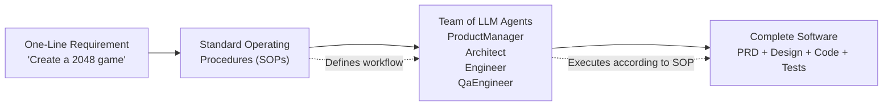
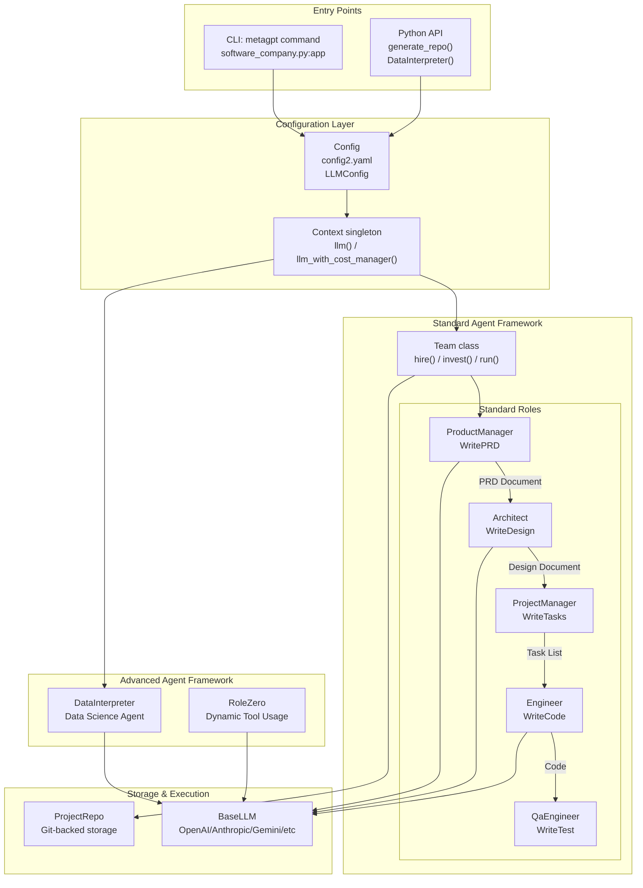
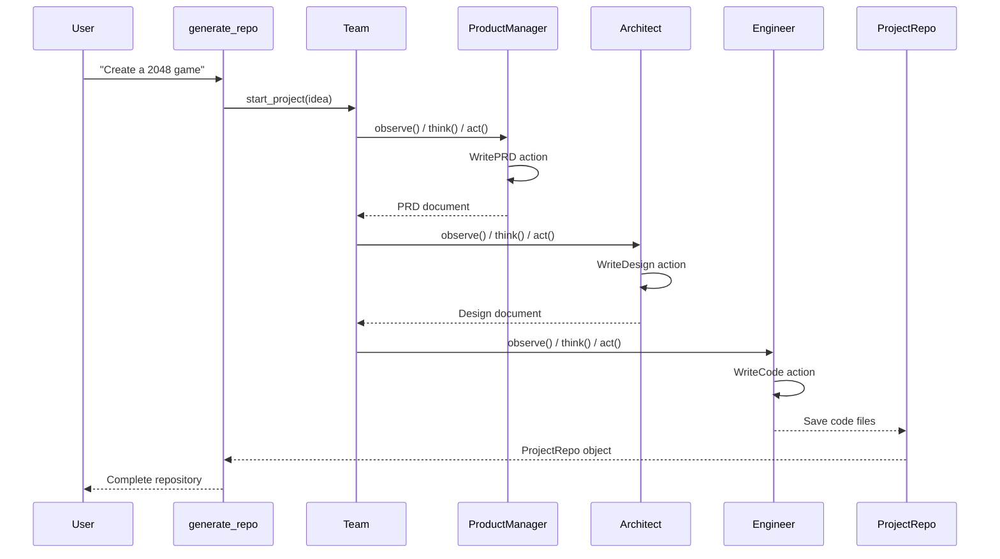

<!-- source: DeepWiki mcp.deepwiki.com · repo FoundationAgents/MetaGPT · page 1 Introduction to MetaGPT · fetched 2026-10-30 -->

# Introduction to MetaGPT

<details>
<summary>Relevant source files</summary>

The following files were used as context for generating this wiki page:

- [.gitignore](.gitignore)
- [Dockerfile](Dockerfile)
- [MANIFEST.in](MANIFEST.in)
- [README.md](README.md)
- [docs/ACADEMIC_WORK.md](docs/ACADEMIC_WORK.md)
- [docs/NEWS.md](docs/NEWS.md)
- [docs/README_CN.md](docs/README_CN.md)
- [docs/README_FR.md](docs/README_FR.md)
- [docs/README_JA.md](docs/README_JA.md)
- [metagpt/llm.py](metagpt/llm.py)
- [metagpt/utils/mermaid.py](metagpt/utils/mermaid.py)
- [requirements.txt](requirements.txt)
- [setup.py](setup.py)

</details>


## Purpose and Scope

This document provides a high-level introduction to MetaGPT, a multi-agent framework that enables Large Language Models (LLMs) to collaborate as a software company. It covers the core philosophy, system architecture, primary entry points, and basic usage patterns. For detailed information about specific subsystems:

- Installation and configuration details: see [Installation and Setup](#1.1) and [Configuration System](#1.2)
- Multi-agent role architecture: see [Core Multi-Agent Framework](#2)
- LLM provider integration: see [LLM Provider Integration](#3)
- Advanced agent capabilities: see [Dynamic Agent System (RoleZero)](#4)
- Software development workflows: see [Software Development Workflow](#5)

Sources: [README.md:1-178]()

## What is MetaGPT?

MetaGPT is a multi-agent framework that assigns different roles to GPTs to form a collaborative software company capable of handling complex tasks. It transforms a single-line natural language requirement into complete software artifacts including user stories, competitive analysis, requirements documents, data structures, APIs, and functional code.

The framework internally simulates an entire software company structure with specialized roles (Product Managers, Architects, Project Managers, Engineers, QA Engineers) that follow carefully orchestrated Standard Operating Procedures (SOPs).

**Key Characteristics:**

| Aspect | Description |
|--------|-------------|
| **Input** | One-line natural language requirement |
| **Output** | Complete project artifacts: PRD, design docs, APIs, code, tests |
| **Architecture** | Multi-agent system with role-based collaboration |
| **Core Philosophy** | `Code = SOP(Team)` - SOPs applied to LLM teams |
| **Primary Interface** | CLI via `metagpt` command or Python API via `generate_repo()` |

Sources: [README.md:40-48](), [README.md:87-103]()

## Core Philosophy: Code = SOP(Team)



**Diagram: The Code = SOP(Team) Philosophy**

MetaGPT's foundational principle is `Code = SOP(Team)`: software is produced by materializing Standard Operating Procedures and applying them to teams composed of LLMs. This approach:

1. **Materializes SOPs**: Converts abstract software development processes into concrete, executable workflows
2. **Assigns Specialized Roles**: Each LLM agent takes on a specific role with defined responsibilities
3. **Enforces Sequential Handoffs**: Agents communicate through structured documents, mimicking real software companies
4. **Produces Structured Artifacts**: Each role generates specific outputs (PRD, design docs, code, tests) that serve as inputs to downstream roles

Sources: [README.md:44](), [docs/README_CN.md:21-23]()

## System Architecture Overview



**Diagram: MetaGPT System Architecture with Code Entities**

MetaGPT consists of several layers:

1. **Entry Points**: `metagpt` CLI command and Python API functions (`generate_repo()`, `DataInterpreter`)
2. **Configuration**: `Config` class manages settings; `Context` singleton provides LLM instances
3. **Agent Framework**: 
   - Standard roles follow sequential SOPs (`ProductManager` → `Architect` → `Engineer` → `QaEngineer`)
   - Advanced agents like `DataInterpreter` and `RoleZero` provide specialized capabilities
4. **Storage**: `ProjectRepo` manages Git-backed project artifacts
5. **LLM Integration**: `BaseLLM` abstraction supports 15+ providers

Sources: [README.md:88-103](), [setup.py:98-122](), [metagpt/llm.py:1-21]()

## Primary Entry Points

### CLI Entry Point

The `metagpt` command provides command-line access to the framework:

```bash
metagpt "Create a 2048 game"  # Creates a repository in ./workspace
```

The CLI is defined as a console script entry point in `setup.py`:

```python
entry_points={
    "console_scripts": [
        "metagpt=metagpt.software_company:app",
    ],
}
```

Sources: [setup.py:116-120](), [README.md:90-92]()

### Python API Entry Point

#### generate_repo()

The primary Python API for software generation:

```python
from metagpt.software_company import generate_repo
from metagpt.utils.project_repo import ProjectRepo

repo: ProjectRepo = generate_repo("Create a 2048 game")
print(repo)  # Displays repository structure
```

**Function Signature:**
- **Input**: Natural language requirement (string)
- **Output**: `ProjectRepo` object containing all generated artifacts
- **Process**: Orchestrates `Team` with standard roles through multiple rounds of collaboration

Sources: [README.md:96-102]()

#### DataInterpreter

A specialized agent for data science tasks:

```python
import asyncio
from metagpt.roles.di.data_interpreter import DataInterpreter

async def main():
    di = DataInterpreter()
    await di.run("Run data analysis on sklearn Iris dataset, include a plot")

asyncio.run(main())
```

**Capabilities:**
- Executes data analysis tasks
- Generates and runs Python code
- Creates visualizations
- Handles Jupyter notebooks

Sources: [README.md:104-115](), [README.md:136]()

## Core Use Cases

### Use Case 1: Software Project Generation



**Diagram: Software Generation Workflow**

**Workflow:**
1. User provides a natural language requirement
2. `generate_repo()` initializes a `Team` with standard roles
3. Roles execute in sequence: `ProductManager` → `Architect` → `ProjectManager` → `Engineer` → `QaEngineer`
4. Each role produces structured documents as output
5. Final artifacts stored in `ProjectRepo` (Git-backed)

**Output Structure:**
- `docs/prd/`: Product requirements documents
- `docs/system_design/`: Architecture and API designs  
- `docs/task/`: Task breakdowns
- `src/`: Source code
- `tests/`: Test files

Sources: [README.md:40-48]()

### Use Case 2: Data Science Analysis

**Workflow:**
1. User provides data science task description
2. `DataInterpreter` analyzes requirements
3. Generates Python code for analysis
4. Executes code with error handling
5. Produces visualizations and results

**Example Tasks:**
- Exploratory data analysis (EDA)
- Data preprocessing and cleaning
- Feature engineering
- Model training and evaluation
- Visualization generation

Sources: [README.md:104-115](), [README.md:136]()

## Installation Quick Start

### Installation Methods

| Method | Command |
|--------|---------|
| **PyPI (Stable)** | `pip install --upgrade metagpt` |
| **Git (Latest)** | `pip install --upgrade git+https://github.com/geekan/MetaGPT.git` |
| **Development** | `git clone https://github.com/geekan/MetaGPT && cd MetaGPT && pip install -e .` |
| **Docker** | `docker pull metagpt/metagpt:latest` |

**Requirements:**
- Python 3.9 or higher, but less than 3.12
- Node.js and pnpm (for Mermaid diagram generation)

**Verify Installation:**
```bash
python --version  # Should show 3.9+
metagpt --init-config  # Creates ~/.metagpt/config2.yaml
```

Sources: [README.md:52-66](), [setup.py:110]()

### Docker Installation

```bash
# Step 1: Pull image and prepare config
docker pull metagpt/metagpt:latest
mkdir -p /opt/metagpt/{config,workspace}
docker run --rm metagpt/metagpt:latest cat /app/metagpt/config/config2.yaml > /opt/metagpt/config/config2.yaml

# Step 2: Edit configuration
vim /opt/metagpt/config/config2.yaml

# Step 3: Run MetaGPT
docker run --rm \
    --privileged \
    -v /opt/metagpt/config/config2.yaml:/app/metagpt/config/config2.yaml \
    -v /opt/metagpt/workspace:/app/metagpt/workspace \
    metagpt/metagpt:latest \
    metagpt "Write a cli snake game"
```

**Docker Image Contents:**
- Base: `python3.9-nodejs20-slim` ([Dockerfile:2]())
- System dependencies: Chromium, fonts ([Dockerfile:5-7]())
- Mermaid CLI for diagram generation ([Dockerfile:9-14]())
- Volume mounts: `/opt/metagpt/config` and `/opt/metagpt/workspace`

Sources: [Dockerfile:1-25](), [README.md:156-175]()

## Configuration Essentials

### Minimum Configuration

Create `~/.metagpt/config2.yaml`:

```yaml
llm:
  api_type: "openai"  # or azure / ollama / anthropic / gemini
  model: "gpt-4-turbo"  # or gpt-3.5-turbo
  base_url: "https://api.openai.com/v1"
  api_key: "YOUR_API_KEY"
```

**Configuration Priority:**
1. Kwargs passed to functions (highest)
2. `~/.metagpt/config2.yaml` (user config)
3. `config/config2.yaml` (project config)
4. Environment variables (lowest)

Sources: [README.md:68-84]()

### Supported LLM Providers

MetaGPT supports 15+ LLM providers through the `BaseLLM` abstraction:

**International Providers:**
- OpenAI (GPT-4, GPT-3.5-turbo)
- Anthropic (Claude)
- Google (Gemini)
- AWS Bedrock
- Ollama (local models)
- Fireworks, Moonshot, Mistral, DeepSeek, OpenRouter, etc.

**Chinese Providers:**
- Qianfan (Baidu)
- DashScope (Alibaba)
- ZhiPu AI
- Volcano Engine
- Spark (iFlytek)

Each provider is registered via `@register_provider` decorator and accessed through `LLMType` enum.

Sources: [requirements.txt:16](), [requirements.txt:34](), [requirements.txt:55](), [requirements.txt:80-87]()

## Core Dependencies

**Essential Libraries:**

| Category | Libraries | Purpose |
|----------|-----------|---------|
| **LLM SDKs** | openai, anthropic, google-generativeai | LLM provider integrations |
| **Data Processing** | pandas, numpy, scikit-learn | Data analysis capabilities |
| **Async I/O** | aiohttp, aiofiles | Asynchronous operations |
| **Storage** | redis, faiss-cpu, qdrant-client | Memory and vector storage |
| **Code Execution** | ipykernel, nbclient, nbformat | Jupyter notebook support |
| **Version Control** | gitpython | Git integration |
| **Web Automation** | playwright, beautifulsoup4 | Browser automation |
| **Utilities** | pydantic, loguru, tenacity | Validation, logging, retries |

**Optional Extras:**
- `pip install metagpt[selenium]` - Web scraping with Selenium
- `pip install metagpt[rag]` - RAG capabilities with llama-index
- `pip install metagpt[test]` - Testing dependencies

Sources: [requirements.txt:1-90](), [setup.py:26-96]()

## Basic Usage Patterns

### Pattern 1: CLI Usage

```bash
# Basic project generation
metagpt "Create a 2048 game"

# Skip implementation phase (design only)
metagpt "Create a 2048 game" --no-implement

# Enable code review
metagpt "Create a 2048 game" --code_review

# Specify platform/tools
metagpt "Write a cli snake game based on pygame"
```

Sources: [README.md:88-92](), [docs/README_JA.md:216-221]()

### Pattern 2: Library Usage

```python
from metagpt.software_company import generate_repo
from metagpt.utils.project_repo import ProjectRepo

# Generate from requirement
repo: ProjectRepo = generate_repo("Create a 2048 game")

# Or load existing repo
repo = ProjectRepo("/path/to/workspace/project")

# Inspect repository
print(repo)  # Displays file structure
```

Sources: [README.md:96-102]()

### Pattern 3: Custom Team Composition

```python
from metagpt.team import Team
from metagpt.roles import ProductManager, Architect, Engineer

async def startup(idea: str, investment: float = 3.0, n_round: int = 5):
    """Run a startup with custom team."""
    company = Team()
    company.hire([ProductManager(), Architect(), Engineer()])
    company.invest(investment)
    company.start_project(idea)
    await company.run(n_round=n_round)
```

**Key Classes:**
- `Team`: Orchestrates multi-agent collaboration
- `Role`: Base class for all agents (ProductManager, Architect, etc.)
- `Environment`: Message broker for agent communication
- `ProjectRepo`: Git-backed storage for artifacts

Sources: [docs/README_JA.md:266-276]()

## Output Artifacts

When MetaGPT generates a project, it creates a structured workspace:

```
workspace/
└── project_name/
    ├── docs/
    │   ├── prd/           # Product Requirements (JSON)
    │   ├── system_design/ # Architecture & APIs (JSON)
    │   └── task/          # Task breakdowns (JSON)
    ├── resources/
    │   ├── prd/           # PRD in Markdown/PDF
    │   ├── system_design/ # Diagrams (SVG/PNG)
    │   └── api_spec_and_task/
    ├── src/               # Source code
    └── tests/             # Test files
```

**Document Types:**
- **PRD**: User stories, requirements, competitive analysis
- **System Design**: Data structures, API specifications, sequence diagrams
- **Tasks**: Detailed implementation tasks
- **Code**: Functional implementation
- **Tests**: Unit and integration tests

Sources: [.gitignore:168]()

## Next Steps

This introduction covers the fundamentals of MetaGPT. For deeper exploration:

- **Installation Details**: See [Installation and Setup](#1.1) for comprehensive installation instructions, dependency management, and troubleshooting
- **Configuration**: See [Configuration System](#1.2) for detailed config options, LLM provider setup, and environment variables
- **Role System**: See [Core Multi-Agent Framework](#2) to understand how roles collaborate and communicate
- **LLM Integration**: See [LLM Provider Integration](#3) for multi-provider setup, token management, and cost control
- **Advanced Agents**: See [Dynamic Agent System (RoleZero)](#4) for tool-using agents with dynamic capabilities

Sources: [README.md:125-141]()

---

