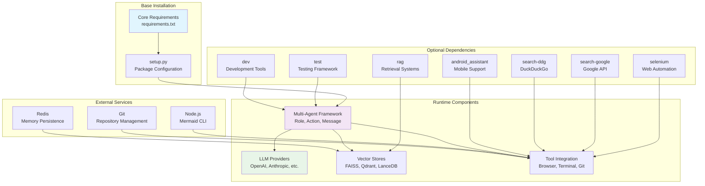
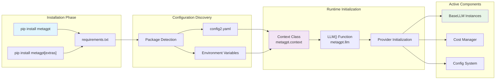

<!-- source: DeepWiki mcp.deepwiki.com · repo FoundationAgents/MetaGPT · page 1.1 Installation and Setup · fetched 2026-10-30 -->

# Installation and Setup

<details>
<summary>Relevant source files</summary>

The following files were used as context for generating this wiki page:

- [.gitignore](.gitignore)
- [Dockerfile](Dockerfile)
- [MANIFEST.in](MANIFEST.in)
- [README.md](README.md)
- [docs/ACADEMIC_WORK.md](docs/ACADEMIC_WORK.md)
- [docs/NEWS.md](docs/NEWS.md)
- [docs/README_CN.md](docs/README_CN.md)
- [docs/README_FR.md](docs/README_FR.md)
- [docs/README_JA.md](docs/README_JA.md)
- [metagpt/llm.py](metagpt/llm.py)
- [metagpt/utils/mermaid.py](metagpt/utils/mermaid.py)
- [requirements.txt](requirements.txt)
- [setup.py](setup.py)

</details>


This document covers the installation requirements, dependency management, and initial configuration for MetaGPT. It focuses on getting the multi-agent framework operational with various LLM providers and optional features.

For information about runtime configuration management, see [Configuration System](#1.2). For details about LLM provider integration, see [LLM Provider System](#3.1).

## Prerequisites

MetaGPT requires Python 3.9 or higher, with explicit support up to Python 3.11. The framework is built around asynchronous operations and requires several system-level dependencies depending on the features you plan to use.

**System Requirements:**
- Python: `>=3.9, <3.12` [setup.py:110]()
- Node.js (optional): Required for Mermaid diagram generation
- Git: Required for repository management features
- Redis (optional): Required for memory persistence features

## Basic Installation

### Standard Installation

The core MetaGPT installation provides the fundamental multi-agent framework with basic LLM integration:

```bash
pip install metagpt
```

This installs the base requirements from [requirements.txt:1-91](), including:
- Core dependencies: `aiohttp`, `fire`, `typer`, `loguru`, `pydantic`, `PyYAML`
- LLM integration: `openai`, `anthropic`, `tiktoken`, `zhipuai`, `google-generativeai`
- Vector processing: `faiss_cpu`, `numpy`, `pandas`
- Development tools: `gitpython`, `beautifulsoup4`, `rich`

### Development Installation

For development or contributing to MetaGPT:

```bash
git clone https://github.com/geekan/MetaGPT
cd MetaGPT
pip install -e .
```

**Sources:** [setup.py:98-122](), [requirements.txt:1-91]()

## Installation Architecture

The following diagram shows the relationship between installation components and runtime systems:



**Sources:** [setup.py:26-96](), [requirements.txt:1-91]()

## Modular Installation Options

MetaGPT supports modular installation through setuptools extras to minimize dependencies for specific use cases:

### Web Automation and Search
```bash
# Selenium-based web automation
pip install metagpt[selenium]

# Google Search integration  
pip install metagpt[search-google]

# DuckDuckGo Search integration
pip install metagpt[search-ddg]
```

### Retrieval-Augmented Generation (RAG)
```bash
pip install metagpt[rag]
```

This installs comprehensive RAG capabilities including:
- LlamaIndex ecosystem: `llama-index-core`, `llama-index-embeddings-*`, `llama-index-vector-stores-*`
- Multiple embedding providers: OpenAI, Azure OpenAI, Gemini, Ollama
- Vector stores: FAISS, Elasticsearch, Chroma
- Reranking: Cohere, ColBERT, Flag Embedding
- Document processing: `docx2txt`

### Development and Testing
```bash
# Full testing suite
pip install metagpt[test]

# Development tools
pip install metagpt[dev]

# Legacy browser automation (unmaintained)
pip install metagpt[pyppeteer]
```

### Specialized Features
```bash
# Android assistant capabilities
pip install metagpt[android_assistant]
```

**Sources:** [setup.py:26-96]()

## Configuration Flow

This diagram illustrates how installation components connect to the runtime configuration system:



**Sources:** [metagpt/llm.py:15-20](), [setup.py:98-122]()

## Post-Installation Setup

### Mermaid CLI Installation (Optional)

For diagram generation capabilities, install the Mermaid CLI:

```bash
python setup.py install_mermaid
```

This executes the custom command defined in [setup.py:8-19]() which runs:
```bash
npm install -g @mermaid-js/mermaid-cli
```

### Console Script Access

After installation, MetaGPT provides a command-line interface through the `metagpt` command, configured as an entry point in [setup.py:116-120]():

```bash
metagpt --help
```

This launches the main application defined in `metagpt.software_company:app`.

### Verification

Verify your installation by checking core imports:

```python
from metagpt.llm import LLM
from metagpt.context import Context
from metagpt.roles.product_manager import ProductManager
```

The `LLM()` function from [metagpt/llm.py:15-20]() should initialize without errors, indicating proper configuration discovery.

**Sources:** [setup.py:8-19](), [setup.py:116-120](), [metagpt/llm.py:15-20]()

## Installation Dependencies Table

| Category | Key Packages | Purpose |
|----------|--------------|---------|
| **Core Framework** | `pydantic>=2.5.3`, `PyYAML==6.0.1`, `fire==0.4.0`, `typer==0.9.0` | Configuration, CLI, validation |
| **LLM Providers** | `openai~=1.64.0`, `anthropic==0.47.2`, `zhipuai~=2.1.5`, `google-generativeai==0.4.1` | Multi-provider LLM support |
| **Vector Processing** | `faiss_cpu==1.7.4`, `qdrant-client==1.7.0`, `lancedb==0.4.0` | Vector storage and similarity search |
| **Web & Automation** | `playwright>=1.26`, `beautifulsoup4==4.12.3`, `selenium>4` | Web scraping and browser automation |
| **Development Tools** | `gitpython==3.1.40`, `rich==13.6.0`, `nbclient==0.9.0`, `ipython==8.17.2` | Repository management, UI, notebooks |
| **Memory & Caching** | `redis~=5.0.0`, `tenacity==8.2.3` | Persistence and retry mechanisms |

**Sources:** [requirements.txt:1-91](), [setup.py:26-48]()

---

