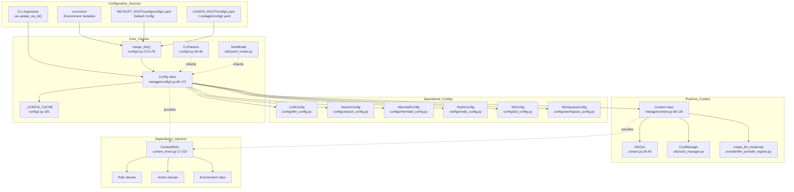
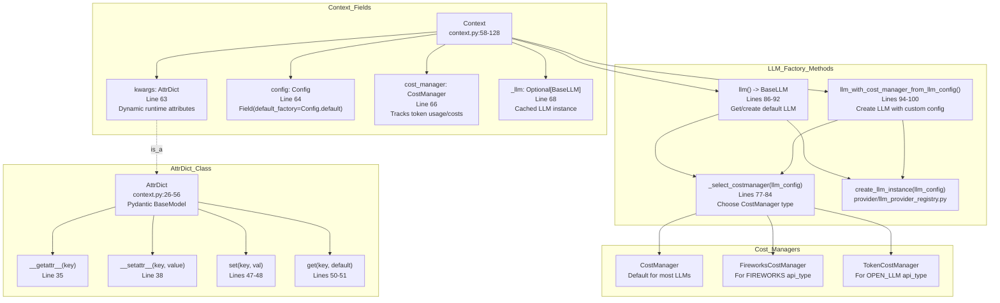

<!-- source: DeepWiki mcp.deepwiki.com · repo FoundationAgents/MetaGPT · page 1.2 Configuration System · fetched 2026-10-30 -->

# Configuration System

<details>
<summary>Relevant source files</summary>

The following files were used as context for generating this wiki page:

- [.github/workflows/fulltest.yaml](.github/workflows/fulltest.yaml)
- [.github/workflows/unittest.yaml](.github/workflows/unittest.yaml)
- [.gitignore](.gitignore)
- [MANIFEST.in](MANIFEST.in)
- [metagpt/config2.py](metagpt/config2.py)
- [metagpt/context.py](metagpt/context.py)
- [metagpt/context_mixin.py](metagpt/context_mixin.py)
- [metagpt/llm.py](metagpt/llm.py)
- [metagpt/software_company.py](metagpt/software_company.py)
- [requirements.txt](requirements.txt)
- [setup.py](setup.py)
- [tests/conftest.py](tests/conftest.py)
- [tests/data/rsp_cache.json](tests/data/rsp_cache.json)
- [tests/metagpt/test_config.py](tests/metagpt/test_config.py)
- [tests/metagpt/test_context.py](tests/metagpt/test_context.py)
- [tests/metagpt/test_context_mixin.py](tests/metagpt/test_context_mixin.py)
- [tests/mock/mock_llm.py](tests/mock/mock_llm.py)

</details>


## Purpose and Scope

The Configuration System is the central component responsible for managing all configuration parameters, environment settings, and runtime context in MetaGPT. It provides a unified interface for loading configuration from multiple sources (YAML files, environment variables, programmatic settings), managing LLM provider configurations, and maintaining runtime context across the multi-agent framework.

For information about LLM provider configuration and integration, see [LLM Provider System](#3.1). For details about role-specific configuration usage, see [Role System](#2.1).

## Architecture Overview

The configuration system follows a layered architecture with four key components: configuration sources with priority-based merging, the `Config` class for centralized settings, the `Context` class for runtime state, and the `ContextMixin` pattern for dependency injection.

**Configuration System Architecture**



Sources: [metagpt/config2.py:1-183](), [metagpt/context.py:1-128](), [metagpt/context_mixin.py:1-102]()

## Core Configuration Classes

### Config Class

The `Config` class is the central configuration object that inherits from both `CLIParams` and `YamlModel`, providing comprehensive configuration management:

```mermaid
graph TD
    subgraph "Config_Class_Hierarchy"
        Config["Config<br/>metagpt.config2.Config<br/>Lines 49-172"]
        CLIParams["CLIParams<br/>metagpt.config2.CLIParams<br/>Lines 30-46"]
        YamlModel["YamlModel<br/>metagpt.utils.yaml_model.YamlModel"]
        BaseModel["BaseModel<br/>pydantic.BaseModel"]
    end
    
    subgraph "Factory_Methods"
        default_method["default(reload=False, **kwargs)<br/>Line 110-123"]
        from_home_method["from_home(path)<br/>Lines 102-107"]
        from_llm_config_method["from_llm_config(llm_config)<br/>Lines 126-137"]
        update_via_cli_method["update_via_cli(...)<br/>Lines 139-150"]
    end
    
    subgraph "Required_Fields"
        llm_field["llm: LLMConfig<br/>Required LLM configuration<br/>Line 53"]
    end
    
    subgraph "Optional_Config_Fields"
        embedding_field["embedding: EmbeddingConfig<br/>RAG embeddings, Line 56"]
        search_field["search: SearchConfig<br/>Search engine config, Line 65"]
        browser_field["browser: BrowserConfig<br/>Browser automation, Line 67"]
        exp_pool_field["exp_pool: ExperiencePoolConfig<br/>Experience caching, Line 82"]
        role_zero_field["role_zero: RoleZeroConfig<br/>RoleZero settings, Line 99"]
        roles_field["roles: List[RoleCustomConfig]<br/>Role-specific configs, Line 96"]
        workspace_field["workspace: WorkspaceConfig<br/>Workspace management, Line 77"]
    end
    
    Config --> CLIParams
    Config --> YamlModel
    YamlModel --> BaseModel
    
    Config --> default_method
    Config --> from_home_method
    Config --> from_llm_config_method
    Config --> update_via_cli_method
    
    Config --> llm_field
    Config --> embedding_field
    Config --> search_field
    Config --> browser_field
    Config --> exp_pool_field
    Config --> role_zero_field
    Config --> roles_field
    Config --> workspace_field
```



Key configuration caching mechanism using `_CONFIG_CACHE` dict for performance optimization:

```python
# Global config instance and caching from config2.py:181-182
_CONFIG_CACHE = {}
config = Config.default()
```

Sources: [metagpt/config2.py:49-172](), [metagpt/config2.py:30-46](), [metagpt/config2.py:181-182]()

### Configuration Loading Priority

The configuration system implements a priority-based loading mechanism in `Config.default()` where later sources override earlier ones:

| Priority | Source | Code Reference | Description |
|----------|--------|----------------|-------------|
| 1 (Lowest) | Environment Variables | `dict(os.environ)` | OS environment variables like `OPENAI_API_KEY` |
| 2 | Default Config | `METAGPT_ROOT/config/config2.yaml` | Repository default configuration |
| 3 | User Config | `CONFIG_ROOT/config2.yaml` (`~/.metagpt/config2.yaml`) | User-specific configuration |
| 4 (Highest) | CLI Arguments | `update_via_cli()` kwargs | Command-line parameters |

**Configuration Merging and Caching**

The `merge_dict()` function at [metagpt/config2.py:173-178]() implements simple dictionary merging where later values overwrite earlier ones. The `Config.default()` method uses caching to avoid re-parsing configuration files on repeated calls:

```python
# From config2.py:115-123
default_config_paths = (
    METAGPT_ROOT / "config/config2.yaml",  # Repository default
    CONFIG_ROOT / "config2.yaml",          # User home directory
)
if reload or default_config_paths not in _CONFIG_CACHE:
    dicts = [dict(os.environ), *(Config.read_yaml(path) for path in default_config_paths), kwargs]
    final = merge_dict(dicts)
    _CONFIG_CACHE[default_config_paths] = Config(**final)
return _CONFIG_CACHE[default_config_paths]
```

The global `config` instance at [metagpt/config2.py:182]() is initialized with `Config.default()` and can be imported directly: `from metagpt.config2 import config`.

Sources: [metagpt/config2.py:110-123](), [metagpt/config2.py:173-178](), [metagpt/config2.py:181-182]()

## Context Management

### Context Class Architecture

The `Context` class at [metagpt/context.py:58-128]() provides runtime environment management and serves as the bridge between configuration and execution. It manages the global `Config` instance, lazy-initializes LLM instances, and tracks costs.

**Context Class Structure**



**LLM Lazy Initialization**

The `Context.llm()` method implements lazy initialization with cost manager injection:

```python
# From context.py:86-92
def llm(self) -> BaseLLM:
    """Return a LLM instance, fixme: support cache"""
    # if self._llm is None:
    self._llm = create_llm_instance(self.config.llm)
    if self._llm.cost_manager is None:
        self._llm.cost_manager = self._select_costmanager(self.config.llm)
    return self._llm
```

The `_select_costmanager()` method at [metagpt/context.py:77-84]() chooses the appropriate cost tracking implementation based on the LLM provider type:
- `FireworksCostManager` for `LLMType.FIREWORKS`
- `TokenCostManager` for `LLMType.OPEN_LLM`
- Default `CostManager` for all other providers (OpenAI, Anthropic, etc.)

**AttrDict for Dynamic Attributes**

The `AttrDict` class at [metagpt/context.py:26-56]() extends Pydantic's `BaseModel` with dict-like attribute access, allowing dynamic runtime attributes to be stored in `Context.kwargs`. This is used for storing temporary state like `project_path` during execution.

Sources: [metagpt/context.py:26-56](), [metagpt/context.py:58-128](), [metagpt/context.py:77-92]()

## ContextMixin Pattern

### Dependency Injection Architecture

The `ContextMixin` class at [metagpt/context_mixin.py:17-102]() implements a sophisticated dependency injection pattern that allows `Role`, `Action`, and `Environment` classes to access configuration, context, and LLM instances with flexible priority resolution.

**ContextMixin Class Structure**

```mermaid
graph TB
    subgraph "ContextMixin_Fields"
        ContextMixin["ContextMixin<br/>context_mixin.py:17-102<br/>Pydantic BaseModel"]
        private_context["private_context: Optional[Context]<br/>Line 28<br/>Instance-specific context"]
        private_config["private_config: Optional[Config]<br/>Line 30<br/>Instance-specific config"]
        private_llm["private_llm: Optional[BaseLLM]<br/>Line 33<br/>Instance-specific LLM"]
    end
    
    subgraph "Setter_Methods"
        set_context["set_context(context, override=True)<br/>Lines 52-54"]
        set_config["set_config(config, override=False)<br/>Lines 56-60"]
        set_llm["set_llm(llm, override=False)<br/>Lines 62-64"]
        set_generic["set(k, v, override=False)<br/>Lines 47-50"]
    end
    
    subgraph "Property_Resolution"
        context_prop["@property context -> Context<br/>Lines 78-83<br/>private_context or Context()"]
        config_prop["@property config -> Config<br/>Lines 66-71<br/>private_config or context.config"]
        llm_prop["@property llm -> BaseLLM<br/>Lines 90-96<br/>private_llm or context.llm()"]
    end
    
    subgraph "Inheriting_Classes"
        Role["Role class<br/>roles/role.py"]
        Action["Action class<br/>actions/action.py"]
        Environment["Environment class<br/>environment/base_env.py"]
    end
    
    ContextMixin --> private_context
    ContextMixin --> private_config
    ContextMixin --> private_llm
    
    ContextMixin --> set_context
    ContextMixin --> set_config
    ContextMixin --> set_llm
    ContextMixin --> set_generic
    
    ContextMixin --> context_prop
    ContextMixin --> config_prop
    ContextMixin --> llm_prop
    
    ContextMixin -.inherited_by.-> Role
    ContextMixin -.inherited_by.-> Action
    ContextMixin -.inherited_by.-> Environment
    
    config_prop --> context_prop
    llm_prop --> context_prop
```



**Priority Resolution Logic**

The property accessors implement a fallback chain that provides flexibility:

1. **`config` property** (Lines 66-71): Returns `private_config` if set, otherwise `context.config`
2. **`llm` property** (Lines 90-96): Returns `private_llm` if set, otherwise creates from `context.llm_with_cost_manager_from_llm_config(self.config.llm)`
3. **`context` property** (Lines 78-83): Returns `private_context` if set, otherwise a default `Context()` instance

This allows fine-grained control: a specific `Action` can use a different LLM than its parent `Role`, or a `Role` can use different configuration than the global default.

**Configuration Override Behavior**

The `set_config()` method at [metagpt/context_mixin.py:56-60]() has `override=False` by default, meaning if `private_config` is already set, calling `set_config()` again won't replace it. This prevents accidental configuration changes. However, `set_context()` uses `override=True` by default, allowing context to be replaced freely.

Sources: [metagpt/context_mixin.py:17-102](), [metagpt/context_mixin.py:47-64](), [metagpt/context_mixin.py:66-96]()

### ContextMixin Usage Examples

**Role with Custom LLM Configuration**

From the test at [tests/metagpt/test_context_mixin.py:105-133]():

```python
# Different roles with different LLM configs
gpt4 = Config.default()
gpt4.llm.model = "gpt-4-0613"
gpt35 = Config.default()
gpt35.llm.model = "gpt-4-turbo"

# Action with its own config (won't be overridden by role)
a1 = Action(config=gpt4t, name="Say", instruction="Say your opinion")
# Action without config (will inherit from role)
a2 = Action(name="Say", instruction="Say your opinion")

# Role A has config=gpt4, but a1 keeps its own config
A = Role(name="A", profile="Candidate", goal="Win", actions=[a1], config=gpt4)
# Role B has config=gpt4, a2 will use gpt4
B = Role(name="B", profile="Candidate", goal="Win", actions=[a2], config=gpt4)
# Role C has config=gpt35
C = Role(name="C", profile="Voter", goal="Vote", actions=[a3], config=gpt35)

# Final LLM assignments:
# a1.llm.model == "gpt-4-turbo" (from its own config)
# a2.llm.model == "gpt-4-0613" (inherited from Role B)
# a3.llm.model == "gpt-4-turbo" (inherited from Role C)
```

This demonstrates the priority chain: `Action.private_config` > `Role.private_config` > `Context.config`.

Sources: [tests/metagpt/test_context_mixin.py:105-133](), [metagpt/context_mixin.py:56-60]()

## Specialized Configuration Modules

MetaGPT provides specialized configuration classes for different subsystems, all accessible as fields on the main `Config` class:

### LLM Configuration

The `LLMConfig` class at [metagpt/configs/llm_config.py]() manages LLM provider settings:

| Field | Type | Description |
|-------|------|-------------|
| `api_type` | `LLMType` | Provider type (OPENAI, AZURE, ANTHROPIC, etc.) |
| `model` | `str` | Model name (gpt-4-turbo, claude-3-opus, etc.) |
| `api_key` | `str` | API key for authentication |
| `base_url` | `str` | API endpoint URL |
| `proxy` | `str` | Optional HTTP proxy |

### Storage and Tool Configurations

| Configuration Class | File Path | Key Fields |
|---------------------|-----------|------------|
| `SearchConfig` | `configs/search_config.py` | `api_type`, `api_key`, `engine` |
| `BrowserConfig` | `configs/browser_config.py` | `engine` (playwright, selenium) |
| `MermaidConfig` | `configs/mermaid_config.py` | `engine` (nodejs, playwright, pyppeteer, ink), `path` |
| `RedisConfig` | `configs/redis_config.py` | `host`, `port`, `password`, `db` |
| `S3Config` | `configs/s3_config.py` | `access_key`, `secret_key`, `endpoint`, `bucket` |
| `WorkspaceConfig` | `configs/workspace_config.py` | `path`, `use_uid` |

### Experience Pool Configuration

The `ExperiencePoolConfig` at [metagpt/configs/exp_pool_config.py]() manages the experience caching system:

| Field | Type | Default | Description |
|-------|------|---------|-------------|
| `enabled` | `bool` | `False` | Enable experience pool |
| `enable_read` | `bool` | `True` | Allow reading from pool |
| `enable_write` | `bool` | `True` | Allow writing to pool |
| `persist_path` | `str` | `.experience_pool` | Storage directory |
| `retrieval_type` | `ExperiencePoolRetrievalType` | `BM25` | BM25 or CHROMA |
| `use_llm_ranker` | `bool` | `False` | Use LLM for re-ranking |

### RoleZero Configuration

The `RoleZeroConfig` at [metagpt/configs/role_zero_config.py]() manages the advanced reactive agent:

| Field | Type | Default | Description |
|-------|------|---------|-------------|
| `enable_longterm_memory` | `bool` | `False` | Enable long-term memory |
| `longterm_memory_persist_path` | `str` | `.role_memory_data` | Memory storage path |
| `memory_k` | `int` | `200` | Short-term memory size |
| `similarity_top_k` | `int` | `5` | Long-term retrieval count |
| `use_llm_ranker` | `bool` | `False` | Enable LLM ranking |

Sources: [metagpt/config2.py:49-99](), [metagpt/configs/llm_config.py](), [metagpt/configs/exp_pool_config.py](), [metagpt/configs/role_zero_config.py]()

## Configuration Usage Patterns

### Initialization and Setup

The configuration system supports multiple initialization patterns:

1. **Default Configuration Loading:**
```python
from metagpt.config2 import config  # Global default config
```

2. **Custom Configuration from LLM Config:**
```python
llm_config = {"api_type": "openai", "api_key": "xxx", "model": "gpt-4"}
custom_config = Config.from_llm_config(llm_config)
```

3. **Configuration with Context:**
```python
from metagpt.context import Context
ctx = Context(config=config)
llm = ctx.llm()  # Get LLM instance with cost manager
```

Sources: [metagpt/config2.py:182](), [metagpt/config2.py:126-137](), [metagpt/software_company.py:29-41]()

### CLI Integration

The configuration system integrates with CLI commands through the `CLIParams` class and `update_via_cli` method:

```python
def update_via_cli(self, project_path, project_name, inc, reqa_file, max_auto_summarize_code):
    if project_path:
        inc = True
        project_name = project_name or Path(project_path).name
    self.project_path = project_path
    self.project_name = project_name
    self.inc = inc
    self.reqa_file = reqa_file
    self.max_auto_summarize_code = max_auto_summarize_code
```

Sources: [metagpt/config2.py:139-150](), [metagpt/software_company.py:77-124]()

### Role-Specific Configuration

The configuration system supports role-specific LLM configurations through the `roles` field:

```yaml
roles:
  - role: "ProductManager"
    llm:
      api_type: "openai"
      model: "gpt-4-turbo-1106"
  - role: "Architect"
    llm:
      api_type: "openai"
      model: "gpt-35-turbo"
```

This allows different roles to use different LLM providers or models based on their specific requirements.

Sources: [config/config2.example.yaml:24-52](), [metagpt/config2.py:95-96]()

---

