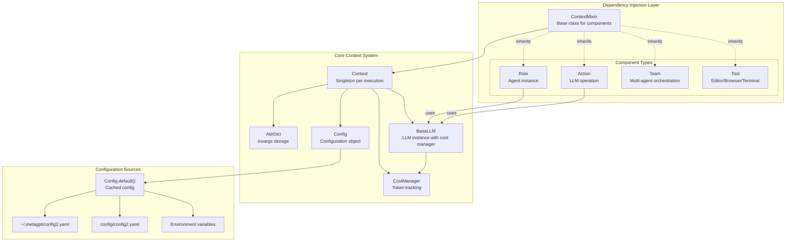
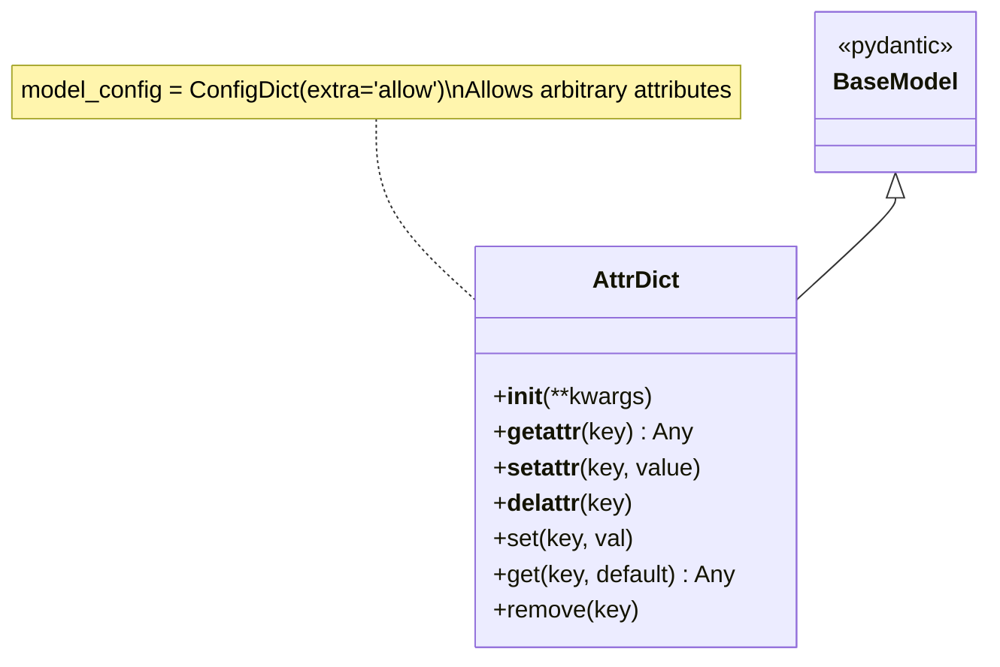
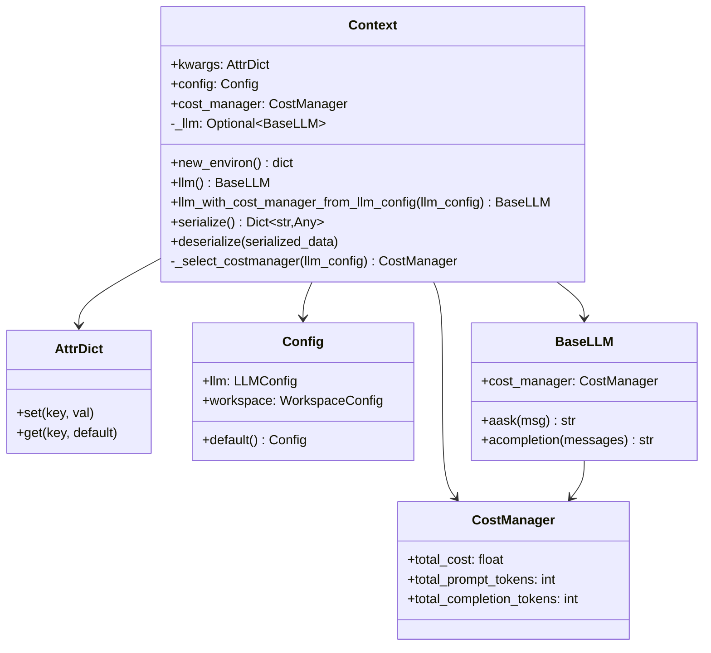
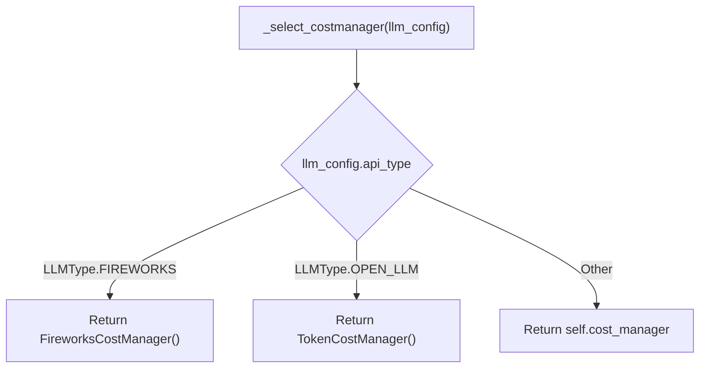
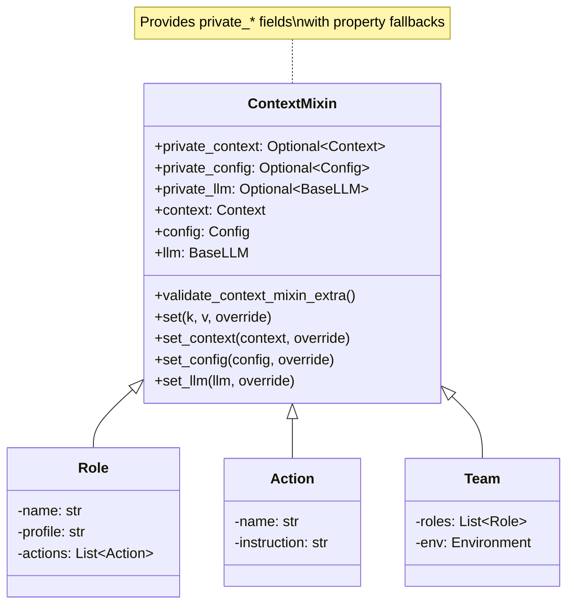
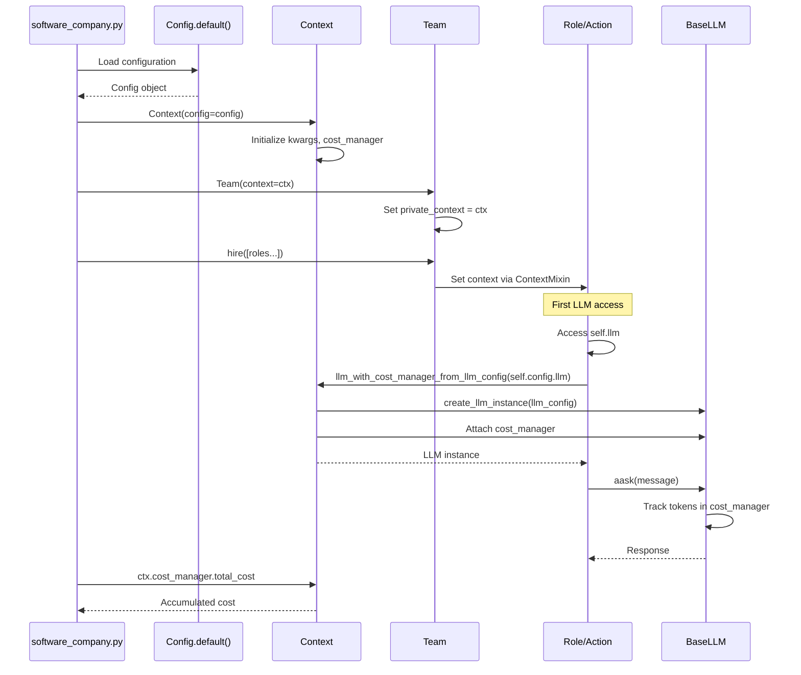
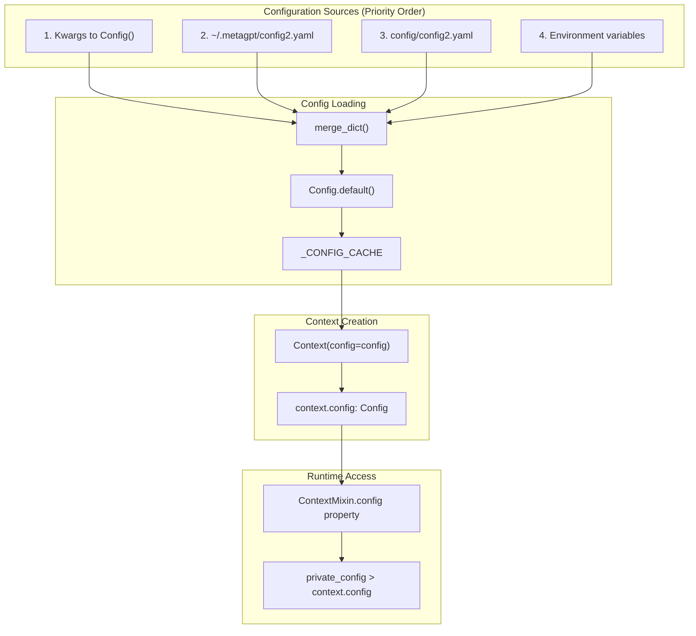
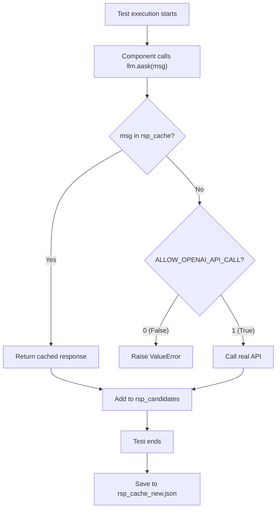

<!-- source: DeepWiki mcp.deepwiki.com · repo FoundationAgents/MetaGPT · page 1.3 Context and Runtime Management · fetched 2026-10-30 -->

# Context and Runtime Management

<details>
<summary>Relevant source files</summary>

The following files were used as context for generating this wiki page:

- [.github/workflows/fulltest.yaml](.github/workflows/fulltest.yaml)
- [.github/workflows/unittest.yaml](.github/workflows/unittest.yaml)
- [metagpt/config2.py](metagpt/config2.py)
- [metagpt/context.py](metagpt/context.py)
- [metagpt/context_mixin.py](metagpt/context_mixin.py)
- [metagpt/software_company.py](metagpt/software_company.py)
- [tests/conftest.py](tests/conftest.py)
- [tests/data/rsp_cache.json](tests/data/rsp_cache.json)
- [tests/metagpt/test_config.py](tests/metagpt/test_config.py)
- [tests/metagpt/test_context.py](tests/metagpt/test_context.py)
- [tests/metagpt/test_context_mixin.py](tests/metagpt/test_context_mixin.py)
- [tests/mock/mock_llm.py](tests/mock/mock_llm.py)

</details>


This document covers MetaGPT's runtime context system, which provides centralized management of configuration, LLM instances, cost tracking, and flexible runtime state. For information about the configuration system itself (config2.yaml structure, loading priority), see [Configuration System](#1.2). For information about cost tracking internals and token management, see [Token Management and Cost Control](#3.5).

## Purpose and Scope

The Context and ContextMixin system solves three core problems:
1. **Centralized State Management**: Provides a single source of truth for runtime configuration, LLM instances, and execution state
2. **Dependency Injection**: Enables components (Roles, Actions, Tools) to inherit or override configuration without explicit passing
3. **Cost Tracking**: Attaches cost managers to LLM instances automatically, tracking token usage across all operations

This system is fundamental to all MetaGPT operations—every Role, Action, Team, and Tool uses Context either directly or through ContextMixin inheritance.

---

## System Overview



**Diagram: Context System Architecture**

The Context acts as a runtime container that combines configuration, LLM instances, cost tracking, and flexible state storage. ContextMixin provides the dependency injection mechanism that allows components to access or override this context.

**Sources:** [metagpt/context.py:1-128](), [metagpt/context_mixin.py:1-102](), [metagpt/config2.py:49-183]()

---

## AttrDict: Flexible Runtime State Storage

`AttrDict` is a Pydantic-based dictionary that supports both dictionary-style (`obj['key']`) and attribute-style (`obj.key`) access patterns. It serves as the flexible storage mechanism within Context for runtime state that doesn't fit into predefined fields.

### Implementation Details



**Diagram: AttrDict Class Structure**

### Key Characteristics

| Feature | Implementation | Purpose |
|---------|---------------|---------|
| **Attribute Access** | `__getattr__` returns `self.__dict__.get(key, None)` | Access via `obj.key`, returns None if missing |
| **Dict Access** | `__dict__` stores all attributes | Compatible with dict operations |
| **Type Safety** | Inherits from `BaseModel` | Pydantic validation support |
| **Extra Fields** | `extra="allow"` in model_config | Accepts arbitrary keyword arguments |
| **Default Returns** | Returns None for missing keys | No KeyError exceptions |

### Usage Pattern

```python
# From tests/metagpt/test_context.py
ad = AttrDict(name="John", age=30)
assert ad.name == "John"           # Attribute access
assert ad.age == 30                # Attribute access
assert ad.height is None           # Missing key returns None

ad.height = 180                    # Set new attribute
assert ad.height == 180

del ad.age                         # Delete attribute
assert ad.age is None              # Returns None after deletion
```

**Sources:** [metagpt/context.py:26-56](), [tests/metagpt/test_context.py:12-43]()

---

## Context Class Architecture

The `Context` class is the central runtime container that manages configuration, LLM instances, and cost tracking for an entire execution session.

### Core Structure



**Diagram: Context Class Relationships**

### Core Attributes

| Attribute | Type | Default | Purpose |
|-----------|------|---------|---------|
| `kwargs` | `AttrDict` | `AttrDict()` | Flexible runtime state storage |
| `config` | `Config` | `Config.default()` | Configuration object with LLM settings |
| `cost_manager` | `CostManager` | `CostManager()` | Token usage and cost tracking |
| `_llm` | `Optional[BaseLLM]` | `None` | Cached LLM instance |

**Sources:** [metagpt/context.py:58-67]()

### LLM Instance Management

The Context provides two methods for obtaining LLM instances:

#### 1. Primary LLM Instance (`llm()`)

```python
def llm(self) -> BaseLLM:
    """Return a LLM instance, fixme: support cache"""
    self._llm = create_llm_instance(self.config.llm)
    if self._llm.cost_manager is None:
        self._llm.cost_manager = self._select_costmanager(self.config.llm)
    return self._llm
```

- Uses `self.config.llm` configuration
- Creates LLM instance via provider registry
- Attaches appropriate cost manager
- Always creates fresh instance (caching is commented as TODO)

#### 2. Custom LLM from Config (`llm_with_cost_manager_from_llm_config()`)

```python
def llm_with_cost_manager_from_llm_config(self, llm_config: LLMConfig) -> BaseLLM:
    """Return a LLM instance, fixme: support cache"""
    llm = create_llm_instance(llm_config)
    if llm.cost_manager is None:
        llm.cost_manager = self._select_costmanager(llm_config)
    return llm
```

- Accepts custom `LLMConfig` parameter
- Used by ContextMixin to create role/action-specific LLMs
- Enables per-component LLM configuration

**Sources:** [metagpt/context.py:86-100]()

### Cost Manager Selection



**Diagram: Cost Manager Selection Logic**

Different LLM providers require different cost tracking strategies:
- **Fireworks**: Uses `FireworksCostManager` (specialized billing model)
- **Open LLM**: Uses `TokenCostManager` (generic token tracking)
- **Others**: Uses context-level `CostManager` (shared across calls)

**Sources:** [metagpt/context.py:77-84]()

### Serialization Support

Context supports state persistence for recovery of interrupted executions:

```python
def serialize(self) -> Dict[str, Any]:
    """Serialize the object's attributes into a dictionary."""
    return {
        "kwargs": {k: v for k, v in self.kwargs.__dict__.items()},
        "cost_manager": self.cost_manager.model_dump_json(),
    }

def deserialize(self, serialized_data: Dict[str, Any]):
    """Deserialize the given serialized data and update the object's attributes accordingly."""
    if not serialized_data:
        return
    kwargs = serialized_data.get("kwargs")
    if kwargs:
        for k, v in kwargs.items():
            self.kwargs.set(k, v)
    cost_manager = serialized_data.get("cost_manager")
    if cost_manager:
        self.cost_manager.model_validate_json(cost_manager)
```

**Note:** Only `kwargs` and `cost_manager` are serialized. The `config` and `_llm` are not persisted—they must be reconstructed on recovery.

**Sources:** [metagpt/context.py:102-127]()

---

## ContextMixin: Dependency Injection Pattern

`ContextMixin` is a Pydantic mixin class that provides the dependency injection mechanism. Classes inheriting from ContextMixin (Role, Action, Team, Tool) gain automatic access to context, config, and LLM with sophisticated fallback logic.

### Class Structure



**Diagram: ContextMixin Inheritance Hierarchy**

### Property Resolution with Fallback Logic

Each property follows a priority chain:

```mermaid
graph TB
    subgraph "config Property Resolution"
        ConfigStart["Access obj.config"]
        CheckPrivate{"private_config<br/>set?"}
        ReturnPrivate["Return private_config"]
        ReturnContext["Return context.config"]
        
        ConfigStart --> CheckPrivate
        CheckPrivate -->|"Yes"| ReturnPrivate
        CheckPrivate -->|"No"| ReturnContext
    end
    
    subgraph "context Property Resolution"
        ContextStart["Access obj.context"]
        CheckPrivateCtx{"private_context<br/>set?"}
        ReturnPrivateCtx["Return private_context"]
        ReturnNewCtx["Return Context()"]
        
        ContextStart --> CheckPrivateCtx
        CheckPrivateCtx -->|"Yes"| ReturnPrivateCtx
        CheckPrivateCtx -->|"No"| ReturnNewCtx
    end
    
    subgraph "llm Property Resolution"
        LLMStart["Access obj.llm"]
        CheckPrivateLLM{"private_llm<br/>set?"}
        ReturnPrivateLLM["Return private_llm"]
        CreateLLM["Create from context.llm_with_cost_manager_from_llm_config(config.llm)"]
        
        LLMStart --> CheckPrivateLLM
        CheckPrivateLLM -->|"Yes"| ReturnPrivateLLM
        CheckPrivateLLM -->|"No"| CreateLLM
    end
```



**Diagram: ContextMixin Property Resolution Flow**

### Configuration Priority in Practice

```python
# From tests/metagpt/test_context_mixin.py:105-133
gpt4t = Config.from_home("gpt-4-turbo.yaml")  # User-specific config
gpt4 = Config.default()
gpt4.llm.model = "gpt-4-0613"

a1 = Action(config=gpt4t, name="Say", ...)      # Action has own config
a2 = Action(name="Say", ...)                    # Action has no config
a3 = Action(name="Vote", ...)                   # Action has no config

# Role A: a1 keeps its config (gpt4t), ignores role config
A = Role(name="A", actions=[a1], config=gpt4)

# Role B: a2 inherits role config (gpt4)
B = Role(name="B", actions=[a2], config=gpt4)

# Role C: a3 inherits role config (different model)
C = Role(name="C", actions=[a3], config=gpt35)

# Results:
# a1.llm.model == "gpt-4-turbo" (own config)
# a2.llm.model == "gpt-4-0613"  (inherited from Role B)
# a3.llm.model == "gpt-4-turbo" (inherited from Role C)
```

**Priority Rule:** `private_config` > `context.config`

Once a component has its own config, it ignores the context config unless explicitly overridden with `set_config(config, override=True)`.

**Sources:** [metagpt/context_mixin.py:17-102](), [tests/metagpt/test_context_mixin.py:104-133]()

### Initialization and Validation

```python
@model_validator(mode="after")
def validate_context_mixin_extra(self):
    self._process_context_mixin_extra()
    return self

def _process_context_mixin_extra(self):
    """Process the extra field"""
    kwargs = self.model_extra or {}
    self.set_context(kwargs.pop("context", None))
    self.set_config(kwargs.pop("config", None))
    self.set_llm(kwargs.pop("llm", None))
```

The Pydantic validator extracts `context`, `config`, and `llm` from `model_extra` (kwargs passed to constructor) and sets them appropriately. This enables both explicit and implicit initialization:

```python
# Explicit initialization
role = Role(name="A", config=my_config)

# Implicit via Team
team = Team(context=ctx)
team.hire([role])  # role inherits ctx through ContextMixin
```

**Sources:** [metagpt/context_mixin.py:35-45]()

---

## Context Lifecycle in Execution

### Typical Execution Flow



**Diagram: Context Lifecycle in generate_repo()**

### Code Example from software_company.py

```python
# From metagpt/software_company.py:28-73
def generate_repo(idea, investment=3.0, n_round=5, ...):
    from metagpt.config2 import config
    from metagpt.context import Context
    from metagpt.team import Team
    
    # 1. Load configuration
    config.update_via_cli(project_path, project_name, inc, ...)
    
    # 2. Create context with config
    ctx = Context(config=config)
    
    if not recover_path:
        # 3. Create team with context
        company = Team(context=ctx)
        
        # 4. Hire roles (they inherit context)
        company.hire([
            TeamLeader(),
            ProductManager(),
            Architect(),
            ...
        ])
    else:
        # Recovery path: deserialize team and context
        company = Team.deserialize(stg_path=stg_path, context=ctx)
    
    # 5. Execute
    asyncio.run(company.run(n_round=n_round, idea=idea))
    
    # 6. Access runtime state from context
    return ctx.kwargs.get("project_path")
```

**Sources:** [metagpt/software_company.py:14-74]()

### State Storage via kwargs

The `ctx.kwargs` AttrDict accumulates runtime state during execution:

```python
# During execution, roles can store state:
self.context.kwargs.set("project_path", workspace_path)
self.context.kwargs.set("git_repo", repository)

# Later, main script retrieves it:
project_path = ctx.kwargs.get("project_path")
```

This pattern enables stateless main functions—all state resides in the Context.

**Sources:** [metagpt/software_company.py:74]()

---

## Integration with Configuration System

Context bridges the configuration system (static YAML files) with runtime execution (dynamic state).

### Configuration Loading Flow



**Diagram: Configuration to Context Integration**

### Config Caching

```python
# From metagpt/config2.py:101-123
_CONFIG_CACHE = {}

@classmethod
def default(cls, reload: bool = False, **kwargs) -> "Config":
    """Load default config
    - Priority: env < default_config_paths
    - Inside default_config_paths, the latter one overwrites the former one
    """
    default_config_paths = (
        METAGPT_ROOT / "config/config2.yaml",
        CONFIG_ROOT / "config2.yaml",  # ~/.metagpt/
    )
    if reload or default_config_paths not in _CONFIG_CACHE:
        dicts = [dict(os.environ), 
                 *(Config.read_yaml(path) for path in default_config_paths), 
                 kwargs]
        final = merge_dict(dicts)
        _CONFIG_CACHE[default_config_paths] = Config(**final)
    return _CONFIG_CACHE[default_config_paths]
```

**Key Points:**
- Configuration is cached globally per path tuple
- `reload=False` by default (returns cached instance)
- Subsequent `Config.default()` calls return same object
- Context typically uses cached config, ensuring consistency

**Sources:** [metagpt/config2.py:101-123](), [metagpt/config2.py:181-182]()

### Custom LLM Configuration Pattern

```python
# From metagpt/config2.py:126-137
@classmethod
def from_llm_config(cls, llm_config: dict):
    """user config llm
    example:
    llm_config = {"api_type": "xxx", "api_key": "xxx", "model": "xxx"}
    gpt4 = Config.from_llm_config(llm_config)
    A = Role(name="A", profile="...", config=gpt4)
    """
    llm_config = LLMConfig.model_validate(llm_config)
    dicts = [dict(os.environ)]
    dicts += [{"llm": llm_config}]
    final = merge_dict(dicts)
    return Config(**final)
```

This pattern enables per-role LLM configuration without modifying global config files.

**Sources:** [metagpt/config2.py:126-137]()

---

## Testing and Mocking

The Context system integrates with MetaGPT's testing infrastructure, particularly for response caching and mock LLM management.

### Test Context Fixture

```python
# From tests/conftest.py:147-161
@pytest.fixture(scope="function")
def context(request):
    ctx = MetagptContext()
    repo = GitRepository(local_path=DEFAULT_WORKSPACE_ROOT / f"unittest/{uuid.uuid4().hex}")
    ctx.config.project_path = str(repo.workdir)
    
    # Destroy git repo at the end of the test session.
    def fin():
        if ctx.config.project_path:
            git_repo = GitRepository(ctx.config.project_path)
            git_repo.delete_repository()
    
    # Register the function for destroying the environment.
    request.addfinalizer(fin)
    return ctx
```

Each test gets a fresh Context with a unique temporary workspace that is cleaned up automatically.

**Sources:** [tests/conftest.py:147-161]()

### Mock LLM Integration

```python
# From tests/conftest.py:61-78
@pytest.fixture(scope="function", autouse=True)
def llm_mock(rsp_cache, mocker, request):
    llm = MockLLM(allow_open_api_call=ALLOW_OPENAI_API_CALL)
    llm.rsp_cache = rsp_cache
    mocker.patch("metagpt.provider.base_llm.BaseLLM.aask", llm.aask)
    mocker.patch("metagpt.provider.base_llm.BaseLLM.aask_batch", llm.aask_batch)
    mocker.patch("metagpt.provider.openai_api.OpenAILLM.aask_code", llm.aask_code)
    yield mocker
    # After test: update rsp_cache with new responses
```

The mock system intercepts all LLM calls at the Context level:
1. Context creates LLM instance via `create_llm_instance()`
2. LLM methods are patched globally
3. MockLLM checks `rsp_cache` for cached responses
4. If `ALLOW_OPENAI_API_CALL=0`, real API calls are blocked
5. New responses are cached for future tests

**Sources:** [tests/conftest.py:30-78](), [tests/mock/mock_llm.py:16-125]()

### Response Caching Mechanism



**Diagram: Test Response Caching Flow**

**Key Files:**
- `tests/data/rsp_cache.json` - Pre-recorded responses (read-only)
- `tests/data/rsp_cache_new.json` - New responses from current test run

**Sources:** [tests/conftest.py:30-49](), [.github/workflows/unittest.yaml:34-38]()

### CI/CD Integration

```yaml
# From .github/workflows/unittest.yaml:34-38
- name: Test with pytest
  run: |
    export ALLOW_OPENAI_API_CALL=0
    mkdir -p ~/.metagpt && cp tests/config2.yaml ~/.metagpt/config2.yaml
    pytest | tee unittest.txt
```

In CI, `ALLOW_OPENAI_API_CALL=0` forces all tests to use cached responses only. Any test requiring uncached API calls will fail, ensuring:
1. Tests are reproducible
2. No API costs during CI
3. Response cache completeness is enforced

**Sources:** [.github/workflows/unittest.yaml:1-59]()

---

## Summary Table: Context System Components

| Component | Purpose | Key Methods/Properties | Inheritance |
|-----------|---------|----------------------|-------------|
| **AttrDict** | Flexible dict+attribute access | `set()`, `get()`, `remove()` | BaseModel |
| **Context** | Runtime container | `llm()`, `serialize()`, `cost_manager` | BaseModel |
| **ContextMixin** | Dependency injection | `context`, `config`, `llm` properties | BaseModel |
| **CostManager** | Token/cost tracking | `total_cost`, `total_tokens` | BaseModel |
| **Config** | Configuration object | `default()`, `from_llm_config()` | YamlModel |

### Property Priority Rules

```
Component Access Priority:
1. private_config     (component-specific)
2. context.config     (team-level)
3. Config.default()   (global cached)

LLM Creation Priority:
1. private_llm        (explicit override)
2. Created from private_config
3. Created from context.config
```

**Sources:** [metagpt/context.py:1-128](), [metagpt/context_mixin.py:1-102](), [metagpt/config2.py:1-183]()

---

