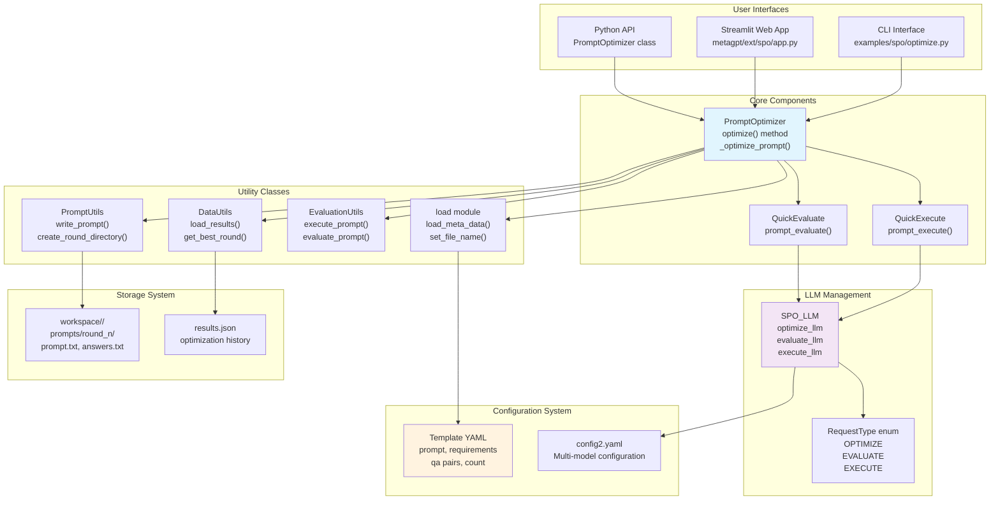
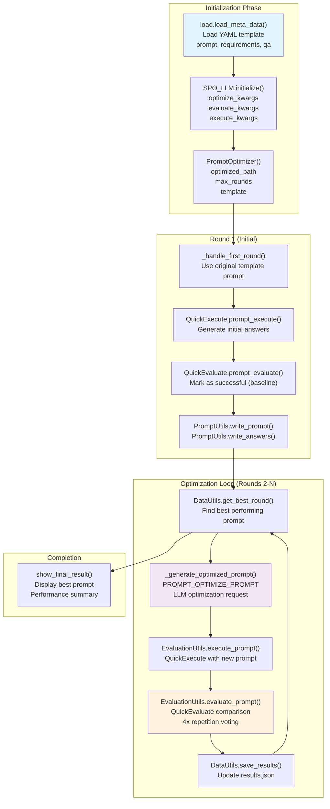
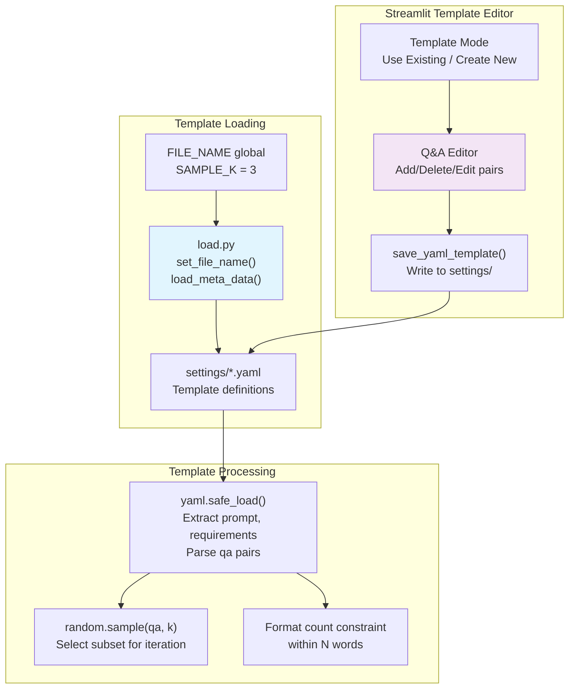
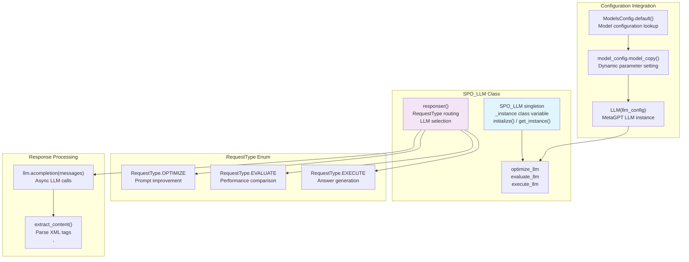
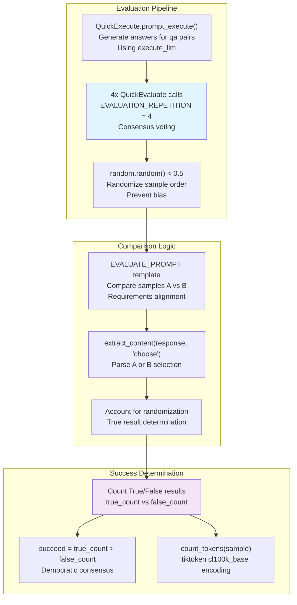

<!-- source: DeepWiki mcp.deepwiki.com · repo FoundationAgents/MetaGPT · page 10 Advanced Topics and Extensions · fetched 2026-10-30 -->

# Advanced Features and Extensions

<details>
<summary>Relevant source files</summary>

The following files were used as context for generating this wiki page:

- [.github/workflows/fulltest.yaml](.github/workflows/fulltest.yaml)
- [.github/workflows/unittest.yaml](.github/workflows/unittest.yaml)
- [metagpt/config2.py](metagpt/config2.py)
- [metagpt/context.py](metagpt/context.py)
- [metagpt/context_mixin.py](metagpt/context_mixin.py)
- [metagpt/provider/base_llm.py](metagpt/provider/base_llm.py)
- [metagpt/provider/dashscope_api.py](metagpt/provider/dashscope_api.py)
- [metagpt/provider/human_provider.py](metagpt/provider/human_provider.py)
- [metagpt/provider/openai_api.py](metagpt/provider/openai_api.py)
- [metagpt/provider/qianfan_api.py](metagpt/provider/qianfan_api.py)
- [metagpt/software_company.py](metagpt/software_company.py)
- [tests/conftest.py](tests/conftest.py)
- [tests/data/rsp_cache.json](tests/data/rsp_cache.json)
- [tests/metagpt/provider/mock_llm_config.py](tests/metagpt/provider/mock_llm_config.py)
- [tests/metagpt/provider/req_resp_const.py](tests/metagpt/provider/req_resp_const.py)
- [tests/metagpt/provider/test_base_llm.py](tests/metagpt/provider/test_base_llm.py)
- [tests/metagpt/provider/test_bedrock_api.py](tests/metagpt/provider/test_bedrock_api.py)
- [tests/metagpt/provider/test_openai.py](tests/metagpt/provider/test_openai.py)
- [tests/metagpt/test_config.py](tests/metagpt/test_config.py)
- [tests/metagpt/test_context.py](tests/metagpt/test_context.py)
- [tests/metagpt/test_context_mixin.py](tests/metagpt/test_context_mixin.py)
- [tests/mock/mock_llm.py](tests/mock/mock_llm.py)

</details>


This page documents the advanced capabilities and extension mechanisms in MetaGPT beyond the core multi-agent framework. The primary advanced feature is the Self-Supervised Prompt Optimization (SPO) system, which provides automated prompt engineering capabilities. For information about the core agent roles and actions, see [Core Multi-Agent Framework](#2). For LLM provider integration details, see [LLM Integration](#3).

## Self-Supervised Prompt Optimization (SPO)

The SPO system implements an automated prompt engineering framework that optimizes prompts through iterative self-supervised learning. It achieves cost efficiency improvements of 17.8-90.9× compared to conventional methods while maintaining competitive performance.

### SPO System Architecture



Sources: [metagpt/ext/spo/components/optimizer.py:19-137](), [metagpt/ext/spo/app.py:1-302](), [examples/spo/optimize.py:1-50]()

### SPO Optimization Process Flow

The SPO system follows a structured optimization cycle with distinct phases for execution, evaluation, and prompt generation.



Sources: [metagpt/ext/spo/components/optimizer.py:40-137](), [metagpt/ext/spo/utils/evaluation_utils.py:25-81](), [metagpt/ext/spo/components/evaluator.py:15-76]()

## Template Configuration System

The SPO system uses YAML-based templates to define optimization tasks. Templates specify the initial prompt, requirements, and evaluation criteria.

### Template Structure

| Component | Description | Example |
|-----------|-------------|---------|
| `prompt` | Initial prompt text | `"Please solve the following problem."` |
| `requirements` | Optimization objectives | `"Generate more thinking, use humorous language"` |
| `count` | Target word count | `50` or `None` |
| `qa` | Question-answer pairs for evaluation | List of `{question, answer}` objects |

### Template Management Classes



Sources: [metagpt/ext/spo/utils/load.py:1-49](), [metagpt/ext/spo/app.py:14-36](), [metagpt/ext/spo/app.py:139-193]()

## Multi-LLM Architecture

The SPO system uses a three-LLM architecture to separate concerns between optimization, evaluation, and execution phases.

### LLM Role Specialization

| Role | LLM Instance | Default Model | Temperature | Purpose |
|------|-------------|---------------|-------------|---------|
| Optimization | `optimize_llm` | `claude-3-5-sonnet-20240620` | 0.7 | Generate improved prompts |
| Evaluation | `evaluate_llm` | `gpt-4o-mini` | 0.3 | Compare prompt performance |
| Execution | `execute_llm` | `gpt-4o-mini` | 0.0 | Generate consistent outputs |

### SPO_LLM Implementation



Sources: [metagpt/ext/spo/utils/llm_client.py:17-84](), [metagpt/ext/spo/utils/llm_client.py:86-107]()

## Usage Interfaces

The SPO system provides three primary interfaces for different use cases and user preferences.

### Interface Comparison

| Interface | Entry Point | Configuration | Use Case |
|-----------|-------------|---------------|----------|
| CLI | `examples/spo/optimize.py` | Command line arguments | Automated/scripted optimization |
| Python API | `PromptOptimizer` class | Direct instantiation | Programmatic integration |
| Streamlit Web UI | `metagpt/ext/spo/app.py` | Interactive forms | User-friendly experimentation |

### Command Line Interface

The CLI interface supports comprehensive parameter configuration:

```bash
python -m examples.spo.optimize \
  --opt-model "claude-3-5-sonnet-20240620" \
  --eval-model "gpt-4o-mini" \
  --exec-model "gpt-4o-mini" \
  --workspace "workspace" \
  --max-rounds 10 \
  --template "Poem.yaml" \
  --name "Poem"
```

Sources: [examples/spo/optimize.py:7-49]()

### Streamlit Web Interface

The web interface provides real-time optimization monitoring and template editing capabilities, including:

- Interactive template creation and editing at [metagpt/ext/spo/app.py:139-193]()
- Live optimization logging with `StreamlitSink` at [metagpt/ext/spo/app.py:197-216]()
- Results visualization with expandable round summaries at [metagpt/ext/spo/app.py:38-73]()
- Prompt testing functionality at [metagpt/ext/spo/app.py:259-297]()

Sources: [metagpt/ext/spo/app.py:75-302]()

## Data Management and Persistence

The SPO system maintains comprehensive records of optimization history and results through structured file organization.

### Workspace Structure

```
workspace/
└── {project_name}/
    └── prompts/
        ├── results.json          # Optimization history metadata
        ├── round_1/
        │   ├── prompt.txt       # Round 1 prompt text
        │   └── answers.txt      # Generated answers
        ├── round_2/
        │   ├── prompt.txt
        │   └── answers.txt
        └── round_n/
            ├── prompt.txt
            └── answers.txt
```

### DataUtils Operations

The `DataUtils` class manages optimization data with methods for:

- `load_results()`: Load optimization history from `results.json`
- `get_best_round()`: Find the highest-performing successful prompt
- `create_result_data()`: Structure round results with metadata
- `save_results()`: Persist results to JSON with timestamp
- `list_to_markdown()`: Format Q&A pairs for prompt generation

Sources: [metagpt/ext/spo/utils/data_utils.py:11-107](), [metagpt/ext/spo/utils/prompt_utils.py:6-35]()

## Evaluation Methodology

The SPO system employs a robust evaluation methodology with voting-based consensus and randomized comparison to ensure reliable optimization decisions.

### Evaluation Process



Sources: [metagpt/ext/spo/utils/evaluation_utils.py:10-82](), [metagpt/ext/spo/components/evaluator.py:15-76]()

## Extension and Customization Points

The SPO system provides several extension points for customization and integration with other systems.

### Key Extension Interfaces

| Component | Extension Method | Purpose |
|-----------|------------------|---------|
| Template System | Custom YAML schemas | Domain-specific optimization tasks |
| Evaluation Logic | `QuickEvaluate` subclassing | Custom performance metrics |
| LLM Integration | `SPO_LLM` configuration | Alternative model providers |
| Storage Backend | `DataUtils` modification | Custom persistence layers |

### Integration with MetaGPT Core

The SPO system integrates with MetaGPT's core infrastructure through:

- **LLM Provider System**: Uses `ModelsConfig` and `LLM` classes for model management
- **Configuration Framework**: Leverages `config2.yaml` for multi-provider setup  
- **Logging Infrastructure**: Utilizes MetaGPT's logging system with `logger`
- **File Management**: Compatible with MetaGPT's project structure conventions

Sources: [metagpt/ext/spo/utils/llm_client.py:30-51](), [examples/spo/config2.example.yaml:1-26]()

---

