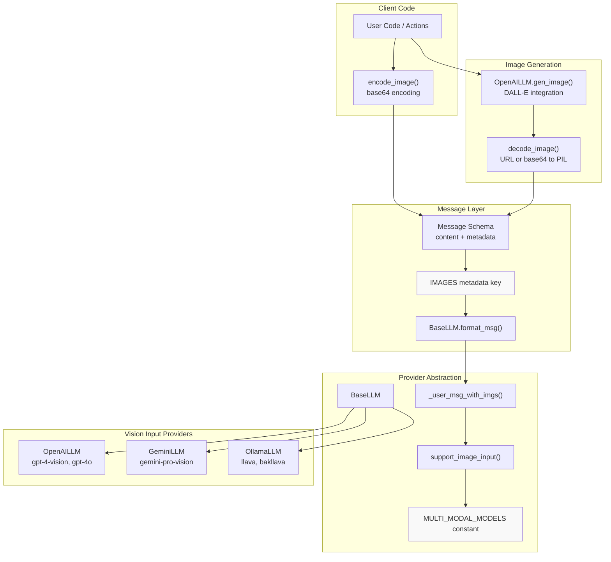
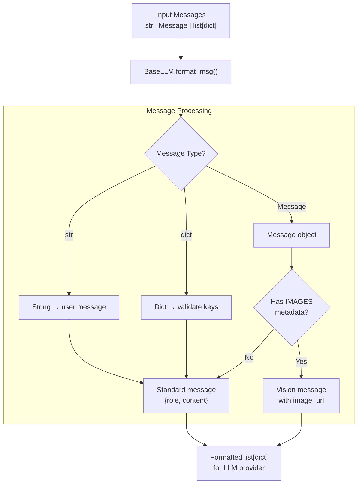
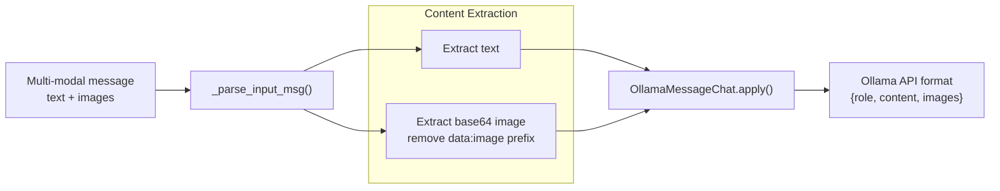

<!-- source: DeepWiki mcp.deepwiki.com · repo FoundationAgents/MetaGPT · page 10.1 Multi-Modal Capabilities · fetched 2026-10-30 -->

# Multi-Modal Capabilities

<details>
<summary>Relevant source files</summary>

The following files were used as context for generating this wiki page:

- [examples/llm_vision.py](examples/llm_vision.py)
- [metagpt/provider/base_llm.py](metagpt/provider/base_llm.py)
- [metagpt/provider/dashscope_api.py](metagpt/provider/dashscope_api.py)
- [metagpt/provider/general_api_base.py](metagpt/provider/general_api_base.py)
- [metagpt/provider/general_api_requestor.py](metagpt/provider/general_api_requestor.py)
- [metagpt/provider/google_gemini_api.py](metagpt/provider/google_gemini_api.py)
- [metagpt/provider/human_provider.py](metagpt/provider/human_provider.py)
- [metagpt/provider/ollama_api.py](metagpt/provider/ollama_api.py)
- [metagpt/provider/openai_api.py](metagpt/provider/openai_api.py)
- [metagpt/provider/qianfan_api.py](metagpt/provider/qianfan_api.py)
- [metagpt/provider/spark_api.py](metagpt/provider/spark_api.py)
- [metagpt/provider/zhipuai/async_sse_client.py](metagpt/provider/zhipuai/async_sse_client.py)
- [metagpt/provider/zhipuai/zhipu_model_api.py](metagpt/provider/zhipuai/zhipu_model_api.py)
- [metagpt/provider/zhipuai_api.py](metagpt/provider/zhipuai_api.py)
- [tests/metagpt/provider/mock_llm_config.py](tests/metagpt/provider/mock_llm_config.py)
- [tests/metagpt/provider/req_resp_const.py](tests/metagpt/provider/req_resp_const.py)
- [tests/metagpt/provider/test_anthropic_api.py](tests/metagpt/provider/test_anthropic_api.py)
- [tests/metagpt/provider/test_base_llm.py](tests/metagpt/provider/test_base_llm.py)
- [tests/metagpt/provider/test_bedrock_api.py](tests/metagpt/provider/test_bedrock_api.py)
- [tests/metagpt/provider/test_google_gemini_api.py](tests/metagpt/provider/test_google_gemini_api.py)
- [tests/metagpt/provider/test_ollama_api.py](tests/metagpt/provider/test_ollama_api.py)
- [tests/metagpt/provider/test_openai.py](tests/metagpt/provider/test_openai.py)
- [tests/metagpt/provider/test_qianfan_api.py](tests/metagpt/provider/test_qianfan_api.py)
- [tests/metagpt/provider/test_spark_api.py](tests/metagpt/provider/test_spark_api.py)
- [tests/metagpt/provider/test_zhipuai_api.py](tests/metagpt/provider/test_zhipuai_api.py)

</details>


## Purpose and Scope

This document covers MetaGPT's support for multi-modal interactions with Large Language Models, specifically:
- **Image input to vision models** (GPT-4V, Gemini Vision, Ollama vision models)
- **Image generation** (DALL-E integration)
- **Message formatting** with image content
- **Provider-specific implementations** for multi-modal operations

For text-based LLM interactions, see [LLM Provider Integration](#3). For structured output generation, see [ActionNode and Structured Output](#7).

---

## Architecture Overview



**Sources:** [metagpt/provider/base_llm.py:27-29](), [metagpt/provider/base_llm.py:64-83](), [metagpt/provider/base_llm.py:91-92](), [metagpt/provider/base_llm.py:94-116]()

---

## Image Input to Vision Models

### Image Encoding and Storage

Images are passed to LLMs through the `Message` metadata system using the `IMAGES` key. The workflow is:

1. **Encode images** to base64 using `encode_image()` utility
2. **Attach to Message** via `add_metadata(IMAGES, [...])`
3. **Format automatically** when passed to LLM via `format_msg()`

```python
# From examples/llm_vision.py
from metagpt.utils.common import encode_image

invoice_path = Path("tests/data/invoices/invoice-2.png")
img_base64 = encode_image(invoice_path)

# Pass image with text prompt
res = await llm.aask(
    msg="return `True` if this image might be a invoice",
    images=[img_base64]
)
```

**Sources:** [examples/llm_vision.py:1-24](), [metagpt/provider/base_llm.py:64-69]()

### Vision Model Detection

The `support_image_input()` method checks if the current model supports vision capabilities by matching against `MULTI_MODAL_MODELS`:

| Provider | Vision Models |
|----------|---------------|
| OpenAI | `gpt-4-vision-preview`, `gpt-4-turbo`, `gpt-4o`, `gpt-4o-mini` |
| Google Gemini | `gemini-pro-vision`, `gemini-1.5-pro`, `gemini-1.5-flash` |
| Ollama | `llava`, `bakllava`, any model with vision capabilities |

```python
# From base_llm.py
def support_image_input(self) -> bool:
    return any([m in self.model for m in MULTI_MODAL_MODELS])
```

**Sources:** [metagpt/provider/base_llm.py:91-92](), [metagpt/provider/constant.py]()

### Message Format with Images

The `_user_msg_with_imgs()` method constructs multi-modal messages in OpenAI's format:

```python
# Message structure for vision models
{
    "role": "user",
    "content": [
        {"type": "text", "text": "What's in this image?"},
        {
            "type": "image_url",
            "image_url": {
                "url": "data:image/jpeg;base64,{base64_string}"
                # OR
                "url": "https://example.com/image.jpg"
            }
        }
    ]
}
```

The method handles both:
- **HTTP(S) URLs**: Passed directly as `image_url`
- **Base64 data**: Prefixed with `data:image/jpeg;base64,`

**Sources:** [metagpt/provider/base_llm.py:71-83]()

---

## Format Message Pipeline



**Sources:** [metagpt/provider/base_llm.py:94-116]()

### Format Message Implementation

The `format_msg()` method in `BaseLLM` handles conversion to provider-compatible format:

```python
def format_msg(self, messages: Union[str, Message, list[dict], ...]) -> list[dict]:
    """Convert messages to list[dict]."""
    from metagpt.schema import Message
    
    if not isinstance(messages, list):
        messages = [messages]
    
    processed_messages = []
    for msg in messages:
        if isinstance(msg, str):
            processed_messages.append({"role": "user", "content": msg})
        elif isinstance(msg, dict):
            assert set(msg.keys()) == set(["role", "content"])
            processed_messages.append(msg)
        elif isinstance(msg, Message):
            images = msg.metadata.get(IMAGES)
            # Use vision format if images present
            processed_msg = self._user_msg(msg=msg.content, images=images) if images else msg.to_dict()
            processed_messages.append(processed_msg)
    
    return processed_messages
```

**Key behavior:**
- Extracts `IMAGES` from `Message.metadata`
- Calls `_user_msg()` which delegates to `_user_msg_with_imgs()` when `support_image_input()` returns True
- Falls back to standard message format for non-vision models

**Sources:** [metagpt/provider/base_llm.py:94-116](), [tests/metagpt/provider/test_base_llm.py:176-201]()

---

## Provider-Specific Implementations

### OpenAI Vision Support

OpenAI vision models accept the standard multi-modal format. The `OpenAILLM` class inherits `_user_msg_with_imgs()` from `BaseLLM` without modification:

**Supported Models:**
- `gpt-4-vision-preview`
- `gpt-4-turbo` (with vision)
- `gpt-4o`, `gpt-4o-mini`

**Image formats:**
- HTTP(S) URLs
- Base64-encoded images (JPEG, PNG, GIF, WebP)

**Sources:** [metagpt/provider/openai_api.py:58-328](), [tests/metagpt/provider/test_openai.py:133-142]()

### Gemini Vision Support

Gemini uses a different message format with `parts` instead of `content`. The `GeminiLLM` class overrides format methods:

```python
# Gemini message format
{
    "role": "user",  # or "model" for assistant
    "parts": ["What's in this image?", image_data]
}
```

However, the current implementation in [metagpt/provider/google_gemini_api.py:64-73]() does not handle images in the overridden `_user_msg()` method, suggesting image support may be limited or require raw message passing.

**Sources:** [metagpt/provider/google_gemini_api.py:42-165]()

### Ollama Vision Support

Ollama supports vision through models like LLaVA and BakLLaVA. The implementation uses a custom message handling system:



**Implementation details:**

The `_parse_input_msg()` method in `OllamaMessageBase` extracts text and images:

```python
def _parse_input_msg(self, msg: dict) -> Tuple[Optional[str], Optional[str]]:
    if "type" in msg:
        tpe = msg["type"]
        if tpe == "text":
            return msg["text"], None
        elif tpe == "image_url":
            # Remove "data:image/jpeg;base64," prefix
            return None, msg["image_url"]["url"][self._image_b64_rms:]
```

Then `OllamaMessageChat.apply()` builds the Ollama-specific format:

```python
def apply(self, messages: list[dict]) -> dict:
    content = messages[0]["content"]
    prompts = []
    images = []
    if isinstance(content, list):
        for msg in content:
            prompt, image = self._parse_input_msg(msg)
            if prompt:
                prompts.append(prompt)
            if image:
                images.append(image)
    
    messes = []
    for prompt in prompts:
        if len(images) > 0:
            messes.append({"role": "user", "content": prompt, "images": images})
        else:
            messes.append({"role": "user", "content": prompt})
    
    return {"model": self.model, "messages": messes}
```

**Sources:** [metagpt/provider/ollama_api.py:18-187](), [tests/metagpt/provider/test_ollama_api.py:1-54]()

---

## Image Generation

### DALL-E Integration

The `OpenAILLM` class provides image generation via the `gen_image()` method:

**Method Signature:**
```python
async def gen_image(
    self,
    prompt: str,
    size: str = "1024x1024",
    quality: str = "standard",  # "standard" or "hd"
    model: str = None,  # defaults to self.model
    resp_format: str = "url"  # "url" or "b64_json"
) -> list[Image]
```

**Response Formats:**
- `url`: Returns HTTP URLs to generated images (expire after 1 hour)
- `b64_json`: Returns base64-encoded image data

**Processing:**
The method decodes responses using `decode_image()` utility, which:
1. Downloads image from URL if `resp_format="url"`
2. Decodes base64 if `resp_format="b64_json"`
3. Returns PIL `Image` object(s)

**Example:**
```python
from metagpt.llm import LLM

llm = LLM()
model = "dall-e-3"
prompt = 'a logo with word "MetaGPT"'

# Get URL response
images = await llm.gen_image(model=model, prompt=prompt)
assert images[0].size == (1024, 1024)

# Get base64 response
images = await llm.gen_image(model=model, prompt=prompt, resp_format="b64_json")
```

**Supported Models:**
- `dall-e-2`: 256x256, 512x512, 1024x1024
- `dall-e-3`: 1024x1024, 1024x1792, 1792x1024 (standard or HD quality)

**Sources:** [metagpt/provider/openai_api.py:302-321](), [tests/metagpt/provider/test_openai.py:133-142](), [metagpt/utils/common.py]()

---

## Base64 Masking for Logging

To prevent log pollution from large base64 strings, `BaseLLM` provides `mask_base64_data()`:

```python
def mask_base64_data(self, msg: dict) -> dict:
    """Replace base64 image data with placeholders for logging."""
    new_msg = msg.copy()
    content = new_msg.get("content")
    img_base64_prefix = "data:image/"
    
    if isinstance(content, list):
        # Handle multimodal content (gpt-4v format)
        new_content = []
        for item in content:
            if isinstance(item, dict) and item.get("type") == "image_url":
                image_url = item.get("image_url", {}).get("url", "")
                if image_url.startswith(img_base64_prefix):
                    item = item.copy()
                    item["image_url"] = {"url": "<Image base64 data has been omitted>"}
            new_content.append(item)
        new_msg["content"] = new_content
    
    return new_msg
```

This is automatically called in `aask()` before logging:

```python
# From base_llm.py aask() method
masked_message = [self.mask_base64_data(m) for m in message]
logger.debug(masked_message)
```

**Sources:** [metagpt/provider/base_llm.py:147-177](), [metagpt/provider/base_llm.py:203-210]()

---

## Testing Multi-Modal Capabilities

### Vision Input Test

```python
def test_format_msg_w_images():
    """Test message formatting with images."""
    base_llm = MockBaseLLM()
    base_llm.model = "gpt-4o"  # Vision-capable model
    
    # Create message with images
    msg_w_images = UserMessage(content="req1")
    msg_w_images.add_metadata(IMAGES, ["base64 string 1", "base64 string 2"])
    
    messages = [msg_w_images, AIMessage(content="rsp")]
    formatted_msgs = base_llm.format_msg(messages)
    
    # Expected format
    assert formatted_msgs == [
        {
            "role": "user",
            "content": [
                {"type": "text", "text": "req1"},
                {"type": "image_url", "image_url": {"url": "data:image/jpeg;base64,base64 string 1"}},
                {"type": "image_url", "image_url": {"url": "data:image/jpeg;base64,base64 string 2"}},
            ],
        },
        {"role": "assistant", "content": "rsp"},
    ]
```

**Sources:** [tests/metagpt/provider/test_base_llm.py:176-201]()

### Image Generation Test

```python
@pytest.mark.asyncio
async def test_gen_image():
    """Test DALL-E image generation."""
    llm = LLM()
    model = "dall-e-3"
    prompt = 'a logo with word "MetaGPT"'
    
    # URL format
    images: list[Image] = await llm.gen_image(model=model, prompt=prompt)
    assert images[0].size == (1024, 1024)
    
    # Base64 format
    images: list[Image] = await llm.gen_image(
        model=model, 
        prompt=prompt, 
        resp_format="b64_json"
    )
    assert images[0].size == (1024, 1024)
```

**Sources:** [tests/metagpt/provider/test_openai.py:133-142]()

---

## Usage Patterns

### Pattern 1: Vision Analysis with Single Image

```python
from pathlib import Path
from metagpt.llm import LLM
from metagpt.utils.common import encode_image

llm = LLM()  # Uses gpt-4o or configured vision model

# Encode image to base64
image_path = Path("data/screenshot.png")
img_base64 = encode_image(image_path)

# Ask question about image
response = await llm.aask(
    msg="Describe what you see in this image",
    images=[img_base64]
)
```

### Pattern 2: Multiple Images in Conversation

```python
from metagpt.schema import UserMessage
from metagpt.const import IMAGES

# Create message with multiple images
msg = UserMessage(content="Compare these two diagrams")
msg.add_metadata(IMAGES, [img1_base64, img2_base64])

# Send via llm.format_msg() automatically
response = await llm.aask(msg.content, format_msgs=[msg.to_dict()])
```

### Pattern 3: Image Generation for Visualization

```python
from metagpt.llm import LLM

llm = LLM()
prompt = "A flowchart showing the MetaGPT architecture with agents and tools"

# Generate high-quality image
images = await llm.gen_image(
    model="dall-e-3",
    prompt=prompt,
    size="1792x1024",
    quality="hd"
)

# Save to disk
images[0].save("architecture_diagram.png")
```

**Sources:** [examples/llm_vision.py:1-24]()

---

## Summary

| Capability | Implementation | Key Methods | Providers |
|------------|----------------|-------------|-----------|
| **Image Input** | Base64 encoding + metadata | `encode_image()`, `_user_msg_with_imgs()`, `format_msg()` | OpenAI (GPT-4V, GPT-4o), Gemini, Ollama |
| **Vision Detection** | Model name matching | `support_image_input()`, `MULTI_MODAL_MODELS` | All providers |
| **Image Generation** | DALL-E API | `gen_image()`, `decode_image()` | OpenAI only |
| **Log Masking** | Base64 placeholder | `mask_base64_data()` | All providers |

**Key Design Principles:**
1. **Provider-agnostic abstraction**: Images handled via `IMAGES` metadata and `format_msg()`
2. **Automatic detection**: Vision capability checked per model via `support_image_input()`
3. **Flexible formats**: Supports both URLs and base64 encoding
4. **Logging safety**: Automatic masking of base64 data in debug logs

**Sources:** [metagpt/provider/base_llm.py:35-413](), [metagpt/provider/openai_api.py:58-328](), [metagpt/provider/ollama_api.py:18-333](), [examples/llm_vision.py:1-24]()

---

