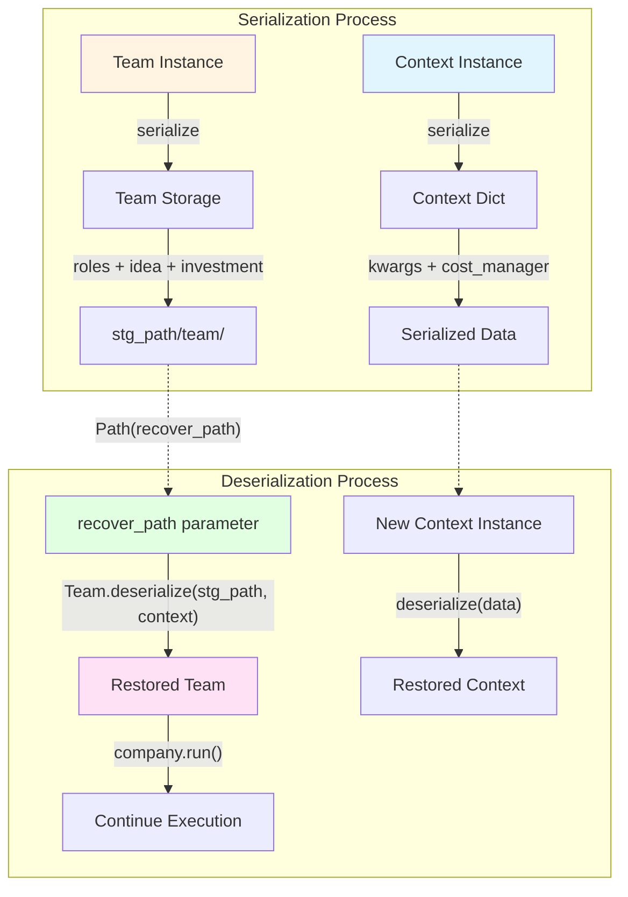
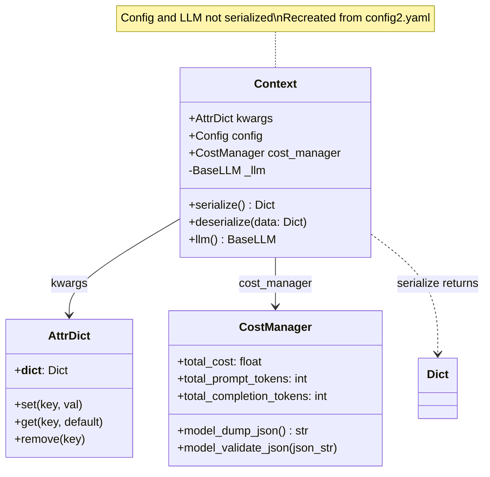
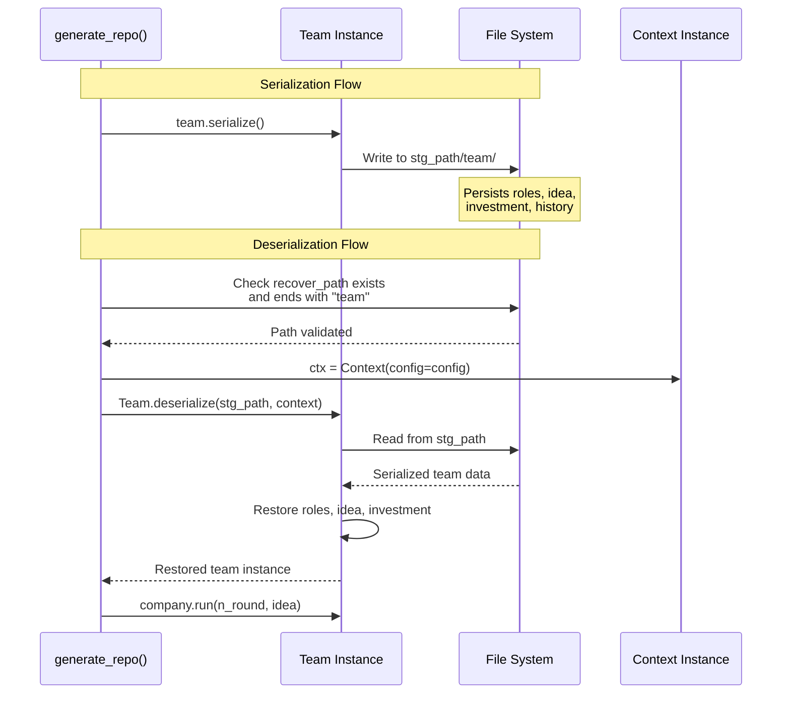
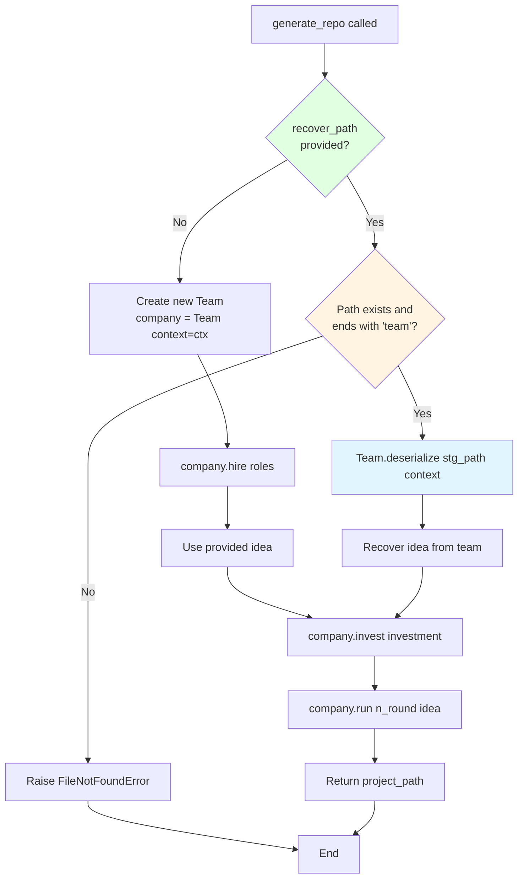
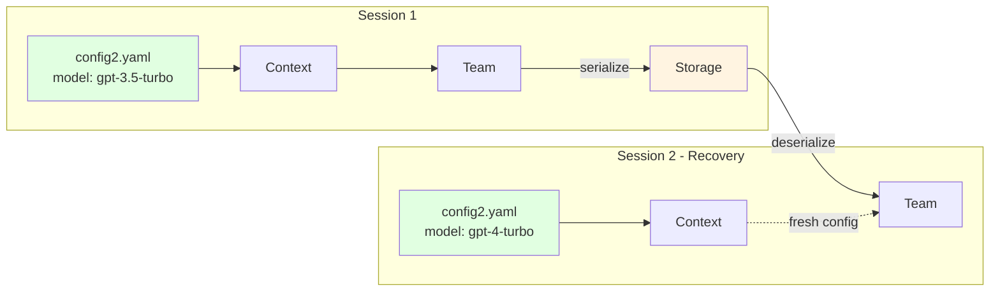

<!-- source: DeepWiki mcp.deepwiki.com · repo FoundationAgents/MetaGPT · page 10.2 Context Serialization and Recovery · fetched 2026-10-30 -->

# Context Serialization and Recovery

<details>
<summary>Relevant source files</summary>

The following files were used as context for generating this wiki page:

- [.github/workflows/fulltest.yaml](.github/workflows/fulltest.yaml)
- [.github/workflows/unittest.yaml](.github/workflows/unittest.yaml)
- [Dockerfile](Dockerfile)
- [README.md](README.md)
- [docs/ACADEMIC_WORK.md](docs/ACADEMIC_WORK.md)
- [docs/NEWS.md](docs/NEWS.md)
- [docs/README_CN.md](docs/README_CN.md)
- [docs/README_FR.md](docs/README_FR.md)
- [docs/README_JA.md](docs/README_JA.md)
- [metagpt/config2.py](metagpt/config2.py)
- [metagpt/context.py](metagpt/context.py)
- [metagpt/context_mixin.py](metagpt/context_mixin.py)
- [metagpt/software_company.py](metagpt/software_company.py)
- [metagpt/utils/mermaid.py](metagpt/utils/mermaid.py)
- [tests/conftest.py](tests/conftest.py)
- [tests/data/rsp_cache.json](tests/data/rsp_cache.json)
- [tests/metagpt/test_config.py](tests/metagpt/test_config.py)
- [tests/metagpt/test_context.py](tests/metagpt/test_context.py)
- [tests/metagpt/test_context_mixin.py](tests/metagpt/test_context_mixin.py)
- [tests/mock/mock_llm.py](tests/mock/mock_llm.py)

</details>


## Purpose and Scope

This page documents the serialization and deserialization mechanisms in MetaGPT that enable **state persistence** and **recovery of interrupted multi-agent workflows**. These capabilities allow long-running projects to be paused and resumed without loss of progress, preserving runtime state including accumulated costs, custom parameters, and team composition.

For information about the Context runtime management system itself, see [Context and Runtime Management](#1.3). For details on Team orchestration, see [Team Orchestration and Environment](#2.4).

---

## System Overview

MetaGPT's serialization system operates at two levels:

1. **Context-level serialization**: Preserves runtime state (custom kwargs, cost tracking)
2. **Team-level serialization**: Preserves multi-agent team state (roles, idea, investment, history)

These two mechanisms work together to enable full project recovery via the `recover_path` parameter in `generate_repo()`.



**Sources**: [metagpt/context.py:102-127](), [metagpt/software_company.py:26-74]()

---

## Context Serialization Architecture

### What Gets Serialized

The `Context.serialize()` method captures two key components:

| Component | Type | Content | Purpose |
|-----------|------|---------|---------|
| `kwargs` | `AttrDict` | Custom runtime parameters | Store dynamic state like `project_path`, custom flags |
| `cost_manager` | `CostManager` | Token usage and costs | Track accumulated LLM API costs across sessions |

**What is NOT serialized**:
- `config`: Configuration is passed separately during deserialization (from `config2.yaml`)
- `_llm`: LLM instances are recreated from config on demand
- Transient system resources (file handles, network connections)



**Sources**: [metagpt/context.py:58-128](), [metagpt/context.py:26-56]()

---

## Serialization Methods

### Context.serialize()

The `Context.serialize()` method creates a dictionary snapshot of runtime state:

```python
def serialize(self) -> Dict[str, Any]:
    """Serialize the object's attributes into a dictionary."""
    return {
        "kwargs": {k: v for k, v in self.kwargs.__dict__.items()},
        "cost_manager": self.cost_manager.model_dump_json(),
    }
```

**Key behaviors**:
- `kwargs` is flattened to a plain dictionary
- `cost_manager` is serialized to JSON string using Pydantic
- Returns a simple dictionary suitable for JSON serialization

**Sources**: [metagpt/context.py:102-111]()

### Context.deserialize()

The `Context.deserialize()` method restores state from serialized data:

```python
def deserialize(self, serialized_data: Dict[str, Any]):
    """Deserialize the given serialized data and update the object's attributes accordingly."""
    if not serialized_data:
        return
    kwargs = serialized_data.get("kwargs")
    if kwargs:
        for k, v in kwargs.items():
            self.kwargs.set(k, v)
    cost_manager = serialized_data.get("cost_manager")
    if cost_manager:
        self.cost_manager.model_validate_json(cost_manager)
```

**Key behaviors**:
- Gracefully handles `None` or empty data
- Restores kwargs key-by-key using `AttrDict.set()`
- Uses Pydantic's `model_validate_json()` for type-safe cost_manager restoration

**Sources**: [metagpt/context.py:113-127]()

---

## Team Serialization

### Team.serialize() and Team.deserialize()

While the `Team` class serialization implementation is not shown in the provided files, the usage pattern in `generate_repo()` reveals the interface:



**Sources**: [metagpt/software_company.py:43-74]()

### Storage Structure

Based on the code requirements, the serialized team must be stored in a directory ending with `"team"`:

```
workspace/
└── project_name/
    └── team/              # stg_path must end with "team"
        ├── team_state     # Team metadata (inferred)
        ├── role_states/   # Individual role states (inferred)
        └── history/       # Message history (inferred)
```

**Sources**: [metagpt/software_company.py:64-66]()

---

## Recovery Workflow

### Using recover_path in generate_repo()

The `recover_path` parameter enables resuming interrupted projects:



**Sources**: [metagpt/software_company.py:14-74]()

### Step-by-Step Recovery Process

1. **Initial Setup**: Create new `Context` with fresh config from `config2.yaml`
   ```python
   ctx = Context(config=config)
   ```

2. **Path Validation**: Verify `recover_path` exists and structure is correct
   ```python
   stg_path = Path(recover_path)
   if not stg_path.exists() or not str(stg_path).endswith("team"):
       raise FileNotFoundError(f"{recover_path} not exists or not endswith `team`")
   ```

3. **Team Deserialization**: Restore team with new context
   ```python
   company = Team.deserialize(stg_path=stg_path, context=ctx)
   idea = company.idea  # Original idea is preserved
   ```

4. **Continue Execution**: Resume with restored state
   ```python
   company.invest(investment)
   asyncio.run(company.run(n_round=n_round, idea=idea))
   ```

**Sources**: [metagpt/software_company.py:43-72]()

---

## Usage Examples

### CLI Recovery Example

```bash
# Initial run - project gets interrupted
metagpt "Create a 2048 game" --project-name game_2048

# Later recovery - resume from saved state
metagpt --recover-path ./workspace/game_2048/team
```

### Python API Recovery Example

```python
from metagpt.software_company import generate_repo
from pathlib import Path

# Initial run
project_path = generate_repo(
    idea="Create a 2048 game",
    project_name="game_2048",
    n_round=5
)

# Recovery run
recovered_path = generate_repo(
    idea="",  # Will be recovered from serialized state
    recover_path=str(Path(project_path) / "team"),
    n_round=3  # Continue for 3 more rounds
)
```

**Note**: When using `recover_path`, the `idea` parameter is ignored as the original idea is recovered from the serialized team state.

**Sources**: [metagpt/software_company.py:14-74](), [metagpt/software_company.py:77-124]()

---

## Configuration and Context Relationship

### Config Persistence Strategy

The `Config` object is intentionally **not serialized** in `Context`. This design decision enables:

1. **Configuration updates**: Users can modify `config2.yaml` between runs
2. **Credential rotation**: API keys can be updated without breaking recovery
3. **Model changes**: LLM providers/models can be switched for resumed runs



**Sources**: [metagpt/context.py:102-127](), [metagpt/config2.py:102-123]()

### Context Recreation Pattern

During recovery, the context is reconstructed as follows:

```python
# Fresh config loaded from config2.yaml
config = Config.default()
config.update_via_cli(project_path, project_name, inc, reqa_file, max_auto_summarize_code)

# New context with fresh config
ctx = Context(config=config)

# Team deserialization receives fresh context
company = Team.deserialize(stg_path=stg_path, context=ctx)
```

This pattern ensures:
- Latest configuration is always used
- LLM instances are recreated with current credentials
- Cost tracking continues from previous state (via serialized cost_manager)

**Sources**: [metagpt/software_company.py:40-68]()

---

## AttrDict: Flexible Runtime State

### Purpose and Design

The `AttrDict` class provides dictionary-like and attribute-like access to runtime state:

| Feature | Behavior | Use Case |
|---------|----------|----------|
| Dict access | `kwargs.get("key")` | Programmatic access |
| Attr access | `kwargs.key` | Convenient dot notation |
| Dynamic | `extra="allow"` | Store arbitrary runtime data |
| Serializable | Plain `__dict__` | Easy JSON serialization |

### Common Runtime Parameters

Parameters commonly stored in `ctx.kwargs`:

- `project_path`: Workspace directory for generated code
- `project_name`: Unique project identifier
- Custom flags: User-defined state variables
- Intermediate results: Cached computations

```python
# Setting runtime state
ctx.kwargs.set("project_path", "/path/to/project")
ctx.kwargs.project_status = "in_progress"

# Reading runtime state
project_path = ctx.kwargs.get("project_path")
status = ctx.kwargs.project_status
```

**Sources**: [metagpt/context.py:26-56](), [metagpt/software_company.py:74]()

---

## Testing Considerations

### Mock LLM and Serialization

The test infrastructure uses cached responses to avoid real API calls during testing:

```python
ALLOW_OPENAI_API_CALL = int(os.environ.get("ALLOW_OPENAI_API_CALL", 1))

@pytest.fixture(scope="function", autouse=True)
def llm_mock(rsp_cache, mocker, request):
    llm = MockLLM(allow_open_api_call=ALLOW_OPENAI_API_CALL)
    llm.rsp_cache = rsp_cache
    mocker.patch("metagpt.provider.base_llm.BaseLLM.aask", llm.aask)
    # ...
```

**Implications for serialization testing**:
- `ALLOW_OPENAI_API_CALL=0` in CI ensures deterministic tests
- Serialized cost_manager reflects cached (not real) costs in tests
- Recovery tests should use mocked LLM to avoid API charges

**Sources**: [tests/conftest.py:30-78](), [.github/workflows/unittest.yaml:36]()

---

## Implementation Details

### Cost Manager Serialization

The `CostManager` uses Pydantic's built-in JSON serialization:

```python
# Serialization
cost_json = self.cost_manager.model_dump_json()  # Returns JSON string

# Deserialization
self.cost_manager.model_validate_json(cost_json)  # Validates and populates
```

This approach provides:
- **Type safety**: Pydantic validates all fields during deserialization
- **Schema evolution**: Can handle version differences with validators
- **Compact format**: JSON string is efficient for storage

**Sources**: [metagpt/context.py:110](), [metagpt/context.py:127]()

### Error Handling

Deserialization includes defensive checks:

```python
def deserialize(self, serialized_data: Dict[str, Any]):
    if not serialized_data:
        return  # Gracefully handle None/empty
    
    kwargs = serialized_data.get("kwargs")
    if kwargs:  # Only process if present
        for k, v in kwargs.items():
            self.kwargs.set(k, v)
```

This design prevents:
- Crashes on corrupted serialization data
- Issues with partial serialization
- Type errors from malformed input

**Sources**: [metagpt/context.py:119-124]()

---

## Limitations and Best Practices

### Current Limitations

1. **LLM State**: LLM instances are not serialized; streaming states are lost
2. **File Handles**: Open file descriptors are not preserved
3. **Network Connections**: Active connections must be reestablished
4. **In-Memory Caches**: Tool caches (Browser, Editor) are not serialized

### Best Practices

| Practice | Rationale | Implementation |
|----------|-----------|----------------|
| Serialize frequently | Minimize lost work | Call `team.serialize()` after each round |
| Validate paths | Prevent deserialization errors | Check `endswith("team")` before saving |
| Version check | Handle schema changes | Include version metadata in serialization |
| Test recovery | Ensure correctness | Write tests that serialize/deserialize |
| Document kwargs | Track custom state | Comment purpose of each kwargs key |

### Recommended Workflow

```python
# Save checkpoint after each major step
async def run_with_checkpoints(team, n_rounds, checkpoint_dir):
    for i in range(n_rounds):
        await team.run(n_round=1)
        
        # Checkpoint after each round
        checkpoint_path = checkpoint_dir / f"round_{i}_team"
        team.serialize(stg_path=checkpoint_path)
        logger.info(f"Checkpoint saved to {checkpoint_path}")
```

**Sources**: [metagpt/software_company.py:64-72]()

---

## Related Systems

- [Context and Runtime Management](#1.3): Core context system and lifecycle
- [Configuration System](#1.2): How config2.yaml integrates with serialization
- [Team Orchestration and Environment](#2.4): Team class and multi-agent coordination
- [Testing and Development Infrastructure](#9): Mock systems and test setup

---

