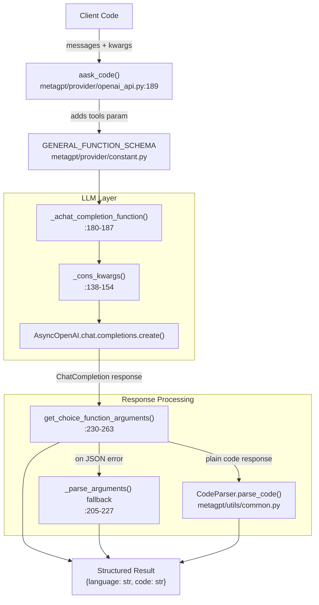
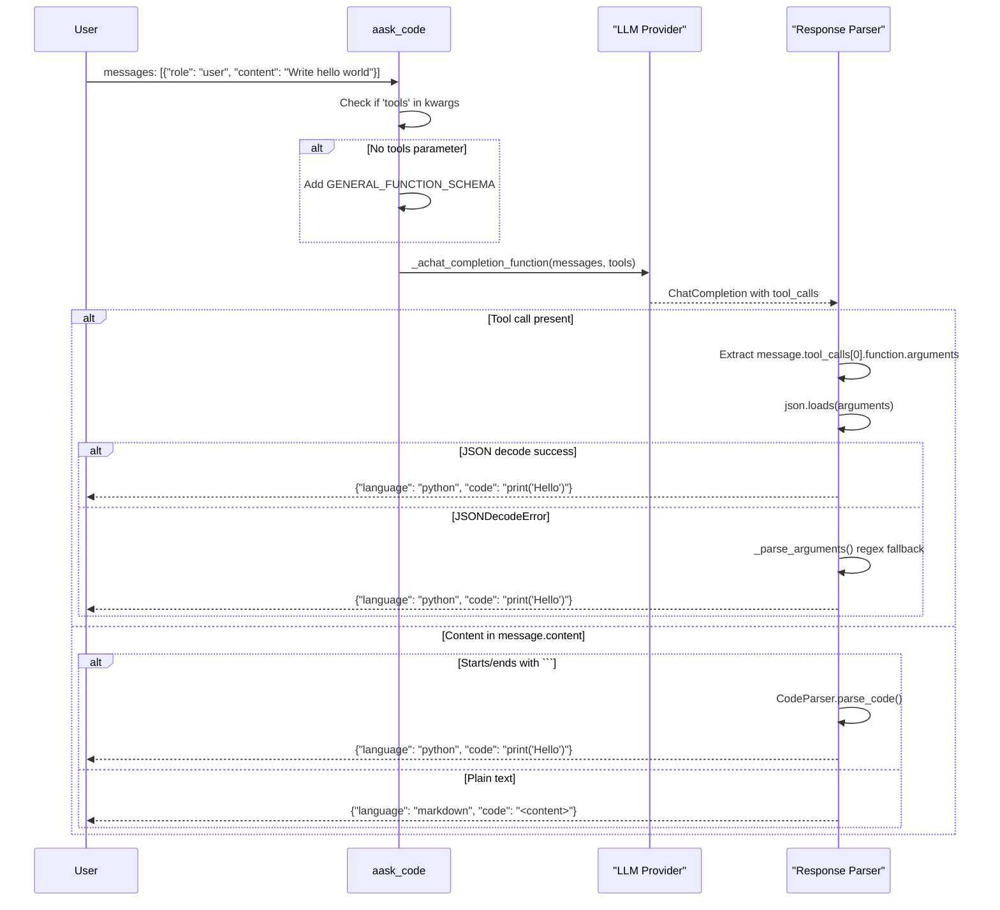

<!-- source: DeepWiki mcp.deepwiki.com · repo FoundationAgents/MetaGPT · page 10.3 Function Calling and Code Generation · fetched 2026-10-30 -->

# Function Calling and Code Generation

<details>
<summary>Relevant source files</summary>

The following files were used as context for generating this wiki page:

- [metagpt/provider/base_llm.py](metagpt/provider/base_llm.py)
- [metagpt/provider/dashscope_api.py](metagpt/provider/dashscope_api.py)
- [metagpt/provider/human_provider.py](metagpt/provider/human_provider.py)
- [metagpt/provider/openai_api.py](metagpt/provider/openai_api.py)
- [metagpt/provider/qianfan_api.py](metagpt/provider/qianfan_api.py)
- [tests/metagpt/provider/mock_llm_config.py](tests/metagpt/provider/mock_llm_config.py)
- [tests/metagpt/provider/req_resp_const.py](tests/metagpt/provider/req_resp_const.py)
- [tests/metagpt/provider/test_base_llm.py](tests/metagpt/provider/test_base_llm.py)
- [tests/metagpt/provider/test_bedrock_api.py](tests/metagpt/provider/test_bedrock_api.py)
- [tests/metagpt/provider/test_openai.py](tests/metagpt/provider/test_openai.py)

</details>


## Purpose and Scope

This document covers MetaGPT's function calling system for structured code generation. Function calling enables LLMs to return code in a structured format with metadata (language, code content) rather than as plain text. This capability is primarily used for generating executable code snippets on-demand.

For information about broader code generation workflows in the software development pipeline, see [Software Development Workflow](#5). For structured output parsing in general contexts, see [ActionNode and Structured Output](#7).

## Function Calling Architecture

MetaGPT implements function calling through the `aask_code` method, which uses OpenAI's tools/functions API to request structured code generation. The system sends a predefined function schema (`GENERAL_FUNCTION_SCHEMA`) that instructs the LLM to return code with language and content fields.



**Sources:** [metagpt/provider/openai_api.py:189-263](), [metagpt/provider/base_llm.py:225-314]()

## The aask_code Method

The `aask_code` method is the primary interface for structured code generation. It extends the base `aask` method by adding function calling capabilities.

### Method Signature and Usage

[metagpt/provider/openai_api.py:189-203]()

```python
async def aask_code(self, messages: list[dict], timeout: int = USE_CONFIG_TIMEOUT, **kwargs) -> dict
```

The method accepts:
- `messages`: Chat messages in OpenAI format
- `timeout`: Request timeout (defaults to config value)
- `**kwargs`: Additional parameters passed to the chat completion API

Returns a dictionary with:
- `language`: Programming language (e.g., "python", "javascript")
- `code`: Executable code string

### Default Function Schema

If no `tools` parameter is provided in kwargs, `aask_code` automatically injects `GENERAL_FUNCTION_SCHEMA`:

```python
if "tools" not in kwargs:
    configs = {"tools": [{"type": "function", "function": GENERAL_FUNCTION_SCHEMA}]}
    kwargs.update(configs)
```

The schema defines an "execute" function that expects `language` and `code` arguments, signaling to the LLM the expected response structure.

**Sources:** [metagpt/provider/openai_api.py:189-203](), [metagpt/provider/constant.py]()

## Code Generation Workflow



**Sources:** [metagpt/provider/openai_api.py:180-263]()

## Response Parsing and Fallback Mechanisms

### Primary Parser: get_choice_function_arguments

[metagpt/provider/openai_api.py:230-263]()

The primary parser `get_choice_function_arguments` handles three response scenarios:

| Scenario | Condition | Handling |
|----------|-----------|----------|
| **Standard function call** | `message.tool_calls[0].function.arguments` exists | Parse JSON arguments directly |
| **JSON decode error** | Valid structure but malformed JSON | Fallback to `_parse_arguments()` regex parser |
| **Code in content** | No tool_calls, content starts/ends with \`\`\` | Use `CodeParser.parse_code()` |
| **Plain text response** | No tool_calls, plain content | Return as `{"language": "markdown", "code": content}` |

### Regex Fallback Parser

[metagpt/provider/openai_api.py:205-227]()

When JSON parsing fails, `_parse_arguments` uses regex patterns to extract language and code:

```python
def _parse_arguments(self, arguments: str) -> dict:
    # Extract language field
    language_pattern = re.compile(r'[\"\']?language[\"\']?\s*:\s*["\']([^"\']+?)["\']', re.DOTALL)
    language_match = language_pattern.search(arguments)
    language_value = language_match.group(1) if language_match else "python"
    
    # Extract code field (handles triple quotes, single quotes)
    code_pattern = r'(["\'`]{3}|["\'`])([\s\S]*?)\1'
    code_value = re.findall(code_pattern, arguments)[-1][-1]
    
    return {"language": language_value, "code": code_value}
```

This provides robustness against LLM responses that don't strictly follow JSON formatting.

**Sources:** [metagpt/provider/openai_api.py:205-263]()

## CodeParser Utility

The `CodeParser` class extracts code blocks from markdown-style responses when the LLM returns code in content rather than function arguments.

[metagpt/utils/common.py]()

```python
# When response contains:
# ```python
# print('Hello, World!')
# ```

code = CodeParser.parse_code(text=message.content)
# Returns: "print('Hello, World!')"
```

This handles the OpenAI tools_call response bug where code appears in `message.content` instead of `message.tool_calls[0].function.arguments`.

**Sources:** [metagpt/provider/openai_api.py:252-258](), [metagpt/utils/common.py]()

## Error Handling

### JSON Decode Errors

[metagpt/provider/openai_api.py:244-251]()

When `json.loads()` fails on function arguments:

```python
try:
    return json.loads(message.tool_calls[0].function.arguments, strict=False)
except json.decoder.JSONDecodeError as e:
    error_msg = f"Got JSONDecodeError for \n{'--'*40} \n{arguments}, {str(e)}"
    logger.error(error_msg)
    return self._parse_arguments(message.tool_calls[0].function.arguments)
```

The `strict=False` parameter allows some non-standard JSON, and regex fallback provides additional robustness.

### Missing Fields

[metagpt/provider/openai_api.py:207-209]()

If neither `language` nor `code` fields are detected, the parser assumes the entire response is pure code:

```python
if "language" not in arguments and "code" not in arguments:
    logger.warning(f"Not found `code`, `language`, We assume it is pure code:\n {arguments}\n. ")
    return {"language": "python", "code": arguments}
```

**Sources:** [metagpt/provider/openai_api.py:205-263]()

## Integration with BaseLLM

The base LLM interface declares `aask_code` as an abstract method that all providers can implement:

[metagpt/provider/base_llm.py:225-228]()

```python
async def aask_code(
    self, messages: Union[str, "Message", list[dict]], timeout=USE_CONFIG_TIMEOUT, **kwargs
) -> dict:
    raise NotImplementedError
```

Base parsing utilities are also provided for extracting function information:

| Method | Purpose | Returns |
|--------|---------|---------|
| `get_choice_function()` | Extract function object | `{"name": str, "arguments": str}` |
| `get_choice_function_arguments()` | Parse function arguments | `dict` (e.g., `{"language": str, "code": str}`)  |

**Sources:** [metagpt/provider/base_llm.py:225-228](), [metagpt/provider/base_llm.py:276-314]()

## Usage Example

```python
from metagpt.llm import LLM

llm = LLM()

# Basic usage
msg = [{'role': 'user', 'content': "Write a python hello world code."}]
rsp = await llm.aask_code(msg)
# Returns: {'language': 'python', 'code': "print('Hello, World!')"}

# With custom tools parameter
custom_schema = {
    "name": "custom_execute",
    "description": "Execute code",
    "parameters": {...}
}
rsp = await llm.aask_code(msg, tools=[{"type": "function", "function": custom_schema}])
```

**Sources:** [metagpt/provider/openai_api.py:192-197](), [tests/metagpt/provider/test_openai.py:108-122]()

## Testing Infrastructure

Test cases validate the parsing of various response formats:

[tests/metagpt/provider/test_openai.py:59-93]()

```python
@pytest.fixture
def tool_calls_rsp():
    # Test standard function call response
    function_rsps = [
        Function(arguments='{\n"language": "python",\n"code": "print(\'hello world\')"}', name="execute"),
    ]
    tool_calls = [ChatCompletionMessageToolCall(...)]
    
    # Test plain text response
    messages.append(
        ChatCompletionMessage(content="Completed a python code for hello world!", role="assistant", tool_calls=None)
    )
    
    # Test OpenAI bug: code in content field
    messages.extend([
        ChatCompletionMessage(content="```python\nprint('hello world')```", role="assistant", tool_calls=None),
    ])
```

Test for JSON decode error fallback:

[tests/metagpt/provider/test_openai.py:87-93]()

```python
@pytest.fixture
def json_decode_error():
    # Malformed JSON: single quotes instead of double quotes
    function_rsp = Function(
        arguments='{\n"language": \'python\',\n"code": "print(\'hello world\')"}',
        name="execute"
    )
```

**Sources:** [tests/metagpt/provider/test_openai.py:59-130](), [tests/metagpt/provider/test_base_llm.py:53-95]()

## Multi-Provider Support

While `aask_code` is implemented in `OpenAILLM`, other providers can implement similar functionality:

| Provider | Status | Notes |
|----------|--------|-------|
| OpenAI | ✓ Implemented | Full support with fallbacks |
| Azure OpenAI | ✓ Implemented | Uses same OpenAILLM implementation |
| Anthropic | Partial | Base method available, may need custom implementation |
| Gemini | Partial | Base method available, may need custom implementation |
| Bedrock | Partial | Provider-specific function calling |
| Chinese LLMs | Partial | May require custom schemas |

**Sources:** [metagpt/provider/openai_api.py:43-57](), [metagpt/provider/base_llm.py:225-228]()

## Response Structure Reference

### Standard Function Call Response

```json
{
  "choices": [{
    "message": {
      "role": "assistant",
      "content": null,
      "tool_calls": [{
        "id": "call_Y5r6Ddr2Qc2ZrqgfwzPX5l72",
        "type": "function",
        "function": {
          "name": "execute",
          "arguments": "{\"language\": \"python\", \"code\": \"print('Hello, World!')\"}"
        }
      }]
    }
  }]
}
```

### Parsed Result

```python
{
    "language": "python",
    "code": "print('Hello, World!')"
}
```

**Sources:** [tests/metagpt/provider/test_base_llm.py:53-82]()

## Cost Tracking

Function calling requests are tracked through the standard cost management system:

[metagpt/provider/openai_api.py:186]()

```python
async def _achat_completion_function(...) -> ChatCompletion:
    rsp: ChatCompletion = await self.aclient.chat.completions.create(**kwargs)
    self._update_costs(rsp.usage)  # Track token usage
    return rsp
```

Token costs are calculated the same way as regular completions, using the model's pricing plan. For details on cost management, see [Token Management and Cost Control](#3.5).

**Sources:** [metagpt/provider/openai_api.py:180-187](), [metagpt/provider/base_llm.py:124-141]()

---

