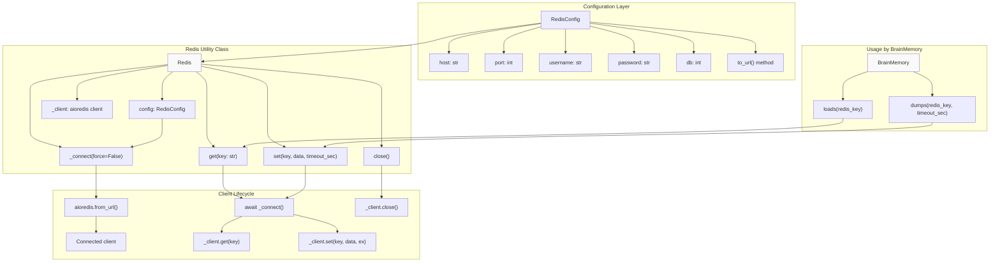
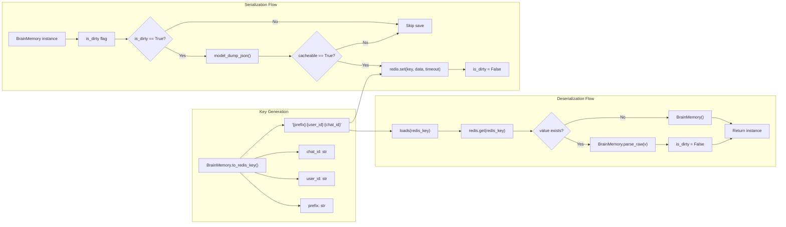
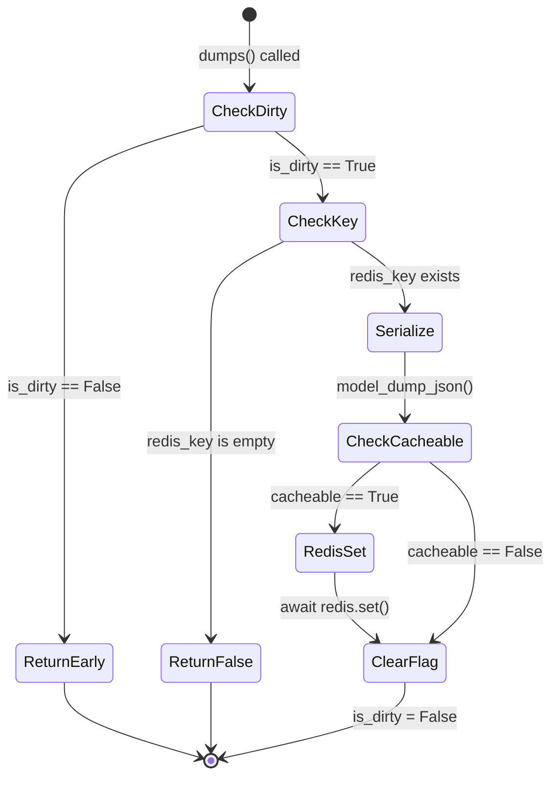
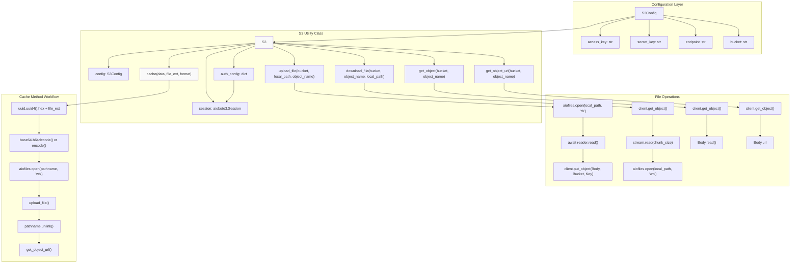
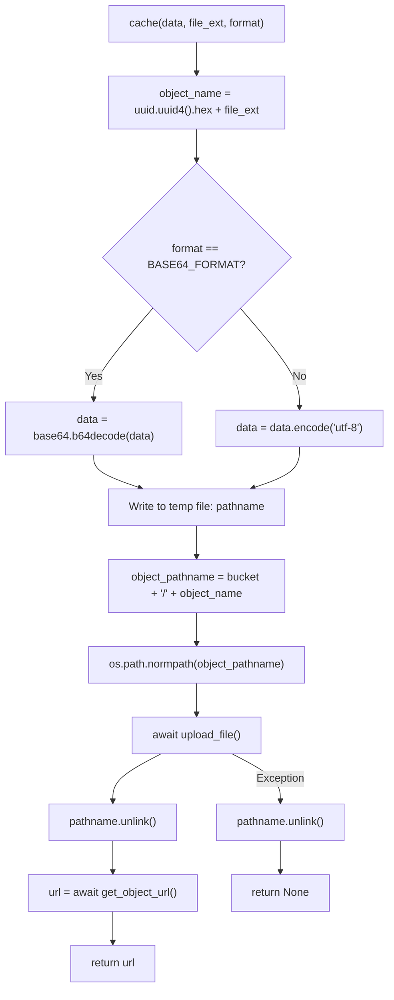
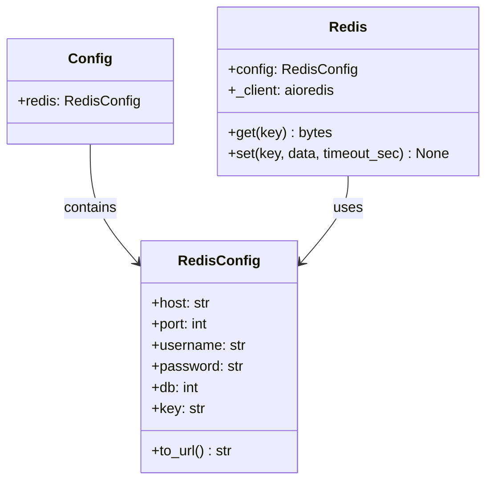
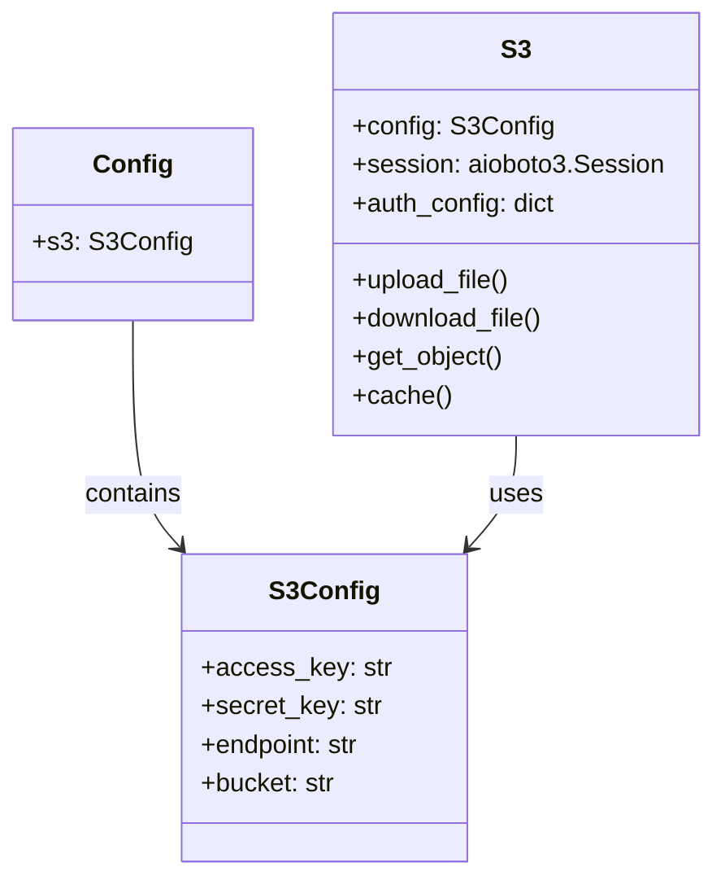
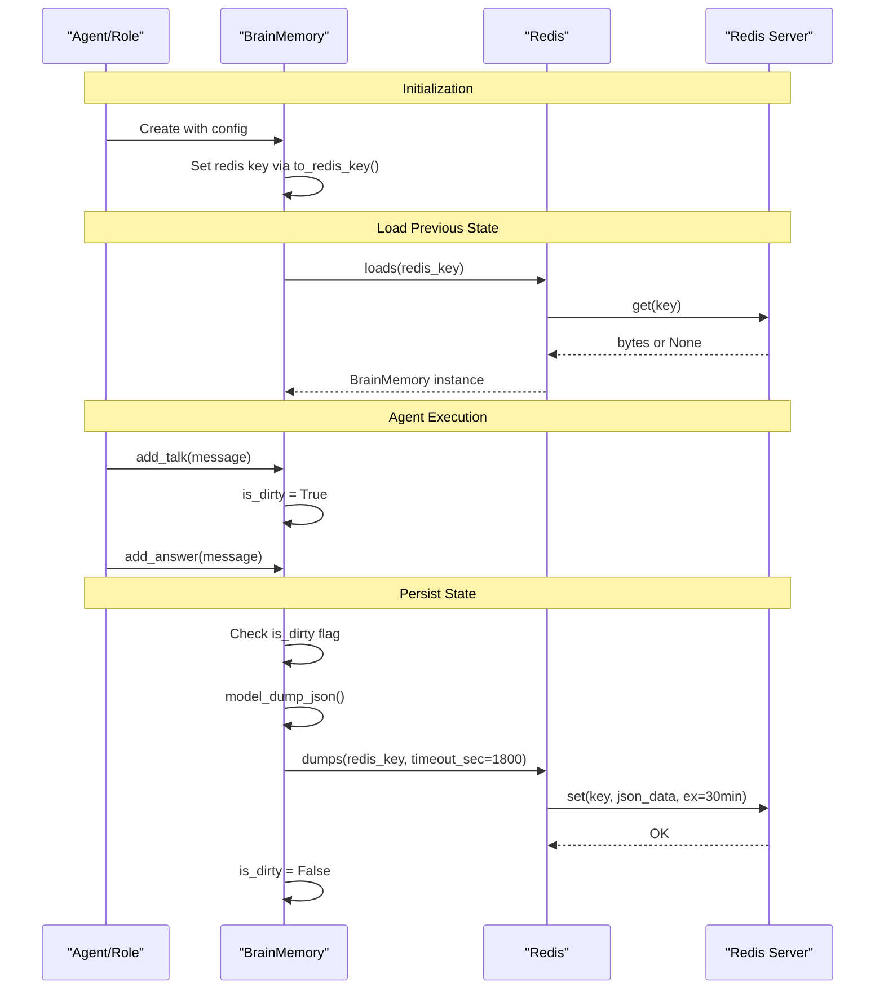
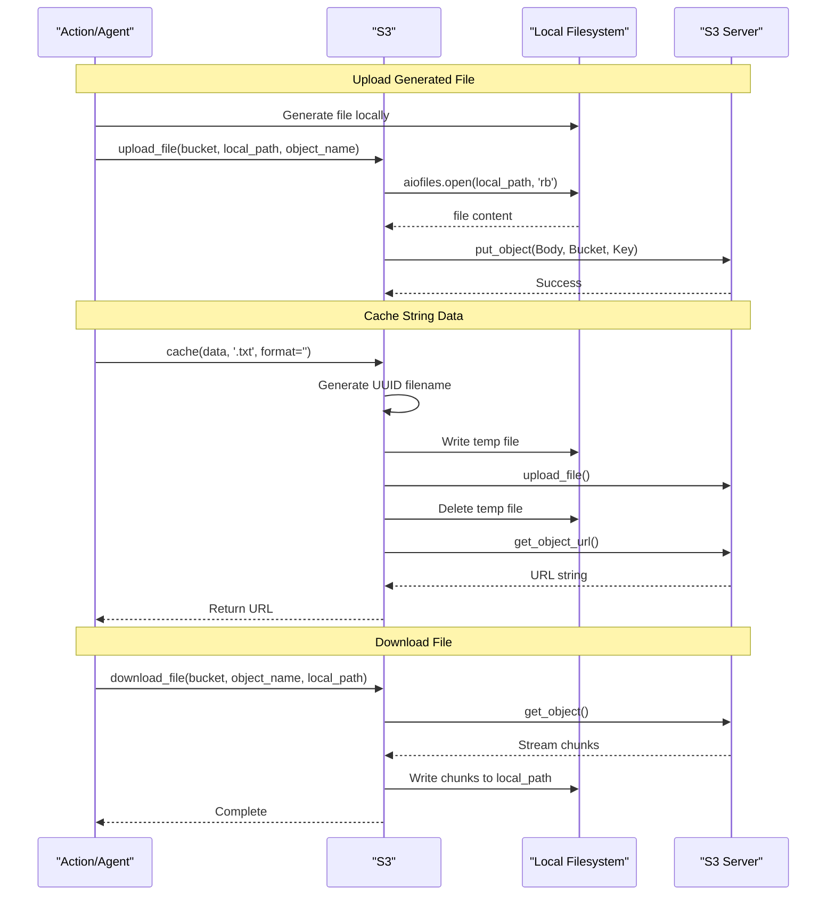

<!-- source: DeepWiki mcp.deepwiki.com · repo FoundationAgents/MetaGPT · page 10.4 Storage Utilities · fetched 2026-10-30 -->

# Storage Utilities

Relevant source files

The following files were used as context for generating this wiki page:

- [metagpt/actions/prepare_documents.py](metagpt/actions/prepare_documents.py)
- [metagpt/actions/skill_action.py](metagpt/actions/skill_action.py)
- [metagpt/actions/talk_action.py](metagpt/actions/talk_action.py)
- [metagpt/memory/brain_memory.py](metagpt/memory/brain_memory.py)
- [metagpt/prompts/di/swe_agent.py](metagpt/prompts/di/swe_agent.py)
- [metagpt/roles/assistant.py](metagpt/roles/assistant.py)
- [metagpt/roles/di/swe_agent.py](metagpt/roles/di/swe_agent.py)
- [metagpt/tools/libs/git.py](metagpt/tools/libs/git.py)
- [metagpt/utils/file_repository.py](metagpt/utils/file_repository.py)
- [metagpt/utils/git_repository.py](metagpt/utils/git_repository.py)
- [metagpt/utils/redis.py](metagpt/utils/redis.py)
- [metagpt/utils/s3.py](metagpt/utils/s3.py)
- [tests/metagpt/memory/test_brain_memory.py](tests/metagpt/memory/test_brain_memory.py)
- [tests/metagpt/roles/di/run_swe_agent_for_benchmark.py](tests/metagpt/roles/di/run_swe_agent_for_benchmark.py)
- [tests/metagpt/roles/di/run_swe_agent_open_source_issue.py](tests/metagpt/roles/di/run_swe_agent_open_source_issue.py)
- [tests/metagpt/roles/test_assistant.py](tests/metagpt/roles/test_assistant.py)
- [tests/metagpt/test_document.py](tests/metagpt/test_document.py)
- [tests/metagpt/test_llm.py](tests/metagpt/test_llm.py)
- [tests/metagpt/tools/libs/test_git.py](tests/metagpt/tools/libs/test_git.py)
- [tests/metagpt/tools/libs/test_image_getter.py](tests/metagpt/tools/libs/test_image_getter.py)
- [tests/metagpt/utils/test_redis.py](tests/metagpt/utils/test_redis.py)
- [tests/metagpt/utils/test_s3.py](tests/metagpt/utils/test_s3.py)

## Purpose and Scope

This document covers MetaGPT's storage utilities that provide persistence and file management capabilities across the framework. The storage layer consists of four key components:

1. **Redis** - Asynchronous Redis client for caching and conversation state persistence
2. **S3** - Asynchronous S3-compatible storage client for file uploads and downloads
3. **FileRepository** - Git-backed file management with dependency tracking
4. **DependencyFile** - Tracks file dependencies for incremental builds and change propagation

These utilities work together to support agent state persistence (Redis), artifact storage (S3), project file management (FileRepository), and dependency tracking (DependencyFile) across the framework.

For information about the `BrainMemory` system that uses Redis for conversation persistence, see page 8.2.
</thinking>

**Sources:** [metagpt/utils/redis.py:1-64](), [metagpt/utils/s3.py:1-155](), [metagpt/utils/file_repository.py:1-240](), [metagpt/utils/dependency_file.py]()

## Redis Integration

The `Redis` class provides an asynchronous wrapper around the `redis.asyncio` library, enabling agents to persist state data to a Redis server. This is primarily used by `BrainMemory` to cache conversation history and summaries.

### Redis Class Architecture

**Sources:** [metagpt/utils/redis.py:1-64](), [metagpt/configs/redis_config.py](), [metagpt/memory/brain_memory.py:63-86]()

### Core Operations

The `Redis` class implements three primary asynchronous operations:

| Operation | Method Signature | Purpose | Return Type |
|-----------|-----------------|---------|-------------|
| **Get** | `async get(key: str)` | Retrieve value from Redis | `bytes \| None` |
| **Set** | `async set(key: str, data: str, timeout_sec: int = None)` | Store value with optional TTL | `None` |
| **Close** | `async close()` | Close Redis connection | `None` |

#### Connection Management

The `_connect()` method handles lazy connection initialization with automatic error handling:

[metagpt/utils/redis.py:24-38]()

The connection is established lazily on first use and cached in `_client`. The `force` parameter allows reconnection if needed. Failed connections log warnings but don't raise exceptions, allowing graceful degradation.

#### Get Operation

The `get()` method retrieves data from Redis with built-in error handling:

[metagpt/utils/redis.py:40-48]()

Returns `None` if the connection fails, key doesn't exist, or an exception occurs during retrieval.

#### Set Operation

The `set()` method stores data with optional expiration:

[metagpt/utils/redis.py:50-57]()

The `timeout_sec` parameter is converted to a `timedelta` for Redis expiration (`ex` parameter). If `timeout_sec` is `None`, the key has no expiration.

**Sources:** [metagpt/utils/redis.py:1-64]()

### Usage by BrainMemory

`BrainMemory` uses Redis to persist conversation state across agent sessions. The key pattern follows a hierarchical namespace structure:

**Sources:** [metagpt/memory/brain_memory.py:63-101]()

#### Persistence Methods

The `BrainMemory` class implements two methods for Redis integration:

**loads() Method:**
[metagpt/memory/brain_memory.py:63-73]()

Retrieves a serialized `BrainMemory` instance from Redis and deserializes it using Pydantic's `parse_raw()`. Returns an empty instance if the key doesn't exist.

**dumps() Method:**
[metagpt/memory/brain_memory.py:75-85]()

Serializes the `BrainMemory` instance to JSON and stores it in Redis with a default 30-minute TTL. The `is_dirty` flag prevents unnecessary writes:

**Sources:** [metagpt/memory/brain_memory.py:63-101]()

## S3 Integration

The `S3` class provides asynchronous file operations for Amazon S3-compatible storage systems. It supports uploading, downloading, and caching files with streaming capabilities.

### S3 Class Architecture

**Sources:** [metagpt/utils/s3.py:1-155]()

### Core File Operations

The `S3` class provides four fundamental file operations:

| Operation | Method Signature | Purpose | Return Type |
|-----------|-----------------|---------|-------------|
| **Upload** | `async upload_file(bucket, local_path, object_name)` | Upload local file to S3 | `None` |
| **Download** | `async download_file(bucket, object_name, local_path, chunk_size=128KB)` | Download S3 object to local file | `None` |
| **Get Object** | `async get_object(bucket, object_name)` | Retrieve file as bytes | `bytes` |
| **Get URL** | `async get_object_url(bucket, object_name)` | Get file URL | `str` |

#### Upload File

The `upload_file()` method reads a local file and uploads it to S3:

[metagpt/utils/s3.py:29-53]()

The method uses `aiofiles` for asynchronous file I/O and reads the entire file into memory before uploading via `put_object()`.

#### Download File

The `download_file()` method streams an S3 object to a local file:

[metagpt/utils/s3.py:105-131]()

Implements chunked streaming with a default 128KB chunk size to handle large files efficiently without loading them entirely into memory.

#### Get Object and Get URL

Two methods provide direct access to S3 objects:

[metagpt/utils/s3.py:80-103]()

`get_object()` retrieves the entire file as bytes, while `get_object_url()` extracts the URL from the S3 response body.

**Sources:** [metagpt/utils/s3.py:29-103]()

### Cache Method

The `cache()` method provides a high-level interface for storing data strings as files in S3:

**Sources:** [metagpt/utils/s3.py:133-154]()

Implementation details:

[metagpt/utils/s3.py:133-154]()

The method:
1. Generates a unique filename using UUID
2. Decodes base64 data if `format == BASE64_FORMAT`, otherwise encodes string as UTF-8
3. Writes data to a temporary local file
4. Uploads to S3 with path `{bucket}/{object_name}`
5. Deletes the temporary file
6. Returns the S3 URL for the uploaded file

This method is useful for caching LLM-generated content or other runtime data that needs to be accessible via URL.

**Sources:** [metagpt/utils/s3.py:133-154]()

## Configuration

Both utilities depend on configuration objects that integrate with MetaGPT's configuration system.

### RedisConfig

The `RedisConfig` class defines Redis connection parameters:

The `to_url()` method constructs a Redis connection URL from the configuration parameters, used by `aioredis.from_url()`.

**Sources:** [metagpt/configs/redis_config.py](), [metagpt/utils/redis.py:24-34]()

### S3Config

The `S3Config` class defines S3 connection parameters:

The `auth_config` dictionary in the `S3` class is constructed from `S3Config`:

[metagpt/utils/s3.py:19-27]()

This configuration is passed to `aioboto3.Session.client()` to authenticate with the S3 service.

**Sources:** [metagpt/config2.py](), [metagpt/utils/s3.py:16-27]()

## Usage Patterns

### Typical Redis Usage

Common pattern for persisting agent state:

**Sources:** [metagpt/memory/brain_memory.py:63-101](), [metagpt/roles/assistant.py:45-140]()

### Typical S3 Usage

Common pattern for file management:

**Sources:** [metagpt/utils/s3.py:29-154]()

## Error Handling

Both utilities implement graceful error handling with logging:

### Redis Error Handling

[metagpt/utils/redis.py:36-47]()

Errors during connection or operations log exceptions but return `None`, allowing the application to continue with degraded functionality (no persistence).

### S3 Error Handling

[metagpt/utils/s3.py:45-52]()

S3 operations log errors and re-raise exceptions since file operations are typically critical to workflow completion.

**Sources:** [metagpt/utils/redis.py:24-63](), [metagpt/utils/s3.py:29-154]()

## Testing

Both utilities include comprehensive test suites using mocked backends:

### Redis Testing

[tests/metagpt/utils/test_redis.py:15-33]()

Tests mock `aioredis.from_url` to avoid requiring a real Redis server during testing.

### S3 Testing

[tests/metagpt/utils/test_s3.py:20-58]()

Tests mock `aioboto3.Session.client` to avoid requiring AWS credentials or network access during testing. The test validates all major operations: upload, download, get_object, get_object_url, and cache.

**Sources:** [tests/metagpt/utils/test_redis.py:1-38](), [tests/metagpt/utils/test_s3.py:1-73]()