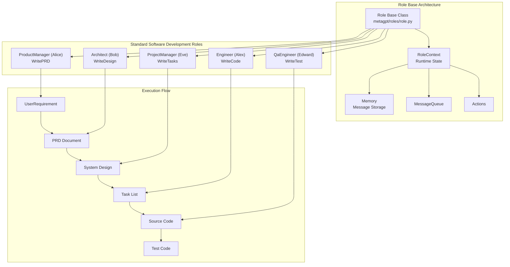
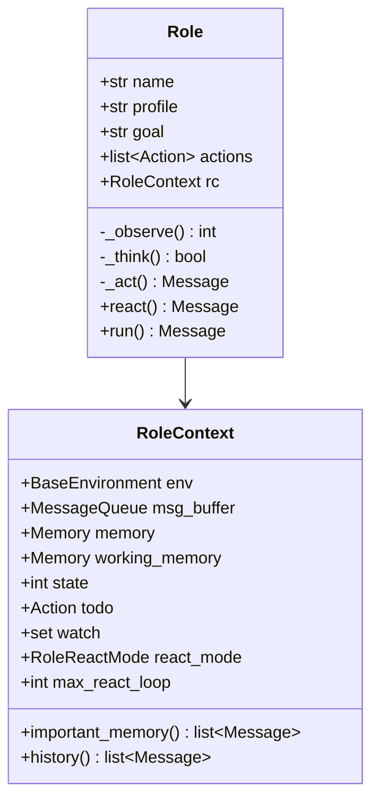
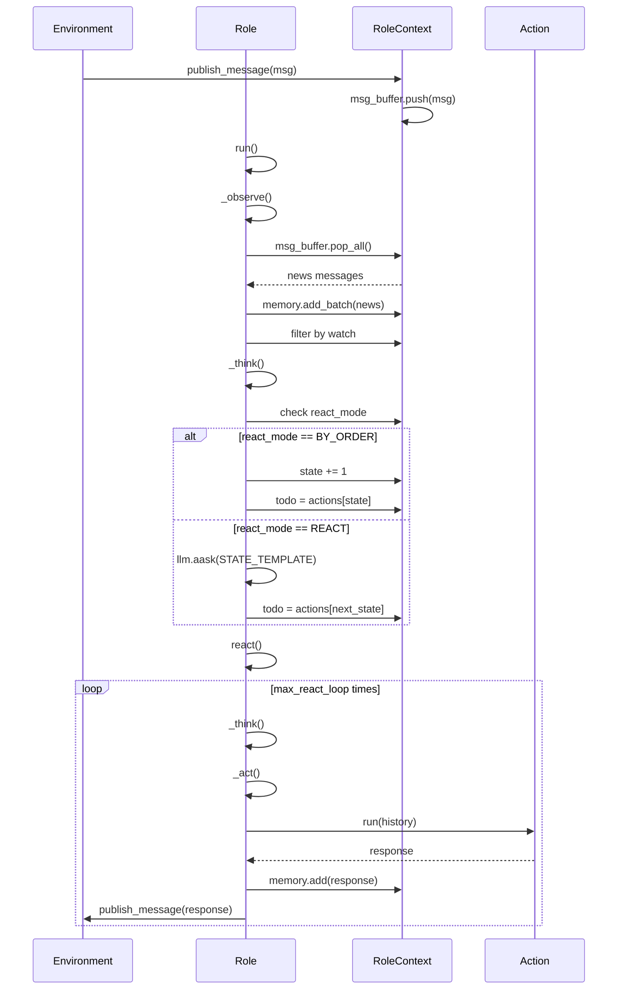
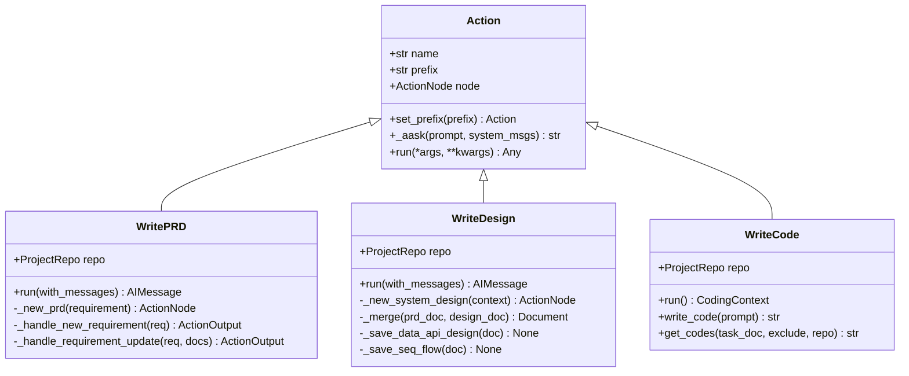
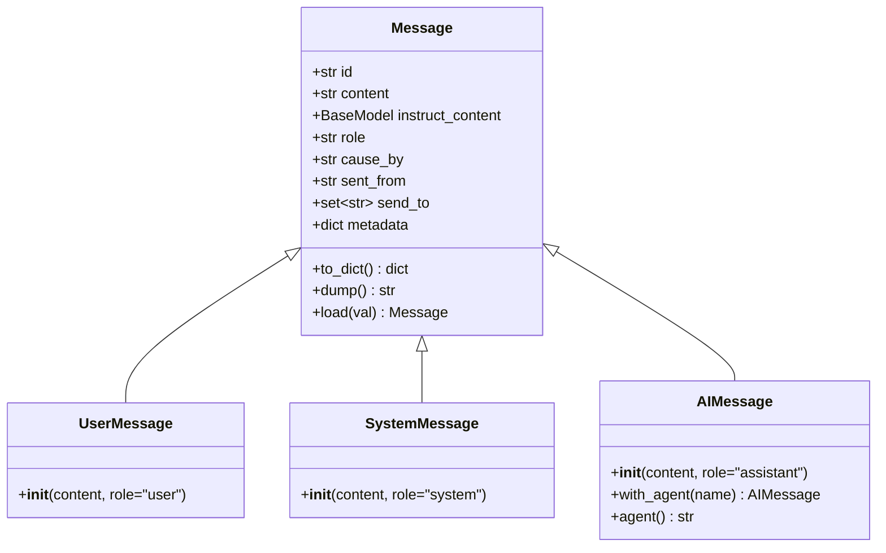
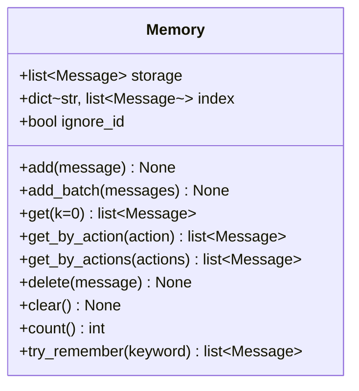
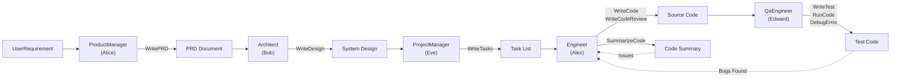
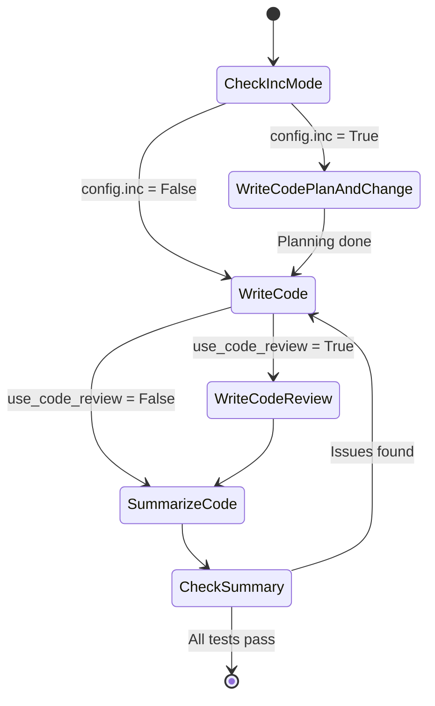
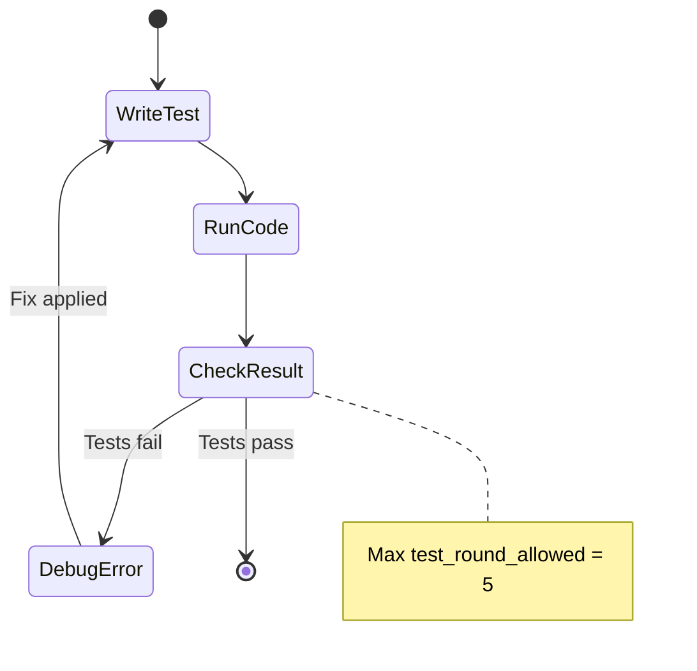

<!-- source: DeepWiki mcp.deepwiki.com · repo FoundationAgents/MetaGPT · page 2 Core Multi-Agent Framework · fetched 2026-10-30 -->

# Core Multi-Agent Framework

<details>
<summary>Relevant source files</summary>

The following files were used as context for generating this wiki page:

- [metagpt/actions/action.py](metagpt/actions/action.py)
- [metagpt/actions/design_api.py](metagpt/actions/design_api.py)
- [metagpt/actions/project_management.py](metagpt/actions/project_management.py)
- [metagpt/actions/summarize_code.py](metagpt/actions/summarize_code.py)
- [metagpt/actions/write_code.py](metagpt/actions/write_code.py)
- [metagpt/actions/write_code_review.py](metagpt/actions/write_code_review.py)
- [metagpt/actions/write_prd.py](metagpt/actions/write_prd.py)
- [metagpt/const.py](metagpt/const.py)
- [metagpt/memory/memory.py](metagpt/memory/memory.py)
- [metagpt/roles/architect.py](metagpt/roles/architect.py)
- [metagpt/roles/engineer.py](metagpt/roles/engineer.py)
- [metagpt/roles/product_manager.py](metagpt/roles/product_manager.py)
- [metagpt/roles/project_manager.py](metagpt/roles/project_manager.py)
- [metagpt/roles/qa_engineer.py](metagpt/roles/qa_engineer.py)
- [metagpt/roles/role.py](metagpt/roles/role.py)
- [metagpt/schema.py](metagpt/schema.py)
- [metagpt/utils/common.py](metagpt/utils/common.py)

</details>


## Purpose and Scope

This page documents the **standard role-based multi-agent framework** in MetaGPT, which implements the core philosophy `Code = SOP(Team)`. It covers the `Role` base class, the observe-think-act execution loop, the `Action` system, and the standard software development roles (`ProductManager`, `Architect`, `ProjectManager`, `Engineer`, `QaEngineer`) that execute in a sequential SOP-driven workflow.

For dynamic tool-based agents (RoleZero descendants), see [Dynamic Agent System (RoleZero)](#4). For conversational agents with long-term memory, see [Conversational Agents and Memory](#8). For action-specific details and structured prompting, see [Action System](#2.2) and [ActionNode and Structured Output](#7).

---

## Role Architecture Overview

The standard multi-agent framework is built on the `Role` base class, which all agent roles inherit from. Each role follows an **observe-think-act loop**, where it:
1. **Observes** new messages from its environment
2. **Thinks** about which action to take
3. **Acts** by executing an action and publishing results



**Sources:** [metagpt/roles/role.py:125-593](), [metagpt/roles/product_manager.py:1-65](), [metagpt/roles/architect.py:1-59](), [metagpt/roles/project_manager.py:1-51](), [metagpt/roles/engineer.py:1-493](), [metagpt/roles/qa_engineer.py:1-229]()

---

## Role Base Class and RoleContext

### Role Class Structure

The `Role` class ([metagpt/roles/role.py:125]()) is the foundation for all agents. It inherits from `BaseRole`, `SerializationMixin`, `ContextMixin`, and `BaseModel`.

**Key Attributes:**

| Attribute | Type | Description |
|-----------|------|-------------|
| `name` | `str` | Agent's name (e.g., "Alice", "Bob") |
| `profile` | `str` | Role type (e.g., "Product Manager", "Engineer") |
| `goal` | `str` | Primary objective of the role |
| `constraints` | `str` | Operating constraints or guidelines |
| `actions` | `list[Action]` | Available actions the role can perform |
| `rc` | `RoleContext` | Runtime context holding state and memory |
| `addresses` | `set[str]` | Message routing addresses the role subscribes to |
| `enable_memory` | `bool` | Whether to persist messages in memory (default: True) |

**Sources:** [metagpt/roles/role.py:125-160]()

### RoleContext

`RoleContext` ([metagpt/roles/role.py:92-123]()) encapsulates the runtime state of a role:



**Key RoleContext Fields:**

- **`env`**: Reference to the `Environment` broker where messages are published
- **`msg_buffer`**: `MessageQueue` for asynchronously receiving messages ([metagpt/schema.py:713-783]())
- **`memory`**: `Memory` object storing all observed messages indexed by `cause_by`
- **`state`**: Current action index in the action sequence (−1 = initial/termination state)
- **`todo`**: The next `Action` to execute
- **`watch`**: Set of action class names this role observes (filters incoming messages)
- **`react_mode`**: Strategy for selecting actions (`REACT`, `BY_ORDER`, `PLAN_AND_ACT`)
- **`max_react_loop`**: Maximum number of think-act iterations before terminating

**Sources:** [metagpt/roles/role.py:92-123](), [metagpt/schema.py:713-783]()

---

## Observe-Think-Act Execution Loop

The core execution pattern is implemented in the `run()` method ([metagpt/roles/role.py:530-554]()), which orchestrates the observe-think-act cycle:



**Sources:** [metagpt/roles/role.py:399-470](), [metagpt/roles/role.py:530-554]()

### 1. Observe Phase (`_observe`)

The `_observe()` method ([metagpt/roles/role.py:399-427]()) retrieves new messages from the message buffer and filters them based on the role's `watch` list:

```python
# Pseudo-code from metagpt/roles/role.py:399-427
async def _observe(self) -> int:
    news = self.rc.msg_buffer.pop_all()  # Get all unprocessed messages
    old_messages = self.rc.memory.get()  # Existing memory
    
    # Filter messages: must be in watch list or addressed to this role
    self.rc.news = [
        n for n in news 
        if (n.cause_by in self.rc.watch or self.name in n.send_to) 
        and n not in old_messages
    ]
    
    # Add to memory
    self.rc.memory.add_batch(self.rc.news)
    self.latest_observed_msg = self.rc.news[-1] if self.rc.news else None
    
    return len(self.rc.news)
```

**Key Points:**
- Filters messages by `cause_by` (action type) and `send_to` (recipient)
- Stores filtered messages in `rc.news` for processing
- Updates `memory` with new messages
- Returns count of new messages

**Sources:** [metagpt/roles/role.py:399-427]()

### 2. Think Phase (`_think`)

The `_think()` method ([metagpt/roles/role.py:340-379]()) decides which action to execute next based on the `react_mode`:

```mermaid
flowchart TD
    Start["_think()"] --> CheckActions{len(actions) == 1?}
    CheckActions -->|Yes| SetState0["set state = 0<br/>RETURN True"]
    CheckActions -->|No| CheckMode{react_mode?}
    
    CheckMode -->|BY_ORDER| IncrementState["state += 1<br/>todo = actions[state]"]
    IncrementState --> CheckBounds{state < len(actions)?}
    CheckBounds -->|Yes| ReturnTrue["RETURN True"]
    CheckBounds -->|No| ReturnFalse["RETURN False"]
    
    CheckMode -->|REACT| AskLLM["llm.aask(STATE_TEMPLATE)"]
    AskLLM --> ParseState["parse next_state"]
    ParseState --> ValidateState{-1 <= next_state < len(states)?}
    ValidateState -->|Yes| SetState["state = next_state<br/>todo = actions[state]"]
    ValidateState -->|No| SetStateNeg1["state = -1"]
    SetState --> ReturnTrue
    SetStateNeg1 --> ReturnTrue
```

**React Modes** (defined in [metagpt/roles/role.py:82-90]()):

| Mode | Behavior |
|------|----------|
| `REACT` | Uses LLM to dynamically select next action based on conversation history |
| `BY_ORDER` | Executes actions sequentially in defined order |
| `PLAN_AND_ACT` | Creates a plan upfront, then executes action sequence |

**Sources:** [metagpt/roles/role.py:340-379](), [metagpt/roles/role.py:82-90]()

### 3. Act Phase (`_act`)

The `_act()` method ([metagpt/roles/role.py:381-397]()) executes the current `todo` action:

```python
# Pseudo-code from metagpt/roles/role.py:381-397
async def _act(self) -> Message:
    logger.info(f"{self._setting}: to do {self.rc.todo}({self.rc.todo.name})")
    response = await self.rc.todo.run(self.rc.history)
    
    # Wrap response in AIMessage if needed
    if isinstance(response, (ActionOutput, ActionNode)):
        msg = AIMessage(
            content=response.content,
            instruct_content=response.instruct_content,
            cause_by=self.rc.todo,
            sent_from=self
        )
    else:
        msg = AIMessage(content=response or "", cause_by=self.rc.todo, sent_from=self)
    
    self.rc.memory.add(msg)
    return msg
```

**Key Points:**
- Invokes `action.run(history)` with conversation history
- Wraps output in `AIMessage` with proper metadata
- Stores result in `memory` for future reference
- Returns message for publishing to environment

**Sources:** [metagpt/roles/role.py:381-397]()

### React Loop

The `react()` method ([metagpt/roles/role.py:512-523]()) orchestrates the think-act loop:

```python
# Pseudo-code from metagpt/roles/role.py:512-523
async def react(self) -> Message:
    if self.rc.react_mode == RoleReactMode.REACT or self.rc.react_mode == RoleReactMode.BY_ORDER:
        rsp = await self._react()  # Standard think-act loop
    elif self.rc.react_mode == RoleReactMode.PLAN_AND_ACT:
        rsp = await self._plan_and_act()  # Plan-based execution
    
    self._set_state(state=-1)  # Reset state after completion
    return rsp
```

The `_react()` method ([metagpt/roles/role.py:454-470]()) implements the loop:

```python
# Pseudo-code from metagpt/roles/role.py:454-470
async def _react(self) -> Message:
    actions_taken = 0
    rsp = AIMessage(content="No actions taken yet", cause_by=Action)
    
    while actions_taken < self.rc.max_react_loop:
        has_todo = await self._think()  # Decide next action
        if not has_todo:
            break
        
        rsp = await self._act()  # Execute action
        actions_taken += 1
    
    return rsp  # Return last action's output
```

**Sources:** [metagpt/roles/role.py:454-470](), [metagpt/roles/role.py:512-523]()

---

## Action System

Actions are the atomic units of work that roles perform. Each action encapsulates a specific task like writing a PRD, designing an API, or generating code.

### Action Base Class

The `Action` class ([metagpt/actions/action.py:29-120]()) provides the foundation:

**Key Attributes:**

| Attribute | Type | Description |
|-----------|------|-------------|
| `name` | `str` | Action name (auto-set to class name if empty) |
| `i_context` | `Union[dict, Context, str]` | Input context for the action |
| `prefix` | `str` | System message prefix (role description) |
| `desc` | `str` | Human-readable description |
| `node` | `ActionNode` | Optional structured prompt node |
| `llm_name_or_type` | `str` | LLM model override (optional) |

**Key Methods:**



**Sources:** [metagpt/actions/action.py:29-120]()

### Standard Software Development Actions

The framework includes predefined actions for each stage of software development:

| Action | File | Purpose | Output |
|--------|------|---------|--------|
| `WritePRD` | [metagpt/actions/write_prd.py:76-326]() | Product requirements document | PRD JSON + competitive analysis |
| `WriteDesign` | [metagpt/actions/design_api.py:53-280]() | System architecture design | Design JSON + class/sequence diagrams |
| `WriteTasks` | [metagpt/actions/project_management.py:46-202]() | Project task breakdown | Task list JSON + requirements.txt |
| `WriteCode` | [metagpt/actions/write_code.py:88-229]() | Code implementation | Source code files |
| `WriteCodeReview` | [metagpt/actions/write_code_review.py:141-221]() | Code review and rewrite | Reviewed/rewritten code |
| `WriteTest` | QaEngineer uses this | Test generation | Unit test files |
| `SummarizeCode` | [metagpt/actions/summarize_code.py:93-124]() | Code review summary | Summary markdown |

**Sources:** [metagpt/actions/write_prd.py:76-326](), [metagpt/actions/design_api.py:53-280](), [metagpt/actions/project_management.py:46-202](), [metagpt/actions/write_code.py:88-229](), [metagpt/actions/write_code_review.py:141-221](), [metagpt/actions/summarize_code.py:93-124]()

### Action Execution Pattern

Actions follow a standard execution pattern:

1. **Receive context**: Input via `with_messages` or direct parameters
2. **Prepare prompt**: Construct prompt from templates and context
3. **LLM call**: Invoke `_aask()` or `llm.aask()` to get response
4. **Parse output**: Extract structured data from LLM response
5. **Persist artifacts**: Save to `ProjectRepo` (docs, resources, source code)
6. **Return message**: Create `AIMessage` with output and routing metadata

Example from `WritePRD` ([metagpt/actions/write_prd.py:209-216]()):

```python
# Simplified from metagpt/actions/write_prd.py:209-230
async def _new_prd(self, requirement: str) -> ActionNode:
    context = CONTEXT_TEMPLATE.format(
        requirements=requirement, 
        project_name=self.project_name
    )
    node = await WRITE_PRD_NODE.fill(
        req=context, 
        llm=self.llm, 
        schema=self.prompt_schema
    )
    return node
```

**Sources:** [metagpt/actions/write_prd.py:209-230]()

---

## Message Schema and Memory

### Message Class

The `Message` class ([metagpt/schema.py:232-417]()) is the primary communication unit between roles:

**Key Fields:**

| Field | Type | Description |
|-------|------|-------------|
| `id` | `str` | Unique message identifier (UUID) |
| `content` | `str` | Natural language content |
| `instruct_content` | `BaseModel` | Structured data payload (optional) |
| `role` | `str` | Sender role (`user`, `assistant`, `system`) |
| `cause_by` | `str` | Action class name that created this message |
| `sent_from` | `str` | Sender role class name |
| `send_to` | `set[str]` | Recipient role class names |
| `metadata` | `dict` | Additional key-value metadata |

**Key Message Subclasses:**



**Message Routing Constants** ([metagpt/const.py:77-84]()):

- `MESSAGE_ROUTE_TO_ALL = "<all>"`: Broadcast to all roles
- `MESSAGE_ROUTE_TO_NONE = "<none>"`: No routing (terminal message)
- `MESSAGE_ROUTE_TO_SELF = "<self>"`: Route back to sender

**Sources:** [metagpt/schema.py:232-451](), [metagpt/const.py:77-84]()

### Memory Class

The `Memory` class ([metagpt/memory/memory.py:20-113]()) provides storage and indexing for messages:

**Key Operations:**



**Indexing Strategy:**

Messages are indexed by `cause_by` (action class name) for efficient retrieval:

```python
# From metagpt/memory/memory.py:27-35
def add(self, message: Message):
    if message in self.storage:
        return
    self.storage.append(message)
    if message.cause_by:
        self.index[message.cause_by].append(message)
```

**Retrieval Examples:**

```python
# Get all messages from a specific action type
prd_messages = memory.get_by_action(WritePRD)

# Get messages from multiple action types
design_messages = memory.get_by_actions({WritePRD, WriteDesign})

# Get most recent k messages
recent = memory.get(k=5)

# Search by keyword
matching = memory.try_remember("authentication")
```

**Sources:** [metagpt/memory/memory.py:20-113]()

### MessageQueue

The `MessageQueue` class ([metagpt/schema.py:713-783]()) provides asynchronous message buffering:

**Key Methods:**

| Method | Description |
|--------|-------------|
| `push(msg)` | Add message to queue (non-blocking) |
| `pop()` | Remove and return one message (non-blocking) |
| `pop_all()` | Remove and return all messages |
| `empty()` | Check if queue is empty |
| `dump()` | Serialize queue to JSON string |
| `load(data)` | Deserialize queue from JSON string |

**Implementation Details:**

- Uses `asyncio.Queue` internally for thread-safe operations
- Supports serialization for context persistence
- Used in `RoleContext.msg_buffer` for asynchronous message delivery

**Sources:** [metagpt/schema.py:713-783]()

---

## Standard Role Pipeline

The standard software development workflow consists of five roles executing in sequence:



**Sources:** [metagpt/roles/product_manager.py:21-65](), [metagpt/roles/architect.py:17-59](), [metagpt/roles/project_manager.py:13-51](), [metagpt/roles/engineer.py:73-493](), [metagpt/roles/qa_engineer.py:39-229]()

### 1. ProductManager (Alice)

**Role Definition** ([metagpt/roles/product_manager.py:21-48]()):

```python
class ProductManager(RoleZero):
    name: str = "Alice"
    profile: str = "Product Manager"
    goal: str = "Create a Product Requirement Document"
    
    def __init__(self, **kwargs):
        super().__init__(**kwargs)
        self.set_actions([PrepareDocuments, WritePRD])
        self._watch([UserRequirement, PrepareDocuments])
        self.rc.react_mode = RoleReactMode.BY_ORDER
```

**Execution Flow:**

1. **PrepareDocuments**: Parses user requirements, initializes project repository
2. **WritePRD**: Generates PRD document with:
   - Project name and goals
   - User stories and requirements
   - Competitive analysis
   - UI/UX considerations

**Output Artifacts:**

- `docs/prd/{filename}.json`: Structured PRD data
- `resources/prd/{filename}.md`: Human-readable PRD
- `resources/competitive_analysis/{filename}.svg`: Competitive quadrant chart

**Sources:** [metagpt/roles/product_manager.py:21-65](), [metagpt/actions/write_prd.py:76-326]()

### 2. Architect (Bob)

**Role Definition** ([metagpt/roles/architect.py:17-59]()):

```python
class Architect(RoleZero):
    name: str = "Bob"
    profile: str = "Architect"
    goal: str = "design a concise, usable, complete software system"
    
    def __init__(self, **kwargs):
        super().__init__(**kwargs)
        self.set_actions([WriteDesign])
        self._watch({WritePRD})
```

**Execution Flow:**

1. **WriteDesign**: Reads PRD documents and generates:
   - Data structures and interfaces
   - Program call flow
   - File list
   - Class diagrams (mermaid)
   - Sequence diagrams (mermaid)

**Output Artifacts:**

- `docs/system_design/{filename}.json`: Structured design data
- `resources/system_design/{filename}.md`: Human-readable design
- `resources/data_api_design/{filename}.svg`: Class diagram
- `resources/seq_flow/{filename}.svg`: Sequence diagram

**Sources:** [metagpt/roles/architect.py:17-59](), [metagpt/actions/design_api.py:53-280]()

### 3. ProjectManager (Eve)

**Role Definition** ([metagpt/roles/project_manager.py:13-51]()):

```python
class ProjectManager(RoleZero):
    name: str = "Eve"
    profile: str = "Project Manager"
    goal: str = "break down tasks according to PRD/technical design"
    
    def __init__(self, **kwargs):
        super().__init__(**kwargs)
        self.set_actions([WriteTasks])
        self._watch([WriteDesign])
```

**Execution Flow:**

1. **WriteTasks**: Reads system design and generates:
   - Task breakdown (file list)
   - Task dependencies
   - Required Python packages
   - API specifications

**Output Artifacts:**

- `docs/task/{filename}.json`: Structured task data
- `resources/api_spec_and_task/{filename}.md`: Human-readable task list
- `requirements.txt`: Python package dependencies

**Sources:** [metagpt/roles/project_manager.py:13-51](), [metagpt/actions/project_management.py:46-202]()

### 4. Engineer (Alex)

**Role Definition** ([metagpt/roles/engineer.py:73-106]()):

```python
class Engineer(Role):
    name: str = "Alex"
    profile: str = "Engineer"
    goal: str = "write elegant, readable, extensible, efficient code"
    use_code_review: bool = False
    
    def __init__(self, **kwargs):
        super().__init__(**kwargs)
        self.set_actions([WriteCode])
        self._watch([WriteTasks, SummarizeCode, WriteCode, WriteCodeReview, FixBug])
```

**Execution Flow:**

The Engineer has a multi-phase workflow:



**Phase 1: Code Planning (Optional)**

If `config.inc = True` (incremental mode), Engineer first runs `WriteCodePlanAndChange` ([metagpt/roles/engineer.py:455-483]()):

```python
async def _new_code_plan_and_change_action(self, cause_by: str):
    code_plan_and_change_ctx = CodePlanAndChangeContext(
        requirement=requirement,
        prd_filename=...,
        design_filename=...,
        task_filename=...
    )
    self.rc.todo = WriteCodePlanAndChange(i_context=code_plan_and_change_ctx, ...)
```

**Phase 2: Code Writing**

The `WriteCode` action ([metagpt/actions/write_code.py:100-165]()):

1. Loads coding context (design doc, task doc, existing code)
2. Constructs prompt with template
3. Invokes LLM to generate code
4. Saves code to `src/{filename}`

**Phase 3: Code Review (Optional)**

If `use_code_review = True`, runs `WriteCodeReview` ([metagpt/actions/write_code_review.py:167-221]()):

1. Reviews generated code for bugs/issues
2. Returns `LGTM` (looks good to me) or `LBTM` (looks bad to me)
3. If `LBTM`, rewrites code and repeats up to `k` times

**Phase 4: Summarization**

Runs `SummarizeCode` ([metagpt/actions/summarize_code.py:104-123]()):

1. Reviews all source files
2. Generates call flow diagram
3. Identifies TODOs and issues
4. If issues found, loops back to WriteCode (up to `max_auto_summarize_code` times)

**Output Artifacts:**

- `src/{filename}.py`: Source code files
- `docs/code_summary/{design_filename}.json`: Summary with TODOs
- `resources/code_summary/{design_filename}.md`: Human-readable summary

**Sources:** [metagpt/roles/engineer.py:73-493](), [metagpt/actions/write_code.py:88-229](), [metagpt/actions/write_code_review.py:141-221](), [metagpt/actions/summarize_code.py:93-124]()

### 5. QaEngineer (Edward)

**Role Definition** ([metagpt/roles/qa_engineer.py:39-60]()):

```python
class QaEngineer(Role):
    name: str = "Edward"
    profile: str = "QaEngineer"
    goal: str = "Write comprehensive and robust tests"
    test_round_allowed: int = 5
    
    def __init__(self, **kwargs):
        super().__init__(**kwargs)
        self.set_actions([WriteTest])
        self._watch([SummarizeCode, WriteTest, RunCode, DebugError])
```

**Execution Flow:**

The QA Engineer cycles through test-run-debug phases:



**Actions:**

1. **WriteTest** ([metagpt/roles/qa_engineer.py:62-103]()): Generates unit tests for each source file
2. **RunCode**: Executes tests and captures stdout/stderr
3. **DebugError**: Fixes test failures based on error logs

**Output Artifacts:**

- `tests/test_{filename}.py`: Unit test files
- `test_outputs/test_{filename}.py.json`: Test execution results

**Sources:** [metagpt/roles/qa_engineer.py:39-229]()

---

## React Modes and State Management

Roles can operate in different execution modes via `RoleReactMode` ([metagpt/roles/role.py:82-90]()):

### Mode Comparison

| Mode | Action Selection | Use Case | Example |
|------|------------------|----------|---------|
| `REACT` | LLM dynamically chooses based on state | Complex reasoning tasks | Research agent |
| `BY_ORDER` | Sequential execution in defined order | Fixed SOP workflows | Standard dev pipeline |
| `PLAN_AND_ACT` | Create plan first, then execute sequence | Multi-step projects | Data analysis tasks |

**Sources:** [metagpt/roles/role.py:82-90]()

### BY_ORDER Mode

Used by the standard software development roles ([metagpt/roles/role.py:353-357]()):

```python
if self.rc.react_mode == RoleReactMode.BY_ORDER:
    if self.rc.max_react_loop != len(self.actions):
        self.rc.max_react_loop = len(self.actions)
    self._set_state(self.rc.state + 1)
    return self.rc.state >= 0 and self.rc.state < len(self.actions)
```

- Executes actions in the order they were added via `set_actions()`
- `max_react_loop` automatically set to number of actions
- State increments sequentially: 0 → 1 → 2 → ... → n−1

**Sources:** [metagpt/roles/role.py:353-357]()

### REACT Mode

Uses LLM to select next action ([metagpt/roles/role.py:359-378]()):

```python
prompt = self._get_prefix()
prompt += STATE_TEMPLATE.format(
    history=self.rc.history,
    states="\n".join(self.states),
    n_states=len(self.states) - 1,
    previous_state=self.rc.state,
)

next_state = await self.llm.aask(prompt)
next_state = extract_state_value_from_output(next_state)

if int(next_state) == -1:
    logger.info(f"End actions with {next_state=}")
self._set_state(next_state)
```

**STATE_TEMPLATE** ([metagpt/roles/role.py:54-69]()):

```
Here are your conversation records. You can decide which stage you should enter 
or stay in based on these records.

Your previous stage: {previous_state}

Now choose one of the following stages you need to go to in the next step:
{states}

Just answer a number between 0-{n_states}, choose the most suitable stage 
according to the understanding of the conversation.
If you think you have completed your goal and don't need to go to any of 
the stages, return -1.
```

**Sources:** [metagpt/roles/role.py:54-69](), [metagpt/roles/role.py:359-378]()

### PLAN_AND_ACT Mode

Creates a task plan and executes it ([metagpt/roles/role.py:472-496]()):

```python
async def _plan_and_act(self) -> Message:
    if not self.planner.plan.goal:
        goal = self.rc.memory.get()[-1].content
        await self.planner.update_plan(goal=goal)
    
    while self.planner.current_task:
        task = self.planner.current_task
        task_result = await self._act_on_task(task)
        await self.planner.process_task_result(task_result)
    
    rsp = self.planner.get_useful_memories()[0]
    return rsp
```

Uses the `Planner` class to manage a task dependency graph with topological sorting.

**Sources:** [metagpt/roles/role.py:472-496]()

---

## Message Publishing and Routing

### Publishing Messages

Roles publish messages via `publish_message()` ([metagpt/roles/role.py:429-446]()):

```python
def publish_message(self, msg):
    # Handle MESSAGE_ROUTE_TO_SELF
    if MESSAGE_ROUTE_TO_SELF in msg.send_to:
        msg.send_to.add(any_to_str(self))
        msg.send_to.remove(MESSAGE_ROUTE_TO_SELF)
    
    # Set sent_from if not set
    if not msg.sent_from:
        msg.sent_from = any_to_str(self)
    
    # If message is only to self, put directly in buffer
    if all(to in {any_to_str(self), self.name} for to in msg.send_to):
        self.put_message(msg)
        return
    
    # Otherwise publish to environment
    if isinstance(msg, AIMessage) and not msg.agent:
        msg.with_agent(self._setting)
    self.rc.env.publish_message(msg)
```

**Key Points:**

- `MESSAGE_ROUTE_TO_SELF` replaced with actual role address
- `sent_from` automatically populated if missing
- Messages to self bypass environment (direct to `msg_buffer`)
- Agent metadata added for tracking

**Sources:** [metagpt/roles/role.py:429-446]()

### Receiving Messages

Messages are delivered via `put_message()` ([metagpt/roles/role.py:448-452]()):

```python
def put_message(self, message):
    """Place the message into the Role object's private message buffer."""
    if not message:
        return
    self.rc.msg_buffer.push(message)
```

The environment routes messages based on `send_to` addresses. Each role subscribes to specific addresses via `addresses` set ([metagpt/roles/role.py:211-214]()):

```python
@model_validator(mode="after")
def check_addresses(self):
    if not self.addresses:
        self.addresses = {any_to_str(self), self.name} if self.name else {any_to_str(self)}
    return self
```

Default addresses include:
- Full class name (e.g., `"metagpt.roles.engineer.Engineer"`)
- Role name (e.g., `"Alex"`)

**Sources:** [metagpt/roles/role.py:448-452](), [metagpt/roles/role.py:211-214]()

---

## Role Initialization and Configuration

### Setting Actions

Actions are configured via `set_actions()` ([metagpt/roles/role.py:239-260]()):

```python
def set_actions(self, actions: list[Union[Action, Type[Action]]]):
    self._reset()  # Clear existing actions
    for action in actions:
        # Instantiate if class passed
        if not isinstance(action, Action):
            i = action(context=self.context)
        else:
            i = action
        
        # Configure action with role's context and LLM
        self._init_action(i)
        self.actions.append(i)
        self.states.append(f"{len(self.actions) - 1}. {action}")
```

The `_init_action()` method ([metagpt/roles/role.py:229-233]()):

```python
def _init_action(self, action: Action):
    action.set_context(self.context)
    override = not action.private_config
    action.set_llm(self.llm, override=override)
    action.set_prefix(self._get_prefix())
```

**Key Operations:**

1. Sets action's context to role's context
2. Assigns role's LLM to action (unless action has private LLM config)
3. Sets action's system prompt prefix to role's prefix

**Sources:** [metagpt/roles/role.py:229-260]()

### Watching Actions

Roles specify which message types to observe via `_watch()` ([metagpt/roles/role.py:284-288]()):

```python
def _watch(self, actions: Iterable[Type[Action]] | Iterable[Action]):
    """Watch Actions of interest. Role will select Messages caused by these Actions from its personal message
    buffer during _observe.
    """
    self.rc.watch = {any_to_str(t) for t in actions}
```

Example from Engineer ([metagpt/roles/engineer.py:106]()):

```python
self._watch([WriteTasks, SummarizeCode, WriteCode, WriteCodeReview, FixBug, WriteCodePlanAndChange])
```

This filters messages in `_observe()` to only those caused by these specific action types.

**Sources:** [metagpt/roles/role.py:284-288](), [metagpt/roles/engineer.py:106]()

### Role Prefix

The system prompt prefix is constructed by `_get_prefix()` ([metagpt/roles/role.py:323-338]()):

```python
def _get_prefix(self):
    if self.desc:
        return self.desc
    
    prefix = PREFIX_TEMPLATE.format(
        profile=self.profile, 
        name=self.name, 
        goal=self.goal
    )
    
    if self.constraints:
        prefix += CONSTRAINT_TEMPLATE.format(constraints=self.constraints)
    
    if self.rc.env and self.rc.env.desc:
        all_roles = self.rc.env.role_names()
        other_role_names = ", ".join([r for r in all_roles if r != self.name])
        env_desc = f"You are in {self.rc.env.desc} with roles({other_role_names})."
        prefix += env_desc
    
    return prefix
```

**PREFIX_TEMPLATE** ([metagpt/roles/role.py:51]()):

```
You are a {profile}, named {name}, your goal is {goal}.
```

This prefix is injected into every LLM call as the system message, providing role-specific context.

**Sources:** [metagpt/roles/role.py:51-52](), [metagpt/roles/role.py:323-338]()

---

## Complete Workflow Example

Here's how the standard pipeline executes for a new project:

```mermaid
sequenceDiagram
    participant User
    participant PM as ProductManager
    participant Arch as Architect
    participant ProjM as ProjectManager
    participant Eng as Engineer
    participant QA as QaEngineer
    participant Env as Environment
    participant Repo as ProjectRepo
    
    User->>Env: UserRequirement("Build snake game")
    Env->>PM: deliver message
    
    PM->>PM: _observe() → msg in watch
    PM->>PM: _think() → PrepareDocuments
    PM->>PM: _act() → create repo
    PM->>Repo: save requirement.txt
    
    PM->>PM: _think() → WritePRD
    PM->>PM: _act() → generate PRD
    PM->>Repo: save docs/prd/xxx.json
    PM->>Env: publish AIMessage(cause_by=WritePRD)
    
    Env->>Arch: deliver message (watches WritePRD)
    Arch->>Arch: _observe() → new PRD
    Arch->>Arch: _think() → WriteDesign
    Arch->>Arch: _act() → generate design
    Arch->>Repo: save docs/system_design/xxx.json
    Arch->>Env: publish AIMessage(cause_by=WriteDesign)
    
    Env->>ProjM: deliver message (watches WriteDesign)
    ProjM->>ProjM: _observe() → new design
    ProjM->>ProjM: _think() → WriteTasks
    ProjM->>ProjM: _act() → generate tasks
    ProjM->>Repo: save docs/task/xxx.json
    ProjM->>Repo: save requirements.txt
    ProjM->>Env: publish AIMessage(cause_by=WriteTasks)
    
    Env->>Eng: deliver message (watches WriteTasks)
    Eng->>Eng: _observe() → new tasks
    
    loop For each task file
        Eng->>Eng: _think() → WriteCode
        Eng->>Eng: _act() → generate code
        Eng->>Repo: save src/{filename}.py
    end
    
    Eng->>Eng: _think() → SummarizeCode
    Eng->>Eng: _act() → review code
    Eng->>Repo: save docs/code_summary/xxx.json
    Eng->>Env: publish AIMessage(cause_by=SummarizeCode)
    
    Env->>QA: deliver message (watches SummarizeCode)
    QA->>QA: _observe() → code complete
    
    loop test_round < test_round_allowed
        QA->>QA: _think() → WriteTest
        QA->>QA: _act() → generate tests
        QA->>Repo: save tests/test_{filename}.py
        
        QA->>QA: _think() → RunCode
        QA->>QA: _act() → execute tests
        QA->>Repo: save test_outputs/test_{filename}.py.json
        
        alt Tests fail
            QA->>QA: _think() → DebugError
            QA->>QA: _act() → fix tests
        else Tests pass
            break
        end
    end
    
    QA->>Env: publish AIMessage(cause_by=WriteTest, send_to=NONE)
    Env->>User: Project complete
```

**Sources:** [metagpt/roles/role.py:399-554](), [metagpt/roles/product_manager.py:21-65](), [metagpt/roles/architect.py:17-59](), [metagpt/roles/project_manager.py:13-51](), [metagpt/roles/engineer.py:73-493](), [metagpt/roles/qa_engineer.py:39-229]()

---

## Summary

The Core Multi-Agent Framework provides:

1. **Role Base Class**: Standardized observe-think-act execution loop with configurable react modes
2. **Action System**: Atomic work units with LLM integration and structured output
3. **Message Protocol**: Typed messages with routing metadata for inter-role communication
4. **Memory Management**: Indexed storage for conversation history and action results
5. **Standard Roles**: Pre-built software development team (PM, Architect, ProjectManager, Engineer, QA)
6. **SOP Workflows**: Sequential execution with document handoffs between roles

This architecture enables the `Code = SOP(Team)` philosophy, where complex software development tasks are decomposed into role-specific actions that execute in a coordinated pipeline.

For advanced dynamic agents with tool usage, see [Dynamic Agent System (RoleZero)](#4). For structured prompt engineering, see [ActionNode and Structured Output](#7).

---

