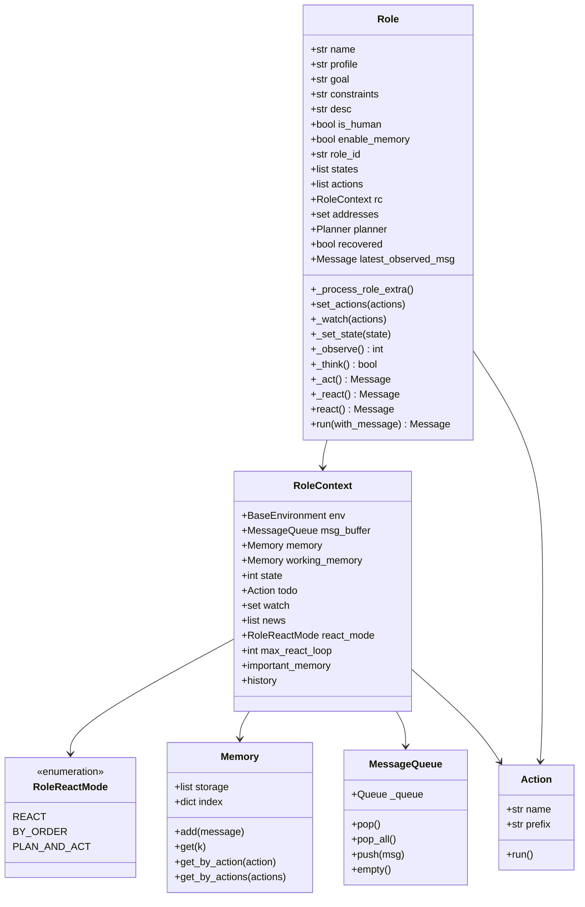
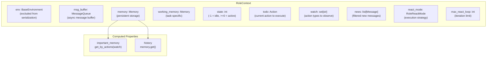
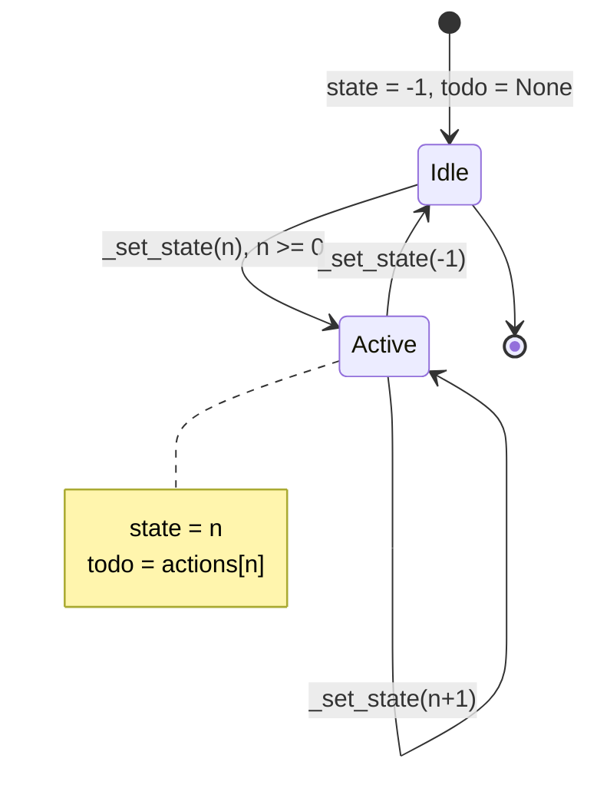
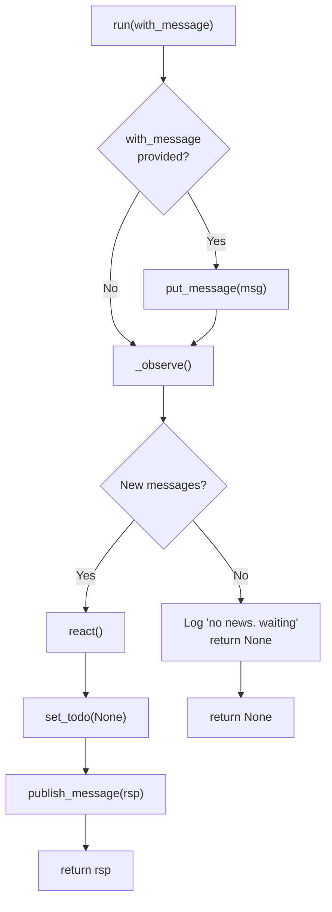
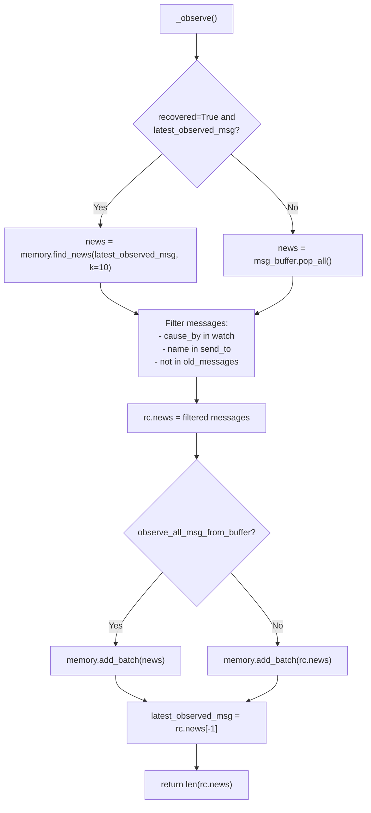
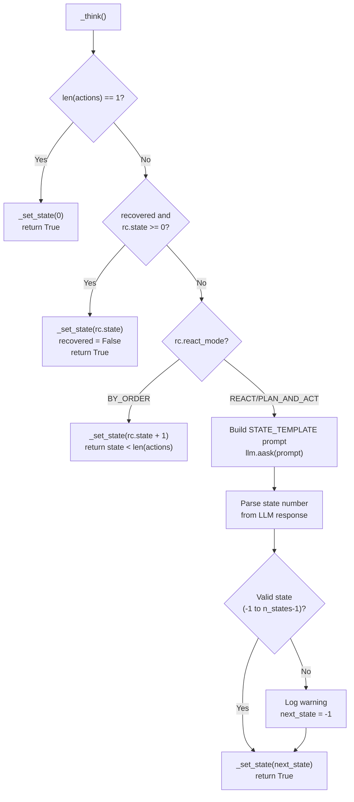
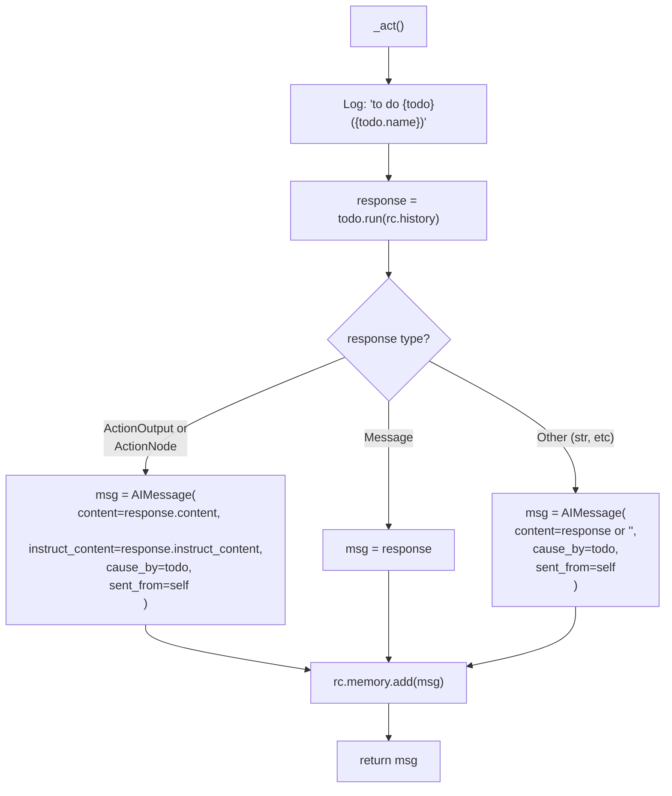
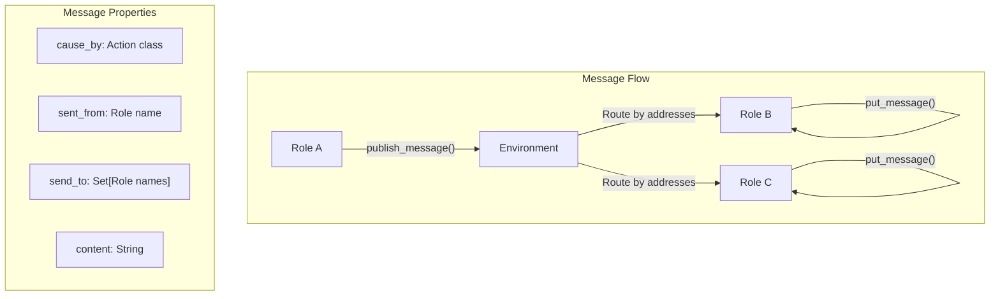
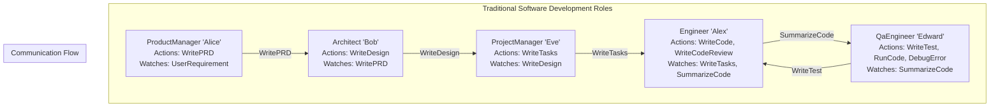
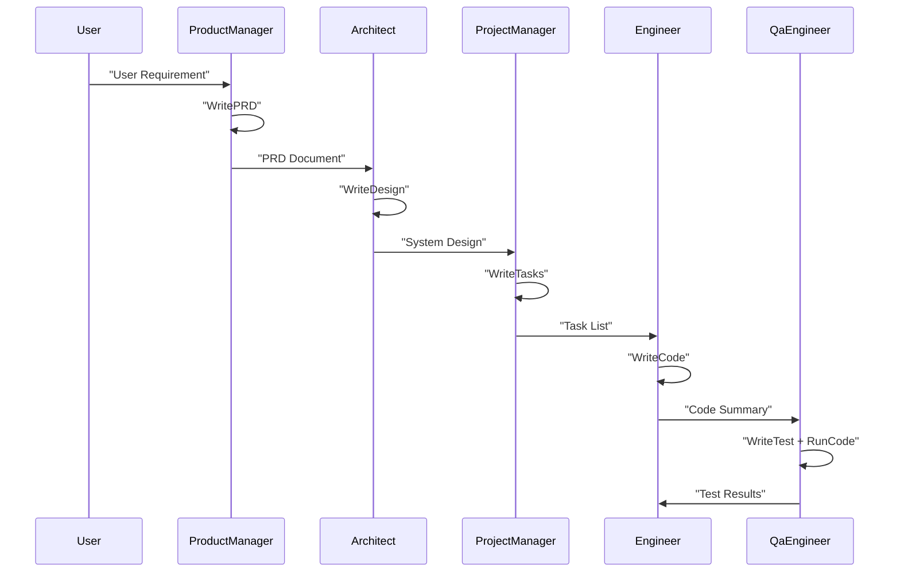

<!-- source: DeepWiki mcp.deepwiki.com · repo FoundationAgents/MetaGPT · page 2.1 Role Architecture · fetched 2026-10-30 -->

# Role Architecture

<details>
<summary>Relevant source files</summary>

The following files were used as context for generating this wiki page:

- [metagpt/actions/action.py](metagpt/actions/action.py)
- [metagpt/actions/design_api.py](metagpt/actions/design_api.py)
- [metagpt/actions/project_management.py](metagpt/actions/project_management.py)
- [metagpt/actions/summarize_code.py](metagpt/actions/summarize_code.py)
- [metagpt/actions/write_code.py](metagpt/actions/write_code.py)
- [metagpt/actions/write_code_review.py](metagpt/actions/write_code_review.py)
- [metagpt/actions/write_prd.py](metagpt/actions/write_prd.py)
- [metagpt/const.py](metagpt/const.py)
- [metagpt/memory/memory.py](metagpt/memory/memory.py)
- [metagpt/roles/architect.py](metagpt/roles/architect.py)
- [metagpt/roles/engineer.py](metagpt/roles/engineer.py)
- [metagpt/roles/product_manager.py](metagpt/roles/product_manager.py)
- [metagpt/roles/project_manager.py](metagpt/roles/project_manager.py)
- [metagpt/roles/qa_engineer.py](metagpt/roles/qa_engineer.py)
- [metagpt/roles/role.py](metagpt/roles/role.py)
- [metagpt/schema.py](metagpt/schema.py)
- [metagpt/utils/common.py](metagpt/utils/common.py)

</details>


## Overview

The `Role` class at [metagpt/roles/role.py:125-593]() is the base class for all agents in MetaGPT. It implements a standardized observe-think-act lifecycle that enables autonomous, multi-step reasoning and action execution. Each Role instance maintains its own state, memory, and action queue while communicating with other roles through a message-based system.

Key architectural components:
- **Role**: Main agent class with identity, goals, and behavior configuration
- **RoleContext**: Runtime state container managing memory, actions, and execution mode
- **RoleReactMode**: Execution strategy enum (REACT/BY_ORDER/PLAN_AND_ACT)
- **Memory**: Message storage and retrieval system
- **MessageQueue**: Asynchronous message buffer

For information about actions that roles execute, see page 2.2. For message schema details, see page 2.3. For multi-role orchestration, see page 2.4.

## Role Base Class Structure

### Class Definition and Core Attributes

**Role Class Attributes and Relationships**


The `Role` class defines core attributes at [metagpt/roles/role.py:130-158]():

**Identity Attributes**:
- `name`: Unique identifier for the role instance (e.g., "Alice", "Bob")
- `profile`: Role type description (e.g., "Product Manager", "Engineer")
- `goal`: Primary objective of the role
- `constraints`: Limitations or guidelines for the role's behavior
- `desc`: Optional detailed description used as system prompt prefix

**Behavioral Attributes**:
- `is_human`: If `True`, uses `HumanProvider` for LLM interactions (manual input mode)
- `enable_memory`: Controls whether messages are persisted in memory
- `actions`: List of `Action` instances the role can execute
- `states`: String descriptions of each action (used for state selection prompts)

**Runtime State**:
- `rc`: `RoleContext` instance managing execution state
- `addresses`: Set of identifiers for message routing (role name, profile)
- `planner`: Optional `Planner` instance for PLAN_AND_ACT mode
- `recovered`: Flag indicating role was restored from serialization
- `latest_observed_msg`: Last message observed (for recovery)

Sources: [metagpt/roles/role.py:125-160](), [metagpt/roles/role.py:130-158]()

## Role Initialization

### Construction and Configuration

Role initialization happens through the `__init__` method and post-initialization validators. The process at [metagpt/roles/role.py:161-181]() follows this sequence:

1. **Pydantic Model Initialization**: Base attributes are set from constructor kwargs
2. **Extra Processing** (`_process_role_extra`): Configures role-specific behavior
3. **Action Setup**: Initializes actions with proper context and LLM
4. **Watch List Setup**: Configures which action types trigger the role
5. **Address Registration**: Sets up message routing identifiers

**Key Initialization Methods**:

```python
# Setting actions for a role
def set_actions(self, actions: list[Union[Action, Type[Action]]]):
    """Add actions to the role."""
    self._reset()  # Clear existing actions
    for action in actions:
        if not isinstance(action, Action):
            i = action(context=self.context)  # Instantiate if class
        else:
            i = action
        self._init_action(i)  # Set context, LLM, prefix
        self.actions.append(i)
        self.states.append(f"{len(self.actions) - 1}. {action}")
```

From [metagpt/roles/role.py:239-260]().

**Action Initialization** (`_init_action` at [metagpt/roles/role.py:229-233]()):
- Sets action's context to role's context
- Assigns role's LLM to action (unless action has private config)
- Sets action's prefix for system prompts

**Watch Configuration** (`_watch` at [metagpt/roles/role.py:284-288]()):
- Converts action types/instances to string identifiers
- Stores in `rc.watch` set
- Used to filter messages in `_observe()`

```python
def _watch(self, actions: Iterable[Type[Action]] | Iterable[Action]):
    """Watch Actions of interest."""
    self.rc.watch = {any_to_str(t) for t in actions}
```

**Address Setup** (`check_addresses` at [metagpt/roles/role.py:211-214]()):
- Automatically generates addresses from role name and class
- Used for message routing (see page 2.4)

Sources: [metagpt/roles/role.py:161-181](), [metagpt/roles/role.py:239-260](), [metagpt/roles/role.py:229-233](), [metagpt/roles/role.py:284-288](), [metagpt/roles/role.py:211-214]()

## RoleContext Deep Dive

The `RoleContext` class at [metagpt/roles/role.py:92-123]() is a container for all runtime state of a Role. It manages message buffers, memory, action queue, and execution mode.

### RoleContext Components

**RoleContext Structure**


### Message Buffer (msg_buffer)

The `msg_buffer` attribute is a `MessageQueue` instance that provides asynchronous message handling:

- **Type**: `MessageQueue` at [metagpt/schema.py:713-783]()
- **Exclusion**: Marked `exclude=True` in field definition (not serialized)
- **Operations**:
  - `push(msg)`: Add message to queue
  - `pop()`: Remove and return one message (returns `None` if empty)
  - `pop_all()`: Remove and return all messages as list
  - `empty()`: Check if queue is empty

The buffer is populated by:
- `Environment.publish_message()` routing messages to roles
- `Role.put_message()` adding messages directly
- Self-messages via `MESSAGE_ROUTE_TO_SELF`

Used in `_observe()` at [metagpt/roles/role.py:406]() to retrieve new messages.

### Memory (memory and working_memory)

**memory**: Persistent `Memory` instance at [metagpt/memory/memory.py:20-113]()
- Stores all messages the role has processed
- Indexed by `cause_by` (action type) for fast retrieval
- Methods:
  - `add(message)`: Store message and update index
  - `get(k)`: Get last k messages (all if k=0)
  - `get_by_action(action)`: Get messages caused by specific action
  - `get_by_actions(actions)`: Get messages caused by any of multiple actions
  - `try_remember(keyword)`: Search messages by content keyword

**working_memory**: Separate `Memory` instance for temporary task context
- Used in PLAN_AND_ACT mode by `Planner`
- Can store intermediate results without polluting main memory
- Cleared between major task transitions

**Memory Control**:
- If `enable_memory=False`, `_observe()` skips duplicate detection
- Used for stateless roles or roles with external storage

### State Management (state and todo)

**state**: Integer tracking role's position in action sequence
- `-1`: Idle/terminated state (no action to perform)
- `0` to `len(actions)-1`: Index of current action in `actions` list
- Set via `_set_state(state)` at [metagpt/roles/role.py:302-306]()

**todo**: Current `Action` instance to execute
- Automatically set when `state` changes via `_set_state()`
- `None` when `state = -1`
- Retrieved via `@property todo` at [metagpt/roles/role.py:183-185]()
- Set via `set_todo(value)` at [metagpt/roles/role.py:187-191]()

**State Transition Flow**:


### Watch List (watch)

The `watch` attribute is a set of action type strings that determine which messages trigger the role:

```python
# Example from Engineer role
self._watch([WriteTasks, SummarizeCode, WriteCode, WriteCodeReview, FixBug])
# Results in watch = {
#   "metagpt.actions.write_tasks.WriteTasks",
#   "metagpt.actions.summarize_code.SummarizeCode",
#   ...
# }
```

Used in `_observe()` filtering at [metagpt/roles/role.py:410-411]():
```python
self.rc.news = [
    n for n in news if (n.cause_by in self.rc.watch or self.name in n.send_to)
]
```

Special case: If `observe_all_msg_from_buffer=True`, watch list is bypassed and all messages are saved.

### News List (news)

Temporary list of newly observed messages after filtering:
- Populated by `_observe()` each cycle
- Contains messages matching watch criteria or addressed to role
- Cleared implicitly on next `_observe()` call
- Used by `_think()` and `_act()` to determine actions

### React Mode Configuration (react_mode and max_react_loop)

**react_mode**: `RoleReactMode` enum controlling execution strategy (detailed in next section)
**max_react_loop**: Maximum iterations in one `react()` call
- REACT mode: Limit LLM-driven action selection loops
- BY_ORDER mode: Automatically set to `len(actions)`
- PLAN_AND_ACT mode: Controlled by plan execution

### Computed Properties

**important_memory** at [metagpt/roles/role.py:116-118]():
```python
@property
def important_memory(self) -> list[Message]:
    """Retrieve information corresponding to the attention action."""
    return self.memory.get_by_actions(self.watch)
```
Returns messages caused by actions in the watch list.

**history** at [metagpt/roles/role.py:120-122]():
```python
@property
def history(self) -> list[Message]:
    return self.memory.get()
```
Returns all messages in memory.

Sources: [metagpt/roles/role.py:92-123](), [metagpt/schema.py:713-783](), [metagpt/memory/memory.py:20-113](), [metagpt/roles/role.py:302-306](), [metagpt/roles/role.py:183-191](), [metagpt/roles/role.py:116-122]()

## The Observe-Think-Act Cycle

The Role's execution follows a three-phase cycle: observation, thinking, and action. This cycle is orchestrated by the `react()` method at [metagpt/roles/role.py:512-523]() and executed repeatedly until completion.

### Cycle Entry Point: run() Method

The `run()` method at [metagpt/roles/role.py:530-554]() is the main entry point:

**Execution Flow**:


Key behaviors:
- Accepts optional `with_message` parameter for direct message injection
- Returns `None` if no new messages to process (role waits)
- Resets `todo` to `None` after each reaction
- Publishes result message to environment

Sources: [metagpt/roles/role.py:530-554]()

### Phase 1: Observation (_observe)

The `_observe()` method at [metagpt/roles/role.py:399-427]() retrieves and filters incoming messages:

**Observation Process**:


**Message Filtering Logic** at [metagpt/roles/role.py:410-411]():
```python
self.rc.news = [
    n for n in news 
    if (n.cause_by in self.rc.watch or self.name in n.send_to) 
    and n not in old_messages
]
```

**Recovery Support**:
- If `recovered=True`, searches memory for messages after `latest_observed_msg`
- Allows resuming from interruption point
- Limited to 10 recent messages to avoid excessive processing

**Memory Management**:
- If `enable_memory=True`, checks for duplicates against `memory.get()`
- If `observe_all_msg_from_buffer=True`, saves all messages (not just filtered)
- Updates `latest_observed_msg` for future recovery

Sources: [metagpt/roles/role.py:399-427](), [metagpt/roles/role.py:410-418]()

### Phase 2: Thinking (_think)

The `_think()` method at [metagpt/roles/role.py:340-379]() determines which action to execute next:

**Thinking Decision Tree**:


**Action Selection Strategies**:

1. **Single Action Mode** (lines [metagpt/roles/role.py:342-346]()):
   - If only one action defined, always select it
   - Sets `state=0`, `todo=actions[0]`

2. **Recovery Mode** (lines [metagpt/roles/role.py:348-351]()):
   - If `recovered=True` and `state >= 0`, resume from saved state
   - Clears `recovered` flag to prevent re-triggering

3. **BY_ORDER Mode** (lines [metagpt/roles/role.py:353-357]()):
   - Increments `state` by 1 each call
   - Adjusts `max_react_loop` to match action count
   - Returns `False` when state exceeds action list

4. **REACT/PLAN_AND_ACT Mode** (lines [metagpt/roles/role.py:359-378]()):
   - Constructs prompt using `STATE_TEMPLATE` at [metagpt/roles/role.py:54-69]()
   - Includes conversation history and available states
   - LLM returns integer state choice (-1 to terminate)
   - Validates response and defaults to -1 if invalid

**STATE_TEMPLATE Structure** at [metagpt/roles/role.py:54-69]():
```python
STATE_TEMPLATE = """Here are your conversation records...
===
{history}
===

Your previous stage: {previous_state}

Now choose one of the following stages you need to go to in the next step:
{states}

Just answer a number between 0-{n_states}, choose the most suitable stage...
If you think you have completed your goal and don't need to go to any of the stages, return -1.
"""
```

Sources: [metagpt/roles/role.py:340-379](), [metagpt/roles/role.py:54-69](), [metagpt/roles/role.py:342-378]()

### Phase 3: Action Execution (_act)

The `_act()` method at [metagpt/roles/role.py:381-397]() executes the current `todo` action:

**Action Execution Flow**:


**Action Invocation** at [metagpt/roles/role.py:383]():
```python
response = await self.rc.todo.run(self.rc.history)
```
- Passes conversation history to action for context
- Action returns `ActionOutput`, `ActionNode`, `Message`, or string

**Response Conversion** at [metagpt/roles/role.py:384-394]():
- `ActionOutput`/`ActionNode`: Extracts `content` and `instruct_content`
- `Message`: Uses directly
- Other types: Wraps in `AIMessage` with string content

**Message Properties**:
- `cause_by`: Set to executed action (enables watch filtering)
- `sent_from`: Set to role instance (for routing)
- `content`: Natural language result
- `instruct_content`: Structured data result (optional)

**Memory Update**:
- Result message added to `rc.memory` at [metagpt/roles/role.py:395]()
- Indexed by `cause_by` for fast retrieval

Sources: [metagpt/roles/role.py:381-397](), [metagpt/roles/role.py:383-395]()

### Cycle Orchestration: react() Method

The `react()` method at [metagpt/roles/role.py:512-523]() coordinates the observe-think-act cycle:

**react() Implementation**:
```python
async def react(self) -> Message:
    """Entry to one of three strategies by which Role reacts to the observed Message"""
    if self.rc.react_mode == RoleReactMode.REACT or self.rc.react_mode == RoleReactMode.BY_ORDER:
        rsp = await self._react()
    elif self.rc.react_mode == RoleReactMode.PLAN_AND_ACT:
        rsp = await self._plan_and_act()
    else:
        raise ValueError(f"Unsupported react mode: {self.rc.react_mode}")
    self._set_state(state=-1)  # Reset to idle
    return rsp
```

Delegates to mode-specific implementations:
- **REACT/BY_ORDER**: `_react()` at [metagpt/roles/role.py:454-470]()
- **PLAN_AND_ACT**: `_plan_and_act()` at [metagpt/roles/role.py:472-496]()

After execution, resets state to -1 (idle).

Sources: [metagpt/roles/role.py:512-523](), [metagpt/roles/role.py:454-470](), [metagpt/roles/role.py:472-496]()

## Message-Driven Communication

Roles communicate through a structured message system that enables loose coupling and asynchronous interaction.

### Message Routing Architecture



Message routing uses the `addresses` system where each role subscribes to messages by:
- **Role Name**: Messages sent directly to the role
- **Profile**: Messages sent to the role type (e.g., "Engineer")  
- **Broadcast**: Messages sent to `<all>` reach every role

Sources: [metagpt/roles/role.py:293-300](), [metagpt/roles/role.py:429-446](), [metagpt/schema.py:232-279]()

### Watch and React Patterns

Roles use the `_watch()` method at [metagpt/roles/role.py:284-288]() to subscribe to specific action types:

```python
# Example from Engineer role
self._watch([WriteTasks, SummarizeCode, WriteCode, WriteCodeReview, FixBug])
```

When a message arrives with a matching `cause_by` field, the role includes it in the next `_observe()` cycle.

Sources: [metagpt/roles/role.py:284-291](), [metagpt/roles/engineer.py:106]()

## Specialized Role Implementations

MetaGPT provides several specialized roles that implement domain-specific behaviors while following the common Role lifecycle.

### Software Development Roles



**ProductManager** at [metagpt/roles/product_manager.py:21-65]():
- **Goal**: Create Product Requirement Documents and market research
- **Actions**: `WritePRD`, `PrepareDocuments`  
- **Behavior**: Processes user requirements and produces structured PRD documents

**Engineer** at [metagpt/roles/engineer.py:73-493]():
- **Goal**: Write elegant, readable, extensible, efficient code
- **Actions**: `WriteCode`, `WriteCodeReview`, `SummarizeCode`
- **Behavior**: Complex multi-step workflow with code generation, review, and summarization

**QaEngineer** at [metagpt/roles/qa_engineer.py:39-228]():
- **Goal**: Write comprehensive and robust tests
- **Actions**: `WriteTest`, `RunCode`, `DebugError`
- **Behavior**: Iterative test-debug cycle with configurable retry limits

Sources: [metagpt/roles/product_manager.py:21-48](), [metagpt/roles/engineer.py:73-110](), [metagpt/roles/qa_engineer.py:39-61]()

### Role Configuration and Initialization

Each specialized role configures its behavior through constructor parameters:

```python
# Engineer role initialization
def __init__(self, **kwargs) -> None:
    super().__init__(**kwargs)
    self.set_actions([WriteCode])
    self._watch([WriteTasks, SummarizeCode, WriteCode, WriteCodeReview, FixBug])
    self.next_todo_action = any_to_name(WriteCode)
```

Key configuration elements:
- **Actions List**: Available behaviors for the role
- **Watch List**: Message types that trigger role activation  
- **React Mode**: Execution strategy (REACT/BY_ORDER/PLAN_AND_ACT)
- **Memory Settings**: Whether to persist conversation history

Sources: [metagpt/roles/engineer.py:102-109](), [metagpt/roles/qa_engineer.py:52-60](), [metagpt/roles/product_manager.py:41-47]()

## Role Interaction Patterns

The Role System supports several interaction patterns that enable complex collaborative workflows.

### Sequential Workflow Pattern



This pattern implements the traditional software development lifecycle where each role has specific responsibilities and hand-offs.

Sources: [metagpt/roles/product_manager.py:44-46](), [metagpt/roles/engineer.py:106](), [metagpt/roles/qa_engineer.py:59]()

### Iterative Feedback Pattern

The Engineer and QaEngineer demonstrate an iterative feedback loop:

1. **Engineer** generates code and runs `SummarizeCode`
2. **QaEngineer** receives summary, writes tests, and runs them
3. If tests fail, **QaEngineer** runs `DebugError` and sends results back
4. **Engineer** receives debug information and updates code
5. Process repeats until tests pass or retry limit reached

```python
# QaEngineer retry logic
test_round_allowed: int = 5
test_round: int = 0

if self.test_round > self.test_round_allowed:
    # Stop testing and report results
    result_msg = AIMessage(content=f"Exceeding {self.test_round_allowed} rounds")
```

Sources: [metagpt/roles/qa_engineer.py:47-48](), [metagpt/roles/qa_engineer.py:162-176](), [metagpt/roles/engineer.py:152-165]()

### State Recovery and Persistence

The Role System includes recovery mechanisms for handling interruptions:

- **Latest Message Tracking**: `latest_observed_msg` enables resuming from interruption point
- **Recovery Mode**: `recovered` flag adjusts behavior after restoration  
- **State Persistence**: Role state can be serialized and restored

```python
# Recovery logic in _think()
if self.recovered and self.rc.state >= 0:
    self._set_state(self.rc.state)  # Resume from saved state
    self.recovered = False
    return True
```

Sources: [metagpt/roles/role.py:348-351](), [metagpt/roles/role.py:155-157](), [metagpt/roles/role.py:179-180]()

---

