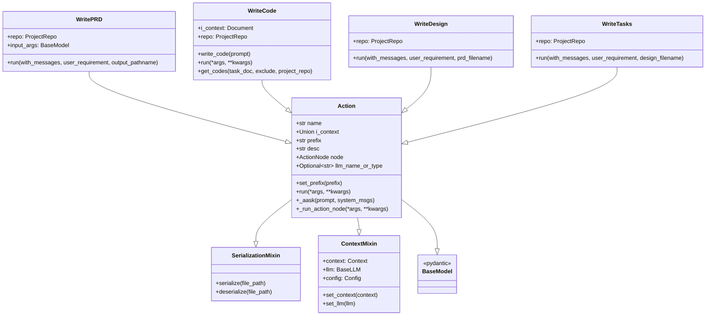
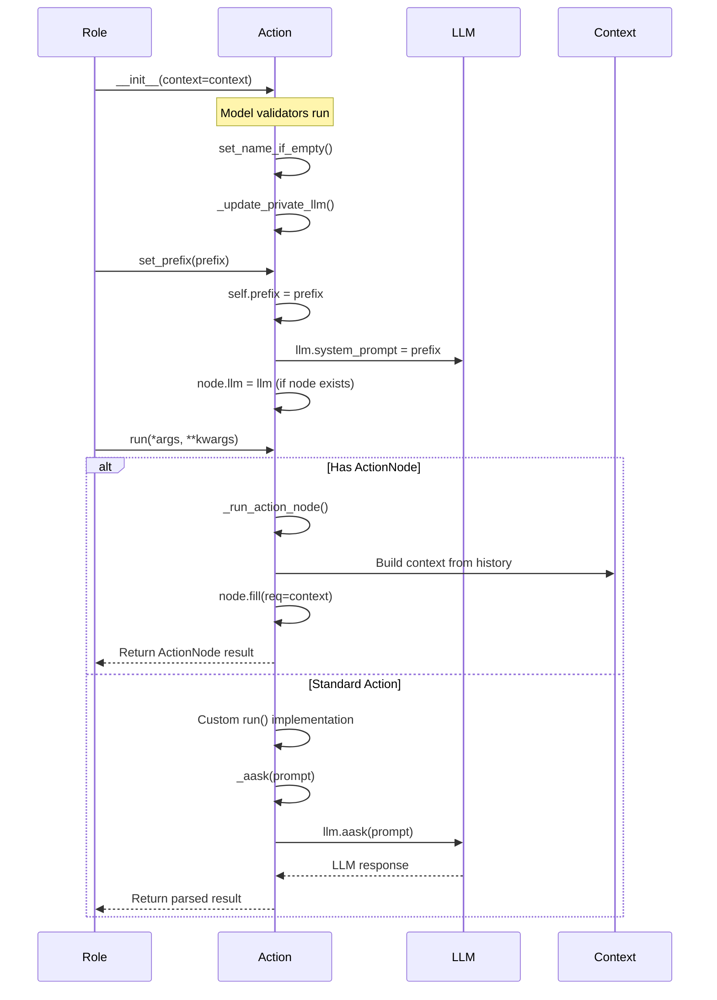
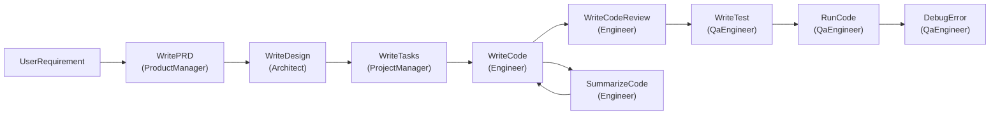
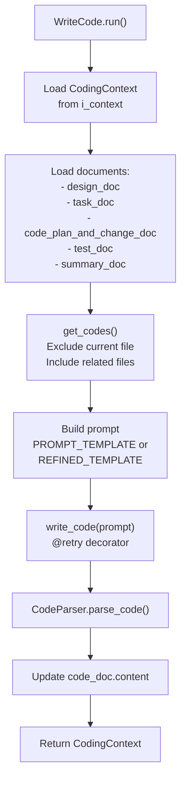
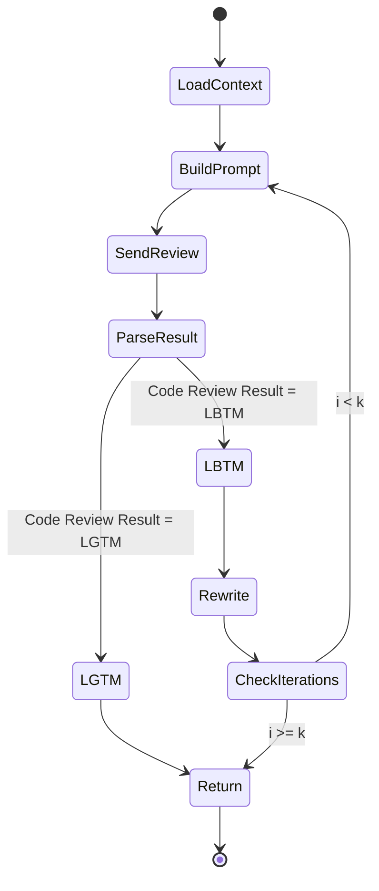
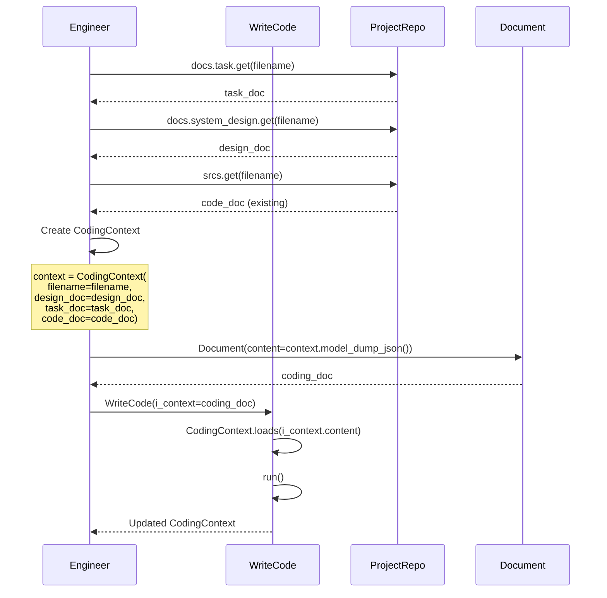
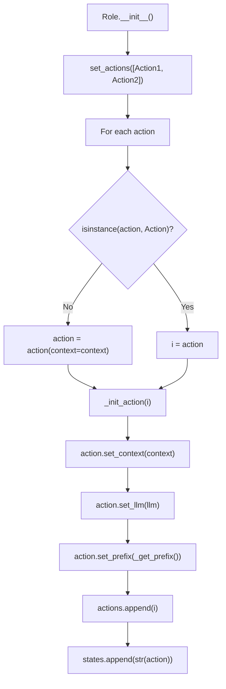
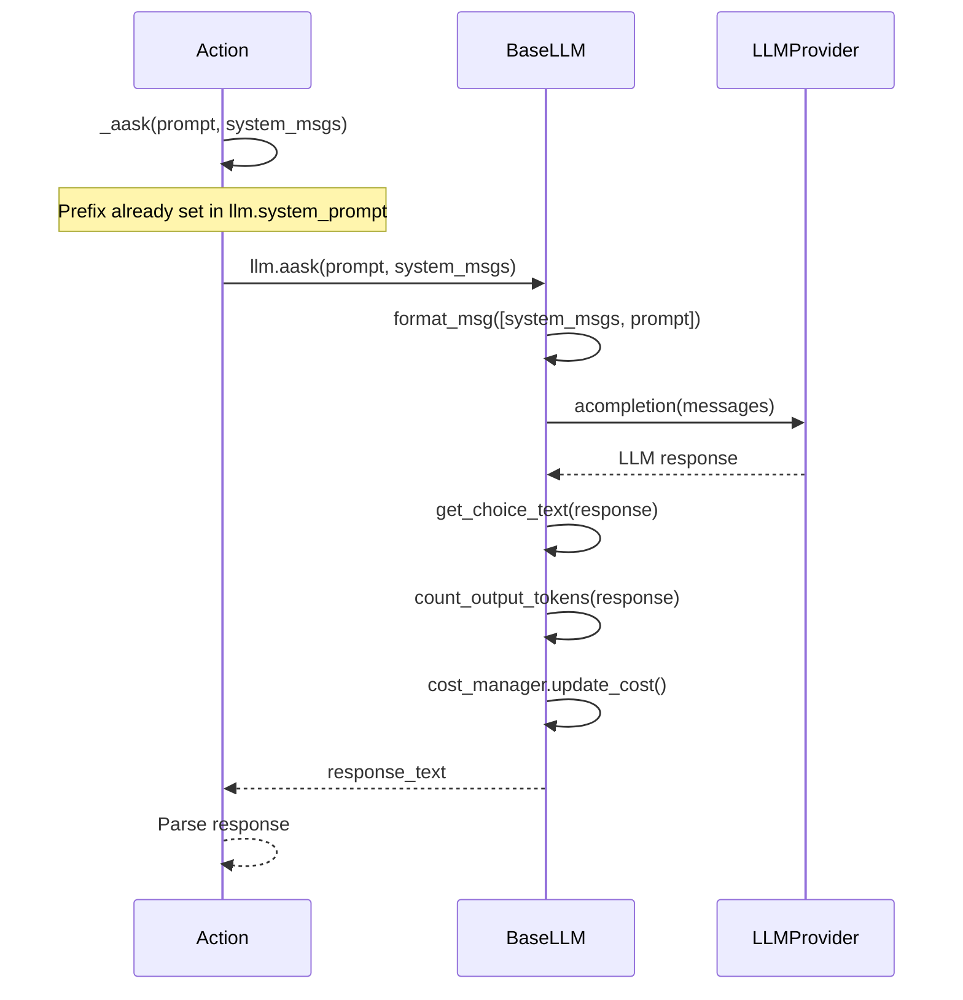
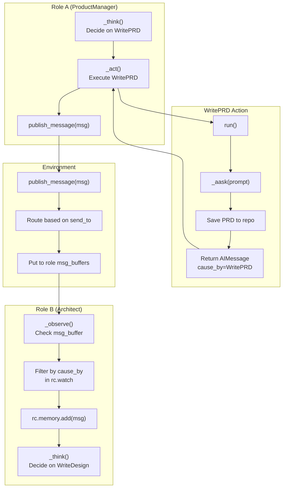
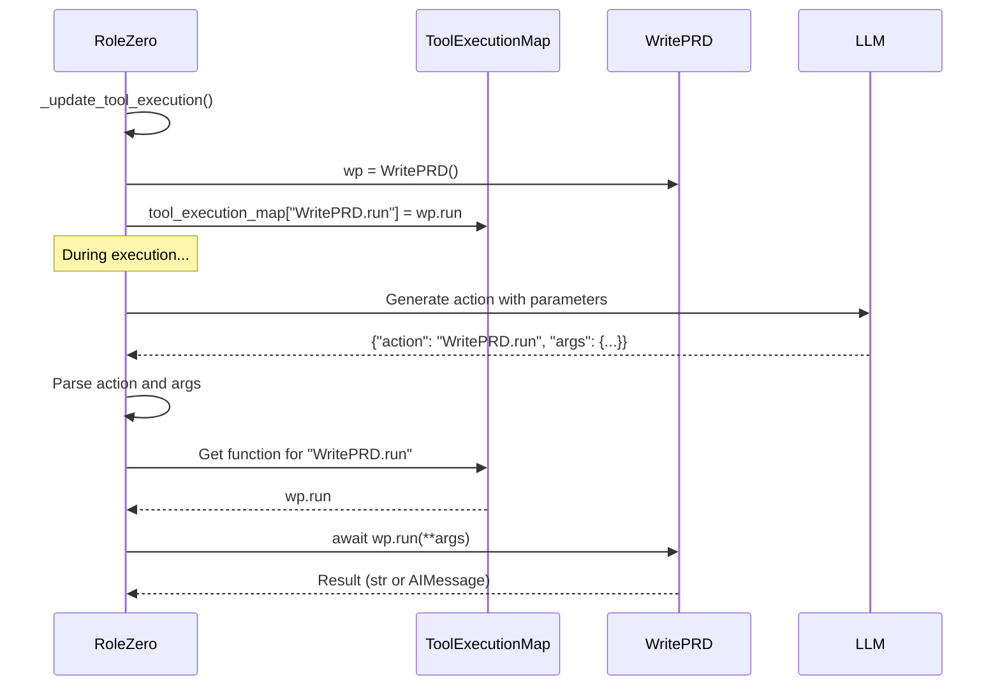

<!-- source: DeepWiki mcp.deepwiki.com · repo FoundationAgents/MetaGPT · page 2.2 Action System · fetched 2026-10-30 -->

# Action System

<details>
<summary>Relevant source files</summary>

The following files were used as context for generating this wiki page:

- [metagpt/actions/action.py](metagpt/actions/action.py)
- [metagpt/actions/design_api.py](metagpt/actions/design_api.py)
- [metagpt/actions/project_management.py](metagpt/actions/project_management.py)
- [metagpt/actions/summarize_code.py](metagpt/actions/summarize_code.py)
- [metagpt/actions/write_code.py](metagpt/actions/write_code.py)
- [metagpt/actions/write_code_review.py](metagpt/actions/write_code_review.py)
- [metagpt/actions/write_prd.py](metagpt/actions/write_prd.py)
- [metagpt/const.py](metagpt/const.py)
- [metagpt/memory/memory.py](metagpt/memory/memory.py)
- [metagpt/roles/architect.py](metagpt/roles/architect.py)
- [metagpt/roles/engineer.py](metagpt/roles/engineer.py)
- [metagpt/roles/product_manager.py](metagpt/roles/product_manager.py)
- [metagpt/roles/project_manager.py](metagpt/roles/project_manager.py)
- [metagpt/roles/qa_engineer.py](metagpt/roles/qa_engineer.py)
- [metagpt/roles/role.py](metagpt/roles/role.py)
- [metagpt/schema.py](metagpt/schema.py)
- [metagpt/utils/common.py](metagpt/utils/common.py)

</details>


The Action System is the atomic unit of work in MetaGPT's multi-agent framework. Actions encapsulate discrete tasks that agents (Roles) perform, such as writing a PRD, designing an API, or generating code. Each Action is an LLM-powered component that transforms input context into structured output through prompt-based interaction.

**Scope**: This document covers the Action base class, standard action implementations, context objects, and the integration patterns between Actions and Roles. For information about ActionNode-based structured prompting, see [ActionNode and Structured Output](#7). For Role-level orchestration and the observe-think-act loop, see [Role Architecture](#2.1).

## Action Base Class Architecture

The `Action` class ([metagpt/actions/action.py:29-120]()) serves as the foundation for all action implementations in MetaGPT. It inherits from `SerializationMixin`, `ContextMixin`, and `BaseModel` to provide serialization, context management, and validation capabilities.



**Key Attributes:**
- `name`: Identifier for the action, defaults to class name ([metagpt/actions/action.py:32]())
- `i_context`: Input context, can be various types including `CodingContext`, `TestingContext`, or simple strings ([metagpt/actions/action.py:33-35]())
- `prefix`: System message prefix added during LLM interaction ([metagpt/actions/action.py:36]())
- `desc`: Description for skill manager integration ([metagpt/actions/action.py:37]())
- `node`: Optional `ActionNode` for structured prompting ([metagpt/actions/action.py:38]())
- `llm_name_or_type`: Override LLM configuration per action ([metagpt/actions/action.py:41]())

**Sources:** [metagpt/actions/action.py:29-75](), [metagpt/actions/action.py:85-120]()

## Action Lifecycle and Configuration

Actions follow a well-defined lifecycle managed by Roles. The lifecycle includes initialization, prefix configuration, and execution.



### Initialization and Validation

Actions are initialized with context and undergo validation through Pydantic model validators:

1. **Name Assignment**: If not provided, the action name defaults to the class name ([metagpt/actions/action.py:69-74]())
2. **ActionNode Initialization**: If an `instruction` parameter is provided, an ActionNode is created automatically ([metagpt/actions/action.py:76-83]())
3. **LLM Configuration**: If `llm_name_or_type` is specified, a private LLM instance is created with the appropriate configuration ([metagpt/actions/action.py:43-51]())

### Prefix Configuration

The prefix system allows Roles to inject their context into Actions. When a Role initializes an Action, it calls `set_prefix()` with role-specific context:

```python
# From metagpt/roles/role.py:229-233
def _init_action(self, action: Action):
    action.set_context(self.context)
    action.set_llm(self.llm, override=override)
    action.set_prefix(self._get_prefix())
```

The prefix template includes role profile, name, goal, constraints, and environment description ([metagpt/roles/role.py:323-338]()).

**Sources:** [metagpt/actions/action.py:43-51](), [metagpt/actions/action.py:69-83](), [metagpt/actions/action.py:85-91](), [metagpt/roles/role.py:229-233](), [metagpt/roles/role.py:323-338]()

## Standard Actions in the SOP Pipeline

MetaGPT implements a sequential Standard Operating Procedure (SOP) where specific actions are executed in order to transform user requirements into working software. Each action corresponds to a phase in the software development lifecycle.



### WritePRD Action

`WritePRD` generates Product Requirement Documents and handles three scenarios: bugfix detection, new requirements, and requirement updates.

**Key Methods:**
- `run()`: Main entry point, determines scenario and delegates to appropriate handler ([metagpt/actions/write_prd.py:86-189]())
- `_new_prd()`: Creates a new PRD from scratch using `WRITE_PRD_NODE` ([metagpt/actions/write_prd.py:209-216]())
- `_is_bugfix()`: Checks if requirement is a bug report using `WP_ISSUE_TYPE_NODE` ([metagpt/actions/write_prd.py:238-242]())
- `_is_related()`: Determines if new requirement relates to existing PRD ([metagpt/actions/write_prd.py:249-252]())
- `_merge()`: Updates existing PRD with new requirements using `REFINED_PRD_NODE` ([metagpt/actions/write_prd.py:254-261]())

**Output:**
- PRD JSON document saved to `docs/prd/` directory
- Competitive analysis Mermaid diagram saved to `resources/competitive_analysis/`
- Returns `AIMessage` with `WritePRDOutput` instruct content

**Sources:** [metagpt/actions/write_prd.py:76-326]()

### WriteDesign Action

`WriteDesign` creates system design documents including data structures, interfaces, and program call flows.

**Key Methods:**
- `run()`: Processes changed PRDs and generates/updates system designs ([metagpt/actions/design_api.py:64-175]())
- `_new_system_design()`: Creates new design using `DESIGN_API_NODE` ([metagpt/actions/design_api.py:177-179]())
- `_merge()`: Updates existing design with `REFINED_DESIGN_NODE` ([metagpt/actions/design_api.py:181-185]())
- `_save_data_api_design()`: Extracts and renders class diagrams ([metagpt/actions/design_api.py:209-218]())
- `_save_seq_flow()`: Extracts and renders sequence diagrams ([metagpt/actions/design_api.py:220-229]())

**Output:**
- System design JSON saved to `docs/system_design/`
- Class diagram SVG saved to `resources/data_api_design/`
- Sequence diagram SVG saved to `resources/seq_flow/`
- Returns `AIMessage` with `WriteDesignOutput` instruct content

**Sources:** [metagpt/actions/design_api.py:53-280]()

### WriteTasks Action

`WriteTasks` decomposes system design into executable tasks with dependency information and package requirements.

**Key Methods:**
- `run()`: Processes system designs and generates task breakdowns ([metagpt/actions/project_management.py:52-132]())
- `_run_new_tasks()`: Creates new task list using `PM_NODE` ([metagpt/actions/project_management.py:155-157]())
- `_merge()`: Updates existing tasks using `REFINED_PM_NODE` ([metagpt/actions/project_management.py:159-163]())
- `_update_requirements()`: Aggregates Python package dependencies ([metagpt/actions/project_management.py:165-176]())

**Output:**
- Task JSON saved to `docs/task/` with task list and dependencies
- `requirements.txt` updated with required packages
- Returns `AIMessage` with `WriteTaskOutput` instruct content

**Sources:** [metagpt/actions/project_management.py:46-202]()

### WriteCode Action

`WriteCode` generates source code based on design documents, tasks, and existing code context.

**Core Logic:**



**Key Methods:**
- `run()`: Main execution, loads context and generates code ([metagpt/actions/write_code.py:100-165]())
- `write_code()`: LLM interaction with retry logic ([metagpt/actions/write_code.py:94-98]())
- `get_codes()`: Static method to gather related code files, supports incremental mode ([metagpt/actions/write_code.py:167-228]())

**Context Structure:**
The input `i_context` is a serialized `Document` containing a JSON-encoded `CodingContext` with:
- `filename`: Target file to generate
- `design_doc`: System design document
- `task_doc`: Task breakdown document
- `code_doc`: Existing code (if any)
- `code_plan_and_change_doc`: Incremental change plan (optional)

**Sources:** [metagpt/actions/write_code.py:88-229](), [metagpt/schema.py:797-803]()

### WriteCodeReview Action

`WriteCodeReview` validates generated code and iteratively rewrites it until it passes review (LGTM) or reaches maximum iterations.

**Review Process:**



**Key Components:**
- `write_code_review_and_rewrite()`: Performs review and conditional rewrite ([metagpt/actions/write_code_review.py:147-165]())
- Review criteria include: requirement fulfillment, logic correctness, design adherence, function completeness, dependency imports, and code reuse ([metagpt/actions/write_code_review.py:52-58]())
- Maximum iterations controlled by `config.code_validate_k_times` ([metagpt/actions/write_code_review.py:169]())

**Output:** Updated `CodingContext` with validated code

**Sources:** [metagpt/actions/write_code_review.py:141-221]()

### SummarizeCode Action

`SummarizeCode` reviews all code files in a module, identifies bugs, generates call flow diagrams, and produces a TODO list for fixes.

**Key Methods:**
- `run()`: Loads design, task, and code documents, then generates summary ([metagpt/actions/summarize_code.py:104-123]())
- `summarize_code()`: LLM interaction with retry logic ([metagpt/actions/summarize_code.py:99-102]())

**Output Format:**
- Code Review All: Per-file bug analysis
- Call flow: Mermaid flowchart of function calls
- Summary: High-level overview
- TODOs: Dict of files needing modification and reasons

**Sources:** [metagpt/actions/summarize_code.py:93-124]()

## Context Objects for Action Input

Actions consume structured context objects defined as Pydantic models in `metagpt/schema.py`. These contexts standardize parameter passing between actions and enable serialization.

| Context Type | Purpose | Key Fields | Used By |
|--------------|---------|------------|---------|
| `CodingContext` | Code generation input | `filename`, `design_doc`, `task_doc`, `code_doc`, `code_plan_and_change_doc` | `WriteCode`, `WriteCodeReview` |
| `TestingContext` | Test generation input | `filename`, `code_doc`, `test_doc` | `WriteTest` |
| `RunCodeContext` | Code execution parameters | `mode`, `command`, `code_filename`, `test_filename`, `working_directory` | `RunCode` |
| `CodeSummarizeContext` | Code review input | `design_filename`, `task_filename`, `codes_filenames` | `SummarizeCode` |
| `CodePlanAndChangeContext` | Incremental planning | `requirement`, `issue`, `prd_filename`, `design_filename`, `task_filename` | `WriteCodePlanAndChange` |

### CodingContext

`CodingContext` ([metagpt/schema.py:797-803]()) is the primary context for code generation:

```python
class CodingContext(BaseContext):
    filename: str
    design_doc: Optional[Document] = None
    task_doc: Optional[Document] = None
    code_doc: Optional[Document] = None
    code_plan_and_change_doc: Optional[Document] = None
```

**Usage in Engineer Role:**
The Engineer role constructs `CodingContext` instances from task documents:



**Sources:** [metagpt/schema.py:797-803](), [metagpt/roles/engineer.py:290-327]()

### RunCodeContext

`RunCodeContext` ([metagpt/schema.py:811-822]()) encapsulates parameters for executing and testing code:

```python
class RunCodeContext(BaseContext):
    mode: str = "script"
    code: Optional[str] = None
    code_filename: str = ""
    test_code: Optional[str] = None
    test_filename: str = ""
    command: List[str] = Field(default_factory=list)
    working_directory: str = ""
    additional_python_paths: List[str] = Field(default_factory=list)
    output_filename: Optional[str] = None
    output: Optional[str] = None
```

This context flows from `WriteTest` → `RunCode` → `DebugError` in the QA cycle.

**Sources:** [metagpt/schema.py:811-822](), [metagpt/roles/qa_engineer.py:92-101]()

## Action Integration with Roles

Roles execute actions through their `_act()` method as part of the observe-think-act loop. The integration involves action initialization, execution, and result handling.

### Action Initialization by Roles

Roles initialize actions in two phases:

1. **Static Initialization**: Actions are added to the role during `__init__()` via `set_actions()` ([metagpt/roles/role.py:239-260]())
2. **Dynamic Initialization**: Per-execution context is injected when an action becomes the current `todo` ([metagpt/roles/role.py:187-192]())



**Sources:** [metagpt/roles/role.py:224-260]()

### Action Execution in _act()

The `_act()` method executes the current `todo` action and wraps the result in a `Message`:

```python
# From metagpt/roles/role.py:381-397
async def _act(self) -> Message:
    logger.info(f"{self._setting}: to do {self.rc.todo}({self.rc.todo.name})")
    response = await self.rc.todo.run(self.rc.history)
    if isinstance(response, (ActionOutput, ActionNode)):
        msg = AIMessage(
            content=response.content,
            instruct_content=response.instruct_content,
            cause_by=self.rc.todo,
            sent_from=self,
        )
    elif isinstance(response, Message):
        msg = response
    else:
        msg = AIMessage(content=response or "", cause_by=self.rc.todo, sent_from=self)
    self.rc.memory.add(msg)
    return msg
```

**Message Construction:**
- `content`: Natural language output for display
- `instruct_content`: Structured data (Pydantic model) for inter-agent communication
- `cause_by`: Action that generated this message
- `sent_from`: Role that executed the action
- `send_to`: Recipient roles (defaults to `MESSAGE_ROUTE_TO_ALL`)

**Sources:** [metagpt/roles/role.py:381-397]()

### Engineer Role Action Orchestration

The `Engineer` role demonstrates complex action orchestration with multiple action types and conditional execution:

```mermaid
stateDiagram-v2
    [*] --> _think
    _think --> WriteCodePlanAndChange: config.inc and<br/>msg from PrepareDocuments/WriteTasks/FixBug
    _think --> WriteCode: msg from WriteTasks/<br/>WriteCodePlanAndChange/<br/>SummarizeCode
    _think --> SummarizeCode: msg from WriteCode/<br/>WriteCodeReview<br/>and sent_from=self
    
    WriteCodePlanAndChange --> _act_code_plan_and_change
    _act_code_plan_and_change --> SaveDocs["Save to docs/code_plan_and_change/<br/>and resources/code_plan_and_change/"]
    SaveDocs --> ReturnMessage1["Return AIMessage<br/>cause_by=WriteCodePlanAndChange<br/>send_to=MESSAGE_ROUTE_TO_SELF"]
    
    WriteCode --> _act_write_code
    _act_write_code --> _act_sp_with_cr
    _act_sp_with_cr --> RunWriteCode["For each todo:<br/>WriteCode.run()"]
    RunWriteCode --> ConditionalReview{"use_code_review?"}
    ConditionalReview -->|Yes| WriteCodeReview["WriteCodeReview.run()"]
    ConditionalReview -->|No| SaveCode["Save to srcs/"]
    WriteCodeReview --> SaveCode
    SaveCode --> ReturnMessage2["Return AIMessage<br/>cause_by=WriteCode/WriteCodeReview<br/>send_to=MESSAGE_ROUTE_TO_SELF"]
    
    SummarizeCode --> _act_summarize
    _act_summarize --> RunSummarize["For each summarize_todo:<br/>SummarizeCode.run()"]
    RunSummarize --> SaveSummary["Save to resources/code_summary/<br/>and docs/code_summary/"]
    SaveSummary --> CheckPass{"_is_pass(summary)?"}
    CheckPass -->|No| CreateTask["Add task to list<br/>for re-coding"]
    CheckPass -->|Yes| DeleteDoc["Delete code_summary doc"]
    CreateTask --> CheckMaxRounds{"n_summarize <<br/>max_auto_summarize_code?"}
    DeleteDoc --> CheckMaxRounds
    CheckMaxRounds -->|Yes| ReturnMessage3["Return AIMessage<br/>cause_by=SummarizeCode<br/>send_to=MESSAGE_ROUTE_TO_SELF"]
    CheckMaxRounds -->|No| ReturnMessage4["Return AIMessage<br/>cause_by=SummarizeCode<br/>send_to='Edward' (QaEngineer)"]
    
    ReturnMessage1 --> [*]
    ReturnMessage2 --> [*]
    ReturnMessage3 --> [*]
    ReturnMessage4 --> [*]
```

**Action State Management:**
The Engineer maintains state through:
- `code_todos`: List of `WriteCode` actions to execute ([metagpt/roles/engineer.py:95]())
- `summarize_todos`: List of `SummarizeCode` actions ([metagpt/roles/engineer.py:96]())
- `next_todo_action`: String indicating next action type ([metagpt/roles/engineer.py:97]())
- `n_summarize`: Counter for summarization rounds ([metagpt/roles/engineer.py:98]())

**Sources:** [metagpt/roles/engineer.py:152-289]()

## LLM Interaction Patterns

Actions interact with LLMs through the `_aask()` method, which appends the action's prefix to the prompt before sending it to the LLM.

### Basic LLM Call



**Key Points:**
- System prompt (prefix) is set once during action initialization ([metagpt/actions/action.py:85-91]())
- `_aask()` is a simple wrapper that delegates to `self.llm.aask()` ([metagpt/actions/action.py:99-101]())
- Token counting and cost tracking happen automatically in the LLM layer
- Response parsing is action-specific (e.g., `CodeParser.parse_code()` for WriteCode)

**Sources:** [metagpt/actions/action.py:99-101](), [metagpt/actions/write_code.py:94-98]()

### Retry Logic

Many actions implement retry logic using the `tenacity` library to handle transient LLM failures:

```python
# From metagpt/actions/write_code.py:94-98
@retry(wait=wait_random_exponential(min=1, max=60), stop=stop_after_attempt(6))
async def write_code(self, prompt) -> str:
    code_rsp = await self._aask(prompt)
    code = CodeParser.parse_code(text=code_rsp)
    return code
```

This pattern ensures robustness against:
- Rate limiting
- Temporary service unavailability  
- Network errors
- Invalid responses that fail parsing

**Sources:** [metagpt/actions/write_code.py:94-98](), [metagpt/actions/write_code_review.py:147](), [metagpt/actions/summarize_code.py:99-102]()

### Response Parsing Utilities

Actions use `CodeParser` and `OutputParser` from `metagpt/utils/common.py` to extract structured data from LLM responses:

| Method | Purpose | Example Usage |
|--------|---------|---------------|
| `parse_code(text, lang)` | Extract code blocks | `code = CodeParser.parse_code(text=rsp, lang="python")` |
| `parse_blocks(text)` | Split by `##` sections | `blocks = CodeParser.parse_blocks(text)` |
| `parse_block(block, text)` | Extract specific section | `result = CodeParser.parse_block("Code Review Result", rsp)` |
| `extract_struct(text, type)` | Extract list/dict | `data = OutputParser.extract_struct(text, dict)` |

**Sources:** [metagpt/utils/common.py:250-321]()

## Action and Message Flow in Multi-Agent System

Actions generate `Message` objects that flow through the `Environment` to other roles, enabling multi-agent collaboration.



**Message Attributes for Routing:**
- `cause_by`: Action class name that generated the message ([metagpt/schema.py:239]())
- `sent_from`: Role instance that executed the action ([metagpt/schema.py:240]())
- `send_to`: Set of recipient addresses, defaults to `MESSAGE_ROUTE_TO_ALL` ([metagpt/schema.py:241]())

**Watch Mechanism:**
Roles subscribe to specific action types via `_watch()`:

```python
# From metagpt/roles/engineer.py:106
self._watch([WriteTasks, SummarizeCode, WriteCode, WriteCodeReview, FixBug, WriteCodePlanAndChange])
```

The `_observe()` method filters messages based on this watch list:

```python
# From metagpt/roles/role.py:410-412
self.rc.news = [
    n for n in news if (n.cause_by in self.rc.watch or self.name in n.send_to) and n not in old_messages
]
```

**Sources:** [metagpt/roles/role.py:399-427](), [metagpt/roles/role.py:429-446](), [metagpt/roles/engineer.py:106]()

## Action Registration and Tool Integration

Actions can be registered as tools for dynamic invocation by advanced roles like `RoleZero` and its subclasses.

### Tool Registration Decorator

The `@register_tool` decorator exposes action methods as callable tools:

```python
# From metagpt/actions/write_prd.py:75-76
@register_tool(include_functions=["run"])
class WritePRD(Action):
    ...
```

This registration enables:
1. **Discovery**: Tools are indexed in a global registry
2. **Schema Generation**: Function signatures and docstrings are extracted
3. **Invocation**: Dynamic calls with argument validation
4. **Documentation**: Auto-generated tool descriptions for LLM context

**Registered Actions:**
- `WritePRD.run` ([metagpt/actions/write_prd.py:75]())
- `WriteDesign.run` ([metagpt/actions/design_api.py:52]())
- `WriteTasks.run` ([metagpt/actions/project_management.py:45]())
- `WriteCodeReview.run` ([metagpt/actions/write_code_review.py:224]())

**Sources:** [metagpt/actions/write_prd.py:75-76](), [metagpt/actions/design_api.py:52](), [metagpt/actions/project_management.py:45]()

### RoleZero Tool Execution

`RoleZero` and subclasses (ProductManager, Architect, ProjectManager) use a `tool_execution_map` to invoke registered actions:



**Example from ProductManager:**

```python
# From metagpt/roles/product_manager.py:49-51
def _update_tool_execution(self):
    wp = WritePRD()
    self.tool_execution_map.update(tool2name(WritePRD, ["run"], wp.run))
```

This allows the LLM to dynamically choose and invoke actions based on context.

**Sources:** [metagpt/roles/product_manager.py:49-51](), [metagpt/roles/architect.py:57-58](), [metagpt/roles/project_manager.py:43-50]()

---

