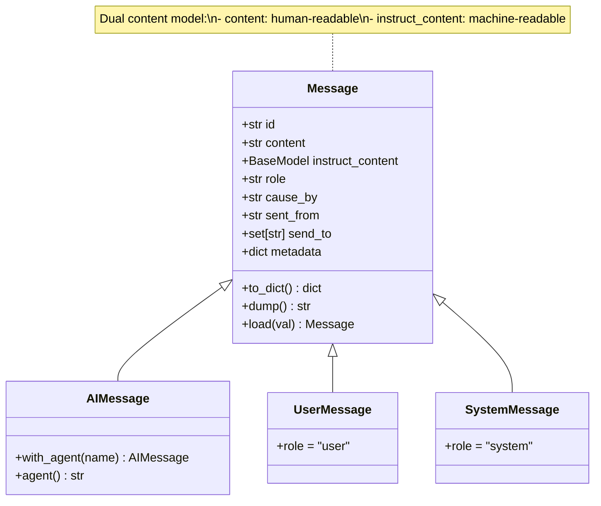
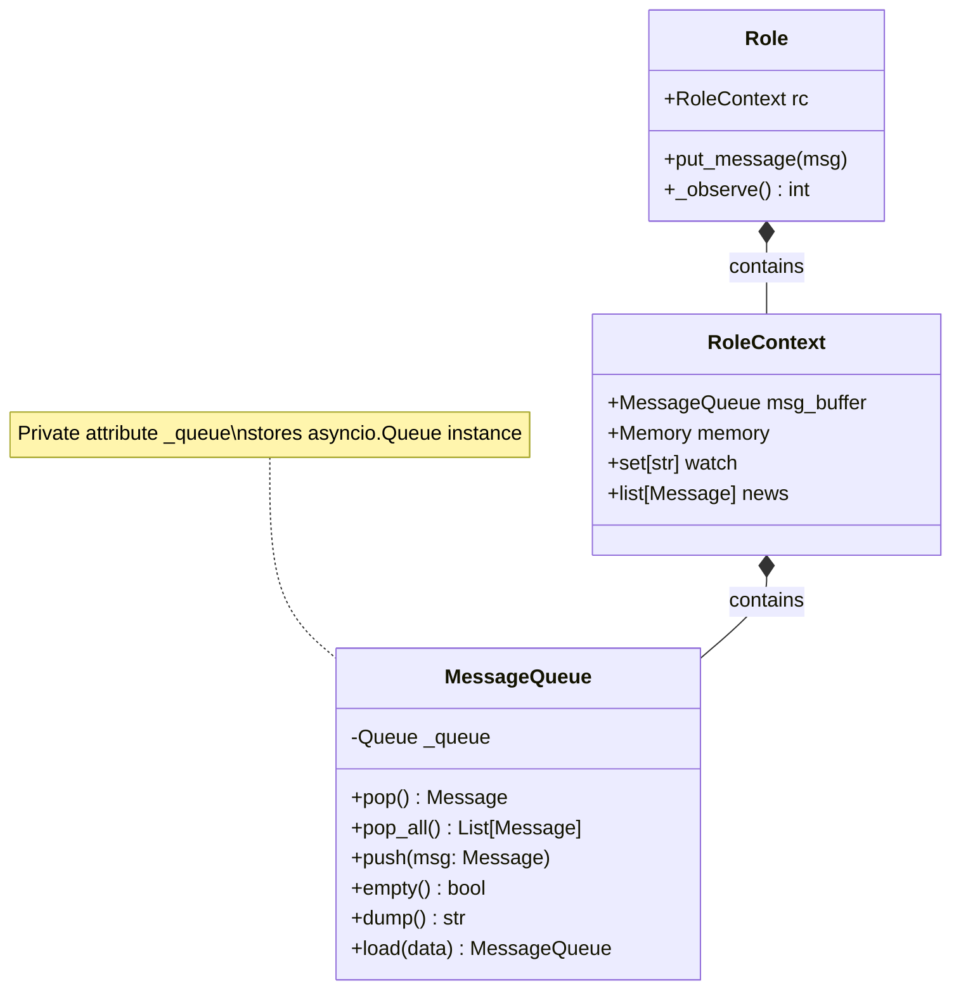
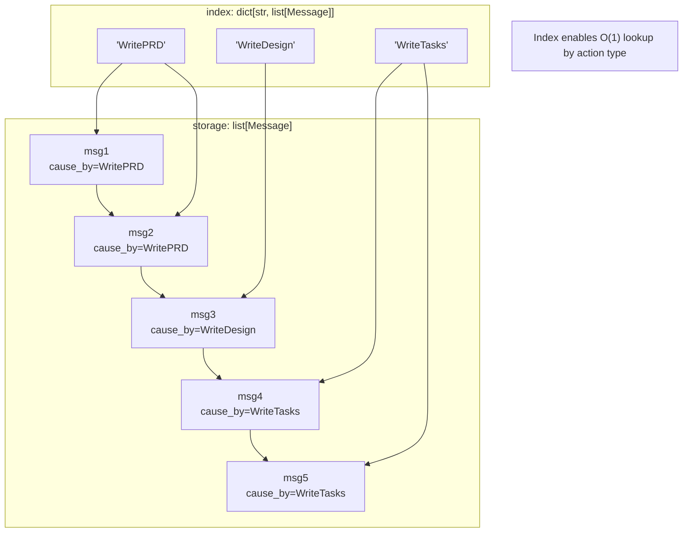
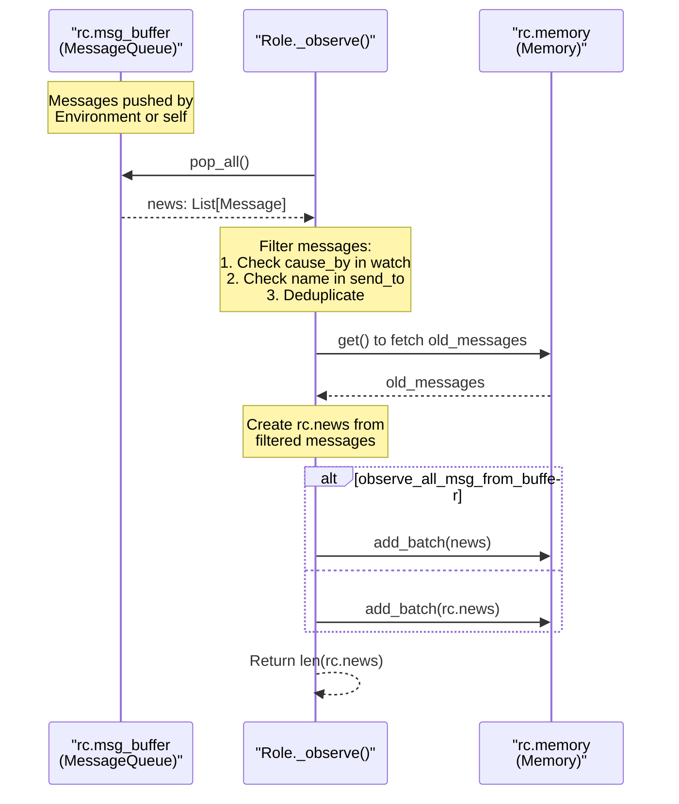

<!-- source: DeepWiki mcp.deepwiki.com · repo FoundationAgents/MetaGPT · page 2.3 Message Schema and Memory · fetched 2026-10-30 -->

# Message Schema and Memory

<details>
<summary>Relevant source files</summary>

The following files were used as context for generating this wiki page:

- [metagpt/actions/action.py](metagpt/actions/action.py)
- [metagpt/actions/design_api.py](metagpt/actions/design_api.py)
- [metagpt/actions/project_management.py](metagpt/actions/project_management.py)
- [metagpt/actions/summarize_code.py](metagpt/actions/summarize_code.py)
- [metagpt/actions/write_code.py](metagpt/actions/write_code.py)
- [metagpt/actions/write_code_review.py](metagpt/actions/write_code_review.py)
- [metagpt/actions/write_prd.py](metagpt/actions/write_prd.py)
- [metagpt/const.py](metagpt/const.py)
- [metagpt/memory/memory.py](metagpt/memory/memory.py)
- [metagpt/roles/architect.py](metagpt/roles/architect.py)
- [metagpt/roles/engineer.py](metagpt/roles/engineer.py)
- [metagpt/roles/product_manager.py](metagpt/roles/product_manager.py)
- [metagpt/roles/project_manager.py](metagpt/roles/project_manager.py)
- [metagpt/roles/qa_engineer.py](metagpt/roles/qa_engineer.py)
- [metagpt/roles/role.py](metagpt/roles/role.py)
- [metagpt/schema.py](metagpt/schema.py)
- [metagpt/utils/common.py](metagpt/utils/common.py)

</details>


## Purpose and Scope

This document describes the data structures used for communication and storage in MetaGPT's multi-agent system. The `Message` class defines the schema for communication units that flow between agents, while the `Memory` and `MessageQueue` classes provide storage and buffering mechanisms.

Key topics covered:
- **Message schema**: Structure and attributes of communication units
- **MessageQueue**: FIFO buffer for asynchronous message delivery
- **Memory**: Indexed storage for message retrieval and context management

For information about how messages are routed and consumed in the agent lifecycle, see [2.1 Role Architecture](#2.1) and [2.4 Team Orchestration and Environment](#2.4).

---

## Message Schema

The `Message` class serves as the fundamental communication unit between agents. It provides both human-readable content and machine-readable structured data, along with comprehensive routing metadata.

### Core Attributes

The Message schema consists of eight primary attributes:

| Attribute | Type | Default | Description |
|-----------|------|---------|-------------|
| `id` | `str` | Auto-generated UUID | Unique identifier for the message (RFC 135, Section 2.2.3.1.1) |
| `content` | `str` | Required | Natural language content for human or LLM consumption |
| `instruct_content` | `Optional[BaseModel]` | `None` | Structured Pydantic model for machine parsing |
| `role` | `str` | `"user"` | Message sender role: `"system"`, `"user"`, or `"assistant"` |
| `cause_by` | `str` | `"UserRequirement"` | Action class name that generated this message |
| `sent_from` | `str` | `""` | Sender's identity (role class name or custom address) |
| `send_to` | `set[str]` | `{MESSAGE_ROUTE_TO_ALL}` | Set of recipient addresses for routing |
| `metadata` | `Dict[str, Any]` | `{}` | Additional key-value pairs (e.g., agent name via AGENT constant) |



**Sources:** [metagpt/schema.py:232-417]()

### Dual Content Model

Messages support two parallel content streams:

1. **Natural Language (`content`)**: Human-readable text used for display and LLM prompts
2. **Structured Data (`instruct_content`)**: Pydantic models containing parsed, typed data for automated processing

The `instruct_content` field enables type-safe data exchange. For example, an Engineer role sends task completion data using `AIMessage.create_instruct_value()`:

```python
# Example from Engineer role
kvs = {
    "project_path": str(self.repo.workdir),
    "changed_src_filenames": [str(file) for file in changed_files],
}
msg = AIMessage(
    content="Coding is complete",
    instruct_content=AIMessage.create_instruct_value(kvs, "SummarizeCodeOutput"),
    cause_by=WriteCode
)
```

**Sources:** [metagpt/schema.py:232-265](), [metagpt/roles/engineer.py:217-227]()

---

### Routing-Related Attributes

Three attributes control message routing (detailed routing logic is covered in [2.4 Team Orchestration and Environment](#2.4)):

| Attribute | Purpose | Common Values |
|-----------|---------|---------------|
| `cause_by` | Identifies the action that created the message | `WritePRD`, `WriteCode`, `UserRequirement` |
| `sent_from` | Identifies the sending role | Role class name (e.g., `metagpt.roles.engineer.Engineer`) |
| `send_to` | Set of recipient addresses | `{MESSAGE_ROUTE_TO_ALL}`, `{"Alex"}`, `{MESSAGE_ROUTE_TO_SELF}` |

Routing constants defined in [metagpt/const.py:77-83]():

```python
MESSAGE_ROUTE_TO_ALL = "<all>"    # Broadcast to all roles
MESSAGE_ROUTE_TO_NONE = "<none>"  # No recipients
MESSAGE_ROUTE_TO_SELF = "<self>"  # Send to self
```

**Sources:** [metagpt/const.py:77-83](), [metagpt/schema.py:239-241]()

---

## MessageQueue

The `MessageQueue` class provides an asynchronous buffer for incoming messages. Each Role maintains a private `msg_buffer` in its `RoleContext` to receive messages before processing.

### MessageQueue API

The `MessageQueue` class wraps Python's `asyncio.Queue` to provide FIFO message buffering:

| Method | Return Type | Description |
|--------|-------------|-------------|
| `push(msg)` | `None` | Add message to queue (non-blocking) |
| `pop()` | `Message \| None` | Remove and return one message, or `None` if empty |
| `pop_all()` | `List[Message]` | Remove and return all queued messages |
| `empty()` | `bool` | Check if queue is empty |
| `dump()` | `str` | Serialize queue to JSON string (async) |
| `load(data)` | `MessageQueue` | Deserialize JSON string to queue (static) |

**Implementation Details:**



**Sources:** [metagpt/schema.py:713-783](), [metagpt/roles/role.py:92-103]()

### Queue Lifecycle in Role Context

The `msg_buffer` is embedded in `RoleContext` and used during the observe phase:

1. **Push Phase**: External entities call `role.put_message(msg)`, which executes `self.rc.msg_buffer.push(msg)`
2. **Pop Phase**: During `_observe()`, role calls `self.rc.msg_buffer.pop_all()` to retrieve all buffered messages
3. **Processing**: Retrieved messages are filtered and stored in `rc.memory`

The queue provides temporary storage between message receipt and observation, enabling asynchronous message delivery without blocking the sender.

**Sources:** [metagpt/roles/role.py:448-452](), [metagpt/roles/role.py:399-406]()

---

## Memory System

The `Memory` class provides indexed storage for messages, enabling efficient retrieval by action type. Unlike the transient `MessageQueue`, Memory persists messages across execution cycles.

### Memory Structure and Indexing

The `Memory` class maintains two parallel data structures:

1. **storage** (`list[Message]`): Sequential list preserving insertion order
2. **index** (`DefaultDict[str, list[Message]]`): Dictionary mapping `cause_by` action names to message lists

**Memory Indexing Diagram:**



The index is automatically maintained when messages are added via `add()` or `add_batch()`. Each message's `cause_by` attribute becomes a key in the index dictionary.

**Sources:** [metagpt/memory/memory.py:20-39]()

### Core Memory Operations

| Method | Purpose | Example |
|--------|---------|---------|
| `add(message)` | Add message to storage and index by `cause_by` | `memory.add(msg)` |
| `add_batch(messages)` | Batch add multiple messages | `memory.add_batch(self.rc.news)` |
| `get(k=0)` | Retrieve most recent k messages (all if k=0) | `memory.get(k=5)` |
| `get_by_action(action)` | Get all messages caused by specific action | `memory.get_by_action(WritePRD)` |
| `get_by_actions(actions)` | Get messages from multiple action types | `memory.get_by_actions(self.rc.watch)` |
| `find_news(observed, k)` | Find previously unseen messages | `memory.find_news([msg], k=10)` |
| `delete(message)` | Remove message from storage and index | `memory.delete(msg)` |

**Sources:** [metagpt/memory/memory.py:20-113]()

### Memory Integration with RoleContext

The `Memory` instance lives in `RoleContext` and provides three key properties:

```python
# From RoleContext in metagpt/roles/role.py:92-124
class RoleContext(BaseModel):
    memory: Memory = Field(default_factory=Memory)
    working_memory: Memory = Field(default_factory=Memory)
    
    @property
    def important_memory(self) -> list[Message]:
        """Retrieve messages caused by watched actions."""
        return self.memory.get_by_actions(self.watch)
    
    @property
    def history(self) -> list[Message]:
        """Return all stored messages."""
        return self.memory.get()
```

**Memory vs. Working Memory:**
- `memory`: Persistent storage across action cycles
- `working_memory`: Temporary storage for plan execution (used by `Planner`)
- `important_memory`: Property that filters messages by watched action types

**Sources:** [metagpt/roles/role.py:92-124]()

---

## Message Lifecycle in Role Observation

Messages flow through MessageQueue and Memory during the role's observation phase. The complete sequence is documented in [metagpt/roles/role.py:399-428]():

**Message Observation Flow:**



**Key Steps:**

1. **Pop**: Retrieve all messages from `msg_buffer` using `pop_all()`
2. **Filter**: Apply routing rules and deduplication checks
3. **Store**: Add filtered messages to `memory` via `add_batch()`
4. **Expose**: Filtered messages become available in `rc.news` for `_think()` and `_act()` phases

**Sources:** [metagpt/roles/role.py:399-428]()

---

## Message Specialization Classes

MetaGPT provides three specialized message classes that inherit from `Message`:

| Class | Role Value | Purpose |
|-------|------------|---------|
| `UserMessage` | `"user"` | User input or requirements |
| `SystemMessage` | `"system"` | System-level instructions |
| `AIMessage` | `"assistant"` | Agent-generated responses |

### AIMessage Extensions

`AIMessage` adds agent tracking capabilities:

```python
# From metagpt/schema.py:439-455
class AIMessage(Message):
    def with_agent(self, name: str):
        """Add agent name to metadata."""
        self.add_metadata(key=AGENT, value=name)
        return self
    
    @property
    def agent(self) -> str:
        """Retrieve agent name from metadata."""
        return self.metadata.get(AGENT, "")
```

**Usage Example from Engineer:**

```python
# Engineer creates message with agent metadata
msg = AIMessage(
    content="Coding is complete",
    instruct_content=output_model,
    cause_by=SummarizeCode,
    send_to="Edward"
)
msg.with_agent(self._setting)  # Adds "Alex(Engineer)" to metadata
```

**Sources:** [metagpt/schema.py:439-455](), [metagpt/roles/engineer.py:217-227]()

---

## Message Serialization

### JSON Serialization Methods

Messages support bidirectional JSON serialization for persistence and context recovery:

| Method | Type | Description |
|--------|------|-------------|
| `dump()` | instance | Serialize message to JSON string |
| `load(val)` | static | Deserialize JSON string to Message object |
| `to_dict()` | instance | Convert to dict with `role` and `content` keys for LLM calls |

**Serialization Example:**

```python
# From metagpt/schema.py:336-357
# Serialize
json_str = message.dump()  # Uses model_dump_json()

# Deserialize
message = Message.load(json_str)  # Handles JSONDecodeError gracefully

# LLM-compatible format
llm_dict = message.to_dict()  # Returns {"role": "user", "content": "..."}
```

### Special Handling for instruct_content

The `instruct_content` field requires custom serialization logic to preserve type information:

- **ActionNode models**: Serialized with `mapping` field containing field definitions
- **BaseModel subclasses**: Serialized with `module` field for class import path

This enables dynamic reconstruction of Pydantic models during deserialization (see [metagpt/schema.py:249-264]()).

**Sources:** [metagpt/schema.py:232-357]()

### MessageQueue Serialization

`MessageQueue` provides async-aware serialization:

```python
# From metagpt/schema.py:748-783
# Serialize (async)
queue_json = await message_queue.dump()

# Deserialize (static)
restored_queue = MessageQueue.load(queue_json)
```

The `dump()` method uses `asyncio.wait_for()` to safely drain the queue with a 1-second timeout, then restores all messages back to the queue.

**Sources:** [metagpt/schema.py:748-783]()

---

## Summary

MetaGPT's message communication system provides:

1. **Dual Content Model**: Natural language (`content`) for LLMs and humans, structured data (`instruct_content`) for machines
2. **Flexible Routing**: Broadcast, direct addressing, and self-loop modes controlled by `send_to`
3. **Action-Based Filtering**: Publish-subscribe pattern using `cause_by` and `watch` for decoupled communication
4. **Asynchronous Buffering**: `MessageQueue` enables non-blocking message delivery
5. **Indexed Storage**: `Memory` provides efficient retrieval by action type
6. **Deduplication**: Automatic filtering of duplicate messages to prevent redundant processing

This architecture enables complex multi-agent workflows where roles communicate without direct references, supporting dynamic composition and workflow evolution.

---

