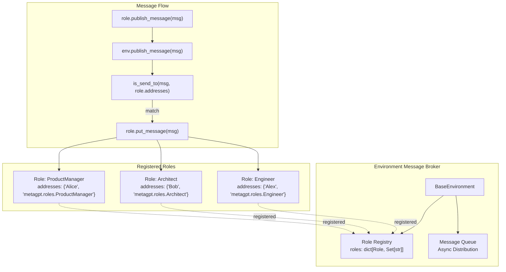
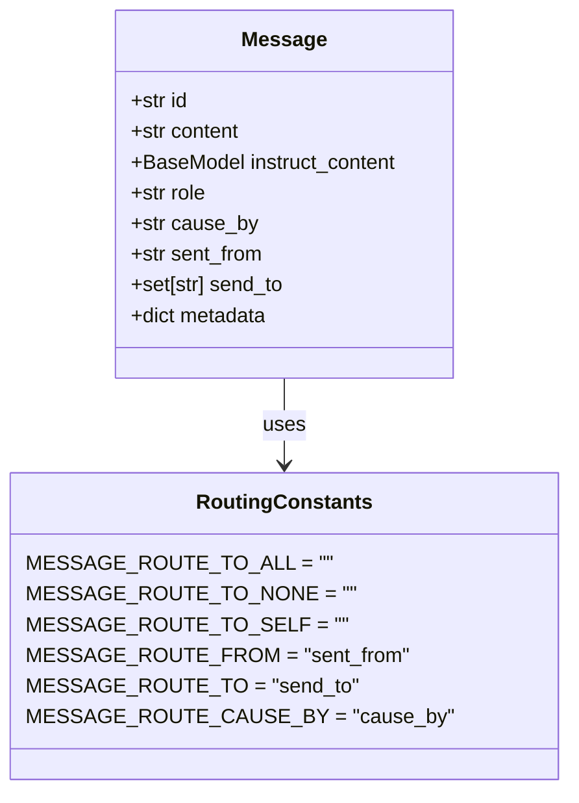
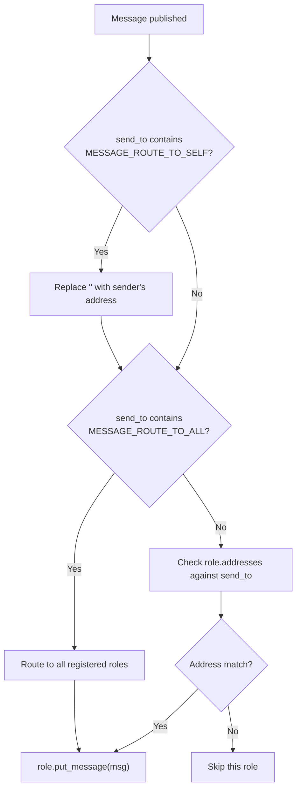
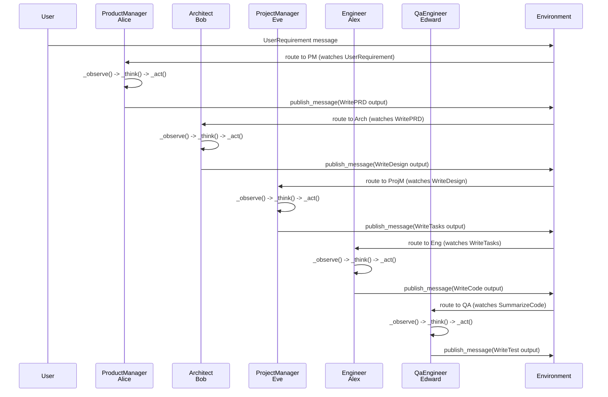
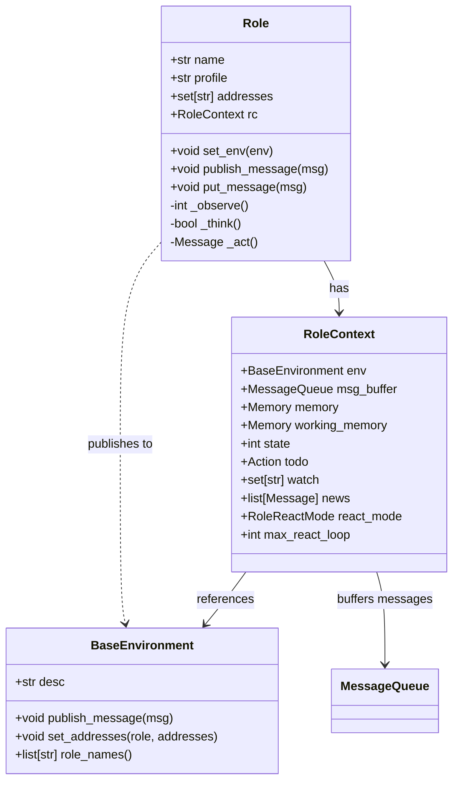
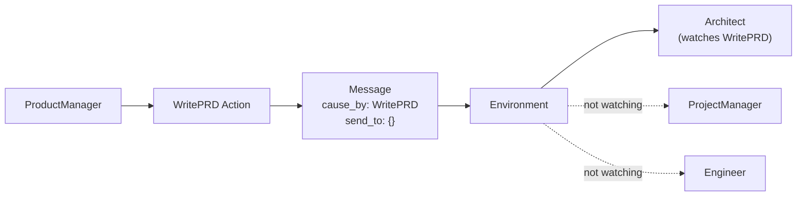
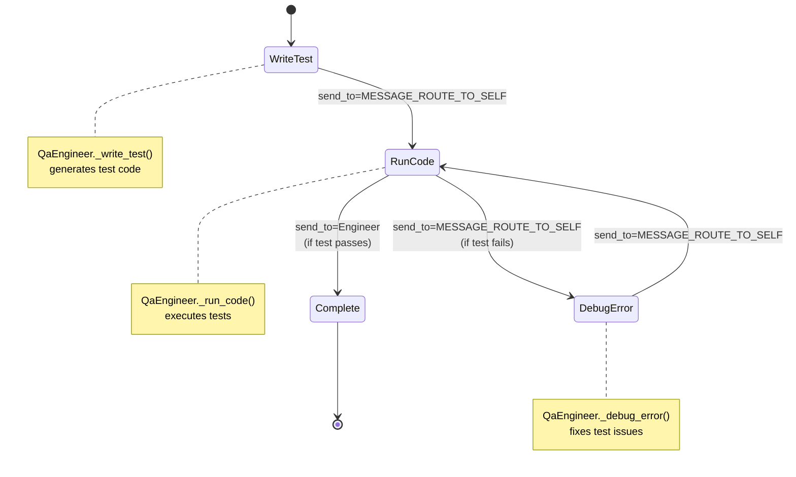

<!-- source: DeepWiki mcp.deepwiki.com · repo FoundationAgents/MetaGPT · page 2.4 Team Orchestration and Environment · fetched 2026-10-30 -->

# Team Orchestration and Environment

<details>
<summary>Relevant source files</summary>

The following files were used as context for generating this wiki page:

- [metagpt/actions/action.py](metagpt/actions/action.py)
- [metagpt/actions/design_api.py](metagpt/actions/design_api.py)
- [metagpt/actions/project_management.py](metagpt/actions/project_management.py)
- [metagpt/actions/summarize_code.py](metagpt/actions/summarize_code.py)
- [metagpt/actions/write_code.py](metagpt/actions/write_code.py)
- [metagpt/actions/write_code_review.py](metagpt/actions/write_code_review.py)
- [metagpt/actions/write_prd.py](metagpt/actions/write_prd.py)
- [metagpt/const.py](metagpt/const.py)
- [metagpt/memory/memory.py](metagpt/memory/memory.py)
- [metagpt/roles/architect.py](metagpt/roles/architect.py)
- [metagpt/roles/engineer.py](metagpt/roles/engineer.py)
- [metagpt/roles/product_manager.py](metagpt/roles/product_manager.py)
- [metagpt/roles/project_manager.py](metagpt/roles/project_manager.py)
- [metagpt/roles/qa_engineer.py](metagpt/roles/qa_engineer.py)
- [metagpt/roles/role.py](metagpt/roles/role.py)
- [metagpt/schema.py](metagpt/schema.py)
- [metagpt/utils/common.py](metagpt/utils/common.py)

</details>


## Purpose and Scope

This document explains how MetaGPT orchestrates multiple roles through the `Environment` message broker and the `Team` class. It covers message routing mechanisms, role-to-role communication patterns, and the integration between roles and their execution environment. This page focuses on the infrastructure that enables multi-agent collaboration.

For information about individual role execution loops and action selection, see [Role Architecture](#2.1). For details about message data structures and memory storage, see [Message Schema and Memory](#2.3).

---

## Environment as Message Broker

The `Environment` class serves as a central message broker that facilitates asynchronous communication between roles. It maintains role registrations, routes messages based on addressing rules, and manages the distribution of information across the agent team.

### Environment Core Responsibilities



**Sources:** [metagpt/roles/role.py:308-316](), [metagpt/roles/role.py:429-446](), [metagpt/const.py:77-83]()

### Role Registration and Addressing

Roles register with the environment through the `set_env` method, which establishes bidirectional awareness. Each role has a set of `addresses` (string identifiers) that the environment uses for message routing.

| Registration Component | Purpose | Example Values |
|------------------------|---------|----------------|
| `Role.addresses` | String identifiers for this role | `{"Alice", "metagpt.roles.product_manager.ProductManager"}` |
| `Role.name` | Human-readable role name | `"Alice"` |
| `Role.profile` | Role type identifier | `"Product Manager"` |
| `env.set_addresses(role, addresses)` | Registers role with environment | Called during `set_env` |

The `addresses` set is automatically populated with the role's class string representation and name. This allows messages to target roles by either their instance name or their class type.

**Sources:** [metagpt/roles/role.py:210-214](), [metagpt/roles/role.py:293-300](), [metagpt/roles/role.py:308-316]()

---

## Message Routing System

MetaGPT implements a flexible addressing system that allows messages to be broadcast to all roles, sent to specific recipients, or looped back to the sender for iterative processing.

### Message Routing Fields



**Sources:** [metagpt/schema.py:232-242](), [metagpt/const.py:77-83]()

### Routing Field Semantics

| Field | Type | Purpose | Example |
|-------|------|---------|---------|
| `send_to` | `set[str]` | Recipient addresses or routing constants | `{"Alice"}`, `{"<all>"}`, `{"<self>"}` |
| `sent_from` | `str` | Originating role identifier | `"metagpt.roles.engineer.Engineer"` |
| `cause_by` | `str` | Action class that generated this message | `"metagpt.actions.write_code.WriteCode"` |

The `send_to` field supports three special routing constants:

- **`MESSAGE_ROUTE_TO_ALL` (`"<all>"`)**: Broadcast to all roles registered with the environment
- **`MESSAGE_ROUTE_TO_SELF` (`"<self>"`)**: Send back to the originating role's message buffer
- **`MESSAGE_ROUTE_TO_NONE` (`"<none>"`)**: No routing (message is terminal)

**Sources:** [metagpt/schema.py:276-283](), [metagpt/const.py:81-83]()

### Routing Logic Flow

The routing determination follows this logic:



**Sources:** [metagpt/roles/role.py:429-446](), [metagpt/utils/common.py:423-431]()

The `is_send_to` utility function implements the address matching logic:

```python
# From metagpt/utils/common.py:423-431
def is_send_to(message: "Message", addresses: set):
    """Return whether it's consumer"""
    if MESSAGE_ROUTE_TO_ALL in message.send_to:
        return True

    for i in addresses:
        if i in message.send_to:
            return True
    return False
```

**Sources:** [metagpt/utils/common.py:423-431]()

---

## Team Orchestration

While the `Team` class implementation is not directly visible in the provided files, the infrastructure in `Role` shows how teams coordinate execution through standardized workflows.

### Multi-Role Coordination Pattern

Standard SOP-driven workflows follow a sequential handoff pattern where each role processes messages triggered by specific actions:



**Sources:** [metagpt/roles/product_manager.py:41-47](), [metagpt/roles/architect.py:43-52](), [metagpt/roles/project_manager.py:36-41](), [metagpt/roles/engineer.py:102-106](), [metagpt/roles/qa_engineer.py:52-60]()

### Role Watch Patterns

Roles declare which action types they're interested in through the `_watch` method. This creates a subscription mechanism where roles only process messages caused by specific actions:

| Role | Watches (Action Types) | Purpose |
|------|------------------------|---------|
| `ProductManager` | `UserRequirement`, `PrepareDocuments` | Processes user input and generates PRDs |
| `Architect` | `WritePRD` | Designs system architecture from requirements |
| `ProjectManager` | `WriteDesign` | Breaks down design into tasks |
| `Engineer` | `WriteTasks`, `SummarizeCode`, `WriteCode`, `WriteCodeReview`, `FixBug`, `WriteCodePlanAndChange` | Implements code based on tasks and feedback |
| `QaEngineer` | `SummarizeCode`, `WriteTest`, `RunCode`, `DebugError` | Tests code and debugs issues |

**Sources:** [metagpt/roles/engineer.py:106](), [metagpt/roles/qa_engineer.py:59](), [metagpt/roles/product_manager.py:46](), [metagpt/roles/architect.py:52](), [metagpt/roles/project_manager.py:41]()

---

## Role-Environment Integration

Each role maintains a reference to its environment and uses it to send and receive messages. The integration happens through the `RoleContext` and explicit message handling methods.

### Role Context Structure



**Sources:** [metagpt/roles/role.py:92-123](), [metagpt/roles/role.py:125-159]()

### Environment Setup

When a role is added to an environment, bidirectional setup occurs:

```python
# From metagpt/roles/role.py:308-316
def set_env(self, env: BaseEnvironment):
    """Set the environment in which the role works. The role can talk to the environment and can also receive
    messages by observing."""
    self.rc.env = env
    if env:
        env.set_addresses(self, self.addresses)
        self.llm.system_prompt = self._get_prefix()
        self.llm.cost_manager = self.context.cost_manager
        self.set_actions(self.actions)  # reset actions to update llm and prefix
```

This setup:
1. Stores environment reference in `rc.env`
2. Registers role's addresses with the environment
3. Updates system prompt with environment context (e.g., other roles present)
4. Reinitializes actions with updated context

**Sources:** [metagpt/roles/role.py:308-316](), [metagpt/roles/role.py:323-338]()

### Message Publication Methods

Roles have two distinct methods for handling messages:

| Method | Purpose | Routing Behavior |
|--------|---------|------------------|
| `publish_message(msg)` | Broadcast message through environment | Sends to environment → routes to recipients |
| `put_message(msg)` | Add message to private buffer | Direct to own `msg_buffer` only |

```python
# From metagpt/roles/role.py:429-446
def publish_message(self, msg):
    """If the role belongs to env, then the role's messages will be broadcast to env"""
    if not msg:
        return
    if MESSAGE_ROUTE_TO_SELF in msg.send_to:
        msg.send_to.add(any_to_str(self))
        msg.send_to.remove(MESSAGE_ROUTE_TO_SELF)
    if not msg.sent_from or msg.sent_from == MESSAGE_ROUTE_TO_SELF:
        msg.sent_from = any_to_str(self)
    if all(to in {any_to_str(self), self.name} for to in msg.send_to):  # Message to myself
        self.put_message(msg)
        return
    if not self.rc.env:
        # If env does not exist, do not publish the message
        return
    if isinstance(msg, AIMessage) and not msg.agent:
        msg.with_agent(self._setting)
    self.rc.env.publish_message(msg)
```

**Sources:** [metagpt/roles/role.py:429-446](), [metagpt/roles/role.py:448-452]()

### Message Observation and Filtering

The `_observe` method retrieves messages from the buffer and filters them based on the role's watch list and addressing:

```python
# From metagpt/roles/role.py:399-427
async def _observe(self) -> int:
    """Prepare new messages for processing from the message buffer and other sources."""
    # Read unprocessed messages from the msg buffer.
    news = []
    if self.recovered and self.latest_observed_msg:
        news = self.rc.memory.find_news(observed=[self.latest_observed_msg], k=10)
    if not news:
        news = self.rc.msg_buffer.pop_all()
    # Store the read messages in your own memory to prevent duplicate processing.
    old_messages = [] if not self.enable_memory else self.rc.memory.get()
    # Filter in messages of interest.
    self.rc.news = [
        n for n in news if (n.cause_by in self.rc.watch or self.name in n.send_to) and n not in old_messages
    ]
    if self.observe_all_msg_from_buffer:
        # save all new messages from the buffer into memory, the role may not react to them but can be aware of them
        self.rc.memory.add_batch(news)
    else:
        # only save messages of interest into memory
        self.rc.memory.add_batch(self.rc.news)
    self.latest_observed_msg = self.rc.news[-1] if self.rc.news else None  # record the latest observed msg
    # ...
    return len(self.rc.news)
```

Messages are filtered by two criteria:
1. `n.cause_by in self.rc.watch`: Message was caused by an action this role is watching
2. `self.name in n.send_to`: Message is explicitly addressed to this role

**Sources:** [metagpt/roles/role.py:399-427](), [metagpt/roles/role.py:284-291]()

---

## Communication Patterns

### Broadcast Pattern

Used for sequential workflows where downstream roles need to react to upstream outputs:



The `MESSAGE_ROUTE_TO_ALL` constant is the default value for `Message.send_to`, making broadcast the standard pattern unless explicitly overridden.

**Sources:** [metagpt/schema.py:241](), [metagpt/const.py:81](), [metagpt/actions/write_prd.py:180-189]()

### Direct Messaging Pattern

Used when a role needs to send output to a specific recipient:

```python
# From metagpt/actions/write_prd.py:191-207
async def _handle_bugfix(self, req: Document) -> AIMessage:
    # ... bugfix logic ...
    await self.repo.docs.save(filename=BUGFIX_FILENAME, content=req.content)
    await self.repo.docs.save(filename=REQUIREMENT_FILENAME, content="")
    return AIMessage(
        content=f"A new issue is received: {BUGFIX_FILENAME}",
        cause_by=FixBug,
        instruct_content=AIMessage.create_instruct_value(
            {
                "project_path": str(self.repo.workdir),
                "issue_filename": str(self.repo.docs.workdir / BUGFIX_FILENAME),
                "requirements_filename": str(self.repo.docs.workdir / REQUIREMENT_FILENAME),
            },
            class_name="IssueDetail",
        ),
        send_to="Alex",  # the name of Engineer
    )
```

Here, the bugfix message is sent directly to "Alex" (the Engineer role) by name, bypassing other roles.

**Sources:** [metagpt/actions/write_prd.py:191-207](), [metagpt/actions/summarize_code.py:217-227]()

### Self-Messaging Pattern

Used for iterative work where a role needs to perform multiple actions in sequence:

```python
# From metagpt/roles/engineer.py:167-171
async def _act_write_code(self):
    await self._act_sp_with_cr(review=self.use_code_review)
    return AIMessage(
        content="", cause_by=WriteCodeReview if self.use_code_review else WriteCode, send_to=MESSAGE_ROUTE_TO_SELF
    )
```

The `MESSAGE_ROUTE_TO_SELF` constant ensures the message loops back to the Engineer's own buffer, allowing it to continue processing (e.g., moving from writing code to summarizing it).

**Sources:** [metagpt/roles/engineer.py:167-171](), [metagpt/roles/engineer.py:231](), [metagpt/const.py:83]()

### Multi-Round Iteration Example

The QaEngineer demonstrates complex self-messaging for test-write-run-debug cycles:



**Sources:** [metagpt/roles/qa_engineer.py:62-104](), [metagpt/roles/qa_engineer.py:105-149](), [metagpt/roles/qa_engineer.py:150-159]()

### Terminal Message Pattern

When work is complete or should not propagate further, roles use `MESSAGE_ROUTE_TO_NONE`:

```python
# From metagpt/roles/qa_engineer.py:169-175
result_msg = AIMessage(
    content=f"Exceeding {self.test_round_allowed} rounds of tests, stop. "
    + "\n".join(list(self.repo.tests.changed_files.keys())),
    cause_by=WriteTest,
    instruct_content=AIMessage.create_instruct_value(kvs=kvs, class_name="WriteTestOutput"),
    send_to=MESSAGE_ROUTE_TO_NONE,
)
```

This prevents the environment from routing the message to any other roles, effectively terminating the workflow branch.

**Sources:** [metagpt/roles/qa_engineer.py:169-175](), [metagpt/const.py:82]()

---

## Summary

The Team orchestration and Environment system in MetaGPT provides:

1. **Centralized Message Broker**: The `Environment` class routes messages between roles based on addresses and routing constants
2. **Flexible Addressing**: Roles can broadcast (`MESSAGE_ROUTE_TO_ALL`), target specific recipients by name, or loop back to themselves (`MESSAGE_ROUTE_TO_SELF`)
3. **Watch-Based Filtering**: Roles declare which action types they're interested in, creating implicit subscription patterns
4. **Dual Message Paths**: `publish_message` for environment-mediated communication, `put_message` for direct buffer access
5. **Sequential Coordination**: Standard workflows follow a pipeline pattern where each role watches for specific upstream action outputs

This architecture enables both rigid SOP-driven workflows (ProductManager → Architect → Engineer) and flexible iterative patterns (QaEngineer's test-debug loops) within the same framework.

**Sources:** [metagpt/roles/role.py:92-123](), [metagpt/roles/role.py:308-316](), [metagpt/roles/role.py:429-446](), [metagpt/schema.py:232-283](), [metagpt/const.py:77-83]()

---

