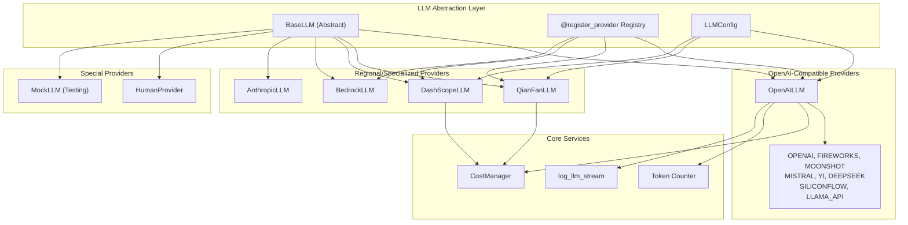
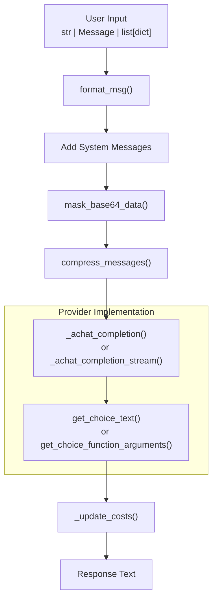

<!-- source: DeepWiki mcp.deepwiki.com · repo FoundationAgents/MetaGPT · page 3 LLM Provider Integration · fetched 2026-10-30 -->

# LLM Integration

<details>
<summary>Relevant source files</summary>

The following files were used as context for generating this wiki page:

- [.gitignore](.gitignore)
- [MANIFEST.in](MANIFEST.in)
- [metagpt/llm.py](metagpt/llm.py)
- [metagpt/provider/base_llm.py](metagpt/provider/base_llm.py)
- [metagpt/provider/dashscope_api.py](metagpt/provider/dashscope_api.py)
- [metagpt/provider/human_provider.py](metagpt/provider/human_provider.py)
- [metagpt/provider/openai_api.py](metagpt/provider/openai_api.py)
- [metagpt/provider/qianfan_api.py](metagpt/provider/qianfan_api.py)
- [requirements.txt](requirements.txt)
- [setup.py](setup.py)
- [tests/metagpt/provider/mock_llm_config.py](tests/metagpt/provider/mock_llm_config.py)
- [tests/metagpt/provider/req_resp_const.py](tests/metagpt/provider/req_resp_const.py)
- [tests/metagpt/provider/test_base_llm.py](tests/metagpt/provider/test_base_llm.py)
- [tests/metagpt/provider/test_bedrock_api.py](tests/metagpt/provider/test_bedrock_api.py)
- [tests/metagpt/provider/test_openai.py](tests/metagpt/provider/test_openai.py)

</details>


The LLM Integration system provides a unified abstraction layer for interacting with multiple Large Language Model providers within MetaGPT. This system enables seamless switching between different LLM services (OpenAI, Anthropic, Bedrock, etc.) while maintaining consistent interfaces for chat completion, token management, cost tracking, and streaming responses.

This document covers the core LLM abstraction layer and provider implementations. For specific role-based LLM usage patterns, see [Software Development Roles](#5). For token management and cost control details, see [Token Management and Cost Control](#3.2). For configuration of LLM providers, see [Configuration System](#1.2).

## Core LLM Architecture

The LLM integration system is built around the `BaseLLM` abstract class that defines standard interfaces, with concrete provider implementations registered through a decorator-based registry system.

### LLM Provider Architecture



Sources: [metagpt/provider/base_llm.py:35-413](), [metagpt/provider/openai_api.py:43-57](), [metagpt/provider/qianfan_api.py:23-24](), [metagpt/provider/dashscope_api.py:156-157]()

## BaseLLM Abstract Interface

The `BaseLLM` class defines the core interface that all LLM providers must implement:

### Core Abstract Methods

| Method | Purpose | Return Type |
|--------|---------|-------------|
| `acompletion()` | Standard chat completion interface | `ChatCompletion` or provider-specific |
| `_achat_completion()` | Internal completion implementation | Provider-specific response |
| `_achat_completion_stream()` | Streaming completion implementation | `str` |

### Standard Interface Methods

The base class provides concrete implementations that delegate to abstract methods:

- **`aask()`** - High-level question interface with system prompts and message formatting
- **`aask_batch()`** - Sequential questioning with conversation context
- **`aask_code()`** - Function calling interface for code generation
- **`acompletion_text()`** - Text-only completion with retry logic

Sources: [metagpt/provider/base_llm.py:179-264]()

### Message Processing Pipeline



Sources: [metagpt/provider/base_llm.py:94-116](), [metagpt/provider/base_llm.py:147-177](), [metagpt/provider/base_llm.py:340-412]()

## Provider Registration System

The system uses a decorator-based registry for automatic provider discovery and instantiation:

```python
@register_provider([LLMType.OPENAI, LLMType.FIREWORKS, ...])
class OpenAILLM(BaseLLM):
    # Implementation
```

The `@register_provider` decorator maps LLM types to their implementing classes, enabling dynamic provider selection based on configuration.

Sources: [metagpt/provider/openai_api.py:43-57](), [metagpt/provider/llm_provider_registry.py]()

## OpenAI-Compatible Implementation

The `OpenAILLM` class serves as the primary implementation, supporting multiple OpenAI-compatible providers:

### Supported Provider Types
- **OPENAI** - Official OpenAI API
- **FIREWORKS** - Fireworks AI
- **MOONSHOT** - Moonshot AI
- **MISTRAL** - Mistral AI
- **YI** - Yi Models
- **DEEPSEEK** - DeepSeek
- **SILICONFLOW** - SiliconFlow
- **LLAMA_API** - Llama API

### Key Implementation Features

#### Client Configuration
The `OpenAILLM` class handles various configuration scenarios including proxy settings and authentication:

```python
def _make_client_kwargs(self) -> dict:
    kwargs = {"api_key": self.config.api_key, "base_url": self.config.base_url}
    if proxy_params := self._get_proxy_params():
        kwargs["http_client"] = AsyncHttpxClientWrapper(**proxy_params)
    return kwargs
```

#### Streaming Response Handling
The streaming implementation handles different provider response formats and usage reporting patterns:

- **Chunk-based streaming** with usage tracking
- **Provider-specific quirks** (Fireworks usage in chunk, Moonshot usage in choice)
- **Reasoning content extraction** for models like DeepSeek

Sources: [metagpt/provider/openai_api.py:74-91](), [metagpt/provider/openai_api.py:92-136]()

#### Function Calling Support
The implementation provides robust function calling with error handling and argument parsing:

```python
async def aask_code(self, messages: list[dict], timeout: int = USE_CONFIG_TIMEOUT, **kwargs) -> dict:
    if "tools" not in kwargs:
        configs = {"tools": [{"type": "function", "function": GENERAL_FUNCTION_SCHEMA}]}
        kwargs.update(configs)
    rsp = await self._achat_completion_function(messages, **kwargs)
    return self.get_choice_function_arguments(rsp)
```

Sources: [metagpt/provider/openai_api.py:189-227]()

## Message Formatting and Validation

The system provides comprehensive message formatting that handles different input types and multimodal content:

### Supported Input Types
- **String messages** - Converted to user messages
- **Message objects** - MetaGPT Message schema with metadata
- **Dict messages** - Raw OpenAI format
- **Mixed lists** - Combinations of the above

### Multimodal Support
For vision-capable models, the system automatically formats image inputs:

```python
def _user_msg_with_imgs(self, msg: str, images: Optional[Union[str, list[str]]]):
    content = [{"type": "text", "text": msg}]
    for image in images:
        url = image if image.startswith("http") else f"data:image/jpeg;base64,{image}"
        content.append({"type": "image_url", "image_url": {"url": url}})
    return {"role": "user", "content": content}
```

Sources: [metagpt/provider/base_llm.py:71-83](), [metagpt/provider/base_llm.py:91-92]()

## Message Compression and Context Management

The system includes sophisticated message compression to handle context length limits:

### Compression Strategies
- **`NO_COMPRESS`** - No compression applied
- **`POST_CUT_BY_TOKEN`** - Keep latest messages within token limit
- **`POST_CUT_BY_MSG`** - Keep latest complete messages
- **`PRE_CUT_BY_TOKEN`** - Keep earliest messages within token limit
- **`PRE_CUT_BY_MSG`** - Keep earliest complete messages

The compression system preserves system messages and intelligently truncates user/assistant message history based on token counts.

Sources: [metagpt/provider/base_llm.py:340-412]()

## Error Handling and Retry Logic

The LLM integration includes comprehensive error handling:

### Retry Configuration
```python
@retry(
    wait=wait_random_exponential(min=1, max=60),
    stop=stop_after_attempt(6),
    after=after_log(logger, logger.level("WARNING").name),
    retry=retry_if_exception_type(APIConnectionError),
    retry_error_callback=log_and_reraise,
)
```

### Exception Handling
- **Connection errors** - Automatic retry with exponential backoff
- **JSON parsing errors** - Fallback argument parsing for function calls
- **Token limit errors** - Context compression and truncation
- **Usage calculation failures** - Graceful degradation with warnings

Sources: [metagpt/provider/openai_api.py:165-171](), [metagpt/provider/openai_api.py:245-251]()

## Regional Provider Implementations

### QianFan (Baidu)
Supports ERNIE models with system prompt capability detection and environment-based authentication:

```python
support_system_pairs = [
    ("ERNIE-Bot-4", "completions_pro"),
    ("ERNIE-Bot-8k", "ernie_bot_8k"),
    ("ERNIE-Bot", "completions"),
    ("ERNIE-Bot-turbo", "eb-instant"),
]
```

### DashScope (Alibaba)
Handles Qwen and other models with specific message formatting and streaming support.

### Bedrock (AWS)
Provides unified interface for multiple foundation models including Anthropic Claude, Meta Llama, and others.

Sources: [metagpt/provider/qianfan_api.py:57-70](), [metagpt/provider/dashscope_api.py:171-180]()

## Human-in-the-Loop Integration

The `HumanProvider` enables human participation in the LLM workflow:

```python
def ask(self, msg: str, timeout=USE_CONFIG_TIMEOUT) -> str:
    logger.info("It's your turn, please type in your response...")
    rsp = input(msg)
    if rsp in ["exit", "quit"]:
        exit()
    return rsp
```

This allows replacing any LLM with human input for debugging, evaluation, or interactive workflows.

Sources: [metagpt/provider/human_provider.py:23-28]()

---

